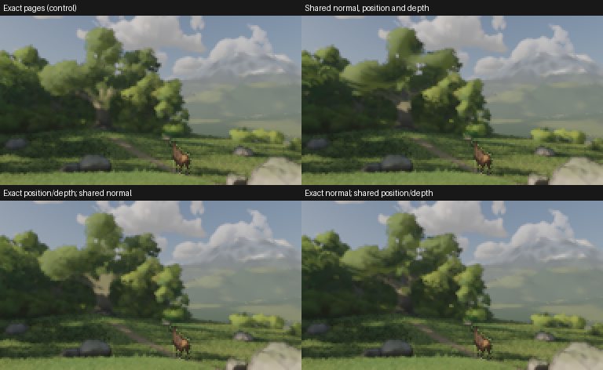

# Shared source-volume appearance: retire the tested projection

**Decision: retire all three tested projections.** The previously qualified exact
BC pages remain active. There is no new rendering win in this block. A shared 3D
field saves some steady allocation but loses view-conditioned lighting detail;
neither targeted follow-up recovers it. G1–G7 and frozen models are unchanged.

Parent 660c5bef71957f0e6b7a8a2fbf593c98d4b34bc4, Wrela 0.9.0/compiler
de9b81e52a7747870dfbd5223cb8aeb41e584d23. Solo Pop!_OS, Ryzen 5 5500U,
AMD RADV RENOIR 1002:164c, Mesa 26.1.6, Chrome 154.0.8037.57. No power/thermal lock.
One GPU queue, one build per multi-capture batch, CPU scoring afterward. Each
capture still initializes scene state; this is not a claim of persistent warmed
asset reuse across all images.

## What was tested

The [retained conventional control](neural-sparse-appearance.md) deduplicates three
BC planes: colour/coverage, normal, and toward/depth. Its actual impostor allocation
is 15,728,640 bytes. Both control and candidates retain the same source-generated
geometry, visibility/sorting data, near-leaf atlas/support and 24³ density/normal/depth
volumes. Both have the same useful source information.

Initial candidate: keep the BC7 colour and coverage pages, but replace both BC5
attribute planes with the existing 12-step volume projection. It chooses a surface
position, normal and crown depth from source density. Exact colour-page deduplication
allocates 7,340,032 bytes. Every retained compressed word is verified before activation;
the ordinary full atlases remain live while preparing and are released afterward.

Follow-up 1: retain exact view-local toward/depth and derive only the normal from
the shared volume at that surface. Follow-up 2: retain exact view-local normal and
project only position/depth. Each allocates 11,534,336 impostor bytes. No fitting,
new network, latent data or privileged reference input is involved. Source edits
would use the existing rebuild path; a new authored-edit replay was not warranted
after the decisive quality failures. Startup and per-frame updates are included
in the measured profiles; broad edit/G7 behavior is not claimed.

## The original quality check was insufficient

The ordinary 192×108 capture against the completed 16k/65k/independent 65k references
barely changed: no pixel differed by more than 2/255 in the fixed displayed-linear
view. All twelve whole-image comparisons stayed near ratios 1.0 and 0 dB delta. Even
a crop over the distant crowns stayed near identity.

But the actual 1080p output changed 11,919 pixels by more than two display-byte
levels, maximum 48 levels. The whole-image mean was only 0.04669 levels, so background
and unaffected geometry could hide the local error. The smaller reference
resolution changes pixel footprints and the contribution of the affected crowns.
This demonstrates weak sensitivity to the new shader; the respective contribution
of LOD selection, fading and filtering was not counted. The volume transition is
distance-based in lod::place, so resolution alone does not prove a switch to volumes.
That check could not decide the new impostor shader's viability.

This demonstrated uncertainty justified **one focused reference case**. It keeps
the existing opening camera, source population, lighting and production renderer,
but pins both methods to impostors (cards range 0.001 m, impostors range 1e9 m).
The existing phase64 production quadrature is unchanged: 256 samples, 1024 samples,
and an independent 1024-sample repeat on the exact-page control. No transport model
or new reference algorithm was introduced. The diagnostic changes 4,207 pixels by
more than 2/255 relative to ordinary LOD, confirming that it exercises a different
representation. It is an architecture stress case, not the normal production LOD.
It deliberately includes crowns where the ordinary renderer would choose cards.
Thus it rejects the tested projection as a general G4 representation; it does not
prove that every normal distant-only operating point fails. The actual 1080p
production image has not been compared with an converged 1080p control reference.
The shortest experiment for that narrower claim would capture the unchanged control
and retained candidate at native/2× 1080p with the same completed quadrature algorithm,
checking convergence before scoring. We do not pursue that narrower qualification
after the broad failure and two allowed optimization follow-ups.

The conventional reference's coarse/fine FLIP difference is 0.012381 and its
independent-repeat difference 0.004949; corresponding LPIPS 0.000340/0.0000835 and
PSNR 50.73/56.27 dB. This is weaker convergence than the completed main reference.
The failures below persist against all three reference captures and are large
enough to reject these prototypes without more reference work. These references
are production-renderer quadrature, not independently converged light transport.

## Rendered quality when the changed shader is exercised

Relative to exact-page temporal output, using the focused control's 1024-sample
reference. Positive FLIP/LPIPS changes and negative PSNR changes are worse.

| Candidate | Reconstruction | FLIP change | LPIPS change | PSNR delta, dB |
|---|---:|---:|---:|---:|
| Shared normal, position and depth | 1× | +45.57% | +45.77% | -5.337 |
| Shared normal, position and depth | 2× | +29.97% | +11.99% | -2.612 |
| Shared normal, position and depth | 3× | +17.49% | +11.34% | -1.397 |
| Shared normal, position and depth | 4× | +11.57% | +6.14% | -0.879 |
| Exact position/depth; shared normal | 1× | +15.86% | +22.29% | -1.850 |
| Exact position/depth; shared normal | 2× | +10.01% | +7.03% | -0.781 |
| Exact position/depth; shared normal | 3× | +5.51% | +6.73% | -0.390 |
| Exact position/depth; shared normal | 4× | +3.50% | +3.54% | -0.249 |
| Exact normal; shared position/depth | 1× | +35.07% | +27.68% | -4.028 |
| Exact normal; shared position/depth | 2× | +23.79% | +7.34% | -1.805 |
| Exact normal; shared position/depth | 3× | +13.47% | +7.83% | -0.900 |
| Exact normal; shared position/depth | 4× | +8.88% | +4.88% | -0.575 |

All three fail the native quality tolerances against all three reference captures.
The additional whole-width crown band (rows 0–87) does not rescue any candidate.
For example, the initial native crown-band FLIP/LPIPS rise about 60%, with 6.26 dB
less PSNR. Keeping exact position/depth still loses 2.32 dB in that band.
The exact colour/coverage payload and prepass remain; shading errors at visible
edges still count. Alpha equality and a contrast band are not independent semantic
silhouette truth, and no G3 motion qualification is implied.

The figure uses the native temporal outputs. It applies the existing nonnegative
Reinhard exposure 1 view followed by sRGB, with no per-image normalization. Captures
and metrics are preserved at their original resolution.

## Complete cost and memory

Fresh 1920×1080 production profiles, internal 2× scale, 600 warmup / 60 measured frames.
This is the ordinary production scene for runtime/residency; the focused case above
is the shading stress test. We do not present ordinary timing as focused-case timing.
All 660 frame timestamps and CPU phases are retained, including source preparation,
wood, sorting/visibility, per-frame updates, shading, reconstruction and compositing.

| Method | Full GPU median / p95, ms | Requested live / peak, bytes | Observed DRM VRAM / GTT, bytes | Whole-browser PSS, bytes |
|---|---:|---:|---:|---:|
| Exact three-plane pages | 24.93468 / 26.51060 | 383,312,696 / 578,009,512 | 535,302,144 / 20,475,904 | 867,003,392 |
| Shared normal, position and depth | 25.07352 / 26.71420 | 374,924,088 / 578,009,512 | 526,848,000 / 20,475,904 | 866,615,296 |
| Exact position/depth; shared normal | 24.92244 / 26.46892 | 379,118,392 / 578,009,512 | 531,107,840 / 20,574,208 | 870,597,632 |
| Exact normal; shared position/depth | 25.02104 / 26.73352 | 379,118,392 / 578,009,512 | 531,042,304 / 20,475,904 | 865,796,096 |

The initial candidate saves 8,388,608 requested live bytes; each follow-up saves 4,194,304.
All have the same 578,009,512-byte startup allocation peak. Physical figures are
deduplicated whole-client snapshots, not physical peaks or per-asset attribution.
These UMA views overlap and must not be summed. BrowserPSS does not show a clear
saving. Single-run frame-time differences are not speedup evidence. There is no
reason to run more timing pairs after the quality failure.

## Decision, verification and next architecture bet

The preliminary ordinary-view comparison finished in10.66minutes. The first
representation-exercising assessment finished in24.52minutes, and the explicit
decision in39.22minutes, within two hours. Exactly two optimization follow-ups
were used. No training steps occurred. No G4 threshold was relaxed.

Retire this use of the current density-weighted volume as a replacement for visible
surface attributes. The experiments show that both the normal and the position/depth
bundle matter; they do not separately isolate position from depth, or disprove every
higher-resolution/angular/learned field. The current volume already has a legitimate
role in low-frequency crown lighting; that does not make it an adequate direct-surface
attribute representation.

All candidate source, generated shaders/builds, raw images, allocation/DRM/PSS records,
the focused fixture and its reference/scoring scripts are preserved. The three selected
compressed-payload verifiers passed. Compile/format checks cover the changed code;
failed experiments were restored byte-for-byte to the parent, including the diagnostic
fixture. Broad unchanged tests were not repeated. No rendering change remains from
this block; the qualified 2.4× exact-page optimization remains.

The next G4 bet must preserve **which source leaf is visible**, rather than replace
its correlated normal, position and depth with marginal averages. Test compact
visibility references into source-leaf records shared across views, with the full
cost of finding that leaf charged. Inspect the prior source-ID/aggregate-material
failures first; do not simply repeat that representation. A conventional decoder
must receive the same records and source information as any learned decoder.

Evidence: build/neural-evidence/appearance-projection-v1 on Pop!_OS. Frozen files,
the prior exact-page evidence and completed references are linked in the manifest.
Manifest SHA-256: `a0a4f91d5be78bca64fb47020d083244fc2d17d46d01f1c17011a653b453d436`.
