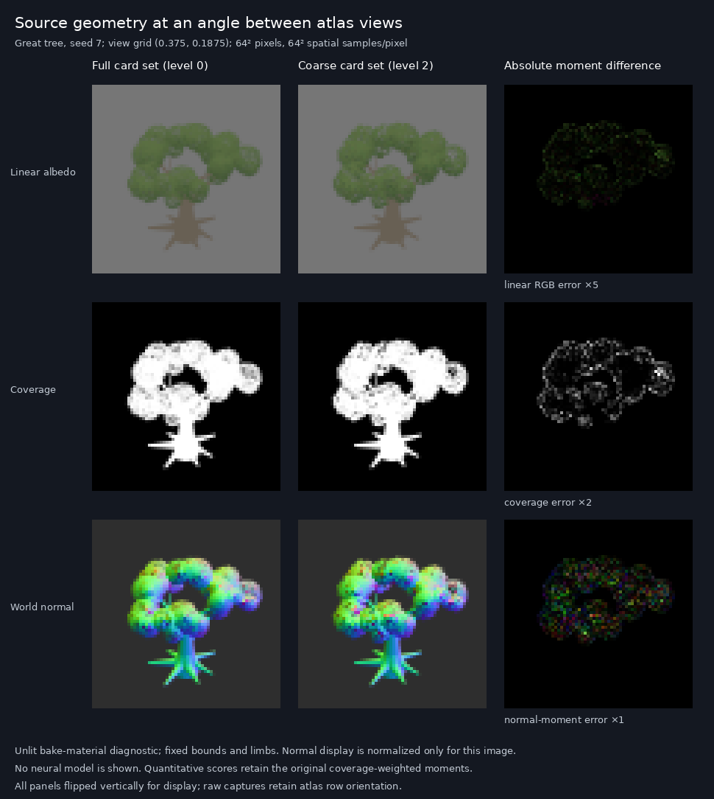
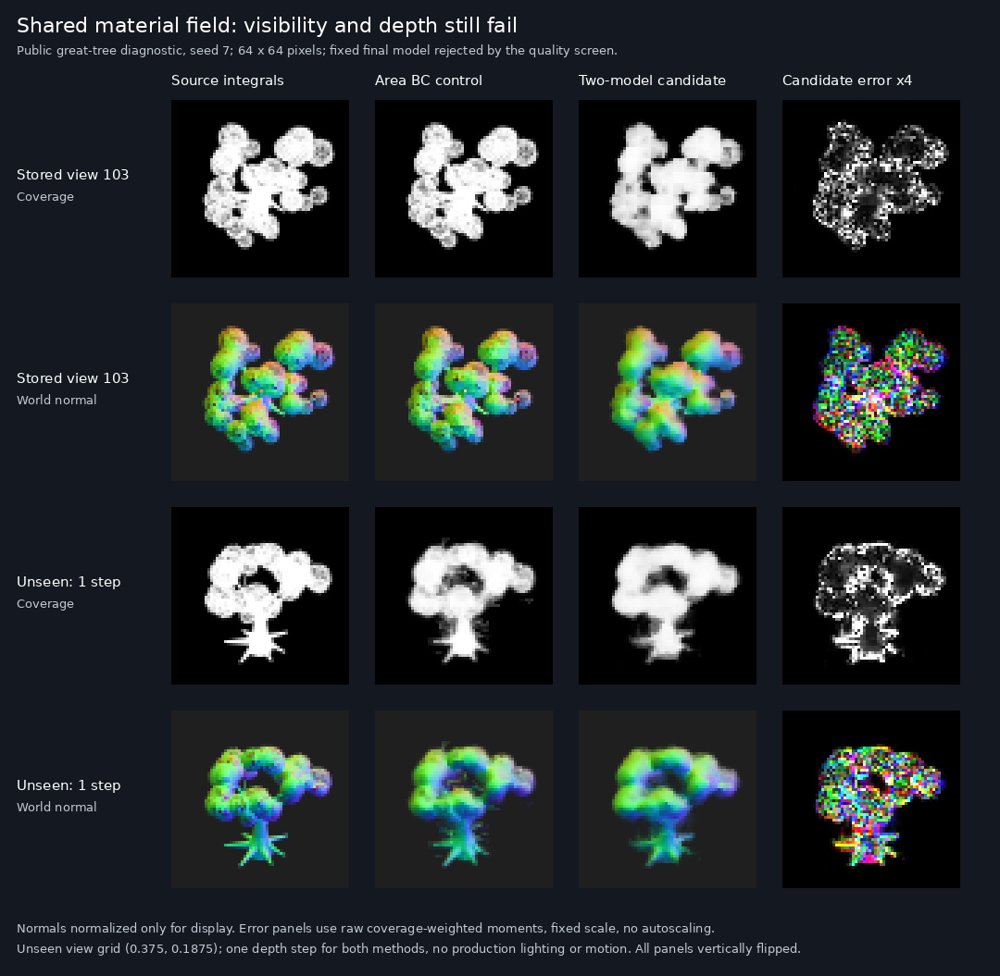
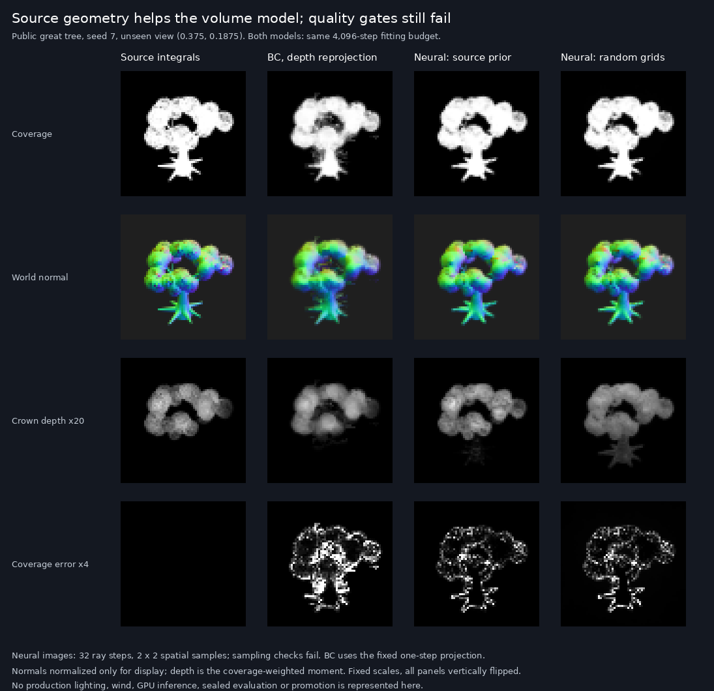
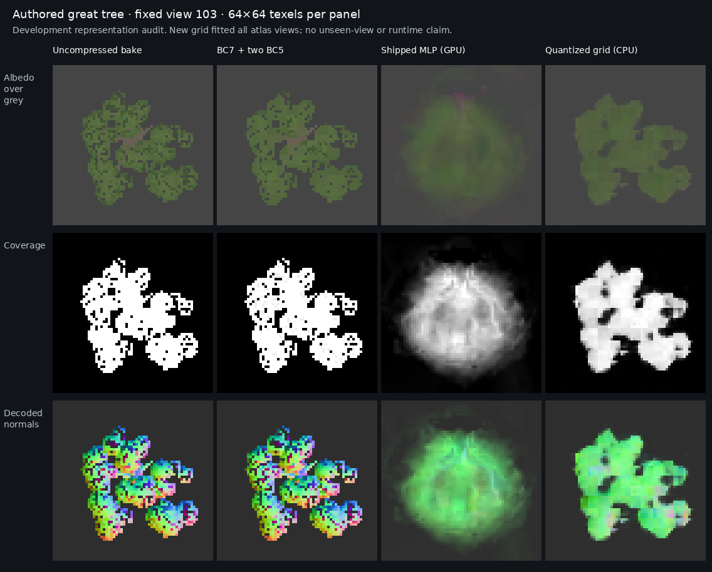

# Neural appearance: authored foliage

This G4/G7 development track starts from actual authored foliage, after the
sample-kernel experiments. All measurements run on the Pop!_OS AMD machine.
No frontier gate is passed or changed.

## What the current representation loses

The shipped great-tree model takes view coordinates and local texel coordinates,
plus eight features from one 32×32 grid shared by all 256 views. Its grid cannot
store independent fine detail for each view; the decoder must express those
differences from its two view inputs. This is an architectural observation,
not proof that the grid alone causes its errors.

`studio/appearance` exports the exact existing bake, actual GPU-decoded BC7/BC5
atlas, actual GPU-decoded shipped network, compressed blocks and model bytes.
The target is the existing uncompressed 64×64-per-view bake. It is **not**
independently converged source geometry/light-transport truth. The current
mode-6 BC7 encoder is an available control, not a demonstrated best encoder.
The source includes normals, toward and depth; toward is a view-space position,
not directional transmission.

The instrument's CPU verifier reconstructs BC7 bits, BC5 endpoint/index data and
the half network independently. It reports per-view coverage, albedo, normal,
toward and depth errors, rather than allowing one colour score to hide failures.
No production rendering code or shipped weights change.

## Primary-source guidance

[Vaidyanathan et al., Random-Access Neural Compression of Material Textures
(SIGGRAPH 2023, sections 4.1–4.5)](https://research.nvidia.com/labs/rtr/neural_texture_compression/assets/ntc_small_size.pdf)
jointly optimize material-specific quantized feature grids and a decoder.
Their finer grid concatenates four neighbouring feature vectors, while the
coarser grid uses bilinear interpolation. Positional phase helps reconstruct
detail beyond the grid resolution. These are useful hypotheses for our
multi-view attribute atlas; their texture results do not prove foliage
silhouette quality, unseen-view quality or performance on this AMD browser.

[Belcour and Benyoub, Hardware Accelerated Neural Block Texture Compression
with Cooperative Vectors (HPG 2025, sections 3–4)](https://arxiv.org/html/2506.06040v1)
use block-compressed latent textures and organize inference by tiles/material.
Their reported runtime uses hardware matrix acceleration on different GPUs;
it cannot be transferred to this adapter. Grouping work and using hardware
texture decoding remain ideas to measure. We do not copy their code or weights.

[Khronos Data Format Specification v1.3.1, section 19](https://registry.khronos.org/DataFormat/specs/1.3/dataformat.1.3.html)
describes BC4/BC5 endpoints and interpolation indices. Our independent ideal
decoder and the actual AMD decoder differ in interpolated values. An exhaustive
controlled probe identifies a six-bit-weight replay for this device/environment;
that observation is not asserted to be a portable format definition or a
conformance judgment.

## First compression trial

The external `appearance-grid-v1` experiment gives each of the 256 views a
16×16×2 fine grid and an 8×8×2 coarse grid. Fine corners are concatenated,
coarse features interpolated, and four local phase values and two view
coordinates feed a 16→32→32→8 ReLU MLP. Latents use fifteen signed levels in
four-bit storage; weights are quantized to half during fitting. This is our
small architecture inspired by the feature-pyramid idea, not a reproduction
of the paper.

The fixed 4,096-step run fits all source-atlas texels. Its 85,648-byte payload
includes 81,920 latent bytes and 3,728 weight bytes. Caches, scratch, metadata
and conventional fallback would be additional. No resident-memory reduction
or GPU/runtime benefit is claimed from payload size alone.

This trial uses all 256 views during fitting, unlike the shipped model's
every-sixteenth-view holdout. Its atlas reconstruction is an asset-compression
diagnostic, not a fair unseen-view comparison. The original G4 requirement for
unseen views, lights, individuals, footprints and motion still applies.

[The measured record](neural-rendering-progress.md#authored-foliage-audits-and-a-rejected-quantized-grid)
contains results and failures. The trial improves the training reconstruction
but still loses coverage and grossly mispredicts normals. It is rejected.
A normal/depth error cannot be repaired by reporting colour PSNR alone.

## Source material captures between stored views

`studio/appearance` now has a `source` command:

```bash
wrela tool appearance --timeout 900 --blob-budget 3221225472 -- source 7 0.5 0.4375 64 0 64
```

Append `--pixel X Y` to also export that pixel's individual, unquantized
spatial samples for an independent accumulator check.

The positional arguments are seed, hemi-octahedral view coordinates, output
size, card level and spatial grid width. This example renders the full card
set at an angle between atlas views, at 4096×4096, then box-averages 64×64
samples into each of the 64×64 output pixels. Level 2 selects the bake's
quarter-density card set with twice the card width. Both levels use the
same bounds, material parameters, limbs and camera.

The source is cooked directly from the authored plant and rerasterized. It
does not read either the compressed atlas or neural predictions. It retains
the existing finite leaf-pattern texture and the bake's hard leaf cut,
crown normal, flat bark and quantized material targets. This isolates
geometry, view sampling and representation errors. It is **not** the complete
production leaf/bark shader or a converged light-transport reference. Wind,
lighting, temporal filtering, lower-hemisphere views and the full G4 footprint
range remain untested here.

`source.f32` contains twelve little-endian floats per pixel: linear albedo
times coverage (RGB), coverage, decoded world-normal times coverage (XYZ),
normalized toward times coverage, normalized crown depth times coverage,
and three reserved zeros. Normals are decoded before integration.
The final accumulator rounds each component to Q20, with nearest ties toward
positive infinity (at most 2^-21 absolute error per sample), and adds it
exactly using two integer words. It converts the final signed magnitude to
f32 and divides by the sample count. This precision is part of the reference
definition, not an unreported model error. Empty samples contribute zero to
every moment. Averaged normals are deliberately
not normalized: their length carries the variation within a pixel. These
moments cannot reproduce arbitrary nonlinear shading after averaging.

The fixed public diagnostic uses four atlas directions and four directions
between them, two card-placement seeds, both card levels, and 8×8, 16×16
and 32×32 spatial grids. The convergence limits were recorded before
capture. The initial grids did not pass; larger grids use the same limits.
A naive f32 accumulator also failed a physical normal-length invariant.
A compensated-summation trial retained its arithmetic in the generated WGSL
but returned exactly the naive results on this environment. The cause of
the unchanged GPU output is not established. The exact integer
accumulator is independently checked against CPU int64 sums and f64 means;
the failed trials and their source snapshots remain in the evidence.

A matching atlas-direction control checks the material adapter;
a high-resolution direct export independently checks the GPU's box reduction.
Repeated captures and wrong-orientation/wrong-view controls check the data
path. Results are recorded in `neural-rendering-progress.md`; an unconverged
case is retained as such rather than relabeled as truth.

The repaired 32×32→64×64 check passes all 32 fixed seed/view/level cases.
The coverage MAE limit is 0.001, coverage p99 absolute-error limit 0.01,
linear-albedo moment MAE limit 0.0005 and normal-vector moment MAE limit
0.002. Passing this finite sampling check establishes a useful material
diagnostic at this footprint; it does not establish general convergence of
production rendering.



## Batched source corpus and two cooperating models

Capture a fixed range of hemisphere views with one build/load:

```bash
wrela tool appearance --timeout 1800 --blob-budget 3221225472 -- source-grid 7 64 0 64 0 256 --bc
```

The arguments are seed, output size, card level, spatial grid, first view
and count. View i uses ((i mod 16 + 0.5)/16, (floor(i/16) + 0.5)/16).
Each view has its own directory. Optional `--bc` requires a size divisible
by four and exports actual GPU-decoded material moments and raw compressed
blocks. `area-bc.txt` identifies the layout: BC7 colour holds sqrt conditional
linear albedo times coverage and coverage; BC7 geometry holds mapped mean
normal XYZ and one; BC5 holds conditional toward and crown depth. Decode
caps mean-normal length at one without forcing unit length.

The full 256-view source corpus passes the same 32²→64² convergence checks.
A fixed two-model trial learns view-local coverage/toward and a shared 3D
material field conditioned on reconstructed position and viewing direction.
Quantized latents plus half weights occupy 161,522 bytes before runtime
overhead. The independently replayed model remains rejected: it loses to
the 3 MiB source-integrated conventional control. Source, fitting, model
bytes and all comparisons are in the
[measured record](neural-rendering-progress.md#source-integrated-visibility-and-shared-material-field-trial).

Offline depth reprojection helps both representations at unseen camera
directions. Moving conventional toward into an independent BC5 channel
also improves the control without increasing its payload. After one
reprojection step the neural trial still has 41% higher coverage error and
87% higher crown-depth error. Public validation on four between-view
directions and a second placement seed is useful for development, not a
sealed G4 or G7 result. No production model or shader changes.



## Source-initialized volume field

Export the authored geometry and existing cooked leaf volume:

```bash
wrela tool appearance --timeout 900 --blob-budget 3221225472 -- geometry 7
```

The capture includes canonical clump/limb parameters, actual GPU card
attributes, independently generated CPU card centres, the actual 24³ half
volume and its unquantized equation output. `geometry.txt` specifies each
layout. A separate seed-consistency check prevents mixing placements across
export modes. This instrument does not produce a new rendering reference.

[Mildenhall et al., NeRF (ECCV 2020), author method description](https://www.matthewtancik.com/nerf)
uses a neural volumetric function queried along camera rays and optimized
through volume rendering.
[Fridovich-Keil, Yu et al., Plenoxels (CVPR 2022), author pipeline](https://alexyu.net/plenoxels/)
also optimizes explicit voxel coefficients through trilinear interpolation
and differentiable volume rendering, without requiring a neural network.
These establish useful methods, not novelty or speed claims for our trial.
No external implementation, data or weights are imported.

Our experiment learns quantized 3D features and a small network that emits
extinction and material attributes, then integrates coverage-weighted moments.
It initializes features from the existing source-generated volume and an
authored-limb capsule proxy. Both coverage and toward follow the same ray
weights. Viewing direction can affect density as well as material, since the
source cards themselves face the camera. This is a material diagnostic, not
a reproduction of NeRF/Plenoxels or a relightable production renderer.

A matched trained ablation preserves initial network weights, material
constants, data stream, fitting steps and quantization, changing only the
feature-grid initialization. On four public unseen camera directions, the
source prior lowers coverage error by 10.24% and crown-depth error by 42.77%
versus random grids. Against the stronger BC control, coverage improves
36.72% and normal error improves 31.87%, but crown depth is 77.95% worse.
Fitted-view errors and integration-sampling checks also fail. Both models
remain rejected; one asset and one training pair cannot establish a general
advantage.

[The measured record](neural-rendering-progress.md#source-initialized-neural-volume-and-matched-training-ablation)
retains all cases, failures, sampling variants and independent replays.



## Depth repair and source teacher

Fitting only the existing 33 depth-output parameters improves crown-depth
error by 4.32% on the four public unseen directions; all other material
outputs stay byte identical. Depth still loses to BC by 70.26%, so the model
remains rejected. Raising sampling to 256 ray steps and 8×8 spatial samples
passes the fixed finite-increment integration checks in all sixteen public
cases, but requires 16,384 field queries per output pixel. No runtime or
temporal-quality claim follows.

The authored crown field independently reproduces every exported leaf card's
depth across two placement seeds within 6.392e-7 metres. A source-sampled 32³
u8 scalar grid has about 3.6 cm mean error at those card centres, versus
19–24 cm for the learned heads. This is useful teacher evidence, not an image
result: billboard attributes and wood still need proper handling.

[The complete measured record](neural-rendering-progress.md#isolated-crown-depth-repair-and-dense-integration-audit)
retains the frozen plans, models, failed screens, independent controls and
all dense outputs.


## Separate source material model

An independent 32³ u8 crown-depth grid, initialized from the authored field
and then fitted, lowers depth error 56.97% relative to the repaired neural
head on the four public unseen directions. It beats the fixed BC control
by 26.74% on that mean; all five diagnostics beat BC in each of those four
views. Even the unfitted source grid improves mean depth error, showing
that directly supplying source information matters in this experiment.

The combined packed model occupies 174,520 bytes before scratch, caches,
fallbacks and metadata. All non-depth outputs remain unchanged. Stored-view
coverage is still 5.02× BC error, and several other stored-view diagnostics
also fail. **The model remains rejected**, with no production, temporal,
runtime, sealed or G1–G7 success claim.

[The complete scalar-field record](neural-rendering-progress.md#independent-source-material-field-beside-learned-visibility)
includes the unfitted control, both packed models, source and decoder audits,
all 256 stored views and every public dense-integration case.


## Source primitive visibility controls

Source-derived, unfitted ellipses and Gaussians now provide stronger
complete-tree material controls than the current volume. They retain all
26,560 cards and 7,392 wood triangles. Both pass all five material screens
on the four stored and four off-grid public directions after independent
source, wood-raster and numerical-integration checks. Full-count ellipse
coverage error is 61.05% below BC on the stored mean and
95.16% below it off-grid. This is an uncompressed conventional
control, with no learned advantage or G1–G7 success.

[The complete source primitive record](neural-source-primitives.md)
includes the new `primitives SEED` and `source --part` commands, both kernels,
all sampling failures, half/quarter/eighth count controls, and native
hard-cut LOD comparisons. Source-derived positions, areas and materials
give useful information. All six reduced-count controls fail the joint
stored-view quality screen despite converged sampling.

## Compact fitted source primitives

Fitting an explicit 3,320-Gaussian representation at a fixed 107,680-byte
packed capacity reduces mean coverage error by 48.98% across all
256 stored views relative to its unfitted initialization. It passes all
five public off-grid material screens, but stored coverage is still
3.58× BC and four stored-view screens fail. The candidate is rejected.

[The packed model, fitting procedure and independent checks](neural-source-primitives.md#fitted-aggregation-at-fixed-packed-capacity)
retain both models, all 256 nominal images, all public sampling checks and
the failed quality ratios. It is a learned explicit representation, not
an MLP decoder; packed size and CPU fitting time establish neither runtime
cost nor G4/G7 success.

## Spatial grouping before fitting

A source-only 1,897-group optical model at 107,672 packed bytes improves
all-256-view coverage by 26.95% against the prior 107,680-byte fit,
without image optimization. It preserves projected source statistics,
then uses an explicit overlap approximation. All five off-grid screens
pass; four stored-view screens fail and stored coverage remains
2.62× BC. The model is rejected.

[The matched-budget and matched-count study](neural-source-primitives.md#spatial-aggregation-of-every-source-card)
retains both opacity kernels, every stored view, public sampling checks
and all failures. Adding 74.01% more packed data improves optical coverage
only 1.23%; larger capacity alone is not an adequate next step.

## Optical calibration control

[A fixed global calibration](neural-source-primitives.md#global-optical-calibration-before-a-local-fit)
selects 1.15× optical density and unchanged shape at the same 107,672-byte
capacity. All-256 coverage MAE becomes
0.006854065, 14.36% below the source optical
model and 37.44% below the older fitted prefix model. Stored coverage
is still 2.24× BC; 2/5 stored screens pass.
The calibrated model remains rejected. This supplies a stronger conventional baseline for a local fit.

## Local optical fitting regression

[The 4,096-step local fit](neural-source-primitives.md#local-optical-fit-regression-against-calibration)
passes decoder and smooth-gradient controls but worsens all five stored
and off-grid mean errors against calibration. Stored coverage rises
13.73% to 0.007795158; only one stored screen
passes. Dense weighted MSE also worsens. Retain calibration as the best
model at this budget; reject the new fit.

A fixed noisy-loss diagnostic finds both self and independent-pair losses
worsen, with only a small variance-penalty reduction. That evidence does
not support blaming sampling variance alone.

## Smaller-step optical fitting

[A controlled tenfold step reduction](neural-source-primitives.md#controlled-smaller-optimizer-steps)
improves all five stored/off-grid means versus calibration at unchanged
107,672-byte capacity. Stored coverage MAE is
0.006437867: 6.07% below calibration and
17.41% below the original-step fit. Decoder/sampler/loss code and
initial data are verified unchanged.

Retain it as the best development model at this budget. It still has
2.10× BC stored coverage error; only albedo and normals pass the
stored quality screen. Dense weighted MSE improves as well. No promotion.

## Verified longer optical fit

[The fixed continuation](neural-source-primitives.md#fixed-longer-optimization-with-exact-continuation)
reproduces the 4,096-step packed prefix exactly, then continues to 16,384
steps. Saved full optimizer and random states reproduce a subsequent
step exactly. Stored coverage MAE is
0.006235107, 3.15% below the shorter fit,
at unchanged 107,672 packed bytes. Stored coverage remains 2.0377× BC;
2/5 stored and 5/5 off-grid diagnostic screens pass.

Fitting takes 485.724 seconds: the fit alone fails G7's complete
five-minute limit. No renderer promotion or G1–G7 achievement.

## Next decision

Implement the rendered comparison next: shade visible source samples before
integration and compare the conventional representation and packed models
under the same declared lights. Record production-material differences and
then measure actual AMD GPU execution, resident memory and complete pass
cost. Shading already averaged moments cannot serve as reference truth.

The moment-error thresholds remain unchanged development screens, with
their failures retained. G4 acceptance instead requires its original
shaded perceptual, motion, memory and runtime criteria. Passing a moment
screen would not establish G4. Keep all G1–G7 thresholds intact.

Keep fitted-view quality, unseen views and sampling/footprint tests separate.
A small packed payload alone does not meet G4. Complete production materials,
motion, lighting, 8–512-pixel footprints, unseen asset families, whole-pass
AMD measurements and the full G1–G7 validation remain.



Each panel has 64×64 source texels, enlarged with nearest-neighbour scaling.
The last column is a CPU decode of the actual packed trial, independently
checked against the training implementation. It is not a GPU runtime result.
All 256 views, not only this illustration, are scored in the retained record.
