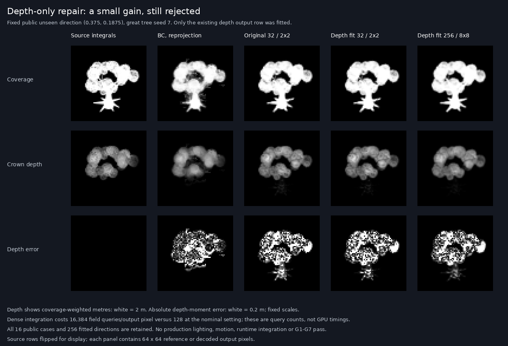
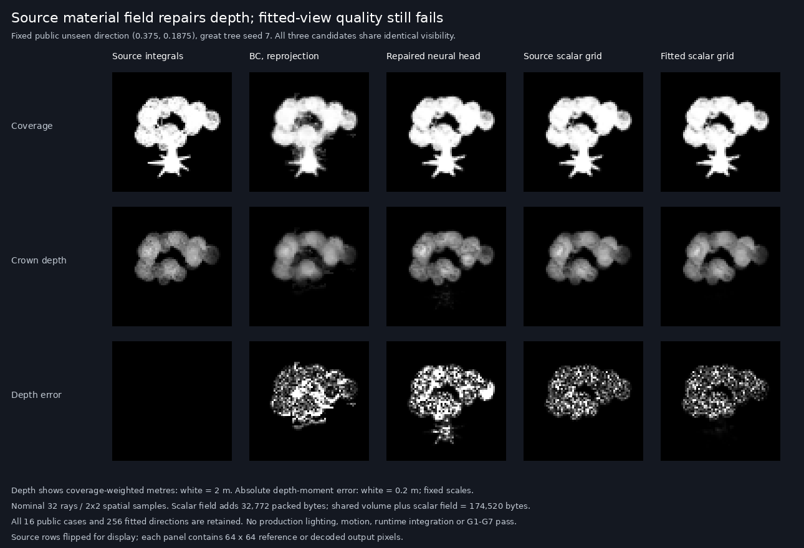

# Neural rendering progress

## Operating constraints

- User authorized autonomous pursuit of `neural-rendering-goals.md` on 2026-10-26.
- AMD Pop!_OS only for builds, training, rendering, and measurements. The Mac is occupied.
- Work alone: no subagents. No paid compute/hardware purchases.
- Remote host: `wrela-popos` over Tailscale SSH.
- Worktree: `/home/ryanwible/worktrees/wrela-neural-frontier`.
- Branch: `codex/neural-rendering-frontier`.
- Source branch: `impl-world-class-v2`, commit `a07cf136494860f20a2590cacf0851e17f41b585`.
- The initial working state also carries the Mac's uncommitted `docs/bench.md`, `wrela.toml`,
  `docs/neural-rendering-goals.md`, and `docs/neural-rendering-research.md` as a snapshot.
- Existing remote checkout and Mac checkout remain on their original branches.
- Pin: Wrela 0.9.0, compiler `de9b81e52a7747870dfbd5223cb8aeb41e584d23`.
- All seven goals are active; none is achieved. Unsupported vendor SDKs and unavailable human
  judgments remain unverified, not successful. Do not claim global leadership without evidence.

## Immediate milestone

Keep the qualified [exact sparse appearance](neural-sparse-appearance.md), source-region
temporal specialization, compact causal source records and packed empty-leaf certificate.
The [shared-volume projection block](neural-appearance-projection.md) is retired: its
8.39 MB or 4.19 MB steady savings lose visible shading detail and do not reduce startup peak.
The original 192×108 production shot barely exposed the changed impostor shader;
a focused same-source LOD test exposed the failure. No new rendering win or G1–G7 pass.

The next G4 representation must retain visible-leaf identity and its correlated
normal, surface position and depth. Investigate visibility references into shared
source-leaf records, charging all lookup/preparation/residency costs and giving the
conventional decoder identical inputs. Review the prior source-ID failures first.
Models stay frozen; do not resume material-moment fitting from this result.

## Evidence recorded so far

SSH works. The source commit and uncommitted documents were transferred using an incremental Git
bundle and an explicit four-file archive. The worktree is based on the exact source commit.
`vulkaninfo --summary` reports hardware AMD RADV RENOIR and a separate llvmpipe software adapter;
all GPU evidence must name and use the hardware adapter. The pinned toolchain downloaded and
reported 0.9.0 successfully.

### First implementation checkpoint

- `engine::supersample::Reference` accumulates scene-linear RGB in f32, rejects dimensions and
  scene-moment mismatches, snapshots a float buffer, and resets without retaining old samples.
  Alpha is forced to 1 because scene alpha holds material tags. This guard requires the caller
  to supply an honest moment; it does not freeze arbitrary scene state automatically.
- `engine/tests/supersample` checks exact analytic edge coverage, radiance above 1, small samples
  following a 4096-valued sample, snapshot isolation, reset and rejected samples. Native GPU and
  Chrome pass. Deliberately clipping RGB to 1 made the intended 4-valued pixel fail; restored
  code passes. The tool's decode/metric test rejects NaN, wrong dimensions and material alpha.
- Found and fixed an existing F12 error: entering reference mode enabled history. The new
  `engine/tests/frame-reference` failed on that behavior, then passed on native and Chrome
  after disabling history. Both original history settings are restored on exit.
- `wrela tool reconstruct -- --width 192 --height 108 --warmup 240 --cells 4` builds the bare
  ground/sky scene and produces raw little-endian RGBA f32 captures, CSV scores and capture
  metadata. Simulation time and camera stay fixed; caches warm independently for each load.
  The reference reads scene HDR before temporal output/develop; candidates read the temporal
  output before develop. Production quality is shared except render scale and history.
- This first smoke run used the Radeon Vulkan driver explicitly through
  `VK_DRIVER_FILES=/usr/share/vulkan/icd.d/radeon_icd.json`. No RTX or Mac work was involved.
  Its raw artifacts, built fixture and SHA-256 provenance are preserved outside tracked source
  in `build/neural-evidence/initial-hdr-192x108-16-64/` on Pop!_OS.

The first 16-versus-64 spatial-sample check had raw RGB MSE 0.0000002828 and diagnostic-view
MSE 0.0000000494. Two separate 64-sample loads were byte-identical. Against the 64-sample mean:

| Existing temporal path | Raw RGB MSE | Fixed-view PSNR dB |
|---|---:|---:|
| 1× | 0.0001343105 | 46.6860 |
| 2× | 0.0007972659 | 38.5476 |
| 3× | 0.0015658517 | 35.5980 |
| 4× | 0.0026618024 | 32.6094 |

Fixed view means `max(x,0)/(1+max(x,0))` at exposure 1, without gamma. These are diagnostic
quality numbers, not timings or FLIP/LPIPS measurements. The initial CSV prints an artificial
300 dB floor for the identical reference; the tool now writes `inf` for exact equality.
The first capture has **no trained model**, moving objects, foliage, external scene, sealed
split or human judgment. Numerical convergence does not prove unbiased lighting. No G1–G7
acceptance gate has been met. This tiny, predominantly sky image is unsuitable as a frontier
training or validation set by itself.

Next: inspect higher-sample convergence, add pinned FLIP evaluation with its viewing conditions,
expand field/detail/motion scenes and data provenance, then train against the reproducible
baseline. Preserve the development/validation/sealed distinction throughout the hill climb.

### Perceptual reference check (same AMD host)

Installed upstream `flip-evaluator==1.7` and `numpy==2.2.6` in a dedicated evaluation environment
outside the source worktree. Evaluation is LDR-FLIP at **67 pixels/degree**, on float RGB after
`max(x,0)/(1+max(x,0))`, `inputsRGB=false`; no PNG quantization or extra gamma. It runs on the
Pop!_OS CPU. The GPU renders every source image. External utility:
`/home/ryanwible/.local/state/wrela-neural-frontier/evaluate_flip.py`. Each `flip.json` embeds its
complete evaluator source, source SHA-256, package versions, image hashes and named conditions.

The 16→64 check's mean FLIP was **0.005671**, and 64→256 was **0.005428**: both exceed the
0.003 reference discrepancy bound implied by a 0.03 candidate mean-error budget. The latter
was dominated by the horizon row (54). Do not mistake the small MSE for perceptual convergence.
The 256→1024 check fell to **0.001369** (upper/lower halves 0.000258/0.002480). Its repeat was
byte-identical. This passes the necessary mean-discrepancy check for this one development view;
independent randomized sample sets, semantic masks and unbiased lighting remain unresolved.

Against the 1024-sample reference, the existing temporal paths scored:

| Scale | Mean FLIP | Pixel p99 FLIP | Fixed-view PSNR dB |
|---|---:|---:|---:|
| 1× | 0.017349 | 0.058823 | 47.9563 |
| 2× | 0.043401 | 0.181581 | 38.6891 |
| 3× | 0.055001 | 0.221766 | 35.5970 |
| 4× | 0.070001 | 0.334024 | 32.5630 |

These are image diagnostics at **192×108**, not 1080p/4K goal scores, confidence intervals or a
ranking against other products. They expose room to improve even before richer field scenes.
The two additional runs, each with its own built fixture and raw data, are:
`build/reconstruct/runs/1793054860-492654431` (64/256) and
`build/reconstruct/runs/1793055065-64207453` (256/1024). The tool now creates a unique timestamped
run directory rather than overwriting outputs. Reproduce with `--cells 8` and `--cells 16`,
respectively, keeping the earlier dimensions and warmup; run the pinned evaluator on that
new directory. The original run's exact source build is retained in its evidence folder.

A second history regression was found: the clearing reapplies its history preference every
frame after handling F12. `Frame::on(History)` now suppresses it throughout reference mode.
The regression test deliberately reapplies history, failed before the guard, and passes in
native and Chrome after it. Entry preferences still restore correctly on exit.

Focused checks pass: HDR accumulation (both hosts), reference mode transitions (both hosts),
float capture decoding/metrics, fixture/tool type checks, changed-file formatting, and workspace
allowlist. Whole-workspace `wrela suite fmt` reports one pre-existing unformatted file:
`examples/clearing/tests/checks/tests.wrela`, untouched by this work. Full suite not run yet;
required before the scope's PR. Inherited `docs/bench.md` edits remain uncommitted and unaltered.

### Rich field scene and independent motion reference

The capture tool now accepts `--scene bare|clearing|edges --shot N`. The shared
`studio/reconstruct/fixture/session.wrela` owns accumulation, while each fixture owns its
simulation state. Refactoring the bare fixture preserved all seven images byte-for-byte
(run `1793055528-841559011` versus the initial evidence). The clearing uses its actual
terrain, trees, stones, grass and field-realized fawn, held at tick 0 without starting its
simulation. It waits for probes, sky and the fawn before capture. Its three shots are the
clearing's existing shots. Production scale also changes its production LOD policy.

The clearing's shot 0 at 192×108, 240 warmup frames, still does **not** have a sufficiently
converged reference. Mean FLIP is 0.019003 for 16→64 spatial samples and 0.009981 for
256→1024. Both exceed 0.003. The latter's reference repeats byte-for-byte, but reproducibility
does not establish accuracy. Its provisional 1×/2×/3×/4× mean FLIP is
0.071734/0.095468/0.141504/0.182689. Do not train against this as certified truth.
Runs: `1793055673-957151421` and `1793056200-382945725`.

The analytic fixture drives the production temporal resolver, neighbourhoods, depth, motion,
jitter and history on moving thin slats over a checkerboard. Eight cases vary thickness,
period, HDR foreground colour and motion, including one stationary case. Its reference is the
exact linear-RGB pixel-area integral; it uses no history or learned predictions. It is a
diagnostic for reconstruction and coverage, not a replacement for diverse real scenes.

Two pure tests check HDR fractional coverage, negative motion and convergence of independent
midpoint quadrature. Deliberately clamping the integral to 1 failed the intended
`1.75`-valued pixel; restored code passes. An external, independently written float64
rectangle-subdivision integrator checked all 18 images in the first dataset, including held-out
cases and three times each. Maximum absolute RGB discrepancy was **0.00002604**. It splits
rectangles at boundaries and sums their constant-colour areas; the GPU uses pulse
antiderivatives/intersections. Audit source, hash and image hashes are in
`build/reconstruct/datasets/rgb-v1/integral-check.json`.

### Measure what a history-weight model can change

`engine::temporal::ReconstructionSample` exports 24 floats per output pixel before blending:
the existing 14 rejector inputs, current/clipped-history RGB, heuristic weight, forced-current
flag, settled cap and material tag. The capture uses the same half-float neighbourhoods as
the shared production resolver. The legacy `found_rows` instead recomputes neighbourhoods in
f32; its inputs can differ slightly. The new export is only dispatched by the instrument.

There is also a target problem in the legacy rejector trainer: it averages already nonlinear,
tamed luma samples for its reference. That is not the result of integrating linear HDR and
applying the view afterward. The new RGB experiment uses the latter. The legacy experiment
and its old claims have not been promoted to this goal's evidence.

Before training, a non-deployable oracle tried 257 current/history weights per pixel against
exact truth, preserving forced-current pixels and the settled cap. Baseline history is fixed.
This measures **one-step** headroom; it is neither a global bound on recurrent models nor
an oracle for FLIP. On four development cases at frame 31, its 4× fixed-view MSE reductions
were 2.29%, 22.48%, 10.79% and 24.54% (cases 0, 3, 5, 7). FLIP actually worsened on cases 0
and 5 despite the improved MSE. A better weight alone cannot be assumed to recover detail.

Oracle evidence: runs `1793056392-812779940`, `1793056869-566910369`,
`1793056873-11561460`, `1793056876-389106667`. Each `oracle.json` embeds the evaluator
source/hash, versions, input hashes and limitations. CPU replay of the captured blend agrees
with the GPU within 0.002 raw RGB in these cases; half-float output accounts for its small
difference. External utility:
`/home/ryanwible/.local/state/wrela-neural-frontier/evaluate_blend_oracle.py`.

### RGB residual experiment v1 — rejected

This is the first newly trained model in this work. Its architecture is 27→32→32→3, with
**2,051 weights**, packed into **4,104 bytes**. Inputs are the captured reconstruction
signals plus relative sample phase and render scale. They contain no scene identity, absolute
position, field parameters, target pixels or future samples. It predicts an RGB residual
in the fixed exposure-1 Reinhard view; inference returns to linear HDR. Forced-current pixels
bypass the learned correction. The decoder and feature construction are shared Wrela code
between trainer and shader.

The split was recorded before training: cases **0, 3, 5, 7** train; **1, 6** validate; frames
**7, 31, 55**, all at 192×108 and all four scales. These are whole cases within one analytic
family, not random-pixel validation, sealed goal clips or external-engine evidence. Cases
2 and 4 have not been rendered for this experiment. Training kept a deterministic random
quarter of eligible pixels (247,134 rows); validation kept all pixels (497,664 rows).
The trainer rejects case overlap; a deliberate same-case/different-frame manifest failed
with that specific error before training.

Training used the existing Wrela Adam implementation, seed 3, 2,000 steps, batch 128, rate
0.002 declining to 0.0002, and squared error on integrated-reference RGB in the named view.
The last layer starts at zero, giving the heuristic baseline. Validation uses packed half
weights. Its one-step mean view MSE improved from **0.018922014 to 0.015414034 (18.54%)**.

Full GPU rollout from frame zero changed the conclusion. The following averages give equal
weight to the six held-out case/time images at each scale. Every image has the same dimensions.

| Scale | Baseline view MSE | Recurrent model view MSE | Baseline mean FLIP | Recurrent model mean FLIP |
|---|---:|---:|---:|---:|
| 1× | 0.015578 | 0.009639 | 0.313014 | 0.288743 |
| 2× | 0.018478 | 0.014181 | 0.369414 | 0.369931 |
| 3× | 0.020217 | 0.017950 | 0.389618 | 0.399214 |
| 4× | 0.021423 | 0.022138 | 0.400725 | 0.412335 |

At 4×, aggregate MSE worsens **3.34%** and FLIP worsens **2.90%**. Case 1 at frame 55 has a
**37.85% FLIP regression**. Visual inspection shows invented diagonal patterns and missing
thin structure. The model is **rejected** as a general upscaler improvement and is not enabled
in the engine. The 1× improvement does not excuse the failures at other scales.

The shader's final learned output agrees with an independent NumPy replay of the same packed
weights and captured inputs: worst fixed-view RGB discrepancy **0.000244** across the six
validation rollouts. A zero-weight model reproduces the heuristic's scores within rounding
(mean-view MSE difference below 0.000000005 on case 0, frame 31). This distinguishes a model
failure from an upload or CPU/GPU feature mismatch.

All rendering, training, replay and scoring ran on Pop!_OS. Rendering/inference used the AMD
RADV RENOIR adapter; Wrela training and external scoring used its CPU. No latency, throughput,
1080p, 4K, memory-residency or G1–G7 claim follows from these tiny images.

Reproduction and evidence on Pop!_OS:

- Dataset and pre-training split: `build/reconstruct/datasets/rgb-v1/`. Its manifest names
  every run; `runs.json` records each command. A source archive and per-run provenance retain
  the exact Wrela sources, built fixture and hashes.
- Train with `wrela tool reconstruct -- train out/datasets/rgb-v1/manifest.txt 2000 3`.
  Model run `build/reconstruct/models/1793057348-651623540/` contains the manifest, settings,
  training curve, full/half weights and one-step scores. Nothing is written into game content.
- Evaluate a rollout with `wrela tool reconstruct -- --scene edges --shot 1 --width 192
  --height 108 --warmup 55 --cells 4 --model out/models/1793057348-651623540/weights.half`.
  The result preserves a copy of its model and full float captures.
- Rollout index: `build/reconstruct/datasets/rgb-v1-rollout/results.json`. Every run's
  `recurrent.json` embeds the independent replay/scorer source, versions and hashes.
  `comparison.png` shows both held-out cases at frame 55; its display encoding is sRGB after
  the fixed view. Metrics continue to use the earlier named linear-view FLIP conditions.
- External utilities are under
  `/home/ryanwible/.local/state/wrela-neural-frontier/`; renderer, model and trainer source
  remain Wrela. The source archives and embedded evaluators make these offline tools auditable.

Focused tests pass for analytic integrals, RGB feature/baseline rules and float capture, plus
native-GPU zero-model and learned-rollout replay checks, fixture type checks, changed-file
formatting and workspace allowlist. The workspace registers the analytic and model tests.
Whole-workspace formatting still reports the previously noted untouched clearing test file.
The full suite remains required before the PR.

Next iteration: fix real-scene reference convergence, add continuous motion/cut sequences, and
test field-derived footprint/coverage information against both a closed-form baseline and a
learned reconstruction. The evidence argues against merely increasing the current rejector's
size. Recurrence and perceptual checks must remain promotion gates; none of G1–G7 is achieved.

### Separate spatial sampling from shading phase

The former reference grid uses the same counter for pixel location and the renderer's
16/64-phase dithering and stochastic shading. That couples integration dimensions. The new
opt-in `--sampling phase64 --seed N` sampler crosses every spatial stratum with all 64
shading phases and uses independently hashed coordinates inside each stratum, while simulation
time stays fixed. A reference has `cells² × 64` samples. It follows stratification's principle
from [PBRT §8.5](https://pbr-book.org/4ed/Sampling_and_Reconstruction/Stratified_Sampler);
no published implementation was copied. Pure tests check the full stratum/phase product and
a separable visibility/position integrand. Their centroid bound is the exact half-stratum
bound, not an assumed probabilistic concentration threshold.

The independent reference check uses seed N+1; it no longer mistakes identical reruns for
accuracy. Regular-grid captures retain their old behavior. On the actual clearing, shot 0,
192×108, fixed time, 240 warmup frames, seed 17:

| Samples, coarse → fine | Coarse/fine mean FLIP | Independent fine-seed mean FLIP | Result |
|---|---:|---:|---|
| 256 → 1,024 | 0.012582 | 0.005576 | Both fail 0.003 |
| 4,096 → 16,384 | 0.004613 | 0.001422 | Sample-count check still fails |

Runs are `1793058183-330807687` and `1793058576-525722079`. The latter's lower-half
coarse/fine discrepancy is 0.006978, so its detailed region particularly needs care. Candidate
captures remain byte-identical across these sampler changes. The new reference's sampling
variation is separated more honestly; this does **not** establish that all prior error came
from the phase correlation or that production lighting is unbiased.

A 16,384→65,536 run is in progress at this checkpoint:
`build/reconstruct/runs/1793059465-54690141`, log
`build/reconstruct/phase64-clearing-16384-65536.log`. Its command is the same as above with
`--cells 16`. A live process was verified; the diagnostic record
`/home/ryanwible/.local/state/wrela-neural-frontier/active-measurement.json` records its process
identity, source archive and observation time. Recheck the process/tool handle before treating
that record as current. No result is claimed for this pending run.

### Continuous clips, independent targets and cut controls

`--frames N` now drives an analytic sequence (up to 300 frames), retaining causal history
between outputs. `--warmup 0` includes the cold start. `--start-frame N` changes the starting
simulation time without inventing prior history. `--cut-at N` declares a change to case
`(shot+3)%8`; `--reset-cut 0` deliberately suppresses the reset for a negative control.
The normal default resets history. Reconstruction runs first. Separate passes then generate
linear-RGB truth and foreground coverage/velocity masks from the captured moment. Neither
target buffer is bound to a decoder. The capture holds the case and frame together so an
observation cannot silently become the next scene's target.

The eight-frame cut test, case 0→3 at frame 4, proves that the production resolver's declared
reset removes history in this fixture. At 1×, 2×, 3× and 4×, the cut frame is **byte-identical**
to a separately initialized case 3 at simulation frame 4. With reset suppressed, respectively
**80.41%, 95.81%, 96.03% and 97.32%** of pixels differ from that fresh control by more than
2/255 in named-view linear luminance. Their current-frame truth and visibility are identical,
so the intervention isolates history. This tests the resolver under an explicit cut, not
automatic cut detection throughout the game, all stale trails, or G3 as a whole.

Evidence: reset run `1793058806-214392282` (`cut-check.json`), no-reset run
`1793058999-631101207`, fresh control `1793059017-891068057`.
The checker embeds its complete source, hashes and comparison conditions.

The first five-second development clip runs **300 frames at a 60 Hz simulation cadence**,
case 7 then case 2, cut at frame 150, cold start, 192×108. It is one constructed diagnostic
clip, not a sealed 100-clip suite or a presentation-rate measurement. Command:

`wrela tool reconstruct -- --scene edges --shot 7 --width 192 --height 108 --warmup 0
--frames 300 --cut-at 150`

The run is `build/reconstruct/runs/1793058998-313684639`. Every frame retains candidate,
analytic colour target and visibility/velocity data. Targets hash-match across all four
scales. An independent float64 rectangle-subdivision audit checked all pixels of frames
0, 1, 149, 150, 151, 298 and 299, using the declared simulation time and case. Its maximum
RGB discrepancy was 0.00002457; maximum coverage discrepancy was 0.00003052.
This checks the capture's time/cut indexing as well as its integrals.

### Perceptual and geometry-correspondence scoring

The external sequence evaluator now computes FLIP, LPIPS, display PSNR and temporal residuals.
LPIPS uses package 0.1.4, AlexNet metric version 0.1 with learned calibration, PyTorch 2.5.1+cpu
and torchvision 0.20.1+cpu. It receives the fixed exposure-1 Reinhard linear RGB view encoded
as sRGB, scaled to [-1,1], with no resizing. PSNR here uses that same **sRGB-encoded** view,
range [0,1], so it differs intentionally from the earlier linear-view diagnostic PSNR.
FLIP remains LDR-FLIP 1.7, 67 pixels/degree, linear input with `inputsRGB=false`.
Effective LPIPS state hash:
`cd2943aa26b6c7e7d100ab7e09a6c0975653ff57be42499de2ab48991fff82de`.

For temporal residuals, first subtract reference from candidate in displayed **linear** RGB.
Background correspondence is stationary; foreground correspondence uses the known horizontal
velocity. Bilinear history is accepted only where both taps and the current pixel have full
coverage of that same foreground. Visibility changes, unmatched/mixed pixels and newly exposed
background are reported separately. Across the declared cut there is no surface correspondence.
Empty masks are `null`, never a fabricated zero. The all-pixel unwarped residual remains
visible, so a method cannot gain by excluding its hard edges.

Identity images score zero in both perceptual metrics. A shifted-image negative control scores
positive. A synthetic moving error field has zero compensated residual while its uncompensated
residual is nonzero; a full reveal correctly has no valid old-surface correspondence.
Controls, evaluator source/hash, versions, effective metric-weight hash and every input hash
are embedded in `sequence-metrics.json`. Evaluation runs on the Pop!_OS CPU; AMD renders all
source frames. No evaluation/model latency is claimed here.

For the five-second clip, the existing temporal path scores:

| Scale | Mean FLIP | Mean LPIPS | sRGB-view PSNR dB | Opaque temporal MAE | Visibility-change temporal MAE |
|---|---:|---:|---:|---:|---:|
| 1× | 0.422584 | 0.191405 | 17.0724 | 0.008312 | 0.149890 |
| 2× | 0.453892 | 0.419704 | 14.7757 | 0.013122 | 0.179872 |
| 3× | 0.466486 | 0.711902 | 14.5206 | 0.007735 | 0.182363 |
| 4× | 0.467562 | 0.554060 | 14.4221 | 0.006435 | 0.185539 |

Temporal columns average the 298 non-cut frame transitions. Conservative opaque correspondence
covers only **36.53%** of pixels; visibility changes cover **63.47%**. This is a limitation of
single-surface correspondence on this thin-layer test, not evidence that the rest is stable.
The 4× path's small opaque temporal residual plainly does not compensate for its large spatial
and changing-visibility errors. This is why the charter requires all gates together.
There are no clip-level confidence intervals or population claims from this one clip.

External utilities: `evaluate_sequence.py`, `check_sequence_cut.py` and
`check_sequence_integrals.py` under the existing external state directory.
Source archive: `build/neural-evidence/sequence-phase64/source.tar.gz`.
Each completed run has a provenance file and retained built fixture. The renderer, sampler,
capture protocol and model code remain Wrela; external packages are measurement tools only.

The captured moment stores both tick and case. After that hardening, the eight-frame cut
control was rerun as `1793060012-470941299`: all 96 candidate, truth and visibility buffers
were byte-identical to `1793058806-214392282`. Six focused pure tests and the native
capture controls pass. Whole-workspace formatting still reports the existing unrelated
`examples/clearing/tests/checks/tests.wrela` issue; changed files are formatted. The 65,536
sample convergence measurement is still running and is not counted as a passing result.

### Retained raw observations: a useful control, not a promoted decoder

Added the explicit fixture-only option `--decoder raw`. It stores 16 causal raw colour,
motion and depth frames, with their known jitter positions. A gather pass reconstructs from
those observations using the nearest current sample's constant-velocity hypothesis. It reads
no field parameters, exact pixel integrals, reference visibility, future frames or case ID.
This is a conventional control for the next neural architecture, not a trained model.
The production engine and the existing neural experiment are unchanged.

The first version rejected historical observations with a different depth. That was wrong
for static fractional coverage: a pixel alternates between foreground and background without
either layer moving. Removing that rejection when motion agrees improves the static control.
It does not solve changing visibility or ambiguous correspondence. Both versions and their
measured failures remain in the evidence.

All rows below are **192×108, 32 consecutive frames from a cold start**, AMD RADV RENOIR.
They are short development clips, not the five-second population or sealed validation set.
The static case is 5. The motion clip changes from case 7 to 2 at frame 16, with an explicit
history reset. Production and candidate use byte-identical references and visibility masks.
FLIP and LPIPS follow the pinned definitions above.

| Clip | Scale | Production FLIP | Raw FLIP | Production LPIPS | Raw LPIPS |
| --- | ---: | ---: | ---: | ---: | ---: |
| Static | 1× | 0.290096 | 0.090682 | 0.104883 | 0.011957 |
| Static | 2× | 0.300883 | 0.125800 | 0.161901 | 0.031573 |
| Static | 3× | 0.306910 | 0.192211 | 0.230668 | 0.075269 |
| Static | 4× | 0.337088 | 0.231750 | 0.344775 | 0.121331 |
| Motion/cut | 1× | 0.393728 | 0.212599 | 0.168920 | 0.075582 |
| Motion/cut | 2× | 0.419706 | 0.237453 | 0.282647 | 0.088752 |
| Motion/cut | 3× | 0.497995 | 0.449301 | 0.438710 | 0.193064 |
| Motion/cut | 4× | 0.474830 | 0.538963 | 0.401666 | 0.310719 |

At 4×, static FLIP improves 31.25% and LPIPS improves 64.81%, but motion FLIP
**regresses 13.51%**, despite its LPIPS improvement. A retained comparison image also shows
substantial missing structure and aliasing. The control is **not promoted**. At moving case 7,
frame 31, 7.05% of 4× output pixels have no weighted compatible observation and fall back to
the nearest current sample. This is a narrow diagnostic frame, not a population failure rate.
It motivates a model with spatial context and explicit visibility handling; it does not
establish that a larger model will succeed.

The earlier depth-gated version's static 4× FLIP was 0.443984, worse than production.
At the moving cases, both raw versions give identical results because the two layers have
distinct velocities. This confirms that the static gain came from retaining fractional
coverage, not a new sample budget or a changed reference.

Independent CPU replay reads only the exported raw observations and declared timing,
never the field or target. On static case 5 and moving case 7, all four scales agree with the
GPU within **0.000242** maximum absolute error in the named linear view, consistent with
the final half-float render target. Removing jitter from the replay produces mean view
errors of 0.008–0.101. Cut frames 16 and 17 are byte-identical to fresh rendering of the new
case at the same times, including truth and masks. Suppressing the reset changes 96.6–99.5%
of pixels by more than 2/255 in at least one named-view RGB channel on the cut frame.

A small-size native control found a real storage-binding bug: unpadded frames could start
between 256-byte boundaries. Raw frame strides now round up to eight 32-byte records.
The failed 12×12 control is retained; the corrected capture and independent replay pass at
all four scales, including padded 6×6 and 3×3 inputs. The pure alignment rule, kernel support,
image decoding and workspace allow checks pass. Raw records have semantic tags and geometry;
their finite-value validation is separate from display images' mandatory alpha=1 check.

This uncompressed instrument deliberately refuses output above 384×216. Its history alone
uses `16 × aligned(input_pixels,8) × 32` bytes: at hypothetical 4× 1080p it would be
63.28 MiB, and at 4K 253.13 MiB, before any other allocations; lower scale factors cost more.
Those sizes have not been run, and a large single storage binding would need a different
layout. No G6 timing or memory claim follows. Existing neighbourhood work is still executed;
this control is not a cost-optimized production path. No timing measured while the reference
job and other captures shared the GPU is used as performance evidence.

Reproduction:
`wrela tool reconstruct -- --scene edges --shot 5 --width 192 --height 108 --warmup 0 --frames 32 --decoder raw`;
repeat with decoder `production` for the paired baseline. The motion pair uses
`--shot 7 --cut-at 16`. Independent replay inputs are captured with
`--warmup 31 --frames 1 --decoder raw`. Sources, run IDs, fixture hashes and metric hashes
are recorded in `build/neural-evidence/raw-history-aligned/manifest.json`.
The earlier exact decoder sources are retained under `raw-history-v1` and
`raw-history-v2`; the final archive adds aligned buffer strides.
External measurement utilities are `replay_raw.py`, `compare_sequences.py` and
`check_raw_cut.py` in the established external state directory, each embedded in its results.
No G1–G7 gate has been satisfied or weakened.

### The 65,536-sample production-reference check completed

The pending phase64 clearing run `1793059465-54690141` completed successfully on the AMD.
Its fixed shot, simulation time, size and view transform are the same as the smaller runs.
Coarse/reference/repeat use 16,384 / 65,536 / 65,536 samples, with independent seeds 17 and 18
for the two fine estimates.

| Numerical check | Whole-image mean FLIP | Upper half | Lower half |
| --- | ---: | ---: | ---: |
| 16k versus 65k | 0.002115 | 0.001109 | 0.003121 |
| Independent 65k seeds | 0.000730 | 0.000555 | 0.000904 |

Both **whole-image necessary numerical checks pass 0.003**. The lower-half coarse/fine
diagnostic still exceeds that limit, so this is not a worst-region guarantee. Agreement
between these estimates cannot establish unbiased lighting: all use the production renderer.
One frozen 192×108 shot also cannot establish temporal, scene-population or sealed-test
reference validity. G1–G7 remain unmet.

Against this reference, production FLIP is 0.073293 / 0.096488 / 0.142255 / 0.183315 for
1× / 2× / 3× / 4×. All four candidate buffers are byte-identical to the 4k/16k phase64 run,
so the convergence experiment changed the reference estimate, not the reconstruction.
The run's `flip.json` embeds the scorer and records image hashes; `provenance.json` records
the exact execution-source archive, compiler and AMD driver. The active measurement record
outside the repository now marks this job completed. No elapsed capture time is used as a
frame-rate or latency claim.

### AMD browser budget baseline recorded

With all earlier GPU experiments completed, fixed-quality production fixtures were profiled
sequentially on the AMD. See the full conditions and evidence in
[the budget baseline](bench.md#2026-10-26-amd-neural-rendering-budget-baseline-a3ff61a4).
At 4×, browser GPU span is **21.696 / 24.226 ms median/p95 at 1080p** and
**47.487 / 49.936 ms at 4K**. Temporal reconstruction alone is **4.427 / 4.460 ms**
and **17.773 / 17.866 ms**, respectively. Clouds and bloom are additional large costs.
These fixed-pose, short profiles are diagnostic; they are not the 120Hz/20-minute G6 protocol.
They use the production heuristic decoder, not the raw control or the rejected neural model.

The next model must therefore improve both the information retained for quality and the
cost of reconstruction. A larger per-output-pixel residual MLP without a computation budget
would ignore the measured constraint. Spatial feature work at input resolution, a small
output decoder, and separately measured visibility/coverage handling are justified next
experiments. Cloud and presentation work also require attention for the complete-frame goal.
No claim is made that any proposed architecture will meet the gates.

### Input-resolution neural patch model: faster kernel, rejected quality

The next experiment is a **48→16→16→12** shared encoder evaluated once per input pixel.
Its twelve outputs describe three local bilinear RGB residual polynomials. Each output
pixel blends four overlapping polynomials over a bilinearly reconstructed current colour.
The baseline interpolation happens in scene-linear RGB; residuals use the fixed exposure-1
Reinhard linear view. The inverse view and final half-float target match the capture protocol.
There are **1,260 weights / 2,520 shipped half-weight bytes**. The model is fixture-only and
is not enabled in a game or the engine's production temporal path.

Inputs comprise a 3×3 current RGB neighbourhood, relative depth neighbourhood, motion,
jitter and scale, one reprojected previous-output RGB sample, validity, depth disagreement,
semantic tag and history age. No case identity, absolute image position, field parameters,
target or future frame enters inference. History is resampled down into the encoder: it
does **not** yet have a direct full-resolution history connection. Each encoded cell occupies
64 bytes; optional training observations occupy 208 bytes and are exported only when requested.
The fixture skips the production neighbourhood and resolve dispatches for this decoder,
but still allocates some unused production resources. This is not a production memory audit.

Training uses whole cases 0/3/5/7; validation uses disjoint cases 1/6. Each contributes
32 consecutive cold-start frames at 192×108 and all four scales, covering all 16 jitter phases
twice. This fixes a coverage weakness in the earlier RGB dataset's frames 7/31/55: modulo 16,
those cover only phases 7/15/7. The new set contains 512 training and 256 validation captures.
History features in this first round come from the zero-residual patch decoder, not from
the learned model's rollout. This distribution difference remains a limitation.

The Wrela trainer differentiates mean RGB squared error through all four overlapping encoders,
using Adam, batch 128, seed 3 and 2,000 steps. It trains unclamped predictions so out-of-range
outputs still receive gradients; validation uses deployed clamping and half-quantized weights.
Full-pixel one-step validation MSE improves **0.020631230 → 0.016081713 (22.05%)** relative
to zero residual. This is not a recurrent quality result.

Continuous AMD rollout of the learned model, paired against production with identical targets,
masks, timing and pinned metric versions, gives:

| Development case | Scale | FLIP change | LPIPS change | PSNR change, dB | Opaque temporal residual, candidate / production |
| --- | ---: | ---: | ---: | ---: | ---: |
| 1 | 1× | −35.81% | −48.27% | +2.769 | 5.056× |
| 1 | 2× | −5.96% | −32.09% | −0.021 | 12.634× |
| 1 | 3× | −4.04% | −2.65% | +0.256 | 11.175× |
| 1 | 4× | +1.61% | −11.22% | −0.457 | 12.058× |
| 6 | 1× | +11.46% | +1.27% | +0.927 | 2.196× |
| 6 | 2× | −9.71% | −71.91% | +0.983 | 4.410× |
| 6 | 3× | −14.14% | −41.50% | +0.220 | 7.586× |
| 6 | 4× | −8.82% | −18.37% | −0.646 | 8.872× |

Negative error changes are better. The temporal column is worse in every row. At 4×,
candidate mean FLIP is 0.365786 / 0.423756 for cases 1/6, far from G1. Both cases also lose
PSNR; newly exposed errors increase at 4×. The opaque temporal mask covers 58.11% / 61.81%
of pixels, with changed/mixed visibility scored separately. These 32-frame development clips
are not five-second acceptance clips, not a sealed population and not external comparators.
The model is **rejected for promotion**, despite its one-step loss and some perceptual gains.

Correctness and runtime evidence:

- The polynomial-coordinate test passes. Exact backpropagated derivatives match finite
  differences across twelve weights spanning the layers; deliberately zeroing the derivative
  makes the test fail, then restoring it passes.
- Independent CPU replay uses only captured causal inputs and packed weights. The largest
  coefficient difference is below 7.4e−7 and final named-view difference below 0.000243.
  Reversing the jitter sign gives mean errors of 0.069–0.108 on the learned-model probe.
- A fixed-shape vector kernel unpacks weights once into 315 vec4 values (5,040 bytes),
  uses constant indices and vector dot products, and retains the scalar implementation as
  a control. Across both 32-frame clips and all scales, final optimized versus scalar maximum
  named-view difference is 0.000242; mean differences are below 1.6e−8. Targets and masks
  remain byte-identical. This does not make floating-point execution bit-identical.
- A case 1→4 cut at frame 16 matches fresh case 4 rendering byte-for-byte on frames 16/17,
  at every scale. Suppressing reset changes 95.24–99.27% of cut-frame pixels by over 2/255
  in at least one named-view RGB channel. This checks reset causality, not all G3 artifacts.
- AMD Chrome encoder median drops from **10.605 to 0.814 ms at 4× 1080p**, and from
  **41.863 to 3.186 ms at 4× 4K**, with unchanged trained weights. The final output stage
  still costs **1.090 / 4.301 ms**. An explicit four-gather decoder rewrite does not materially
  improve its p95. See [conditions and all three kernels](bench.md#2026-10-26-amd-neural-patch-v1).
  These are reconstruction-fixture timings, not complete game-frame or G6 results.

Reproduction: capture with
`wrela tool reconstruct -- --scene edges --shot 1 --width 192 --height 108 --warmup 0 --frames 32 --decoder patch --patch-fast 1 --model out/models/patch-1793063898-289696714/weights.half`.
Use `--training-inputs 1` for causal per-frame inputs, and omit the model for the initial
zero-residual dataset. Train with
`wrela tool reconstruct --timeout 3600 --blob-budget 3221225472 -- patch-train out/datasets/patch-v1/manifest.txt 2000 3`.
`--patch-fast 0` retains scalar inference; both are explicitly experimental options.

All evidence remains on Pop!_OS under `build/neural-evidence/patch-v1/manifest.json`, including
the source archive hash, training source hash, exact model hashes, paired reports, CPU replay,
reset/negative control and all timing reports. Model: `patch-1793063898-289696714`;
packed weights SHA-256 `4b9b969a9fd191f25f69cdc6f348f4464f0b2bb7b9d6bd9be687b64bee62fe18`.
Production clips are `1793063890-927028191` / `1793063897-608218538`; scalar learned clips are
`1793063995-411379862` / `1793064001-819925230`; final optimized clips are
`1793065513-190478045` / `1793065519-546747103`.
The external `audit_patch_v1.py`, `replay_patch.py` and `summarize_patch_v1.py` scripts are
embedded with their hashes in their results. New package checks, the two focused pure tests,
workspace allow and changed-source formatting pass. Full workspace suite remains required
before a PR; it was not run for this development checkpoint.

The next experiment should preserve full-resolution temporal detail and explicitly optimize
motion consistency while retaining the measured small input-resolution encoder. On-policy
training and a direct, validity-controlled history connection are hypotheses to test;
neither is implemented or claimed to work here. No G1–G7 gate is satisfied or weakened.

### Direct history and source-geometry ablations

The patch model now has an optional direct full-resolution history connection. Its 1,260
weights are **unchanged**: this round isolates the reconstruction architecture, not training.
The fixed-input path proposes motion from the nearest current low-resolution geometry sample,
checks previous depth and velocity, and blends the current neural prediction with reprojected
previous output in the named view. Its maximum history share is explicit; cold-start share is
bounded by age/(age+1), with age capped at 16. Both paths reset age on cuts and resize.
Default history share is zero, preserving the previous experiment.

Constant maximum shares 50% and 90% were tested on both 32-frame development clips at every
scale, with zero-residual/90% controls. A separate **full-stack** path evaluates the authored
analytic geometry at the output position and its previous position. It takes only each
frame's geometry parameters (period, width, offset, speed), with no field colours, integrated
coverage, reference data or future frame. There are two source-geometry queries per output
pixel, in addition to the same low-resolution base-colour samples. Their work is inside the
timed output pass. The fixed-input and source paths have separate shader entry points;
the fixed-input binding does not receive the source parameters.

This is the two-layer analytic field's visibility function, **not** a general 3D visibility
solution. Point visibility also cannot describe a pixel's mixture of moving foreground and
background. The broader authored-field advantage remains a hypothesis beyond this fixture.

| Case | 4× variant | Mean FLIP | Mean LPIPS | Temporal residual / production | Newly exposed error / production |
| --- | --- | ---: | ---: | ---: | ---: |
| 1 | 90% history, sampled geometry | 0.357252 | 0.479582 | 4.581× | 1.240× |
| 1 | 90% history, source geometry **(full stack)** | 0.332059 | 0.424967 | 1.356× | 1.252× |
| 1 | 90% history, zero neural residual | 0.472798 | 0.549568 | 10.071× | 1.540× |
| 6 | 90% history, sampled geometry | 0.425954 | 0.399452 | 1.870× | 1.027× |
| 6 | 90% history, source geometry **(full stack)** | 0.418722 | 0.439455 | 1.033× | 1.015× |
| 6 | 90% history, zero neural residual | 0.480028 | 0.566561 | 3.420× | 1.309× |

Ratios above one are worse. Production 4× FLIP/LPIPS are 0.359978/0.512431 (case 1) and
0.464741/0.556551 (case 6). Against the previous unblended neural model, sampled-geometry
90% history reduces the opaque temporal residual by **62.0% / 78.9%**. Source geometry then
reduces that residual another **70.4% / 44.8%**. Both source variants still trail production
temporally and lose PSNR (−0.216 / −0.236 dB). Case 1's newly exposed error remains 25.2%
worse than production. Source geometry also worsens case 6 LPIPS relative to sampled geometry.
No variant is promoted, and the extra-source result is not a G2 fixed-input tournament entry.

At 1×, the 90% source variant's FLIP is 0.2726 / 0.3508 versus production's 0.3184 / 0.2574:
the second case regresses substantially. More history is not a general quality improvement.
All four scales, both shares and the zero-network controls remain in the manifest. Tuning on
these clips makes them development feedback; none is a sealed-test observation.

The 18-frame case 1→4 reset probe accepts history at 63.14% of 4× pixels with sampled geometry
and 82.87% with source geometry. These include two cold/reset frames. In the complete uncut
source clips, mean acceptance is 90.10% / 86.85%. Acceptance is not proof of correct transport:
the quality and reveal metrics above remain the independent checks.

Independent CPU replay reconstructs the current spatial model, reprojects prior output from
captured geometry, and reproduces the blend. The source version reads the exact geometry-only
parameters exported for each frame; it does not reconstruct them from the target. Maximum
named-view disagreement is below **0.000244** across the cut probes and both complete source
clips, consistent with the final half target. Reversing motion produces a failing negative
control. Disabling the new option preserves the prior model byte-for-byte over 32 frames and
all scales. Separating the source pipeline also preserves both complete clips byte-for-byte.

For both geometry paths, reset frames 16/17 match fresh case 4 at the same times byte-for-byte.
Suppressing reset changes 95.63–98.91% of cut-frame pixels by over 2/255 in at least one
named-view channel. The geometry translation test passes, fails when motion's time sign is
reversed, and passes after restoration. The spatial-only trainer now explicitly rejects
history-enabled captures; that rejection was exercised. Its old feature-only datasets remain
compatible. Geometry/source-parameter readbacks run only in requested diagnostic captures.

An offline, **target-informed** best per-pixel blend of the same spatial prediction and
already-captured history gives 4× view MSE 0.018053 / 0.015803 versus the deployed constant
share's 0.025374 / 0.019828 (28.9% / 20.3% lower). This is a fixed-history headroom diagnostic,
not a runnable model, a rollout, a temporal guarantee, or an acceptance score. It justifies
testing learned confidence with causal inputs; it does not predict that training will realize
that bound. Repeated resampling and mixed-layer visibility still need architectural attention.

[AMD browser measurements](bench.md#2026-10-26-amd-direct-history-and-source-geometry)
include the source queries. At 1080p, the sampled/source output stages cost 1.937/1.494 ms
median; at 4K, 7.531/5.640 ms. Source queries are cheaper than the sampled-buffer variant in
this small analytic case, but the full reconstruction budget is still missed. No claim is made
that source queries are cheap for arbitrary 3D geometry or that this is a complete frame.

Reproduce a fixed-input capture with the prior patch command plus `--patch-history 900`;
add `--patch-source-geometry 1` for the explicitly separate full-stack path. Use
`--training-inputs 1` to retain causal features, raw point geometry, and (for source mode)
the exact two geometry parameter vectors. Sequence metadata declares the input track.

Evidence: `build/neural-evidence/patch-history-v1/manifest.json` on Pop!_OS, with all capture
IDs, source/weight/build hashes, complete comparisons, CPU checkers, cut controls, negative
test logs and timing reports. Final source clips with diagnostic inputs are
`1793067234-323531082` / `1793067245-571211036`; cut probes are
`1793066205-146124167` (sampled) and `1793066780-629644561` (source).
The final source archive SHA-256 is
`59311b9573be49442090c04ab11622f65b3bc28abf4a6a2319f83e873dda7f5d`.
Package checks, three focused patch tests, allow, changed-source formatting and diff checks
pass. No full suite/PR or G1–G7 acceptance is claimed at this checkpoint.

### Learned history confidence: one-step gains, recurrent rejection

A separate 13-parameter logistic model now predicts history confidence: current and previous
named-view RGB, their absolute difference, inverse render divisor, history age and motion
magnitude (12 features plus bias). Its sigmoid multiplies the existing geometric eligibility
and age-bounded 90% maximum. The 1,260-weight spatial model is frozen. The gate occupies
64 bytes (13 f32 parameters and three checked zero-padding values); inference uses no truth,
integrated coverage, future frame or case identity. It is an optional experiment, disabled
by default. Source-geometry runs remain **full-stack** entries, not fixed-input G2 entries.

The diagnostic capture exports the exact causal inputs before reconstruction; targets remain
a separate later pass. The Wrela trainer samples 512 pixels per frame/scale from four complete
cold-start cases (0/3/5/7), and checks every pixel of validation cases 1/6. Each clip has 32
frames at 192×108, all four scales, and every jitter phase twice: 262,144 training rows and
5,308,416 validation rows. These cases are development data, not a sealed test.

Training uses Adam, seed 3, 4,000 steps, batches of 512 and rate 0.02 decaying toward 0.002.
The loss is mean squared RGB error in the named view plus a weighted warped previous-error
consistency term on eligible history. That term has different masks and a different norm
from the acceptance evaluator; it is **not** the acceptance temporal metric. Inputs and
previous errors come from the constant-history control, rather than the learned model's
rollout. The three temporal coefficients are 0, 0.25 and 1.

| Temporal coefficient | One-step validation view MSE | One-step warped-error MSE |
| --- | ---: | ---: |
| Constant-history control | 0.018003379 | 0.004445967 |
| 0 | 0.015357259 | 0.005375419 |
| 0.25 | 0.015550814 | 0.004945132 |
| 1 | 0.016063972 | 0.004481103 |

The best one-step image improvement is 14.7%, but complete recurrent AMD captures reject
**all three models**. The following uses the same two complete clips, exact reference/mask
hashes, exposure-1 view, FLIP 67 ppd and LPIPS AlexNet v0.1 as the preceding experiment.
Temporal and reveal ratios are relative to that experiment's 90% source-geometry control.

| Case | Coefficient | 4× FLIP | 4× LPIPS | Opaque temporal ratio | Newly exposed error ratio |
| --- | ---: | ---: | ---: | ---: | ---: |
| 1 | 0 | 0.320997 | 0.514685 | 2.216× | 0.942× |
| 1 | 0.25 | 0.317203 | 0.512338 | 1.960× | 0.946× |
| 1 | 1 | 0.311932 | 0.493491 | 1.655× | 0.959× |
| 6 | 0 | 0.415276 | 0.422297 | 1.521× | 0.994× |
| 6 | 0.25 | 0.415408 | 0.426585 | 1.431× | 0.995× |
| 6 | 1 | 0.415843 | 0.430968 | 1.352× | 0.996× |

Control FLIP/LPIPS are 0.332059/0.424967 and 0.418722/0.439455. At 4× the gates reduce
FLIP by 0.7–6.1%, while case 1 LPIPS rises 16–21% and opaque temporal error rises 35–122%.
At 1×, FLIP improves 11–27% and LPIPS improves 31–51%, yet temporal error rises 66–175%.
All four scales and comparisons against both the constant-history and production controls
are retained. Single-image fitting is insufficient here. Off-policy inputs and the loss's
different temporal definition are hypotheses to investigate, not established sole causes.

Correctness controls distinguish training failure from an obvious execution mismatch:

- The analytic gradient matches finite differences for all 13 active parameters; invalid
  history is inert. Deliberately zeroing the derivative fails the test, then restoration
  passes. The first test probe was too close to stationary to witness a broken gradient;
  a nonstationary probe fixed the test without relaxing its error tolerance.
- Disabling the gate preserves both full 32-frame controls byte-for-byte at every scale.
- A CPU replay of only the captured causal gate inputs and weights matches the GPU within
  0.000244 in the named view; bias perturbation provides a failing negative control.
  A separate replay reconstructs the spatial network, source geometry, reprojection and
  gate independently, with maximum final-view disagreement 0.000244141.
- The full replay initially exceeded a 4e-6 bound on the **pre-quantization spatial
  intermediate** at 3× (observed 1.049798e-5). Investigation is retained; the exact
  arithmetic cause is not established. Its retained intermediate bound is 2e-5, while
  independent geometry/history bounds and the final-view 0.00035 bound are unchanged.
  This numerical probe does not alter any G1–G7 threshold or rescue the rejected models.
- Reset frames 16/17 match fresh case 4 at the same times byte-for-byte. Suppressing reset
  changes 96.92–98.83% of first-cut pixels by more than 2/255 in a view channel.

The new offline oracle diagnostic respects the actual age/eligibility cap. The preceding
experiment's target-informed oracle allowed a maximum of 0.9 even during early cold start;
neither oracle was used for inference or constitutes a realizable-model result.

The coefficient-1 model was selected only for execution and runtime checks, not promotion.
[AMD Chrome timing](bench.md#2026-10-26-amd-learned-history-confidence) measures its complete
source-geometry output stage at 1.470/5.730 ms median (1080p/4K), compared with 1.451/5.632 ms
for the contemporaneous disabled-gate control. Short unpaired timings do not establish a
precise overhead bound. Both still miss the reconstruction budget.

Reproduce capture with the preceding source-geometry command and `--training-inputs 1`.
Train with `wrela tool reconstruct --timeout 3600 --blob-budget 3221225472 -- gate-train out/datasets/gate-v1/manifest.txt 4000 3 1000`
(change the last value to 0 or 250 for the other objectives). Capture the recurrent candidate
with `--gate-model out/models/gate-1793068787-531418279/weights.f32`. The exported gate-input
format is version 1. Training and validation clips must have disjoint case identities.

Evidence: `build/neural-evidence/gate-v1/manifest.json` on Pop!_OS embeds source/version/
weight hashes, capture IDs, all paired comparisons, replay code and results, cut controls,
negative-test logs and timings. Dataset IDs and the manifest are also under
`build/reconstruct/datasets/gate-v1`. Model directories and 64-byte weight hashes:

| Coefficient | Model directory | SHA-256 |
| --- | --- | --- |
| 0 | `gate-1793068769-126677887` | `920f33c0e0924d75ba4e1fa598907070decc565e8ca124dcf03ca16775dd9958` |
| 0.25 | `gate-1793068778-327079336` | `31f475866b44b9f7884b478eb03589f801f45f067a71085d1a4c142b2d8cf376` |
| 1 | `gate-1793068787-531418279` | `1742bb47661055d0f53c48fc3b7445d28cc442b76951947f877c5bdd9f413495` |

Training/profile source archive SHA-256:
`4b4a798e869a65707547b63081508a87f50fd551eb45f880776e09ad0e39f503`.
Capture source archive SHA-256:
`e1d2867af32346ab33a1d6ad35e1bd10378ce7c52adb66812358df971415c77b`.
The CPU trainer took 11.25/9.19/9.17 seconds including tool startup, loading and validation;
cache conditions were not controlled. Dataset capture/readback/file work took approximately
12.0–12.4 seconds per clip from run timestamp to final gate file, excluding teardown.
These small-fixture costs do not establish G7's source-to-validated-asset requirement.

Package checks, the focused gradient test, allow, changed-source formatting and diff checks
pass. No full suite/PR, model promotion or G1–G7 acceptance is claimed at this checkpoint.

### Full recurrent training: improved tradeoff, still rejected

The confidence gate now has an externally trained comparison that follows its **own outputs
through all 32 frames**, including their effect on both the next spatial encoder and the final
history blend. The spatial model's weights remain frozen. Captured prior RGB features are
explicitly discarded and recomputed from the candidate's output. Current source samples,
point geometry, jitter and age are causal inputs; truth and integrated coverage are used only
by the offline loss. The source-geometry variant retains its separate full-stack scope.

The external prototype uses PyTorch 2.5.1+cpu on Pop!_OS, outside the Wrela repository; the
deployed candidate still uses the Wrela gate and renderer. [PyTorch's reverse differentiation
description](https://raw.githubusercontent.com/pytorch/pytorch/v2.5.1/docs/source/notes/autograd.rst)
describes the graph/chain-rule mechanism used here. A double-precision six-frame finite-
difference probe checks all 13 gate parameters: maximum gradient disagreement is 2.26e-13.
Detaching frame history produces 9.92e-5 disagreement and fails the same 2e-6 bound. This
checks the smooth recurrent surrogate, not a derivative through discrete target quantization.

The initial forward replay failed its numerical checks. Inspection found two device behaviors:

- RADV RENOIR reports `subTexelPrecisionBits = 8`. Rounding bilinear fractional weights to
  that precision reduces maximum encoder-history disagreement from 0.000599 to 0.00000358.
  Six- and ten-bit alternatives do worse; the probe and device report are retained.
- The measured positive half-float render target behaves like rounding toward zero. On the
  cold-frame probe, that conversion matches 99.30–100% of channels, versus 46.4–54.4% for
  round-to-nearest. Remaining spatial arithmetic differences are retained separately.

These are measured properties of this AMD/compiler/driver path, not portable WebGPU promises.
The calibrated full recurrent replay has p99 channel error zero on all four new validation
captures, with maximum view error 0.000376 and worst mean error 7.19e-7. Teacher-forced
intermediate checks also pass. Initial failures remain in evidence; no acceptance threshold
was changed. Training uses f32 recurrent targets, while audit/evaluation applies the measured
half conversion. Actual GPU rollout remains the quality authority.

Both candidates start from the earlier coefficient-1 gate and train for 256 steps (16 epochs)
over complete cases 0/3/5/7 at all four scales. Each update uses every pixel of one 32-frame
clip; seeded case/scale shuffling and Adam rate 0.03→0.003 are recorded. Validation cases 1/6
are excluded from updates. Loss is named-view RGB MSE plus either 0.25 or 1 times the
conservative opaque temporal MAE used by the independent evaluator. Its masks come from
offline reference visibility. Replayed loss values agree with independently scored GPU
captures within 4.56e-8. This is still only one temporal diagnostic, not G3's full requirements.

| Case | Temporal coefficient | 4× FLIP | 4× LPIPS | Temporal / constant history | Newly exposed error / constant history |
| --- | ---: | ---: | ---: | ---: | ---: |
| 1 | 0.25 | 0.314339 | 0.456450 | 1.254× | 0.980× |
| 1 | 1 | 0.321247 | 0.439038 | 1.118× | 0.992× |
| 6 | 0.25 | 0.417438 | 0.437736 | 1.121× | 0.998× |
| 6 | 1 | 0.418061 | 0.438783 | 1.055× | 0.999× |

Compared with its initial one-step gate, the coefficient-1 candidate reduces 4× opaque
temporal error by 32.4% / 22.0%. Both new candidates nevertheless regress that metric against
the constant-history control, and case 1 LPIPS remains worse by 3.3–7.4%. All scales show a
temporal regression against that control. **Neither is promoted.** The loss definition and
training regime both changed, so the comparison does not isolate the causal effect of
backpropagating through time.

At 4×, the stronger penalty uses 97.15% / 99.10% of the eligible history cap on average.
It approaches the constant control while giving back some image improvement. These results
support shifting the next experiment toward the spatial representation and its interaction
with feedback, plus broader production content. They do not establish that confidence
learning cannot help with a different representation or training set.

[Training costs](bench.md#2026-10-26-pop-os-recurrent-confidence-training) are 139.84 / 137.68
seconds after data loading, with 4,402,096 KiB process peak RSS. No new GPU speedup or G7
claim follows: this reuses the frozen model and captured toy data, and quality rejects the
outputs. Runtime code and default behavior are unchanged in this experiment.

Evidence on Pop!_OS: `build/neural-evidence/recurrent-gate-v1/manifest.json`, including both
training programs' source, all input/weight hashes, original and corrected numerical probes,
gradient controls, all four-scale comparisons, independent loss parity and gate-use summaries.
The source bundle `external-sources.tar.gz` contains the external replay/trainer/evaluators
for reproduction outside the repository. Its SHA-256 is `a63a738de1a554fb755893c89d2de4ea681c230c3852a26d1f85b60255d42080`.
Renderer/capture source SHA-256 is
`4b4a798e869a65707547b63081508a87f50fd551eb45f880776e09ad0e39f503`.

| Coefficient | Model directory | Weight SHA-256 | Validation run IDs (cases 1 / 6) |
| --- | --- | --- | --- |
| 0.25 | `recurrent-gate-1793071668-176717405` | `c9c4ccccf9a348cd9fdb58a3e8b44b41e62823804ef1e9a8bc8f88ea0abbe4df` | `1793071973-417518141` / `1793071987-469352288` |
| 1 | `recurrent-gate-1793071808-886661632` | `3cab57a84072d3289cc5ada7e5336a99d47631eab78ae56e908bc2fa00cbf60f` | `1793072001-624444023` / `1793072015-927421509` |

Reproduce using the bundled `train_recurrent_gate.py` with the pinned CPU environment and
the recorded gate-v1 dataset, then `evaluate_recurrent_gate.py`; both create unique model/run
directories. Renderer invocation is unchanged except for the new `--gate-model` weight path.
This remains development work. No sealed test, full suite/PR or G1–G7 acceptance is claimed.

### Joint spatial/history training and a broader diagnostic catalog

The next experiment trains all 1,260 spatial parameters and all 13 confidence parameters
together through their own 32-frame output history. It uses the preceding calibrated CPU
replay, the same four training cases and all four scales, with every output pixel participating.
The two candidates start from patch-v1 and the preceding recurrent coefficient-1 gate.
Their objectives are view MSE plus 0.25 or 1 times conservative opaque temporal MAE.
Adam uses spatial rate 0.001→0.0001 and gate rate 0.01→0.001, seed 3, 256 updates;
the declared combined gradient-norm cap of 1 clips no update. Validation remains cases 1/6,
excluded from fitting. This is development data, not a sealed test.

The external prototype follows the same [PyTorch reverse differentiation mechanism](https://raw.githubusercontent.com/pytorch/pytorch/v2.5.1/docs/source/notes/autograd.rst)
as the preceding experiment. Parameter packing reproduces the old replay exactly. Double-
precision finite differences check 31 coordinates (including all gate parameters, spatial
layer boundaries/biases and history coefficients) and 16 seeded directions spanning every
parameter. Maximum disagreement is 2.77e-9. Detaching frame feedback instead produces
0.02518 maximum gradient disagreement and fails the 2e-6 check.

Training uses f32 weights/history, then packs spatial weights to f16 and retains a padded
f32 gate. Shipped model data would still be 2,520 + 64 bytes, with the existing architecture
and inference stages. This is not a complete GPU memory or runtime measurement.
[CPU fitting costs](bench.md#2026-10-26-pop-os-joint-spatial-and-history-training) are about
145 seconds per candidate after loading.

**Both candidates are rejected.** Lower training loss does not transfer into a better complete
validation tradeoff. The table compares actual AMD GPU output with the constant 90% source-
geometry control; ratios above one are worse. These remain full-stack experiments.

| Case | Temporal coefficient | 4× FLIP | 4× LPIPS | Opaque temporal ratio | Newly exposed error ratio |
| --- | ---: | ---: | ---: | ---: | ---: |
| 1 | 0.25 | 0.356660 | 0.433309 | 1.405× | 1.108× |
| 1 | 1 | 0.346174 | 0.424700 | 1.213× | 1.071× |
| 6 | 0.25 | 0.421716 | 0.477091 | 1.209× | 1.038× |
| 6 | 1 | 0.429820 | 0.467764 | 1.074× | 1.005× |

At 1×, case 6 LPIPS regresses 75–89% against that control. All four-scale comparisons against
the constant control, production and the initial recurrent stack are retained, including
visibility-change and unmatched masks. The unchanged independent scorer verifies the same
target/mask hashes and viewing conditions for each pair.

The full recurrent CPU replay of the **packed** models matches GPU output with maximum
named-view disagreement 0.000411 and worst mean disagreement 7.57e-7. Replayed MSE/opaque
temporal MAE agree with independent GPU scoring within 5.24e-8. A separate packing-only probe
compares f32 and f16 spatial weights under the same recurrent target conversion. Across all
scales, its maximum mean view difference is 8.35e-5, maximum MSE change 7.39e-6 and maximum
temporal-MAE change 4.16e-6. Large quality regressions remain in the deployed packed output;
they are not rescued by the small packing differences. Frame-31 inspection montages are
retained as visual debugging, with no motion or human-acceptance claim.

| Coefficient | Model directory | Spatial half SHA-256 | Gate SHA-256 |
| --- | --- | --- | --- |
| 0.25 | `joint-1793072611-692335964` | `422760a06fbf0f59dc1c4cac0278d946279311bffd45029eb4cd3b2c3534720d` | `a8456ac573c38a656c9b31c1a928fc9e072fd0e6e518209c05484d80a5f9b22e` |
| 1 | `joint-1793072756-960751169` | `1d64233f6bb17681cdaa3e4eac4147a04d3437451a08599ceedbc2b93e7e7d04` | `614d55fadbc2fb0b14265b55774cf3046b3b71481f98b7112d0622fe704d43cc` |

Validation runs are `1793072939-167539238` / `1793072953-323341949` for coefficient 0.25
and `1793072967-325207231` / `1793072981-502237001` for coefficient 1 (cases 1 / 6).
Use `--model out/models/<directory>/weights.half --gate-model out/models/<directory>/gate.f32`
with the existing source-history capture configuration. No new runtime model is enabled
by default.

Evidence: `build/neural-evidence/joint-v1/manifest.json` on Pop!_OS embeds training source,
dataset/weight hashes, curves, numerical/gradient checks, quantization probes and complete
paired comparisons. Its external-source bundle SHA-256 is `fece003dafaaa0c0bfab4e5a658236263f967c8884a50002a9cf8804b51e8d12`. Renderer/capture
source SHA-256 is `4b4a798e869a65707547b63081508a87f50fd551eb45f880776e09ad0e39f503`.
The external trainer/evaluator and their sources remain outside the tracked repository.

### Additional colour, footprint and fast-motion development cases

The analytic catalog now preserves cases 0–7 and adds cases 8–71, with deterministic variation
in foreground/background colour, spacing, width, checker footprint and signed speed. The new
geometry parameters are dyadic fractions: periods 2.5–14.4375 pixels, widths 0.125–3 pixels
(clipped below the period), checker cells 0.875–8.3125 pixels, and speeds from ±0.25 to ±32
pixels/frame. Colours vary independently, with foreground radiance reaching 4.046875.
The same independent box integral remains the target. No target, integrated coverage, colour
parameter or future frame is added to inference.

These are additional parameter cases of the **same analytic family**. They are neither
production-content evidence, whole-generator holdouts, the sealed release suite, nor a
complete G3 test. Existing Wrela trainers retain their legacy 0–7 case restriction;
the broader catalog is initially an evaluation instrument.

Before viewing these results, the stress plan selected cases 8/10/13/18/21/23, covering
−32/−8/−1/+1/+8/+32 pixels/frame. Each is 32 frames at 192×108, all four scales. Three methods
were captured: production, the original spatial model with constant source history, and the
joint coefficient-1 candidate selected on the preceding legacy results. No fitting used
these six extra cases. Subsequent use makes them development feedback, not unseen release data.

| Method | Median clip-mean 4× FLIP | Median clip-mean 4× LPIPS | Median clip opaque temporal MAE |
| --- | ---: | ---: | ---: |
| Production | 0.487061 | 0.482253 | 0.022780 |
| Constant source history | 0.454154 | 0.370478 | 0.021027 |
| Joint coefficient 1 | 0.448415 | 0.358328 | 0.025932 |

Each entry is the median of six clip scores, not a median ratio or a population estimate.
The joint model has worse opaque temporal error than the constant control in **every** clip.
At case 8 (−32 px/frame), that error is 5.101× larger and FLIP is 9.2% worse; at case 18,
LPIPS is 7.3% worse. Per-clip/all-scale scores, mask populations, changed/unmatched regions,
reveal errors, and production comparisons are retained. Absolute spatial error is far above
G1; small aggregate image gains cannot override the motion/tail failures.

Catalog checks cover all new cases' integral-domain bounds and fast-motion endpoints. Dense
128×128 independent point quadrature agrees with the analytic integral within 1e-4 on every
scored stress case plus six additional cases, at three times and four pixel locations,
including negative coordinates. The dyadic boundaries align with this quadrature's cells.
A deliberate 10% bias in the bright-background integral fails the new test; restoration
passes. This is a reference check for this analytic family, not independent light transport.

A fresh 32-frame legacy case-1 capture has all 384 image/target/mask files byte-identical to
the earlier control across all four scales. Case 71 captures successfully; case 72 is rejected
with usage before capture. Sequence metadata now names `legacy8_and_stress64_v1`.
Reproduce a production stress clip with
`wrela tool reconstruct -- --scene edges --shot 8 --width 192 --height 108 --warmup 0 --frames 32`;
add the documented patch/history/model arguments for the other methods.

Evidence: `build/neural-evidence/stress-v1/manifest.json`, with the pre-capture plan, all 18
scored run IDs, comparisons, legacy parity and CLI/test controls. Capture-source SHA-256:
`3a6c463c5b519e17807e210c4469b4c6b5e6404a82000793d9f6a84041ef112a`.
The later tested-source archive, which expands only the quadrature test's case list, has
SHA-256 `6d672b52c1972a90f971206ce6aafa885ec797a8bf7c7db8f23462e79ced75a1`. The external bundle is shared with joint-v1 above.

Both training attempts remain rejected. The broader catalog and the packing/replay checks
make representation and generalization the next useful focus: preserve observed colour and
surface information while reconstructing detail, and test beyond the original small case set.
No G1–G7 threshold has changed or been met. Focused reference/gradient checks, package checks,
allow and changed-source formatting pass; no full suite/PR is claimed at this checkpoint.

## Raw-sample kernels: clearer detail, rejected quality and cost

At base `46f9c968`, a new full-stack control preserves sixteen raw renderer frames and gathers both authored layer trajectories. It rejects currently occluded sample points, then normalizes positive scene-linear colour weights. Extra source input is geometry only (slat period, width, offset and speed); no checker frequency, source colour, analytic coverage, reference or future frame reaches inference. This remains a two-layer analytic diagnostic, not general 3D or a fixed-input upscaler result.

The [design and primary sources](neural-kernel-reconstruction.md) describe the colour-independent 8→8→1 MLP: 81 f32 parameters, 336 deployment bytes including padding. It modulates tent weights using geometry and sample age. Four whole cases (0/3/5/7), all four scales and 32 cold frames supply 64 seeded pixels/frame, 32,768 current training positions. Two fixed 2,048-step Adam runs use named-view MSE plus opaque temporal MAE coefficients 0 and 0.25. Both final models are measured on legacy cases 1/6 and all six previously declared stress cases, without fitting those cases.

### Legacy 4× results

All values below are means over 32 cold-start frames at 192×108. Lower is better. Temporal error is reference-subtracted opaque correspondence MAE; it is not trail length or a complete G3 test.

| Case / method | FLIP | LPIPS | Opaque temporal MAE |
| --- | ---: | ---: | ---: |
| 1 / old raw | 0.512591 | 0.387900 | 0.077566 |
| 1 / source raw, fixed | 0.255558 | 0.197783 | 0.025210 |
| 1 / learned λ0 | 0.221607 | 0.146160 | 0.016287 |
| 1 / learned λ0.25 | 0.231822 | 0.153543 | 0.015530 |
| 6 / old raw | 0.485842 | 0.334271 | 0.034208 |
| 6 / source raw, fixed | 0.251275 | 0.180354 | 0.016725 |
| 6 / learned λ0 | 0.236069 | 0.138334 | 0.013055 |
| 6 / learned λ0.25 | 0.238755 | 0.139881 | 0.012341 |

The new correspondence control improves detail over the old raw method. Learning further improves legacy FLIP/LPIPS and motion error. It still loses motion stability to the earlier smoother source-geometry constant-history baseline, and absolute FLIP remains far above G1. Every paired comparison verifies identical reference/mask hashes and metric settings.

### Six-case stress results

These are the same public diagnostic cases 8/10/13/18/21/23, with signed speeds 1/8/32 pixels per frame and changed colours/geometry. They are not a sealed suite or an independent scene generator. Relative changes below compare each trained kernel against the new fixed raw-source control at 4×. Negative FLIP/LPIPS change and temporal ratio below one are better.

| Case | λ0 FLIP Δ | λ0 LPIPS Δ | λ0 temporal ratio | λ0.25 FLIP Δ | λ0.25 LPIPS Δ | λ0.25 temporal ratio |
| --- | ---: | ---: | ---: | ---: | ---: | ---: |
| 8 | +2.85% | -3.38% | 0.956× | +17.73% | +1.65% | 1.323× |
| 10 | -2.93% | -10.98% | 0.884× | +2.17% | -14.08% | 0.850× |
| 13 | +1.84% | -5.11% | 1.014× | +2.97% | -8.34% | 0.973× |
| 18 | -4.20% | -18.51% | 0.726× | -5.22% | -19.53% | 0.687× |
| 21 | -4.82% | -16.58% | 0.756× | +5.06% | -11.14% | 0.594× |
| 23 | -1.16% | -3.27% | 0.786× | +23.06% | -0.18% | 0.680× |

**Neither model is promoted.** The spatial-only model still regresses FLIP on cases 8/13 and temporal error on 13. The temporal-loss model has larger fast-motion regressions, including case 8. All-scale, reveal, mixed/changed-pixel and worst-frame results remain in the manifest; this table does not replace them. Fixed-view frame-31 inspections of cases 6/13 show more structure but obvious incorrect high-frequency patterns. These still images are debugging aids, not blinded human or motion evidence.

### Controls and limits

- An independent CPU replay checks all 32 frames and all scales of both fixed-control legacy clips; maximum named-view channel difference is below 0.000244. The learned audit samples 257 seeded pixels in every frame/scale of both models and both legacy clips, with maximum difference below 0.000243. Wrong jitter and zero-model negatives are retained.

- All 81 parameter finite differences pass (maximum error 4.41e-13); detaching the normalization denominator fails (gradient difference 0.00420). Constant and nonnegative affine RGB transforms pass in float64 before deployment rounding/clipping. This property follows from geometry-only weights, not from kernel prediction in general.

- A zero head reproduces 640 captured image/input/reference/mask files byte for byte. Fixed and trained cut captures each match all eight fresh-start images across four scales; suppressing the reset produces a measurable error. Non-finite, wrong-length and nonzero-padding model files are rejected.

- The visibility test passes; deliberately accepting the wrong layer makes it fail. Package checks, changed-source formatting and the workspace allow-list check pass. No full-suite or PR readiness claim is made.

- Browser latency and 4K allocation measurements fail G6; [the benchmark record](bench.md#2026-10-26-amd-retained-sample-kernels) includes the 120-second profiler failure and its explicitly shorter-warmup diagnostic. The 336-byte network does not make its history buffers or sample search inexpensive.

The next implementation opportunity is to avoid reading samples that cannot contribute, then investigate a compact cache and broader whole-case training. Preserving colours has helped, but it has not solved sparse support, mixed coverage, general geometry, population quality or deployment cost. G1–G7 remain unchanged and unmet.

Evidence is on Pop!_OS at `build/neural-evidence/raw-source-v1/manifest.json`. Source archives distinguish the initial fixed control, learned captures and timing (which adds a separate retain label). The original missing export-directory attempt and corrected model relocation are retained; binary weights were unchanged.

Learned capture source SHA-256: `be16076190ee333584d739b77b8bdaf123c8beaca4bf4c5fbce62986124381e7`. Timing source: `14deba433e93ca9cd0b745b17af7d62348aea09e6792acb587a15758a0ecb45c`. External scripts/models bundle: `17f238073e0cd7b062338349582b38b9e801bf51d85abaeda8d8d2a191bc44e1`.

| Objective | Model directory | Weights SHA-256 |
| --- | --- | --- |
| λ0.0 | `raw-kernel-1793075359061891164` | `168d11903b4bedc831ca3816275338ae0d96fa17d308389f7454bc406c1921bc` |
| λ0.25 | `raw-kernel-1793075364934390340` | `16d099f82d3dda4e447bbdf8668d4060bff3276a2562acb28cfbadf9ab9999d6` |

## Sample-search cost and lossless observation packing

Starting at `0cc8b17c`, two measured implementation stages reduce sample-search
cost without retraining or promoting either raw-kernel model. Stage A rejects
candidates before loading their observations when even the accepted motion error
cannot give them positive support. Stage B bounds the existing candidate loops
and replaces 32-byte records with 20-byte records. Colour was already Rgba16Float;
motion and depth remain f32. The horizon stays sixteen frames, source inputs stay
geometry-only, and the original 32-byte diagnostic export remains available.

Stage A reproduces 27 clips / 9,672 image, reference and mask files byte for byte,
including cuts and the no-reset negative. It also passes four 32-frame high-resolution
command/pipeline/final-display comparisons against immutable original builds.

Stage B's first strict HDR comparison **failed** on learned output. This failure is
retained. Packed-only and bounded-loop-only isolation each changes learned rounding;
repeating Stage A remains exact. The raw cache export is byte-identical across all
four scales, and an AMD GPU probe round-trips all 63,488 finite half-float patterns.
The bound tests fail when their accumulated motion margin is removed; the precision
test fails when motion is incorrectly rounded to half. These controls separate stored
information from arithmetic/output rounding.

Before completing the audit, the revised diagnostic plan requires at most one
positive finite half-float code step per reconstructed RGB channel, exact alpha,
references and masks, and fresh perceptual/temporal comparisons. It does not alter
any G1–G7 gate. All 27 clips / 9,672 files meet it; 7,522 files are byte-identical.
The fixed-filter clips are exact. Cut/fresh images match exactly across all four
scales, while suppressing the reset changes all eight corresponding images.

Both models are re-scored on every frame/scale of the eight evaluation cases.
Maximum per-frame absolute score changes are FLIP
0.00004244, LPIPS
0.00004542, and PSNR
0.00015775 dB.
Maximum aggregate opaque temporal MAE change is
0.000000579.
The declared diagnostic limits are 0.0001 FLIP/LPIPS, 0.01 dB PSNR, and
0.00001 opaque temporal MAE. Reference/mask hashes, metric definitions and learned
LPIPS weights match. All other temporal categories remain in the record.

The final displayed frames at 1080p and 4K match exactly for fixed and learned
timing fixtures. The whole `wrela same` result is false because cache layout and
pipelines change; only its final screen comparison is used here. This complements
the continuous 192×108 HDR audit and is not a full-resolution sequence audit.

[Browser measurements](bench.md#2026-10-26-amd-sample-pruning-and-packed-history)
show useful implementation gains, but latency remains far beyond G6. The 4K fixture's
reported allocations now fit below 384 MiB; complete browser/driver memory and
production performance remain unproven. Packing existing observations is not G4's
16× learned appearance compression. No new quality, population, G3, G5 or G7 success
is implied. Both models remain rejected and G1–G7 remain unchanged and unmet.

The remaining search still considers sixteen frames for each layer. The next
architectural experiment should test a compact cache of observations in surface
coordinates, with explicit collisions, age and visibility accounting, or amortized
filter evaluation. Broader training alone cannot remove this measured cost.

Evidence on Pop!_OS: `build/neural-evidence/raw-kernel-prune-v1/manifest.json` and
`build/neural-evidence/raw-kernel-packed-v1/manifest.json`. Packed capture source
SHA-256 `77db68f801b6de876cbcf1a45821ec9827b41eed48271b0567e63c66b41ff9a9`; timing source
`5673e31d9f1fc73787d260582c712a2bd265b03144cbc2390f14596d96894a89`; external scripts bundle
`62469e6afbbd6dbb12603b0adee2bcf76cf51010b515744674ea9ad65cbee8c3`.
Focused checks, changed-source formatting and allow-list results are retained.
This is an implementation checkpoint, not full-suite or PR readiness.

## Spatial-index completeness and a modest cost tradeoff

At base `93949167`, `raw-index` adds a current-output-space index over the same
sixteen packed raw frames. It checks source geometry once per retained observation
and follows bin lists during reconstruction, preserving the old per-frame 3×3
candidate domain. A separate clear/build runs every frame and every link is charged
to memory. The 2D dispatch also stays within per-dimension workgroup limits at 4K.
This remains the two-layer analytic full-stack control, not a general 3D or
fixed-input upscaler. No source colours, references or future observations are added.

Independent CPU checks reconstruct expected nodes/bins from exported raw observations
and geometry-only source parameters. Six declared snapshots across four scales
check 1,882,080 node occurrences in 24 graphs; every expected node
occurs exactly once, in the right bin, with no cycle. The largest tested bin holds
64 observations, with no capacity truncation. Removing a list or introducing a cycle
makes the graph verifier fail. Removing the spatial halo fails the unit test.
An initial source-export assertion was repaired and its failed run retained.

The 27 continuous clips and cut controls compare 9,672 image/reference/mask files.
Every reconstructed RGB difference is at most one positive finite half-float code
step, within the predeclared two-step bound; alpha, references and masks are exact.
All eight cut/fresh images match exactly, and all eight no-reset negative images
differ. The previous learned source decoder still reproduces 384 checked files
byte for byte after adding the new mode.

Atomic insertion order is not deterministic. Repeated λ0.25 clips for cases 1 and
23 change 747 and 1,434 HDR channels respectively, each by at most one half-float
step. All four index files in the repeated snapshot change order but pass the
same complete membership/acyclicity checks. No deterministic-output or long-run
temporal-stability claim is made. Raw observations, rather than previous neural
outputs, remain the history.

All 24 fixed/learned clips are independently re-scored on every frame and scale.
Maximum per-frame absolute changes are FLIP
0.00009173, LPIPS
0.00004542, and PSNR
0.00020721 dB; maximum aggregate
opaque temporal MAE change is
0.000002525.
The declared limits remain 0.0001 FLIP/LPIPS, 0.01 dB PSNR and 0.00001 opaque
temporal MAE. These are implementation-comparison bounds, not replacements for
any G1–G7 threshold. Fixed-filter score comparisons use the byte-identical earlier
fixed captures; learned comparisons use the packed-stage scores.

The four native final displayed screens match the previous full-size builds,
but the complete `wrela same` result is false because command/pipeline state changes.
The [browser comparison](bench.md#2026-10-27-utc-amd-spatial-sample-index) gives modest
median fixture-span gains, higher memory and three p95 regressions. Index rebuilding
alone exceeds the entire G6 reconstruction budget. **The indexed variant remains
experimental; neither model is promoted.** G1–G7 remain unchanged and unmet.

Next tests should reduce index rebuild/traversal cost or repeated neural arithmetic,
not infer deployment readiness from a faster gather label. Smaller bins, contiguous
lists or per-age/layer specialization of the six distance-independent MLP features
are hypotheses to measure, with all extra work and storage counted.

Evidence: `build/neural-evidence/raw-kernel-index-v1/manifest.json` on Pop!_OS.
Capture source SHA-256 `10b9de7e24f8551617955108249f63c047fe748d91de66237d35cd368f69b049`;
timing source `272732e5702330b51a4ec0118ca37e4b743b0a2ce7788840512216367e91d3e7`;
external scripts `f4ab59a7c12a781611d910d7ea5dc765e861111c6fbdac21cb44cb0307146205`.
Focused source/halo checks, formatting, allow-list and diff checks pass.
This checkpoint does not claim the full suite or PR readiness.

## Preparing the kernel's shared geometry terms

At base `6d769911`, the explicit `--raw-specialize 1` ablation partially
evaluates the same 8→8→1 MLP for each retained age and authored layer.
Six inputs are constant in that context; only normalized x/y distance varies
per observation. A 4,608-byte table contains transposed distance coefficients,
hidden biases and the unchanged output head. One compute dispatch prepares it
every frame. This is manual algebraic specialization in the analytic fixture,
not automatic whole-program optimization or a new trained model. Both
`raw-source` and `raw-index` support it; default behavior stays disabled.

The pure rule matches dense evaluation over four scales, five history counts,
five signed velocities, both layers, live ages and four distances. Removing
the age term makes the test fail. Independent NumPy reconstruction checks
40 AMD-exported tables from both frozen models across cold/partial/full
histories and signed-motion cases. The largest coefficient difference is
2.38418579e-07; copied/transposed coefficient rows are bit-exact.
Swapping layers fails the independent check. An indexed snapshot exports the
same four tables as the source decoder and passes complete graph checks.

The 38 continuous clips/cut controls compare 13,200 image/reference/mask
files. RGB changes are at most 1 positive finite half-float code step
(predeclared limit two); alpha, references and masks are exact. Each decoder's
eight cut/fresh images match exactly and eight no-reset negative images differ.
Disabled-path, zero-output-head and repeat controls are retained. The source
decoder's disabled and zero-head controls match their old comparators byte for
byte, as does the repeated prepared source run. The indexed versions have at
most one half-float-step changes from atomic insertion order. No deterministic
indexed-output claim is made.

All 32 learned clips are rescored at every frame/scale against matching dense
baselines. Maximum absolute per-frame changes are FLIP
0.00004624, LPIPS
0.00009346 and PSNR
0.00015197 dB. Maximum aggregate opaque
temporal MAE change is 0.000001150.
The limits remain 0.0001 FLIP/LPIPS, 0.01 dB PSNR and 0.00001 opaque temporal
MAE. Target/mask hashes, metric conditions and LPIPS weight hashes match;
other temporal categories remain published. None of these tolerances changes
a frontier goal.

All eight final native full-size displays match the earlier saved builds.
They are final 8-bit screens, not full-resolution continuous HDR validation.
[The browser matrix](bench.md#2026-10-27-utc-amd-neural-kernel-context-preparation)
compares disabled and enabled code in this revision and charges preparation,
all other passes and memory. It remains a small public analytic experiment;
neither model is promoted and G1–G7 remain unmet. Fixed-filter cost and
candidate search still dominate, so arithmetic specialization alone cannot
close G6. Real authored appearance/field experiments remain necessary for
G4/G7; faster rejected toy models cannot establish a frontier claim.

Evidence: `build/neural-evidence/raw-kernel-context-v1/manifest.json`.
Capture source `525dcd47275091ab034c62b1ee0dafec819f43c117c262c5a2276c4646a1fdc7`; timing source
`729e9b0cdaecf8bb55e1270cf6d0752eed691079c3c2e3b8b3149833b24cbb8f`; external scripts
`ebb6849cc253588fce6bae0203515af41fbb100f20e453ae25dd953a1ab87f04`. Focused checks, formatting, allow-list
and diff checks pass. This is not a full-suite or PR-readiness claim.

## Authored foliage audits and a rejected quantized grid

The new `studio/appearance` tool audits a real authored great-tree crown.
It exports every texel of the uncompressed bake, current compressed atlas and
shipped network on AMD, plus the exact compressed blocks and model payload.
Seven payloads match byte for byte across the repeated seed 7 capture and again
after adding the decoder probe. Seed 11 changes the bake while the frozen
seed 7 network returns the same output, as expected; this perturbation is a
diagnostic, not a new-asset specialization success.

Independent BC7 mode 6 decoding matches GPU output exactly. The initial ideal
BC5 verifier fails: normal/depth errors exceed its 1/255 allowance, with an
example 3/7 interpolation returning 27/64 on this device. That failure is retained.
An independent controlled probe covers all 65,536 byte-endpoint pairs and every
index in both channels, 2,097,152 values including repeats. The predeclared
six-bit-weight hypothesis matches within 1.49011612e-8. Wrong index ordering
fails by 1.0. The empirically calibrated replay then checks both crowns'
actual BC5 payloads within 1.49011612e-8. The ideal differences remain reported;
no format-conformance or portability claim is made, and no goal is relaxed.

The shipped half network independently replays at 1,024 deterministic texels
within 4.76837158e-7 of the actual GPU output. Channel-permutation negatives
fail. This establishes that the bad quality is present in the representation,
rather than assuming a shader/trainer mismatch is the cause.

| Representation | Payload KiB | Legacy weighted attribute PSNR dB | Coverage precision / recall at 0.5 | Covered normal mean / p95 degrees |
| --- | ---: | ---: | ---: | ---: |
| Existing BC7 + two BC5 | 3072.00 | 37.623 | 100.00% / 100.00% | 5.77 / 13.33 |
| Shipped coordinate/grid MLP | 22.58 | 13.854 | 80.91% / 83.08% | 59.96 / 133.00 |
| Per-view quantized grid trial | 83.64 | 17.752 | 91.42% / 95.91% | 55.08 / 123.54 |

This is a diagnostic weighted attribute PSNR, not G4 display PSNR. Static
coverage precision/recall is not a G3 motion or strand result. Normal errors
are measured on source-covered texels. Full per-view/channel tables for
both seed 7 and seed 11 are retained. The BC encoder is the current engine
control, not an exhaustive best-encoder comparison.

The fixed quantized per-view trial uses four-bit fine/coarse features and a
half-weight 16→32→32→8 decoder. It improves coarse coverage structure but still
loses leaf holes and predicts near-average normals. The actual packed payload
independently decodes within 7.15255737e-7 of the training
implementation; swapping a latent axis fails by 1.099882.
**Rejected.** It is not integrated into the renderer or promoted.

This trial fitted all 256 atlas views; the shipped model used a 16-view holdout.
No unseen-view or fair holdout win is claimed. Fitting took
30.705 s after data loading, but data generation, validation and
installation remain separate, and only one public asset was specialized.
No G7 five-minute success rate follows. The 85,648-byte payload omits future
cache/scratch/fallback allocation and cannot establish G4 resident compression.
The original bake is not independent converged source truth.

The [research note](neural-appearance.md) cites the feature-pyramid prior art,
records our architecture and explains the next source-geometry sharing hypothesis.
The normal/depth/silhouette relationship must survive compression and changed
views. Before another runtime integration, generate independent off-grid source
views and compare stronger conventional representations. More optimisation of a
rejected blurred representation would not resolve this measured quality gap.

Evidence on Pop!_OS: `build/neural-evidence/appearance-baseline-v1/manifest.json`
and `appearance-grid-v1/manifest.json`. Final source archive
`fd13bcdba8dc017b9b899a8ef1efb974cb706bc989be61d9052c23830c30c84f`; external scripts
`ad3de7bf4ac0e9188028179157d8c48124cb6173d2153f1f9afb6a09923d2954`. Focused tool/fixture checks,
formatting, allow-list and diff checks pass. No full-suite or PR-readiness claim.
G1–G7 remain unchanged and unmet.

## Foliage source views, spatial convergence and loss before compression

The new `appearance source` path cooks the authored great-tree cards and limbs
directly, at arbitrary upper-hemisphere view coordinates. It exports coverage,
linear-albedo moments, decoded normal moments and normalized toward/depth
moments. Four stored atlas directions and four directions between them are
fixed in advance, for seeds 7 and 11 and card levels 0 and 2, at 64×64 output.
Level 2 uses one quarter of the cards at twice their width; both levels share
bounds, limbs and material settings. No neural output enters source generation.

The initial 16×16→32×32 spatial-sample comparison passes **0/32** cases.
The final 32×32→64×64 comparison passes **32/32**, with unchanged limits:

| Successive-resolution diagnostic | Limit | Worst of 32 final cases |
| --- | ---: | ---: |
| Coverage mean absolute difference | 0.001 | 0.000895917 |
| Coverage p99 absolute difference | 0.01 | 0.009033203 |
| Linear-albedo moment mean absolute difference | 0.0005 | 0.000085693 |
| Normal-vector moment mean absolute difference | 0.002 | 0.000856251 |

A numerical failure is retained: naive f32 summation at 4,096 samples makes
one normal's length exceed coverage by 2.38471033e-6, beyond the 2e-6 invariant.
A compensated-summation trial is present in its emitted WGSL but all 32 GPU
outputs equal the naive outputs byte for byte. The cause of the unchanged
GPU output is not established. The final Wrela accumulator rounds each
component to Q20 (nearest, ties toward positive infinity; at most 2^-21
absolute error), adds with exact signed two-word integer arithmetic and
converts the final mean to f32. Its maximum normal-length excess is 1.029e-7.

Independent CPU int64 reduction of the same 512×512 source raster into
8×8 and 4×4 outputs, respectively 4,096 and 16,384 samples per pixel, matches
the GPU exactly. Differences from unquantized f64 means are 1.604e-7 and
9.486e-8. A predeclared 2e-5 old-versus-new closeness check still fails all
32 cases; these failures remain recorded. Individual-sample probes at the
three greatest deviations establish that the new outputs match CPU int64
exactly and f64 means within 3.193e-7, while the old sums differ from f64
by 4.192e-5–4.729e-5. The inaccurate accumulator is not the acceptance target.

The final repeated capture is byte identical, including after the sample
probe and precision metadata are added. Wrong vertical orientation and wrong
view controls fail by coverage MAE 0.22555 and 0.21186. Changing the placement
seed changes source coverage. The four single-sample atlas-direction controls
have identical coverage to the existing bake at all 16,384 pixels, but their
attributes are not bit-exact: 21 pixels differ by more than 1e-4, with a
maximum normal-component difference of 0.691660. The localized discrepancies
are retained; exact attribute parity is not claimed.

At the final sample count, switching the source from full to coarse cards
changes coverage MAE by 0.010893–0.025371 across the sixteen seed/view pairs
(mean 0.017854). Directions of mean normals differ by 8.481–12.860 degrees
(mean 10.514) where both cover at least half the pixel. These are material
and geometry differences before either BC or neural compression.

A descriptive comparison of the frozen representations at the four stored
directions, across both seeds, uses the full-card area reference:

| Frozen texel-centre representation | Coverage MAE | Normal-moment MAE | Mean normal angle on mutually covered pixels |
| --- | ---: | ---: | ---: |
| Uncompressed point bake | 0.050208 | 0.063891 | 24.41 degrees |
| Existing BC7 + two BC5 | 0.049585 | 0.065647 | 25.85 degrees |
| Shipped MLP | 0.109687 | 0.115022 | 53.13 degrees |
| Earlier quantized-grid trial | 0.040196 | 0.103385 | 51.36 degrees |

The grid trial's smoother coverage is closer to the integrated reference, but
its normal moments remain substantially worse. **Still rejected.** This is
not a full rendered-image comparison: these stored directions were used in
fitting, both frozen networks specialize seed 7, and the grid trial fitted
all atlas views. No prediction at the new between-view directions is scored
yet. No production shader, shipped weight, G1–G7 threshold or promotion changes.

The reference retains the finite leaf-pattern atlas, hard bake cut, crown
normals, flat bark and quantized targets. It omits production leaf/bark
shading, light transport, wind and temporal filtering. Only two public
placement seeds and one footprint are covered. Passing the stated finite
sampling test is not full production convergence, a G4 compression result
or a G7 held-out-asset success rate. There are no browser/renderer timings
in this record; capture elapsed times include compilation, cooking and readback.

Evidence: `build/neural-evidence/appearance-source-v1/manifest.json`,
SHA-256 `18ecd3ef083820e855b80822914d5895eb78503f96b1e27ad7ceb8a8c61570b7`; 211 unique capture runs.
Final source `3fc23e8e9a709bb1cf6bc68fb5cd7217c54c657293b6cece0ed1c3b604927134`; external scripts
`4d82762514accd10faeae3135e1590f509b161d1f17eeb6decb0c4458c9a2167`. Source snapshots, failed trials, individual
samples, full per-case metrics, plans, environment and hashes are retained.
Focused tool/fixture checks, formatting, allow-list and diff checks pass.
No full-suite or PR-readiness claim. The next model should learn footprint
integrals while preserving the geometry/normal/depth relationship; matching
the old point-atlas labels alone is insufficient.

## Source-integrated visibility and shared material-field trial

The candidate is **rejected**. A stronger conventional layout is retained for
future comparisons. This record runs on the Pop!_OS Ryzen 5 5500U/Radeon
Graphics (RADV RENOIR, PCI 1002:164c), Wrela 0.9.0 compiler
`de9b81e52a7747870dfbd5223cb8aeb41e584d23`, Mesa
`26.1.6-1pop0~1787580452~24.04~a5619ea`. Neural fitting is CPU PyTorch
2.5.1+cpu with four threads. Native material captures and BC decoding use
the AMD GPU. No Mac or NVIDIA measurements are used.

The source corpus now covers all 256 stored hemisphere directions of the
full-card seed-7 tree at 64×64 output pixels. Every 32×32→64×64 spatial-grid
comparison passes the previous convergence limits; no 128×128 escalation
is needed. Four anchors match the previous individual captures exactly.
A batched first/last-view control matches fresh captures, and all 256
source outputs remain byte identical when compressed in both layout trials.
These checks establish this finite source-material diagnostic, not production
light-transport convergence.

Two networks cooperate: a 16→32→32→2 visibility decoder predicts coverage
and toward from per-view 16×16×2 fine and 8×8×2 coarse features; a
12→48→48→7 material decoder uses the reconstructed position, viewing
direction and shared 32³×4 plus 16³×2 trilinear grids. It predicts linear
albedo, a mean normal bounded to the unit ball, and crown depth. The final
prediction uses its own toward; a named reference-assisted ablation uses
true toward only to diagnose coupling. The first 1,024 training steps use
true toward, the next 2,048 transition to predicted toward, and the remaining
steps use prediction alone. The fixed 8,192-step fit uses seed 941 and
batch 4,096; no off-grid or seed-11 target enters fitting.

Four-bit grids and f16 weights total 161,522 bytes (151,552 + 9,970).
This excludes runtime scratch, cache, fallback and metadata: it is **not**
a G4 resident-memory ratio. Fitting takes 160.781 s and exporting the full
prediction plus oracle takes 2.936 s on the CPU. Batched reference captures
take 11.605 s at grid 32 and 21.148 s at grid 64, including compilation,
cooking and readback. None of these numbers is renderer latency or a
validated G7 source-to-shipping result.

Independent NumPy decoding of the packed model agrees with the trainer at
8,192 predetermined samples within 4.424e-6; the oracle variant agrees
within 5.961e-7. Swapping the shared field's axes changes output by 1.5823.
Actual AMD BC readbacks agree with independent bit decoders within
1.789e-7. The BC5 replay retains the earlier device-specific calibration.

The initial conventional control places normal XYZ and toward together in
BC7 and crown depth in one BC5 channel. Moving toward into the unused BC5
channel keeps the payload at 3,145,728 bytes, makes toward independent of
the normal interpolation index, and reduces mean toward error by 68.91%
and normal-moment error by 6.09%. Coverage/albedo and crown-depth outputs
are byte identical. Every training view improves normal and toward errors;
the new layout passes its fixed per-view/mean comparison screen.
It uses the available encoders and is not a demonstrated strongest
conventional compressor.

At the 256 fitted directions, using the independent-depth control:

| Representation | Coverage MAE | Linear-albedo moment MAE | Normal-moment MAE | Toward-moment MAE | Crown-depth moment MAE |
| --- | ---: | ---: | ---: | ---: | ---: |
| Available area BC, independent-depth layout | 0.003060 | 0.001120 | 0.028233 | 0.002727 | 0.000139 |
| Two-model candidate | 0.028702 | 0.003173 | 0.035664 | 0.021020 | 0.001019 |
| Reference-assisted toward ablation | 0.028702 | 0.003061 | 0.031124 | 0.021020 | 0.000855 |

These are attribute moments, not display PSNR, FLIP or LPIPS. The oracle
retains predicted coverage and reported toward; only its material-query
position uses reference toward. Its better normal result does not make it
deployable.

Four seed-7 directions between stored views form a public validation
diagnostic. Each queries four neighbouring camera planes. A separate fixed
ablation applies zero, one or two depth-reprojection steps equally to each
representation, without target data. It solves the source plane's conditional
toward against the current camera ray, queries revised UVs, and then blends
coverage-weighted moments with the original view weights. Full per-case
results also retain eight seed-11 perturbation cases using the same seed-7
representations, not retrained individuals.

| Representation | Coverage MAE | Linear-albedo moment MAE | Normal-moment MAE | Toward-moment MAE | Crown-depth moment MAE |
| --- | ---: | ---: | ---: | ---: | ---: |
| Uncompressed area atlas, zero steps | 0.036040 | 0.003676 | 0.033635 | 0.021091 | 0.000739 |
| Uncompressed area atlas, one step | 0.022664 | 0.002271 | 0.021123 | 0.013724 | 0.000508 |
| Independent-depth BC, zero steps | 0.036378 | 0.003867 | 0.042651 | 0.021157 | 0.000749 |
| Independent-depth BC, one step | 0.025883 | 0.002767 | 0.034725 | 0.015426 | 0.000572 |
| Two-model candidate, zero steps | 0.044610 | 0.004653 | 0.044015 | 0.027657 | 0.001191 |
| Two-model candidate, one step | 0.036517 | 0.003826 | 0.037720 | 0.023352 | 0.001071 |

At one reprojection step the candidate has 41.09% greater coverage error,
38.29% greater albedo error, 8.62% greater normal error, 51.38% greater toward
error and 87.35% greater crown-depth error than the same-step stronger BC
control. Two steps do not reverse the rejection. The original model screen
(required mean ratios ≤1.05 and no view above 1.10 for five moment MAEs)
already failed against the weaker control. That screen is an experimental
rejection rule, not a replacement for G4's unchanged quality/memory/runtime
gates.

The one-step ablation improves the candidate's five mean errors over its own
zero-step result, but cannot establish a neural advantage. The first BC
layout has tail regressions and fails the ablation's no-regression screen;
all variants remain recorded. Geometry, compression and inference errors
must be compared jointly rather than credited to the model alone.

The offline projector's initial f32 identity error (2.0644e-6) exceeds the
fixed 2e-6 control. Recomputing its analytic camera basis and transforms in
f64 brings all 256 stored-view identities, at all three step counts, within
1.491e-8. Candidate network arithmetic remains f32 with f16 weights.
The intersection residual is below 1e-12 and a wrong-depth-sign control
fails. The original evaluator and failure remain retained. An initial
non-writable compute texture failure and metadata type-check failure are
also retained with the repaired sources.

The final rebuilt view-103 capture matches all five prior payloads exactly.
Focused tool/fixture type checks, changed-file formatting, allow-list and
diff checks pass. No full-suite or PR-readiness claim. There is no production
model integration, no new browser timing, no sealed result, no human study
and no G1–G7 success. The single footprint, bake-material semantics and
view-facing cards remain limitations.

Evidence: `build/neural-evidence/appearance-field-v1/manifest.json`,
SHA-256 `9d41ea7cec470cada043f4bfdf7a5b2b6686d79c12dc410a32d9dea57c4d9339`; final source `e8a82d12be929d625eb4aeda4cb11b0335fe9ce8ccca2fbb636a8f4aa11b16bf`;
external scripts `fad0c5185d5ddcdb8ba70ae11c6b27a2a029e286bd199e15f01ab29f57f65fa3`. Plans, model bytes, source targets,
capture/decoder hashes, per-view metrics, failed trials, projected outputs
and an illustrated comparison are retained. The next experiment should
resolve visibility and position under view changes before adding decoder
capacity or claiming appearance compression.

## Source-initialized neural volume and matched training ablation

The volume model improves four material diagnostics at the four public
between-view directions, but still fails crown depth and the fitted-view
comparison. **Both trained models remain rejected for runtime integration.**
This is one authored asset and a single matched fitting pair, not a sealed
result, broad generalization estimate, production rendering win or G1–G7 pass.

The new `appearance geometry SEED` command exports the actual authored
description, GPU-cooked card attributes, existing 24³ f16 volume, independent
CPU card centres and an f32 evaluation of the volume equation. Great tree has
44 clumps, 22 limbs and 26,560 cards; its shared bake half-width is 11.406363 m.
The existing volume's two RGBA16F textures occupy 221,184 bytes and cover
leaves only. They omit limbs and are not a matched-quality full-tree control.

Two seed-7 captures match in all six exports byte for byte. Seed 11 leaves
authored parameters unchanged but changes the card placement and volume.
GPU and CPU card centre/width exports agree within 9.537e-7 over every card.
An independent f64 implementation of the existing Gaussian volume equation
checks 64 predetermined voxels per seed. Its maximum error against the
GPU f32 equation is 3.476e-6, within the fixed 1e-5 absolute plus 1e-4 relative
arithmetic tolerance. Swapping x/z fails by more than 1.66.

The initial audit assumed nearest half conversion and failed: maximum
error/tolerance ratios are 1.4645 and 1.5447. The separate f32 export isolates
the calculation from texture storage. Independently rounding that f32
buffer toward zero matches **every voxel/component** of both actual f16
texture exports exactly. Nearest rounding disagrees on 5,258 and 5,315
components. This records observed AMD/RADV behavior for these values,
not a portable texture-format definition. The failed nearest-assumption
check and original sources remain retained; rendering gates are unchanged.

The learned field uses a 48³×2 fine grid, a 24³×4 coarse grid and a
12→32→32→8 ReLU network. Inputs are position, viewing direction and the
interpolated grids. Outputs are positive extinction, linear albedo,
a bounded mean normal and crown depth. All outputs, including density,
can depend on viewing direction; view-facing source cards do not define
one fixed surface. Coverage and toward are integrated from the same
positive ray weights instead of being predicted independently.

The source initializer uses the checked leaf volume plus a capsule proxy
along authored limb control-point segments. The capsule proxy is only an
initializer, not the limb reference. It is baked into initial features;
neither that volume nor source geometry is needed by the packed decoder.
Shared material constants remain in both compared models. Half network
weights, four-bit grids and those constants occupy 141,748 bytes
(138,240 + 3,472 + 36), excluding runtime scratch, cache, fallback and metadata.
No resident compression ratio follows from that payload.

The fixed run uses seed 2718, 4,096 Adam steps, 128 pixels per batch,
512 initial float-feature steps and then quantization-aware training.
Each pixel integrates 32 ray strata and 2×2 spatial samples. Depth strata
are jittered during fitting and sampled at midpoints for frozen inference.
Half uniform / half foreground sampling uses the exact mixture importance
correction. The loss separately weights coverage, linear-albedo, normal,
toward and crown-depth moment errors. All 256 stored seed-7 views fit the
model; no off-grid or seed-11 label enters fitting.

A trained random-grid ablation uses the same original network weights,
material constants, optimizer steps, loss, quantization schedule and sample
stream. Reconstructed initial payloads are byte identical; replaying the
first 128 original fitting steps reproduces loss 0.1288122534751892 exactly
before the ablation's sampling state is reset. This compares equal steps
and data, not controlled equal wall time. It is stronger evidence than the
also-retained untrained-initializer comparison, but still only one fitting
pair on one public asset.

At the fixed 32-step/2×2 operating point:

| Cases | Representation | Coverage MAE | Albedo-moment MAE | Normal-moment MAE | Toward-moment MAE | Crown-depth-moment MAE |
| --- | --- | ---: | ---: | ---: | ---: | ---: |
| 256 fitted directions | Independent-depth BC | 0.003060 | 0.001120 | 0.028233 | 0.002727 | 0.000139 |
| 256 fitted directions | Neural volume, source initialization | 0.015374 | 0.001927 | 0.022706 | 0.009653 | 0.000941 |
| 256 fitted directions | Same neural volume, random grids | 0.017557 | 0.002454 | 0.025274 | 0.010869 | 0.001694 |
| 4 unseen directions | Independent-depth BC | 0.025883 | 0.002767 | 0.034725 | 0.015426 | 0.000572 |
| 4 unseen directions | Neural volume, source initialization | 0.016379 | 0.002008 | 0.023660 | 0.010109 | 0.001018 |
| 4 unseen directions | Same neural volume, random grids | 0.018247 | 0.002554 | 0.025959 | 0.011253 | 0.001778 |

The off-grid BC control uses the previous fixed one-step depth reprojection;
the neural volume decodes directly at the requested direction. Relative to
that BC control, the source-initialized model reduces mean off-grid coverage
error by 36.72%, albedo by 27.41%, normal by 31.87% and toward by 34.47%.
Each of those four diagnostics improves in every tested off-grid view.
Crown-depth error is **77.95% worse**, and four fitted-view metrics also
fail the fixed rejection screen. No display PSNR, FLIP, LPIPS or motion
quality is established by these material moments.

Compared with the matched trained random-grid model, source initialization
reduces the four-view mean errors by 10.24% coverage, 21.38% albedo,
8.85% normal, 10.17% toward and 42.77% crown depth. The eight seed-11 public
perturbation cases, still using the unchanged seed-7 models, retain the same
direction of mean improvement. This supports a source-geometry prior for
this fixed experiment; it does not prove a universal or zero-shot advantage.

Independent NumPy decoding checks 8,192 world points and 512 complete
pixel/ray integrals for each trained model. The source-initialized model's
maximum moment discrepancy is 3.100e-6; the random-grid model's is 2.265e-6,
both within the fixed 2e-5 ray tolerance. Pointwise density/material results
pass the separate 3e-5 absolute plus 1e-4 relative tolerance. Wrong grid axes
and reversed ray order change outputs by more than 1.54. Positive moment
bounds and source-echo controls pass.

Sampling remains a material failure. All sixteen public cases fail both
the 32→64 ray-step and 2×2→4×4 spatial checks against the earlier convergence
limits. Ray-step coverage differences range from MAE 0.004526–0.010510 and
p99 0.074668–0.161846. Spatial coverage differences range from MAE
0.001189–0.001649 and p99 0.016117–0.020743. Higher-sample outputs and their
reference errors remain recorded. These checks concern the model integrator,
not the already-validated source reference. The nominal result must not be
presented as a converged or temporally stable renderer.

Everything runs on Pop!_OS Ryzen 5 5500U / Radeon Graphics, RADV RENOIR
(1002:164c), Wrela 0.9.0 compiler `de9b81e52a7747870dfbd5223cb8aeb41e584d23`,
Mesa `26.1.6-1pop0~1787580452~24.04~a5619ea`. PyTorch 2.5.1+cpu uses
four CPU threads. Source initialization takes 0.620 s, fitting 96.066 s,
and a complete packed CPU decode of the 256-view corpus 64.846 s.
The no-prior fit takes 89.239 s; its final decode overlaps focused type
checks, so that decode timing is not a comparative measurement. These
observations are not GPU inference, foliage-pass, browser or validated
G7 source-to-shipping timings.

Direct inference performs 128 field evaluations per output pixel at the
tested setting. No GPU implementation, caching, distillation, or complete
resident-memory accounting exists for this candidate. The legacy leaf-only
volume is reported only as a diagnostic; the comparison target remains the
full-tree BC control, and strongest conventional atlas/volume alternatives
are still required. Production materials, wind, lighting, footprint range,
independent assets and human/temporal gates remain untested.

The final rebuilt geometry capture matches all six files exactly, including
after the exporter gains a seed-consistency assertion. Focused type checks,
changed-file formatting, allow-list and diff checks pass. No full-suite or
PR-readiness claim. Next work must repair crown-depth fitting and integration
sensitivity, then reduce total inference cost before runtime promotion.

Evidence: `build/neural-evidence/appearance-volume-v1/manifest.json`,
SHA-256 `e0306b6c44d957a6fbca9a80191474b1b1c83e7bcec103b4ffa0e54ca3e73486`; final source `7474c288dc082b72d9cd94423efc5f61cc446c283ccc8eb01a53aa9375c132c3`;
external scripts `d9252c27d0d3a66592667340c4c84afcb1064c89be73eaea4ea550e468d9083a`. Model payloads, trained ablation,
original numerical failures, source exports, complete per-view metrics and
sampling variants are retained.

## Isolated crown-depth repair and dense integration audit

The 33-parameter depth-row repair lowers mean crown-depth error by 4.32%
on the four public unseen directions, with every other stored material
moment byte identical. It still has 70.26% higher depth error than the
stronger BC control at the nominal setting. **The model remains rejected.**
This is one asset and public development data, not a sealed or G1–G7 result.

A fixed gradient audit uses 16 uniform batches of 256 pixels, seed 982,
at 64 ray steps and 2×2 spatial sampling. Crown depth contributes about
0.50% of the joint weighted loss; its mean squared gradient norm is
3.703e-7 versus 0.01245 for coverage. This motivates an isolated test;
it does not prove loss scaling is the only limitation.

The repair freezes every grid and network parameter except the final
depth-output row and bias. Fixed seed 319, 2,048 Adam steps, batch 256,
half uniform / half foreground importance sampling and a 1600× squared
normalized-depth-moment loss optimize those existing 33 values. Original
32 jittered ray strata and 2×2 spatial sampling stay fixed. No off-grid
label or validation stopping is used. Fitting takes 41.366 s and complete
packed CPU decoding 65.315 s on the same Pop!_OS Ryzen 5 5500U, PyTorch
2.5.1+cpu / four threads. These are observations, not renderer latency.

Thirty-two of the allowed 33 half values change after packing. Every
other weight, both latent grids and material constants remain byte
identical. The payload remains 141,748 bytes before runtime overhead.
Independent NumPy point evaluation passes 3e-5 absolute plus 1e-4
relative tolerance over 8,192 points. Maximum full-ray disagreement
against the saved Torch decode is 1.938e-6 over 512 uniform/foreground
rays, within 2e-5. Both ordinary decoders agree exactly with the shared
two-head decoder in that check. Swapping the head changes depth by
0.003327; other moment outputs remain unchanged. Physical bounds pass.

| Cases / setting | Representation | Coverage MAE | Albedo moment MAE | Normal moment MAE | Toward moment MAE | Crown depth moment MAE |
| --- | --- | ---: | ---: | ---: | ---: | ---: |
| 256 fitted, 32 / 2×2 | BC control | 0.003060 | 0.001120 | 0.028233 | 0.002727 | 0.000139 |
| 256 fitted, 32 / 2×2 | Original volume | 0.015374 | 0.001927 | 0.022706 | 0.009653 | 0.000941 |
| 256 fitted, 32 / 2×2 | Depth-row fit | 0.015374 | 0.001927 | 0.022706 | 0.009653 | 0.000890 |
| 4 unseen, 32 / 2×2 | BC control | 0.025883 | 0.002767 | 0.034725 | 0.015426 | 0.000572 |
| 4 unseen, 32 / 2×2 | Original volume | 0.016379 | 0.002008 | 0.023660 | 0.010109 | 0.001018 |
| 4 unseen, 32 / 2×2 | Depth-row fit | 0.016379 | 0.002008 | 0.023660 | 0.010109 | 0.000974 |
| 4 unseen, 256 / 8×8 | Original volume | 0.015529 | 0.001883 | 0.021652 | 0.009441 | 0.000973 |
| 4 unseen, 256 / 8×8 | Depth-row fit | 0.015529 | 0.001883 | 0.021652 | 0.009441 | 0.000920 |

Sampling is escalated under the predeclared unchanged limits: coverage
MAE ≤0.001 and p99 ≤0.01, albedo-moment MAE ≤0.0005, normal-moment
MAE ≤0.002. All sixteen public cases fail 64→128 ray steps at 4×4 spatial
sampling. All sixteen pass 128→256 at 4×4, and all sixteen pass 4×4→8×8
at 256 steps. The two heads share all quantities in these four checks.
These finite differences concern this model integrator, not production
temporal stability or a mathematical convergence proof.

For 128→256, coverage MAE ranges 0.000206–0.000618 and p99
0.004058–0.009591. For 4×4→8×8, coverage MAE ranges
0.000227–0.000337 and p99 0.003192–0.003943. At each setting, 128
deterministic complete rays independently replay through NumPy; the largest
discrepancy is 4.769e-7, below the fixed 2e-5 tolerance. All 16 source hashes,
all outputs and scores are retained. At 256 / 8×8, depth-row fitting reduces
off-grid depth error 5.49% versus the same dense original model; error is
still 60.88% above BC. More sampling does not solve the material mismatch.

Dense evaluation needs 16,384 field queries per output pixel, versus 128
at the nominal setting. No GPU implementation, full foliage cost, resident
memory ratio or production-image win follows. CPU elapsed values include
controls/readback files; a brief installed-toolchain documentation query
overlaps dense decoding, so they are not comparative timings.

A separate source audit reconstructs the authored crown's smooth union
independently in f64 at every actual GPU leaf-card centre for seeds 7 and
11 (26,560 cards each). Maximum depth discrepancy is 6.392e-7 metres.
A second stable formula agrees within 5.552e-16 on 256 points per seed.
Swapping world x/z causes >2.20 m error. The maximum normal component
discrepancy is 5.447e-5, within the predeclared 1.6e-4 bound derived from
the installed Wrela 0.9.0 `Oct32` documentation's 1.5e-4-radian packing
bound plus arithmetic margin. This uses actual GPU exports, not a neural
prediction as truth.

A 32³ scalar grid sampled directly from that source, quantized to u8 with
one f32 range, occupies 32,772 bytes. Its mean error at leaf centres is
3.570 cm / 3.585 cm for seeds 7 / 11. Original learned-depth mean errors
span 20.01–23.87 cm across the four fixed directions and two seeds; the
row repair spans 19.00–21.88 cm. This is a teacher-feasibility diagnostic,
not a pixel-quality result: source attributes stay constant across each
billboard, and wood has zero crown depth. The compact field still needs
proper visibility integration, wood handling and pixel validation.

No Wrela implementation changes in this experiment. Allow-list and diff
checks pass; no full-suite or PR-readiness claim. Source/geometry/compiler
remain those of the previous volume experiment. The next test is an
independent scalar material model initialized from the authored field,
while preserving the frozen visibility outputs for diagnosis.

Evidence: `build/neural-evidence/appearance-depth-v1/manifest.json`,
SHA-256 `76ad089bd8a195fdc8d64933ddb84b91f9c55202e39ba8ed4e74b36ffdf6e6e3`; source `7474c288dc082b72d9cd94423efc5f61cc446c283ccc8eb01a53aa9375c132c3`;
external scripts `4c4cf117c7bbe1bb90cb3a8f9ae015131abe7bef26674615a3abff38c8083db7`. Original failed nominal quality/sampling
checks remain intact, and no acceptance threshold is relaxed.

## Independent source material field beside learned visibility

A separate scalar crown-depth field fixes the previous model's remaining
public off-grid material failure: the fitted variant beats the fixed BC
control in all five diagnostics in each of the four unseen directions.
**It remains rejected overall**, because stored-view coverage, colour,
toward and depth still fail. This is one asset, sixteen public seed/view
cases and public development selection, not sealed generalization or G4.

[`Plant::crown` and `cook_cards`](../engine/plant.wrela) supply the field:
the smooth crown union determines each leaf card's depth at its centre.
The preceding independent audit validates that equation against GPU exports.
A sampled 32³ scalar grid, stored as u8 plus one f32 range, is an explicit
learned material model; its depth lookup needs no extra neural network.
The original neural volume still determines visibility and all other
attributes. Every original byte remains counted, including its now-unused
depth output row.

The unfitted variant copies the checked source grid byte for byte. The
fitted variant starts there and optimizes only the scalar grid for a fixed
4,096 Adam steps, seed 793, batch 128, learning rate 0.01→0.001. It uses
eight-bit quantization from the first step, the fixed source-derived range
2.174512 m, the same half-uniform/half-foreground importance correction,
32 jittered ray strata and 2×2 spatial samples. The loss is 1600 times
normalized crown-depth-moment squared error. No off-grid label or validation
stopping enters fitting. This adds capacity compared with the preceding
33-parameter repair; it is not a matched-capacity ablation.

The scalar field is 32,772 bytes. Including the entire frozen volume's
141,748-byte payload gives **174,520 packed bytes before runtime overhead**.
A decoder must still read the original volume's grids, network weights and
material constants. Every scalar lookup and its storage count in any future
runtime measurement. No resident-memory or speed claim follows.

At the nominal 32-ray / 2×2 setting:

| Cases | Representation | Coverage MAE | Albedo moment MAE | Normal moment MAE | Toward moment MAE | Crown depth moment MAE |
| --- | --- | ---: | ---: | ---: | ---: | ---: |
| 256 fitted directions | BC control | 0.003060 | 0.001120 | 0.028233 | 0.002727 | 0.000139 |
| 256 fitted directions | Repaired neural depth head | 0.015374 | 0.001927 | 0.022706 | 0.009653 | 0.000890 |
| 256 fitted directions | Unfitted source scalar grid | 0.015374 | 0.001927 | 0.022706 | 0.009653 | 0.000435 |
| 256 fitted directions | Fitted scalar grid | 0.015374 | 0.001927 | 0.022706 | 0.009653 | 0.000385 |
| 4 public unseen directions | BC control | 0.025883 | 0.002767 | 0.034725 | 0.015426 | 0.000572 |
| 4 public unseen directions | Repaired neural depth head | 0.016379 | 0.002008 | 0.023660 | 0.010109 | 0.000974 |
| 4 public unseen directions | Unfitted source scalar grid | 0.016379 | 0.002008 | 0.023660 | 0.010109 | 0.000473 |
| 4 public unseen directions | Fitted scalar grid | 0.016379 | 0.002008 | 0.023660 | 0.010109 | 0.000419 |

Relative to the repaired neural head, fitted scalar-grid crown-depth MAE
drops 56.97% on the four public unseen directions. It is 26.74% below BC.
Even the unfitted source grid is 17.22% below BC on the four-view mean,
although its worst view is 6.97% above BC. Fitting improves the source
grid's four-view mean depth error by 11.50%, and its worst-view error ratio
to BC becomes 0.9294. This shows both useful direct source information and
an additional fitting gain in this fixed experiment.

On the eight seed-11 public cases, the unchanged seed-7 fitted grid gives
depth MAE 0.000494, versus 0.000575 BC and 0.001006 repaired neural head.
Those cases are a placement perturbation of the same authored tree, not
a held-out asset family. Stored-view fitted depth is still 2.77× BC;
coverage remains 5.02×, albedo 1.72× and toward 3.54×. The visibility
bottleneck is unchanged.

A source-defined coverage partition across all 1,048,576 stored-view pixels
locates the remaining error. Partially covered reference pixels occupy
25.55% of the corpus but contribute 94.59% of the volume's absolute coverage
error. Their MAE is 0.056924 versus 0.011222 BC; their p99 error is
0.308567 versus 0.040040 BC. Empty pixels contribute only 3.85% of the
volume error, and fully covered pixels 1.57%. At the diagnostic coverage
threshold 0.5, the volume has 6,722 false positives and 4,000 false negatives,
versus BC's 503 and 499. These are ordinary coverage classifications, not
G3 strand/hole precision or recall. They motivate resolving partial coverage
rather than hiding error in the 70.21% empty background.

Independent NumPy replay checks 8,192 packed point queries for both scalar
grids. Depth values match the Torch lookup exactly in that check; complete
point outputs pass the original 3e-5 absolute plus 1e-4 relative tolerance.
Full-ray comparisons on 512 uniform/foreground pixels disagree by at most
3.219e-6, below 2e-5. Wrong x/z grid orientation changes depth by more
than 0.0502 normalized units. Physical bounds and source hashes pass.
Across all 256 stored views, every non-depth moment is byte identical to
the earlier models.

Both scalar variants undergo the same dense sampling escalation. All
sixteen cases fail 64→128 rays at 4×4; all sixteen pass 128→256 at 4×4 and
4×4→8×8 at 256 under the unchanged four integration limits. All non-depth
moments are byte identical to the preceding experiment in all 64 dense
paired files. These checks do not turn the failed nominal operating point
into a converged or temporally validated renderer. Dense fitted off-grid
depth MAE is 0.000389473, 31.89% below BC; 5/5 dense off-grid
diagnostic screens pass. All raw per-case results remain available.

The scalar model still inherits 128 base-volume network queries per output
pixel at nominal sampling, and adds 128 scalar-grid lookups. Dense sampling
requires 16,384 of each. Fitting takes 49.586 s on the same four-thread
PyTorch 2.5.1+cpu / Ryzen 5 5500U setup; complete packed CPU decodes take
73.732 s fitted and 73.536 s unfitted. They are observational CPU values,
not GPU model performance, full foliage cost, browser timing or validated
G7 source-to-shipping latency.

No Wrela code or default rendering model changes. Focused evidence checks,
allow-list and diff checks pass; no full-suite or PR-readiness claim.
The next useful bottleneck is visibility at stored directions and the
direct integrator's cost, while preserving the source material information.

For that next experiment, [Kerbl et al., 3D Gaussian Splatting (SIGGRAPH
2023), author method description](https://repo-sam.inria.fr/fungraph/3d-gaussian-splatting/)
provides primary-source context: optimized 3D Gaussian primitives and a
visibility-aware splatting renderer can avoid evaluating empty space.
A source-position primitive trial in Wrela is only a proposed alternative
to the current dense march. Count all primitive positions, shapes, material
parameters, sorting/tiles and scratch; compare an equally budgeted untrained
source aggregation and conventional rendering before claiming a learned
benefit. No paper code, data, weights or hardware performance result is
imported or extrapolated.

Evidence: `build/neural-evidence/appearance-source-depth-v1/manifest.json`,
SHA-256 `f365b7ae83243e450cf225fdad8a33913a07c083e9a14fee77d56297cd7806b6`; source `7474c288dc082b72d9cd94423efc5f61cc446c283ccc8eb01a53aa9375c132c3`;
scripts `99620c89af3d8cc0250d19de944873ddc3a7e82c3fccaac14376fa0a750dd36f`. The independent scalar model, unfitted initialization,
original volume dependencies, complete corpora and dense comparisons are
retained. Every G1–G7 threshold and prior failure remains intact.

## Source primitive visibility and count controls

The [complete experiment](neural-source-primitives.md) adds independently
checked source primitive exports and leaf/wood component captures.
Source card rotations, pattern cuts, covariance/area and actual wood
triangles are available without learning image geometry from scratch.
The independent wood raster agrees with GPU captures, and old source and
geometry outputs remain byte identical.

Full-count untrained ellipses reduce coverage MAE to
0.001255631 across four stored directions and
0.001252439 across four off-grid directions.
Both ellipse/Gaussian controls pass all five material screens in both
groups. They keep all 26,560 cards and 7,392 wood triangles; this is a
conventional full-geometry diagnostic, not compression or a learned result.
Integration passes only 6/16 at 8→16 and 12/16 at 16→32; escalation to
32→64 passes all sixteen under the original limits.

The half/quarter/eighth count ladder and native hard-cut LODs provide
capacity controls for the next fit. All six reduced-count primitive variants
fail the joint stored-view quality screen after sampling converges. The complete table, all failures,
changed-seed stress cases and sampling checks are retained. Larger support
offsets much of the reduction in primitive count at the sample-work level.
No new packed model, GPU primitive runtime or production promotion exists.

Evidence: `appearance-primitives-v1/manifest.json`, SHA-256
`2a232b363a4f279ae0cb3a70d9c000e327933436989d262d8b223220883e2d39`; count controls
`appearance-primitive-budget-v1/manifest.json`, SHA-256
`7d55fc50d287fc0457b4d2ff2026f9cf91063bb2c4abda015d260238e34bc55c`. Source snapshot
`b333ba10f3c1fb3902c52a47ec7e1c21343b9d45af25cdb90bc2640003e7a453`; external scripts
`54933ac1ce22ba48aaf2cd7d1a9cc034263bc6128130f6509f77d79e3d72490d`. All reside below `build/neural-evidence/` on Pop!_OS.
Focused source checks pass; no full-suite/PR readiness or G1–G7 pass.

## Fixed-capacity learned primitive aggregation

A [3,320-primitive packed fit](neural-source-primitives.md#fitted-aggregation-at-fixed-packed-capacity)
reduces all-256-view coverage MAE from
0.021473852 to
0.010956385, a 48.98%
improvement at identical 107,680-byte packed capacity. Mean errors of all
five material moments improve. All five off-grid material screens pass;
only one of five stored-view screens passes. Coverage remains
3.58× BC on the stored mean and 5.0905× in the worst view.
**The candidate remains rejected.**

The seed-4031, 4,096-step CPU fit learns explicit primitive positions,
shape, opacity and material values with half packing from the first step.
It takes 255.939 s including
wood-query acceleration, excluding pre-existing reference generation.
No neural-network decoder or GPU primitive runtime is claimed.

Independent packed point decoders, wood point visibility and smooth
finite-difference gradients pass; a separately checked C++ CPU evaluator
scores all 256 nominal images and all 16 public cases. Every public
16→32 integration check passes. Complete production/temporal/perceptual,
resident-memory and browser timing requirements remain. Next is a
source-derived spatial aggregation control, replacing prefix thinning
with geometric moments before another equal-budget fit.

Evidence manifest `56fe9d315bdc182559753f30a1a6091f3426b1b6c2dfb63c17adaef30e863f83`;
source `b333ba10f3c1fb3902c52a47ec7e1c21343b9d45af25cdb90bc2640003e7a453`;
scripts `52dba28f362738b71fea246768421c947d703dfc9238345681b1a423ad32f1f5`, under
`build/neural-evidence/appearance-learned-primitives-v1/` on Pop!_OS.
No Wrela implementation or default weights change. All G1–G7 targets
remain intact; no full-suite or PR-readiness claim.

## Source spatial aggregation at matched capacity

[Grouping all source cards](neural-source-primitives.md#spatial-aggregation-of-every-source-card)
produces an unfitted 1,897-group optical model at 107,672 packed bytes.
All-256 stored coverage MAE is 0.008003161,
26.95% below the previous 107,680-byte fitted prefix model. All five
mean material errors improve, and all five off-grid screens pass.
Stored coverage is still 2.6155× BC; only the stored normal screen
passes. All four spatial controls remain rejected.

The source moment/packing checks, independent raster controls and all
32 public 16→32 integration checks pass. A matched-count 187,360-byte
optical control improves coverage only 1.23% over the smaller model.
Gaussian alpha overfills coverage; optical alpha underfills it. Next is
calibration versus a full packed optical fit at the smaller budget.

Evidence manifest `d5910f77992f6870134c09bf3faaa2be6c0a033a33189b615b8ec5481194140a`;
source `b333ba10f3c1fb3902c52a47ec7e1c21343b9d45af25cdb90bc2640003e7a453`;
scripts `f1f48fbfd11a892b2d56cb460a4a4e940466caf956b6a0b8e6355253c55514b6`, under
`build/neural-evidence/appearance-spatial-primitives-v1/` on Pop!_OS.
No GPU primitive runtime, resident-memory or G1–G7 achievement. All original
goals remain intact; no full-suite or PR-readiness claim.

## Global optical calibration control

A [fixed 49-candidate calibration](neural-source-primitives.md#global-optical-calibration-before-a-local-fit)
selects 1.15× density and unchanged shape at the same 107,672 packed bytes.
All-256 coverage MAE is 0.006854065
(14.36% below source optical, 37.44% below the older prefix fit).
It remains 2.2400× BC; 2/5 stored and 5/5
off-grid screens pass. The calibrated model remains rejected.

All 49 packed candidates/images/losses are retained, with independent loss
recomputation and byte-exact unchanged-model control. Public sampling:
8/8 16to32. Final all-256 and public outputs are retained separately from
the 32 selection views. No new GPU model runtime or G1–G7 success.

Evidence manifest `fd84699ae12d2f5a4cc49e3ad89f13bc0a57e17f46ef7627197f1697845a891b`;
source `b333ba10f3c1fb3902c52a47ec7e1c21343b9d45af25cdb90bc2640003e7a453`;
scripts `9aacd3d0f9b0ac115e82a5ce99d1a2b4b9be2f5c081042a6f2da11a032cfc41a`, under
`build/neural-evidence/appearance-spatial-calibration-v1/` on Pop!_OS.
Next is a local packed fit against both source-only and calibration
controls. All original targets remain intact.

## Local optical fit rejected after complete scoring

A [fixed packed local fit](neural-source-primitives.md#local-optical-fit-regression-against-calibration)
from calibration regresses coverage
0.006854065→0.007795158
(13.73%) across all 256 stored views. All five stored/off-grid
mean errors worsen against calibration. Only 1/5 stored screens pass;
coverage is 2.5475× BC. Retain calibration as the best at this budget.

The exact 107,672-byte model passes independent decoders, all eight smooth
gradient checks, covariance/physical controls and 8/8 16to32 public
integration checks. 4,096-step fit: 142.921 s CPU-work
wall time, excluding earlier calibration/source/reference generation
and validation. No GPU runtime or G1–G7 success.

Dense MSE worsens too. A 64-pixel, 128-repeat diagnostic finds both self
and independent-pair losses worsen; it does not establish sampling
variance as the cause. Next is the same fixed experiment with tenfold
smaller optimizer steps, preserving all baseline and failed evidence.

Evidence manifest `7d534b610dfb2e276b0abe814ed0ca0916e732c6f1be160cc9ed25ebd8ee1ea8`;
source `b333ba10f3c1fb3902c52a47ec7e1c21343b9d45af25cdb90bc2640003e7a453`;
scripts `7f2aedaab046238caf435164bbe5d364d4a69ccf9af6139b3a680d6ed0c3a7ab`, under
`build/neural-evidence/appearance-learned-spatial-v1/` on Pop!_OS.
All original goals remain intact; no full-suite/PR readiness claim.

## Smaller optimizer steps establish a better development model

[The controlled rate reduction](neural-source-primitives.md#controlled-smaller-optimizer-steps)
uses identical initialization, seed, 4,096 steps, sampler, loss, decoder
and 107,672-byte format. Only initial rates and their entire schedule scale
by 0.1. Source syntax-tree comparison and bitwise initial-output repeats
verify the control.

Stored coverage MAE becomes 0.006437867
(6.07% below calibration, 17.41% below original-step fit).
All five stored/off-grid means improve. Dense weighted MSE improves to
0.011191350. Retain it as best development model at this budget;
coverage remains 2.1039× BC and only 2/5 stored screens pass.
All off-grid screens and 8/8 16to32 public integration checks pass.

Fit 138.226 s; all-256 nominal CPU evaluation
177.666 s. No complete G7, GPU runtime or G1–G7 success.
Next is a fixed longer-budget experiment that exactly reproduces this
prefix before continuing at the final rates; retain optimizer/RNG states.

Manifest `fea09f2254859efa9e1f378ce476c610ab8360847c538f847eb684bf68a9c172`;
source `b333ba10f3c1fb3902c52a47ec7e1c21343b9d45af25cdb90bc2640003e7a453`;
scripts `687a7f5d1c8f8c8e07329f8f412f2d404132d9ebb4659183d1e9a5db10f66947`, under
`build/neural-evidence/appearance-spatial-smallstep-v1/` on Pop!_OS.
Original targets remain unchanged; no full-suite/PR readiness claim.

## Fixed continuation establishes resumable experiments

[The fixed 16,384-step run](neural-source-primitives.md#fixed-longer-optimization-with-exact-continuation)
repeats the successful 4,096-step prefix byte for byte and saves full
model/optimizer/RNG state. Reloading reproduces the next actual step;
resetting momentum changes the result.

Stored coverage MAE 0.006235107
(3.15% below the shorter fit), 2.0377× BC.
2/5 stored and 5/5 off-grid diagnostic screens pass.
Fit 485.724 s CPU wall: already above G7's complete five-minute limit.
All-256 evaluation 180.499 s CPU wall.
No renderer promotion or G1–G7 achievement.

Move next to source-sample shaded truth and representation rendering,
then AMD GPU runtime. Moment screens remain diagnostics with unchanged
thresholds; they do not replace G4's actual perceptual/motion/memory/time
acceptance criteria. Original G1–G7 remain intact and unmet.

Manifest `c2e2a06ab9d44c08db09dedbc983ab9371b4d154ef7cd211f37dbf9c3589aa28`;
source `b333ba10f3c1fb3902c52a47ec7e1c21343b9d45af25cdb90bc2640003e7a453`;
scripts `42fecda0d6ce19b73315a7ef764b318f26a075c32df6d41c59b5b2011afde279`, under
`build/neural-evidence/appearance-spatial-continuation-v1/` on Pop!_OS.

## Decisive G4 viability block

[Full evidence, failures and decision](neural-shaded-appearance.md).
Frozen weights; zero training steps and zero new reference captures. Both candidate
optimizations were measured on AMD: pre-blend shading, then four spatial samples.

The final compact path improves mean quality over BC substantially, but two silhouette
cases fail, GPU p99 is 3.021× BC, and complete requested GPU allocation saves only 6.015×.
The source-calibrated conventional primitive control is just 0.388 dB behind at the same
storage and algorithm. Physical DRM residency and browser PSS are recorded; packed size
is no longer used as a substitute for residency. Choose **change representation**,
preserve every failed result, and retain G1–G7 unchanged.

## Two-slab visibility replacement rejected

[Measured replacement and two targeted follow-ups](neural-shaded-appearance.md#replacement-experiment-reject-two-visibility-slabs):
global CPU sort removal lowers CPU p99 from 0.973 to 0.553 ms and full requested GPU
bytes from 721,852 to 599,688, but mean PSNR falls 40.128→32.850 dB and paced GPU
p95 rises 0.314→0.376 ms. Neither follow-up recovers quality. Retire the mixture.

Four independent opacity samples nearly reproduce ordered coverage outside source
wood bounds (0.0001531 MAE), but shaded color and wood/leaf ordering still fail.
The next representation must retain joint visibility. Zero training or new references;
default outputs byte-identical after restoration; goals unchanged.
Evidence manifest: `814030755e130a9fd7a600643fbcef0f303cb6db94d4108f4916cbe7af44ef9e`.

## Ordered GPU execution rejected after paired verification

[Full results](neural-shaded-appearance.md#ordered-gpu-execution-quality-recovered-cost-rejected).
The tile-local path matches its ordered control in all 24 shaded cases but raises GPU
p95 to 1.586 ms and saves only 1.0% of full requested GPU allocation. One projection-cache
follow-up and one GPU-sort/raster follow-up do not meet the joint target.

GPU sort reproduces all 16 fitted/calibrated images exactly. Its initially favorable
paced timing is contradicted by three alternating pairs: saturated GPU median
0.07824→0.21404 ms, with 43.38% less paired CPU time. Actual residency, cache/scratch,
power snapshots and failed results are retained. Original default restored, eight
outputs byte-identical; no training/new references or goal achievement.
Manifest: `19998e152994f78f42b6e63c1b2e23668b66485cad005e5077c303677d6e604e`.

### 2026-10-27: retire global image/camera joint appearance field

The next compact joint-shading experiment is complete on AMD, solo. Six frozen fits
(three initial and three in one angular-grid follow-up) all fail the public shaded-quality
gate against BC. The best neural field reaches 23.619 dB, 0.15422 FLIP and 0.22198 LPIPS;
the old ordered representation remains at 40.128 dB. Worst silhouette boundary p99 is
8.64px. Its 16,520-byte payload becomes 426,120 live / 442,504 peak requested GPU bytes,
and complete GPU p95/p99 is 2.060/2.160ms. The same-information C8 tensor fit is similar
in quality, has only 2.37% more live allocation, and is faster (1.263/1.374ms).

Decision: retire the tested global image/camera factorization for G4. One follow-up used;
no second tuning cycle. The previous model and G1–G7 are unchanged. Training targeted
complete shaded images and coverage, never material moments. No truth references were
added. All six failures and physical residency evidence are preserved. Next bet:
source-anchored local visibility/radiance with explicit ordering and exact wood, against
an equally informed conventional control.

[Full result and limitations](neural-shaded-appearance.md#joint-shaded-light-field-retire-imagecamera-factorization).
Evidence build/neural-evidence/g4-joint-field-v1; manifest `d412e61a93664caa3724d00759759a626d93d4d90027affd462af81410ef40fa`.

### 2026-10-27: compact source anchors need richer local appearance

Completed the AMD 88-element comparison and both allowed follow-ups: a sharper optical
profile, then equal-budget direct shaded-image fitting of source-clump and spatial
initializations. Spatial grouping remains better. Its fitted result is 32.424 dB,
0.04013 FLIP, 0.04164 LPIPS and GPU p95/p99 of 0.210/0.211 ms; 13/24 numeric quality
cases pass versus BC. The 6,368-byte packed representation becomes 613,500 live /
629,884 peak requested GPU bytes. It is smaller and faster than the frozen model,
but loses 7.70 dB and does not meet G4.

Decision: change the representation; retain ordered rendering and exact wood. Do not
promote these 88-element models. Next bet: spatial anchors plus a shared local
opacity/radiance decoder, compared with equally informed conventional local functions.
Fixed two-elements-per-clump allocation is rejected. All failures are retained; no
material-moment training or new references; the frozen default's eight outputs are
byte-identical. G1–G7 remain unchanged.

[Full result](neural-shaded-appearance.md#source-anchors-preserve-order-change-local-appearance).
Evidence: build/neural-evidence/g4-source-anchors-v1; manifest `bd5636383b51a19ff6f258290ad5608294e9112b58b5518bbb7880c9a36b01dd`.

### 2026-10-27: local neural response retired after full AMD comparison

Frozen 88-element geometry plus a shared local opacity/radiance head gains only 0.285 dB
over the compact base, slightly worsens LPIPS, and leaves silhouette error unchanged.
Neural: 32.708 dB, FLIP 0.03924, LPIPS 0.04209; complete GPU p95/p99 0.715/0.716 ms;
615,668 live/632,052 peak requested GPU bytes. Conventional affine reaches 32.796 dB;
quadratic reaches 33.009 dB. All fail the frozen-quality/G4 frontier. Only13/24 neural
quality cases pass against the existing BC atlas.

One follow-up caches an unchanged decode per element. It adds 8,444 net live bytes and
produces no saturated runtime win. Stop; no second optimization or further training.
Decision: retire this tested local-polynomial architecture. Next bet: source-derived sparse
visibility patches, direct pixel-footprint filtering, and separately modeled radiance.
The 196,608-byte AA2 targets themselves nearly consume the optimistic 16x engine allowance.

First complete comparison 17 minutes after start; decision 23 minutes after start.
No new references or material-moment training. Physical DRM/PSS snapshots and failed
strict conventional cache parity retained. Frozen default images and native allocation
counts unchanged. G1-G7 unchanged and unmet.
[Full result](neural-shaded-appearance.md#local-response-decoder-retired).
Evidence build/neural-evidence/g4-local-response-v1; manifest `ce4b84b4b62bd5d5a5f2b969d8bd62f265e1842fc79ecc37ad0bb816ba94e05b`.

### 2026-10-27: fine-patch filtering exposes wood visibility as the next target

No new G4 rendering win. Direct footprint filtering reduces engine appearance/scratch
allocation to 164,984 bytes but drops frozen quality from 40.128 to 35.042 dB. Full
sample streaming recovers 40.163 dB; after exact indexed wood reuse it still costs
GPU p95 0.948 ms versus 0.270 ms for AA2 and 0.105 ms for BC. All requested allocations
give only a 6.15x saving versus BC, despite the 18.61x engine-only ratio.

Two follow-ups completed; decision in 25 minutes: change joint wood/leaf visibility
representation, retain fine foliage patches and frozen AA2 as the quality control.
93.91% of direct filtering's added error lies in/adjacent to wood, covering 12% of pixels;
this is localization, not complete causal attribution. Next bet: directly filtered
source-curve coverage/depth, with equally informed conventional controls.

Retain two fixture corrections: indexed exact wood, already used in production, lowers
paired complete GPU median 12.76% with unchanged pixels (+4,028 live bytes; CPU inconclusive).
Bounded BC uploads reduce its retained ring from 1 MiB to 256 KiB with identical pixels.
These correct the comparison; they are not a new neural or engine-wide performance win.

No training or new references. All eleven variants/failures preserved; default eight
images unchanged. G1-G7 unchanged and unmet.
[Full result](neural-shaded-appearance.md#fine-visibility-patches-change-wood-sampling).
Evidence build/neural-evidence/g4-footprint-visibility-v1; manifest `62aeb743a297c6734bb92f9894bbd17c47a5871fb4881e537e89a823f4c651c5`.

### Source-curve wood visibility: decisive rejection

First complete AMD assessment within23minutes; final decision within27minutes.
Six measured variants preserve frozen/conventional parity of inputs. Both targeted
follow-ups used: reuse otherwise idle foliage filtering capacity, then shared
cone geometry projection. No training or new reference captures.
Retire this diagnostic: quality, complete cost and all requested/physical residency
do not jointly satisfyG4. Original model/default8images and nativecounts unchanged;
forcedoverflowrejectsall8frames. Raw failures, CPUdiagnostics and allresults retained.
[Detailed report](neural-shaded-appearance.md#source-curve-wood-visibility-retire-the-two-group-path).
Evidence build/neural-evidence/g4-wood-visibility-v1 on Pop!_OS.
Manifest SHA-256: `d67ea7938d2cc74c2834b2c49eca4d11124572149ee378e908e9eae3612a7139`.

### Source programs preserve visibility while trading storage for work

Four conventional source variants, two targeted follow-ups; first assessment within
12 minutes and decision within19 minutes. Exact generated geometry and selectively
cached field response save20.55% of total requested GPU memory. All24 comparison image
pairs and the archived source-AA8 control's8 images are byte-identical. Paired tails
still fail the1.1x runtime gate in2/3 pairs; no G4 or neural advantage claimed.
Keep the memory tradeoff and target the dominant atlas/sample storage next.
Frozen model/default8images unchanged, with12 extra inactive buffer bytes counted.
[Report](neural-shaded-appearance.md#source-program-reconstruction-a-conventional-memory-tradeoff).
Evidence build/neural-evidence/g4-procedural-source-v1 on Pop!_OS.
Manifest SHA-256: `a51c8f7e3a7021fd3675d7d5f0183e0f9b666cc63708930a2c57b2de0fcf0e0a`.

### Leaf coverage packing strengthens the conventional comparator

Five AMD alternatives, two targeted follow-ups; first assessment8min13s and decision
21min18s. Independent128-texel masks pass24/24 numeric cases and save786,432 requested
GPU bytes (25.36%); all8coverage images identical. Paired GPU p95 ratios1.027,.999,1.032.
Actual physical residency does not demonstrate a saving. Full material branch
stress costs3.366x control p95; retain only as a distant-view conventional control.
BC7 and64-texel masks fail per-case quality; full field evaluation fails runtime.
Frozen learned method passes8/24 against the stronger control: change representation.
All failures preserved; no training/newtruth; defaults/frozen8images unchanged,
with16 extra inactive texture bytes counted. Format/type pass; no full-suite claim.
[Report](neural-shaded-appearance.md#source-leaf-storage-a-useful-distant-control-not-an-all-scale-solution).
Evidence build/neural-evidence/g4-leaf-storage-v1 on Pop!_OS.
Manifest SHA-256: `c01382504fc39faeee1e12d68966e4b3a87c33fa0d4834ce5f2659010bba4503`.

### Surface identities preserve quality but do not clear the runtime tails

Four AMD variants, two optimization follow-ups. All3identity methods pass24/24 cases,
preserve coverage, and the followups match direct RGBA exactly. Stored-card IDs save
11.33% requested GPU memory; source reconstruction saves38.86%. Repeated GPU95/99
comparisons fail, despite a9.64% saturated median improvement for direct identity.
All24raw paired runs, actual residency observations and failed results remain recorded.
Full-material stress is2.71x faster than packed-source evaluation, while the original
larger RGBA8 atlas is still faster. Keep as conventional control; change G4 representation.
Next: partial evaluation of source programs and compact invariant parameter storage.
Initial assessment5m31s, decision21m58s; no training/newtruth; frozen8images/model unchanged,
+4inactive texture bytes counted. Format/type pass, no full-suite claim.
[Report](neural-shaded-appearance.md#surface-identities-preserve-visibility-but-reject-the-tail-regressions).
Evidence build/neural-evidence/g4-surface-identity-v1 on Pop!_OS.
Manifest SHA-256: `7d8a6a58ed568e092da0264b6b5b770fd22235a276b6fc9cad69984277e5e285`.

### Compiled leaf programs preserve quality but fail complete cost

Six AMD paths, exactly two optimization follow-ups. A3,328-byte source table
passes24/24 numeric cases against all three conventional controls; both predicate
caches preserve images but fail to reduce saturated GPU cost. Program GPU95/99 is
2.411/2.469ms vs packed masks1.039/1.043ms; total requested live allocations fall
only12.61%, with no demonstrated physical residency saving. Final finer cache saves
9.42% and remains2.26x/2.31x slower. Retire repeated per-fragment field evaluation;
next bet is bounded source-compiled hardware-filtered tiles. Frozen model passes8/24.
Initial assessment6m27s; decision36m30s; no training/new truth. Default frozen images,
model and native memory unchanged; format/type pass; failures preserved.
[Report](neural-shaded-appearance.md#compiled-leaf-programs-quality-survives-repeated-decoding-does-not).
Evidence build/neural-evidence/g4-leaf-program-v1 on Pop!_OS.
Manifest SHA-256: `7c7e26aba5b3016a8d84c372a7266508861413c6853dd717a8bbac4dec7dd1ff`.

### Bounded source tiles recover speed but expose a larger memory floor

Nine AMD variants, exactly two targeted optimizations. Full-capacity tile images
match packed masks byte for byte;24/24 static cases vs all3controls. Compact
leaf storage3.06x smaller, complete requested memory8.60% lower, no demonstrated
physical residency saving. Warm paired tails fail1/3saturated pairs, median+3.15%;
all12raw runs retained. Full rebuild and resolved material costs measured.
Keep as conventional control; change G4 toward joint instance/visibility hierarchy.
Initial assessment5m48s, decision19m10s; no training/newtruth. Frozen model8/24,
unchanged;8frozen images unchanged; +8inactive buffer bytes; format/typepass.
Failures preserved; G1–G7 unchanged/unmet.
[Report](neural-shaded-appearance.md#bounded-source-tiles-recover-speed-then-confront-the-memory-floor).
Evidence build/neural-evidence/g4-leaf-tiles-v1 on Pop!_OS.
Manifest SHA-256: `dd1466ac0b5821aac90d9346223b1ca02c7d40a94ff16cb573cf4c3fdf1a3b30`.

### Source hierarchy preserves images but repeated visibility work fails

Seven AMD paths, exactly two optimizations. Full hierarchy removes 636,008
requested bytes and preserves every shaded output; complete requested memory
falls 33.91%. Physical savings unproved, saturated median +16.36%.
Culled eight-row visibility is 5.21x slower than the cached source control.
A 16-cubed response volume saves 67.93% all-live bytes but passes only 1/24
quality cases and is 5.30x slower; all coverage remains exact.
Change representation. Retain exact source compilation as a conventional control;
retire repeated full-geometry bands and uniform response volume for G4.
Next bet: source-cluster work submission with equally informed conventional routing.
Initial assessment 12m15s; decision 23m09s. No training/new truth.
All 26,560 cards exact; all 22,176 wood vertices within bounds. Frozen fit/model
and eight images unchanged; +24 inactive buffer bytes; format/type pass.
No full-suite claim; failures preserved; G1–G7 unchanged/unmet.
[Report](neural-shaded-appearance.md#source-hierarchy-exact-reconstruction-helps-repeated-visibility-work-does-not).
Evidence build/neural-evidence/g4-source-hierarchy-v1 on Pop!_OS.
Manifest SHA-256: `410b6972c5ee90a227e686e906f9a324968f366a2e606f7294833013b8387403`.

### Source work lists preserve quality but retire the band strategy

Nine AMD variants;72RGBA comparisons exact;24/24cases versus3strong controls.
Selection removes70.65–72.01% leaf submissions and63.07% wood submissions, but
batched source8 still costs1.112ms saturated median. Wider source32 costs0.511ms
versus cached0.278ms, requests986,124 versus1,875,712live bytes; physical savings
unproved. Both optimizations include identical stored-card routing controls.
Retire band reuse for this G4 path; all failed implementations preserved.
Initial assessment376.4s; decision875.8s; exactly two optimizations.
No training/new truth; frozen fit8/24. Runtime restored byte-for-byte to54aaf879,
so its established default checks apply; no new allocations or redundant suite.
Next: opacity/radiance attribution from existing shaded captures, then a
matched-budget residual representation if the rendered failure warrants it.
G1–G7 unchanged/unmet.
[Report](neural-shaded-appearance.md#source-work-lists-selective-submission-still-fails-the-band-strategy).
Evidence build/neural-evidence/g4-source-worklist-v1 on Pop!_OS.
Manifest SHA-256: `b90b9266a472ff3f19480f5b53d273514f487940e521a49bfdb38fb47034801c`.

### Rendered residuals require a representation change

Oracle attribution diagnoses both coverage and conditional foreground radiance.
Final perceptual CNN14/24 vs frozen8/24 and conventional linear13/24; both
CNN/firstlinear5/12 on evaluation view. Lighting changes CNN coverage by0.066285.
CNN complete paced GPU95/99=0.672/0.674ms, saturated median0.161ms;
linear0.406/0.407ms and0.103ms. Requested engine bytes384,420 vs source1,466,092,
only3.814x, actual physical savings unproved. Retire joint RGBA correction;
all four correctors archived, prior runtime restored with no default changes.
32native/Torch outputs agree within5.96e-8;8frozen+8cache prior captures unchanged.
Exactly two targeted experiments,3,600 rendered-loss steps,no new references.
Next: separate light-invariant geometry coverage from conditional radiance inside
the representation, with equal-input/equal-byte conventional controls.
[Report](neural-shaded-appearance.md#rendered-error-attribution-change-representation-retire-joint-rgba-correction).
Manifest SHA-256: `b303fcfb330ca9eca5b5284a304d37edaa712e93c70fecd8f4e1b87003f1f988`.

### Geometric scalar-opacity correction is retired

Matched33-parameter conventional polynomial and neuralReLU4: both5/24 versus
frozen8/24, zero/12 on the view excluded from fitting. Lighting invariant exact;
only128additional requested bytes, no new target. GPU saturated medians
0.07036/0.06976ms versus frozen0.06820ms. Requested engine bytes316,676,
4.630x source control;16x actual resident reduction unproved. No rendering win.
Retire this head after the initial complete comparison; zero follow-up tuning.
Native predictor conformance max6.855e-7;8frozen+8cache images unchanged.
Prior runtime restored, all failures preserved. Next support/visibility change
must reduce payload and be judged by shaded images with equally informed controls.
[Report](neural-shaded-appearance.md#geometric-opacity-predictors-invariant-silhouettes-do-not-recover-shaded-quality).
Manifest SHA-256: `1e31da11ddbce856e8f7ffd2a0cea0e6c134af52c70f7e2255e2c0befb1bf081`.

### Exact authored response is retained; local codecs are rejected

Full field24/24/all8RGBAexact; removes212,472requestedGPUbytes versus hierarchy.
All-live1,027,180 vs fastsource1,875,660; saturated0.60796 vs0.28000ms.
Reuse worsens fullfield0.79568ms. Equal12,320byte polynomial/neural codecs7/24
and5/24againstcurrentcache(neural4/24forward), so neither promoted.
VisibilityID/depth524,288bytes dominates84.9% of remainingenginebytes.
Retain optional exact field, defaultsunchanged; all failures archived.
Native retainedfield/default images+allocations unchanged,format/typepass;
all26560codec predictions independently verified. Two followups,2400steps,
no new shaded truth. Nextvisibility-storagearchitecture; G1–G7unmet.
[Report](neural-shaded-appearance.md#authored-response-after-visibility-exact-reconstruction-beats-the-tested-codecs).
Manifest SHA-256: `392362f94b0c798d26e7b36f9d21372973c7ef80ad4a3b65d06549caa1b573e4`.

### Packed visibility passes quality; response memoization is rejected

All eleven variants pass 24/24 against three source controls; all 88 coverage images
match. Packed visibility changes six sample winners, with negligible measured shading
error. Full-field requested live bytes 830,580 versus 1,027,185; saturated medians
0.63764 versus 0.60912 ms, with fast stored-source still 0.27540 ms.
Retain optional packed visibility; retire discard and the 12 KB memo. No physical
16x reduction or neural/G4 win. Two follow-ups, no training or new shaded references.
Default eight images/allocations and retained sixteen packed images/live allocations
match, format/type checks pass. Next: fused tile-local visibility/shading.
[Report](neural-shaded-appearance.md#packed-visibility-smaller-allocations-little-response-reuse).
Manifest SHA-256: `4751fab541729bea59183f12548cc97e5ffc3cf513f67c22b03dd9c4d6139a72`.

### Fused compute visibility is retired after exact quality recovery

Initial fused paths pass 20/24. Matching snapped coverage and interpolation gives
all 24/24 against four controls and sixteen byte-identical packed-control captures.
Full-field saturated GPU cost is 1.49664 versus 0.64160 ms, for only 7.80% fewer
requested live bytes. Worklists contain 52,714/52,760 entries and are consistent;
local visibility/shading dominates cost. No G4/physical-memory/neural win.

One targeted follow-up; no second memory-only optimization, training or new shaded
references. All runtime files restored to verified 9487c46b and prior checks reused.
Failed results and the initially invalid chunk-splicing diagnostic are preserved.
Next: source-conditioned integration with fewer shaded samples, keeping hardware
visibility and equally informed conventional estimators.
[Report](neural-shaded-appearance.md#fused-source-visibility-exact-images-recover-complete-cost-fails).
Manifest SHA-256: `373bbe2f9d059a8d249c59b05fd7218198046345c1f1bb8cfcbc16693358bae9`.

### Source-conditioned response sharing is retired

Centroid4/8 pass1/24 despite saturated GPU0.44052/0.51460ms versus exactfield0.638ms.
One targeted follow-up selects actual visible source positions: source4 passes4/24;
source8 passes16/24 currentcontrols,15/24 forwardcontrol at0.629ms, with worse
paced tails. Fast stored source remains0.28140ms. All48coverage images match.
All sharing variants retain830,580requestedlivebytes; no physical-memory or G4 win.

Change representation: retire this sharing path; next replace per-sample visibility
storage with lighting-independent hierarchical coverage/depth and source-conditioned
radiance, with equally informed conventional sparse encodings. No second tuning
experiment, training or new references. Runtime restored byte-for-byte; established
checks reused. Frozenbest and G1–G7unchanged, failures preserved.
[Report](neural-shaded-appearance.md#source-conditioned-sample-integration-retires-response-sharing).
Manifest SHA-256: `9e02d51108488857cfcbdf479e5d0bbbe531bcced23587dfc8250f755d1689cb`.

### Exact source-space visibility hierarchy is retired

Source-only133,424byte hierarchy replaces327,680byte sample visibility.
Allfourspatialvariants24/24againstfourcontrols,32RGBAexactpackedcontrol,
all48coverageexact. Fullfield requestedlive636,324 versus830,580bytes;
16xphysicalresidencyunproved. Initial GPU59.44/67.35ms; one tight-footprint
follow-up gives28.37/36.72ms, still versus fastnative0.279/packedfield0.644ms.
Retire exact per-pixel traversal; next integrate source-conditioned distant
aggregate nodes with equal-input conventional controls and counted fallback.
No second tuning,training,newtruth or runtime promotion; restored code exact.
[Report](neural-shaded-appearance.md#source-space-visibility-hierarchy-exact-quality-unacceptable-cost).
Manifest SHA-256: `3892d286404bddb7f0026e599d284946a5e0274747e162c5b1283011028481d9`.

### Wood-only conditional depth is retired

Frozen best remains 8/24 shaded cases; conventional source aggregate remains 5/24
against all four source controls. Conditional covariance/CDF gains only
0.00225/0.00291 dB, with identical silhouettes and allocations, while saturated
GPU cost rises 20.92%/19.31%. Engine/live bytes remain 316,532/726,132;
actual 16x appearance residency is unproved. Initial comparison completed in
102.3s; no follow-up optimization, training or new truth.
Pass setup matches eight original images exactly; sixteen independent GPU math
probes validate conditioning. Runtime restored exactly. Next hypothesis: preserve
source normal/material response mixtures, test conventional quadrature first.
[Quality, complete cost and memory](neural-shaded-appearance.md#conditional-depth-at-wood-no-useful-rendered-advantage).
Manifest SHA-256: `1008e19fd701e38eb42384da7c01b4ad53f20f69cc081cc42ecb37001b50bb07`.

### Unconditional source-response mixtures are retired

Four components reach9/24frozen and6/24conventional versus8/24and5/24original.
Frozen GPU0.06144 ->0.09144ms, all-live726,132 ->847,540requestedbytes;
PSNR/LPIPS improve but FLIP worsens. One all-source-response follow-up remains
9/24frozen,5/24conventional; frozen0.28616ms and1,945,112livebytes versus native
0.27936ms/1,875,660bytes. Retire; no second tuning, training or newtruth.
Forty mixture coverage images exact;24controlRGBA exact;24GPUresponse probes pass.
Inactive-selector setup runs preserved/excluded. Runtime restored exactly.
Next hypothesis: projected position/visibility-conditioned response at fixed bytes.
[Complete comparison](neural-shaded-appearance.md#source-response-mixtures-retire-a-single-colour-per-aggregate).
Manifest SHA-256: `8ea276e73c7fe24759e09b590be7b5fb3f0f3201d3cef7afed19d020f8a94792`.

### Source joint partitioning is retired

Same1897x56byte budget; source median-tree spatial/joint both0/24.
One follow-up reproduces establishedLloyd assignments/payload byte-exact, then
adds source-balanced response features. Response residual falls43.4%, but shaded
passes fall5/24to3/24 and coverageMAE rises0.00934771to0.00960004.
JointGPU0.06872 vsconventional0.06804ms; sameengine/live316,532/726,132bytes.
Retire; no second sweep, neural training or newtruth. Runtime restored exactly.
Next isolate conditional unlit response inside fixed coverage/visibility.
[Complete comparison](neural-shaded-appearance.md#joint-source-partitioning-better-response-statistics-worse-rendered-gates).
Manifest SHA-256: `d281baf3e2ea503e1eb3814c116bb33ab5ef30de22eb5355f203244c18b2bbde`.

### Conditional material helps; change the G4 representation

Conditional source-field derivatives inside unchanged optical coverage improve
frozen quality 8/24→14/24 (PSNR +0.404 dB, FLIP −6.98%, LPIPS −10.79%).
Conventional optical gets the same information and improves 5/24→9/24.
Cached variant 0.10108 ms GPU  / 773,064 live requested bytes versus original
0.06120 ms  / 726,132 bytes; direct field 0.82048 ms is retired.
Only 1.074x requested-live ratio against the compact informed field baseline;
ten quality cases and silhouettes still fail. No neural advantage or G4 pass.

Decision: change the coverage/visibility representation, retaining conditional
pre-lighting material gradients as an experimental component. Next source-only
front-surface patches must combine coverage/front-depth and material variation,
with complete cost counted before any fitting. First assessment 124.35s,
decision 23.25min, exactly two follow-ups, no training/new references.
80 rendered captures, 32 focused math probes; failed sources and measurements
preserved; production runtime restored byte-exactly. G1–G7 unchanged/unmet.
[Complete comparison](neural-shaded-appearance.md#conditional-unlit-material-useful-gain-change-the-g4-representation).
Manifest SHA-256: `54062ed20c5ca1c107da2f56b405606625c896213ed9513f701278d698f9a630`.

### Explicit leaf boundary meshes are retired

Source-only shared meshes preserve source depths/material fields but fine geometry
passes 17/24 at 8.75952 ms versus compact field 24/24 at 0.64060 ms. Live requested bytes
801,772 versus 830,580. One coarser follow-up reduces mesh 53,624→12,664 bytes and
GPU time to 1.78924 ms, but quality drops to 1/24; live 760,812 bytes remains far from 16×.
Neither candidate meets quality and runtime together. No second sweep.

First assessment 234.08 s, decision 12.60 min; no training/new references.
40 rendered captures; 24 original control RGBA exact; source mesh/index/mapping
checks pass and quantify boundary errors. Failed meshes and measurements preserved.
Default runtime restored byte-exactly. G1–G7 unchanged/unmet.
Next keep source-card quads/exact depth and test compact coverage decoding against
a matched-size conventional approximation, targeting the rendered boundary error.
[Complete comparison](neural-shaded-appearance.md#source-boundary-meshes-retire-the-per-leaf-geometry-expansion).
Manifest SHA-256: `2f40a667ceed6294e82a21ae15074165308c404b07b6f13016f607029508e0cc`.

### Compact learned coverage is retired

The frozen 4,356-byte coverage decoder passes 14/24 rendered cases versus a
4,096-byte conventional fitted grid's 16/24. One exact-weight vectorization
preserves all images but costs 6.30516 ms versus 0.61752 ms, with 749,184 versus
748,924 requested live bytes. The informed exact source program passes 24/24 at
1.89936 ms and 748,156 live bytes. No neural advantage; skip a second optimization.

First assessment 5.52 minutes; decision
16.40 minutes. Each source fit used 2,400 steps; follow-up
used none. No material-moment fitting or new shaded references. 56 rendered and
24 math captures; failed models preserved, default runtime restored byte-exactly.
Actual DRM/PSS snapshots recorded, without claiming asset-attributed residency.
G1–G7 remain unchanged and unmet.

Next architecture bet: source-derived clump-level layered depth/coverage tiles
that reduce visibility scratch and per-card work, with exact fallback counted.
Start conventional; justify any learned residual with rendered error and cost.
[Full comparison](neural-shaded-appearance.md#compact-learned-coverage-retire-per-fragment-decoding).
Manifest SHA-256: `d023e3286fbde983839e28a1ae35bae98847ab3e1dd31ed1fa5d3700e37754eb`.

### Shared-representative clump visibility is retired

Both variants preserve exact 16-sample coverage and silhouettes but fail all
24 shaded cases. One layer: 33.757 dB, 0.82956 ms, 656,844 live requested bytes.
Four layers: 37.033 dB, 0.86428 ms, 919,908 bytes. Compact source: 40.296 dB,
0.63828 ms, 830,596 bytes, 24/24 cases. Sharing representatives changes 84–85%
of covered sample identities; four layers still change 73%. No joint advantage.

First assessment 1.40 minutes; decision
7.20 minutes. One follow-up, no training/new references.
40 rendered captures, 24 winner probes, 262,144 exact coverage bits; failed
results preserved, default runtime restored. G1–G7 unchanged/unmet.

Next: source-guided sample placement under G1's unchanged full-stack budget,
preserving exact surface ownership; conventional adaptive control first, with
equal source inputs and all query/selection/shading/history/reconstruction cost.
[Full decision and evidence](neural-shaded-appearance.md#clump-visibility-tiles-exact-silhouettes-insufficient-surface-information).
Manifest SHA-256: `ade37d69564e890e972d7b3f2c01efbb7560ade6192c7c048dbeb656194a68bb`.

### Source-guided scattered sampling is retired

Four existing 32-frame clips, all four scales; first complete comparison
7.95 minutes, decision 20.46 minutes.
At 4x, balanced FLIP 0.265405 vs regular 0.243244; LPIPS 0.317812 vs 0.253246;
opaque temporal error +40.0%. Complete 1080p GPU 33.42048 vs 21.97056 ms,
identical 89,493,544 requested live bytes. Uniform scattering also regresses.
Whole-client DRM/PSS recorded; no joint or neural rendering advantage.

No follow-up, training or reference expansion. Independent position/class/weight/
gather replay passed; failed half-rounding audit preserved. Runtime restored;
G1–G7 unchanged and unmet. Next: regular samples in a bounded persistent surface
coordinate cache, charging insertion/expiry/collisions/visibility/fallback before
considering learned routing. [Full evidence](neural-adaptive-sampling.md).
Manifest SHA-256: `0647b783a3aa74993eaef0a3d50b3ad2170b6270340535bc8fbf9ebb041e6855`.

### Persistent fixed-slot cache retired; shared jitter retained

First comparison 7.47 minutes; decision
30.86 minutes; exactly two follow-ups, no training/reference
expansion. Two slots save runtime/memory but worsen 4x FLIP10.2% and temporal68.2%.
Four slots recover most4xquality; with sharedjitter they cost14.83664ms and
114,761,532livebytes versus informedregular18.49892ms/89,493,804bytes, while
2xFLIP worsens37.28%. No joint architecture or neural win; cache retired.

Retain shared jitter only in fixed, non-indexed source control. All1024pairedRGBA
frames exact; independentcache-state audits andcut/freshnegatives pass. Final
retained runtime18.49648ms,89,493,784livebytes; +240bytes, no new ordinary-renderer
allocation. All1152finalfixed/frozen image/reference/mask files match prior.
G1–G7 unchanged/unmet. Next: separate geometric coverage and per-surface radiance,
with equal information and complete costs before another learned residual.
[Full comparison](neural-surface-cache.md).
Manifest SHA-256: `474d249e9b36b99fc35a0d353f93697214222189bb4a3d5a4d1a139369a2d094`.

### Source coverage and per-surface radiance checkpoint (2026-10-28)

The initial full comparison completed in6.96minutes; decision at31.62minutes.
One follow-up repairs demonstrated wrong-surface fallback using causal retained
observations. Keep explicit raw-factor control; current compact G4 appearance
representation remains unqualified. Final outputs/frozen controls/cuts verified;
failures and actual DRM/PSS snapshots preserved. No goal thresholds changed.
[Quality, memory, runtime, limitations and replay](neural-coverage-radiance.md).
Evidence manifest: `1376a43a3faef8f1e258cb31ae9aa68547e1aea8b776b134d774e420072a2bc5`.

### Exact visibility and compact surface material checkpoint (2026-10-28)

First full comparison1.75minutes; decision8.09minutes. One follow-up restores
source normal/depth, raising4/24 to21/24 numeric cases. Full compact material
costs0.35120ms/914,044liveB vs compact source0.63812ms/830,580B, but fails20cases.
Colour-only0.64276ms/898,868B still fails3cases and paced cost. Retire both;
restore appearance runtime exactly to83a2f998, retaining reconstruction work.
[Full comparison](neural-shaded-appearance.md#exact-surface-visibility-with-compact-materials-retire-aggregate-response-lookup).
Evidence manifest: `f82d5df92e0f8a760aa4c4ae136c38cff8b72bd4999b168d0f6980fd96f1d402`.

### Sparse directional field checkpoint (2026-10-28)

First complete comparison2.13minutes; decision12.60minutes. One owner-list follow-up.
All source variants24/24; directcutoff8 .62000ms vs exact-owner .62396ms;
ownerlist .74136ms/832,684liveB vs exactfield .63800ms/830,580B. Retire sparse
execution; preserve source-point bounds, failed initialization and all measurements.
[Full comparison](neural-shaded-appearance.md#sparse-source-field-evaluation-quality-preserved-execution-retired).
Evidence manifest: `3671d01d79187eb46ee8b6a2dc038e184df80525c28b7db9d074799db9b45713`.

### Neighbor-field residual checkpoint (2026-10-28)

First complete 4.20 minutes; decision 7.21 minutes.
Zero follow-ups. Both 7,040 B fits 0/24 versus exact 24/24. Neural 36.7506 dB/0.44136 ms/
837,612 live B; exact 40.2959 dB/0.64056 ms/830,580 B; fastest cache 0.27780 ms/1,875,660 B.
Retire both; all-card decoder checks pass, source alpha exact, all failures retained.
[Comparison and next bet](neural-shaded-appearance.md#neighbor-field-residuals-retire-compact-owner-local-response-fitting).
Manifest: `aa48d2889f0363c44788c4c306fccce64383f8328c6a7744177f43f436fb46c6`.

### Shared support-table checkpoint (2026-10-28)

First complete comparison 3.31 minutes; decision
19.16 minutes, exactly two follow-ups. Retain observed-motion
support masks: paired GPU 15.95852→10.77440 ms, +2,519,280 live bytes; 512 original
and final selected frames exact, frozen controls unchanged, cut/reset checked.
Final GPU 10.77568 ms, 92,013,064 live bytes.
No neural/G4/sustained-G6 claim. [Full evidence and next bet](neural-coverage-radiance.md#shared-support-tables-retain-exact-output-with-lower-complete-gpu-cost).
Manifest: `2080ba5dd69ffe0d45e5b9bdd68cc35fe93ef41d3fab97ce807a155e6ba6c2c7`.

### Cooperative gather checkpoint (2026-10-28)

First complete comparison 7.10 minutes; decision
8.87 minutes. Zero follow-ups, training or new reference cases.
Each candidate's 512 RGBA frames and 1,024 reference/mask files are exact.
Complete GPU: fragment 10.78208 ms, direct compute 13.10052 ms, cooperative
47.71356 ms. All request 92,013,064 live bytes; cooperation also declares
13,312 shared bytes per group. Actual DRM/PSS and completion tails preserved.
No new rendering advantage. Retire both, restore runtime exactly to 147049ed.
[Decision and next G4 bet](neural-coverage-radiance.md#cooperative-observation-gather-retire-shared-decoding).
Manifest: `6b57efb2553344a1646e0553f64e0d1d94065d19afe7166378a470ebcdee5ace`.

### Adaptive response and source-target correction checkpoint (2026-10-28)

First complete comparison 6.23 minutes; decision
22.89 minutes. Exactly two follow-ups: corrected tree targets,
then corrected equal-byte compact fits (2,400 steps each). No new references.
Full/budget corrected trees pass24/24 but lose complete cost; corrected neural
passes4/24, polynomial6/24. Leaf coverage had been misread as field blend;
prior sealed failures remain, with explicit correction of their interpretation.
80 shaded captures and56 focused source/decoder captures preserved.
Runtime restored exactly; no rendering win claimed.
[Full measurements and next bet](neural-shaded-appearance.md#adaptive-response-trees-correct-the-targets-retire-the-cost-tradeoff).
Manifest: `f5c1852086f181f7ea8c5055b8fd62c0e97614ac9c8d9499668ec479789ce394`.

### Source contributor routing checkpoint (2026-10-28)

First assessment 3.60 minutes; decision
13.82 minutes. One targeted follow-up, zero training,
zero new references. Nine complete comparisons, 72 shaded captures and 40
focused GPU captures preserved. Source masks retain quality but lose complete
runtime and memory versus full-field evaluation; direct full-field summation
still loses runtime versus matched cached source. No tail-latency win promoted.
Runtime restored exactly; change representation rather than tune more masks.
[Measurements and next bet](neural-shaded-appearance.md#source-contributor-routing-preserve-quality-retire-the-lookup-cost).
Manifest: `f5d6c6ee32044e9a7d954b5b588ddc0a222256f5af9fdc81ac81345280cf5d65`.

### Sparse optical source bricks checkpoint (2026-10-28)

First run 3.81 minutes had a projection defect;
first corrected comparison 6.44 minutes;
decision 10.71 minutes. Exactly two follow-ups, zero training
and no new references. All corrected variants fail every shaded gate.
64³ cells improve quality but cost more time and memory than matched source;
AA4 at 32³ adds only 0.12 dB. Ten full variants, 80 shaded captures and 24
focused GPU captures (eight failed) preserved. Runtime restored exactly.
[Joint quality/cost evidence and next bet](neural-shaded-appearance.md#sparse-optical-bricks-fast-coarse-rendering-insufficient-surface-fidelity).
Manifest: `095f9b70fd509d5aa1029d513546136f0cbc55c3d1fcfeea9a39e709c2d205f7`.

### Exact surface blocks checkpoint (2026-10-28)

First complete assessment 14.24 minutes; decision
23.10 minutes. One follow-up, zero training/new references.
Eight full variants and 64 shaded captures preserved; all four block candidates
match source RGBA exactly. Balanced scheduling reduces 13.25 to 3.91 ms but remains
6× slower than hardware source for 25% fewer requested live bytes. Retire software
per-surface rasterization; restore runtime exactly. G1–G7 unchanged/unmet.
[Joint evidence and next bet](neural-shaded-appearance.md#exact-surface-blocks-preserved-quality-excessive-software-rasterization-cost).
Manifest: `b8025da32e1fed8d50bc87c5e1d25d44e8098601de3eb18e0e189837d29c39cc`.

### Hardware block rectangles checkpoint (2026-10-28)

Initial comparison 9.94 minutes; corrected comparison
12.30 minutes; decision 13.70
minutes. One coordinate repair, no second optimization, training or new references.
Nine variants/72 captures preserved. Correct paths match source pixels exactly,
but full-frame costs 7.37 ms and streamed field 9.21 ms versus source 0.64 ms.
Retire per-fragment surface traversal; runtime restored; G1–G7 unchanged/unmet.
[Joint evidence and next bet](neural-shaded-appearance.md#hardware-block-rectangles-exact-visibility-expensive-fragment-traversal).
Manifest: `80a7a1340e0a475872ae8b29a0cd6a8fa0f23f401bc2d2ebf47bd97f0396fba1`.

### Source material basis checkpoint (2026-10-28)

Initial assessment 13.94 minutes; decision
35.74 minutes. Two follow-ups, zero training; two existing
catalog counterexamples reused the established reference method. Guided samples
fix seven cold missing-colour frames; case19 RGB exact, case53 FLIP0.000300726.
Full1080p GPU1.60788ms, live48,045,912B; paired guidance cost inconclusive.
Retain this narrow conventional path; G4 and G1–G7 remain unmet.
3,200 exact retained/frozen files, 768 current palette frames, cut and source
checks pass. Failures preserved.
[Quality, complete costs, actual residency and scope](neural-coverage-radiance.md#source-material-basis-retain-guided-observations-for-the-supported-family).
Manifest: `822b9c163dcc10881af528c1da7bebabd13c18ad911d003c4f65096fb8c44356`.

### Direct source density checkpoint (2026-10-28)

First assessment7.06min; decision8.53min.
No follow-ups, training or new references. Eight variants/64captures preserved.
Half/quarter density both0/24 shaded gates; source-field0.59596/0.57240ms versus
full0.64056ms, all830,580requestedliveB. Cached quarter0.28076ms/883,692B versus
full0.34564ms/1,043,052B, but6.82dBloss. ActualDRM/PSS retained separately.
16reduced field/cache captures exact,24prior controls exact; runtime restored.
Retire area-preserving thinning forG4; existing engineLOD unchanged.
[Joint quality/runtime/memory evidence](neural-shaded-appearance.md#direct-source-density-retire-area-preserving-thinning-for-g4).
Manifest: `20b390687a314d3f54761f447500eac1ad06b5267bb2cf18c6a7fb400ab2c1b3`.

### Hardware response grid checkpoint (2026-10-28)

First assessment7.98min; decision12.89min.
One coefficient follow-up, zero training/new references. Eight variants/64captures
preserved. All32grid alpha images exact;24prior controls exact.
11³/22³normal-depth0/24and2/24; gradient/distance0/24and1/24.
22³normal-depth0.36056ms/915,764requestedliveB versus exactcache
0.34600ms/1,043,060B, but1.632dBloss. No jointG4advantage.
Runtime restored; next extend the retained source-guided radiance basis.
[Full joint evidence](neural-shaded-appearance.md#hardware-response-grids-exact-silhouettes-insufficient-material-fidelity).
Manifest: `ee6b70a01567ab7f25a2dbe606a1e20fe67b0b441dda385da9c2227b91dd36c3`.

### Spatial radiance checkpoint (2026-10-28)

First joint assessment16.59min; decision20.34min. One stronger-baseline
follow-up, no training. Two justified spatial-radiance cases extend the existing
antiderivative only. Palette/bilinear/direct meanFLIP0.27222473/0.00252797/
0.00152334; full1080pGPU1.09688/1.79748/1.43692ms and requestedlive48,045,912/
48,021,760/25,212,040B. ActualDRM/PSS retained separately.
GPU silhouette moments exact on256frames;224legacy/frozen and32retained
candidate files exact;16cut/fresh files exact. No broadG4advantage.
Change representation: compile known analytic source terms; reserve observed,
cached or learned approximations for demonstrably expensive residuals.
Conventional wins also count as successful outcomes; G1–G7 stay unchanged/unmet.
[Complete quality, cost, residency and decision](neural-coverage-radiance.md#spatial-radiance-compile-known-formulas-before-estimating-coefficients).
Manifest: `5d13eae5c91ce64f0e45e5f8020d4eaadfdde7754add4e9f0c1da02081b62530`.

### Source-domain field bounds checkpoint (2026-10-28)

Firstassessment7.09min; decision14.99min. Two follow-ups, no training or references.
Cutoff4source masks pass24/24shaded comparisons with exact source silhouettes.
Five paired complete64pxtree GPUruns show21.53%median saving versus fullfield;
geometricmean21.10%,95%pairedbootstrap20.37–21.66%. CPU inconclusive.
Requestedlive830,924B,344Babove fullfield; exactcache1,043,052B remains faster.
Whole-clientDRM/PSS preserved. Retain explicit conventional mode; default unchanged.
Uniform-loop follow-up is slower and retired.64captures,24priorcontrols,
32candidatealpha and16retained RGBA checks preserved. G1–G7 unchanged/unmet.
[Complete quality/runtime/residency and scope](neural-shaded-appearance.md#source-domain-field-bounds-retain-a-conventional-gpu-speed-tradeoff).
Manifest: `301ffc8d04fa9596474aab01b802b9210ae4c762eff61271c1dadfca13f6ba17`.

### Broader source-bound views checkpoint (2026-10-28)

First joint assessment 12.61 minutes; decision 18.09 minutes. Two targeted
follow-ups; no training. Reused 16 existing AA8 validation views (192 comparisons)
and refined only two demonstrated problem view/light pairs with the existing CLI.
Cutoff 4 fails with 0.44766 dB loss / 1.100013 LPIPS ratio; cutoff 5 still fails
1.058506 LPIPS. Cutoff 6 passes 192 screen rows and six selected AA64 rows.
All 192 candidate alpha images match source visibility exactly.

Cutoff 6 paired median GPU saving is 4.35% vs uncached full field; geometric
saving 3.51%, conditional 95% interval 2.20–4.63%. Requested live/peak
830,924/847,308 B; 344 B above full field. Compact cache remains faster
(0.35216 vs 0.57744 ms) at 1,043,052 B. Actual whole-client DRM/PSS and full
completion costs are recorded. No 16× residency or broad quality promotion.

Decision: change representation for G4. Retain cutoff 6 as an opt-in diagnostic,
reject cutoffs 4/5 qualification and stop cutoff tuning. Next test a source-compiled
smooth far-field aggregate while preserving exact near-field terms and visibility.
Eight retained captures match prior measurements; other runtime files restored.
G1–G7 and frozen models unchanged. Failures preserved.
[Full measurements and decision](neural-shaded-appearance.md#broader-views-overturn-the-aggressive-cutoff).
Manifest: `ebc652b8bc4874596b5ace82fb68b8c7a57ba57e2469b65fe2f953da277bf1f8`.

### Source-compiled far-field checkpoint (2026-10-28)

First assessment9.71min; decision30.68min. Two targeted follow-ups, no training;
four justified existing-CLI reference captures for two demonstrated uncertainties.
Compact quadratic and eight-region linear log aggregates both pass36AA64rows
against all exact source controls. Compact screen192/192; regional192vscache
and191vsnative, with the sole borderline native case passingAA32andAA64.
All288candidate alpha captures match source;144retainedRGBA/resource files exact.

Paired median completeGPU savings17.93%/26.55% vsfullfield; geometric18.03%/26.58%,
conditional95%intervals17.61–18.46%/26.34–26.80%. Tables7,392/22,880B;
allrequestedlive837,964/853,452B versus exactcache1,043,052B.
Cache remains faster:0.35248ms vs0.49672/0.44004ms. Whole-clientDRM/PSS and
completion costs retained; no16×physicalresident proof.
Continue source-compiled near/far diagnostic options; defaults unchanged.
Reject aggressive global approximations. Invalid regional layout and metric-helper
failures preserved. Next bet: share compiled summaries across instances and choose
caches by measured benefit, validated across families, footprints and multiasset load.
G1–G7 and frozen models unchanged.
[Complete comparison and limitations](neural-shaded-appearance.md#source-compiled-far-fields-recover-quality-and-useful-gpu-savings).
Manifest: `0e9177f7ac4cb92e13d2ca5c4de56e4a7b9b5407bf574279d0b2ee92128d1ec8`.

## 2026-10-28: Population sharing changes the G4 direction

The ten-layout AMD experiment completed its first assessment in23.19 minutes and used exactly two follow-ups, with no training. Compact cutoff 4 fails1/60 rendered comparisons; regional cutoff 2 fails5/60. Cutoff 5 repairs all 60, also passes the 36 prior converged rows (90 distinct total), and is 9.63% faster than full-field evaluation. It uses1.641 MB requested live versus3.758 MB for the compact exact cache, but is 65.1% slower. No G4 promotion.

The shared exact owner table gains 6.04% GPU time but adds roughly83MB actual resident VRAM despite only26.6 KB additional requested buffers. It is rejected and removed; restoring the no-owner code returns resident VRAM to 18.043 MB. All failed outputs and binaries are preserved.

Decision: change the G4 representation toward source-compiled response residuals and cheap decode; retain cutoff 5 only as a measured memory/runtime diagnostic. Same source information and shared wood/cutouts/scratch for all controls. This tests distinct leaf layouts over one crown field, not 10× density or unseen families. [Full joint results and limits](neural-source-population.md). Evidence manifest: `38eb09675763f99ed58c6c3136f127a3f0f6000bbb259cefeea51d3374a9a3e3`. G1–G7 and frozen models remain unchanged/unmet.

## 2026-10-28: Uniform response packing is retired for G4

The [joint AMD comparison](neural-response-statistics.md) assessed viability in 27.14 minutes and decided in 37.77, with exactly two follow-ups and no training/new references. Exact attenuation caching preserves all 80 source-control images. Uniform 16-bit formats pass 3/60 and 0/60; the best 32-bit format passes 59/60 after precision reallocation, still failing LPIPS.

Bounded construction removes an 8.39 MB observed resident penalty and lowers requested peak to 2.860 MB. It preserves the quality failure and costs 3.287 ms versus native cards' 2.569 ms. Its 28.27% requested-live saving against the smaller exact cache gives no demonstrated steady physical-residency advantage. Full replacement plus rendering costs 7.111 ms versus 5.015 ms exact response / 4.509 ms native.

Retire uniform per-card packing; all engine/studio files restored exactly, 720 captures and all failed builds preserved. Next bet: source-certified adaptive shading with exact visibility and sensitive-material fallback. Untested; no G4 win. G1–G7 and frozen models unchanged/unmet. Manifest: `66085f3d8ca1fcb849a789cd530da1296327245a087bfbd580e91746d918c733`.

## 2026-10-28: Exact sample lanes improve the conventional baseline

The [AMD lane experiment](neural-sample-lanes.md) reduces complete GPU time by 29.62% for native cached cards and 27.74% for the compact exact cache in five alternating pairs. Geometric 95% intervals are 28.623–29.831% and 27.696–27.867%; CPU improvement is inconclusive. All 640 candidate images are byte-identical to their controls, and all 60 scored comparisons pass. The retained path adds 64 KiB global staging and 1 KiB workgroup storage; observed residency remains near the baseline.

Full cache replacement plus rendering also improves: 4.503→3.743 ms native, 5.009→4.117 ms compact. Initial assessment 16.82 minutes, architecture decision 26.43 minutes, exactly two follow-ups. Shared same-leaf duplicate suppression is retired because it slows both methods despite exact images. Its failed results and the larger staging variants remain archived.

Continue the exact sixteen-lane AA4 executor, with serial fallback for other AA counts. Thirty-two retained AA4 checks, eight AA2 fallback pairs and eight frozen-default pairs preserve images and resource counts. No training/new references; engine/reconstruction code and frozen default fixture unchanged. Next: remeasure source-field/residual representations against these upgraded conventional caches. No neural, 16× memory, temporal or world-leading claim; G1–G7 unchanged/unmet. Manifest: `26d712d7066dccb7081b66a8654fdb4511717a0589d8ed90bc1261d8f4a226c6`.

## 2026-10-28: Source-field lanes reject steady G4; replacement cost identifies the next question

The [joint AMD comparison](neural-field-lanes.md) completes its first assessment in 15.08 minutes and decides in 28.43. Exact field costs 3.105 ms, quadratic 2.987 ms, versus native 1.804 ms and compact caching 2.376 ms. Quadratic requested live storage is 1.706 MB versus 3.824 MB compact, but observed resident VRAM remains near compact caching; no 16× physical-memory advantage.

Both permitted follow-ups preserve images and lose: per-pixel sharing costs 3.285/3.155 ms; the unique visible queue costs 3.132/3.115 ms and adds 424,964 B. All 800 captures match corresponding parents, all 60 scored rows per method pass, and ten full-replacement frames remain exact. Both new implementations are removed; renderer code is restored byte-exact to 44d67436. Failures preserved.

Full replacement plus rendering costs 3.111 ms exact field versus 3.739 ms native / 4.103 ms compact. Paired savings are 17.020% and 24.326%; CPU improvement inconclusive. This rebuilds unchanged source, not actual edited-source or selective-invalidation proof.

Change toward persistent response caching with source-derived dependency/change bounds. Next test actual edits and fair selective conventional updates, charging metadata, fallback and refresh costs. No training/new references; G1–G7 and frozen models unchanged/unmet. Manifest: `cd936529f0af25926f3c1465f2e46395282c909105f466afec8395f9ecefc79f`.

## 2026-10-28: Actual edits favor source-algebra caching, with preparation charged

The [AMD source-edit comparison](neural-source-edits.md) finishes its initial assessment in 23.09 minutes and decides after exactly two candidate optimizations in 62.31 minutes. The fair native full updater costs 2.92860 ms, beating direct field evaluation at 3.10864 ms. Native half invariant caching costs 2.20608 ms; compact f32 costs 2.59572 ms.

- Compiled raw native full update versus Original native full update: **16.167% lower complete GPU time**, geometric paired-log 95% interval **16.089–16.250%**; CPU result inconclusive.
- Native half invariant versus Compiled raw native full update: **25.403% lower complete GPU time**, geometric paired-log 95% interval **24.324–25.833%**; CPU result inconclusive.
- Compact f32 invariant versus Compiled raw native full update: **11.669% lower complete GPU time**, geometric paired-log 95% interval **11.611–11.739%**; CPU result inconclusive.
- Compact f32 invariant versus Compiled raw compact full update: **25.345% lower complete GPU time**, geometric paired-log 95% interval **25.220–25.404%**; CPU result inconclusive.

All valid methods pass 90/90 shaded rows with unchanged coverage; stale negative fails all 60 edited rows. There are 960 captures, 20 necessary new edited reference cases, 48 retained/default/drift checks, and no training. Invariant sums are immutable; 64 versus two alternating transitions preserve images exactly after response conversion.

Preparation plus update/render costs 3.46548 ms native half and 3.82876 ms compact f32, so one-off changes favor full recomputation. Added requested storage is 2,124,800 / 4,249,600 B. Compact half is retired: fresh resident VRAM 26,386,432 B versus compact f32's 22,052,864 B despite smaller requested buffers.

Continue source-derived statistics for repeated localized edits; retain full-update fallback and keep edits opt-in. Next test changing edit targets/query positions with preparation/invalidation charged and equal conventional inputs. No G4 16× residency, independent G3, unseen-family or density qualification. G1–G7/frozen models unchanged. Manifest: `c1bd9136294e1c43d86400bff808c89e0bb27045dfc442a214a0cd344a4fb4ed`.

## 2026-10-28: Changing targets retain a conventional win; batch the experiment loop

[Changing and simultaneous source edits](neural-changing-edits.md) reach joint assessment in 33.13 minutes and decision in 63.31, after two candidate followups. Immutable authored-base sums avoid per-target cache rebuilds. Native Oct12 costs 2.21216 ms; compact f32 2.60140 ms; fastest full updater 2.93024 ms.

- Native immutable Oct12 versus Native full raw update: **24.342% lower complete GPU time**, geometric paired-log 95% interval **23.766–24.576%**; CPU result inconclusive.
- Compact immutable f32 versus Native full raw update: **11.575% lower complete GPU time**, geometric paired-log 95% interval **11.337–11.672%**; CPU result inconclusive.
- Compact immutable f32 versus Compact full raw update: **24.977% lower complete GPU time**, geometric paired-log 95% interval **24.910–25.186%**; CPU result inconclusive.

All valid methods pass 90/90 rendered rows with identical coverage; stale negative fails all 72 edited rows. Preparation+update+render costs 3.28980 / 3.65432 ms, so one-off edits favor full recomputation. Compact Oct12 is retired: fresh VRAM 26,386,432 B versus f32 22,249,472 B despite its smaller requested buffer. Keep native Oct12, compact f32 and full fallback, opt-in. No G4 16× or general G3 qualification.

A new single-build batch command captures the same 32 images/resources in 3.877 s versus 30.573 s across eight legacy builds (7.89× observed workflow improvement). Full batches capture 400 images in roughly six seconds. This is not a rendering win. 352 archive matches, 80 history matches and eight default image/resource matches pass.

Next block: controlled capacity increase for the fast 1,260-weight input-resolution neural encoder, preserving causal inputs/output representation initially, held-out motion/reveal/cut quality, full AMD cost and memory. Reuse previous neural failures; old models immutable. Alternate bounded neural and G4/source-aware blocks. Next G4 bet is compressed source-bounded base-field evaluation, not indefinite per-card tuning. Same two-hour assessment/two-followup discipline; one quiet queue. G1–G7 unchanged/unmet. Manifest: `6046addafe6c0e8f799e68fbd4509290255df0373ae9ac04030d72cab67f245d`.

## 2026-10-28: Capacity is insufficient; preserve a faster conventional source-history control

[The controlled capacity experiment](neural-capacity.md) increases the spatial model from 1,260 to 8,076 weights with unchanged causal inputs/output head and a matched 256-update recipe. First joint assessment finishes in 26.07 minutes; decision in 35.75. At 4×, median FLIP/LPIPS changes versus small are only -0.813% / -0.882%, with motion regressions on three cases. Complete GPU time at 1080p/4K rises from 3.22668/12.45480 to 13.58652/53.86832 ms. Retire the wider model and preserve all weights/failures.

A conventional followup skips unused neural cells/features and retains identical source-geometry history. All 1,024 images and targets/masks are exact. Complete initial cost: 2.02632/7.87388 ms; requested live memory: 48,021,584/191,099,984 B. The paired result:

- 1920 output width: **34.582% lower complete GPU time**, geometric paired-log 95% interval **34.075–35.014%**; CPU comparison inconclusive.
- 3840 output width: **35.266% lower complete GPU time**, geometric paired-log 95% interval **35.045–35.320%**; CPU comparison faster.

Cold observation collisions identify a fixed-input ambiguity: 48.30% of pixels belong to identical-observation groups with differing references; conditional MSE floor 0.0090844, or 15.16% of actual cold MSE. All final grouped GPU outputs are identical; the initial cross-row numerical grouping is preserved but excluded. This is not a G1 FLIP or general temporal impossibility bound.

Keep batched multi-case capture and the exact conventional bypass; 72 final retained/default images and their targets/masks pass. The next neural bet changes observations and surface/detail representation before more fitting. Alternate next to a bounded G4 compressed base-field experiment. Old models remain unchanged; G1–G7 remain unchanged and unmet. Manifest: `8d640fd5b9ea1d4ffabbc83693c36606a332be80b8821114a484299440cc8fd8`.

## 2026-10-28: Retire shared mixed-field grids after a complete comparison

[The source-grid experiment](neural-base-grid.md) replaces per-card sums/response caches with shared owner-local tables and exact source fallback. The complete comparison, including table preparation and the strengthened bounded-raw field baseline, takes 13.48 minutes after observed implementation start (22.48 including the explicitly estimated nine-minute inspection allowance). One candidate followup; no training or new references.

Both guarded tables pass 90/90 shaded rows but accept zero / 1.320% of all authored leaf queries. They cost 3.06944 / 3.07724 ms, versus 2.24624 ms native Oct12. Table preparation plus full rendering costs 3.48252 / 5.13500 ms. Removing the finer grid's interpolation guard reaches 2.53540 ms but passes only 49/90 rows and still fails the 1.1× paced p95/p99 limit versus native.

The existing bounded-raw direct field costs 3.05524 ms with 1,698,932 B requested live memory, versus 1,810,860 / 2,393,772 B for guarded grids. Physical residency is approximately 17.8 MB for all three. Grid paced tails are lower in these unpaired runs; no statistically resolved small win or dominance is claimed. No G4 resident-memory qualification.

All 3,600 captures preserve alpha; 800 preparation images and 528 old baseline images are exact. Retire the grid runtime, preserve all failed results, and restore engine/content/studio byte-for-byte. Next block returns to source-visible, surface-separated neural observations with an equally informed conventional baseline. G1–G7 remain unchanged/unmet. Manifest: `140aca3467f2daf6cbe657a1fd5ad7bf8fe8fb39d0d1d888291a9c688f875e4b`.

## 2026-10-28: Nonlinear source lighting rejects a uniform radiance cache

[The leaf-lighting comparison](neural-leaf-lighting.md) replaces already-solved
constant/bilinear diagnostic radiance with actual engine leaf_response. First joint
quality/runtime/residency assessment:23.10minutes; explicit decision:29.65minutes.
One cubic-filter followup, no training. Initial4×4reference failure is preserved;
8×8vs16×16 meets the predeclared convergence limits.

At4×, bilinear cache FLIP is0.0100–0.0948 versus direct source0.00196–0.00394.
It saves36–42% saturated GPUtime but adds2.07/8.29MB requested live memory at1080p/4K.
Cubic reduces FLIP by23.7–40.6%, yet still scores0.0633–0.0703 on sharp cases and
costs roughly direct shading. Actual DRM/PSS and shaded silhouette/temporal/reveal
errors are included. No new joint rendering win or G4 comparison is claimed.

Retire both cache paths; retain the nonlinear diagnostic/direct control.264 compared
files, including old cases and camera cuts, are exact. Batched multi-case execution
keeps one quiet AMD queue. Next bet: an error-budgeted source shading compiler,
using exact integration/direct evaluation for cheap terms and bounded approximation
only for expensive smooth residuals. G1–G7 unchanged/unmet. Manifest:
`202f6416ca1abebcc330959b565270597a01ffdf284e3c220a15aeeeaf8e461b`.

## 2026-10-29: Terrain ceilings fail the full clearing comparison

[The source-bound probe experiment](neural-probe-ceilings.md) reaches its first
joint quality/runtime/residency assessment in 23.16 minutes and decides in 51.65.
The initial global bound and two followups preserve inspected shaded output, but
none improves the production workload. Probe median is 1.80284 ms baseline versus
1.86372/1.85272/1.88600 ms; complete frame is 27.66524 versus
27.97544/27.71396/27.69688 ms. Requested live memory is 405,005,112 B baseline,
unchanged / +4 / +5,120 B for the candidates; actual DRM/PSS is recorded.

The initial flat/hilly fixtures show nominal 2–6% probe gains with exact images and
1,296 exact lighting words per variant, but these gains do not transfer. Default
clearing dispatches no recurring probe updates after its bake; a corrected equal-work
comparison schedules all 60 measured updates and removes the misleading speedup.

Retire all three candidates, preserve failures and restore tracked runtime exactly
to 61c534f4. Three changed-representation GPU tests pass; no repeat of unchanged
engine tests. No training or new transport references. Next measure expensive
irradiance/visibility/shadow terms inside volumetric scattering before selecting
a source-radiance cache or learned residual. G1–G7/frozen models unchanged, no
new rendering win or goal qualification. Manifest: `56cd426ca9e904e1547b0fe10faaffa8b22a650f8fcbc43ec13494671605b4e7`.

## 2026-10-29: Cloud optical-depth caching loses quality, even with 64 MiB

[The cloud source experiment](neural-cloud-cache.md) first confirms the proposed
leaf-bounce lookup is disabled in the clearing, then targets its largest measured
stage. Removing sunlight-density queries reduces cloud GPU median6.23936→4.40660ms,
but visibly breaks shading; it is only a cost diagnostic.

The source-coordinate cache keeps two near light samples exact and reuses the far
six across wind updates. Its8MiB version costs27.06012ms complete versus27.71420ms
baseline, but7.02%of pixels exceed2/255 error, maximum63. Doubling all dimensions
uses64MiB, costs27.18664ms and still fails on4.36%, maximum57. Cache generation
costs4.48328/23.19544ms; actual residency includes the full added allocation.

First joint assessment15.69minutes; retire both caches in22.58minutes after one
followup. All source and failed results preserved, tracked runtime restored exactly
to91c97c8d. No training/new transport reference. Next test source-derived bounds
that skip provably empty cloud samples while preserving density/lighting.
No new rendering win or G1–G7 qualification; frozen goals/models unchanged.
Manifest: `db21fabf7e17197019355ad0f3d0121bfab3b1bd0a0b9bb7657a1765c80e49c0`.

## 2026-10-29: Exact weather bounds fail cost; workload points to shape support

[The weather-bound experiment](neural-cloud-bounds.md) reaches first joint assessment
in11.85minutes and retires all three variants in35.79minutes after two followups.
Cloud GPU median6.24152/6.39500/6.52288ms versus6.22624baseline; complete frame
27.76088/27.92436/28.00516ms versus27.67216. Requested additions32,768/696,320/
737,280B; actual residency and preparation included. Images exact or within one byte.

Interval and row GPU tests pass across weather edits, wrapping and both dome scales;
deliberately bad bounds/masks fail. Runtime restored exactly to60e2fbec, failures
preserved. No new joint rendering win or G1–G7 qualification.

Two bounded workload diagnostics agree exactly on counts. Only2.447%of view queries
have nonzero density;46.413%terminate at shape thresholding,36.932%at weather tests.
Simple compaction increases estimated query-group work; no speedup is inferred.
Next preflight local shape-noise support bounds before another integration,
requiring measured selectivity and complete cost. No training/new transport
references; frozen models/goals unchanged. Manifest: `7b3b13e06de6e2d00c03272d76bf140dcb4f1662ea5d62b37cf84a2529af0281`.

## 2026-10-29: Source support produces a measured cloud rendering win

[The shape-support experiment](neural-cloud-support.md) retains a 256 KiB bound
with original density, lighting, textures and fallbacks. It certifies 47.159% of
25.166 million original view queries empty without an observed false rejection.
First joint assessment 6.45 minutes; two followups
rejected, architecture choice 14.32 minutes.

Final corrected code: **5.70% lower complete GPU
time**, **24.28% lower cloud time**, three paired
runs at1920×1080. Image differences at most one byte. Requested live adds262,144B;
complete residency and explicit noise-rebuild cost reported. A thin-column failure
is preserved and corrected;131,072 changed-bound queries pass, reject-all fails.

Retain32³; retire larger table and extra branch. Next test the same certificate
on sunlight-density queries, with unchanged quadrature. No training, new transport
reference, broad motion/silhouette claim or G1–G7 qualification.
Manifest: `50aa27439f64740c2165d2bdd288555e8d59b1166b1e77bed4374711170124ab`.

## 2026-10-29: Retire sunlight support; preserve the view-ray gain

[The sunlight-reuse experiment](neural-cloud-light-support.md) reaches its first
joint assessment in4.73minutes and retires three
variants in14.45minutes after two followups. Complete medians
26.71472/26.53576/26.37524ms versus26.04872baseline; cloud5.38516/5.12176/4.97780ms
versus4.68700. All requested live405,267,256B; actual residency captured.
Images differ by at most2bytes, no new rendering advantage.

4,926,936 original light queries produce zero observed false skips, but the
certificate rejects only14.853%overall and0.0109%of eligible near queries.
That query population does not repay the bound cost. Preserve all failures and
restore runtime exactly to2b6f47c4; its measured view-support gain remains.

Next return to causal surface-separated reconstruction observations and a fair
constructive conventional decoder, before further neural fitting. Unique-ID
collision removal alone is not a rendering result. No training/new references;
G1–G7/frozen models unchanged. Manifest: `843735e7936ad4c3283b2f7aa0bbbe23dd7a9d76732a73b18114c18d8ddfd156`.

## 2026-10-29: Retire dense causal source-coordinate radiance charts

[The chart experiment](neural-source-chart.md) finishes its first joint comparison
in 30.91 minutes and retires the candidate at
33.13 minutes, with zero tuning followups. Four batched
captures produce 3,072 frames; all methods share exact references and visibility.

At 4x, chart FLIP 0.213524 versus raw-factor 0.170361, temporal
0.032675 versus 0.013622, requested live 114,549,584 versus 92,013,116 bytes.
Chart complete GPU 4.97408 ms flat / 4.68804 ms nonlinear leaf; direct source
1.79612 / 2.25320 ms with 25,212,072 requested live bytes and far better quality.
Actual residency and complete tails recorded. No new rendering advantage.

Restore runtime exactly to parent a829ee61 and preserve the failed candidate.
No training, new reference method or G1–G7 change. Next test source-derived
interval certificates on contiguous empty cloud view queries, keeping the original
sample schedule and the retained point-support baseline.
Manifest: `e33978e38675f190552e95e8246eb7034ac271a458af3be3a0ba5af8245a08ac`.

## 2026-10-29: Retire coarse cloud interval certificates

[The interval experiment](neural-cloud-intervals.md) completes its first joint
comparison in 12.56 minutes and retires three
candidates at 21.99 minutes after two followups.
Complete medians26.50504/26.48944/26.49236ms versus26.10764baseline;
cloud5.17724/5.11784/5.10400ms versus4.71184. Images differ by at most1byte.
Requested live adds65,536B initially or36,864B for the coarse variants.

Two actual-query audits each cover25,166,123 original points with zero observed
false skips. Final certificates remove22.425% of scheduled samples but still cost
more. Cold table generation and actual whole-client residency are recorded;
changed-weather tails remain unqualified. Restore runtime exactly to parent
ccd785d1, preserving the prior point-support win and all failed variants.

Next test stationary-camera reprojection specialization in the measured5.05ms
temporal pass, with motion/deformation fallbacks and existing quality checks.
No new fitting/reference algorithm, no G1–G7 change.
Manifest: `c91a9fe67074f87e249a4a40d547bd3354f8051424c3c4a9a9f4052475b740f7`.

## 2026-10-29: Retire three temporal shortcuts after batched comparisons

[The temporal experiment](neural-temporal-identity.md) reaches its first joint
assessment in 8.64 minutes and retires all three
variants at 25.56 minutes, after two targeted followups.
Identity/stationary-texel complete medians 25.93984/25.72540 ms versus 26.14876 ms
baseline, but localized clearing differences reach 98/37 bytes. Mean analytic
quality changes are tiny and mixed; these are not verified quality-preserving wins.

Exact-texel preserves all 768 analytic RGBA32F frames and stays within one byte
in the full scene, but complete median is 26.42412 ms and temporal 5.34344 ms
versus 5.06712 ms. All methods use 405,267,256 live requested bytes; actual
whole-client residency is recorded. No new rendering advantage.

Four batched runs capture 3,072 frames in 95.27 seconds excluding
full-scene measurement and scoring. Restore runtime exactly to parent 388ca647.
No training, new reference algorithm or G1–G7 change. Next investigate discrete
source/surface correspondence, first resolving the observed local image changes
against the existing matched static-clearing reference path.
Manifest: `0502a8e71784f0a2c4ea5baa329cda50996f0097a17b845292ea72e5aacbe290`.

## 2026-10-29: Reference-relative boundaries redirect temporal architecture

[The reference diagnosis](neural-temporal-reference.md) completes its first joint
assessment in 12.26 minutes and records its decision
at 18.68 minutes. Zero optimization followups or fitting.
New256/1024/independent1024 references and baseline temporal outputs exactly match
completed older captures, allowing reuse of the existing16k/65k/independent65k
reference estimates for this fixed clearing shot.

Global quality changes are tiny and mixed. Existing analytic evidence shows
affected-boundary MAE rising0.272266→0.286048 for identity and0.302635→0.315912
for stationary-texel. These are post-hoc region diagnostics, not acceptance gates.
Keep all shortcuts retired; earlier runtime/residency limitations remain.

On the same affected boundary mask, existing raw-factor MAE is0.011206 and cheap
source-history0.094478. Raw-factor's earlier1080p complete cost10.80–17.89ms
makes source-routed expensive boundary decoding the next architecture bet,
with a cheap interior path. Route from runtime authored geometry, never target
images or diagnostic error masks; compare the strongest same-information controls
and count all histories, routing, updates and complete cost.
Runtime unchanged; G1–G7/frozen models unchanged.
Manifest: `e155ca3621d4b6d03853ee4af64dcbee4318e0f4fdc259e85ceeb90506fe8949`.

## 2026-10-29: Retire source-routed boundary decoding

[The routed decoder](neural-source-routed.md) reaches its first joint assessment
in 12.26 minutes and retires at
38.23 minutes after two followups. Initial branching costs
11.04/18.02ms versus full raw-factor10.79/17.91, while whole-clip errors can grow.

Independent cheap history reduces regressions but adds16,588,800B. Source-generated
boundary draws preserve all768isolated-history frames exactly and lower measured
complete cost to9.69/7.68ms; requested live108,601,884B. A compact compute attempt
was rejected by the GlobalId write rule before execution and is preserved.

At4x final mean FLIP0.306529 versus cheap0.319201, full raw-factor0.170361 and
direct source0.001711. Final3x worst-clip FLIP still regresses12.143%; direct source
is faster and smaller on these supported fixtures. No new rendering win.
Six batched captures,4608frames,12profile/residency pairs. Restore runtime exactly
to parent1d9e3cbc. No fitting/new references; G1–G7 unchanged.

Next test source-declared radiance factors to rebase causal observations at known
lighting changes, equally for all baselines, without pretending one scalar handles
direction, visibility or arbitrary material edits.
Manifest: `c4e10affcb72a4dee70b4351a9815a41a9b6742d26cc8185d34b8389308adfa4`.

## 2026-10-29 — declared light factors repair stale radiance; sixteen observations still needed

Continue source-declared16-frame rebasing as an opt-in conventional control;
retire both8-frame alternatives. Six-case4×raw FLIP0.154857→0.116796,
LPIPS0.186073→0.168024, temporal0.011068→0.008370, live92,013,084B unchanged.
Complete AMD case77 median12.54320→12.55448ms initially; finalselector12.51164ms,
with three alternating pairs per retained path. Cheap control has mixed LPIPS
behavior. Direct-source control remains smaller/faster/more accurate; no G gate.
First complete assessment12.46minutes; decision22.60minutes.
Exactly two memory/runtime followups fail:8-frame71.277MB/11.559ms, and fixed
footprint71.277MB/10.798ms, both losing too much quality/temporal stability.
No training or reference expansion. Public option defaults unchanged and excludes
unmeasured learned paths.1,536selected-code frames and targets/masks replay exactly;
AMD scalar guard passes73,728samples and fails its deliberate negative control.

Next: retain all16radiance phases and test source-generated compact observation
records, removing redundant12-byte geometry only if exact rounding/source-work
and joint quality/runtime/residency support it. [Evidence](neural-radiance-evolution.md).
Manifest `e345b435333a94d718a83de88a76cc78c7e93738faf72e4aef09387eb0309b96`. Inherited benchmark edits unstaged.

## 2026-10-29 — source records and shared visibility queries

Continue8B colour/tag records plus shared observed-class query filtering, retaining
all16phases; keep equally informed20B full-mask control. Initial memory-only
variant was slower. Exactlytwofollowups isolate predicate and shared-mask gains.
Finalcase77 completeAMD generic/full-mask/compact
12.66036/9.96280/9.62540ms;
compactlive67,134,000B, saves24,883,188B.
Four3-pair comparisons and actualDRM/PSS are preserved.
6,144originalframes exact and192qualityrows reused after exact target/mask checks.
1,152public-selectorframes: normal outputs exact, compactcut differs in9colour
components across3frames(max0.000244141), bothcutclips freshlyscored.
5,667,840actual geometryrecords exact; deliberatelywrongmotion fails.
Initialassessment7.13min, decision34.13min;
no training/newreferences, G1–G7unchanged. Defaultdecoder unchanged.
Next: source-compiled shared reconstruction over coherent surface tiles, with
bounded scratch and production visibility; no hidden extra sourceRGB.
[Evidence](neural-source-records.md). Manifest `dac261d373a8672d6d12045413b1f7a2462e37628b88ab180d1e2ee17c6e7eef`.
Inherited benchmark edits remain unstaged.

## 2026-10-29 — source knowledge selects a faster production temporal shader

Continue source-region specialization; retire shared9tap motion certificates and
dynamic source-bound branches. Same source knowledge pays when it selects a shader
before drawing: full-clearing pairedGPU26.09468→25.34972ms
(2.85%lower), initial temporal5.04136→4.30072ms, live405,267,256B unchanged.
All analytical frames and selected full-production frame exact; dynamic branch has
one changed byte comparable to its replay variation. Focused28case GPU test,
161,280pixel comparisons exact plus failing deliberate false bound. Seven completed
production HDR buffers replay exactly. Firstassessment5.54min;
decision27.87min after exactlytwofollowups.
Source contract defaults false; clearing declares its sole motion writer and bound.
No training/reference expansion, frozen artifacts/G1–G7 unchanged. Still~25msfullframe.
Next: source-declared regions selecting more specialized reconstruction work while
preserving camera reprojection/history, not the rejected identity shortcut.
[Evidence](neural-motion-regions.md). Manifest `3e17c376c548caa77706d95d2205ab5b1a1eeaa1fcf78396640fb2f405e950ad`.
Inherited benchmark edits remain unstaged.

## 2026-10-29 — retire the homogeneous camera-map shortcut

[The camera-map experiment](neural-camera-map.md) completes its first full
quality/runtime/residency assessment in 9.71 minutes
and retires at 16.36 minutes, with zero optimization followups.
Single-run complete GPU25.37972→25.54684ms, temporal4.31520→4.36144ms;
requested live405,267,256B unchanged, actualDRM/PSS recorded. No demonstrated win;
the small timing difference is not a statistically established slowdown.

Two batched captures produce1,536analyticframes. Candidate scores are fresh because
744/768frames change. Analytic and production global quality changes fit numerical
matched-quality tolerances but are small/mixed;4×post-hoc changed-region MAE grows
0.029111→0.033294. Existing low-reference buffers replay exactly, permitting the
completed16k/65k/independent65k shaded-reference comparison. No G3 gate is established.

Restore runtime exactly to8442e272; no training/reference expansion, G1–G7 unchanged.
Next: source-derived per-frame leaf geometry reused across production depth and
shading passes, charging preparation, scratch and changed-camera/wind updates.
The measured7.8ms combined vegetation cost is not all removable geometry work.
Manifest `a81e892f627c0e228fa50f798d9e369c8ec64d9a6c7dab308aeb86ea079c8425`. Inherited benchmark edits remain unstaged.

## 2026-10-29 — retire shared leaf geometry after two followups

[Shared geometry](neural-leaf-geometry.md) reaches its first full assessment in
17.40 minutes and retires at 33.30 minutes.
Full GPU medians: baseline25.37440ms, shared25.35220ms,
specialized25.38672ms, compact25.43744ms.
Preparation consumes the shading saving; no useful complete-frame advantage.
Shared/specialized add about16.8MB; compact adds about8.4MB. Actual residency,
all preparation, scratch, fallback and update costs are included.

All21candidate HDR/reference-check buffers match the completed baseline exactly.
The measured1080p frames differ by at most one byte; no broad dynamic/G3 claim.
Firstfollowup separates prepared/overflow draws; second halves record storage.
No training/reference expansion. Runtime restored exactly to parent e16e414e.
G1–G7 remain unchanged/unmet.

Next: separate card, grass and far-crown costs within the production vegetation
workload, then test source-compiled coverage/work selection at the dominant cost.
Aggregate7.8ms does not identify the removable work.
Manifest `50207e59bf0c42c20c255eabc1b4fad86ca0c2dd7c96f3dd950462927b292c44`. Inherited benchmark edits remain unstaged.

## 2026-10-29 — retain source-certified leaf coverage

[Leaf coverage](neural-vegetation-support.md) completes its first joint assessment
in29.16min and decides in57.72min after exactly two followups.
Attribution identifies near-card depth as2.91844 ms; the diagnostic split is restored.
Packed guarded source certificates reduce five-pair complete GPU median
25.32668→24.89280 ms (1.71% lower).
Added requested live65,536bytes; actual DRM/PSS and full startup/update/fallback costs recorded.
All 28 HDR buffers exact; final 1080p changes<=1byte. GPU guard: 2,097,152 queries,
zero false certificates; invalid table: 33,887 detectable errors.
Generic Wood callers default to original shader/no table; clearing opts into a
fixed-atlas lifetime contract. No training/reference expansion or G1–G7 pass.
Next: source-derived prefiltered coverage for minified cards, with original fallback
at uncertain silhouettes and an equally informed conventional control.
Manifest `d42480953bab68f5713b42df5c05c608c73868bb58724faa4a54212187f928fb`. Inherited benchmark edits remain unstaged.

## 2026-10-29 — change the leaf prefilter representation

[Source prefiltering](neural-leaf-prefilter.md) completes its first joint assessment
in 19.81 minutes and decides at 30.24 minutes after two followups.
Single-run full GPU: baseline 25.01468 ms, integrated 24.02292 ms,
equally informed count-control 25.05988 ms, matched 24.07140 ms.
Mips add 349,504 live bytes; all startup/scratch/fallback/residency costs recorded.
Initial integration fails 2× FLIP/PSNR. Derived filter width repairs 2× but 3× LPIPS
rises 7.8%, above 5%, despite better FLIP/PSNR. Final 4× gains 2.96 dB PSNR.
All failures recur on the three unchanged shaded references; own candidate
references are not substituted for truth. No new runtime win is retained.
Restore exact parent 7e7b854a. Next preserve directional footprint and sampling phase.
No training/reference expansion; G1–G7 unchanged/unmet. Prior test-source count
annotation corrected (eight/three were guard variants; production uses six).
Manifest `b312f7e524727a6fdb54719da03f93deb5c972832fedc2f3789e2b56c63f6ec3`. Inherited benchmark edits remain unstaged.

## 2026-10-29 — leaf phases and exact constant regions

[Leaf coverage experiment](neural-leaf-phases.md): retire.
Initial joint assessment 16.95 minutes, decision 46.52
minutes, exactly two optimization followups. Phased/fixed two-sample variants fail
native LPIPS by 16.2%/10.9%. Constant-region certificates preserve all four reconstruction outputs exactly; six of seven total HDR
buffers are exact. Requested allocation is unchanged. Five alternating full-frame pairs:
24.98448 → 24.83992 ms
(0.579% ratio-of-medians reduction; inconclusive).
Focused GPU guard and all physical residency/cost observations preserved.
No new representation-memory or G4 pass. G1–G7 unchanged/unmet; models frozen.
Next measure the compression ceiling for exact source-derived sparse appearance
pages, preserving mixed boundary samples and using an equally informed sparse control.
Manifest `5b158891b49e944c75a28683f27324b34824397729bc74c330c45f460db8a695`. Inherited benchmark edits remain unstaged.

## 2026-10-29: exact sparse production appearance

Continue the fenced conventional page path for the measured clearing; change
representation for the16×G4 research direction. First complete assessment 32.89
minutes; exactly two followups. Impostors37,748,736→15,728,640bytes; whole-scene
requested405,332,792→383,312,696bytes, peak582,510,964→578,009,512bytes.
Full GPU24.95216→25.00236ms: no speedup claim. Four scored HDR outputs exact,
but sparse1080p differences are preserved. Source-edited60frame GPU window
2,310.276→2,334.768ms; requested peak633,016,412→610,996,316bytes.
Observed GPU-client residency lower before/after edit; totalPSS inconsistent.
Negative payload corruption detected; models/goals unchanged. See
[complete comparison and limits](neural-sparse-appearance.md).
Evidence manifest: `6b989c2026312f6e1ac745dca2038a58dd3a65a440c37328c189ec435ce41378`.

## 2026-10-29: shared source-volume appearance rejected

Initial projection and both targeted follow-ups fail focused native shaded quality
against all three reference captures. The initial whole-image FLIP/LPIPS rise about 46%,
PSNR falls 5.34 dB; exact position/depth still loses 1.85 dB. Steady allocation saves 8.39 MB
or 4.19 MB but startup peak remains 578,009,512 bytes, full frame about 25 ms. The preliminary
ordinary 192×108 pass was insufficient because the changed shader had little measured effect; the cause was not isolated.
One focused reference case resolved that uncertainty without a new reference algorithm.
All experimental runtime and fixture code restored to 660c5bef; qualified exact pages stay.
[Full comparison and next bet](neural-appearance-projection.md).
Evidence manifest: `a0a4f91d5be78bca64fb47020d083244fc2d17d46d01f1c17011a653b453d436`.

## 2026-10-29 — Source visibility palettes retained as an opt-in

Source IDs pass 24 existing stress checks and 12 normal-production 1080p comparisons.
Impostor allocation 15.73→5.49MB (2.87x for impostors; common appearance remains resident), full GPU
span median 24.886→25.119ms. Actual DRM VRAM is ~15.4MB lower; paired browser PSS is 1.8–16.7MB
higher, so no total physical-memory claim. Startup peak is unchanged; source-edit
requested peak is 10.24MB lower at ~16ms extra elapsed over 60 frames. IDs are lossless;
322 of 86,919 wood texels have over one degree of normal discrepancy, though rendered
gates pass. Next bet: raster-exact sparse wood records with source-card identity,
judged by quality, total memory and runtime together. No training; two optimization
follow-ups; G1–G7 unchanged. [Report](neural-source-identity-atlas.md).
