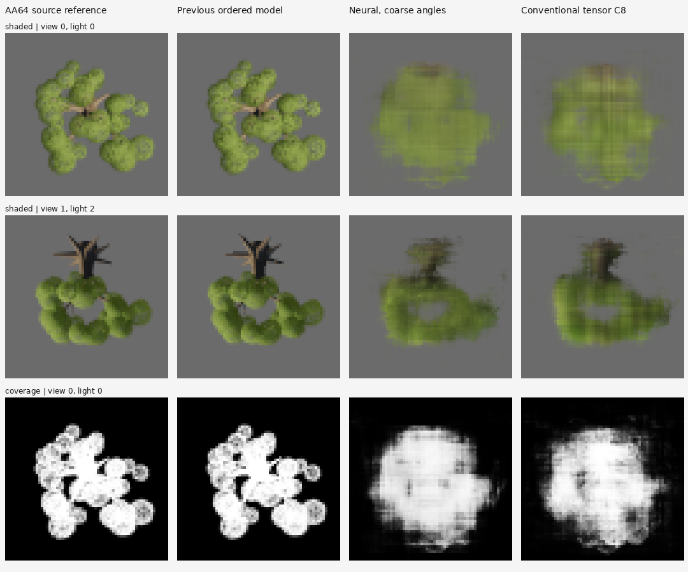
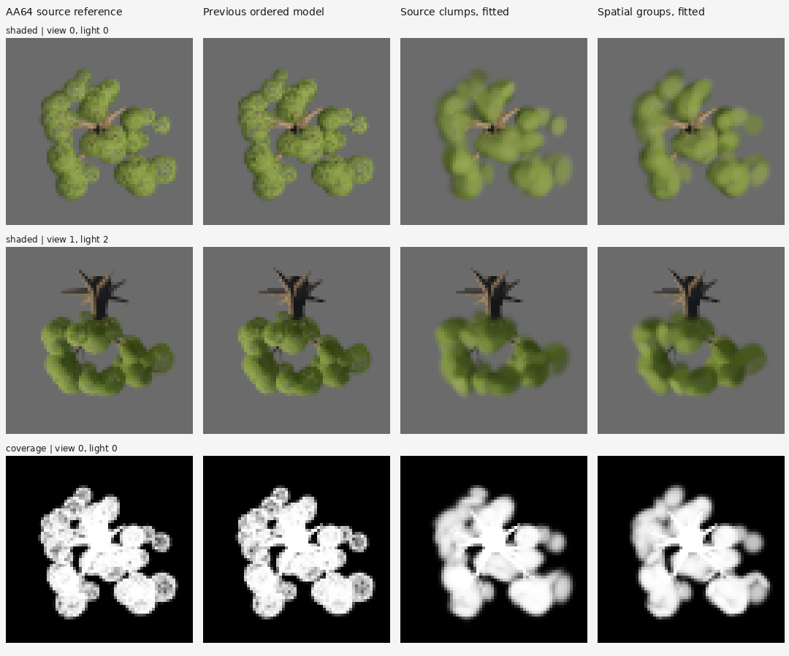
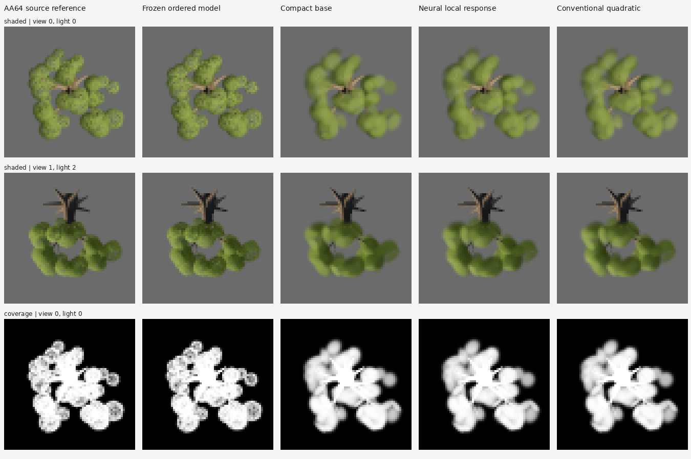
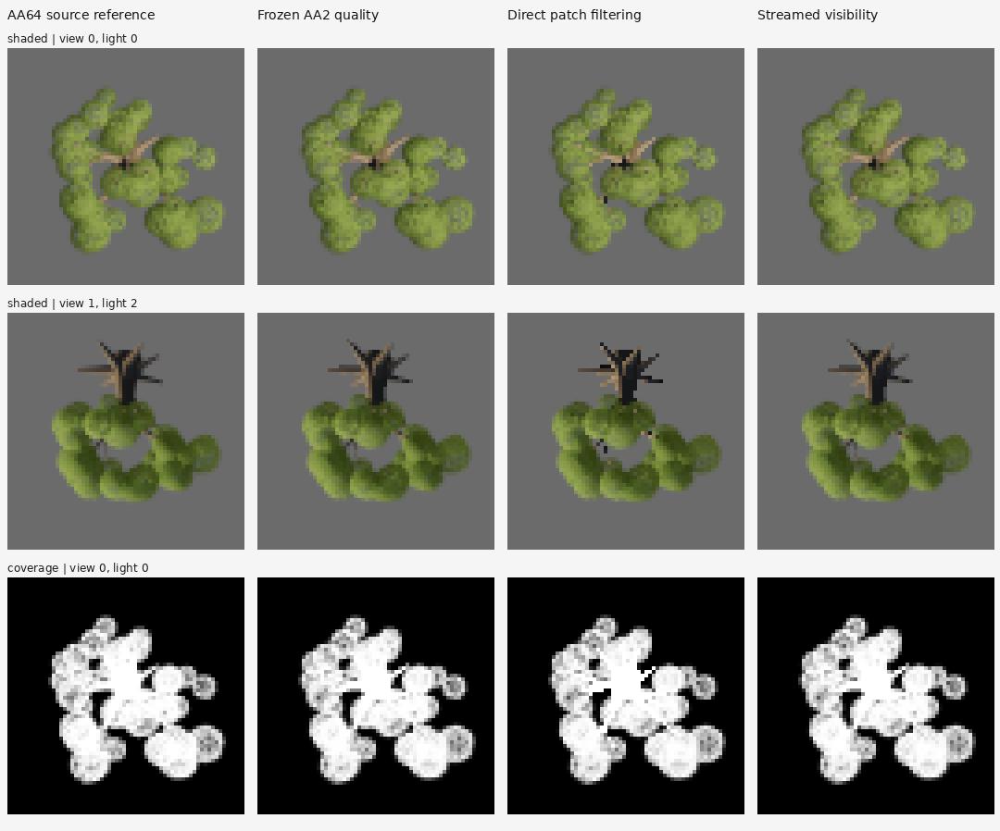
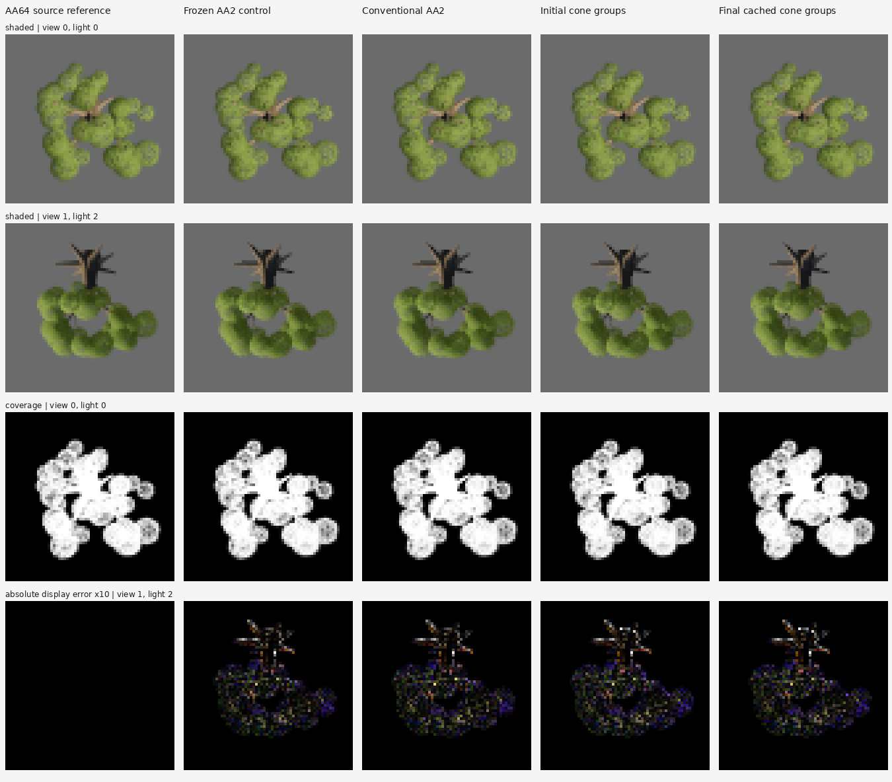

# Shaded appearance: first G4 viability decision

**Decision: change the representation.** Preserve the frozen fit and the renderer as an
experimental control. Stop spending training cycles on material-moment error. Neither
of the two permitted optimizations meets quality, runtime and resident-memory requirements
together. [G1–G7](neural-rendering-goals.md) are unchanged and remain unmet.

Work began 2026-10-27 15:04:56 UTC, with a 17:04:56 UTC deadline, solo on Pop!_OS.
The architecture decision was reached within the two-hour block; final archival/check time
is recorded in the evidence. No training steps or new reference captures occurred in this block.

The useful result is **shading visible material components before mixing them**, combined
with source-derived compact geometry. Relative to the full BC atlas, the trained AA2 path
has 80.20% lower mean FLIP, 94.99% lower LPIPS and +9.442 dB mean PSNR on this diagnostic.
That is not a large demonstrated learning advantage: the existing conventional
source-calibrated primitive control, rendered identically, is only 0.388 dB behind,
The trained parameters reduce mean FLIP by 11.30% and LPIPS by 10.73% versus that control. Both take essentially the same storage and execute the same algorithm.
All 24 trained-vs-calibrated comparisons meet the unchanged numeric quality tolerances.


## What was actually compared

One Great Tree, seed 7, at 64×64 output pixels; two previously published views
(stored anchor 103 and one off-grid direction), four fixed illuminations and three backgrounds:
24 shaded comparisons, not 24 independent scenes. Static hard-cut source cards and authored
wood, production leaf response with analytic sky, flat source bark. There is no wind,
scene shadow transport, fog, temporal reconstruction, camera-cut test or unseen asset here.
AA1 is one spatial sample per pixel; AA2 is 2×2; AA8 is 8×8.

The 1,897 fitted optical primitives are explicit optimized half-precision parameters,
**not an MLP or a neural decoder**. Total packed representation is 107,672 bytes,
including common values and wood. The primitive payload remains
`dc329e4b4c4eaa8ad0bbbb93eeea90cb2a94f4a0f01b284487f344d4ee2ff71c`.
The [prior continuation](neural-source-primitives.md#fixed-longer-optimization-with-exact-continuation)
is frozen.

All methods receive the same authored source information. No target image, current-view
ground truth or future sample is supplied to an inference path. Conventional controls are:

- The full source-integrated 16×16-view atlas: two BC7 layers plus an independent-depth BC5
  layer, 3 MiB, decoded-material bilinear filtering, four-view interpolation and the established
  one-step depth reprojection. Its raw GPU output agrees with the previously checked CPU
  decoder to the recorded 2e-5 maximum tolerance. A first implementation omitted reprojection;
  its off-grid parity failure and all resulting artifacts are preserved as `bc-no-parallax`.
- The existing source-derived 1,897-primitive model with the previously selected **two global
  calibration parameters**. This is not an uncalibrated strawman: its earlier fixed 49-candidate
  calibration used stored development views. No new calibration occurs here. It receives
  exactly the same pre-blend shading, wood renderer, sorting, AA2, output and composite
  as the fitted model. All 107,672 packed bytes are retained, and its active weight hash
  is recorded separately from the frozen trained weights.
- The original conventional source-card and wood renderer, with the same source material
  equations and 8×8 sampling. Cached cards, leaf-pattern texture, depth, scratch and output
  are counted. Source fields cook the cards at initialization; decoding/drawing them and
  wood, visibility, shading, integration and compositing occur in every measured frame.

These are the strongest applicable existing controls tested in this block, not proof of an
optimal conventional renderer. In particular, the BC atlas averages material roles: crediting
the learned path with its entire improvement over that atlas would confound representation,
shading order and learning. The calibrated and direct-source controls expose that confound.

## Two optimization experiments, then a decision

1. **Shade before blending, AA1.** Keep all primitive parameters and sorting unchanged.
   Shade each leaf primitive and shade wood with its bark response, then blend premultiplied
   radiance into one RGBA16F target. This replaces three material targets. Coverage is
   bitwise identical to the initial GPU path in all eight view/light outputs. Numeric
   quality passes versus BC rise from 13/24 to 22/24, but the two remaining cases regress
   as far as 11.558 dB. Runtime does not recover the BC budget.
2. **Four spatial samples, AA2.** Test the demonstrated silhouette/sampling failure.
   Mean quality improves strongly and the worst boundary error falls from 2.236 to 1.414
   pixels. The same two cases still fail. Scratch grows, and complete allocation reduction
   versus BC is only 6.015×. There was no third candidate optimization.

Mean displayed-image metrics, using the existing preprocessing and pinned evaluators:

| Path | PSNR dB ↑ | FLIP ↓ | LPIPS ↓ |
|---|---:|---:|---:|
| BC atlas + depth reprojection | 30.685 | 0.06237 | 0.037719 |
| Frozen model: material moments, AA1 | 30.406 | 0.05049 | 0.035133 |
| Experiment 1: shade then blend, AA1 | 33.431 | 0.02107 | 0.017743 |
| Experiment 2: shade then blend, AA2 | 40.128 | 0.01235 | 0.001889 |
| Conventional calibrated primitives, AA2 | 39.740 | 0.01392 | 0.002116 |
| Original source cards + wood, AA8 | 48.044 | 0.00651 | 0.000301 |

The final trained AA2 path still fails stored view 103, sky-only illumination, against
gray and blue backgrounds. PSNR losses versus BC are **3.530 and 5.980 dB**;
LPIPS ratios are **1.314× and 2.309×**. The excellent mean does not erase these failures.
The conventional source AA8 control has higher mean quality than either compact primitive
path; it is slower and larger. Neither conventional control is silently weakened to
manufacture a learned win.

Coverage is scored before tone mapping. Precision and recall use coverage ≥0.5;
boundary error is the symmetric 99th-percentile distance between binary boundaries.
The table gives the worst view for precision, recall and boundary error:

| Path | Mean coverage MAE ↓ | Precision ↑ | Recall ↑ | Boundary p99, pixels ↓ |
|---|---:|---:|---:|---:|
| BC atlas + depth reprojection | 0.01678 | 97.89% | 93.82% | 2.038 |
| Frozen model: material moments, AA1 | 0.01788 | 99.13% | 97.09% | 2.236 |
| Experiment 1: shade then blend, AA1 | 0.01788 | 99.13% | 97.09% | 2.236 |
| Experiment 2: shade then blend, AA2 | 0.00883 | 97.80% | 98.54% | 1.414 |
| Conventional calibrated primitives, AA2 | 0.00935 | 97.81% | 98.80% | 1.414 |
| Original source cards + wood, AA8 | 0.00429 | 99.49% | 99.57% | 1.000 |

This is a static silhouette diagnostic, not achievement of G3's temporal, disocclusion or
thin-feature acceptance tests.

## Complete rendering cost on the AMD machine

Ryzen 5 5500U, hardware AMD Radeon Graphics / RADV RENOIR, Mesa 26.1.6,
Chrome 154.0.8037.57, pinned Wrela 0.9.0. Each profile has 60 warmup and 240 measured
frames, one worker, 64×64 output. View changes every frame and illumination every two frames,
forcing model updates and sorting. Captures, profiles and scoring run sequentially.
Raw profiles, device descriptions, compiled shaders, programs and commands are retained.

The candidate frame includes half decoding, stable CPU depth sort and index upload,
procedural wood vertex evaluation, optical visibility, blending, integration and final
tone-mapped screen composite. It uploads 8,196 bytes/frame including uniforms, versus
96 bytes for BC. The direct source control has no global sort. The calibrated model
executes the same algorithm as the trained model.

All times below are milliseconds:

| Path | Saturated GPU p95 | Paced GPU p95 / p99 | CPU frame p99 | CPU start → GPU complete p95 / p99 |
|---|---:|---:|---:|---:|
| BC atlas + depth reprojection | 0.0269 | 0.1036 / 0.1046 | 0.370 | 1.906 / 3.812 |
| Frozen model: material moments, AA1 | 0.0758 | 0.2892 / 0.2899 | 1.020 | 4.985 / 5.215 |
| Experiment 1: shade then blend, AA1 | 0.0736 | 0.2915 / 0.2920 | 0.983 | 5.276 / 5.513 |
| Experiment 2: shade then blend, AA2 | 0.0981 | 0.3141 / 0.3161 | 0.973 | 4.340 / 4.528 |
| Conventional calibrated primitives, AA2 | 0.0855 | 0.3125 / 0.3149 | 0.862 | 4.858 / 5.131 |
| Original source cards + wood, AA8 | 1.0488 | 1.6842 / 1.7184 | 0.598 | 3.900 / 4.148 |

GPU spans cover the registered passes, including final compositing. They **do not by
themselves include a queue upload before the first timestamp**. CPU frame time includes
sorting, command recording and submission, but is not GPU completion time. Therefore a
separate observer follows the existing queue-completion promises from CPU frame start
through completion of all that frame's queued work. It adds no waits, includes uploads
and compositing, and excludes post-run image readback. That wall-clock column also includes
browser scheduling and driver notification, and varies between runs; it is not an
input-to-photon measurement or a basis for claiming the trained model faster than calibration.
Instrumentation is confined to copied evidence builds. The ordinary GPU/CPU profiles are
unmodified builds.

The trained AA2 path is 3.031× / 3.021× BC's paced GPU p95 / p99; saturated GPU p95 is
3.649× BC. Its observed complete-work p95 is 2.277× BC. G4's ≤1.1× limit is not met.
Paced frame intervals near 16.7 ms reflect the 60 Hz schedule and are not substituted for
rendering latency. Initialization/source cooking is outside steady-state frame timing;
its allocation peak is included below. No G6 whole-scene or G7 build-time claim is made.

## Resident memory, including scratch and caches

Packed model size is not residency. The engine counter misses executor uniform/upload
rings and the offscreen screen target. A measurement-only observer records **every**
WebGPU buffer and texture creation/destruction, including retained upload capacity,
scratch, output, dummy/fallback resources and cache backing storage. Shader/pipeline
and driver allocation bytes are not exposed by that interface, so actual DRM residency
and whole-browser proportional resident memory are recorded separately.

| Path | Engine appearance/scratch bytes¹ | All live requested GPU bytes² | Peak requested GPU bytes² |
|---|---:|---:|---:|
| BC atlas + depth reprojection | 3,145,844 | 4,341,876 | 7,487,620 |
| Frozen model: material moments, AA1 | 230,316 | 639,916 | 656,300 |
| Experiment 1: shade then blend, AA1 | 164,796 | 574,396 | 590,780 |
| Experiment 2: shade then blend, AA2 | 312,252 | 721,852 | 738,236 |
| Conventional calibrated primitives, AA2 | 312,368 | 721,968 | 738,352 |
| Original source cards + wood, AA8 | 5,046,136 | 5,455,736 | 5,472,120 |

¹ Excludes the identical 65,536-byte output buffer only; includes wood, sorting indices,
depth and image targets. ² Includes that output, screen, upload/uniform rings and all other
observed buffers/textures. No fallback atlas is loaded by the compact paths. Inactive
counterpart payloads are removed from each build. The source-control helper added 116
dummy bytes to the later calibrated build and final checked-in default; this is explicitly
counted for calibration and the final native check, not normalized away. The tables retain
the exact originally measured AA2 build; final default images are byte-identical.

The BC upload ring retains 1,048,576 bytes after initialization; compact/source paths
retain 262,144 bytes. Every path retains a 65,536-byte uniform ring and 16,384-byte
offscreen screen. The three-target path initially appears to save 13.659× by the engine
counter, and the one-target AA1 path 19.089×, but the latter is only **7.559×** with complete
requested allocations. Final AA2 is **6.015×** versus BC and **1.00016×** versus conventional
calibration. Neither is 16×.

Actual post-run residency snapshots, MiB, from the same isolated browser process groups:

| Path | DRM resident VRAM | DRM resident GTT | Browser group PSS |
|---|---:|---:|---:|
| BC atlas + depth reprojection | 24.55 | 9.20 | 464.48 |
| Frozen model: material moments, AA1 | 16.57 | 9.38 | 455.31 |
| Experiment 1: shade then blend, AA1 | 16.57 | 9.40 | 456.44 |
| Experiment 2: shade then blend, AA2 | 16.56 | 9.30 | 456.80 |
| Conventional calibrated primitives, AA2 | 16.82 | 9.38 | 456.54 |
| Original source cards + wood, AA8 | 16.51 | 9.40 | 456.91 |

DRM clients are deduplicated by device/client ID. These counters include driver/client
allocations and retained caches; PSS includes CPU/WASM data, sort scratch, code and browser
caches. The machine uses shared memory: **do not add PSS, VRAM and GTT columns** as if they
were disjoint per-asset ownership. The single-instance fixture's shared host overhead
cannot establish amortized multi-instance residency. WASM committed/used and reserved
values, full allocation descriptors and raw `/proc` records are retained. This is enough
to reject a 16× total-residency claim here, not a claim about every production scene.

## Next architecture-level bet

Keep exact authored wood and material roles. Replace globally sorted, point-sampled
appearance splats with **source-compiled visibility layers and pixel-footprint coverage**.
Use source geometry, field support and known visibility to bound occupied regions and
resolve thin silhouettes without allocating a supersampled image for every asset.
A learned component should predict a compact residual only where the deterministic
source-conditioned renderer has a demonstrated rendered error. Give the conventional
control those same layers, coverage and visibility inputs.

The shortest next discriminating experiment is one fixed-footprint layer/coverage
prototype on these same eight view/light images, against the frozen trained and calibrated
controls, with one scratch pool, full update/sort/composite accounting and a small batch
of instances. First resolve the two sky-only silhouette failures and count amortized
resident bytes. Train nothing until that measured comparison identifies a useful residual.

The remaining acceptance gaps are unseen views/individuals, motion, scale range 8–512 pixels,
richness scaling, shared-memory scaling and whole-scene integration. They are not needed
to decide against the current configuration: it already fails the joint public quality,
memory and cost test. This work does not retire neural rendering or change G1–G7.

## Reused shaded references and proportional verification

The completed shaded references shade each visible source fragment before exact Q20
integration. Existing 16→32 sampling failed all eight cases; the completed 32→64
comparison passed all eight fixed RGB/coverage tolerances. This block uses those AA64
references unchanged. Material-average controls expose nonlinear shading, normal
renormalization, material quantization and leaf/wood role loss; they do not isolate only
the mathematical averaging operation.

The production `leaf_response` extraction has the previously completed 4,096-case GPU
byte-parity check against the original expression
(`a2b14264783b3078b2d8901b92be0ce771a39eb9483e5bf4b185604271a24c25`),
an independent float64 equation check (maximum 6.57e-6), and a transmission-negative control.
Existing exact pixel integration and GPU/CPU material-response checks are reused.
No repeated reference audit or new reference captures were needed.

Preprocessing is engine tone mapping at exposure 0.62 followed by sRGB, applied after
premultiplied linear compositing over each background. FLIP uses LDR 67 pixels/degree,
RGB inputs; LPIPS uses AlexNet v0.1, sRGB [-1,1], without resizing or cropping.
Mean PSNR is the arithmetic mean of case PSNR values, not PSNR of pooled MSE.
Pinned implementations and primary sources are in [citations](citations.md).
The established probes and all executable GPU captures/profiles are the substantive checks;
the final frozen checkout is checked for formatting/types and byte-identical output.
No full-suite or PR-readiness claim is made.

## Evidence and replay

The checked-in `studio/appearance/runtime` defaults to the frozen trained AA2 diagnostic.
Its actual half words, common values and wood are included as Wrela constants so a clean
checkout can build it. This is not enabled in the production renderer.

On Pop!_OS from the worktree:

```bash
wrela tool appearance -- runtime
wrela profile studio/appearance/runtime --frames 240 --warmup 60 --workers 1 --size 64x64 --chrome --json
```

The remote evidence root is
`/home/ryanwible/worktrees/wrela-neural-frontier/build/neural-evidence/g4-viability-v1`.
Each variant retains its exact `runtime-source.tar.gz`, compiled profile build, raw pixels,
profiles, individual scores, allocation/DRM/PSS and completion records. Frozen full BC
and candidate data live in `frozen/`. External scripts under
`/home/ryanwible/.local/state/wrela-neural-frontier/` are archived with the evidence;
they are not repository Python code. Restoring a variant archive restores its actual data
and configuration; save the checked-in version before doing so. The calibrated baseline's
active weight SHA is in its `record.json`.

The old bad projection baseline, initial build/capture failures, failed material-moment
path, failed two targeted optimizations and every quality tail remain preserved.
A manifest binds this evidence, its reference dependency and exact source/script archives.
Evidence digest: `44cc42b8607d0781958bbd4409c360cd7ab8a7288d5a8797dfa091d4f8ef46b6`.


## Replacement experiment: reject two visibility slabs

**Decision: retire the two-slab radiance mixture.** This subsequent experiment tests
the replacement proposed above, with two targeted follow-ups after its initial result.
It does not reopen the first block's optimization budget. The first block concluded
within 67 minutes; this replacement's plan was recorded at 16:29:38 UTC and its decision
at 16:46:09 UTC on 2026-10-27. Zero training steps and zero new references.
G1–G7 remain unchanged and unmet.

The frozen 1,897-primitive payload is unchanged, SHA-256
dc329e4b4c4eaa8ad0bbbb93eeea90cb2a94f4a0f01b284487f344d4ee2ff71c.
The conventional source-calibrated payload is unchanged, SHA-256
065549765511b660a115519d86c2d307bf04c5d56bc2536f17d60d80bb111114.
Both receive the same source geometry, materials, field support, authored wood
triangles, lighting and four quarter-pixel sample locations. The strongest ordered
calibrated control and established BC/depth control remain in the comparison.
These are fitted explicit optical primitives, not an MLP runtime decoder.

The initial replacement removes global CPU sorting and supersampled image targets.
Each primitive averages four opacity samples, converts the result to optical
thickness, and additively accumulates thickness-weighted shaded radiance in two
depth slabs. Far then near slabs resolve over point-sampled source wood. Support
quads expand to cover the four sample positions. Within each slab, colors are
mixtures rather than ordered per-fragment compositing.

This belongs to the general family of bounded-storage commutative transparency
approximations discussed by [McGuire and Bavoil (2013)](https://www.jcgt.org/published/0002/02/09/).
It is our own optical-depth/slab experiment, not a reproduction or novelty claim.

The two follow-ups answer separate measured questions:

1. **Local front anchor:** replace the global split with a per-pixel nearest contributing
   primitive depth, using the source shader's 2.4 m attenuation length for the front
   slab. An extra visibility pass recovers only 0.502 dB while raising paced GPU
   p95 from 0.376 to 0.558 ms.
2. **Independent coverage samples:** keep the original global split, but accumulate
   four independent optical thicknesses before averaging final opacities. This retains
   overlap correlations lost by per-primitive averaging. An extra 32,760 live scratch
   bytes recovers only 0.101 dB. Point-sampled wood and slab color mixtures remain.

No third follow-up is taken. All failed outputs, the local-front compile failure,
exact source/builds and measurements are retained.

### Rendered quality and silhouettes

Same completed AA64 references, two views, four lights, three backgrounds and metric
preprocessing as above; no crop, threshold or acceptance change.

| Path | Mean PSNR dB | Mean FLIP | Mean LPIPS | BC quality gates passed |
|---|---:|---:|---:|---:|
| BC atlas + depth reprojection | 30.68527 | 0.062373 | 0.037719 | reference baseline |
| Conventional calibrated, ordered AA2 | 39.73958 | 0.013921 | 0.002116 | 22/24 |
| Frozen fit, ordered AA2 | 40.12768 | 0.012348 | 0.001889 | 22/24 |
| Frozen fit, global two slabs | 32.84992 | 0.047489 | 0.018105 | 17/24 |
| Conventional calibration, two slabs | 32.71395 | 0.048277 | 0.018490 | 17/24 |
| Follow-up 1: local front | 33.35180 | 0.043010 | 0.016403 | 18/24 |
| Follow-up 2: four coverage samples | 32.95052 | 0.047441 | 0.017916 | 17/24 |

Global slabs have 9.58× the ordered fit's LPIPS; even the best local-front result
passes only 18/24 public cases. The conventional slab control receives identical
runtime inputs and costs, and tracks the fitted one closely. Its ordered version
remains substantially stronger.

Coverage MAE rises from 0.008832 for the ordered fit to 0.013472 for global slabs,
0.013470 with the local front, and 0.012288 with independent coverage samples.
Worst per-image coverage-error p99 rises from 0.113129 to 0.307728, 0.307730 and
0.316566 respectively. Worst silhouette boundary p99 remains 1.414 pixels for
all four; that metric alone hides substantial fractional-coverage damage.
Per-case precision/recall, soft IoU and shaded tails remain in the evidence.


### Complete cost and actual residency

Same Ryzen 5 5500U, hardware AMD RADV RENOIR, Mesa 26.1.6, Chrome
154.0.8037.57, pinned Wrela 0.9.0 / compiler
de9b81e52a7747870dfbd5223cb8aeb41e584d23.
One isolated 240-frame run after 60 warmup frames per path, at 64×64, one worker.
Captures, profiling and scoring run sequentially on Pop!_OS.

GPU spans include decoding, wood, visibility, layer accumulation/resolution and screen
compositing. CPU calls include view/light updates and command recording. No global CPU
sort or index upload remains. These paths write 784 uniform bytes per frame; the
local-front path writes 1,296 bytes. Initialization is outside steady-state time,
but its peak allocation and retained upload capacity are counted.

| Path | Paced GPU p95 / p99 ms | CPU call p99 ms | Saturated GPU p95 ms | CPU start to GPU completion p95 / p99 ms |
|---|---:|---:|---:|---:|
| Frozen fit, global two slabs | 0.375642 / 0.376428 | 0.553050 | 0.09548 | 4.220215 / 4.452451 |
| Conventional calibration, two slabs | 0.375042 / 0.375649 | 0.538050 | 0.11424 | 4.365491 / 4.726450 |
| Follow-up 1: local front | 0.558454 / 0.559950 | 0.702200 | 0.16740 | 4.490247 / 4.605481 |
| Follow-up 2: four coverage samples | 0.390446 / 0.395628 | 0.538550 | 0.10452 | 4.204834 / 4.305229 |

Ordered fitted AA2 has paced GPU p95/p99 0.314113/0.316113 ms, CPU p99 0.973050 ms
and saturated GPU p95 0.09808 ms. BC has paced GPU p95/p99 0.103642/0.104649 ms
and CPU p99 0.370000 ms. CPU sorting removal reduces CPU work, but no replacement
establishes a complete GPU improvement.

Completion uses the existing observer of submissions and completion notifications;
every submission within each CPU frame is accounted for. This includes browser
scheduling and driver notification latency, and is not input-to-photon timing.
Ordered AA2 completion p95/p99 was 4.340100/4.527881 ms; BC was 1.906018/3.812336 ms.
Small single-run differences are not a robust wall-time ranking.

| Path | Engine appearance + scratch bytes | All live requested GPU bytes | Peak requested GPU bytes | DRM VRAM / GTT MiB | Browser group PSS MiB |
|---|---:|---:|---:|---:|---:|
| Frozen fit, global two slabs | 190,088 | 599,688 | 616,072 | 16.582 / 9.289 | 454.899 |
| Conventional calibration, two slabs | 190,088 | 599,688 | 616,072 | 16.582 / 9.289 | 454.088 |
| Follow-up 1: local front | 190,088 | 599,688 | 616,072 | 16.590 / 9.383 | 462.865 |
| Follow-up 2: four coverage samples | 222,848 | 632,448 | 648,832 | 16.586 / 9.289 | 455.003 |

The engine column excludes only the identical 65,536-byte output. Full requested
allocations include that output, depth/coverage/radiance targets, wood, fallback/dummy
resources, uniform/upload rings and screen storage. Only a dummy sort-index entry
remains. No BC fallback atlas is retained. Global/local slabs save 16.9% against
the measured ordered fit's 721,852 requested live GPU bytes.

Against BC's 4,341,876 bytes, complete requested allocations save only **7.240×**
(global/local) or **6.865×** (four coverage samples). The engine-only number appears
to exceed 16× for global slabs, illustrating why it cannot substitute for residency.
Actual DRM residency and whole-browser PSS include retained driver/browser storage
not exposed by WebGPU descriptors. These are separate UMA observations: do not sum
PSS, VRAM and GTT or attribute shared host overhead to one asset. The final-default
116-byte helper difference remains as documented above.

### What the failures identify

Post-measurement attribution uses conservative bounding boxes of the already exported
source wood triangles. No new reference or changed quality gate. Inside these boxes
can include foliage: not all their error is established as wood-caused.

Outside projected wood bounds, four independent opacity values reproduce ordered
AA2 coverage within **0.0001531 mean absolute error**. This is agreement with the
four-sample control, not with perfect coverage. Yet display squared error against
the shaded reference rises from 0.9217 to 2.9194 on average over cases in that region.
Within conservative wood bounds, coverage differs by 0.048656 and display squared
error rises from 0.6505 to 5.0003. Raw masks and per-case values are retained.

Compact coverage accumulation is useful, but does not retain joint depth, shaded
color and wood/leaf visibility. More material-moment fitting would not repair this
renderer's lost ordering. Reject the mixture on quality, full storage and complete
runtime together; infrastructure progress is not a rendering win.

### Next architecture-level bet

Preserve **ordered subpixel visibility including wood**, while eliminating global CPU
sorting and full supersampled radiance targets. The shortest discriminating prototype
is tile-local ordered evaluation at the same four sample positions, with bounded lists,
explicit overflow/fallback accounting and both frozen fitted and conventional
source-calibrated inputs. Recover the ordered control's images before its CPU/storage
savings count. Reuse these references and metrics.

If transmittance reconstruction becomes the demonstrated bottleneck, test a small
source-conditioned transmittance model against conventional moment reconstruction
receiving the same moments, depths and coverage. [Tsopouridis, Vasilakis and Fudos,
Neural Moment Transparency (2024)](https://cgrg.eu/publications/neural-moment-transparency)
is prior work on learned fragment transmittance from accumulated moment statistics.
This is a possible model target, not an implemented result or imported performance
claim. Wrela's fields and source visibility can supply exact ordered supervision and
support bounds to both methods.

### Preservation and proportional verification

The runtime keeps rejected methods as diagnostic modes 4–6; its default remains
the frozen ordered AA2 renderer. Format/type checks pass; a final native capture
reproduces all eight measured AA2 outputs byte for byte. Completed reference and
response checks are reused. No full-suite/PR-readiness claim.

Evidence on Pop!_OS: build/neural-evidence/g4-visibility-layers-v1 in the worktree.
Each variant retains actual source/payload, compiled build, raw images, profile,
completion/allocation records and raw process/DRM records. The manifest references
unchanged prior comparison/reference manifests and binds exact final source/scripts.
Manifest SHA-256: `814030755e130a9fd7a600643fbcef0f303cb6db94d4108f4916cbe7af44ef9e`.


## Ordered GPU execution: quality recovered, cost rejected

**Decision: change the appearance representation. Retire tile-local compute execution;
do not promote the GPU-global-sort alternative.** Keep the original frozen, CPU-sorted
AA2 renderer as the diagnostic control. This block follows the rejected two-slab
representation and uses exactly two targeted optimizations, zero training steps and
zero new shaded references. G1–G7 are unchanged and unmet.

The initial prototype assigns an 8×8 pixel tile to each 64-lane workgroup. It projects
the frozen primitive stream, culls support bounds, compacts a 512-entry local list,
sorts by float32 centre depth and descending primitive ID, and cooperatively evaluates
four ordered subpixel contributions. Pixel colors stay in registers until their
four-sample resolve. Source wood uses the existing 128×128 color/depth raster targets;
these remain resident and counted. This tests ordered GPU execution, not a claim
that all supersampled storage has been removed.

The tile's declared workgroup-local storage is 10,244 bytes; 64 groups are dispatched.
Count above 512 produces invalid negative coverage, making the result ineligible:
there is no hidden dropped-leaf path or loaded conventional fallback. None of the
eight captures overflows, for either fitted or calibrated parameters. This remains
a bounded diagnostic, not a general production fallback.

Both methods receive the same source support, materials, wood, camera, lights and
sample positions. The conventionally calibrated source primitives retain their
previously selected parameters. The fitted and calibrated hashes remain unchanged
from the earlier sections. No new fitting advantage is introduced by the runtime.

### Quality recovery and two consequential follow-ups

| Path | Mean PSNR dB | Mean FLIP | Mean LPIPS | Cases matching its prior ordered control | BC quality gates passed |
|---|---:|---:|---:|---:|---:|
| Frozen fit, tile-local | 40.120118 | 0.012470 | 0.001883 | 24/24 | 22/24 |
| Calibrated, tile-local | 39.735748 | 0.013968 | 0.002108 | 24/24 | 22/24 |
| Follow-up 1: projection cache | 40.120118 | 0.012470 | 0.001883 | 24/24 | 22/24 |
| Follow-up 2: GPU sort + raster | 40.127682 | 0.012348 | 0.001889 | 24/24 | 22/24 |
| Calibrated, GPU sort + raster | 39.739577 | 0.013921 | 0.002116 | 24/24 | 22/24 |

The original fitted AA2 control is 40.127682 dB / 0.012348 FLIP / 0.001889 LPIPS;
the calibrated control is 39.739577 dB / 0.013921 FLIP / 0.002116 LPIPS.
Tile integration uses f32 accumulation instead of rounding every blend through an
RGBA16F attachment, so its pixels are close rather than identical. Every shaded
case stays within the existing relative quality tolerances against its corresponding
ordered control. The fitted tile path's coverage MAE is 0.008820 versus 0.008832;
silhouette precision/recall are identical and worst boundary p99 remains 1.414 pixels.
The same two BC-relative sky-only cases still fail. This is no G4 quality completion.

1. **Project/shade once:** the first measurement's GPU p95 is 1.586 ms. Test whether
   repeating projection in every tile causes that regression by caching all 1,897
   projected/shaded records once per frame. The complete 121,408-byte cache and its
   dispatch are counted. Quality is retained, but GPU p95 remains 1.297 ms, saturated
   p95 0.537 ms, and total requested GPU allocations rise to 836,064 bytes.
2. **GPU sorting plus hardware raster:** replace tile integration with one global
   2,048-entry GPU sort followed by the established wood/leaf raster and four-sample
   resolve. The source count is asserted at most 2,048; sort indices are stored and
   counted. Its single workgroup declares 16,384 bytes of local storage. It reproduces
   all eight fitted and all eight calibrated images **byte for byte**, yet costs more
   GPU work in the alternating comparison below.

The GPU sort uses a standard bitonic network; see [Batcher (1968)](https://doi.org/10.1145/1468075.1468121).
This Wrela implementation and its rendering integration are our own, with no imported
implementation or claimed novelty. No third optimization is taken.

### Complete runtime, including the misleading first paced result

Same Ryzen 5 5500U / hardware AMD RADV RENOIR, Mesa 26.1.6, Chrome 154.0.8037.57,
Wrela 0.9.0 / compiler de9b81e52a7747870dfbd5223cb8aeb41e584d23.
Each initial run has 240 frames after 60 warmups, one worker, 64×64 output.
All builds, scoring and GPU measurements run sequentially on Pop!_OS.

| Path | Paced GPU p95 / p99 ms | CPU call p99 ms | Saturated GPU p95 ms | CPU start to completion p95 / p99 ms |
|---|---:|---:|---:|---:|
| Frozen fit, tile-local | 1.586317 / 1.655851 | 0.573050 | 0.71412 | 4.340356 / 4.500298 |
| Calibrated, tile-local | 1.587522 / 1.643885 | 0.510000 | 0.72608 | 4.340332 / 4.531252 |
| Follow-up 1: projection cache | 1.296984 / 1.430936 | 0.500250 | 0.53696 | 6.070813 / 6.339993 |
| Follow-up 2: GPU sort + raster | 0.224052 / 0.260471 | 0.444150 | 0.22880 | 4.401636 / 4.547219 |
| Calibrated, GPU sort + raster | 0.915528 / 0.916725 | 0.533050 | 0.22452 | 4.385754 / 4.539114 |

These GPU spans include decoding/projection, sorting, visibility, source wood, ordered
leaf composition, resolve and final display composite. CPU calls include view/light
updates and uploads/recording; no new path does a CPU global sort or index upload.
Initialization is outside steady-state timing, with peak/resident allocation counted.
Completion includes every frame submission, plus browser scheduling and completion
notification latency. It is not input-to-photon time.

The first fitted GPU-sort run misleadingly suggests a paced improvement over the old
CPU-sort p95 of 0.314113 ms: it reports 0.224052 ms. However, saturated performance
worsens, and the calibrated GPU-sort run reports 0.915528 ms despite the same algorithm.
This contradiction triggered a proportional verification run, not a new optimization:
three alternating pairs against the archived CPU-sort build, in B,A,A,B,B,A order.

| Alternating comparison | Original CPU sort | GPU sort + raster |
|---|---:|---:|
| Median of saturated GPU medians | 0.078240 ms | 0.214040 ms |
| Saturated GPU p95, three runs | 0.08504 / 0.08100 / 0.09324 ms | 0.23452 / 0.23552 / 0.23092 ms |
| Median CPU frame calls | 0.680000 ms | 0.380000 ms |
| Final pair paced GPU p95 / p99 | 0.313842 / 0.315178 ms | 0.914434 / 0.916959 ms |
| Final pair CPU p95 / p99 | 0.950750 / 1.043300 ms | 0.450250 / 0.538550 ms |

The established paired estimator reports **43.38% lower CPU time but 173.57% higher
saturated GPU time**. Every pair has the same direction. GPU cost is 2.74×, not a win.

Read-only 100 ms power snapshots retain the unchanged automatic policy, reported
shader clocks from 400–1,800 MHz and temperatures 35–43°C. These are not synchronized
per-frame clock measurements, so they do not prove a specific spike's cause.
No clock or power setting was changed. Preserve the initially favorable paced result
alongside the contradictory repeats; do not cherry-pick it.

### Resident storage and scratch

| Path | Engine appearance/scratch bytes | All requested live / peak GPU bytes | DRM VRAM / GTT MiB | Browser group PSS MiB |
|---|---:|---:|---:|---:|
| Frozen fit, tile-local | 305,056 | 714,656 / 731,040 | 16.555 / 9.289 | 449.797 |
| Calibrated, tile-local | 305,056 | 714,656 / 731,040 | 16.555 / 9.195 | 449.311 |
| Follow-up 1: projection cache | 426,464 | 836,064 / 852,448 | 16.566 / 9.398 | 455.268 |
| Follow-up 2: GPU sort + raster | 312,440 | 722,040 / 738,424 | 16.570 / 9.383 | 457.114 |
| Calibrated, GPU sort + raster | 312,440 | 722,040 / 738,424 | 16.824 / 9.383 | 456.738 |

The engine column excludes only the identical 65,536-byte output. Complete requested
allocations include it, wood, sort indices, projected cache, all image/depth targets,
fallback/dummy data, retained upload/uniform rings and screen storage. The initial tile
path saves only 1.0% against the old fitted AA2 allocation of 721,852 bytes; caching
increases storage by 15.8%. The GPU-sort variant has essentially the same storage.
All remain far from 16× against the strongest same-source conventional control.

GPU workgroup-local arrays are separate from persistent WebGPU buffer/texture bytes.
Their declared sizes above affect occupancy; driver alignment and concurrent residency
are not inferred by multiplying the size by every dispatched group. Physical DRM
residency and browser PSS snapshots capture exposed retained driver/client allocations,
including retained spill storage and caches where reported. Transient physical peaks and
exact per-asset attribution are not established by these snapshots. On this UMA
device these columns overlap: never sum PSS, VRAM and GTT.

The restored default adds 72 dummy GPU bytes relative to the parent checkpoint.
Together with the already documented 116-byte helper difference, that is 188 bytes
above the original measured fitted AA2 build. The GPU-sort table counts the actual
722,040 bytes, without subtracting these differences.

### Next representation bet and preservation

The useful result is that ordered subpixel visibility restores the shaded image.
The failed bet is that moving this explicit 1,897-primitive stream's sorting and
compositing to compute delivers the required joint quality/runtime/storage gain.
No further optimization of this execution path is justified by these results.

Next test a **small source-conditioned representation of joint visibility and shaded
response**, replacing the explicit primitive stream. Keep source support and authored
wood, and model the rendered contribution rather than independent averaged material
moments. A deterministic low-rank/basis fit must receive the identical source-derived
features, sample positions and supervision. The frozen ordered fitted and calibrated
renderers remain controls; the completed shaded references still judge actual quality.
This is an architecture hypothesis, not a learned rendering result. No new model was
trained in this block.

Exact source/payload, compiled builds, all five variants, quality/tails, complete runtime,
DRM/PSS, allocation descriptors, three paired runs and power records are preserved in
build/neural-evidence/g4-tile-ordered-v1 on Pop!_OS. The paired profiler writes into the
compared build's results directory: its new baseline outputs were preserved separately,
and the four overwritten original result files were restored from existing copies to
their sealed-manifest hashes. No original evidence was lost; replay now copies the
baseline first.

The runtime preserves rejected diagnostics as modes 7–9 and restores mode 2 as default.
Focused formatting/type checks pass, and all eight restored default images are
byte-identical to the original measured AA2. No full-suite or PR-readiness claim.
Manifest SHA-256: `19998e152994f78f42b6e63c1b2e23668b66485cad005e5077c303677d6e604e`.


## Joint shaded light field: retire image/camera factorization

**Decision: retire this tested representation for G4.** A compact field of image position
and camera direction loses too much geometry and costs too much to decode. The previous
frozen ordered model remains the default. G1–G7 are unchanged and unmet.

This follow-on block tested an actual AMD renderer, not material-moment accuracy. It
fits complete premultiplied shaded RGB and coverage, including authored wood, into
six bilinear factor planes over image x/y and camera gx/gy. Complementary plane pairs
are multiplied. Signed 4-bit planes feed either a two-layer 32-wide neural decoder or
a conventional tensor/basis decoder with no hidden network. Both get the same coordinates,
ten-term lighting basis, source captures, quantization method, rendered loss and
2,048-step budget. Conventional C8 has twice the feature channels of C4; it avoids
claiming an advantage over only a deliberately small control. Our implementation is
informed by the general plane-factorization idea in
[Cao and Johnson, HexPlane, CVPR 2023](https://openaccess.thecvf.com/content/CVPR2023/html/Cao_HexPlane_A_Fast_Representation_for_Dynamic_Scenes_CVPR_2023_paper.html);
our dimensions are image/camera coordinates, not their space-time volume.

The old AA64 shaded references are unchanged. The existing source-card/wood renderer
provided AA8 **training targets**, not new reference truth: 128 training poses and 16
validation poses, four lights each. The two public reference views are excluded from
training. All three fits use the same shaded display loss across the three established
backgrounds, foreground weighting and coverage loss; no further material-moment training
was performed. Fixed endpoints are retained without selecting a checkpoint on the public
references. The previous BC, calibrated optical and source-card controls still have the
source geometry/material/visibility information. The new conventional tensor fits receive
exactly the same teacher data as the neural fit.

| Fit | Mean PSNR dB ↑ | Mean FLIP ↓ | Mean LPIPS ↓ | Complete GPU p95/p99 ms | Asset/decoder bytes, output excluded | All live/peak requested GPU bytes |
|---|---:|---:|---:|---:|---:|---:|
| neural-c4 | 20.168 | 0.20498 | 0.38626 | 1.773/1.803 | 21,000 | 430,600/446,984 |
| tensor-c4 | 21.268 | 0.22610 | 0.42865 | 1.234/1.241 | 17,952 | 427,552/443,936 |
| tensor-c8 | 21.384 | 0.24533 | 0.41750 | 1.434/1.471 | 35,592 | 445,192/461,576 |
| neural-c4-a8 | 23.619 | 0.15422 | 0.22198 | 2.060/2.160 | 16,520 | 426,120/442,504 |
| tensor-c4-a8 | 23.082 | 0.17706 | 0.24028 | 1.228/1.242 | 13,472 | 423,072/439,456 |
| tensor-c8-a8 | 23.354 | 0.15845 | 0.21425 | 1.263/1.374 | 26,632 | 436,232/452,616 |

The common runtime allocation overhead above the asset is 409,600 bytes: output,
upload/uniform rings and screen target. This is measured live allocation, not an estimate
from the model file. Conventional half-weight buffers include two alignment bytes.
Neither path retains source geometry, an exact wood fallback, a hidden view atlas or a
sort cache: wood and visibility are part of the approximation, and their lost detail
counts against quality. GPU timing includes every plane lookup, unpack, decoder,
coverage evaluation and final composite; CPU timing includes view/light updates and
command recording. There is no runtime sorting. Build-time fitting and source capture
are recorded separately.

| Fit | CPU frame p99 ms | Saturated GPU p95 ms | CPU start through final GPU completion p95/p99 ms |
|---|---:|---:|---:|
| neural-c4 | 0.451 | 0.864 | 4.836/5.023 |
| tensor-c4 | 0.431 | 0.291 | 4.385/4.682 |
| tensor-c8 | 0.461 | 0.480 | 4.330/4.431 |
| neural-c4-a8 | 0.524 | 0.865 | 6.264/6.585 |
| tensor-c4-a8 | 0.470 | 0.278 | 4.295/4.402 |
| tensor-c8-a8 | 0.355 | 0.485 | 4.225/4.406 |

Completion timings cover every submission belonging to the frame and include browser/driver
notification latency; they are not input-to-photon. Saturated timing is reported separately
from paced timing because power state affects this AMD iGPU. No power policy was changed.

For context, the preserved ordered model scored **40.128 dB / 0.01235 FLIP / 0.00189
LPIPS** with prior measured GPU p95/p99 **0.314/0.316 ms**, and the calibrated conventional
optical control scored **39.740 dB / 0.01392 / 0.00212**. These are reused measurements on
the same AMD machine, not a newly paired timing experiment. The quality failure is large
enough that another timing audit cannot change this decision. Every new fit fails all
24 joint numeric quality cases against the existing BC control, which itself averages
30.685 dB.

### One targeted follow-up, then stop

The initial 16×16 angular lattice was underconstrained: the even-column training poses
touched only 128 of its 256 camera-plane coefficients. The first follow-up coarsened
angular planes to 8×8, making all 64 coefficients reachable from training. Image
resolution, channels, decoder, quantization, loss, data and step budget stayed fixed.
Both neural and conventional fits received this change.

The neural public mean rose from 20.168 to **23.619 dB**. Its separate 16-pose validation
mean was 23.874 dB against the AA8 teacher; conventional C8 reached 24.065 dB on that
same validation set. Fixing coefficient support helps, but does not recover geometry:
the best neural field has mean coverage error **0.11075**, worst symmetric
boundary p99 **8.64 pixels**, and worst thresholded silhouette precision/recall
**71.19%/83.56%**. The previous ordered result was 1.41 pixels with 97.80%/98.54%.
These static silhouette metrics do not establish the motion requirements of G3/G4.

Against conventional C8 at the coarser angular resolution, the neural field has +0.265 dB,
2.67% lower FLIP and **3.61% worse LPIPS** on public means. It meets all three relative
numeric quality limits in only **9/24** cases. Its payload is 1.61× smaller, but complete
live GPU allocations fall only **2.32%**, while measured GPU p95 is **63.0% higher**.
This is not a useful combined quality/memory/runtime advantage, let alone G4's 16×
resident-memory requirement with ≤10% runtime regression. The second allowed optimization
slot is unused. This rejects the tested compact implementation and fit budget; it is
not a proof that every image/camera factorization or longer fit must fail. A larger or
more expensive representation would still have to meet the same combined G4 gates.



### Resident memory, scope and verification

All six runs retain full resource create/destroy logs, live/peak requested GPU bytes,
CPU-to-last-GPU-completion timings, and actual Linux DRM resident-memory/browser PSS
snapshots. Those snapshots expose approximately 16.5–16.8 MiB of resident VRAM, 9.3–9.6
MiB of resident GTT and 442–446 MiB of browser-group PSS. They are separate, potentially
overlapping UMA views and **must not be summed**. They include reported retained
driver/client allocations and caches; they do not establish transient physical peaks
or exact per-asset driver attribution. The two final compared builds each report 30,474,240 used WASM bytes and a 1 GiB virtual
reservation; the reservation is not a physical residency measurement. There is no declared
workgroup scratch, although
thread-private arrays may spill. This uncertainty cannot rescue the failed quality gate.

This remains one static tree, one 64-pixel footprint and four known controlled
illuminations. There is no unseen-light, wind, full transport, 8–512-pixel or asset-family
claim. A neural output is one fitted integrated pixel, not a point sample proved to
integrate correctly at other footprints. Capturing additional views was necessary to
test generalization of the new image/camera representation; no new convergence or
reference system was built.

Packed-payload GPU decoding agrees with independent CPU evaluation in all **48** new
view/light cases, maximum absolute RGBA error **2.98e-7** (declared tolerance 5e-5).
Changed tooling and the new package pass format/type checks. Restoring the frozen
default reproduces all eight original outputs byte for byte. Frozen primitive
SHA-256 remains dc329e4b4c4eaa8ad0bbbb93eeea90cb2a94f4a0f01b284487f344d4ee2ff71c.
No full-suite or PR-readiness claim is made.

**Next architecture-level bet:** compile authored clumps and geometry into local
coordinates, explicit support and ordering; retain exact wood, then learn only local
shaded visibility/residual response. Give conventional local fits the identical source
and sampling knowledge. This uses Wrela's source to constrain the representation instead
of asking a global image field to relearn projection and silhouette. It is a proposed
experiment, not a demonstrated advantage.

All six failed fits, full checkpoints, quantized payloads, training logs, 576 teacher
captures, independent decoder checks, raw reference-comparison outputs, builds, timings,
allocation records, physical-memory snapshots and the initial syntax failure are kept
under build/neural-evidence/g4-joint-field-v1 on Pop!_OS. The runnable rejected fixture
is studio/appearance/joint; appearance joint-runtime [FIRST COUNT] captures it.
The first complete comparison and the follow-up decision finished within the block's
two-hour deadline. Manifest SHA-256: `d412e61a93664caa3724d00759759a626d93d4d90027affd462af81410ef40fa`.


## Source anchors: preserve order, change local appearance

**Decision: change the representation; retain ordered rendering and exact wood.** Do not
promote any of these 88-element models. A fixed quota of two elements per authored clump
loses to ordinary spatial grouping, both before and after equal-budget shaded-image fitting.
No neural-specific advantage or G4 pass is demonstrated.

The previous image/camera field lost projection and silhouette. This block instead keeps
the established 5D joint position/pattern optical elements, production shading before
blending, per-view depth sorting, four-point spatial integration and exact authored wood.
It reduces foliage from 1,897 elements to 88. The two initial conventional controls use
the identical 26,560 source cards, cutout-pattern moments, material information and
covariance/mass aggregation. One reproduces source ownership across the 44 authored clumps
and places two elements in each; the other spatially groups all cards into 88 elements.
Both get eight fixed grouping iterations. The source ownership arithmetic is checked
against every card's normalized authored shell radius. No image labels select these
initial controls.

These are explicit optical representations, not MLP decoders. The second follow-up fits
their numbers by differentiating shaded rendering; it does not turn them into a runtime
neural network. Source definitions are in [plant.wrela](../engine/plant.wrela) and
[great-tree/tree.wrela](../content/great-tree/tree.wrela). The source-only aggregation and
rendering reuse the previously verified optical primitive machinery.

| Variant | Mean PSNR dB ↑ | Mean FLIP ↓ | Mean LPIPS ↓ | Complete GPU p95/p99 ms | CPU start to final GPU completion p95/p99 ms | Numeric quality passes vs BC |
|---|---:|---:|---:|---:|---:|---:|
| source-88 | 28.426 | 0.08018 | 0.11304 | 0.211/0.212 | 4.510/4.659 | 1/24 |
| global-88 | 29.966 | 0.06103 | 0.06585 | 0.205/0.206 | 4.210/4.427 | 8/24 |
| source-88-square | 28.649 | 0.07861 | 0.08598 | 0.211/0.211 | 1.952/3.595 | 3/24 |
| global-88-square | 30.161 | 0.06027 | 0.04453 | 0.205/0.205 | 4.176/4.448 | 11/24 |
| source-88-square-fit | 31.895 | 0.04479 | 0.05424 | 0.212/0.213 | 4.380/4.613 | 8/24 |
| global-88-square-fit | 32.424 | 0.04013 | 0.04164 | 0.210/0.211 | 4.170/4.268 | 13/24 |

All six use 4,928 bytes of optical parameters, 1,408 serialized wood bytes and 32 common
metadata bytes: **6,368 packed bytes**, 16.91× smaller than the frozen best's 107,672 bytes.
That is not a resident-memory or matched-quality win. All six actually allocate
**613,500 live / 629,884 peak requested GPU bytes**. Excluding the identical 65,536-byte
output, engine appearance and scratch total 203,900 bytes: 196,608 bytes are the AA2
colour/depth attachments; the remainder includes optical data, wood, sorting indices and
inactive helper resources. Host rings, uniform storage, screen target and output account
for the remaining common 409,600 bytes. Full resource lifetime logs and CPU/WASM memory
are retained; no hidden source-card cache or fallback atlas supplies the compact output.

The preserved best measured 40.128 dB, 0.01235 FLIP and 0.00189 LPIPS, with prior GPU
p95/p99 0.314/0.316ms and 721,852 live requested GPU bytes. These same-machine results
are reused, not newly paired timing estimates. The compact spatial fit is faster and uses
about 15% less total live GPU allocation, but is **7.70 dB worse**. It also fails 11 of 24
numeric quality comparisons against BC, whose mean PSNR is 30.685dB. Smaller/faster at
lower quality does not meet G4.

### Exactly two targeted experiments

1. **Sharper optical profile, no training.** Replace the Gaussian optical density
   exp(−q/2) with a normalized exp(−q²/(4π)), retaining every source-derived element,
   its nominal covariance, integrated mass, bounds, material and draw order.
   The integral over q is π rather than 2, giving the amplitude factor 2/π;
   the existing Gaussian's finite-support normalization is also included.
   At the retained q≤18 cutoff, integrated mass agrees to about 2e-9 relative, while
   the sharper kernel's finite-support covariance is 0.1112% larger. The initial
   plan's “same covariance” means nominal untruncated covariance; the numerical
   clarification is preserved in the evidence. Spatial grouping improves by only
   0.195dB, although LPIPS falls 32.4%. Both controls receive the same profile.
2. **Direct shaded-image fitting at the same capacity.** Fit both initializations for
   2,048 steps, with the same seed, sampling sequence, constraints, optimizer rates,
   loss and fixed endpoint. Each step samples one of the existing 128 AA8 teacher
   poses, one of four lights and 1,024 pixels, rendered at the same four spatial
   points as the AMD path. The loss is display RGB over the three established
   backgrounds plus coverage, with foreground weighting. There is **no material-moment
   objective**. The public AA64 test views are excluded from training. The frozen
   1,897-element model and reference captures are unchanged.

The direct fit raises spatial grouping from 30.161 to **32.424dB**, and source grouping
from 28.649 to **31.895dB**. On the separate 16-pose AA8 teacher validation set, the final
means are 31.445 and 31.028dB respectively. The endpoint is not chosen using public
reference scores. Both optimization slots are now exhausted.

### What still fails

The best compact fit has coverage MAE **0.02360**, versus **0.00883** for the frozen best.
Worst symmetric silhouette boundary p99 is **2.86 pixels**, versus **1.41 pixels**.
Inside mostly opaque reference pixels, conditional foreground display-colour MSE is
0.001256 versus 0.000170 for the frozen model—about 7.4× higher. This interior diagnostic
does not mask or replace any pixel in the full-image scores. Both visible shape and
local shaded response need more expressive models; another global opacity adjustment
cannot address the colour error.



**Next bet:** retain spatial anchors, explicit ordering and exact wood, but replace one
constant material response per broad element with a shared local opacity/radiance decoder
conditioned on local geometry and source-field features. Give conventional local
functions the same features. Use authored clumps as conditioning information rather than
forcing every clump to receive the same capacity. That proposal remains unproven.

### Verification, residency and provenance

The initial strict CPU/GPU maximum-RGBA discrepancy limit of 0.002 failed at a wood edge;
the failed check and log are preserved. The CPU training approximation uses the existing
triangle query and f32 optical accumulation, whereas the GPU uses raster edge rules and
f16 target blending. The discrepancy is quantified, not silently treated as byte parity:
the initial maximum RGBA difference was 0.02357, but displayed-image discrepancy was
at most 0.00809% of the actual GPU reference MSE. After fitting, the corresponding maximum
fraction is 0.01375%. Both are below the declared 1% surrogate-error limit; final claims
use actual AMD output. The new differentiable shading agrees with the independent
material equation, and eight parameter groups pass smooth finite-difference checks.
No additional reference or capture system was built to eliminate a difference too small
to affect this decision.

The complete runtime measurements include decoding, projection, sorting/index uploads,
visibility, wood, integration, view/light updates and final compositing. Completion timing
also includes browser/driver notification and is not input-to-photon. Paced/saturated
timings, CPU tails and all allocations are preserved separately. Actual DRM resident-memory
and browser PSS snapshots are retained; they include exposed retained driver/client
allocations and caches, but not proven transient physical peaks or per-asset attribution.
Overlapping UMA counters must not be added.

For the final spatial fit specifically, CPU frame p99 is 0.544 ms and saturated GPU p95
is 0.0549 ms. Its actual client snapshots report 17,305,600 resident VRAM bytes,
9,740,288 resident GTT bytes and 476,049,408 browser-group PSS bytes, separately.
WASM reports 30,474,240 used bytes and a 1 GiB virtual reservation; virtual reservation
is not physical residency. These figures retain host/driver overhead rather than
equating the 6,368-byte payload with memory consumed by the complete renderer.


This is still one static tree, four known controlled lights and a 64-pixel footprint.
No wind, unseen-light, transport, 8–512-pixel, new-individual or full-family claim is made.
The format/type checks pass and the restored default reproduces all eight original
outputs byte for byte. G1–G7 remain unchanged and unmet; no full-suite/PR-readiness claim
is made.

Evidence lives at build/neural-evidence/g4-source-anchors-v1 on Pop!_OS: all six variants,
both fitted checkpoints, grouping ownership, training curves, teacher dependencies,
wood training caches, failed and successful checks, source builds, raw GPU pixels,
metrics, allocation/completion logs, physical-residency snapshots and the decision.
First measurements and both follow-ups finished within the two-hour block.
Manifest SHA-256: `bd5636383b51a19ff6f258290ad5608294e9112b58b5518bbb7880c9a36b01dd`.


## Local response decoder: retired

**Decision: retire the tested 88-element representation with shared quadratic local
opacity/radiance corrections for G4.** Keep the frozen 1,897-element renderer as the quality
control. A neural decoder improves compact-base PSNR by only 0.285 dB, reduces FLIP 2.21%,
worsens LPIPS 1.07%, and leaves silhouette errors essentially unchanged. Its paced GPU
p95 is 0.715 ms versus 0.210 ms for the compact base. These are complete-render measurements,
not decoder-only timing. No new model is promoted.

This block started 2026-10-27 at 18:48:56 UTC. The first three complete comparisons finished
at 19:06:03; the decision was recorded at 19:11:53, within the two-hour limit. One targeted
follow-up was used. A second execution optimization would not resolve the measured
visibility/quality gap, so its budget was left unused.

### Frozen inputs and equally informed controls

The preceding [source-anchor experiment](#source-anchors-preserve-order-change-local-appearance)
identified missing shaded color detail in its strongest compact 88-element model.
Freeze all 88 positions, projected covariance parameters, masses, base colors, normals
and crown depths. Preserve exact authored wood, CPU depth sorting and 2x2 pixel sampling.

All three heads receive the same 17 context values: center, unit source normal, crown
depth, view direction, projected ellipse scales/correlation and four trainable half
coordinates per element. Color also receives the same known light direction and sun
presence; opacity is light independent. Each predicts six coefficients for a local
quadratic basis, separately correcting log optical density and three log-radiance
channels. Corrections are bounded. Zero heads reproduce the compact GPU images exactly.

- Neural: width 12 shared stem, opacity head and width 12 color branch; 732 half weights.
- Conventional affine: 18 context terms and five light terms; 1,728 half weights.
- Conventional quadratic: 171 context terms and the same light basis; 16,416 half weights.

Each also stores the same 704-byte per-element coordinate array and 4,928-byte frozen
geometry/base array. Packed totals including common parameters and serialized wood are
8,536/10,528/39,904 bytes. None has privileged source features or targets. These bounded
controls supplement the existing engine BC atlas, compact spatial model and frozen
quality model; they are not a claim to exhaust all conventional methods.

Fit each head for exactly 2,048 steps, 256 sampled pixels/step and four spatial samples,
with identical sampled view/light/pixel sequences and the same shaded-display plus
coverage loss. Use the existing 128 AA8 training poses and 16 separate validation poses;
exclude both public test views. Select the fixed endpoint. No material-moment loss,
geometry update, new teacher capture or reference-infrastructure expansion was used.
Source derivation remains [engine/plant.wrela](../engine/plant.wrela), the authored
[great-tree fields](../content/great-tree), and the completed references documented
[above](#reused-shaded-references-and-proportional-verification).

### Rendered result and full execution cost

Means cover the same 24 shaded cases: two public views, four controlled lights and three
backgrounds against the completed AA64 source. Actual AMD GPU images decide quality.

| Model | PSNR dB | FLIP | LPIPS | Paced GPU p95/p99 ms | All live requested GPU bytes |
| --- | ---: | ---: | ---: | ---: | ---: |
| BC atlas control (reused) | 30.685 | 0.06237 | 0.03772 | 0.104/0.105 | 4,341,876 |
| Frozen 1,897 elements (reused) | 40.128 | 0.01235 | 0.00189 | 0.314/0.316 | 721,852 |
| Compact 88 base (reused) | 32.424 | 0.04013 | 0.04164 | 0.210/0.211 | 613,500 |
| neural12 | 32.708 | 0.03924 | 0.04209 | 0.715/0.716 | 615,668 |
| linear | 32.796 | 0.03949 | 0.04217 | 1.343/1.405 | 617,660 |
| quadratic | 33.009 | 0.03804 | 0.04097 | 4.650/4.708 | 647,036 |

The neural head passes only 13/24 numeric quality cases against the BC atlas, unchanged
from the compact base. The affine control reaches 32.796 dB; the quadratic control reaches
33.009 dB and beats the neural head on all three mean metrics. Both still fail the required
quality frontier. Neural remains 7.419 dB below the frozen model, with 3.18x its FLIP and
22.28x its LPIPS. There is no useful neural rendering advantage demonstrated here.

Neural mean coverage error is 0.023997 and worst boundary p99 is 2.864 pixels, compared with
0.023601/2.863 for the compact base and 0.008832/1.414 for the frozen model. High-frequency
coverage, holes and shading remain visibly smoothed. A low-order local correction
does not recover the missing visibility structure in this tested representation.



The image shows two shaded cases and coverage, enlarged without interpolation.
The runtime includes view/light updates, CPU sorting, index uploads, exact wood,
decoder execution, visibility, integration and final compositing. Profiles use 240
measured frames after 60 warmup,64x64, one Chrome worker. AMD RADV RENOIR/1002:164c,
Ryzen 5 5500U, Mesa 26.1.6, Chrome 154.0.8037.57; Wrela 0.9.0 compiler
de9b81e52a7747870dfbd5223cb8aeb41e584d23. All work ran sequentially on Pop!_OS.

### One execution follow-up, no promotion

Evaluate the unchanged decoder once per primitive in a compute pass, store six float4
coefficients, and read them in rasterization. This adds an 8,448-byte cache replacing an
existing 4-byte inactive buffer, plus the measured dispatch/update costs. Apply this
identically to all three heads; no retraining. It produced no saturated GPU improvement.
Paced results also do not establish a useful win; do not infer small speed ratios across
these unpaired runs. Prior AMD paired experiments already documented clock sensitivity.

| Head | Original saturated GPU p95 ms | Cached saturated GPU p95 ms | Cached paced GPU p95/p99 ms | Cached all live requested GPU bytes |
| --- | ---: | ---: | ---: | ---: |
| neural12 | 0.17152 | 0.18480 | 0.772/0.773 | 624,112 |
| linear | 0.45756 | 0.46276 | 1.299/1.363 | 626,104 |
| quadratic | 3.78684 | 3.83204 | 5.098/5.231 | 655,480 |

All neural cached images are byte-identical. A strict all-model byte-parity check failed:
moving the conventional arithmetic between shader stages changes rounding, with a
maximum RGBA difference 0.000122071. Preserve that failure. Cached variants have their own
full quality scores; the largest display discrepancy is 7.62e-9 of reference-error MSE.
This is not an exact-equivalence claim.

| Variant | CPU frame p99 ms | CPU start to final GPU completion p95/p99 ms | Engine appearance plus scratch bytes | All requested GPU peak bytes |
| --- | ---: | ---: | ---: | ---: |
| neural12 | 0.516 | 4.470/4.584 | 206,068 | 632,052 |
| linear | 0.507 | 4.305/4.548 | 208,060 | 634,044 |
| quadratic | 0.500 | 7.712/8.021 | 237,436 | 663,420 |
| neural12-cache | 0.661 | 4.441/4.669 | 214,512 | 640,496 |
| linear-cache | 0.563 | 5.977/6.333 | 216,504 | 642,488 |
| quadratic-cache | 0.544 | 7.432/7.847 | 245,880 | 671,864 |

Completion includes browser/driver notification, not input-to-photon latency. Engine
appearance/scratch excludes the identical 65,536-byte output and host-managed rings;
all-requested columns include output, upload rings, uniform rings, screen allocations,
inactive/fallback resources and decoded caches. Initialization is included in peak
memory and excluded from steady-state runtime.

### Residency is the second architectural constraint

For neural, 206,068 engine appearance/scratch bytes include 196,608 bytes of AA2 color/depth
targets,7,096 model bytes,1,760 live wood bytes,352 sort-index bytes and 252 inactive bytes.
All live requested allocations total 615,668, with 632,052 peak. This is only 7.05x below the
BC control's 4,341,876 live bytes, before any quality matching requirement is satisfied.
The optimistic engine-only ratio is 15.27x; it omits differing host upload rings and is
not an acceptable complete G4 residency result.

Against this measured BC control, 196,608 bytes of supersampling targets alone nearly
consume an optimistic 16x engine-only allowance of 196,615.25 bytes. Wood, indices and the
decoder still need storage. This bound concerns this particular control and allocation
scheme, not all possible conventional representations.

Actual physical snapshots from each isolated browser run are preserved separately:

| Variant | DRM resident VRAM bytes | DRM resident GTT bytes | Browser process-group PSS bytes |
| --- | ---: | ---: | ---: |
| neural12 | 17,367,040 | 9,740,288 | 480,005,120 |
| linear | 27,254,784 | 9,838,592 | 480,647,168 |
| quadratic | 27,242,496 | 10,149,888 | 480,657,408 |
| neural12-cache | 17,641,472 | 9,838,592 | 484,811,776 |
| linear-cache | 27,246,592 | 9,854,976 | 485,233,664 |
| quadratic-cache | 27,525,120 | 10,133,504 | 486,026,240 |

Requested bytes are not physical residency. DRM/PSS include retained driver/client
allocations, compiled code and caches where exposed; they do not prove transient
physical peaks or per-asset attribution. These UMA views overlap and must not be added.
No physical 16x saving is established.

### Next bet, verification and preserved evidence

Change visibility representation: source-derived sparse patches with direct filtering
over the output-pixel footprint and ordered wood/leaf visibility. Preserve fine coverage
explicitly, then model lower-frequency radiance separately. Start with conventional
patch compression using the same field/source information; add a learned model only if
it improves the joint quality, runtime and residency frontier. This is a proposed next
experiment, not a demonstrated rendering win.

Focused checks cover new decoder gradients, zero-head recovery and light-independent
opacity. The trained CPU surrogate's largest display discrepancy is 0.01415% of actual
GPU reference-error MSE; actual GPU outputs remain authoritative. Format/type checks
pass. Restoring KIND0/CACHEDfalse reproduces all eight frozen images and native resource
counts exactly. No full-suite or PR-readiness claim is made.

G1-G7 remain unchanged and unmet. Scope is still one static tree at 64 pixels with four
known analytic lights: no wind, unseen-light, new-individual, family, 8-512-pixel or full
transport claim. Evidence at build/neural-evidence/g4-local-response-v1 on Pop!_OS retains
all six measured variants, checkpoints, optimizer curves, raw images, complete timing,
allocation and physical-residency records, the failed parity check and the decision.
Replay archives include the Wrela sources and external fitting/evaluation scripts.
Manifest SHA-256: `ce4b84b4b62bd5d5a5f2b969d8bd62f265e1842fc79ecc37ad0bb816ba94e05b`.


## Fine visibility patches: change wood sampling

**Decision: change the wood/leaf visibility representation.** Retain the frozen fine
patches and their AA2 quality path. Direct per-patch filtering loses too much quality;
streaming all four complete visibility samples recovers quality but costs too much.
Neither is promoted. No new G4 rendering architecture win is established.

Two fixture corrections are retained: exact indexed wood drawing, already used in the
production engine, and bounded conventional-atlas uploads. They improve the comparison's
execution path; they are not a new neural advantage or an engine-wide speed claim.

This block began 2026-10-27 at 19:18:23 UTC. Initial complete measurements finished at
19:24:49; the decision was recorded at 19:42:52. Exactly two follow-ups were used.
No training, new references or changes to G1-G7.

### Frozen source knowledge and the consequential questions

Reuse all 1,897 fine optical patches of the frozen best model, and the equally informed
conventional source-calibrated patches. Positions, covariance, opacity and material
parameters stay unchanged. Both retain the authored wood and receive identical filtering
and execution changes. The 88-element neural decoder remains retired.

The first path samples each patch's opacity four times across an output pixel, then
blends the mean in depth order. It uses 64x64 color/depth targets instead of 128x128,
saving 147,456 target bytes. Its wood remains point sampled. This deliberately tests an
approximation: averaging each opacity before composing does not preserve every subpixel
visibility correlation.

Follow-up 1 renders all four jittered subpixel views, including wood and ordered leaves,
through the same 64x64 targets, accumulating linear RGBA in the existing output buffer.
Sort and upload once per frame. All four draws/passes and updates count. This preserves
visibility sampling but can differ slightly from the AA2 rasterizer's subpixel precision.

Follow-up 2 uses the existing [limb_corner/limb_point source geometry](../engine/plant.wrela)
in an indexed instanced wood draw. Each limb's 1,008 triangle indices address 225 shared
points; triangles, normals, curve samples and order are unchanged. The 4,032-byte index
buffer replaces a 4-byte inactive buffer. The production [wood renderer](../engine/wood.wrela)
already uses this approach; the diagnostic's expanded-vertex path was less efficient.
Both the frozen and conventional models receive the correction.

The BC atlas keeps every texel and shader equation. Initializing its buffers in 128 KiB
chunks reduces the observed retained upload ring from 1 MiB to 256 KiB, matching the
candidate's ring size. All eight BC images are byte-identical to the prior control.
The older fixture differs by 188 inactive bytes; report the ring change directly rather
than attributing that unrelated difference to the upload correction.

### Shaded quality, including silhouettes

The same completed AA64 source references, two public views, four analytic lights and
three backgrounds supply the 24 shaded cases. The table includes every measured variant.

| Variant | PSNR dB | FLIP | LPIPS | Mean coverage error | Worst boundary p99 px |
| --- | ---: | ---: | ---: | ---: | ---: |
| bc-chunk | 30.685 | 0.06237 | 0.03772 | 0.01678 | 2.038 |
| frozen-aa2-control | 40.128 | 0.01235 | 0.00189 | 0.00883 | 1.414 |
| frozen-aa2-indexed | 40.128 | 0.01235 | 0.00189 | 0.00883 | 1.414 |
| calibrated-aa2-indexed | 39.740 | 0.01392 | 0.00212 | 0.00935 | 1.414 |
| frozen-direct4 | 35.042 | 0.01789 | 0.01158 | 0.01351 | 1.414 |
| calibrated-direct4 | 34.858 | 0.01989 | 0.01191 | 0.01433 | 1.414 |
| frozen-direct4-indexed | 35.042 | 0.01789 | 0.01158 | 0.01351 | 1.414 |
| frozen-stream4 | 40.163 | 0.01234 | 0.00190 | 0.00882 | 1.414 |
| calibrated-stream4 | 39.774 | 0.01391 | 0.00213 | 0.00933 | 1.414 |
| frozen-stream4-indexed | 40.163 | 0.01234 | 0.00190 | 0.00882 | 1.414 |
| calibrated-stream4-indexed | 39.774 | 0.01391 | 0.00213 | 0.00933 | 1.414 |

Direct filtering reaches 35.042 dB versus 40.128 dB for frozen AA2. Streaming recovers
40.163 dB; the small difference is not a trained improvement. Both source-calibrated
controls show the same qualitative tradeoff. Each patch variant passes only 22/24
numeric quality cases against the BC atlas; no full G4 quality pass is established.

Using the existing source-wood sample masks on the neutral-gray background, 93.91% of
direct filtering's extra displayed MSE against frozen AA2 lies within one pixel of projected wood. That region covers
12.00% of the image. The mask includes foliage in front of and behind wood, so it does
not prove that every masked error comes from wood alone. It does identify joint wood/
leaf visibility as the next specific target. Remaining errors outside the mask still
count in every whole-image quality score.



### Complete rendering cost and residency

Same Pop!_OS AMD RADV RENOIR/1002:164c, Ryzen 5 5500U, Mesa 26.1.6,
Chrome 154.0.8037.57; Wrela 0.9.0 compiler
de9b81e52a7747870dfbd5223cb8aeb41e584d23. One worker, 64x64 output, 60 warmup and
240 measured frames. Solo, sequential builds/captures/profiles/scoring.

GPU timing includes decoding, wood, visibility, integration and final compositing.
CPU timing includes view/light changes, sorting, uploads and command recording.
CPU-start-to-final-GPU completion includes browser/driver notification; it is not
input-to-photon latency. Initialization contributes to peak memory, not steady-state time.

| Variant | Paced GPU p95/p99 ms | CPU frame p99 ms | CPU to final GPU p95/p99 ms | Engine appearance/scratch bytes | All requested live/peak GPU bytes |
| --- | ---: | ---: | ---: | ---: | ---: |
| bc-chunk | 0.105/0.105 | 0.404 | 4.495/4.832 | 3,146,032 | 3,555,632/6,701,376 |
| frozen-aa2-control | 0.317/0.318 | 0.983 | 5.306/5.610 | 312,440 | 722,040/738,424 |
| frozen-aa2-indexed | 0.270/0.272 | 1.053 | 4.936/5.191 | 316,468 | 726,068/742,452 |
| calibrated-aa2-indexed | 0.272/0.274 | 1.001 | 4.231/4.326 | 316,468 | 726,068/742,452 |
| frozen-direct4 | 0.309/0.315 | 0.970 | 4.771/4.851 | 164,984 | 574,584/590,968 |
| calibrated-direct4 | 0.309/0.312 | 1.037 | 4.655/4.883 | 164,984 | 574,584/590,968 |
| frozen-direct4-indexed | 0.265/0.269 | 1.016 | 4.800/5.000 | 169,012 | 578,612/594,996 |
| frozen-stream4 | 1.125/1.128 | 1.021 | 4.861/5.089 | 164,984 | 574,584/590,968 |
| calibrated-stream4 | 1.121/1.123 | 1.043 | 5.051/5.186 | 164,984 | 574,584/590,968 |
| frozen-stream4-indexed | 0.948/0.950 | 1.075 | 4.921/5.187 | 169,012 | 578,612/594,996 |
| calibrated-stream4-indexed | 0.950/0.951 | 1.047 | 4.766/4.995 | 169,012 | 578,612/594,996 |

The indexed stream uses 169,012 engine appearance/scratch bytes, versus 316,468 for
indexed AA2. Yet its complete paced GPU p95 is 0.948 ms versus 0.270 ms; BC is 0.105 ms.
The engine-only ratio against BC is 18.61x, but it excludes the output and host-managed
rings/screen. Including every requested allocation reduces the ratio to 6.15x.
Even with identical-sized common rings, exclusions must remain explicit; this is not
proof of the complete G4 residency target.

Three paired runs of indexed versus expanded wood drawing on the unchanged AA2 path
use order B,A,A,B,B,A and read-only power/temperature sampling. Median saturated full-GPU
time falls from 0.07840 to 0.06836 ms: -12.76%, with individual pair changes from -13.01%
to -12.64%. CPU timing is inconclusive. Standalone paced p95/p99 falls from
0.317/0.318 to 0.270/0.272 ms, at 4,028 extra live index bytes. Retain this fixture
correction, without claiming a CPU or whole-engine throughput improvement. The paired
baseline is a private copy; archived measurements were not overwritten.

Actual physical residency snapshots are separate from requested buffer/texture sizes:

| Variant | DRM resident VRAM bytes | DRM resident GTT bytes | Browser-group PSS bytes |
| --- | ---: | ---: | ---: |
| bc-chunk | 25,747,456 | 9,756,672 | 486,687,744 |
| frozen-aa2-control | 17,301,504 | 9,854,976 | 477,434,880 |
| frozen-aa2-indexed | 17,367,040 | 9,838,592 | 477,849,600 |
| calibrated-aa2-indexed | 17,387,520 | 9,838,592 | 477,125,632 |
| frozen-direct4 | 17,367,040 | 9,838,592 | 478,234,624 |
| calibrated-direct4 | 17,367,040 | 9,854,976 | 477,139,968 |
| frozen-direct4-indexed | 17,633,280 | 9,838,592 | 478,456,832 |
| frozen-stream4 | 17,371,136 | 9,838,592 | 479,877,120 |
| calibrated-stream4 | 17,371,136 | 9,838,592 | 479,728,640 |
| frozen-stream4-indexed | 17,371,136 | 9,838,592 | 479,994,880 |
| calibrated-stream4-indexed | 17,367,040 | 9,854,976 | 480,855,040 |

These overlapping UMA counters must not be added. They include retained driver/client
storage and caches where exposed, but do not isolate per-asset residency or prove
transient physical peaks. No physical 16x saving is established. Raw allocation records
include scratch, indices, inactive/fallback data, output, staging, upload/uniform rings
and screen resources; the physical snapshots and all completion records are retained.

### Next architecture-level bet and verification

Keep fine foliage detail. Test a source-derived analytic or sparse wood coverage/depth
representation that filters the pixel footprint directly, while preserving partial
wood/leaf occlusion. It must avoid four complete repeated wood draws, pass the whole
shaded image and silhouettes, and use the same authored curve/source information for
its conventional control. This is the next hypothesis, not an achieved rendering win.

No material-moment or other training was performed. Fifty-six implementation-control
images prove that indexed topology and bounded BC uploads preserve the corresponding
outputs byte for byte. The promoted default keeps the original model and AA2 quality;
all eight images remain identical, and the extra 4,028 live index bytes are verified.
Format/type checks pass. An initial helper-borrow compile failure is retained. No full
suite or PR-readiness claim is made.

Evidence: build/neural-evidence/g4-footprint-visibility-v1 on Pop!_OS. All eleven variants,
the two follow-ups, paired timing and power samples, source/build archives, raw images,
allocation/DRM/PSS records, failed compile log and decision are preserved.
This remains one static tree at 64 pixels with known lights. No family, unseen-light,
motion or 8-512-pixel claim; G1-G7 remain unchanged and unmet.
Manifest SHA-256: `62aeb743a297c6734bb92f9894bbd17c47a5871fb4881e537e89a823f4c651c5`.


## Source-curve wood visibility: retire the two-group path

**Decision: retire this experimental analytic-cone/two-group renderer for G4.**
The current compact appearance representation still has no demonstrated joint
quality, runtime and memory advantage. Keep the frozen fine-patch AA2 renderer as
the quality control; change how visibility is represented before further fitting.

The best new path uses 196,208 engine appearance/scratch bytes instead of 316,468,
but complete requested live GPU allocations fall only from 726,068 to 605,808 bytes
(16.56%, or 1.20x). It loses 0.435 dB against the frozen renderer, increases FLIP
9.97% and LPIPS 13.30%, and has paced full-GPU p95/p99 of 1.315/1.356 ms versus
0.270/0.272 ms. The equally informed conventional AA2 control is also stronger than
a BC-only comparison suggests: the candidate passes only 10/24 numeric quality cases
against it. This is a failed combined comparison, not a rendering win.

### Fixed inputs and bounded experiment

Solo on Pop!_OS. Work started 2026-10-27 19:48:18 UTC; the first complete assessment
was recorded at 20:10:56 UTC, and the final decision at 20:14:53 UTC. Both are within
the two-hour limit. Exactly two targeted follow-ups followed the first measurement.
No new references, material-moment fitting, other training or model-selection sweep.

The 1,897-patch best model remained frozen. The source-calibrated conventional
1,897-patch model receives the same authored geometry, source materials, camera,
lighting, sorting, footprint samples and new wood implementation. Its AA2 path is
the strongest previously measured conventional compact control in this fixture;
the lower-quality BC control is retained separately. Existing source-AA8 results
remain the higher-cost source-quality control. None is denied useful source inputs.

The new representation uses 264 closed circular frusta, one per existing source
wood ring interval: 12 intervals per limb, 22 limbs. Endpoints and radii are derived
from the [authored ring geometry](../engine/plant.wrela) and occupy 4,224 half-packed
bytes appended to either unchanged patch payload. Circular frusta approximate the
original angled polygonal rings; they are not exact source geometry. Conservative
screen tiles cull cones; four ray samples find nearest wood, depth and radial shading
normal. Sparse storage admits at most 512 wood-covered pixels and rejects overflow.

Leaf fragments blend into two 64x64 RGBA16F targets, conditioned on samples that hit
wood or remain open. This preserves partial wood occlusion but averages leaf
transmittance within each group before compositing. It does not retain independent
visibility samples. The complete output remains four-channel float32.

A nondeployable CPU diagnostic using already-completed exact source-wood samples
scores 39.545 dB; replacing that wood with quantized cones scores 39.428 dB.
The AMD cone path scores 39.428 dB as well. Thus exact wood alone would not recover
the frozen renderer's 40.128 dB. GPU-versus-CPU display discrepancy is less than
0.09% of reference MSE in these diagnostic cases; raw RGBA agreement is not exact.
This oracle is quality diagnosis only, with no runtime or memory advantage claimed.

### Two follow-ups and rendered quality

1. **Reuse the idle target away from wood.** In pixels where all four wood samples
   miss, split foliage samples into left/right pairs instead of averaging all four.
   This follows the measured error: 67.7% of excess neutral-background display MSE
   lies outside a one-pixel-dilated source-wood mask. No new allocation or fitting.
   Frozen quality improves 0.265 dB, but still misses tolerance.
2. **Share cone geometry work.** Project cones once per workgroup into shared
   camera-space records and reject individual rays by conservative bounds before
   intersection. Preserve the first follow-up's filtering. Separate profiles show
   substantially lower saturated GPU time, but it remains over six times the AA2
   control's saturated p95. Paced tails still fail. No precise causal speedup or
   promotion claim is made from separate, unpaired profiles.

All quality rows use the completed AA64 shaded references: two public views,
four known analytic lights and three backgrounds. FLIP uses the established 67-pixel-
per-degree LDR pipeline; LPIPS uses the pinned AlexNet configuration. Coverage and
boundary errors are measured against the same source images.

| Variant | PSNR dB | FLIP | LPIPS | Coverage MAE | Worst boundary p99 px |
| --- | ---: | ---: | ---: | ---: | ---: |
| bc-chunk | 30.685 | 0.06237 | 0.037719 | 0.016777 | 2.038 |
| frozen-aa2-indexed | 40.128 | 0.01235 | 0.001889 | 0.008832 | 1.414 |
| calibrated-aa2-indexed | 39.740 | 0.01392 | 0.002116 | 0.009348 | 1.414 |
| frozen-cones | 39.428 | 0.01457 | 0.002298 | 0.010020 | 1.414 |
| calibrated-cones | 38.939 | 0.01666 | 0.002662 | 0.010877 | 1.414 |
| frozen-open-split | 39.693 | 0.01358 | 0.002141 | 0.009403 | 1.414 |
| calibrated-open-split | 39.245 | 0.01549 | 0.002464 | 0.010133 | 1.414 |
| frozen-cached-cones | 39.693 | 0.01358 | 0.002141 | 0.009403 | 1.414 |
| calibrated-cached-cones | 39.245 | 0.01549 | 0.002464 | 0.010133 | 1.414 |

The final candidate's mean quality is close to conventional AA2 (-0.047 dB,
FLIP -2.45%, LPIPS +1.15%), yet only 10/24 individual cases satisfy all three
numeric tolerances. Against frozen AA2 it passes 1/24; against the lower-quality BC
control it passes 22/24. Mean scores and favorable BC ratios do not establish G4.
The frozen model is 0.448 dB better than the calibrated model on the same final cone
path, but this quality difference does not overcome its cost or prove a neural
architecture advantage.



Images are nearest-neighbor enlargements of actual 64-pixel captures. The final row
shows absolute display error multiplied by ten. Numerical evaluation uses float
captures, not these quantized illustrations.

### Complete rendering cost and memory

Same AMD RADV RENOIR/PCI 1002:164c, Ryzen 5 5500U, Mesa 26.1.6,
Chrome 154.0.8037.57; Wrela 0.9.0 compiler
de9b81e52a7747870dfbd5223cb8aeb41e584d23. One worker, 60 warmup and 240 measured
frames. View/light updates alternate every frame. Builds, captures, profiles and
metric scoring run sequentially.

GPU spans include cone decoding/projection/intersection, leaf decoding and shading,
visibility blending, integration and final display composite. CPU frame time includes
sorting, index/parameter uploads and command recording. CPU-start-to-final-GPU
completion also includes browser/driver notification; it is not input-to-photon.
Initialization is excluded from steady-state time but included in allocation peaks.

| Variant | Paced GPU p95/p99 ms | Saturated GPU p95 ms | CPU frame p99 ms | CPU to final GPU p95/p99 ms | Engine appearance/scratch bytes | All requested live/peak GPU bytes |
| --- | ---: | ---: | ---: | ---: | ---: | ---: |
| bc-chunk | 0.105/0.105 | 0.027 | 0.404 | 4.495/4.832 | 3,146,032 | 3,555,632/6,701,376 |
| frozen-aa2-indexed | 0.270/0.272 | 0.071 | 1.053 | 4.936/5.191 | 316,468 | 726,068/742,452 |
| calibrated-aa2-indexed | 0.272/0.274 | 0.071 | 1.001 | 4.231/4.326 | 316,468 | 726,068/742,452 |
| frozen-cones | 1.847/1.922 | 0.968 | 1.078 | 4.851/5.133 | 196,208 | 605,808/622,192 |
| calibrated-cones | 1.846/1.906 | 0.968 | 1.005 | 5.740/5.959 | 196,208 | 605,808/622,192 |
| frozen-open-split | 1.313/1.639 | 0.969 | 1.007 | 6.456/6.659 | 196,208 | 605,808/622,192 |
| calibrated-open-split | 1.990/2.189 | 0.968 | 1.057 | 5.761/5.956 | 196,208 | 605,808/622,192 |
| frozen-cached-cones | 1.315/1.356 | 0.442 | 1.080 | 4.801/4.985 | 196,208 | 605,808/622,192 |
| calibrated-cached-cones | 1.293/1.369 | 0.441 | 1.019 | 4.821/4.973 | 196,208 | 605,808/622,192 |

The AA2 and BC rows reuse sealed controls from the preceding block; they are not
new paired runs. The large runtime failure plus quality failure is sufficient to
reject the candidate, without repeatedly profiling unchanged controls.

All requested bytes count weights, cone geometry, indices, scratch, maps, inactive/
fallback resources, output, staging, upload/uniform rings and screen allocations.
The engine-only column excludes 409,600 identically sized bytes: 65,536 output,
262,144 upload ring, 65,536 uniform ring and 16,384 screen. Its 16.03x ratio against
BC becomes 5.87x when all requested allocations are included. Neither establishes
the G4 target, especially against the stronger source-calibrated control.

Shared workgroup storage is also explicit: the initial/split path declares 1,060
bytes for its cone list; the cached path declares 14,884 bytes, including 13,824
geometry bytes. These are per-workgroup shader storage, not persistent buffers.
Register spills, compiler caches and driver storage cannot be assigned to this asset
from requested-buffer counts. Actual resident snapshots follow:

| Variant | DRM resident VRAM bytes | DRM resident GTT bytes | Browser-group PSS bytes |
| --- | ---: | ---: | ---: |
| bc-chunk | 25,747,456 | 9,756,672 | 486,687,744 |
| frozen-aa2-indexed | 17,367,040 | 9,838,592 | 477,849,600 |
| calibrated-aa2-indexed | 17,387,520 | 9,838,592 | 477,125,632 |
| frozen-cones | 17,637,376 | 9,838,592 | 483,670,016 |
| calibrated-cones | 17,375,232 | 9,854,976 | 483,975,168 |
| frozen-open-split | 17,653,760 | 9,953,280 | 483,088,384 |
| calibrated-open-split | 17,375,232 | 9,854,976 | 483,990,528 |
| frozen-cached-cones | 17,371,136 | 9,838,592 | 480,525,312 |
| calibrated-cached-cones | 17,637,376 | 9,838,592 | 481,431,552 |

These UMA counters overlap and must not be added. They expose whole-client physical
residency including retained driver storage where reported, not per-asset attribution
or transient physical peaks. No physical 16x reduction is demonstrated. All raw
allocation, completion, DRM and PSS records are retained.

### Next architecture bet and checks

Preserve independent subpixel coverage, depth and order through compositing. Use
hardware indexed source wood as the control, and investigate compressing visibility
records or sharing appearance work after visibility is known. Wrela's source fields
can guide which samples and surfaces deserve work; the next representation must
preserve their occlusion, rather than merge visibility groups early. A learned
radiance model is only justified by a specific remaining shaded error.

The retired diagnostic is disabled by default. The original model hash and all eight
frozen outputs remain byte-identical, with unchanged native resource counts.
A forced one-record capacity makes all pixels in all eight captures explicitly invalid:
no dropped wood or implicit fallback is accepted. Cached geometry changes individual
RGB values by less than 0.000003; all 16 before/after image pairs and actual scores are
retained without claiming byte identity. Format/type checks pass. The initial cached
shader parse failure and corrected reporting-bound check are preserved. No full-suite or PR-readiness claim is made.

Evidence: build/neural-evidence/g4-wood-visibility-v1 on Pop!_OS. Six measured
candidate/control variants, both follow-ups, CPU diagnostics, failed and successful
sources, builds, float images and measurements are preserved. Existing truth and
prior control manifests are dependencies; no reference infrastructure was expanded.
One static tree at 64 pixels cannot establish family, motion, unseen-light or
8-512-pixel behavior. G1-G7 remain unchanged and unmet.
Manifest SHA-256: `d67ea7938d2cc74c2834b2c49eca4d11124572149ee378e908e9eae3612a7139`.


## Source-program reconstruction: a conventional memory tradeoff

**Decision: continue exact source-program reconstruction with selective field caching
as a conventional memory option; do not promote it as a G4 win.** Recomputing the
entire crown field for every vertex is too expensive for this deployment path.

The source program reconstructs the same visible leaves without storing complete
cards. Keeping only exact crown normals/depth and the small sampling distribution
saves 637,228 requested GPU bytes (20.55% of all live requested allocations) with
byte-identical images. However, three alternating paired runs put its complete GPU
p95 cost over 1.1x the stored-card control in two pairs. This is a real allocation/
runtime tradeoff, not a neural or physical-memory victory.

Solo work began 2026-10-27 20:24:43 UTC. The first assessment was recorded at
20:36:03 UTC, and the architecture decision at 20:43:14 UTC: within the two-hour limit.
Exactly two targeted optimization experiments followed the initial comparison.
No fitting, model changes or new truth generation occurred.

### Source knowledge, shared fairly

[Plant card generation](../engine/plant.wrela) already defines every card through
its global index, seed, source clumps and crown field. The ordinary card is 32 bytes:
position, size, normal, crown depth, seed and tint. For this tree, 26,560 stored cards
consume 849,920 bytes. A new shared card_at helper gives cooking and direct
evaluation the identical source formula; the existing cook_cards API is unchanged.

The stored and procedural methods use identical seed 7, authored fields, leaf atlas,
lighting, shading and 4x4 independent visibility samples. Both use indexed card
quads and indexed wood, as the production engine does. This corrects the source
fixture's expanded geometry without claiming a new engine-wide optimization.
No learned method receives privileged source inputs.

Four actual AMD variants were measured:

- Stored cards: materialize the established complete card records at initialization.
- Procedural cards: reconstruct every card and its exact crown field in the vertex
  shader. Remove 849,888 live requested bytes, but increase complete rendering cost.
- First follow-up: cache the 44 authored clump areas and their total in 45 words
  (180 bytes). Preserve the original selection arithmetic and seeded placements.
  This avoids repeating area powers/sums in every vertex.
- Second follow-up: also cache the exact Oct32 normal and float32 crown depth,
  eight bytes per card. Geometry, size, seed and tint still come from source.
  The combined distribution/response buffer is 212,660 bytes. Startup field evaluation,
  its allocations and the source parameters remain counted.

These are conventional alternatives. They use no neural inference, learned weights,
future images or reference-derived visibility. The frozen 1,897-patch model remains
unchanged as a separate learned control.

### Quality and verification

All 24 before/after GPU image pairs (three alternatives x two views x four lights)
are byte-identical to stored cards. Each therefore has the same results against the
completed AA64 shaded source references:

| Mean over 24 shaded cases | Result |
| --- | ---: |
| PSNR | 40.294314 dB |
| FLIP | 0.01300185 |
| LPIPS | 0.00249142 |
| Coverage MAE | 0.01005954 |
| Worst boundary p99 | 2.000 pixels |

Metric preprocessing, three backgrounds, known lights and reference convergence are
unchanged. No new reference machinery was built. The source method's AA8 outputs also
match all eight archived original source-AA8 images byte for byte, verifying the
shared generator, indexed topology and cached response against the earlier control.

This strengthens the comparison set: frozen AA2 passes only 8/24 numeric matched-
quality cases against source AA4, and calibrated AA2 passes 5/24. Their mean metrics
alone looked closer. The source method uses more samples and more time; those costs
are explicit. It is a different point on the full rendering tradeoff, not a fixed-input
G2 tournament result. Against BC, all source variants pass 22/24 numeric cases.

### Complete cost and resident memory

AMD RADV RENOIR/PCI 1002:164c, Ryzen 5 5500U, Mesa 26.1.6,
Chrome 154.0.8037.57; Wrela 0.9.0 compiler
de9b81e52a7747870dfbd5223cb8aeb41e584d23. One worker, 64x64 output, 60 warmup and
240 measured frames. Builds, native captures, Chrome profiles and scoring run
sequentially. Camera/light changes alternate each frame.

GPU time includes source evaluation, wood, mask testing, visibility, shading,
integration and display compositing. CPU time includes source/lighting parameters,
uploads and command recording. Source cards use depth testing and do not run the
optical-patch sort. CPU-to-final-GPU completion includes browser/driver notification,
not input-to-photon. Initialization is outside steady-state time and inside allocation
peaks. Dynamic edits requiring a new card/response cache are not measured by this
static-source workload; view/light updates are.

| Variant | Paced GPU p95/p99 ms | Saturated GPU p95 ms | CPU p99 ms | CPU to final GPU p95/p99 ms | Engine appearance/scratch bytes | All requested live/peak GPU bytes |
| --- | ---: | ---: | ---: | ---: | ---: | ---: |
| source-stored-aa4 | 1.087/1.144 | 0.435 | 0.496 | 4.295/4.467 | 2,690,968 | 3,100,568/3,116,952 |
| source-procedural-aa4 | 1.979/2.009 | 1.118 | 0.671 | 4.531/4.774 | 1,841,080 | 2,250,680/2,267,064 |
| source-distribution-aa4 | 1.687/1.748 | 0.858 | 0.716 | 4.535/4.695 | 1,841,260 | 2,250,860/2,267,244 |
| source-response-aa4 | 1.191/1.252 | 0.468 | 0.682 | 4.535/4.745 | 2,053,740 | 2,463,340/2,479,724 |

The response-cache option's standalone GPU p95/p99 ratios are 1.096/1.094,
close enough to the limit to require a paired check. Three pairs run in order
B,A,A,B,B,A, with read-only power/temperature sampling. Saturated median rises
2.64% (individual pairs +2.47%, +4.72%, +2.64%). Its p95 ratios are **1.092,
1.167 and 1.148**: two pairs fail the 1.1 limit. CPU median rises 7.45%, with
wide per-pair variation; no CPU win is claimed. The final pair's raw paced p95/p99
is 1.221/1.249 ms versus 0.861/1.096 ms. Median timing cannot hide tail failure.

The profiler retains saturated median/p95 summaries for all pairs, but raw paced
timings for only the last pair. Paired saturated p99 is unavailable and is not
invented. Every standalone variant has measured paced p95/p99. The baseline build
was copied before comparison; original controls were not overwritten.

All requested allocations include source/card/response data, atlas, indices, scratch,
dummy/fallback resources, uploads, output and screen. The engine-only column excludes
409,600 identically sized bytes: output 65,536, upload ring 262,144, uniform ring
65,536 and screen 16,384. The first two variants predate the extra four-byte inactive
parameter buffer introduced in the follow-ups; actual totals retain that difference.
Declared workgroup shared storage is zero. Driver caches and compiled programs are
not represented by requested buffer sizes; physical snapshots are separate:

| Variant | DRM resident VRAM bytes | DRM resident GTT bytes | Browser-group PSS bytes |
| --- | ---: | ---: | ---: |
| source-stored-aa4 | 17,395,712 | 9,740,288 | 478,806,016 |
| source-procedural-aa4 | 17,403,904 | 9,936,896 | 476,436,480 |
| source-distribution-aa4 | 17,330,176 | 10,035,200 | 480,390,144 |
| source-response-aa4 | 17,326,080 | 9,936,896 | 478,759,936 |

The UMA counters overlap and must not be added. They are whole-client snapshots,
not per-asset physical attribution or transient physical peaks. The allocation
saving does not establish a physical residency reduction, much less 16x.

### Next architecture-level bet

After caching only field response, the 1,048,576-byte leaf atlas and 786,432 bytes
of sample colour/depth targets account for 89.35% of engine appearance/scratch
allocations. Further compression of card records alone cannot meet G4.

The next representation should evaluate or compress source leaf coverage at the
actual footprint and retain independent visibility until resolve, with sample-local
storage rather than a large permanent supersample image. Conventional analytic and
texture controls must receive the same source definition and sampling information.
The source program can supply exact, reproducible training signals if a learned
coverage model is justified. No additional training is authorized by a better
material-moment score alone.

The established default remains selected. All eight frozen images and the model
hash are unchanged. Three new inactive buffer handles cost exactly 12 bytes;
native accounting verifies that increase and unchanged texture bytes. Format/type
checks pass. No full-suite or PR-readiness claim is made. All four measured variants,
including the slow full-procedural path and failed timing tails, remain preserved.

Evidence: build/neural-evidence/g4-procedural-source-v1 on Pop!_OS, including exact
runtime/plant sources, builds, float outputs, allocation/DRM/PSS records, power traces,
paired results and the decision. This is one static tree at 64 pixels, two public
views and four known lights. No family, motion, unseen-light or 8-512-pixel claim.
G1-G7 remain unchanged and unmet.
Manifest SHA-256: `a51c8f7e3a7021fd3675d7d5f0183e0f9b666cc63708930a2c57b2de0fcf0e0a`.


## Source leaf storage: a useful distant control, not an all-scale solution

**Decision: change the compact appearance architecture.** Keep independently packed
128-texel source coverage as a stronger conventional distant-view control. It saves
786,432 requested GPU bytes (25.36% of the complete live allocation) while passing
all 24 numeric shaded-quality comparisons against the original source atlas.
All captured coverage values are identical. Three paired GPU p95 ratios are within
3.3% of the control. This establishes a useful conventional allocation tradeoff,
not a neural advantage or a reduction in physical residency.

The hybrid does not solve all scales: forcing its full material-detail branch on
raises complete GPU p95 from 1.144 to 3.849 ms. The frozen compact model still passes
only 8/24 numeric quality cases against this stronger source control. G4 is unmet.

Solo Pop!_OS work began 2026-10-27 20:52:20 UTC. The complete initial assessment was
recorded at 21:00:32 UTC and the decision at 21:13:37 UTC: about 8 and 21 minutes.
Exactly two targeted optimization experiments followed the initial comparison.
No training, model changes or new shaded truth generation occurred.

### Equal source information and the five executable paths

All variants render the same 26,560 stored source cards and indexed wood, seed 7,
source materials, lights and 4x4 independent visibility samples per output pixel.
The conventional methods have the authored fields, source code and sampling knowledge.
The frozen 1,897-patch model remains a separate, unchanged learned control.

The [source leaf definition](../engine/plant.wrela) generates 16 patterns with
128x128 texels each. The original 512x512 RGBA8 atlas stores coverage, leaf label
and two tissue-response channels. The experiment changes its storage/evaluation:

- Original atlas: 1,048,576 bytes, with hardware bilinear filtering.
- Existing engine BC7 mode-6 encoder: 262,144 bytes. Its startup source atlas and
  compression scratch count toward peak memory. This is the available engine
  encoder, not a claim about the best possible BC7 encoder.
- Direct source: reconstruct four original, quantized RGBA8 texels from the
  authored field and interpolate in float32 at every sample. Hardware and float32
  interpolation need not be bit-identical; measure the resulting images.
- First follow-up, mask128: pack four independent coverage patterns into RGBA
  channels of a 128x512 texture, 262,144 bytes. Atlas generation and shading use
  the same positive leaf count, making the old leaf-label range check redundant.
  Reconstruct the original tissue channels only when material detail contributes.
- Second follow-up, mask64: a 64x256 texture, 65,536 bytes, with each texel averaging
  2x2 original quantized coverage values. The threshold stays 0.5; no fitting or
  threshold tuning. Tissue still uses the original 128-texel source law.

Implementation: [leaf_field.wrela](../studio/appearance/runtime/leaf_field.wrela)
and [source_control.wrela](../studio/appearance/runtime/source_control.wrela).
These are conventional methods, with no reference-derived runtime inputs or neural
inference. The two mask follow-ups are the only optimization experiments.

### Shaded quality and silhouettes

Reuse the completed AA64 shaded references, two public views, four lights and three
backgrounds. Metric preprocessing is unchanged. A numeric case passes with PSNR
loss at most 0.25 dB and FLIP/LPIPS increases at most 5%, using the established
near-zero floors. These static numeric gates do not establish G3 or a human result.

| Variant | Mean PSNR dB | Mean FLIP | Mean LPIPS | Coverage MAE | Cases passing vs original |
| --- | ---: | ---: | ---: | ---: | ---: |
| leaf-raw | 40.294314 | 0.01300185 | 0.00249142 | 0.01005954 | 24/24 |
| leaf-bc7 | 40.279616 | 0.01300866 | 0.00249364 | 0.01007199 | 16/24 |
| leaf-field | 40.293732 | 0.01303561 | 0.00247795 | 0.01007283 | 24/24 |
| leaf-mask128 | 40.295825 | 0.01299942 | 0.00249220 | 0.01005954 | 24/24 |
| leaf-mask64 | 40.321734 | 0.01301385 | 0.00229899 | 0.01004040 | 22/24 |

All variants have worst boundary p99 of 2.0 pixels. The initial raw control matches
all eight prior stored-source images byte for byte. Mask128 preserves coverage in
all eight images and matches complete RGBA in four; the other four have maximum
absolute differences up to 0.016495 in linear RGBA. Matching aggregate coverage
does not imply identical frontmost leaf selection or radiance.

BC7 fails eight cases despite similar averages; its worst LPIPS ratio is 1.286.
Mask64 improves mean PSNR and LPIPS yet fails two cases, with worst LPIPS ratio
1.114. It changes coverage at 89 pixels in view 0 and 49 pixels in view 1,
up to 0.125 absolute coverage. Neither is promoted by averaging away failures.
Direct field evaluation passes all numeric cases but is much slower.

Against mask128, frozen AA2 passes 8/24 cases, calibrated AA2 5/24 and the old
BC appearance control 1/24. Sampling counts and runtime differ and are explicit;
this is a full-rendering tradeoff, not a fixed-input G2 tournament.

### Complete rendering cost and actual memory observations

AMD RADV RENOIR, PCI 1002:164c, Ryzen 5 5500U, Mesa 26.1.6,
Chrome 154.0.8037.57; Wrela 0.9.0 compiler
de9b81e52a7747870dfbd5223cb8aeb41e584d23. One worker, 64x64 output,
60 warmup and 240 measured frames. Builds, captures, GPU runs and scoring are
sequential. Camera/light updates alternate each frame.

GPU measurements include source geometry, wood, mask decoding or field evaluation,
independent visibility, shading, sample integration and final display compositing.
Source cards use depth testing, so no optical-patch sort runs in these variants.
CPU time includes view/light updates, parameters, uploads and command recording.
CPU-to-final-GPU completion includes browser/driver notification and is not
input-to-photon. Initialization is excluded from steady-state timing but included
in requested allocation peaks. Source edits/cache rebuilds are not exercised.

| Variant | Paced GPU p95/p99 ms | Saturated GPU p95 ms | CPU p99 ms | CPU to final GPU p95/p99 ms | Engine appearance/scratch bytes | All requested live/peak GPU bytes |
| --- | ---: | ---: | ---: | ---: | ---: | ---: |
| leaf-raw | 1.207/1.208 | 0.411 | 0.584 | 3.990/4.294 | 2,690,988 | 3,100,588/3,116,972 |
| leaf-bc7 | 1.151/1.190 | 0.430 | 0.647 | 4.540/4.590 | 1,904,544 | 2,314,144/3,624,908 |
| leaf-field | 4.180/4.410 | 3.007 | 0.584 | 6.675/6.904 | 1,642,416 | 2,052,016/2,068,400 |
| leaf-mask128 | 1.204/1.219 | 0.445 | 0.684 | 4.417/4.578 | 1,904,556 | 2,314,156/2,330,540 |
| leaf-mask64 | 1.196/1.211 | 0.408 | 0.668 | 3.732/3.873 | 1,707,948 | 2,117,548/2,133,932 |

Three alternating pairs compare mask128 against an untouched copy of the raw build.
Saturated GPU median changes are -16.23%, -22.04% and -10.69%; p95 ratios are
**1.027, 0.999 and 1.032**. The last pair's raw paced p95/p99 is 1.164/1.202 ms
versus 1.150/1.180 ms. CPU median is +1.06%, inconclusive. Read-only power and
temperature traces are preserved; no power settings were changed. All-pair saturated
median/p95 summaries exist, but only the last pair's raw paced timings remain.
Paired saturated p99 is unavailable; do not infer it from median results.

All requested live/peak allocations include source records, indices, textures,
scratch, dummy/fallback data, caches, rings and output. The engine-only column
excludes 409,600 identical bytes: output 65,536, upload ring 262,144, uniform ring
65,536 and screen 16,384. Declared workgroup shared storage is zero; private spills
and driver caches are not exposed by this counter. BC7's lower steady allocation
comes with a higher 3,624,908-byte initialization peak.

| Variant | DRM resident VRAM bytes | DRM resident GTT bytes | Browser-group PSS bytes |
| --- | ---: | ---: | ---: |
| leaf-raw | 17,375,232 | 9,740,288 | 478,342,144 |
| leaf-bc7 | 17,657,856 | 9,838,592 | 482,942,976 |
| leaf-field | 17,379,328 | 10,133,504 | 483,489,792 |
| leaf-mask128 | 17,313,792 | 9,838,592 | 481,591,296 |
| leaf-mask64 | 17,395,712 | 9,838,592 | 481,886,208 |

These are whole-client physical snapshots, not per-asset attribution or transient
physical peaks. UMA counters overlap and must not be added. They do not establish
a physical residency saving. The requested-byte reduction is not a 16x memory result.

### Material-detail uncertainty resolved without new truth infrastructure

At the measured distant footprint, the original shader's detail blend is zero.
That means normal captures cannot verify conditional tissue reconstruction. A
bounded implementation stress check forces pixels=12 in both original and hybrid
shaders while keeping the same geometry and samples. It activates full tissue
response without introducing a new reference, retraining, or third optimization.

All outputs are finite and coverage stays byte-identical. Maximum RGB RMSE across
the eight raw/hybrid pairs is 0.000315; maximum absolute RGBA difference is 0.024067.
This is measured implementation agreement, not bit-exact material reproduction.
Paced full GPU p95/p99 becomes **3.849/3.918 ms versus 1.144/1.179 ms**: a 3.366x
p95 cost. That rejects unconditional field reconstruction as an all-scale replacement.
This stress check does not validate actual close-up visibility or natural close-up
performance; it exposes the cost of the newly introduced conditional branch.

### Architecture decision and next experiment

Keep mask128 as a distant-view conventional control. Retire the tested coarse mask,
BC7 encoding and unconditional field evaluation for this quality/runtime target.
Do not train the current compact representation harder: its 8/24 result against
the stronger control still fails G4, and physical memory reduction is unproved.

Stored cards (849,920 bytes) plus sample colour/depth targets (786,432 bytes) now
account for 85.92% of mask128's engine appearance/scratch allocation. The next bet
is a visibility-first representation: preserve source coverage and the identity
of each independently visible surface, then shade surviving surfaces rather than
keep a full supersample RGBA image. The conventional comparator must receive the
same source IDs, sampling and field knowledge.

The shortest consequential experiment is one AMD surface-ID visibility path against
mask128, using identical source shading and samples, and measuring shaded errors,
whole GPU tails, allocations and physical residency together. Only a demonstrated
response error or expensive field evaluation should justify a learned residual.
No further material-moment fitting is supported by this block.

The default configuration and frozen model are restored. All eight frozen outputs
are byte-identical; the new inactive BC7 handle costs exactly 16 texture bytes,
verified by native accounting. Format/type checks pass. No full-suite claim.
All five measured alternatives, failed quality cases, slow material stress results,
initial generic-format compilation failure and exact builds/sources are preserved.

Scope remains one static 64-pixel tree, two public views and four known lights.
Motion, unseen views/lights/individuals, the 8-512-pixel range, families and G6
sustained budgets remain unvalidated. G1-G7 are unchanged and unmet.
Evidence: build/neural-evidence/g4-leaf-storage-v1 on Pop!_OS.
Manifest SHA-256: `c01382504fc39faeee1e12d68966e4b3a87c33fa0d4834ce5f2659010bba4503`.


## Surface identities: preserve visibility, but reject the tail regressions

**Decision: change the G4 representation again.** Exact surface identity followed by
source shading is a useful conventional control, but neither measured storage option
qualifies as a G4 winner. The stored-card version saves 11.33% of complete requested
GPU allocation and lowers paired saturated median time 9.64%, yet fails p95/p99
tails in two of three saturated pairs and one paced pair. Regenerating source
placement saves 38.86% of live allocations, but fails all three paced tail comparisons.
Physical residency savings remain unproved; neither requested reduction approaches 16x.

All three identity alternatives pass 24/24 numeric shaded-quality cases against the
packed-mask source control, with byte-identical coverage. The two optimization
follow-ups preserve the first identity path's eight RGBA outputs exactly.
Per-pixel shading reuse increased GPU cost and is disabled. Per-frame source
placement is retained as a measured memory tradeoff, not promoted for deployment.

Solo Pop!_OS work began 2026-10-27 21:17:46 UTC. Initial assessment completed at
21:23:17 UTC (5m31s); decision at 21:39:43 UTC (21m58s). Exactly two optimization
experiments followed the initial comparison. No model training or new truth generation.

### The complete executable representation

The [engine already uses integer visibility IDs](../engine/virtual.wrela).
This experiment applies that separation to the source foliage fixture:

- Rasterize the same leaf masks and wood geometry into R32Uint IDs and depth.
  Zero denotes background, positive low IDs identify leaf cards, and the top bit
  marks a global wood-triangle index. Keep all 16 visibility samples per output pixel.
- Resolve each winning ID from the original source attributes. For wood, reconstruct
  the three source vertices and interpolate the normal using projected barycentrics.
  The wood ID pass expands triangles to supply flat triangle IDs; that additional
  vertex work is included in all timing.
- Shade each visible sample with the established source material. Round each result
  through Half2 to match the original RGBA16Float sample target, then sum in the
  original sample order and composite.
- The first follow-up reuses leaf radiance within one output pixel when material
  detail is unresolved. It keeps a 16-entry private key/value cache, preserves sum
  order and falls back to normal evaluation for wood, resolved tissue or a full cache.
- The second follow-up removes stored card records and reuses the established
  212,660-byte source-distribution/Oct32-normal/float32-depth cache. The vertex stage
  reconstructs source placement. Distant shading reconstructs only seed/tint and
  reads exact cached response; full placement is reconstructed when tissue needs UV.
  This version disables the unsuccessful per-pixel reuse.

Implementation: [source_control.wrela](../studio/appearance/runtime/source_control.wrela),
[main.wrela](../studio/appearance/runtime/main.wrela). The retained code is the
initial stored-card identity implementation; both failed optimization implementations
remain in their exact evidence archives.
Both sides receive the same authored fields, seeds, sampling and material information.
No reference-derived visibility is supplied to any runtime path. These are conventional
methods, and the learned 1,897-patch model stays frozen as a separate control.

### Shaded quality and silhouette evidence

Use only the completed AA64 shaded references, two public views, four lights and
three backgrounds. Preprocessing and numeric thresholds are unchanged. These are
static numeric comparisons, not a G3 motion or human-study result.

| Variant | Mean PSNR dB | Mean FLIP | Mean LPIPS | Coverage MAE | Cases passing vs control |
| --- | ---: | ---: | ---: | ---: | ---: |
| identity-control | 40.295825 | 0.01299942 | 0.00249220 | 0.01005954 | 24/24 |
| identity-direct | 40.295971 | 0.01300193 | 0.00249104 | 0.01005954 | 24/24 |
| identity-dedup | 40.295971 | 0.01300193 | 0.00249104 | 0.01005954 | 24/24 |
| identity-source | 40.295971 | 0.01300193 | 0.00249104 | 0.01005954 | 24/24 |

Worst boundary p99 is 2.0 pixels for every variant. All eight original control images
match the previous mask128 captures byte for byte. All 24 alternative coverage images
match the current control. The 16 follow-up RGBA images match the initial identity
path exactly. Reconstructed shading is not bit-identical to raster shading: small
normal/interpolation differences remain. Nothing averages material moments before
visibility is resolved.

### Complete cost, allocations and physical residency

AMD RADV RENOIR/PCI1002:164c, Ryzen5 5500U, Mesa26.1.6, Chrome154.0.8037.57;
Wrela0.9.0 compiler de9b81e52a7747870dfbd5223cb8aeb41e584d23. One worker,
64x64 output, 60 warmup and 240 measured frames. Builds, GPU runs and scoring
are sequential. View and lighting change each frame.

GPU spans include leaf-mask evaluation, source decoding, wood geometry, visibility,
surface reconstruction, source shading, sample integration and final compositing.
Depth testing supplies ordering; no optical-patch sort runs in these source paths.
CPU calls include source parameters, view/light updates, uploads and recording.
CPU-to-final-GPU completion includes browser/driver notification, not input-to-photon.
Startup is outside steady-state time and inside requested memory peaks. Source edits
and cache rebuilds are not exercised by this static-source workload.

| Variant | Paced GPU p95/p99 ms | Saturated GPU p95 ms | CPU p99 ms | CPU to final GPU p95/p99 ms | Engine appearance/scratch bytes | All requested live/peak GPU bytes |
| --- | ---: | ---: | ---: | ---: | ---: | ---: |
| identity-control | 1.147/1.192 | 0.456 | 0.544 | 3.825/4.150 | 1,904,560 | 2,314,160/2,330,544 |
| identity-direct | 1.041/1.044 | 0.466 | 0.639 | 4.620/4.741 | 1,642,420 | 2,052,020/2,068,404 |
| identity-dedup | 1.112/1.165 | 0.506 | 0.563 | 4.001/4.281 | 1,642,420 | 2,052,020/2,068,404 |
| identity-source | 1.183/1.232 | 0.462 | 0.670 | 4.600/4.746 | 1,005,188 | 1,414,788/1,431,172 |

The direct path replaces the 524,288-byte RGBA sample texture with 262,144 bytes
of integer IDs; depth stays 262,144 bytes. Dummy-resource differences make the
complete allocation saving 262,140 bytes. The source-cache option saves another
637,232 bytes. Source reconstruction uploads **17,088 bytes per frame**, versus
768 for direct identity and 1,120 for the original control. The cost of rebinding
invariant source data is included; no causal speedup from removing it is assumed.

All requested live/peak bytes include source data, response caches, indices,
textures, scratch, dummy/fallback resources, upload/uniform rings and output.
The engine-only column excludes the same 409,600 common bytes: output65,536,
upload262,144, uniforms65,536 and screen16,384. Workgroup shared storage is zero.
The failed reuse experiment declares 320 bytes of private arrays per invocation;
register placement or spills are compiler/driver decisions, not requested persistent
buffer allocations. Their cost is included in timing and whole-client observations.

| Variant | DRM resident VRAM bytes | DRM resident GTT bytes | Browser-group PSS bytes |
| --- | ---: | ---: | ---: |
| identity-control | 17,309,696 | 9,838,592 | 480,436,224 |
| identity-direct | 17,735,680 | 9,838,592 | 483,664,896 |
| identity-dedup | 17,371,136 | 9,838,592 | 481,551,360 |
| identity-source | 17,387,520 | 9,838,592 | 484,860,928 |

Whole-client physical snapshots include driver/browser effects but do not attribute
them to individual assets or measure transient physical peaks. UMA counters overlap;
do not add them. These observations do not demonstrate reduced physical residency.

### Repeated tails reverse the tempting median result

Each serious candidate receives three alternating pairs against a private copy
of the original control build. Both saturated and 60Hz-paced phases are retained.
A read-only result watcher copies completed measurements before the profiler reuses
its output directory, preserving all 12 raw runs per comparison. This resolves the
previous missing all-pair p99 evidence; it is measurement work, not a rendering win.
Power/temperature sampling is read-only and no power setting changes.

| Candidate | Phase | GPU p95 ratios, pairs1/2/3 | GPU p99 ratios, pairs1/2/3 | Pairs failing either1.1x limit |
| --- | --- | ---: | ---: | ---: |
| identity-direct | paced | 0.887/3.256/0.990 | 0.870/2.853/0.934 | 1/3 |
| identity-direct | saturated | 0.864/1.124/1.258 | 0.848/1.261/1.167 | 2/3 |
| identity-source | paced | 1.106/4.060/1.139 | 1.096/3.320/1.112 | 3/3 |
| identity-source | saturated | 1.212/0.943/1.045 | 1.398/0.924/0.918 | 1/3 |

Direct identity's saturated median improves9.64%, but its p95/p99 fail in two
saturated pairs. Source reconstruction's median changes+0.47%, inconclusive, yet
all paced p95 comparisons fail. CPU is not a demonstrated improvement either.

The large second paced-pair ratios reflect an unusually fast control, not a 4ms
candidate: in the source-cache comparison, control p95 is0.327ms and candidate
p95 is1.328ms. Candidate p95 stays approximately1.326–1.328ms across all three
paced pairs. Keep those observations; do not discard the unfavorable control run
or substitute median timing for the required tails. No power-state cause is asserted.

Raw summaries use NumPy linear quantiles consistently on240 post-warmup complete
GPU spans. The profiler's upper median is separately reproduced for every saturated
run. An initial assertion incorrectly equating the two median conventions failed;
its calculation and correction are preserved. No measurement was changed.

### Full material branch: useful work avoidance, not an all-scale claim

Distant captures do not activate tissue detail, so a bounded verification forces
pixels=12 in both original and deferred source shaders. This exercises reconstructed
leaf UV, the source-cache full-placement branch, and wood reconstruction under the
full source material. It does not create new truth or a third optimization.

All16 alternative stress images have finite output and byte-identical coverage
against the current packed-mask control. Worst RGB RMSE is0.00005326 and maximum
absolute RGBA error0.00056458. The current packed control also matches all8
previous packed-mask stress captures exactly.

| Full-detail stress path | Paced GPU p95/p99 ms | Context |
| --- | ---: | --- |
| Original full RGBA8 atlas | 1.144/1.179 | Archived previous block; larger atlas; not newly paired |
| identity-control | 3.862/3.927 | Current branch stress |
| identity-direct | 1.426/1.491 | Current branch stress |
| identity-source | 2.031/2.189 | Current branch stress |

Direct identity is2.71x faster in p95 than the packed-mask field-evaluation control,
because expensive shading is deferred until after visibility. The full RGBA8 atlas
remains a faster, larger-memory conventional alternative in the archived check.
Thus this is a tradeoff, not victory over the strongest conventional method at every
budget. Stress runs do not add physical-memory snapshots or validate natural close-up
coverage, unseen views, or dynamic geometry.

### Next architecture-level bet

Keep exact surface identity as an equally informed conventional control. Change
the G4 representation: specialize the authored leaf/material program into compact
constant tables and cheap decoders. Move invariant construction out of repeated
field evaluation and per-frame uniform rebinding. Preserve exact source coverage,
and retain the full RGBA8 atlas as the speed control. A neural decoder must beat a
specialized analytic decoder with the same source information, rather than benefit
from an unnecessarily expensive conventional implementation.

The shortest next experiment compares those decoders under the same visibility
path, with complete costs, scratch/caches/fallback memory and rendered silhouettes.
No additional material-moment training is justified by this block.

Defaults and frozen model are restored; all8 frozen outputs remain byte-identical.
The new inactive R32Uint handle costs4 texture bytes, verified by native accounting.
Format/type checks pass; no full-suite claim. The allocation observer needed the
new format's4-byte size; its initial fail-closed run is preserved. A failed GPU build
that called a CPU-only source builder is also retained; the working path binds
authored source parameters from the CPU.

All four variants, exact paired sources/builds,24 raw paired runs, stress images,
allocation/DRM/PSS observations and failed results are preserved in
build/neural-evidence/g4-surface-identity-v1 on Pop!_OS.
One static64px tree, two public views, four known lights and three backgrounds:
no motion, family, unseen-light/individual,8–512px or sustainedG6 result.
G1–G7 remain unchanged and unmet.
Manifest SHA-256: `7d8a6a58ed568e092da0264b6b5b770fd22235a276b6fc9cad69984277e5e285`.


## Compiled leaf programs: quality survives, repeated decoding does not

**Decision: retire per-fragment compiled leaf decoding as the G4 runtime architecture.**
A 3,328-byte source table preserves all 24 static numeric quality cases against all
three same-input conventional controls. That is a compact description, not an
end-to-end rendering win: complete GPU p95/p99 are more than twice every current
control, and complete requested memory improves only 9.4–12.6% against packed masks.
Whole-client physical observations establish no residency saving. Two conservative
coverage-cache optimizations preserve the images but fail to fix cost.

The frozen 1,897-patch model is unchanged. Its established captures pass only 8/24
numeric cases against each current control; mean metrics cannot rescue those failed
cases. No training, new shaded truth or reference infrastructure was added.

Solo AMD Pop!_OS work started 2026-10-27 21:49:15 UTC. The initial four-way comparison
finished at 21:55:41 UTC, about 6m27s. Decision at 22:25:44 UTC, about 36m30s, after
exactly two optimization experiments. Both the assessment and decision fit two hours.

### What was executable and compared

All paths use the same stored source cards, seed, authored leaf functions, wood,
materials, cameras, lights and 16 independent visibility samples per output pixel.
The conventional methods receive the same useful source information as the compact
program. Nothing derived from reference images is supplied at runtime.

- program-raster: original forward renderer with the full 1,048,576-byte RGBA8 atlas.
- program-atlas: identical full atlas behind the established integer surface-ID renderer.
- program-masks: 262,144-byte packed coverage atlas, with source tissue evaluated only
  when resolved, behind the same surface-ID renderer.
- program-cached: partially evaluate authored leaf geometry into 832 u32 words.
  Decode the original four quantized texels and bilinear interpolation per lookup.
- program-regions4: first follow-up, add a 4,096-byte conservative two-bit predicate
  cache. Each 4x4 region includes a one-texel support halo. Regions entirely above or
  below half bypass field evaluation; mixed regions retain the four-texel decoder.
- program-regions1: second and final follow-up, one classification per bilinear cell,
  using its four support texels; 65,536 cache bytes plus the same source table.

The compiled program is an original partial evaluation of
[the authored sprig](../engine/plant.wrela), implemented in
[leaf_program.wrela](../studio/appearance/runtime/leaf_program.wrela).
[Source control](../studio/appearance/runtime/source_control.wrela) supports the
matched atlas and program paths. The initial diagnostic remains executable but is
not promoted as a production architecture. Failed predicate implementations are
preserved in exact evidence archives and removed from retained code.

### Shaded quality, silhouettes and bounded verification

Reuse the completed AA64 references: two public views, four lights, three backgrounds,
64x64 output, established tone mapping and pinned FLIP/LPIPS preprocessing.
This is one static asset, not unseen-family, motion, human, or natural 8–512px validation.

| Variant | Mean PSNR dB | FLIP | LPIPS | Coverage MAE | Numeric cases vs each control |
| --- | ---: | ---: | ---: | ---: | ---: |
| program-raster | 40.294314 | 0.01300185 | 0.00249142 | 0.01005954 | 24/24 |
| program-atlas | 40.294466 | 0.01300426 | 0.00249026 | 0.01005954 | 24/24 |
| program-masks | 40.295971 | 0.01300193 | 0.00249104 | 0.01005954 | 24/24 |
| program-cached | 40.293874 | 0.01303834 | 0.00247681 | 0.01007283 | 24/24 |
| program-regions4 | 40.293874 | 0.01303834 | 0.00247681 | 0.01007283 | 24/24 |
| program-regions1 | 40.293874 | 0.01303834 | 0.00247681 | 0.01007283 | 24/24 |

Worst silhouette boundary p99 remains 2.0 pixels for every path. Both predicate-cache
variants match all eight program RGBA outputs byte for byte. The program is not
bit-identical to the original atlas: coverage MAE rises from 0.01005954 to 0.01007283.
The original forward and packed controls reproduce 16 previous images exactly.

Because distant images do not exercise resolved tissue, a bounded GPU conformance
check compares all 262,144 original atlas texels across all four channels. Different
texel counts are [356, 0, 784, 4534] for R/G/B/A; every difference is at most one
8-bit step, with zero half-threshold crossings at texel centers. This does not imply
identical interpolated coverage: rendered differences remain measured above.
It verifies the decoder against its source atlas, not against new rendered truth.

The first predicate cache correctly classifies 85.5957% of all bilinear cells with
zero false classifications in a complete support-texel check. Its lack of speedup
therefore justified the final finer-cache experiment. Neither experiment improves
saturated GPU cost. No unmeasured explanation involving driver optimization,
divergence or power state is asserted.

### Complete rendering cost and memory

AMD RADV RENOIR, PCI1002:164c, Ryzen5 5500U, Mesa26.1.6, Chrome154.0.8037.57;
Wrela0.9.0 compiler de9b81e52a7747870dfbd5223cb8aeb41e584d23. Sequential builds,
captures, profiles and scoring; one browser worker, 60 warmup and 240 measured frames.

GPU spans include source geometry, decoding, wood, depth ordering/visibility,
attribute reconstruction, shading, sample resolve and final composite. There is no
optical-patch sort in these depth-tested source paths. CPU includes camera/light
updates, source parameters, uploads and command recording. Forward uploads 1,120
bytes/frame; all deferred paths upload 768. Source edits and cache rebuilds are not
exercised each frame. Initialization is outside steady timing but inside requested
allocation peaks. CPU-to-final-GPU completion includes browser/driver notification;
it is not input-to-photon latency.

| Variant | Paced GPU p95/p99 ms | Saturated GPU p95 ms | CPU p99 ms | CPU to final GPU p95/p99 ms | Engine appearance/scratch bytes | All requested live/peak GPU bytes |
| --- | ---: | ---: | ---: | ---: | ---: | ---: |
| program-raster | 1.161/1.190 | 0.410 | 0.515 | 4.565/4.719 | 2,690,992 | 3,100,592/3,116,976 |
| program-atlas | 1.067/1.076 | 0.455 | 0.660 | 4.570/4.762 | 2,428,852 | 2,838,452/2,854,836 |
| program-masks | 1.039/1.043 | 0.353 | 0.710 | 4.105/4.342 | 1,642,420 | 2,052,020/2,068,404 |
| program-cached | 2.411/2.469 | 1.489 | 0.739 | 5.151/5.426 | 1,383,604 | 1,793,204/1,809,588 |
| program-regions4 | 2.436/2.852 | 1.494 | 0.727 | 4.302/4.837 | 1,387,700 | 1,797,300/1,813,684 |
| program-regions1 | 2.345/2.405 | 1.493 | 0.577 | 4.422/4.805 | 1,449,140 | 1,858,740/1,875,124 |

All requested bytes include source geometry, caches, fallback/dummy resources,
scratch, targets, rings and output. Engine-only excludes the same 409,600 common
bytes: output65,536, upload262,144, uniforms65,536 and screen16,384. No workgroup
shared array is declared. Register allocation, spills and driver caches are not
attributed to the asset; whole-client observations below include their physical
context, without claiming per-asset attribution.

| Variant | DRM resident VRAM bytes | DRM resident GTT bytes | Browser-group PSS bytes |
| --- | ---: | ---: | ---: |
| program-raster | 17,309,696 | 9,838,592 | 479,571,968 |
| program-atlas | 17,641,472 | 9,936,896 | 480,757,760 |
| program-masks | 17,641,472 | 9,838,592 | 483,062,784 |
| program-cached | 17,653,760 | 10,133,504 | 482,864,128 |
| program-regions4 | 17,391,616 | 10,035,200 | 485,972,992 |
| program-regions1 | 17,391,616 | 10,133,504 | 485,391,360 |

Physical counters are snapshots, not transient physical peaks. UMA VRAM/GTT can
overlap and are not added. Requested allocation is not interchangeable with
physical residency. These snapshots do not establish a physical memory advantage.

The smallest program saves 12.61% of all requested live GPU bytes against packed
masks, but costs 2.32x GPU p95 and 2.37x p99. The final cache saves only 9.42% and
costs 2.26x/2.31x. Against the larger original forward atlas the program variants
still exceed 2.0x both tails. Saturated p95 is approximately 1.49ms for every program
variant versus 0.35–0.46ms for controls. These are individual complete measurements,
not repeated paired promotion evidence. The large failures in both pacing modes
justify rejection without additional tuning or promotion runs.

### Next architecture-level bet and evidence

Compile source fields into a bounded cache of hardware-filtered working tiles.
Use known visibility and sampling footprints to choose what is resident; charge
decoding, misses, rebuilds, page tables, scratch and fallback data to total cost.
This is an unproven next representation, not a result of this block. A conventional
tile compiler gets the same source information; add a learned residual only if a
specific rendered error or cost remains that it can measurably improve.

The immediate missing evidence is whether a bounded tile working set can retain
filtered silhouette quality while beating the existing full/packed atlases after
cache cost. The shortest next experiment is one fixed-budget cache with warm and
forced-miss frames against those same controls. No further material-moment fitting
is justified here. G1–G7 stay unchanged and unmet.

Proportional verification: format and type checks pass; all eight frozen output
images, model hash and native memory counts are unchanged. Retained implementation
matches the initially measured program source; failed cache variants remain archived.
No full-suite or all-scale validation claim.

All six source/build variants, raw frames, quality cases, conformance captures,
requested allocations, DRM/PSS snapshots, decision and unsuccessful results are in
build/neural-evidence/g4-leaf-program-v1 on Pop!_OS.
Manifest SHA-256: `7c7e26aba5b3016a8d84c372a7266508861413c6853dd717a8bbac4dec7dd1ff`.


## Bounded source tiles: recover speed, then confront the memory floor

**Decision: change the G4 representation beyond leaf-only caching.** Retain bounded
source tiles as an equally informed conventional control. All full-capacity tile
variants reproduce the packed-mask control's eight RGBA images exactly. The compact
cache reduces complete requested GPU memory 8.60%, but establishes no physical
residency saving. Warm paired GPU tails fail one of three saturated comparisons;
the saturated median is 3.15% slower. Neither memory nor runtime qualifies for G4.

The useful result is concrete: 85,764 bytes of source parameters, coverage tiles,
page metadata and reverse mapping replace 262,156 bytes for the packed leaf subsystem,
including its inactive handles. That is 3.06x for this subsystem, not 16x whole-renderer
compression. The frozen neural model remains unchanged and passes only 8/24 numeric
cases against each current conventional control.

Solo Pop!_OS work began 2026-10-27 22:30:18 UTC. Initial five-way comparison completed
22:36:05 UTC, about 5m48s; decision22:49:28 UTC, about 19m10s. Exactly two targeted
optimization experiments followed. No training, new shaded truth or reference
infrastructure was added.

### Executable cache and fair controls

[leaf_tiles.wrela](../studio/appearance/runtime/leaf_tiles.wrela) divides each of
16 authored leaf patterns into 4x4 bilinear-cell pages. A page whose 5x5 support
texels are entirely above or below the coverage threshold stores a predicate.
Mixed pages receive a hardware-filtered 5x5 tile. Four independent tile masks pack
into RGBA channels; a two-dimensional atlas avoids a narrow texture layout.
The 3,328-byte compiled source table supplies tile construction and exact source
evaluation on capacity overflow. There is no hidden full atlas fallback.

Pages are assigned in deterministic source order, independent of cameras and
reference images. This is bounded source coverage storage, not a production demand
scheduler. View-dependent demand selection and dynamic source edits are untested.

The initial budget holds1,024 mixed pages in a25,600-byte texture, with32,768 bytes
of16-bit page entries and4,100 bytes of reverse mapping/counter. The first follow-up
raises capacity to2,560:64,000 texture bytes and10,244 reverse-map bytes. A GPU check
finds2,360 mixed pages, so this budget has no overflow. The second follow-up reduces
the page table to8,192 bytes: two-bit classes plus one prefix rank per16pages;
count_ones locates a mixed tile. The engine already uses rank from bit counts in
[light selection](../engine/lights.wrela); this cache implementation is our own.

Each cache configuration has two workloads: warm content, and rebuilding every
resident tile before every frame. The latter charges full tile-content eviction cost;
static source page metadata stays resident. It does not measure source-topology
invalidation or a page-request/eviction scheduler. Both keep the same memory budget.

Three conventional controls receive identical useful source data:
original forward fullRGBA8, fullRGBA8 behind the surface-ID renderer, and packed128
coverage behind that renderer. All use the same stored cards, authored wood, materials,
seed, cameras, lights and16visibility samples. No privileged learned inputs.

### Shaded quality and silhouettes

Reuse completed AA64 truth: two public views, four lights, three backgrounds,64px;
established exposure0.62 tone mapping, sRGB, FLIP and LPIPS. These are static numeric
cases, not motion, human judgments, unseen families or natural close-up validation.

| Variant | Mean PSNR dB | FLIP | LPIPS | Coverage MAE | Cases vs each of3controls |
| --- | ---: | ---: | ---: | ---: | ---: |
| tile-raster | 40.294314 | 0.01300185 | 0.00249142 | 0.01005954 | 24/24 |
| tile-atlas | 40.294466 | 0.01300426 | 0.00249026 | 0.01005954 | 24/24 |
| tile-masks | 40.295971 | 0.01300193 | 0.00249104 | 0.01005954 | 24/24 |
| tile-warm1024 | 40.293435 | 0.01300814 | 0.00248110 | 0.01007283 | 24/24 |
| tile-rebuild1024 | 40.293435 | 0.01300814 | 0.00248110 | 0.01007283 | 24/24 |
| tile-warm2560 | 40.295971 | 0.01300193 | 0.00249104 | 0.01005954 | 24/24 |
| tile-rebuild2560 | 40.295971 | 0.01300193 | 0.00249104 | 0.01005954 | 24/24 |
| tile-compact-warm2560 | 40.295971 | 0.01300193 | 0.00249104 | 0.01005954 | 24/24 |
| tile-compact-rebuild2560 | 40.295971 | 0.01300193 | 0.00249104 | 0.01005954 | 24/24 |

Worst boundary p99 is2.0pixels for all variants. All32 full-capacity cache images
match packed masks byte for byte. All24 warm/rebuild image pairs are identical.
The three controls reproduce24 earlier images exactly. The smaller cache uses source
fallback and has small measured differences from hardware-filtered coverage.

Bounded verification of the compact2,560-slot cache checks every16,384 page entry and
reverse mapping:11,562 outside,2,462 inside,2,360 cached, zero overflow or invalid entry.
Four fractional phases across all262,144 bilinear cells produce zero threshold
mismatches against the compiled source; maximum mixed-region difference is5.96e-8.
This checks the new lookup/filtering implementation at those phases, not new truth
or equality for every possible floating-point coordinate.

### Complete cost and residency

AMD RADV RENOIR/PCI1002:164c, Ryzen5 5500U, Mesa26.1.6, Chrome154.0.8037.57;
Wrela0.9.0 compiler de9b81e52a7747870dfbd5223cb8aeb41e584d23.
Sequential builds, captures, scoring and GPU profiles; one worker,60warmup+240frames.

GPU spans include source geometry, wood, cache/fallback decoding, depth ordering,
visibility, attribute reconstruction, shading, resolve and final composite. Rebuild
work is inside the same frame. CPU includes source/view/light updates, uploads and
recording. Warm deferred paths upload768bytes/frame, rebuild paths1,024, original
forward1,120. Depth supplies ordering; no optical-patch sort runs. Initialization is
outside steady timing and inside allocation peaks. Completion includes driver/browser
notification, not input-to-photon latency.

| Variant | Paced GPU p95/p99 ms | Saturated GPU p95 ms | CPU p99 ms | CPU to final GPU p95/p99 ms | Engine appearance/scratch bytes | All requested live/peak GPU bytes |
| --- | ---: | ---: | ---: | ---: | ---: | ---: |
| tile-raster | 1.147/1.187 | 0.436 | 0.599 | 4.150/4.291 | 2,691,000 | 3,100,600/3,116,984 |
| tile-atlas | 1.052/1.071 | 0.471 | 0.648 | 4.605/4.806 | 2,428,860 | 2,838,460/2,854,844 |
| tile-masks | 1.040/1.043 | 0.367 | 0.731 | 4.306/4.597 | 1,642,428 | 2,052,028/2,068,412 |
| tile-warm1024 | 1.416/2.106 | 1.298 | 0.688 | 4.451/4.936 | 1,446,068 | 1,855,668/1,872,052 |
| tile-rebuild1024 | 2.177/2.230 | 1.330 | 0.720 | 4.555/4.839 | 1,446,068 | 1,855,668/1,872,052 |
| tile-warm2560 | 1.053/1.056 | 0.486 | 0.688 | 4.486/4.693 | 1,490,612 | 1,900,212/1,916,596 |
| tile-rebuild2560 | 1.159/1.205 | 0.443 | 0.729 | 4.350/4.510 | 1,490,612 | 1,900,212/1,916,596 |
| tile-compact-warm2560 | 1.034/1.091 | 0.556 | 0.721 | 3.941/4.151 | 1,466,036 | 1,875,636/1,892,020 |
| tile-compact-rebuild2560 | 1.167/1.212 | 0.454 | 0.664 | 4.316/4.450 | 1,466,036 | 1,875,636/1,892,020 |

All requested bytes include source geometry, cache, page tables, reverse mappings,
fallback data, scratch, dummy resources, rings and output. Engine-only excludes the
same409,600 common bytes: output65,536, upload262,144, uniforms65,536, screen16,384.
No workgroup shared array is declared. Registers/spills and driver caches are not
attributed to individual assets; the whole-client physical observations below remain
separate from requested allocation accounting.

| Variant | DRM resident VRAM bytes | DRM resident GTT bytes | Browser-group PSS bytes |
| --- | ---: | ---: | ---: |
| tile-raster | 17,375,232 | 9,740,288 | 477,795,328 |
| tile-atlas | 17,371,136 | 9,838,592 | 479,353,856 |
| tile-masks | 17,387,520 | 9,838,592 | 484,413,440 |
| tile-warm1024 | 17,670,144 | 9,936,896 | 486,490,112 |
| tile-rebuild1024 | 17,670,144 | 9,936,896 | 486,781,952 |
| tile-warm2560 | 17,670,144 | 9,936,896 | 485,765,120 |
| tile-rebuild2560 | 17,670,144 | 9,936,896 | 485,760,000 |
| tile-compact-warm2560 | 17,686,528 | 9,936,896 | 485,329,920 |
| tile-compact-rebuild2560 | 17,403,904 | 10,035,200 | 484,701,184 |

These are actual whole-client residency snapshots, not per-asset attribution or
transient physical peaks. UMA counters can overlap and are not summed. No physical
residency saving is established.

### Paired warm tails and resolved-material branch

The compact warm candidate receives three alternating pairs against a private copy
of the packed-mask build. All12 completed raw runs are retained before profiler
output reuse, including unfavorable tails. No power/clock settings are changed.

| Phase | GPU p95 ratios, pairs1/2/3 | GPU p99 ratios, pairs1/2/3 | Pairs failing either1.1x limit |
| --- | ---: | ---: | ---: |
| paced | 0.466/0.290/0.276 | 0.757/0.469/0.427 | 0/3 |
| saturated | 0.950/1.105/0.931 | 0.672/1.373/0.822 | 1/3 |

The paced candidate is faster in these paired runs, while its saturated median is
3.15% slower and one saturated pair fails both tail gates. In that pair p95/p99 is
0.420/0.632ms versus control0.380/0.460ms. The initial unpaired warm candidate's p95
was1.034ms; paired paced p95 ranges0.287–0.484ms. Preserve that variation and avoid
a universal speedup claim. No power-state or driver cause is inferred.

Raw reports use consistent NumPy linear quantiles on240post-warmup GPU spans;
the CLI's upper median is separately reproduced against its aggregate for all
saturated runs. Baseline copies preserve the original measured build.

The established material-branch stress forces pixels=12 while keeping64px geometry.
This exercises compiled tissue decoding after cached coverage without adding truth.
Compact-cache and packed-mask RGBA match for all8images; both retain identical
coverage versus original forwardRGBA8. Maximum RGB RMSE versus forward is0.00031976,
maximum absolute RGBA difference0.02413559. Those discrepancies remain measured.

| Full-material stress | Paced GPU p95/p99 ms |
| --- | ---: |
| tile-raster | 1.157/1.183 |
| tile-masks | 1.330/1.449 |
| tile-compact-warm2560 | 1.251/1.297 |

These are single stress runs, not a repeated full-detail gate or natural close-up
validation. The original full atlas remains a strong speed control.

### Why the next bet must change the larger representation

The compact cache uses85,764 bytes, but stored cards use849,920 and the visibility
ID/depth targets524,288. Even deleting the entire leaf subsystem would leave
1,789,872 requested live bytes, or1,380,272 excluding declared common resources.
Against the current packed control's1,642,428 engine bytes, that hypothetical floor
is only1.19x smaller. This is a floor for this fixture and accounting, not a general
limit on neural rendering.

Retire leaf-only cache tuning as the route to G4. The next unproven bet is a joint
source-instance/visibility hierarchy: spend exact source work on boundaries and
uncertain or newly exposed samples; use compact appearance where it is predictable.
An equally informed conventional hierarchy must receive the same source, visibility
and sampling information. Count exact fallback, selection, decoding and scratch.
The shortest next experiment is one bounded hierarchy against the retained cached
source control, guided by existing rendered silhouette errors. No new material-moment
training is justified by this block.

Defaults/model and all8 frozen images are restored unchanged. Two inactive handles
add8 GPU buffer bytes; native accounting verifies this and unchanged texture counts.
Format/type checks pass. Retained source matches the measured compact implementation,
plus a CPU guard rejecting an unsupported forward/tile combination. A failed first
compact build using unsupported bitwise-not syntax is preserved with its correction.
No full-suite claim. G1–G7 remain unchanged and unmet.

All9 variants,12raw paired runs, material checks, conformance captures, memory
observations, failed results and exact source/build archives are preserved in
build/neural-evidence/g4-leaf-tiles-v1 on Pop!_OS.
Manifest SHA-256: `dd1466ac0b5821aac90d9346223b1ca02c7d40a94ff16cb573cf4c3fdf1a3b30`.


## Source hierarchy: exact reconstruction helps, repeated visibility work does not

**Decision: change the representation.** Keep exact source-instance reconstruction
as an equally informed conventional control. Retire repeated full-geometry band
rendering and the uniform shading volume as G4 candidates. No neural advantage
or G4 achievement is demonstrated.

Reconstructing source cards from clumps and seeds removes 636,008 requested GPU
bytes while preserving all eight shaded outputs exactly. Complete requested live
memory falls from 1,875,660 to 1,239,652 bytes (33.91%). This is useful source
compilation, but the full hierarchy's saturated median is 16.36% slower and its
initial paced p95/p99 ratios are 1.287/1.193 against the cached control. Physical
residency savings remain unproved.

Reusing visibility targets in eight-row bands lowers requested memory further,
but repeats too much work. Conservative bounds barely help: the resulting saturated
median is 5.21x the cached control. A 16-cubed source-response volume reduces total
requested live memory to 601,580 bytes, but passes only 1/24 quality cases and is
5.30x slower. These failures decide this block without more timing repetitions.

Solo Pop!_OS work began 2026-10-27 22:57:06 UTC. The initial five-way comparison
completed 23:09:20 UTC (12m15s); decision at 23:20:15 UTC (23m09s), inside the
two-hour limit. Exactly two optimization experiments followed the initial
comparison. No training, new shaded references or reference infrastructure.

### Representation and equally informed controls

[source_hierarchy.wrela](../studio/appearance/runtime/source_hierarchy.wrela)
compiles the 44 authored clumps and exact source index-range endpoints into
89 vec4 values (1,424 bytes). Range construction preserves the original f32
accumulation/subtraction order. A binary lookup chooses the clump; the original
seed law reconstructs card position, size and tint. The exact response cache
holds Oct32 normal and f32 crown depth for all 26,560 cards (212,480 bytes).
This replaces the 849,920-byte stored card array, retaining a charged dummy handle.

The source laws are [card_at and plant geometry](../engine/plant.wrela) and the
[authored great tree](../content/great-tree/tree.wrela). No teacher-derived
routing, privileged learned inputs or hidden full-card fallback. Wood remains
the same source geometry. All paths use the same seed, material law, lights,
16 independent visibility samples and final composite.

Controls are the original forward RGBA8 atlas, deferred packed masks, and the
strong bounded coverage-tile cache from the previous block. The hierarchy uses
that same cache. Both controls and candidates have complete authored source
information. They differ in how they store and execute it.

The full hierarchy retains 256x256 R32Uint identity and depth targets, totaling
524,288 bytes. Eight-row bands reuse two 256x32 targets totaling 65,536 bytes,
saving 458,752 bytes. Each band still submits all cards and wood, then resolves
its rows into the shared output. This is bounded visibility storage, not a
selective work scheduler.

First optimization: conservative source-clump spheres reject off-band leaves
before placement, and 22 limb spheres reject wood before curve evaluation.
Leaf bounds include maximum rotated square support; wood bounds enclose all
rendered rings. A half-output-pixel margin is included. This adds 352 node bytes.
It avoids some per-vertex calculations, but still invokes the vertex stages
and records all bands.

Second optimization: replace the exact per-card response cache with a 16x16x16
RGBA16Float volume (32,768 bytes). Sample the authored crown's raw gradient and
signed distance on a tight source-clump AABB, then trilinearly sample at each
reconstructed card center. Normalize the interpolated gradient before Oct32
encoding and clamp negative distance to crown depth. Placement, seeds and
coverage stay exact. Two bound records and all dummy handles are counted.
This failed variant and its executable source/build are archived; its volume
binding is removed from retained code.

### Shaded quality and silhouettes

Reuse completed AA64 shaded truth: two views, four analytic lights, three
backgrounds, 64x64 output. The established exposure 0.62, sRGB, LDR FLIP at
67 pixels/degree and AlexNet LPIPS v0.1 protocol is unchanged. Per-case gates
remain PSNR loss at most 0.25 dB, FLIP/LPIPS increases at most 5% with the
1e-4 floor. Means never substitute for these gates.

| Variant | Mean PSNR dB | FLIP | LPIPS | Cases passing against each of 3 controls |
| --- | ---: | ---: | ---: | ---: |
| hierarchy-raster | 40.294314 | 0.01300185 | 0.00249142 | 24/24 |
| hierarchy-masks | 40.295971 | 0.01300193 | 0.00249104 | 24/24 |
| hierarchy-cache | 40.295971 | 0.01300193 | 0.00249104 | 24/24 |
| hierarchy-full | 40.295971 | 0.01300193 | 0.00249104 | 24/24 |
| hierarchy-band8 | 40.295971 | 0.01300193 | 0.00249104 | 24/24 |
| hierarchy-cull8 | 40.295971 | 0.01300193 | 0.00249104 | 24/24 |
| hierarchy-field16 | 38.551649 | 0.02278740 | 0.00355300 | 1/24 |

All 56 native captures are finite and have identical coverage. The packed, cached,
full-hierarchy, band and culled-band images match the cached control byte for byte
(40 comparisons, including the control itself). All 24 prior control images also
match. The volume changes shading only: mean PSNR loses 1.744 dB and mean FLIP
increases about 75%. This is a demonstrated rendered-response failure, not a
material-moment proxy. It justifies considering a local adaptive/residual response
representation later, but does not justify more fitting in this block.

Against AA64 truth, shared mean coverage MAE is 0.01005954, mean soft IoU 0.959469,
mean boundary p99 1.707 pixels and worst boundary p99 2 pixels. Exact parity to
a conventional control does not remove its sampling error.

The frozen 1,897-primitive appearance fit remains unchanged and passes 8/24
numeric cases against each control. Terminology correction: this frozen payload
is an optimized explicit optical-primitive representation, not a neural MLP.
No new claim of learned superiority follows from the source-control work.

### Complete runtime and memory

AMD RADV RENOIR, PCI 1002:164c, Ryzen 5 5500U, Mesa 26.1.6,
Chrome 154.0.8037.57, Pop!_OS. Wrela 0.9.0, compiler
de9b81e52a7747870dfbd5223cb8aeb41e584d23. Parent fcc7d35d plus exact archived
per-variant source/builds. Sequential runs, 60 warmup + 240 measured frames.

GPU spans include source reconstruction, leaf decoding, wood, depth/identity
visibility, resolve and display compositing. Depth testing replaces optical
sorting; there is no omitted sort in these paths. CPU timings include camera/light
updates, repeated CPU source setup, uploads and command recording. Band variants
record 17 draws, 8 compute passes and 7,952 upload bytes/frame versus 3 draws,
1 compute pass and 784 bytes for the cached control.

| Variant | Paced GPU p95/p99 ms | Saturated GPU median/p95 ms | CPU frame p99 ms | CPU start to last GPU completion p95/p99 ms |
| --- | ---: | ---: | ---: | ---: |
| hierarchy-raster | 1.181/1.198 | 0.353/0.430 | 0.595 | 4.675/4.959 |
| hierarchy-masks | 1.033/1.038 | 0.265/0.457 | 0.675 | 4.635/4.804 |
| hierarchy-cache | 0.924/1.019 | 0.275/0.468 | 0.728 | 4.585/4.740 |
| hierarchy-full | 1.190/1.217 | 0.320/0.425 | 0.645 | 4.580/4.738 |
| hierarchy-band8 | 2.706/2.893 | 1.467/1.472 | 1.727 | 5.686/6.422 |
| hierarchy-cull8 | 2.365/2.434 | 1.433/1.439 | 1.703 | 5.637/6.286 |
| hierarchy-field16 | 2.309/2.437 | 1.459/1.465 | 1.736 | 6.556/6.799 |

The completion measurement includes driver/browser notification; it is not
input-to-photon latency. These are single per-variant measurements, not paired
speed claims. The wide regression plus failed memory/quality gates already
decide the candidates; unchanged profiler machinery was not repeatedly audited.
Initialization is excluded from steady timings but included in requested allocation
peaks. Source edits and topology rebuilds are untested; updates here mean the
actual per-frame view/light/setup work, not arbitrary dynamic asset edits.

| Variant | Engine representation/scratch bytes | All requested live/peak bytes | DRM resident VRAM/GTT bytes | Browser group PSS bytes |
| --- | ---: | ---: | ---: | ---: |
| hierarchy-raster | 2,691,024 | 3,100,624/3,117,008 | 17,375,232/9,756,672 | 479,324,160 |
| hierarchy-masks | 1,642,452 | 2,052,052/2,068,436 | 17,399,808/9,838,592 | 484,488,192 |
| hierarchy-cache | 1,466,060 | 1,875,660/1,892,044 | 17,682,432/9,936,896 | 487,510,016 |
| hierarchy-full | 830,052 | 1,239,652/1,256,036 | 17,682,432/9,936,896 | 489,201,664 |
| hierarchy-band8 | 371,300 | 780,900/797,284 | 17,420,288/10,035,200 | 493,975,552 |
| hierarchy-cull8 | 371,652 | 781,252/797,636 | 17,670,144/9,936,896 | 495,933,440 |
| hierarchy-field16 | 191,980 | 601,580/617,964 | 17,698,816/9,953,280 | 492,585,984 |

Engine bytes exclude the same 409,600 common bytes: output 65,536, upload capacity
262,144, uniform capacity 65,536 and screen 16,384. All-live figures include them.
Requested accounting includes caches, source data, fallback code data and scratch.
No declared workgroup arrays are added; thread-private spilling and driver caches
are not separately attributable to this asset.

DRM and PSS are actual whole-client residency snapshots after the measured run,
not per-asset attribution or transient physical peaks. Do not sum UMA pools.
They establish no physical saving. Even the rejected field's 7.64x engine-requested
compression falls short of 16x; its 67.93% all-live reduction is not a G4 result.

### Verification and next architecture bet

Native AMD checks compare every source card's position, size, seed, tint, normal
and depth against the existing source function: zero mismatches. Conservative
spheres contain every card's square support (tested with scale 4, covering fixture
LODs) and all 22,176 rendered wood vertices. This checks the new hierarchy only;
it is not held-out asset validation. The first probe used an invalid positional
argument after a named argument; its failed source/log are preserved.

Retained code matches the measured exact-response variant, with hierarchy disabled,
64-row targets and no culling by default. The only equivalent cleanup replaces
the literal 13 ring samples with 3*RINGS+1, where RINGS is 4. The failed volume stays
in its archive. Format/type checks pass. Frozen model and all eight default images
are unchanged; native accounting confirms 24 added inactive buffer bytes and
unchanged textures. No full-suite claim.

The next architecture-level bet is **source-cluster work submission**: emit only
intersecting card ranges and wood to each region, rather than dispatching every
source instance through every band. Share that routing with the conventional
control. First use exact cached response and existing shaded references; demand
image parity and complete cost near the cached control before coupling it to
compact appearance. If repeated work cannot be eliminated, abandon band reuse
as this memory strategy.

For appearance itself, a uniform volume has now failed rendered shading while
silhouettes stayed fixed. A local adaptive/residual response representation is
a candidate, not a demonstrated remedy. Do not restart material-moment training.
Static one-asset 64px results do not cover unseen families, continuous motion,
natural close-ups, dynamic source changes, or G4's 8–512px range and richness test.
G1–G7 remain unchanged and unmet.

All seven variants, failed results, exact sources/builds, raw timing, requested
allocations, physical snapshots and checks are preserved on Pop!_OS in
build/neural-evidence/g4-source-hierarchy-v1.
Manifest SHA-256: `410b6972c5ee90a227e686e906f9a324968f366a2e606f7294833013b8387403`.


## Source work lists: selective submission still fails the band strategy

**Decision: retire band reuse as the G4 strategy on this AMD path.** GPU-built
range lists preserve all rendered outputs and remove most redundant submissions,
but do not recover the required runtime or residency ratio. The implementations
are preserved in the evidence archive; the active runtime is restored byte for
byte to parent 54aaf879. No rendering improvement is promoted.

The fastest reconstructed band candidate uses two 32-row bands. It requests
986,124 live GPU bytes versus 1,875,712 for the cached conventional control
(47.43% less), but saturated median cost is 0.511 versus 0.278ms (83.32% more).
Its paced GPU p95/p99 is 1.654/1.848ms versus 1.058/1.085ms. Actual DRM/PSS
snapshots do not demonstrate a physical residency saving.

Solo Pop!_OS work began 2026-10-27 23:28:16 UTC. Initial five-way assessment
completed 2026-10-27T23:34:32.385303+00:00 (376.4s elapsed);
decision 2026-10-27T23:42:51.780114+00:00 (875.8s elapsed), within two hours.
Exactly two optimization experiments followed. No training or new shaded truth.

### Selection and fair comparison

The initial path uses one 256-thread workgroup per band. It evaluates conservative
source-clump/wood bounds, computes an exclusive prefix sum of selected range sizes,
and writes stable range records plus indexed-leaf/non-indexed-wood indirect draw
arguments. Source order and global surface identities remain unchanged.

Each record stores selected end, original source start, clump/limb index and count.
There are 132 leaf ranges (44 clumps times three source shares) and 22 wood ranges:
2,464 bytes, plus 36 bytes of indirect arguments. Vertex lookup searches the prefix
records, then reads either stored cards or the exact reconstructed source.
The [retained source hierarchy](../studio/appearance/runtime/source_hierarchy.wrela)
supplies identical bounds and source ranges to both alternatives. This uses existing
GPU capabilities, also exercised by the engine's [particles](../engine/particles.wrela)
and [grass](../engine/grass.wrela); no compiler changes.

Both stored and reconstructed variants receive the same authored source, selection,
cached leaf coverage, wood, shading, seed and 16 visibility samples. No privileged
learned inputs. The strongest fast comparator remains the conventional full-frame
coverage-tile cache; full source hierarchy and the previous culled-band path are
remeasured controls.

A native readback checks all 154 range records and indirect counts across eight
bands and two views. All four lighting settings give identical selections.
Leaf submissions fall from 212,480 per frame to 62,354/59,477 (70.65%/72.01% fewer).
Wood vertex submissions fall from 177,408 to 65,520 (63.07% fewer).
The remaining repetitions are still 2.35x/2.24x for leaves and 2.95x for wood.

First optimization batches all eight lists into one dispatch, one workgroup per
band, with independent prefix storage and raw u32 indirect-argument arrays.
It reduces compute passes from 16 to 9, but costs 32,768 bytes of range storage
plus 288 argument bytes. Reconstructed saturated median only improves
1.153 to 1.112ms, with a worse observed paced tail in its single run.

Second optimization uses two 32-row bands, retaining the same batched selector.
It returns visibility memory: ID/depth targets rise from 65,536 to 262,144 bytes.
Range storage falls to 8,192 bytes plus 72 argument bytes. Only three compute
passes and five draws remain. Runtime improves substantially over eight bands,
but still fails against the full-frame control. Both optimizations are measured
with stored and reconstructed cards; they are two ideas, not four tuning attempts.

### Rendered quality

Reuse existing AA64 shaded references: two views, four analytic lights and three
backgrounds at 64x64. Exposure 0.62, sRGB, LDR FLIP at 67 pixels/degree and
AlexNet LPIPS v0.1 preprocessing are unchanged. All nine variants pass 24/24
numeric cases against the current cache and the archived forward/packed controls.

All 72 RGBA captures match the cached control byte for byte, including the control
itself; eight prior cached-control captures also match. Shared mean PSNR is
40.295971dB, FLIP 0.01300193 and LPIPS 0.00249104. Mean coverage MAE is
0.01005954, soft IoU 0.959469, mean boundary p99 1.707 pixels and worst 2 pixels.
These are static one-asset observations, not motion, unseen-family or natural
close-up validation.

The frozen explicit optical-primitive fit remains unchanged and passes 8/24
against all three controls. Against the current cache, its largest PSNR loss is
1.896dB (between view, light0, dark background); that case also has FLIP 1.109x
and LPIPS 1.819x. Other failures differ by background and light. This identifies
a real rendered discrepancy, but does not yet attribute it to opacity or radiance.

### Complete cost and actual memory observations

AMD RADV RENOIR PCI1002:164c, Ryzen5 5500U, Mesa26.1.6,
Chrome154.0.8037.57, Pop!_OS. Wrela0.9.0 compiler
de9b81e52a7747870dfbd5223cb8aeb41e584d23; parent54aaf879 plus archived sources.
Sequential runs, 60 warmup + 240 measured frames.

GPU spans include selection, indirect argument construction, range lookup,
geometry, decoding, wood, visibility, shading resolve and final compositing.
Source order is stable and depth testing replaces optical sorting; no sort is
omitted. CPU timings include view/light updates, repeated source setup, uploads
and command recording. Initialization is excluded from steady timings but its
requested allocation peak is retained. Dynamic asset edits/rebuilds are untested.

| Variant | Paced GPU p95/p99 ms | Saturated GPU median/p95 ms | CPU p99 ms | CPU start to last GPU completion p95/p99 ms |
| --- | ---: | ---: | ---: | ---: |
| worklist-cache | 1.058/1.085 | 0.278/0.406 | 0.643 | 4.581/5.054 |
| worklist-full | 1.188/1.218 | 0.311/0.529 | 0.680 | 4.366/4.594 |
| worklist-band8 | 2.432/2.469 | 1.433/1.440 | 1.685 | 5.968/6.571 |
| worklist-stored8 | 1.923/1.997 | 1.049/1.055 | 1.779 | 7.025/7.195 |
| worklist-source8 | 2.033/2.101 | 1.153/1.166 | 2.153 | 7.245/7.554 |
| worklist-batch-stored8 | 1.917/1.966 | 1.021/1.028 | 1.703 | 6.897/7.135 |
| worklist-batch-source8 | 2.292/2.421 | 1.112/1.119 | 1.798 | 6.592/7.134 |
| worklist-batch-stored32 | 1.299/1.358 | 0.484/0.515 | 1.044 | 5.017/5.219 |
| worklist-batch-source32 | 1.654/1.848 | 0.511/0.566 | 0.995 | 4.850/4.990 |

The completion observer includes browser/driver notification; it is not photon
latency. These are single per-variant measurements. No paired speedup claim or
power-state explanation; failures are wide enough, and memory remains far enough
from G4, that more timing repetitions cannot promote a candidate.

| Variant | Engine persistent representation/scratch bytes | All requested live/peak bytes | DRM resident VRAM/GTT bytes | Browser group PSS bytes |
| --- | ---: | ---: | ---: | ---: |
| worklist-cache | 1,466,112 | 1,875,712/1,892,096 | 17,338,368/9,953,280 | 487,445,504 |
| worklist-full | 830,104 | 1,239,704/1,256,088 | 17,670,144/9,936,896 | 490,674,176 |
| worklist-band8 | 371,704 | 781,304/797,688 | 17,670,144/10,035,200 | 495,860,736 |
| worklist-stored8 | 1,011,568 | 1,421,168/1,437,552 | 17,690,624/9,953,280 | 496,344,064 |
| worklist-source8 | 374,152 | 783,752/800,136 | 17,440,768/9,953,280 | 497,726,464 |
| worklist-batch-stored8 | 1,042,124 | 1,451,724/1,468,108 | 17,690,624/9,953,280 | 496,095,232 |
| worklist-batch-source8 | 404,708 | 814,308/830,692 | 17,707,008/10,035,200 | 496,058,368 |
| worklist-batch-stored32 | 1,213,940 | 1,623,540/1,639,924 | 17,690,624/9,953,280 | 490,789,888 |
| worklist-batch-source32 | 576,524 | 986,124/1,002,508 | 17,690,624/10,035,200 | 489,768,960 |

Engine bytes exclude the same 409,600 common output/upload/uniform/screen bytes;
all-live figures include them. All source, fallback, cache, work-list and argument
buffers are counted. The new paths also declare 1,024 bytes of shared memory per
selection workgroup: one group per narrow-band dispatch, eight groups in the
batched eight-row dispatch (up to 8,192 bytes across groups), or two groups for
32-row bands (up to 2,048). This is separate from persistent requested bytes.
Thread-private spills and driver caches are not separately attributable.

DRM/PSS are actual whole-client residency snapshots, not per-asset physical
allocation or transient physical peaks. Do not sum UMA pools. No physical savings
are established. Comparing identical routing does not rescue the result:
stored32 requests 1,623,540 bytes and takes 0.484ms saturated median, versus
source32's 986,124 bytes and 0.511ms. Its memory ratio remains far short of 16x.
The strongest conventional method is still the faster full-frame cache.

### Retirement and next consequential experiment

Stop tuning exact band reuse for this G4 attempt. The next bet is joint visibility
and radiance approximation, guided by the frozen fit's actual rendered failures.
The shortest next experiment substitutes reference opacity and reference straight
radiance separately into existing captured outputs. This is a diagnostic
counterfactual, not a rendering candidate or a quality claim. It can distinguish
opacity, radiance and their interaction without training or new reference images.

Only after that attribution should a compact view-conditioned residual be tried,
alongside an equally informed conventional residual codec with the same byte budget.
Do not resume material-moment fitting based only on proxy errors.

Every measured source/build, failed result, memory observation and raw timing is
preserved. Initial validation rejected domain dispatch for a shared-memory kernel;
the failed source/diagnostic and the corrected explicit-group dispatch are archived.
The experimental work-list module is removed from the active runtime, and every
tracked runtime file is byte-identical to54aaf879. Its established frozen-model,
eight-image, memory and format/type checks therefore apply without rerunning
unchanged machinery. No new default allocations, no full-suite claim.
G1–G7 remain unchanged and unmet.

Evidence on Pop!_OS: build/neural-evidence/g4-source-worklist-v1.
Manifest SHA-256: `b90b9266a472ff3f19480f5b53d273514f487940e521a49bfdb38fb47034801c`.


## Rendered-error attribution: change representation, retire joint RGBA correction

**Decision: change the representation; retire generic joint RGBA post-correction
as the G4 path.** The perceptually trained CNN improves rendered quality from
8/24 to 14/24 passing numeric cases against each of three practical conventional
controls. A simpler linear filter reaches 13/24 with fewer parameters and lower
measured cost. Both reach only 5/12 on the view excluded from fitting. Neither
meets G4, and no production model is promoted.

The final CNN adds 67,856 requested GPU bytes over the frozen path, including a
65,536-byte full-image output. Requested representation/scratch compression against
the fast source control is only 3.814x; actual physical residency observations do
not establish a saving. Lighting alone changes predicted coverage by as much as
0.066285, despite unchanged geometry. A generic filter over shaded RGBA spends
memory while entangling shape and lighting.

Solo Pop!_OS block started 2026-10-27 23:48:05 UTC. Existing-capture diagnosis
completed in 130.1s; the first four-way
executable AMD comparison in 799.3s.
Decision at 2026-10-28T00:14:03.930647+00:00 (1558.9s elapsed),
within the two-hour deadline. Exactly two targeted experiments, 3,600 optimizer
steps on rendered losses, zero material-moment steps and zero new shaded references.
The 1,897-primitive frozen payload is unchanged. It is an explicit fitted optical
representation, not an MLP.

### Attribution establishes the rendered problem

Use existing premultiplied RGBA: foreground radiance P, coverage A, straight
foreground radiance C=P/A where A>0 and zero otherwise. Substitute either reference
coverage, keeping candidate C, or reference C, keeping candidate A. Apply the same
substitutions to the source control. These are **unattainable oracle diagnostics**,
not executable compressed candidates or rendering wins.

| Frozen diagnostic | Mean PSNR dB | Mean FLIP | Mean LPIPS | Cases passing versus source control |
| --- | ---: | ---: | ---: | ---: |
| Original | 40.127682 | 0.01234846 | 0.00188937 | 8/24 |
| Reference coverage | 45.763468 | 0.00967838 | 0.00107183 | 19/24 |
| Reference straight radiance | 42.849701 | 0.00847229 | 0.00096022 | 23/24 |

Perfect coverage improves aggregate error more, but five perceptual failures
remain on the second view. Perfect straight radiance leaves one numeric failure.
Straight radiance includes which surfaces are visible and their mixture; it is
not just a material parameter. Neither result justifies more material-moment fitting.

The attribution also records missing/extra support, opaque/interior/boundary
regions and an exact symmetric linear-light decomposition:
coverage error times mean foreground/background contrast, plus mean coverage
times straight-radiance error. Its squared cross term can cancel, so these are
not independent percentages of error. Zero-coverage support prevents reconstructing
a candidate's missing foreground colour. Original scores reproduce archived values;
no repeated reference-convergence audit.

### Two targeted experiments and fair inputs

First, fit a conventional 5x5 linear residual (404 parameters, 1,616 weight bytes)
and a two-layer 3x3 ReLU CNN with eight hidden channels (588 parameters, 2,352 bytes).
Both see exactly the same premultiplied RGBA and 5x5 effective neighborhood, with
the same existing source truth, training view, lights, backgrounds and augmentations.
There is no privileged view ID, light index, depth, normal or source annotation
available only to the CNN. These are equal-input/receptive-field controls, **not
equal-parameter-count models**; the linear method uses less storage.

Train on view0 and all four lights for 1,200 steps per model. Loss is displayed
RGB MSE over the three established backgrounds plus 0.1 coverage MSE. Select
checkpoints by unaugmented training-view loss only. View1 never selects weights,
but it is a previously examined public view, not a sealed G4 holdout.

Both add 0.1 times their predicted residual, clamp A to [0,1] and premultiplied
RGB to [0,4A], and output zero outside positive input 5x5 coverage support.
D4 rotations/reflections apply jointly to inputs and truth. Torch deterministic
CPU fitting uses two threads on Pop!_OS; all rendering measurements use AMD.

The first CNN improves mean pixel error but worsens LPIPS relative to the linear
filter, passing 10/24 versus 13/24. The second and final experiment continues both
for 600 steps with an added 0.05 AlexNet LPIPS loss. It keeps capacity, inputs and
training/evaluation split fixed. This raises CNN passes to 14/24; the linear
method stays at 13/24, with one fewer pass on view1. No third tuning trial.

Metric implementations and rights are recorded in [citations](citations.md).
The LPIPS network remains frozen while gradients update only the correctors.
Each curve, selected checkpoint, weights, CPU prediction and executable source
is preserved. This is supervision on rendered errors, not proxy material moments.

### Executable rendered quality, including silhouettes

Reuse completed AA64 truth at 64x64: two views, four lights, three backgrounds,
exposure 0.62, sRGB, LDR FLIP at 67 pixels/degree and AlexNet LPIPS v0.1.
Passes require all three numeric G4 tolerances on each case: PSNR loss <=0.25dB,
FLIP and LPIPS <=1.05x with the established 1e-4 denominator floor.

| Candidate | Mean PSNR dB | FLIP | LPIPS | Cases /24 | Training view /12 | Evaluation view /12 | Coverage MAE | Worst boundary p99 pixels |
| --- | ---: | ---: | ---: | ---: | ---: | ---: | ---: | ---: |
| Source coverage-cache control | 40.295971 | 0.01300193 | 0.00249104 | 24 | 12 | 12 | 0.01005954 | 2.000 |
| Frozen explicit fit | 40.127682 | 0.01234846 | 0.00188937 | 8 | 5 | 3 | 0.00883219 | 1.414 |
| Linear 5x5 | 40.498732 | 0.01202139 | 0.00193091 | 13 | 8 | 5 | 0.00865870 | 1.414 |
| CNN, 8 hidden channels | 40.562141 | 0.01215715 | 0.00211275 | 10 | 7 | 3 | 0.00853288 | 1.414 |
| Linear + perceptual loss | 40.459173 | 0.01268073 | 0.00166777 | 13 | 9 | 4 | 0.00864951 | 1.414 |
| CNN + perceptual loss | 40.530325 | 0.01234041 | 0.00174393 | 14 | 9 | 5 | 0.00857529 | 1.414 |

The same counts hold against archived forward-source and packed-mask controls.
The source-cache control shares authored fields, shading, wood and useful source
information; it is the fastest practical source control found in the preceding
comparisons. The narrower frozen representation cannot claim a fair G4 win from
aggregate means while ten cases fail. The retained source hierarchy is another
conventional memory/runtime tradeoff; comparing against it would not recover 16x.

All 32 native GPU corrector outputs match independent Torch predictions within
5.96046448e-8, with finite bounded RGBA. The eight new frozen captures and eight
new cached-control captures match prior images byte for byte.

Coverage should be lighting-invariant in this fixture. Frozen and conventional
controls satisfy that exactly. Across the four lights, maximum per-pixel coverage
change on view1 is 0.02029 for the first linear filter, 0.06175 for the first CNN,
0.02438 for the perceptual linear filter and 0.06628 for the perceptual CNN.
The latter crosses the 0.5 silhouette threshold at six pixels on view1; perceptual
linear crosses at twelve. This is a geometry/lighting invariant violation, not
a measured temporal trail or a complete G3 test.

### Complete cost and memory

AMD RADV RENOIR PCI1002:164c, Ryzen5 5500U, Mesa26.1.6,
Chrome154.0.8037.57, Pop!_OS; Wrela0.9.0 compiler
de9b81e52a7747870dfbd5223cb8aeb41e584d23. Parent4e07e0c1 plus archived sources.
Sequential measurements, 60 warmup and 240 measured frames.

Frozen/corrected paths include primitive decoding, four-sample optical visibility,
indexed wood, resolve, correction when enabled and final compositing. Their CPU
cost includes sorting all 1,897 primitives every frame, uploading order, view/light
updates and command recording. The conventional path includes compact coverage
cache lookup, source cards, indexed wood, sixteen-sample ID/depth visibility,
deferred shading, resolve and compositing; stable source order/depth testing
replace optical sorting. Initialization is outside steady timing and included
in requested allocation peaks. Dynamic geometry edits/rebuilds remain untested.

| Candidate | Paced GPU p95/p99 ms | Saturated GPU median/p95 ms | CPU p99 ms | CPU start to last GPU completion p95/p99 ms |
| --- | ---: | ---: | ---: | ---: |
| Source coverage-cache control | 1.042/1.086 | 0.277/0.404 | 0.639 | 4.255/4.492 |
| Frozen explicit fit | 0.074/0.269 | 0.068/0.074 | 0.887 | 4.756/5.003 |
| Linear 5x5 | 0.406/0.407 | 0.103/0.124 | 1.042 | 3.905/4.075 |
| CNN, 8 hidden channels | 0.675/0.676 | 0.161/0.225 | 1.004 | 4.835/5.079 |
| Linear + perceptual loss | 0.406/0.407 | 0.103/0.110 | 1.003 | 4.735/4.914 |
| CNN + perceptual loss | 0.672/0.674 | 0.161/0.211 | 0.941 | 4.901/5.073 |

The final CNN's observed saturated median is 1.565x the first linear filter's,
and 2.366x frozen. These single sequential runs establish costs, not a paired
speedup claim or an explanation of paced/saturated differences. The completion
observer includes browser/driver notification; it is not photon latency. No extra
timing rounds can rescue the already failed quality and memory gates.

| Candidate | Engine persistent representation/scratch bytes | All requested live/peak bytes | DRM resident VRAM/GTT bytes | Browser group PSS bytes |
| --- | ---: | ---: | ---: | ---: |
| Source coverage-cache control | 1,466,092 | 1,875,692/1,892,076 | 17,686,528/9,838,592 | 485,860,352 |
| Frozen explicit fit | 316,564 | 726,164/742,548 | 17,367,040/9,740,288 | 477,589,504 |
| Linear 5x5 | 383,684 | 793,284/809,668 | 17,326,080/9,838,592 | 481,532,928 |
| CNN, 8 hidden channels | 384,420 | 794,020/810,404 | 17,395,712/9,854,976 | 479,940,608 |
| Linear + perceptual loss | 383,684 | 793,284/809,668 | 17,641,472/9,838,592 | 481,367,040 |
| CNN + perceptual loss | 384,420 | 794,020/810,404 | 17,375,232/9,838,592 | 480,997,376 |

The engine column excludes the same 409,600 common output/upload/uniform/screen
bytes; all-live includes them. Representation, ordering, wood, caches, fallback
and correction buffers are counted. Inactive experimental controls add 32 bytes
over the prior runtime. Linear correction adds 67,120 bytes over this frozen
control; CNN adds 67,856. Both include a new 65,536-byte full RGBA target.

The fused CNN recomputes hidden neighborhoods instead of allocating a hidden
feature image. It declares no workgroup shared array. Private spills, compiled
shader caches and driver allocation granularity are not separately attributable.
DRM/PSS are actual whole-client residency snapshots, not per-asset physical
allocations or transient physical peaks. Do not sum UMA pools. No 16x physical
residency reduction is demonstrated, even before considering missing quality.

Inherited scorer prose incorrectly described all paths as sixteen-sample/no-sort/
untrained. Corrected descriptions distinguish the measured paths; original JSONs
are preserved, numerical values unchanged. Legacy comparisons against the weaker
BC fixture are labeled separately. Decisions use quality-vs-controls.json and the
current source cache, not the weaker legacy comparator.

### Next architecture-level bet and preserved failures

Separate geometry/visibility coverage from conditional visible-surface radiance
inside the compact representation. Coverage must depend on geometry, view and
sampling footprint, not illumination. Wrela can expose source ownership, projected
footprints and normal/visibility information to both a conventional codec and a
learned alternative. Do not spend a full extra image on post-correction.

The shortest next experiment changes only the coverage representation, freezes
radiance, and uses existing rendered coverage truth. Compare conventional and
learned candidates with the same useful geometric inputs and byte budget; require
lighting invariance and complete AMD cost/memory accounting. Only a measured
rendered failure should justify a subsequent radiance change. No new reference
infrastructure or material-moment training is warranted by this block.

All four failed correctors, the unchanged frozen model, exact measured sources,
weights, logs, builds, curves, raw captures and allocation/residency observations
are archived. Experimental modules are removed from the active runtime, whose
tracked files are byte-identical to parent4e07e0c1 and retained runtime54aaf879.
Reuse the latter's established default checks; no redundant capture or full-suite
claim, and no new default allocation.

This one-asset/static64px fixture does not establish unseen-family, 8-512px scale,
continuous-motion, human or whole-engine performance. G1–G7 remain unchanged
and unmet.

Evidence on Pop!_OS: build/neural-evidence/g4-rendered-error-attribution-v1.
Manifest SHA-256: `b303fcfb330ca9eca5b5284a304d37edaa712e93c70fecd8f4e1b87003f1f988`.


## Geometric opacity predictors: invariant silhouettes do not recover shaded quality

**Decision: retire the tested shared scalar-opacity predictor as a G4 optimization.**
Keep lighting-invariant coverage as a design constraint, but change spatial support
and visibility rather than tuning this head. The conventional and neural candidates
both fall from the frozen model's 8/24 to 5/24 passing shaded cases, and from 3/12
to zero on the view excluded from fitting.

Both candidates eliminate the preceding postfilter's lighting-dependent silhouette
and full-image scratch. Each has 33 active float32 parameters in a 144-byte GPU
buffer, only 128 bytes beyond the frozen control's dummy buffer. That is an
execution improvement over the rejected postfilter, **not a rendering win**:
quality is worse, the base representation remains the same size, and actual
16x residency savings are unproved.

Solo Pop!_OS start 2026-10-28T00:21:44.496826+00:00; first complete four-way AMD comparison
2026-10-28T00:27:11.548576+00:00 (327.1s elapsed);
decision 2026-10-28T00:31:50.358018+00:00 (605.9s).
No follow-up optimization was warranted or used after these first measurements.
Total fitting: 2,400 rendered-coverage steps; no material-moment fitting or new
shaded references. The frozen 106,232-byte explicit primitive payload is unchanged.

### Matched inputs and bytes, integrated in the existing renderer

Both predictors receive the same six geometric features: normalized primitive
center height, mean-normal vertical component, normal/view dot product, projected
standard deviations x/y times 16, and projected xy correlation. No lighting,
radiance, view ID or reference image is available to either at runtime.

The conventional function contains a constant, six linear features, all 21
quadratic pairs and cubes of the first five features: 33 coefficients.
The neural function has six inputs, four ReLU hidden units and one output:
24 input weights, four hidden biases, four output weights and one output bias.
Both use 33 float32 values plus three padding values, exactly 144 bytes.

Output is a log optical-density multiplier clamped to [-1,1], exponentiated
inside the vertex shader. It changes the primitive's optical mass only.
Primitive positions, covariance/support, ordering, material/radiance attributes,
wood, four visibility samples and compositing remain frozen. The shader evaluates
the predictor for the existing six vertices per primitive; this cost is measured.
There is no new output target, hidden activation image or workgroup-shared array.

Fit each model for 1,200 Adam steps against coverage from existing AA64 view0,
selecting by unaugmented training-view MSE at 50-step checkpoints. The polynomial
uses learning rate 0.01; the neural model 0.005 with deterministic seed903.
Both select step1200. They reduce analytic training MSE from 0.000703109 to
0.000670834 and 0.000675545 respectively, but this does not improve complete
shaded quality. View1 is excluded from fitting and checkpoint selection, while
remaining a previously examined public view, not a sealed G4 holdout.

### A necessary parity check, not expanded reference infrastructure

The first coverage precheck stopped before any fitting: analytic coverage differed
from the native frozen output by 0.049255 at one view0 pixel. A bounded native
readback of the existing indexed wood found exactly one different subpixel
coverage value versus the old CPU wood cache. View1 had no differences.

The fitter now reuses native four-sample wood coverage. Its zero-correction
maximum discrepancy falls to 0.002324/0.002536 across the two views; candidate
discrepancies remain <=0.002591. The sparse float density sum is not the native
half-float blend path, so this is a disclosed analytic fitting approximation,
not exact renderer conformance. Decisions use native rendered images.

Independently, all 1,897 predictor coefficients on both views for both models
match Torch within 6.855e-7 on AMD. All four light repeats produce identical
coefficients. This separates actual kernel correctness from the renderer's
floating-point accumulation approximation.

The failing precheck, its source and log are preserved. The additional captures
are unshaded current-runtime wood samples and predictor readbacks; they are not
new high-quality source references. Existing AA64 shaded truth is reused unchanged.

### Shaded quality and silhouettes

Same existing 64x64 fixture: two views, four analytic lights, three backgrounds,
exposure0.62, sRGB, LDR FLIP at67pixels/degree and AlexNet LPIPSv0.1.
Metric sources and rights remain in [citations](citations.md).
Every numeric case must satisfy PSNR loss <=0.25dB and both perceptual metrics
<=1.05x, using the established 1e-4 denominator floor.

| Candidate | Mean PSNR dB | FLIP | LPIPS | Cases /24 | Training view /12 | Evaluation view /12 | Coverage MAE | Worst boundary p99 pixels |
| --- | ---: | ---: | ---: | ---: | ---: | ---: | ---: | ---: |
| Source coverage-cache control | 40.295971 | 0.01300193 | 0.00249104 | 24 | 12 | 12 | 0.01005954 | 2.000 |
| Frozen explicit fit | 40.127682 | 0.01234846 | 0.00188937 | 8 | 5 | 3 | 0.00883219 | 1.414 |
| Conventional polynomial | 39.867820 | 0.01522767 | 0.00200208 | 5 | 5 | 0 | 0.00912901 | 1.414 |
| Neural, four hidden units | 39.451052 | 0.01581269 | 0.00231367 | 5 | 5 | 0 | 0.00976873 | 2.000 |

Counts are identical against archived forward-source and packed-mask controls.
The current source-cache control receives the same authored fields, source,
shading and useful information. The eight new frozen and eight new source-cache
captures are byte-identical to earlier measurements.

All four candidates now preserve coverage exactly across all four lights:
maximum alpha change0, no 0.5-threshold crossings. This establishes the fixture's
lighting invariant, not motion/trail or complete G3 behavior. The neural model
nevertheless worsens the worst boundary p99 from1.414 to2pixels. Enforcing one
physical property does not establish image quality.

### Complete runtime and actual memory observations

AMD RADV RENOIR PCI1002:164c, Ryzen5 5500U, Mesa26.1.6,
Chrome154.0.8037.57, Pop!_OS. Wrela0.9.0 compiler
de9b81e52a7747870dfbd5223cb8aeb41e584d23; parent702ddab3 plus archived sources.
Sequential measurements:60warmup+240measured frames.

GPU spans include primitive decoding/prediction, exact indexed wood, visibility,
resolve and final compositing. CPU spans include per-frame sorting and order upload
for frozen/corrected paths, view/light updates and command recording. The source
control uses stable source order, compact leaf coverage cache, sixteen-sample
ID/depth visibility and deferred shading. All steady costs are included in their
respective GPU/CPU scopes. Initialization is excluded from steady timing and its
requested allocation peak retained. Dynamic geometry edits remain untested.

| Candidate | Paced GPU p95/p99 ms | Saturated GPU median/p95 ms | CPU p99 ms | CPU start to last GPU completion p95/p99 ms |
| --- | ---: | ---: | ---: | ---: |
| Source coverage-cache control | 1.084/1.088 | 0.278/0.421 | 0.681 | 4.442/4.590 |
| Frozen explicit fit | 0.269/0.270 | 0.068/0.079 | 0.992 | 4.755/4.890 |
| Conventional polynomial | 0.282/0.286 | 0.070/0.074 | 1.070 | 4.880/5.062 |
| Neural, four hidden units | 0.280/0.283 | 0.070/0.082 | 1.019 | 4.661/4.823 |

Single sequential runs; no paired speedup claim or power-state explanation.
Completion includes browser/driver notification, not photon latency.
Additional timing repetitions cannot rescue the failed quality and compression.

| Candidate | Engine persistent representation/scratch bytes | All requested live/peak bytes | DRM resident VRAM/GTT bytes | Browser group PSS bytes |
| --- | ---: | ---: | ---: | ---: |
| Source coverage-cache control | 1,466,076 | 1,875,676/1,892,060 | 17,670,144/9,936,896 | 485,529,600 |
| Frozen explicit fit | 316,548 | 726,148/742,532 | 17,301,504/9,838,592 | 476,138,496 |
| Conventional polynomial | 316,676 | 726,276/742,660 | 17,367,040/9,838,592 | 477,351,936 |
| Neural, four hidden units | 316,676 | 726,276/742,660 | 17,367,040/9,740,288 | 478,170,112 |

Engine bytes exclude the same409,600common output/upload/uniform/screen bytes;
all-live includes them. Active representation, ordering, indexed wood, predictor
weights, visibility, cache and fallback/dummy allocations are counted.
Both heads add128requested bytes over the control, with no new image scratch.
The unchanged frozen primitive payload itself remains106,232bytes.

Candidate requested engine compression against the fast source control is only
4.630x. DRM/PSS are actual whole-client residency snapshots, not per-asset physical
allocations or transient physical peaks; do not sum UMA pools. Private spills,
compiled shaders and driver caches are not separately attributable. No16x actual
resident saving is demonstrated.

### Retirement and next consequential question

Do not keep optimizing this shared scalar-opacity function or its coverage-only
loss. It cannot change support, spatial overlap, order or the underlying payload,
and neither fitted form preserves the frozen image quality. The initial complete
comparison is already decisive; zero follow-up tuning trials were used.

Keep light-invariant coverage as a constraint. The next representation bet is
source-guided local support and ordered visibility, judged by shaded image losses
as well as silhouette invariants. Give conventional and learned alternatives the
same source ownership, geometry and sampling information. The next experiment
must test an actual support/visibility change at a materially smaller payload,
not another scalar head or full-image postfilter.

All failed models, weights, measurements, precheck failure and native diagnostic
sources are preserved. Experimental modules are removed and every tracked runtime
file restored byte-for-byte to702ddab3/54aaf879. Existing default checks therefore
remain applicable; no redundant default capture or full suite is claimed.
No new default allocations. One asset at64px and two known views remains far
short of the full G4 family/scale/lighting/motion suite. G1–G7 unchanged and unmet.

Evidence on Pop!_OS: build/neural-evidence/g4-geometric-coverage-v1.
Manifest SHA-256: `1e31da11ddbce856e8f7ffd2a0cea0e6c134af52c70f7e2255e2c0befb1bf081`.


## Authored response after visibility: exact reconstruction beats the tested codecs

**Decision: retain exact authored response as an optional conventional control;
retire owner-only response, per-pixel reuse and the tested local codecs for G4.**
No learned model is promoted. The full authored field reproduces every measured
source-cache RGBA value exactly while removing 212,472 requested GPU bytes from
the hierarchy path. It costs 0.608ms saturated median versus 0.326ms with cached
response and 0.280ms for the fastest stored-source control.

This exposes the next architecture constraint: full-frame visibility IDs and
depth consume 524,288 bytes, 84.9% of the exact-field path's remaining 617,580
requested engine representation/scratch bytes. A smaller response model does
not address that dominant allocation. Physical residency reduction is not
established by these requested-byte figures.

Solo Pop!_OS block began 2026-10-28T00:39:35.019278+00:00. Initial four-way comparison
completed 2026-10-28T00:41:17.212246+00:00 (102.2s).
Decision 2026-10-28T00:55:25.068812+00:00 (950.0s), within two hours.
Exactly two follow-up experiments. No new shaded references. One polynomial
solve per clump and 2,400 neural fitting steps followed the observed owner-only
shaded failure; the frozen best optical payload remains unchanged.

### Exact source support and a fair conventional alternative

The [source hierarchy](../studio/appearance/runtime/source_hierarchy.wrela)
already reconstructs the exact 26,560 source cards from 44 authored clumps,
source ownership/ranges, deterministic sampling and seeds. Its response cache
stores Oct32 normal plus float32 depth per card: 212,480 bytes.

Those values come from the same authored [Plant::crown](../engine/plant.wrela)
field. The new optional path evaluates that field only after visibility identifies
a source surface. It uses the existing node positions, radii, squash and blend,
preserving clump order and the stabilized exponential union. It then applies the
same Oct32 packing and downstream material shading. The response cache becomes
an 8-byte inactive buffer. Exact card geometry, leaf masks, wood and sixteen-sample
visibility remain unchanged.

The initial owner-only control uses just the owning clump's normal and depth.
It keeps exact silhouettes but falls to30.008dB and0/24quality cases. The failure
identifies missing interactions between clumps as a real shaded-quality problem;
it is not evidence to tune coverage or material averages blindly.

All alternatives receive the same useful authored source, ownership, sampling,
shading and visibility information. The conventional path is allowed to exploit
the fields fully. The fastest comparator remains the existing compact coverage
cache with stored source cards; the exact hierarchy is another memory/runtime
control, not an artificially weakened baseline.

### Two targeted experiments

First, reuse an unresolved leaf's shaded result when its surface ID repeats
among a pixel's sixteen samples. A small private list holds up to16IDs and16RGBA
values; sample accumulation order remains unchanged. Wood and resolved leaf
tissue are not reused because they vary with sample position.

Apply the same optimization to stored-source, cached-hierarchy and full-field
paths. Every image remains exact, but saturated medians worsen from0.280 to0.347ms,
0.326 to0.385ms and0.608 to0.796ms respectively. The source declares320private bytes
per output invocation; actual register use/spill is not separately attributable.
Reuse is rejected on the measured complete costs, without asserting a hardware
cause.

Second, compile the full source response into owner-conditioned local functions.
Both see normalized owner-local position, use the same analytic owner normal/depth
as a base, and fit the same residual labels from all26,560canonical source cards.
No camera, light or reference image is a runtime input; no rendered-view score
selects weights. Both have140half parameters per clump,6,160total,12,320bytes:

- Conventional degree4 polynomial:35monomials times4residual channels, fitted by
  per-clump least squares with rcond1e-5 and then packed tofloat16.
- Neural function:3inputs,17ReLU hidden units,4outputs;17inputvec4s,
  17outputvec4s and1biasvec4. Fixed2,400Adamsteps with half-quantized forward
  values and straight-through gradients, balanced64samples per clump/step,
  deterministic seed9413, learning rate0.004decaying to0.0004.

The first three residual channels correct the owner normal before normalization
and Oct32 packing; the fourth corrects depth in owner-radius units, clamped
nonnegative. Training labels are intrinsic source normal/depth, justified here
by the measured owner-only30dB failure. They are a fitting proxy; native shaded
quality is the acceptance test. The same canonical source labels are available
to both functions and the exact conventional method.

Polynomial source-residual MSE is0.00440468, neural0.00471357. Neither preserves
enough rendered quality:7/24 and5/24 against the current cache. The neural model
passes only4/24 against the archived forward-source comparator. Model storage
alone is17.25x smaller than the per-card response cache, but that is not G4's
whole-residency compression and the quality gate fails.

### Rendered quality and silhouettes

Reuse the existing two views, four analytic lights and three backgrounds at64x64,
AA64shaded truth, exposure0.62, sRGB, LDR FLIP67pixels/degree and AlexNet LPIPSv0.1.
Sources/preprocessing remain recorded in [citations](citations.md).
Per-case tolerances stay PSNR loss<=0.25dB and FLIP/LPIPS<=1.05x, denominator floor1e-4.

| Candidate | Mean PSNR dB | FLIP | LPIPS | Cases versus current source cache /24 |
| --- | ---: | ---: | ---: | ---: |
| Stored source/cache | 40.295971 | 0.01300193 | 0.00249104 | 24 |
| Source hierarchy + response cache | 40.295971 | 0.01300193 | 0.00249104 | 24 |
| Full authored field | 40.295971 | 0.01300193 | 0.00249104 | 24 |
| Owner clump only | 30.007693 | 0.09083346 | 0.02299403 | 0 |
| Stored source + reuse | 40.295971 | 0.01300193 | 0.00249104 | 24 |
| Hierarchy cache + reuse | 40.295971 | 0.01300193 | 0.00249104 | 24 |
| Full field + reuse | 40.295971 | 0.01300193 | 0.00249104 | 24 |
| Local degree4 polynomial | 40.092004 | 0.01350756 | 0.00270152 | 7 |
| Local ReLU17 network | 39.988011 | 0.01377769 | 0.00263178 | 5 |

All72RGBA captures have exactly the same coverage. Mean coverage MAE0.01005954,
softIoU0.959469, mean boundaryp99=1.707pixels, worst2pixels. Exact field and three
reuse variants join the two cached controls in48byte-identical RGBA captures.
Those six paths pass24/24against all three conventional comparators.
Eight current cached-control images also match previous evidence byte for byte.

The two codecs' GPU residuals match independent NumPy/Torch evaluation on every
canonical card: maximum error1.595e-6 polynomial and1.103e-6 neural. Their failures
are not a weight-layout or shader translation error. This is asset-specific
compression, not unseen-asset or fullG4 validation.

### Complete runtime and actual memory

AMD RADV RENOIR PCI1002:164c, Ryzen5 5500U, Mesa26.1.6,
Chrome154.0.8037.57, Pop!_OS; Wrela0.9.0 compiler
de9b81e52a7747870dfbd5223cb8aeb41e584d23. Parent124dd389 plus archived sources.
All runs sequential,60warmup+240measured frames.

GPU spans include source reconstruction/fetch, coverage lookup, indexed wood,
ID/depth visibility, field/codec evaluation or response fetch, material shading,
resolve and final compositing. CPU includes view/light updates, source setup,
uploads and command recording. Stable source order and depth testing replace
optical sorting. Initialization is excluded from steady timing and included in
requested allocation peaks; dynamic edits/rebuilds remain untested.

| Candidate | Paced GPU p95/p99 ms | Saturated GPU median/p95 ms | CPU p99 ms | CPU start to last GPU completion p95/p99 ms |
| --- | ---: | ---: | ---: | ---: |
| Stored source/cache | 1.088/1.093 | 0.280/0.385 | 0.683 | 4.515/4.686 |
| Source hierarchy + response cache | 1.176/1.232 | 0.326/0.443 | 0.725 | 4.228/5.183 |
| Full authored field | 1.561/1.654 | 0.608/0.638 | 0.669 | 4.666/4.799 |
| Owner clump only | 1.210/1.307 | 0.314/0.595 | 0.718 | 4.605/4.770 |
| Stored source + reuse | 1.122/1.160 | 0.347/0.490 | 0.552 | 4.455/4.635 |
| Hierarchy cache + reuse | 1.029/1.199 | 0.385/0.650 | 0.575 | 4.610/4.940 |
| Full field + reuse | 1.343/1.489 | 0.796/0.859 | 0.606 | 5.330/6.180 |
| Local degree4 polynomial | 1.536/1.593 | 0.608/0.745 | 0.641 | 5.466/5.691 |
| Local ReLU17 network | 1.409/1.464 | 0.506/0.556 | 0.711 | 4.600/4.723 |

Single per-variant runs do not establish paired speedups. Completion includes
browser/driver notification, not photon latency. Timings refer to the archived
measured sources; the retained simplified exact-field option is separately checked
for native image/allocation parity, without claiming a newly measured timing.

| Candidate | Engine persistent representation/scratch bytes | All requested live/peak bytes | DRM resident VRAM/GTT bytes | Browser group PSS bytes |
| --- | ---: | ---: | ---: | ---: |
| Stored source/cache | 1,466,060 | 1,875,660/1,892,044 | 17,670,144/9,936,896 | 485,477,376 |
| Source hierarchy + response cache | 830,052 | 1,239,652/1,256,036 | 17,403,904/9,953,280 | 488,523,776 |
| Full authored field | 617,580 | 1,027,180/1,043,564 | 17,670,144/9,936,896 | 488,359,936 |
| Owner clump only | 617,580 | 1,027,180/1,043,564 | 17,670,144/10,035,200 | 485,856,256 |
| Stored source + reuse | 1,466,060 | 1,875,660/1,892,044 | 17,670,144/9,936,896 | 486,809,600 |
| Hierarchy cache + reuse | 830,052 | 1,239,652/1,256,036 | 17,670,144/10,035,200 | 489,681,920 |
| Full field + reuse | 617,580 | 1,027,180/1,043,564 | 17,670,144/9,953,280 | 486,452,224 |
| Local degree4 polynomial | 629,892 | 1,039,492/1,055,876 | 17,670,144/9,953,280 | 487,328,768 |
| Local ReLU17 network | 629,892 | 1,039,492/1,055,876 | 17,686,528/9,936,896 | 488,655,872 |

Engine bytes exclude the same409,600common output/upload/uniform/screen bytes;
all-live includes them. Source geometry, ordering/index data, wood, cache/fallback,
field nodes, codec weights and all visibility targets are included. Reuse has no
new persistent buffer, but its declared320private bytes per invocation are reported
separately; no register/spill-size claim.

Full field reduces all requested live bytes45.24% versus the fast source cache,
while costing117.13% more saturated GPU time. Physical whole-client DRM/PSS
snapshots do not demonstrate a16x residency reduction. They are not per-asset
physical allocation or transient peaks; do not sum UMA pools. Compiled shaders,
driver caches and private spills are not separately attributable.

The16sample visibility ID/depth targets alone consume524,288requested bytes.
They account for84.9% of full-field engine bytes. Even removing every remaining
response coefficient would barely change this allocation total. This is a
requested-allocation diagnosis, not a proof about physical page compression.

### Retained control, failures and next architecture bet

Retain only FIELD_RESPONSE=false by default in source_hierarchy: when explicitly
enabled with the source hierarchy, evaluate the exact authored crown after
visibility. The owning-clump approximation, reuse arrays and both codecs are
archived and removed. No neural model is promoted; no G4 win is claimed.

The simplified retained field produces eight RGBA images and native allocation
counts identical to the measured full-field path. The frozen default's eight
images and allocations remain identical to prior evidence. Format/type checks
pass; no full suite or redundant source-geometry/metric audit. Default adds zero
allocation bytes and the frozen payload/G1–G7 file hashes are unchanged.

All models, failed results, weights, fits, shader sources, builds, timings and
actual memory snapshots are preserved. An early decision consistency check assumed
neural counts matched across all controls; it stopped before mutation and is
preserved. The corrected report distinguishes4/24forward from5/24cache/packed.

The next architecture-level question is visibility storage: reduce or eliminate
the full-frame multisample ID/depth images while preserving source support and
avoiding the repeated geometry work that already defeated band reuse. Source-aware
tile-local visibility is a candidate, not a demonstrated solution. It must be
measured against these stronger field-aware conventional controls. More response
or material fitting cannot address the dominant current allocation.

One asset,64px,two known views/four lights does not establish G4's family, scale,
motion or human gates. G1–G7 remain unchanged and unmet.

Evidence on Pop!_OS: build/neural-evidence/g4-source-response-v1.
Manifest SHA-256: `392362f94b0c798d26e7b36f9d21372973c7ef80ad4a3b65d06549caa1b573e4`.


## Packed visibility: smaller allocations, little response reuse

**Decision: change the G4 architecture. Retain packed visibility as an optional
conventional control; reject attachment discard and visible-response memoization.**
No learned model is promoted. The useful result is a smaller measured allocation
footprint at matched fixture quality, not a G4 rendering win or a physical-memory claim.

Packed depth/ID plus the full authored field uses 420,980 requested engine bytes,
versus 617,585 in the measured native-field prototype. All requested live bytes fall
from 1,027,185 to 830,580 (19.14%). Complete saturated GPU median rises from
0.60912 to 0.63764 ms (4.68%). The fastest stored-source control is still 0.27540 ms.
The packed field is 2.32x slower than that control and only 3.48x smaller in
requested engine bytes, far from G4's joint 16x resident-memory / 1.1x tail-time goals.

The solo Pop!_OS block began 2026-10-28T01:10:37.935655+00:00. The initial six-way comparison
finished 2026-10-28T01:13:24.883019+00:00 (166.9 seconds).
The explicit decision was recorded 2026-10-28T01:22:29.650959+00:00
(711.7 seconds). Exactly two follow-up experiments;
zero training steps and zero new shaded references. G1–G7 and the frozen model are unchanged.

### One word per sample, with equally informed controls

The native path stores a 32-bit surface ID and a 32-bit depth for each of 65,536
samples. The candidate keeps hardware rasterization and the same authored card
geometry, leaf coverage tiles, wood triangles, sample locations and deferred shading.
Each covered fragment combines rounded 16-bit depth with a 16-bit source-order ID,
then uses atomic minimum to select a winner. IDs include both leaves and wood.
The lowest source-order ID wins a quantized tie, consistent with first-drawn tie
preference; quantization can still change the nearest surface.

The word is round(depth*65534) in its high bits and source order in its low bits.
0xffffffff is the clear sentinel; source orders are 1 through 33,952 in this fixture.
The CPU rejects 65,535 or more surfaces and non-full-row views. This is an explicitly
bounded experiment, not a general production fallback. A counted R8 target provides
the raster dimensions. Thus visibility storage drops from 524,288 to 327,680 bytes:
a 262,144-byte word array plus the 65,536-byte R8 attachment.

This uses standard [WGSL atomic minimum semantics](https://www.w3.org/TR/2026/CRD-WGSL-20261026/#atomic-min).
The implementation is our own Wrela code; no novel atomic or rasterization claim.
Existing visibility-buffer references remain in [citations](citations.md).

The same change is tested with stored source cards, exact procedural source placement
plus a response cache, and the full authored field after visibility. All receive the
same useful source, sampling and visibility information. Packed visibility is a
conventional alternative, not a learned method with privileged inputs.

### Quality, silhouettes and the two rejected follow-ups

Use the completed 64x64 AA64 shaded references, two known views, four lights and
three backgrounds. Keep exposure 0.62, sRGB, LDR FLIP at 67 pixels/degree, and AlexNet
LPIPS v0.1. No metric or reference re-audit. All eleven variants pass 24/24 quality
cases against each of the stored-cache, forward-source and packed-mask controls.

| Output family | Mean PSNR dB | FLIP | LPIPS | Changed shaded pixels across eight captures |
| --- | ---: | ---: | ---: | ---: |
| Native visibility, including its memo variant | 40.295971 | 0.01300193 | 0.00249104 | 0 |
| Packed visibility, including discard and memo variants | 40.295900 | 0.01300320 | 0.00249059 | 20 |

All 88 captures have byte-identical coverage to the native control. This means
unchanged measured silhouettes, not perfect agreement with truth: coverage MAE is
0.01005954 and worst boundary p99 is 2 pixels. Native GPU readback of every sample
ID finds four changed leaf winners in view 0 and two in view 1, with no occupancy
changes. This accounts for the small shading differences; depth quantization is
not presented as exact visibility.

1. **Discard after the atomic update.** Avoid writing the otherwise unused R8
   attachment while preserving the atomic result. WGSL specifies that effects before
   [discard](https://www.w3.org/TR/2026/CRD-WGSL-20261026/#discard-statement) remain observable.
   All images stay identical to the packed path. Stored-source median changes from
   0.31684 to 0.30780 ms, but hierarchy/cache worsens from 0.34860 to 0.35872 ms and
   hierarchy/field from 0.63764 to 0.63952 ms; paced tails worsen. Reject it as an
   unsupported general optimization, without inferring a hardware cause.
2. **Cache only visible field responses.** A fixed 1,024-slot table stores a source ID,
   packed normal and depth: 12,288 bytes. Each frame clears keys, gathers IDs with
   atomic minimum, evaluates the selected authored responses, then uses exact field
   evaluation for collisions. Apply it to both native and packed visibility.
   Images remain exact relative to their corresponding controls, but complete
   medians worsen to 0.66764 and 0.69588 ms. Reject the cache.

The ID readback explains the limited opportunity for memoization: view 0 contains
15,928 visible leaf samples from about 10,934 distinct leaves, and view 1 contains
11,772 samples from about 8,183 leaves. The fixed cache hits only 9.1% and 12.5% of
leaf samples. Including table fills, predicted field evaluations fall only about
3–4%; the added dispatches, clears, gathers, lookups and storage are all charged.
These counts come from actual GPU visibility and deterministic slot selection;
they are not a hardware timing attribution. No third optimization is attempted.

### Complete AMD cost and memory

AMD RADV RENOIR PCI 1002:164c, Ryzen 5 5500U, Mesa 26.1.6,
Chrome 154.0.8037.57, Pop!_OS; Wrela 0.9.0 compiler
de9b81e52a7747870dfbd5223cb8aeb41e584d23. Parent c77aff17 plus archived sources.
Runs are sequential, with 60 warmup and 240 measured frames at 64x64.

GPU spans include visibility clear, procedural reconstruction or stored geometry,
coverage lookup, wood reconstruction and expanded-triangle rasterization, visibility
selection, field/response decoding, optional memo work, shading, resolve and final
composite. CPU includes view/light updates, source setup, uploads and command recording.
Stable source order and depth selection replace optical sorting. Initialization is
outside steady timing but included in requested allocation peaks; dynamic source edits
are untested. No frozen neural work is active in these source-control variants.

| Candidate | Paced GPU p95/p99 ms | Saturated GPU median/p95 ms | CPU p99 ms | CPU start to GPU completion p95/p99 ms |
| --- | ---: | ---: | ---: | ---: |
| Stored source | 1.082/1.088 | 0.275/0.431 | 0.690 | 4.525/4.632 |
| Hierarchy + response cache | 1.165/1.201 | 0.316/0.423 | 0.699 | 4.186/4.468 |
| Hierarchy + full field | 1.562/1.638 | 0.609/0.711 | 0.700 | 4.640/5.132 |
| Packed stored source | 1.136/1.223 | 0.317/0.473 | 0.750 | 4.535/4.643 |
| Packed hierarchy/cache | 1.174/1.234 | 0.349/0.459 | 0.703 | 5.976/6.193 |
| Packed hierarchy/field | 1.499/1.566 | 0.638/0.650 | 0.744 | 4.675/4.829 |
| Discard stored source | 1.232/1.237 | 0.308/0.404 | 0.720 | 5.811/6.065 |
| Discard hierarchy/cache | 1.227/1.274 | 0.359/0.495 | 0.648 | 4.641/4.813 |
| Discard hierarchy/field | 1.775/1.845 | 0.640/0.751 | 0.701 | 5.550/5.778 |
| Visible memo, native field | 1.494/1.558 | 0.668/0.767 | 0.728 | 4.365/4.499 |
| Visible memo, packed field | 1.528/1.590 | 0.696/0.704 | 0.765 | 4.605/4.771 |

Single runs do not establish paired speedups. Completion includes browser/driver
notification and is not photon latency. Timings belong to the archived measured
implementations. The retained optional-resource refactor has separate image/allocation
parity checks; it has no newly claimed timing result.

| Candidate | Engine representation/scratch bytes | All requested live/peak bytes | DRM resident VRAM/GTT bytes | Browser group PSS bytes |
| --- | ---: | ---: | ---: | ---: |
| Stored source | 1,466,065 | 1,875,665/1,892,049 | 17,338,368/9,936,896 | 486,513,664 |
| Hierarchy + response cache | 830,057 | 1,239,657/1,256,041 | 17,408,000/10,035,200 | 488,953,856 |
| Hierarchy + full field | 617,585 | 1,027,185/1,043,569 | 17,670,144/9,953,280 | 487,975,936 |
| Packed stored source | 1,269,460 | 1,679,060/1,695,444 | 17,670,144/9,936,896 | 486,685,696 |
| Packed hierarchy/cache | 633,452 | 1,043,052/1,059,436 | 17,403,904/9,953,280 | 490,297,344 |
| Packed hierarchy/field | 420,980 | 830,580/846,964 | 17,420,288/9,953,280 | 488,064,000 |
| Discard stored source | 1,269,460 | 1,679,060/1,695,444 | 17,403,904/9,953,280 | 486,779,904 |
| Discard hierarchy/cache | 633,452 | 1,043,052/1,059,436 | 17,424,384/9,936,896 | 489,540,608 |
| Discard hierarchy/field | 420,980 | 830,580/846,964 | 17,424,384/9,953,280 | 487,274,496 |
| Visible memo, native field | 629,873 | 1,039,473/1,055,857 | 17,698,816/9,936,896 | 490,078,208 |
| Visible memo, packed field | 433,268 | 842,868/859,252 | 17,698,816/9,936,896 | 490,328,064 |

Engine bytes exclude the same 409,600 common output/upload/uniform/screen bytes;
all-live includes them. Representation, source geometry, wood, indices, coverage
cache, field nodes, inactive/fallback resources, all visibility storage and memo data
are counted. No explicit workgroup arrays are introduced. Private spills, compiled
shader storage and driver caches are not separately attributable.

The first prototype includes five inactive bytes in native controls; memo prototypes
add a four-byte inactive memo before replacing it. These are included in the table.
The retained option allocates resources only when enabled, so default allocations
stay exactly unchanged. Packed live counts match the measured packed implementation.

Whole-client DRM and process PSS snapshots are actual observations, but their variation
does not prove a per-asset physical saving or a 16x reduction. Do not sum UMA pools.
Per-asset physical transient peaks remain unmeasured. The shortest later attribution
experiment is a fixed multi-crown workload with independent live resource sets,
alternating methods and measuring residency versus instance count; it needs no new
shaded references. That measurement cannot turn the present runtime/allocation ratios
into a G4 pass.

### Retained code, verification and the next bet

Only PACKED_VISIBILITY=false by default is retained in
[source_control](../studio/appearance/runtime/source_control.wrela), with optional
resources routed by [main](../studio/appearance/runtime/main.wrela).
The earlier authored-field option is unchanged. Attachment discard and the response
cache are archived and removed. The default eight images and allocations match prior
evidence exactly; sixteen retained packed images and live allocation counts match
the measured stored-source/full-field variants. Format/type checks pass. No full suite
or repeat audit of unchanged metrics, source sampling or reference convergence.

Preserve all eleven variants, raw images, builds, timing traces, memory snapshots,
visibility readbacks and failed source variants. Initial compiler diagnostics and the
optional-resource borrowing fix are retained. A descriptor correction replaces an
inherited claim of indexed wood with the actual expanded-triangle identity draw;
numerical results are unchanged.

Next: fuse tile-local visibility and shading to remove the full-frame sample image,
with source-aware scheduling that avoids repeating geometry. Small response caches
have too little reuse here; another material fit cannot remove sample storage.
The packed control strengthens the conventional comparison for that experiment.
One asset at 64 pixels and two public views establishes neither motion stability nor
unseen-family/scale performance. G1–G7 remain unmet.

Evidence on Pop!_OS: build/neural-evidence/g4-packed-visibility-v1.
Manifest SHA-256: `4751fab541729bea59183f12548cc97e5ffc3cf513f67c22b03dd9c4d6139a72`.


## Fused source visibility: exact images recover, complete cost fails

**Decision: retire this fused compute visibility architecture for G4.**
Restoring hardware-compatible sample setup recovers exact packed-control images,
but complete cost fails: full-field saturated GPU median is 1.49664 ms versus
0.64160 ms for packed hardware visibility, a 2.33x cost. All requested live bytes
fall only 7.80%, from 830,580 to 765,816. Paced GPU p95/p99 rise from
1.490/1.542 to 2.337/2.418 ms. No neural model is promoted and no G4 win is claimed.

The solo Pop!_OS block began 2026-10-28T01:38:30.945020+00:00. Initial six-way comparison
finished 2026-10-28T01:41:14.566442+00:00 (163.6 seconds).
Decision recorded 2026-10-28T01:57:52.277531+00:00 (1161.3 seconds).
One targeted follow-up repaired the demonstrated quality problem, with its selected
setup then measured on the full-field path. No second optimization was justified.
Zero training steps, zero new shaded references; frozen model and G1–G7 unchanged.

### Replace the sample image with source worklists and local visibility

The [retained source renderer](../studio/appearance/runtime/source_control.wrela)
provides the same 26,560 leaf cards, 7,392 wood triangles, source ownership/seeds,
coverage tiles, authored response and shading to every candidate. Controls include
fast native stored-source rendering, packed stored-source rendering, and the
memory-efficient packed full-field path. Nothing useful is withheld from them.

The candidate counts surface overlaps with 64 row tiles, builds prefix offsets,
then scatters source IDs into a fixed-capacity worklist. Count and fill each project
the source; the final pass reconstructs only surfaces listed in that row. This
avoids scanning the entire source in every tile, but does not pretend projection
happens only once. Actual worklist entries are 52,714 and 52,760 for the two views,
about 1.55 listed rows per authored surface, in addition to the count/fill passes.

Each 64-invocation workgroup handles one 64x1 output tile with 16 samples per pixel.
Its 1,024 packed depth/source-ID words occupy 4,096 declared shared bytes. It computes
coverage, selects nearest surfaces by atomic minimum, evaluates the same shading,
and resolves directly into the existing output buffer. The full-frame sample image
and its R8 raster attachment disappear; visibility dies with the workgroup.

A 65,536-entry u32 worklist plus 193 metadata words takes 262,916 requested bytes.
The prototype rejects overflow by producing invalid negative coverage, not dropping
surfaces silently or loading an uncounted fallback. Both views fit. Stable-list
readback verifies valid IDs, duplicate-free rows, prefix/cursor agreement and maximum
row counts of 1,882 and 2,768. This is a bounded fixture, not a production overflow policy.

### First measurement fails quality; one targeted follow-up repairs it

The initial compute test uses analytic inverse card coordinates and float triangle
coverage. All three response-storage variants produce the same images, but only
20/24 shaded cases pass against every conventional control. Mean PSNR actually
improves slightly; four cases in the second view fail LPIPS, with a worst relative
increase of 9.70%. A better mean is insufficient. Coverage also differs.

The observed AMD adapter reports subPixelPrecisionBits=8, saved in
vulkan-raster-properties.txt. Vulkan defines that property as precision in framebuffer
coordinates; see the primary [limits specification](https://docs.vulkan.org/spec/latest/chapters/limits.html).
The follow-up reconstructs the original card triangles and rounds projected coordinates
to a 1/256 grid in the 256x256 sample framebuffer. It compares:

- Snapped coverage with original floating-point interpolation: still 20/24.
- Snapped coverage and snapped barycentric interpolation: all 24/24, with all eight
  stored-source images byte-identical to the packed hardware control.

The selected rule is then measured with the full authored field: all eight images
also match the packed full-field control exactly. This is evidence for this AMD
fixture, not a universal rasterizer-conformance result or a claim about other GPUs,
projection types, edge cases or scenes.

| Output family | Mean PSNR dB | FLIP | LPIPS | Cases versus each of four controls |
| --- | ---: | ---: | ---: | ---: |
| Native stored source | 40.295971 | 0.01300193 | 0.00249104 | 24/24 |
| Packed hardware controls | 40.295900 | 0.01300320 | 0.00249059 | 24/24 |
| Initial fused paths | 40.301640 | 0.01290842 | 0.00249368 | 20/24 |
| Snapped coverage only | 40.301632 | 0.01290854 | 0.00249371 | 20/24 |
| Snapped coverage and interpolation | 40.295900 | 0.01300320 | 0.00249059 | 24/24 |

The four controls are current native stored source, current packed full field, and
the established forward-source/packed-mask controls. Use unchanged per-case thresholds:
PSNR loss <=0.25 dB and FLIP/LPIPS increase <=5%, denominator floor 1e-4.

The repaired paths have byte-identical coverage to native/packed controls. Their
coverage MAE against truth is 0.01005954 and worst boundary p99 is 2 pixels; exact
control agreement does not mean perfect silhouettes. Initial fused coverage MAE is
0.01005667, with the same boundary p99, but this does not override the shaded failures.
All 72 measured captures are finite and within the valid coverage range.

The completed 64x64 AA64 references are reused: two public views, four lights, three
backgrounds, exposure 0.62, sRGB, LDR FLIP at 67 pixels/degree and AlexNet LPIPS v0.1.
No new reference or metric machinery. These known views are not a sealed holdout.

### Complete cost defeats the memory reduction

AMD RADV RENOIR PCI 1002:164c, Ryzen 5 5500U, Mesa 26.1.6,
Chrome 154.0.8037.57, Pop!_OS; Wrela 0.9.0 compiler
de9b81e52a7747870dfbd5223cb8aeb41e584d23. Parent 9487c46b plus exact archived sources.
Sequential runs, 60 warmup and 240 measured frames at 64x64.

GPU spans include worklist clear/count/prefix/fill, all source projection and
reconstruction, wood triangles, coverage lookup, shared visibility selection,
field/response evaluation, shading, resolve and final composite. CPU includes
view/light/source setup, uploads and commands. Source IDs and depth selection replace
optical sorting. Initialization is outside steady timing but included in requested
allocation peaks; dynamic source edits remain untested. No neural payload is active.

| Candidate | Quality cases /24 | Paced GPU p95/p99 ms | Saturated GPU median/p95 ms | CPU p99 ms | CPU start to GPU completion p95/p99 ms |
| --- | ---: | ---: | ---: | ---: | ---: |
| Native stored source | 24 | 1.064/1.088 | 0.281/0.502 | 0.617 | 4.465/4.587 |
| Packed stored source | 24 | 1.107/1.166 | 0.308/0.389 | 0.741 | 4.251/5.053 |
| Packed full field | 24 | 1.490/1.542 | 0.642/0.834 | 0.707 | 4.837/5.008 |
| Fused stored source | 20 | 1.554/1.620 | 0.732/0.754 | 0.593 | 4.345/4.550 |
| Fused cached hierarchy | 20 | 1.980/2.169 | 0.792/0.816 | 0.583 | 5.327/5.530 |
| Fused full field | 20 | 1.761/1.925 | 0.997/1.010 | 0.638 | 5.555/5.739 |
| Snapped coverage only, stored source | 20 | 1.358/1.539 | 1.252/1.284 | 0.538 | 4.206/4.730 |
| Snapped coverage/interpolation, stored source | 24 | 1.548/2.068 | 1.226/1.255 | 0.543 | 4.480/4.643 |
| Snapped coverage/interpolation, full field | 24 | 2.337/2.418 | 1.497/1.514 | 0.541 | 5.826/5.962 |

The current paced timestamps show median component durations for the repaired
full-field path of 0.01348 ms clear, 0.13840 count, 0.06776 prefix, 0.14668 fill,
1.54555 local visibility/shading and 0.00460 composite. Component quantiles do not
add to frame-span quantiles; saturated and paced measurements are distinct.
The local kernel dominates the observed cost. Even packing the worklist more
tightly would not remove it, so a second memory-only optimization is not warranted.

Single runs do not prove paired speedups or identify a hardware cause. Completion
includes browser/driver notification, not photon latency. All timings apply to the
archived experimental binaries. No production/default path is changed.

| Candidate | Engine representation/scratch bytes | All requested live/peak bytes | DRM resident VRAM/GTT bytes | Browser group PSS bytes |
| --- | ---: | ---: | ---: | ---: |
| Native stored source | 1,466,060 | 1,875,660/1,892,044 | 17,420,288/9,936,896 | 501,754,880 |
| Packed stored source | 1,269,460 | 1,679,060/1,695,444 | 17,403,904/10,051,584 | 504,273,920 |
| Packed full field | 420,980 | 830,580/846,964 | 17,670,144/10,051,584 | 504,855,552 |
| Fused stored source | 1,204,696 | 1,614,296/1,630,680 | 17,424,384/9,936,896 | 502,244,352 |
| Fused cached hierarchy | 568,688 | 978,288/994,672 | 17,424,384/9,936,896 | 504,078,336 |
| Fused full field | 356,216 | 765,816/782,200 | 17,424,384/9,953,280 | 502,922,240 |
| Snapped coverage only, stored source | 1,204,696 | 1,614,296/1,630,680 | 17,424,384/10,035,200 | 504,845,312 |
| Snapped coverage/interpolation, stored source | 1,204,696 | 1,614,296/1,630,680 | 17,674,240/9,936,896 | 504,760,320 |
| Snapped coverage/interpolation, full field | 356,216 | 765,816/782,200 | 17,674,240/10,149,888 | 502,458,368 |

Engine bytes exclude the same 409,600 common output/upload/uniform/screen bytes;
all-live includes them. Source geometry, wood, coverage cache, nodes, response,
worklist capacity/metadata, inactive/fallback buffers and all image targets count.
The declared 4,096 shared bytes are per active workgroup; 64 workgroups are dispatched.
They are not persistent VRAM/GTT allocations or a separately measured physical peak.
Private registers/spills, compiled shaders and driver caches are not attributable.

The repaired full field reduces engine allocations 15.38% versus packed full field,
but only 7.80% across all live allocations. It is only 4.12x smaller in requested
engine bytes than the fast native source control, while costing 5.32x its saturated
GPU time. Actual whole-client DRM/PSS snapshots do not establish a 16x per-asset
resident reduction. Do not sum UMA pools. Per-asset physical transient peaks remain
unmeasured; none of these limitations turns the joint result into a G4 pass.

### Preserve the failure and change the architectural bet

All runtime files are restored byte-for-byte to parent 9487c46b. The previously
retained hardware native/packed options remain intact. Their existing default and
packed image/allocation checks are reused because the source is identical; no
unchanged machinery is re-audited. All nine experimental builds/captures ran, and
the initial type check passed. No broad suite or new default allocation.

The complete experimental sources, builds, images, timing traces, actual memory
snapshots, worklists and failures are preserved. The first diagnostic spliced
chunks from separately rebuilt atomic-insertion lists and reported duplicates.
That observation was invalid because list order may change between frames.
The failed script/capture is retained; the corrected diagnostic builds once per
view and reads all four chunks from that same list. It verifies duplicate-free
rows without changing measured execution, which still rebuilds each frame.

Next: retain hardware visibility and investigate source-conditioned footprint
integration that reduces the number of shaded samples. Give the conventional
integrator the same causal source coverage/depth information. This is a new
architecture question, not permission to repeat generic RGBA postfilters,
scalar-opacity heads or material-moment training. The complete-quality/cost gate
must decide before more fitting. G1–G7 remain unchanged and unmet.

Evidence on Pop!_OS: build/neural-evidence/g4-fused-source-v1.
Manifest SHA-256: `373bbe2f9d059a8d249c59b05fd7218198046345c1f1bb8cfcbc16693358bae9`.

## Source-conditioned sample integration retires response sharing

**Decision: change the representation for G4; retire this per-pixel response-sharing
approach.** Four or eight subgroup centroids reduce measured complete GPU cost,
but both pass only 1/24 shaded cases. Selecting actual visible source points
recovers much of the quality: eight points pass 16/24 against current controls,
15/24 against the earlier forward source renderer. Its saturated GPU span is
0.629 ms versus 0.638 ms for the exact field, with higher paced p95/p99. The fast
stored-source renderer is still 0.281 ms. All sharing variants use the exact
field path's 830,580 requested live bytes. No neural or G4 advantage is demonstrated.

The solo AMD block began 2026-10-28T02:13:12.593302+00:00; initial comparison finished
2026-10-28T02:14:57.361443+00:00 (104.8 seconds).
Decision was recorded 2026-10-28T02:19:31.159025+00:00 (378.6 seconds).
One targeted follow-up was enough to reject this route. The second was deliberately
unused. Zero training steps or new shaded references; the frozen best and G1–G7
remain unchanged.

### Consequential question and fair controls

The [existing source renderer](../studio/appearance/runtime/source_control.wrela)
can evaluate the [44-clump authored field](../studio/appearance/runtime/source_hierarchy.wrela)
after exact sample visibility, removing a per-card normal/depth cache. That path
spends extra time evaluating the field independently at visible leaf positions.
This experiment asks whether source knowledge can share those evaluations.

Every variant receives the same 26,560 cards, 7,392 wood triangles, procedural
positions and ownership, compact coverage cache, authored field and material laws.
The fastest practical stored-source renderer and the smaller packed full-field
renderer are both measured again. Established forward and packed-mask source
controls also participate in the quality comparison. No baseline loses useful
information that a learned method could receive. No model is fitted here.

The first candidates divide each pixel's 4x4 visible samples into either four
2x2 groups or eight 2x1 groups. For each group with visible leaves, they average
those leaves' source positions and evaluate the exact authored field once there.
Its normal/depth are shared by that group's leaves. Each leaf still gets its
own tint, age-dependent albedo and full light response; every wood sample keeps
its exact original shade. Hardware visibility and coverage remain unchanged.

The demonstrated failure is shaded colour, not silhouette coverage. Averaging
positions from different surfaces moves the field query away from the actual
visible samples. Four centroids produce 36.516 dB mean PSNR; eight produce
38.202 dB versus the exact control's 40.296 dB.

The single follow-up uses actual visible source positions. It starts with the
first leaf sample, repeatedly selects the point with greatest distance to the
already selected points, and assigns each sample the normal/depth from its
nearest selected point. Four and eight representatives test whether avoiding
off-surface centroids resolves the error. Empty samples and wood do not enter
the selection; repeated positions need no additional field evaluation. Exact
per-leaf material/shading and all visibility still remain intact.

### Shaded quality, including silhouettes

| Candidate | Mean PSNR dB | Mean FLIP | Mean LPIPS | Passing cases vs current / forward source |
| --- | ---: | ---: | ---: | ---: |
| Native stored source | 40.295971 | 0.01300193 | 0.00249104 | 24/24 / 24/24 |
| Packed full field | 40.295900 | 0.01300320 | 0.00249059 | 24/24 / 24/24 |
| Four subgroup centroids | 36.516277 | 0.02512044 | 0.00856789 | 1/24 / 1/24 |
| Eight subgroup centroids | 38.202202 | 0.01939662 | 0.00479312 | 1/24 / 1/24 |
| Four selected source points | 39.386349 | 0.01488396 | 0.00319210 | 4/24 / 4/24 |
| Eight selected source points | 40.208915 | 0.01316430 | 0.00256060 | 16/24 / 15/24 |

All thresholds are unchanged: per-case PSNR loss <=0.25 dB and FLIP/LPIPS increase
<=5%, denominator floor 1e-4. Eight-point sharing fails eight current-control cases;
its worst LPIPS ratio is 1.2061, despite only 0.087 dB loss in mean PSNR.
The earlier forward control rejects one additional case. A good mean is insufficient.

All 48 captured coverage images are byte-identical to the native source control.
Coverage MAE against the completed shaded truth is 0.01005954; worst boundary p99
is 2 pixels, worst precision/recall at half coverage 0.983065/0.994007, and worst
soft IoU 0.954098. Exact control agreement does not mean perfect silhouettes.
Both current controls' eight RGBA captures match their previous verified captures.

The existing 64x64 AA64 shaded references, two known views, four lights and three
backgrounds are reused. Established exposure 0.62/ACES/sRGB preprocessing, LDR FLIP
at 67 pixels per degree and AlexNet LPIPS v0.1 remain unchanged. These are public
diagnostics of one static asset, not the unseen-family/scale/motion G4 evaluation.

### Complete AMD runtime and actual memory observations

AMD RADV RENOIR PCI 1002:164c, Ryzen 5 5500U, Mesa 26.1.6, Chrome 154.0.8037.57,
Pop!_OS; Wrela 0.9.0 compiler de9b81e52a7747870dfbd5223cb8aeb41e584d23.
Parent 4a99ffb6 plus each archived measured source. Each sequential run has
60 warmup and 240 measured frames at 64x64.

GPU spans include source reconstruction/fetch, compact coverage, native or packed
hardware visibility, representative selection, authored-field evaluation, per-leaf
and wood shading, resolve and final compositing. Packed visibility includes its
clear and atomic minimum pass. There is no optical sort in these conventional
paths; nearest-surface depth selection is timed. CPU measurements include source,
view and light setup, uploads and command submission. Static source initialization
is outside steady-state timing; requested allocation peaks include it. Dynamic
source edits are not measured and no update-cost claim is inferred.

| Candidate | Paced GPU p95/p99 ms | Saturated GPU median/p95 ms | CPU p99 ms | CPU start to completion p95/p99 ms |
| --- | ---: | ---: | ---: | ---: |
| Native stored source | 1.084/1.087 | 0.281/0.398 | 0.704 | 4.376/4.638 |
| Packed full field | 1.482/1.550 | 0.638/0.650 | 0.724 | 5.480/5.646 |
| Four subgroup centroids | 1.319/1.356 | 0.441/0.606 | 0.710 | 4.635/4.873 |
| Eight subgroup centroids | 1.345/1.387 | 0.515/0.627 | 0.638 | 4.670/4.796 |
| Four selected source points | 1.421/1.457 | 0.521/0.645 | 0.618 | 6.210/6.656 |
| Eight selected source points | 1.587/1.634 | 0.629/0.664 | 0.680 | 4.351/4.521 |

The separate completion observation starts at the CPU frame call and ends at the
last GPU submission's completion notification, including browser/driver delivery.
It adds no waits and is not input-to-photon latency. Saturated, paced GPU and
notification timings are different measurements; these single sequential runs
do not establish a repeatable 1.4% speedup for source8. Its paced GPU tails are
1.587/1.634 ms versus the exact field's 1.482/1.550 ms and the fast source's
1.084/1.087 ms. There is no useful measured quality/cost frontier improvement.

| Candidate | Engine representation/scratch bytes | All requested live/peak bytes | DRM resident VRAM/GTT bytes | Browser group PSS bytes |
| --- | ---: | ---: | ---: | ---: |
| Native stored source | 1,466,060 | 1,875,660/1,892,044 | 17,403,904/9,936,896 | 490,512,384 |
| Packed full field | 420,980 | 830,580/846,964 | 17,408,000/9,953,280 | 492,191,744 |
| Four subgroup centroids | 420,980 | 830,580/846,964 | 17,670,144/9,936,896 | 492,530,688 |
| Eight subgroup centroids | 420,980 | 830,580/846,964 | 17,670,144/10,035,200 | 492,017,664 |
| Four selected source points | 420,980 | 830,580/846,964 | 17,674,240/9,953,280 | 493,546,496 |
| Eight selected source points | 420,980 | 830,580/846,964 | 17,670,144/10,035,200 | 492,481,536 |

Engine bytes exclude only the common 65,536-byte output. All-requested bytes
include the output, upload/uniform/screen resources, caches, wood, scratch and
dummy/fallback buffers, with 409,600 common bytes retained in those totals.
The candidate adds no persistent or shared GPU buffer. The selected-point path
uses private arrays of sixteen keys, positions, distances and response codes;
compiler registers/spills and driver shader caches are not separately attributable.

DRM resident VRAM/GTT and browser-group proportional set size are actual
whole-client snapshots, not asset-specific residency or physical transient peaks.
Do not add UMA pools or call requested resource bytes physical residency.
The small physical differences above do not prove an appearance-memory reduction.
Raw native resource counts, host GPU/WASM memory and all allocation observations
are preserved per variant.

The shared-response path retains 420,980 requested engine bytes, only a 3.48x
reduction against the fast source's 1,466,060, and offers no reduction against the
exact packed field. The 327,680-byte packed sample visibility allocation alone
exceeds the 91,629-byte budget implied by a 16x reduction from that fast-source
requested-byte total. Even free response evaluation cannot satisfy this local
necessary storage condition, much less demonstrate 16x actual residency.

### Retirement, verification and the next architecture bet

Do not spend a second experiment on more representatives or a learned residual
for this path. Eight selected points already approach the full field's runtime
and still fail quality; their selection has not reduced persistent memory.
Training to repair the remaining pixels would not remove the visibility-storage
floor. This decision retires the tested algorithms, not a claim that every possible
sampling or field-sharing scheme is impossible.

The next bet is a lighting-independent hierarchical coverage/depth representation
coupled to source-conditioned radiance. It must replace fixed per-sample visibility
storage, not just shade that storage more cheaply. Conventional sparse encodings
receive the same fields, source IDs, visibility and sampling knowledge. Any neural
fit must target a demonstrated rendered error and be judged on the same complete
quality/memory/runtime comparison. Generic RGBA postfilters and scalar-opacity
corrections already rejected above are not the proposed return path.

All experimental runtime changes are archived and restored byte-for-byte to
4a99ffb6. No candidate is enabled or promoted. Six executable AMD native/browser
builds provide 48 finite valid captures and full cost/memory evidence. Existing
metric checks are reused; restored unchanged code reuses the previous default and
packed-control checks. No redundant broad suite. Initial setup filename and
formatting failures are preserved with the experimental sources and logs.

Evidence: build/neural-evidence/g4-sample-integration-v1, including plan.json,
decision.json, quality-vs-controls.json, image-parity.json, measurement-summary.json,
checks.json, exact per-variant sources/builds/captures, physical memory snapshots,
retired-experiment-source.tar.gz, restored-source.tar.gz, external-scripts.tar.gz
and replay.md. Full failed results remain available. Manifest SHA-256:
`9e02d51108488857cfcbdf479e5d0bbbe531bcced23587dfc8250f755d1689cb`.

## Source-space visibility hierarchy: exact quality, unacceptable cost

**Decision: retire exact per-pixel source-hierarchy traversal for this G4 path.**
All four hierarchy variants reproduce the packed control's eight shaded images
byte-for-byte. The tighter full-field path reduces all requested live allocation
from 830,580 to 636,324 bytes (23.39%), but takes 36.71596 ms versus 0.64360 ms
for packed hardware visibility, a 57.05x GPU cost. Fast stored source is 0.27908 ms.
No usable rendering, neural or G4 advantage is established.

Solo Pop!_OS block: start 2026-10-28T02:33:26.941009+00:00; initial comparison complete
2026-10-28T02:37:25.145193+00:00 (238.2 seconds);
decision 2026-10-28T02:43:05.598430+00:00 (578.7 seconds).
One targeted follow-up, no second optimization, no training or new shaded references.
Frozen best and G1–G7 are unchanged.

### Source-only hierarchy replaces the sample image

This uses the standard bounding-volume hierarchy principle: partition primitives
and skip a subtree when its bound misses the query, as described in
[PBRT, fourth edition, section 7.3](https://pbr-book.org/4ed/Primitives_and_Intersection_Acceleration/Bounding_Volume_Hierarchies).
The quantized encoding and compute fixture are our own implementation; no code was copied.

All 26,560 source cards and 7,392 wood triangles occur exactly once. A stable
equal-count split on the longest centroid axis produces 4,095 nodes with at most
32 surfaces per leaf. Each 16-byte node stores six outward-quantized u16 bounds
and either an escape index or a packed source-list span. Original source IDs
occupy 67,904 bytes as u16 entries. Total GPU hierarchy/list allocation is 133,424
bytes, replacing the 327,680-byte packed sample visibility target.

Bounds come from the existing canonical source geometry exports, not rendered
references or camera labels. Cards use conservative spheres enclosing their
view-facing square for every direction; wood uses its exact exported triangle
bounds. Compilation verifies every decoded bound encloses its source primitives
and every source ID occurs once. Source-only Python compilation takes 0.306 seconds.
This is declared offline static asset preparation; dynamic geometry changes would
require rebuild/refit, which is neither implemented nor timed here.

Each output pixel traverses the hierarchy without a traversal stack. Projected
node bounds reject subtrees; selected source geometry is reconstructed and tested
at the same sixteen sample positions. The shader reuses the already verified
snapped triangle setup and packed depth16/source-ID16 ordering. Sixteen private
words hold nearest surfaces, which are shaded from the original source and resolved
directly into the output. No full-frame sample target, per-frame worklist, optical
sorting or shared-memory allocation is introduced.

Stored-source and procedural/full-field variants isolate the response-storage
tradeoff. Current fast native stored source and packed full field are measured
controls, with the established forward-source and packed-mask controls also scored.
Every method receives the same source geometry, masks, fields, sampling and shading
knowledge. The candidate receives no privileged image information.

### One targeted follow-up preserves quality but fails runtime

Initial stored-source/full-field hierarchy paths cost 59.44008/67.34752 ms.
The follow-up rejects non-overlapping card footprints before reconstructing their
triangles, then clips each triangle's sample loop to its projected bounds inside
the pixel. Conservative bounds and ordering are unchanged. This lowers costs to
28.37012/36.71596 ms with identical images and allocations. The remaining gap is
decisive; no second traversal or memory-only tweak is justified.

All six variants pass 24/24 numeric shaded cases against each of four controls,
using unchanged PSNR loss <=0.25 dB and FLIP/LPIPS increase <=5% with ratio floor1e-4.
All 32 hierarchy RGBA captures equal the current packed control exactly.
All 48 coverage images equal the native source control. Both current controls'
sixteen images also equal their previous captures.

Packed/hierarchy mean PSNR is40.295900 dB, FLIP0.01300320 and LPIPS0.00249059;
native source is40.295971/0.01300193/0.00249104. Coverage MAE against truth is
0.01005954, worst boundary p99 is2pixels, worst half-coverage precision/recall
0.983065/0.994007. Exact control agreement is not perfect reference fidelity
and does not establish motion/G3 performance.

The completed AA64 shaded references remain the only image truth: one64pxasset,
two public views, four lights, three backgrounds, exposure0.62/ACES/sRGB, LDR FLIP
at67pixels/degree and AlexNet LPIPSv0.1. Existing metric machinery is reused.

### Complete runtime and resident-memory observations

AMD RADV RENOIR PCI1002:164c, Ryzen5 5500U, Mesa26.1.6,
Chrome154.0.8037.57, Pop!_OS; Wrela0.9.0 compiler
de9b81e52a7747870dfbd5223cb8aeb41e584d23. Parent a26bc0d7 plus exact archived
sources. Sequential runs,60warmup/240measured frames at64x64.

GPU spans include hierarchy decoding/traversal, all candidate geometry reconstruction,
sample coverage and ordering, leaf-mask lookup, wood, source/field shading, resolve
and final composite. CPU includes view/light/source setup, uploads and commands.
There is no omitted optical sort; nearest-depth selection replaces it and is timed.
Static initialization is outside steady runtime but inside allocation peaks.
No source-edit cost or10x-richness scaling result is claimed.

| Candidate | Paced GPU p95/p99 ms | Saturated GPU median/p95 ms | CPU p99 ms | CPU to completion p95/p99 ms |
| --- | ---: | ---: | ---: | ---: |
| Native stored source | 1.080/1.088 | 0.279/0.445 | 0.840 | 3.901/4.119 |
| Packed full field | 1.495/1.545 | 0.644/0.899 | 0.703 | 4.825/5.029 |
| Hierarchy, stored source | 59.746/59.781 | 59.440/59.745 | 0.523 | 166.037/166.305 |
| Hierarchy, full field | 68.112/68.160 | 67.348/68.116 | 0.593 | 187.422/187.855 |
| Tight footprint, stored source | 28.605/28.630 | 28.370/28.611 | 0.511 | 83.711/84.072 |
| Tight footprint, full field | 37.122/37.164 | 36.716/37.098 | 0.527 | 105.628/105.943 |

CPU-to-completion includes all frame submissions plus browser/driver notification,
with no observer waits. It is not input-to-photon. The large completion times remain
in the evidence. Saturated, paced and completion measurements are distinct; no
repeatable small speedup or hardware-cause claim is inferred from these single runs.

| Candidate | Engine representation/scratch bytes | All requested live/peak bytes | DRM resident VRAM/GTT bytes | Browser-group PSS bytes |
| --- | ---: | ---: | ---: | ---: |
| Native stored source | 1,466,060 | 1,875,660/1,892,044 | 17,358,848/9,838,592 | 499,712,000 |
| Packed full field | 420,980 | 830,580/846,964 | 17,686,528/9,936,896 | 507,788,288 |
| Hierarchy, stored source | 1,075,204 | 1,484,804/1,501,188 | 17,661,952/10,149,888 | 496,492,544 |
| Hierarchy, full field | 226,724 | 636,324/652,708 | 17,661,952/10,149,888 | 497,936,384 |
| Tight footprint, stored source | 1,075,204 | 1,484,804/1,501,188 | 17,399,808/10,149,888 | 497,460,224 |
| Tight footprint, full field | 226,724 | 636,324/652,708 | 17,395,712/10,149,888 | 494,904,320 |

Engine totals exclude the common65,536-byte output. All-requested totals include
output, upload/uniform/screen resources, complete source/response/coverage caches,
hierarchy/list, wood, scratch and dummy/fallback data. The common difference is
409,600bytes. No hidden full-source fallback supplies the compact path's output.
Its sixteen private words are64declared scalar bytes per invocation, not an
attributed physical resident allocation; registers/spills and shader caches are
compiler/driver controlled. Raw host GPU/WASM and native counts are archived.

DRM resident VRAM/GTT and browser-group PSS are physical whole-client snapshots,
not asset-specific residency or transient physical peaks. Do not sum overlapping
UMA pools. These observations do not prove16x appearance-memory reduction.
Even requested engine bytes are226,724 versus fast source1,466,060, only6.47x;
all-requested live bytes are636,324 versus1,875,660.

### Preserve the failure and change where the hierarchy stops

The next hypothesis is source-conditioned aggregate integration at distant hierarchy
nodes, preserving angular coverage/depth distributions and material mixtures before
lighting. A useful distant renderer must avoid visiting every original leaf; merely
compressing its acceleration structure is insufficient here. Equally informed
conventional adaptive aggregates are the first controls. Exact source visibility
is a measured fallback whose storage and update cost must count. This is not a
return to the rejected fixed two-slab, scalar-opacity or generic RGBA corrections.
Any neural fit must address a demonstrated rendered error.

No new runtime is retained. All experimental source and the new data module are
archived; tracked runtime files are restored byte-for-byte to a26bc0d7. Established
default/packed checks are reused for that unchanged code, with no broad-suite rerun.
The initial nine-storage-buffer compile failure is preserved; combining node and
ID data into one buffer resolves the eight-buffer stage limit without changing
the algorithm or total bytes. All failed runtime/cost results remain available.

Evidence: build/neural-evidence/g4-spatial-visibility-v1 on Pop!_OS. Includes the
source-only hierarchy payload and input hashes, plan/decision, all six exact
sources/builds/captures, quality comparisons, timings, allocation/DRM/PSS records,
checks, retired/restored source archives, scripts and replay instructions.
Manifest SHA-256: `3892d286404bddb7f0026e599d284946a5e0274747e162c5b1283011028481d9`.

## Conditional depth at wood: no useful rendered advantage

**Decision: retire wood-only conditional-depth integration; change the aggregate
representation before further fitting.** The frozen model still passes 8/24 cases
against every equally informed source control, and the conventional aggregate
still passes 5/24. Conditional depth improves mean PSNR by only 0.00225/0.00291 dB,
with identical coverage and requested allocation. Saturated GPU cost increases
20.92%/19.31%. Neither optimization slot is used; the initial result is decisive.

Solo Pop!_OS block: start 2026-10-28T03:01:07.422101+00:00; first complete comparison
2026-10-28T03:02:49.766211+00:00 (102.3 seconds);
decision 2026-10-28T03:16:52.365582+00:00 (944.9 seconds).
No training, no new shaded references, no changes to frozen parameters or G1–G7.

### Integrate the existing depth distribution at opaque wood

The frozen representation has 1,897 explicit optimized optical primitives, not
an MLP. Each already stores a five-dimensional mean/covariance over world position
and local pattern coordinates. Both it and the same-size conventional source-derived
aggregate receive the same new query: derive joint projected-XY/toward-depth
covariance, condition depth on the pixel's XY offset, and integrate the fraction
of optical density in front of the exact wood depth.

The conditional mean and variance use the standard Gaussian conditioning rule,
documented in [Cornell's Gaussian-process notes](https://www.cs.cornell.edu/courses/cs4780/2015fa/web/lecturenotes/lecturenote15.html).
The normal CDF uses our implementation of the erf approximation from
[Abramowitz and Stegun, equation 7.1.26, page 299](https://digital.library.unt.edu/ark:/67531/metadc40302/m1/315/).
No external implementation was copied. Applying this Gaussian law to actual leaf
depth is a representation approximation, not a claim that source geometry is Gaussian.

Exact indexed wood is drawn first. A separate colour pass keeps that result and
samples wood depth. If no wood is present, the visible fraction is one; otherwise
density is multiplied by the conditional depth CDF before conversion to opacity.
Degenerate variance uses the hard threshold. The additional projected parameters
are one flat vec4 vertex output. There are no new buffers, image targets, caches
or model bytes. Inter-aggregate ordering remains the original centre-depth sort;
normal/material evaluation and four-sample resolve are unchanged.

Both payloads remain 106,232 bytes. Frozen SHA-256:
dc329e4b4c4eaa8ad0bbbb93eeea90cb2a94f4a0f01b284487f344d4ee2ff71c.
Conventional source-calibrated SHA-256:
065549765511b660a115519d86c2d307bf04c5d56bc2536f17d60d80bb111114.
The fast native source control retains exact source cards, masks, normals, material,
wood and sampling knowledge. Packed full-field, forward-source and hierarchy-mask
controls reuse their established captures. No candidate receives privileged inputs.

### Shaded quality and silhouettes

| Candidate | Cases passing vs each source control | Mean PSNR dB | Mean FLIP | Mean LPIPS |
| --- | ---: | ---: | ---: | ---: |
| Native stored source | 24/24 | 40.295971 | 0.01300193 | 0.00249104 |
| Frozen, hard depth | 8/24 | 40.127682 | 0.01234846 | 0.00188937 |
| Frozen, conditional depth | 8/24 | 40.129932 | 0.01233995 | 0.00188812 |
| Conventional aggregate, hard depth | 5/24 | 39.739577 | 0.01392093 | 0.00211637 |
| Conventional aggregate, conditional depth | 5/24 | 39.742486 | 0.01391034 | 0.00211346 |

A case passes only when PSNR loss is <=0.25 dB and FLIP/LPIPS increases are <=5%
with the established ratio floor of 1e-4. The four source controls independently
produce the same pass counts. Means alone hide the failing cases. Legacy BC
comparisons remain in individual assessments but do not decide acceptance.

All 24 hard/native control captures match their prior images byte-for-byte.
Across the 16 conditional-depth captures, 597 pixels change in RGB, with maximum
raw RGB difference 0.01394653. All 16 coverage images remain exactly unchanged.
That is expected: over opaque wood, composite coverage is a+(1-a)*1=1; elsewhere
the visible fraction stays one. This modification therefore cannot repair silhouette
or aggregate-coverage errors. It only adjusts colour where wood overlaps aggregates.

Frozen coverage MAE is 0.00883219, worst boundary p99 is 1.4142 pixels, and worst
half-coverage precision/recall are 0.978010/0.985445. Conventional aggregate values
are 0.00934771, 1.4142 pixels and 0.978079/0.988014. Native source values are
0.01005954, 2 pixels and 0.983065/0.994007. These static measurements do not establish
G3, and exact agreement with a source control is not perfect reference fidelity.

The completed AA64 references remain the only image truth: one 64px asset,
two public views, four analytic lights and three backgrounds; exposure 0.62,
ACES/sRGB, LDR FLIP at 67 pixels/degree and AlexNet LPIPS v0.1. No new reference
infrastructure, proxy objective or training cycles were introduced.

### Complete runtime and memory

AMD RADV RENOIR PCI1002:164c, Ryzen5 5500U, Mesa26.1.6,
Chrome154.0.8037.57, Pop!_OS; Wrela0.9.0 compiler
de9b81e52a7747870dfbd5223cb8aeb41e584d23. Parent f586361b plus each exact
archived variant. Sequential native/browser runs, 60 warmup and 240 measured
frames at 64x64; no concurrent fitting or scoring during GPU measurement.

GPU spans include aggregate decode/projection, conditional covariance/CDF where
enabled, visibility, source shading, exact indexed wood, ordered blending,
sample resolve and final composite. CPU frame calls include centre-depth sorting,
order uploads, view/light/source updates and commands. The new path adds one
render pass, taking three instead of two. Static initialization is outside steady
runtime but included in requested allocation peaks. Geometry edits/refits are untested.

| Candidate | Paced GPU p95/p99 ms | Saturated GPU median/p95 ms | CPU p99 ms | CPU to completion p95/p99 ms |
| --- | ---: | ---: | ---: | ---: |
| Native stored source | 0.3277/0.3994 | 0.27752/0.37716 | 0.7142 | 4.5908/4.8485 |
| Frozen, hard depth | 0.2496/0.2523 | 0.06100/0.06276 | 0.9850 | 4.4558/4.6422 |
| Frozen, conditional depth | 0.2986/0.3025 | 0.07376/0.08588 | 1.0381 | 5.0803/5.1621 |
| Conventional aggregate, hard depth | 0.2477/0.2501 | 0.06112/0.06412 | 0.8792 | 4.9099/5.1580 |
| Conventional aggregate, conditional depth | 0.2918/0.2956 | 0.07292/0.07812 | 0.9000 | 4.8904/5.1349 |

Completion includes submissions and browser/driver notification, not input-to-photon.
These single runs distinguish saturated, paced and completion costs; they do not
establish repeatable small speedups or a hardware explanation for timing variation.

| Candidate | Engine representation/scratch bytes | All requested live/peak bytes | DRM resident VRAM/GTT bytes | Browser-group PSS bytes |
| --- | ---: | ---: | ---: | ---: |
| Native stored source | 1,466,060 | 1,875,660/1,892,044 | 17,670,144/10,035,200 | 491,627,520 |
| Frozen, hard depth | 316,532 | 726,132/742,516 | 17,301,504/9,658,368 | 474,143,744 |
| Frozen, conditional depth | 316,532 | 726,132/742,516 | 17,375,232/9,740,288 | 476,350,464 |
| Conventional aggregate, hard depth | 316,532 | 726,132/742,516 | 17,301,504/9,756,672 | 473,652,224 |
| Conventional aggregate, conditional depth | 316,532 | 726,132/742,516 | 17,641,472/9,854,976 | 476,758,016 |

Engine totals exclude the common 65,536-byte output. All-requested totals also
include output, upload/uniform/screen resources, all source/response/coverage
caches, sorting, wood, scratch and dummy/fallback data. Their common difference
is 409,600 bytes. Additional shader registers/spills and compiled caches are not
independently attributable from requested GPU resources.

The frozen/CDF path has 4.63x fewer engine bytes and 2.58x fewer all-requested live
bytes than fast stored source, with failing quality. Against the established
packed full-field control's 420,980 engine / 830,580 all-live bytes, those ratios
are only 1.33x / 1.14x. Neither is a quality-matched 16x result.

DRM resident VRAM/GTT and browser-group PSS are actual whole-client physical
snapshots, not asset-specific physical residency or transient physical peaks.
Do not add overlapping UMA pools. Physical appearance residency remains a G4
measurement gap; the current quality failure already decides against promotion,
so expanding memory attribution cannot change this block's decision.

### Verification, retirement and next bet

Eight manual hard-depth captures using the new split/load-preserving pass are
byte-identical to the original frozen captures. The changed pass setup is therefore
not the cause of the conditional-depth result. Sixteen GPU probes compare both
packed models, two views and four lights against independent NumPy float64
conditioning and SciPy normal CDF. Maximum parameter error is 2.91e-7, CDF error
1.79e-7 and visible-fraction error 2.39e-7; outputs are finite and light-independent.
These are focused implementation checks, not additional rendered references.

Retire the wood-only correction. The result does not disprove conditional Gaussian
math or all aggregate rendering; it shows this correction cannot fix coverage and
does not materially resolve the measured shaded failures. Both optimization slots
remain unused. No more fitting is justified for it.

The next hypothesis is to retain source-derived normal/material response mixtures
inside aggregates, evaluate lighting per component, then integrate before compositing.
The earlier [rendered-error attribution](#rendered-error-attribution-change-representation-retire-joint-rgba-correction)
identified radiance loss as consequential; this is a hypothesis for testing its
representation cause, not a demonstrated solution. First compare small conventional
source-conditioned quadrature/mixtures at equal resident bytes and complete cost.
Avoid repeating the rejected 88-aggregate local MLP, fixed depth slabs, scalar
opacity corrections or RGBA postfilter. Neural fitting must target a demonstrated
rendered residual after that comparison.

All experimental source is archived and tracked runtime restored byte-for-byte to
f586361b. The new module is removed. Established default/packed checks are reused
for unchanged code; no broad suite rerun. All measured failures, exact sources,
captures, numerical probes, timings and memory records are preserved.
G1–G7 remain unchanged and unmet. Unseen assets/families, motion, 8–512px scale,
10x source richness, dynamic edits and sustained G6 are not established here.

Evidence: build/neural-evidence/g4-conditional-depth-v1 on Pop!_OS, including
plan/decision, five exact variants, comparisons, focused checks, physical snapshots,
retired/restored sources, scripts, known metadata-field notes and replay instructions.
Manifest SHA-256: `1008e19fd701e38eb42384da7c01b4ad53f20f69cc081cc42ecb37001b50bb07`.

## Source response mixtures: retire a single colour per aggregate

**Decision: retire spatially unconditional response mixtures as an added G4
representation.** Four components improve the frozen path from 8/24 to 9/24
passing shaded cases, but increase saturated GPU cost from 0.06144 to 0.09144 ms
and requested live allocation from 726,132 to 847,540 bytes. Mean PSNR and LPIPS
improve while FLIP regresses. There is no joint quality/memory/runtime win.

One targeted follow-up removes component reduction altogether: evaluate every
original source response, then average within each aggregate. It still reaches
only 9/24 frozen and 5/24 conventional cases. Frozen cost is 0.28616 ms and
1,945,112 requested live bytes, versus native source 0.27936 ms and 1,875,660 bytes.
No second optimization or fitting is justified by this result.

Solo Pop!_OS: start 2026-10-28T03:24:44.892506+00:00; first valid comparison complete
2026-10-28T03:29:20.280637+00:00 (275.4s);
decision 2026-10-28T03:33:20.279331+00:00 (515.4s).
One follow-up, zero training, zero new shaded references. Frozen best and G1–G7
unchanged. The initially inactive shader runs are preserved and excluded below.

### Source-only component compilation and fair lighting

The existing source assignment partitions all 26,560 cards into 1,897 optical
aggregates. Keep that assignment and both frozen/conventional optical payloads
unchanged. Each component stores eight f16 values: normal3, linear albedo3,
normalized crown depth and optical-area weight. The original through colour and
production [leaf response](../engine/impostor.wrela#L114) are shared by every
candidate and the conventional source controls, through the existing
[controlled illumination wrapper](../studio/appearance/runtime/relight.wrela).
No external implementation or new image labels are introduced.

Four components come from two recursive weighted-median splits along the
largest weighted-variance axis of fixed features: normal3, sqrt(albedo)3 and
crownDepth/2.4m. There is no fitting, parameter search or iterative refinement.
Component means and weights preserve the source's seven material first moments
to absolute 1e-12 before packing; packed weights are normalized in the shader.
Normals are normalized separately before lighting. One component costs 30,352
bytes; four cost 121,408 bytes. Compilation takes 1.156 seconds.

The source-mean control replaces the frozen material values with one source
mean. Four components evaluate the light response separately and average the
result. This isolates nonlinear response integration from simply changing the
mean material. Both frozen and conventional aggregate geometry get identical
component data, fields, illumination and sample knowledge. The native source
control retains exact geometry, masks, material and visibility information.

The follow-up stores all 26,560 individual responses with one 4-byte offset/count
header per aggregate: 424,960 component bytes plus 7,588 header bytes. Groups
contain up to 36 responses. It removes component reduction, but retains f16
packing and the original aggregate's spatial approximation. It is an executable,
deliberately expensive diagnostic, not an oracle using rendered truth.

All variants still assign one shaded colour across each aggregate. Weights
reflect unoccluded source area, not which component is visible at a particular
pixel. Source position/material correlations and per-component depth are absent.
Geometry, optical density, centre-depth sorting, exact wood and blending do not
change. The frozen optimized optical payload remains SHA-256
dc329e4b4c4eaa8ad0bbbb93eeea90cb2a94f4a0f01b284487f344d4ee2ff71c.

### Shaded quality and silhouettes

| Candidate | Passes vs each source control | Mean PSNR dB | Mean FLIP | Mean LPIPS |
| --- | ---: | ---: | ---: | ---: |
| Native source | 24/24 | 40.295971 | 0.01300193 | 0.00249104 |
| Frozen original | 8/24 | 40.127682 | 0.01234846 | 0.00188937 |
| Frozen, source mean | 8/24 | 40.074490 | 0.01321007 | 0.00189586 |
| Frozen, four components | 9/24 | 40.218774 | 0.01303777 | 0.00182720 |
| Frozen, all source responses | 9/24 | 40.220749 | 0.01321091 | 0.00185933 |
| Conventional original | 5/24 | 39.739577 | 0.01392093 | 0.00211637 |
| Conventional, four components | 6/24 | 39.885365 | 0.01373155 | 0.00203585 |
| Conventional, all source responses | 5/24 | 39.888617 | 0.01390746 | 0.00206947 |

Passes use unchanged PSNR loss <=0.25 dB and FLIP/LPIPS increase <=5%, floor1e-4.
Four equally informed source controls independently give these counts: current
native, established packed full-field, forward-source and hierarchy-mask.
Legacy BC-only scores remain in assessments but do not decide acceptance.

All 24 original control images exactly reproduce prior captures. All 40 changed
response captures retain their corresponding original coverage byte-for-byte.
Frozen silhouette MAE remains 0.00883219, worst boundary p99 1.4142 pixels and
worst half-coverage precision/recall 0.978010/0.985445. Conventional aggregate
values remain 0.00934771, 1.4142 pixels and 0.978079/0.988014. Native values are
0.01005954, 2 pixels and 0.983065/0.994007. This static fixture does not prove G3.

All truth is the existing AA64 shaded reference: one64pxasset, two public views,
four analytic lights, three backgrounds, exposure0.62/ACES/sRGB, LDR FLIP67ppd
and AlexNet LPIPSv0.1. No reference expansion or material-moment training occurred.
The all-source result differs little from four components and still fails15/24:
the tested component reduction is not the decisive loss. This does not establish
that visibility correlation is the sole remaining error or that another mixture
architecture will succeed.

### Complete runtime and actual resident-memory observations

AMD RADV RENOIR PCI1002:164c, Ryzen5 5500U, Mesa26.1.6,
Chrome154.0.8037.57, Pop!_OS; Wrela0.9.0 compiler
de9b81e52a7747870dfbd5223cb8aeb41e584d23. Parent c359b103 plus exact variant
archives; sequential runs, 60warmup/240measured frames at64x64.

GPU includes decoding, repeated per-vertex component lighting/integration,
projection, visibility, exact indexed wood, blending, resolve and final composite.
CPU includes centre sorting, order upload, view/light updates and commands.
Static source compilation/upload is initialization, outside steady runtime but
inside requested allocation peaks. Dynamic source edits/refits are untested.

| Candidate | Paced GPU p95/p99 ms | Saturated GPU median/p95 ms | CPU p99 ms | CPU to completion p95/p99 ms |
| --- | ---: | ---: | ---: | ---: |
| Native source | 1.0724/1.0864 | 0.27936/0.41368 | 0.7646 | 4.4399/4.5923 |
| Frozen original | 0.1545/0.2480 | 0.06144/0.06836 | 0.9031 | 4.7051/4.8761 |
| Frozen, source mean | 0.2510/0.2527 | 0.06164/0.06836 | 0.9875 | 4.5213/4.7011 |
| Frozen, four components | 0.3863/0.3931 | 0.09144/0.14604 | 1.1149 | 4.3904/5.0175 |
| Frozen, all source responses | 1.1530/1.1754 | 0.28616/0.37180 | 0.9791 | 3.9658/4.2654 |
| Conventional original | 0.2501/0.2523 | 0.06140/0.06456 | 0.9880 | 4.7505/4.9419 |
| Conventional, four components | 0.3858/0.3897 | 0.09168/0.13508 | 0.9133 | 4.9653/5.1602 |
| Conventional, all source responses | 0.7092/0.9853 | 0.29212/0.41132 | 0.9691 | 4.8203/5.0196 |

CPU-to-completion includes all frame submissions and browser/driver notification,
not input-to-photon. Single-run saturated, paced and completion observations
remain separate. Timing-state variation is not evidence for repeatable small gains.

| Candidate | Engine representation/scratch bytes | All requested live/peak bytes | DRM resident VRAM/GTT bytes | Browser-group PSS bytes |
| --- | ---: | ---: | ---: | ---: |
| Native source | 1,466,060 | 1,875,660/1,892,044 | 17,338,368/9,936,896 | 489,585,664 |
| Frozen original | 316,532 | 726,132/742,516 | 17,367,040/9,740,288 | 474,313,728 |
| Frozen, source mean | 346,884 | 756,484/772,868 | 17,367,040/9,740,288 | 473,452,544 |
| Frozen, four components | 437,940 | 847,540/863,924 | 17,633,280/9,658,368 | 474,586,112 |
| Frozen, all source responses | 749,080 | 1,945,112/1,961,496 | 17,387,520/9,641,984 | 476,699,648 |
| Conventional original | 316,532 | 726,132/742,516 | 17,367,040/9,740,288 | 472,449,024 |
| Conventional, four components | 437,940 | 847,540/863,924 | 17,301,504/9,740,288 | 474,535,936 |
| Conventional, all source responses | 749,080 | 1,945,112/1,961,496 | 17,633,280/9,658,368 | 476,822,528 |

Engine totals exclude the common65,536-byte output; all-requested totals include
output, screen, upload/uniform resources, model/components, sorting, wood, caches,
scratch and fallback. The all-source upload grows the retained host upload ring
from262,144 to1,048,576 bytes, adding786,432 bytes beyond the larger model itself.
This observed cost is counted. Four-component all-live bytes exceed the established
packed full-field control's830,580 bytes, while quality still fails. None of the
paths establishes16x quality-matched resident appearance reduction.

DRM VRAM/GTT and browser-group PSS are actual whole-client physical snapshots,
not asset-attributed residency or transient physical peaks. Do not sum overlapping
UMA pools. Compiler registers/spills and shader caches are not individually
attributed by requested resource counts. Expanding attribution cannot rescue the
already failing quality/runtime decision, so it is deferred.

### Focused verification, preserved failure and next bet

The first three component variants uploaded data while an overescaped selector
replacement left COUNT=0. Identical original images exposed this setup error.
Their complete sources/builds/captures/timings remain under inactive-setup-failure;
they are excluded from acceptance. The selector was repaired with a counted
replacement and explicit selected-value assertion, then only affected variants
were repeated. This was a setup repair, not a model optimization.

Twenty-four GPU response probes across one/four/all components, two views and
four lights match independent float64 production-response evaluation with maximum
absolute error1.08e-7. Source membership, weights, header ranges and component
packing are checked. These probes are not additional shaded references.
All experimental code is archived; tracked runtime is restored byte-for-byte
to c359b103 and the new module removed. Established default/packed checks cover
the unchanged restored runtime; no broad suite rerun.

The next hypothesis couples source response to projected position and visibility:
condition component weights on pixel footprint and depth before compositing,
under a fixed representation budget. Start with conventional source-derived
conditional components and exact-source visibility controls. The test must preserve
material-position correlation, rather than return to a single mean colour, the
rejected88aggregate localMLP, fixed depth slabs or wood-only correction. Neural
fitting requires a demonstrated residual after that source-only comparison.

G1–G7 remain unmet. Unseen families/views/lights,8–512px, motion,10xrichness,
source edits and sustainedG6 are untested. No rendering or neural win is claimed.

Evidence: build/neural-evidence/g4-response-mixtures-v1 on Pop!_OS. Eight valid
variants, three invalid preserved runs, component/source payloads, exact archives,
all captures, quality/cost/memory records, mathematical probes, plan/decision,
restored sources and replay scripts.
Manifest SHA-256: `8ea276e73c7fe24759e09b590be7b5fb3f0f3201d3cef7afed19d020f8a94792`.

## Joint source partitioning: better response statistics, worse rendered gates

**Decision: retire response-driven repartitioning of the fixed optical budget.**
The strongest tested joint partition reduces source response residual variance
by43.4%, but passes only3/24 shaded cases versus5/24 for the established spatial
control and8/24 for the frozen best. Coverage MAE rises from0.00934771 to0.00960004.
All optical variants use the same316,532 engine /726,132 all-requested live bytes;
joint GPU0.06872ms is comparable to spatial0.06804ms. No combined quality,
memory or runtime advantage is established.

Solo Pop!_OS: start 2026-10-28T03:42:12.412053+00:00; initial comparison complete
2026-10-28T03:43:56.096107+00:00 (103.7s);
decision 2026-10-28T03:50:07.543535+00:00 (475.1s).
One targeted follow-up; no second tuning attempt, neural training or new shaded
references. Eight fixed source-clustering assignment/centroid updates are part
of the declared asset compiler, not image-supervised model training. G1–G7 and
the frozen best remain unchanged.

### Preserve correlation by repartitioning, not adding response storage

The previous response-mixture experiment assigned one averaged colour across
each optical footprint. Here the same1,897 primitive records are rebuilt so
sources with different material response can receive different projected
footprints and centre depths. All26,560 original cards remain assigned once.

Each record still uses28f16 values: joint world-position/local-pattern mean5,
lower Cholesky covariance15, optical mass1, sqrt(albedo)3, normal3 and crown
depth1. Payload size stays106,232bytes, with identical wood, rendering, sorting,
sample count, scratch and fallback resources. Source pattern covariances are
included in each aggregate. The inherited conventional mass gain1.15 is fixed
before this block; no new calibration to reference images is performed.

The initial source-only compiler repeatedly splits the leaf with largest total
weighted feature variance, using a stable weighted-median cut on its largest
variance axis, until1,897 nonempty groups remain. Spatial features are joint
worldXYZ/local-patternXY scaled by32, the64px orthographic pixel scale.
Joint features also include normal3, sqrt(albedo)3 and crownDepth/2.4m.
The paired spatial-only tree zeros those response features.

Both initial tree partitions fail0/24. Their mean PSNR is38.57dB, about1.17dB
below the established spatial control. At unit response scale, only3 of1,896
joint-tree cuts use response axes. This is weak evidence about conditional
material representation, because the replacement spatial partition already
degrades rendering before material information is added.

### One follow-up isolates the material tradeoff with the established compiler

Recreate the established eight-step spatial Lloyd compiler with its original
initialization, weighted means and empty-cluster repair. Exact Euclidean nearest
centroids use [SciPy cKDTree.query](https://docs.scipy.org/doc/scipy/reference/generated/scipy.spatial.cKDTree.query.html)
with its default eps=0 and one worker. All26,560 assignments reproduce the archived
original exactly. The two-step f16 packing and1.15mass gain reproduce all106,232
bytes of the current conventional payload. Its existing executable captures and
timings are therefore the direct control; no redundant GPU rerun is needed.

The joint follow-up adds source response features to worldXYZ and uses one
source-derived balance: sqrt(position residual / response residual) measured
inside that original spatial partition. This gives3.21672069294, with no weight
sweep or rendered labels. The same eight source-clustering iterations produce
the joint payload in0.188seconds.

Position residual increases from0.450562 to0.491659 pixel-squared; response
residual falls from0.043544 to0.024639. These are diagnostic source statistics,
not acceptance metrics. The rendered result improves mean LPIPS but loses
passing cases and coverage accuracy. Lower material variation is not sufficient
to choose a rendering representation.

All candidates and source controls receive the same useful source geometry,
fields, masks, response and sampling information. The frozen explicit optical
payload is unchanged; it is not a newly trained neural network. This experiment
does not grant privileged runtime reference information to any candidate.

### Shaded quality and silhouettes

| Candidate | Passes vs each source control | Mean PSNR dB | Mean FLIP | Mean LPIPS | Coverage MAE |
| --- | ---: | ---: | ---: | ---: | ---: |
| Native source | 24/24 | 40.295971 | 0.01300193 | 0.00249104 | 0.01005954 |
| Frozen best | 8/24 | 40.127682 | 0.01234846 | 0.00188937 | 0.00883219 |
| Established spatial control | 5/24 | 39.739577 | 0.01392093 | 0.00211637 | 0.00934771 |
| Spatial median tree | 0/24 | 38.573127 | 0.01807045 | 0.00274817 | 0.01088606 |
| Joint median tree | 0/24 | 38.577836 | 0.01801559 | 0.00273470 | 0.01086929 |
| Balanced joint Lloyd | 3/24 | 39.755566 | 0.01372136 | 0.00187963 | 0.00960004 |

Each case must satisfy PSNR loss<=0.25dB and FLIP/LPIPS increase<=5%, floor1e-4.
The same pass counts hold against each of four source controls: current native,
established packed full-field, forward-source and hierarchy-mask. Means alone
hide the joint candidate's failures. Legacy BC-only scores remain archived but
do not decide acceptance.

Worst boundary p99 is1.4142pixels for all optical variants and2pixels for native.
Balanced joint half-coverage precision/recall minima are0.977083/0.988014,
versus conventional0.978079/0.988014 and frozen0.978010/0.985445.
Coverage is byte-identical across all four lights for each candidate/view.
All24 original-control RGBA images reproduce prior captures exactly.
Geometry changes intentionally alter candidate coverage; no silhouette/G3 win
is claimed.

The completed AA64 shaded references are reused: one64pxasset, two public views,
four analytic lights, three backgrounds, exposure0.62/ACES/sRGB, LDR FLIP67ppd
and AlexNet LPIPSv0.1. There is no reference expansion or new proxy-trained model.

### Complete runtime and memory

AMD RADV RENOIR PCI1002:164c, Ryzen5 5500U, Mesa26.1.6,
Chrome154.0.8037.57, Pop!_OS; Wrela0.9.0 compiler
de9b81e52a7747870dfbd5223cb8aeb41e584d23. Parent4a7d04b9 plus exact archived
payload/configuration variants; sequential runs,60warmup/240measured frames64x64.

The renderer itself is unchanged. GPU spans include decoding/projection, shading,
visibility, exact indexed wood, ordered blending, resolve and final composite.
CPU includes centre-depth sorting, order uploads, view/light updates and commands.
Changed aggregate footprints can change overdraw despite equal primitive counts.
Source asset compilation and initial upload are outside steady runtime; requested
allocation peaks include initialization. Dynamic edits/refits remain untested.

| Candidate | Paced GPU p95/p99 ms | Saturated GPU median/p95 ms | CPU p99 ms | CPU to completion p95/p99 ms |
| --- | ---: | ---: | ---: | ---: |
| Native source | 1.0778/1.0868 | 0.27460/0.41684 | 0.6585 | 4.1748/4.3380 |
| Frozen best | 0.2721/0.2743 | 0.06820/0.07364 | 1.0800 | 4.9961/5.2017 |
| Established spatial control | 0.2714/0.2735 | 0.06804/0.07844 | 1.0281 | 4.7500/5.0565 |
| Spatial median tree | 0.2828/0.2854 | 0.06992/0.07776 | 1.0333 | 4.8221/5.2731 |
| Joint median tree | 0.2830/0.2854 | 0.06984/0.08000 | 1.0353 | 4.5801/4.7264 |
| Balanced joint Lloyd | 0.0850/0.2511 | 0.06872/0.07152 | 0.9100 | 4.6155/4.7200 |

Completion includes all submissions and browser/driver notification, not
input-to-photon. These single-run saturated/paced/completion measurements do not
prove repeatable small speedups or a hardware explanation for timing variation.

| Candidate | Engine representation/scratch bytes | All requested live/peak bytes | DRM resident VRAM/GTT bytes | Browser-group PSS bytes |
| --- | ---: | ---: | ---: | ---: |
| Native source | 1,466,060 | 1,875,660/1,892,044 | 17,424,384/9,936,896 | 491,318,272 |
| Frozen best | 316,532 | 726,132/742,516 | 17,367,040/9,854,976 | 477,166,592 |
| Established spatial control | 316,532 | 726,132/742,516 | 17,633,280/9,740,288 | 478,373,888 |
| Spatial median tree | 316,532 | 726,132/742,516 | 17,649,664/9,854,976 | 479,707,136 |
| Joint median tree | 316,532 | 726,132/742,516 | 17,633,280/9,838,592 | 478,450,688 |
| Balanced joint Lloyd | 316,532 | 726,132/742,516 | 17,633,280/9,838,592 | 478,369,792 |

Engine bytes exclude the common65,536-byte output. All-requested totals include
output, screen, upload/uniform rings, model, sorting, wood, caches, scratch and
dummy/fallback resources. The common difference is409,600bytes.
These paths add no memory advantage over the original compact candidates.
Versus the smaller packed full-field control's830,580 all-live bytes, the ratio
remains only1.14x, with failing quality.

DRM resident VRAM/GTT and browser-group PSS are actual whole-client physical
snapshots, not asset-attributed appearance residency or transient physical peaks.
Do not sum overlapping UMA pools. Private shader storage and compiled caches
are not separately attributable from requested resources.16xquality-matched
physical appearance reduction remains unproved.

### Preserve spatial coverage in the next representation

Retire these joint partitions. The result rules out the tested source-variance
allocation choices, not every possible conditional material representation.
No second feature-weight sweep or additional proxy fitting is justified.

The next hypothesis keeps spatial coverage/depth fixed and predicts unlit
material response within each footprint before lighting, using source
position/material cross-statistics or a shared source-field decoder. Count all
sidecar/model bytes and require a rendered gain before fitting. The first
comparison must isolate conditional versus spatially constant response with
identical coverage and visibility. This differs from post-shading RGBA correction
and from spending geometric primitive capacity to reduce material variance.

Independent direct source means/covariances/material moments agree with compiled
full-precision records within1e-12; packed projected covariance stays positive in
both scored views. The unchanged renderer's established numerical checks are
reused. All tracked runtime files are restored byte-for-byte to4a7d04b9; no new
module remains and no broad suite was rerun. Failed tree/joint payloads, assignments,
split traces, source statistics and complete GPU measurements are preserved.

G1–G7 remain unmet.64pxfeature scaling is not8–512pxgeneralization; unseen assets,
motion,10xrichness,source edits and sustainedG6 are untested.

Evidence: build/neural-evidence/g4-joint-partition-v1 on Pop!_OS. Six variants,
48validcaptures, source inputs and partitions, exact-control compiler check,
quality/cost/memory observations, plan/decision, archived runtime and replay scripts.
Manifest SHA-256: `d281baf3e2ea503e1eb3814c116bb33ab5ef30de22eb5355f203244c18b2bbde`.

## Conditional unlit material: useful gain, change the G4 representation

**Decision: change the representation for G4.** Source-derived material variation
inside fixed optical footprints improves rendered quality. The cached field
derivative variant passes 14/24 cases versus 8/24 for the frozen model, with mean
PSNR +0.404 dB, FLIP 6.98% lower and LPIPS 10.79% lower. Complete saturated GPU time
rises 0.06120→0.10108 ms and all requested live resources rise 726,132→773,064 bytes.
The informed conventional optical control also improves 5/24→9/24. This is evidence
for exploiting the authored field before lighting; it is not a neural-network win.

Ten cases still fail, silhouette errors are unchanged, and even the requested
live-resource ratio against the compact conventional field path is only 1.074x.
No 16x quality-matched physical appearance reduction is demonstrated. Preserve the
cached derivative as an experimental component; promote no candidate. The
production/default runtime is restored byte-for-byte to parent 5a1aa8db.

### Bounded experiment and useful source information

Started 2026-10-28T03:59:17.620077+00:00; first six-variant comparison completed after
124.35s. Decision 2026-10-28T04:22:32.672764+00:00, after
23.25 minutes, within the two-hour assessment limit.
Exactly two targeted follow-ups, zero neural training steps and zero new shaded
references. The fixed 106,232-byte frozen optical payload and G1–G7 are unchanged.
The frozen payload is an optimized explicit optical representation, not an MLP.

Initial experiment: source-position/material cross-covariance predicts unlit
albedo, normal and crown-depth variation within each aggregate, before production
lighting. It keeps geometry, opacity, centre-depth order and wood unchanged.
The 7×5 half-precision cross-covariance adds 132,792 bytes including padding.
The original 1,897 source assignments define the statistics. Candidate covariance
projects the source latent correlations into the view; on frozen geometry this
is a stated deformation approximation, not the exact visible-surface conditional
distribution. Original material means remain the intercepts.

A fragment-lighting control with no variation reproduces all eight frozen RGBA
images byte-exactly while GPU cost rises 0.06120→0.09564 ms. This isolates most of
the cost of changing the shading stage from the gain due to conditional values.

Follow-up 1 replaces the cross-covariance payload with the existing 44-clump
authored normal/depth field. Query the conditional expected world point and
subtract the field at the aggregate centre; add that difference to the original
mean. Albedo remains constant. Only 1,408 additional requested bytes are needed,
but per-frame field evaluation costs 0.82048 ms for 13/24 frozen cases, slower than
the 0.27488 ms native source renderer. Retire this execution path.

Follow-up 2 evaluates central differences at initialization, at fixed ±0.05m
offsets along world XYZ. Cache three normal components and depth derivatives as 12 half values per
aggregate: 45,528 bytes, replacing a 4-byte dummy. Together with field nodes the net
increase is 46,932 bytes. Project the cached derivatives per view and light the
conditional materials per fragment. It retains 14/24 cases at 0.10108 ms. No step
sweep, third optimization, image supervision or material-moment fitting occurred.

The same source-statistic and authored-field methods are applied to the frozen
and conventional optical payloads. Native and packed-field controls retain all
useful source information, exact cards and field knowledge. The learned/optimized
path receives no new privileged teacher input. The compact packed-field control's
earlier sealed quality/memory measurements are reused; native, frozen and
conventional optical controls are freshly measured and all 24 RGBA captures
reproduce their previous results exactly.

### Shaded quality and silhouettes

| Candidate | Passes vs each source control | Mean PSNR dB | Mean FLIP | Mean LPIPS | Coverage MAE |
| --- | ---: | ---: | ---: | ---: | ---: |
| Native source | 24/24 | 40.295971 | 0.01300193 | 0.00249104 | 0.01005954 |
| Frozen optical | 8/24 | 40.127682 | 0.01234846 | 0.00188937 | 0.00883219 |
| Conventional optical | 5/24 | 39.739577 | 0.01392093 | 0.00211637 | 0.00934771 |
| Frozen fragment mean | 8/24 | 40.127682 | 0.01234846 | 0.00188937 | 0.00883219 |
| Frozen cross-covariance | 14/24 | 40.552784 | 0.01142245 | 0.00168828 | 0.00883219 |
| Conventional cross-covariance | 9/24 | 40.190446 | 0.01274858 | 0.00181844 | 0.00934771 |
| Frozen direct field | 13/24 | 40.558319 | 0.01152316 | 0.00164711 | 0.00883219 |
| Conventional direct field | 9/24 | 40.185468 | 0.01288993 | 0.00180872 | 0.00934771 |
| Frozen cached field derivative | 14/24 | 40.531697 | 0.01148620 | 0.00168558 | 0.00883219 |
| Conventional cached field derivative | 9/24 | 40.159085 | 0.01290697 | 0.00183576 | 0.00934771 |

Pass counts require the unchanged G4 numeric quality tolerances simultaneously
per view/light/background: PSNR loss≤0.25 dB and FLIP/LPIPS ratios≤1.05 with the
existing 1e-4 floor. Counts are the same against each informed control: current
native and prior packed-field, hierarchy-raster and hierarchy-masks. They are
partial numeric gates, not full G4 passes or a new benchmark score.

Cached frozen derivatives pass 8/12 first-view and 6/12 second-view cases. Worst
loss versus native is 1.3784 dB; worst FLIP ratio 1.08283 and LPIPS ratio 1.54844.
Better means do not excuse those failing cases. Source-only conventional
derivatives pass 6/12 and 3/12 respectively.

All 56 changed-path coverage images are byte-identical to their corresponding
frozen/conventional controls. Coverage is light-independent in all 20 candidate
views. Frozen coverage MAE stays 0.00883219, soft-IoU mean 0.964202, worst
boundary-distance p99=1.414214 pixels, worst half-coverage precision 0.978010 and
recall 0.985445. This block fixes no silhouette or temporal errors.

Completed AA64 shaded references are reused: one static 64px tree, two public
views, four analytic lights and three backgrounds. Exposure 0.62, ACES→sRGB,
LDR FLIP 67 ppd and AlexNet LPIPS v0.1; no resize. Flat bark and analytic illumination
remain fixture limitations. No claim of unseen-family or motion generalization.

### Complete rendering cost and memory

AMD RADV RENOIR PCI 1002:164c, Ryzen 5 5500U, Mesa 26.1.6,
Chrome 154.0.8037.57, Pop!_OS. Wrela 0.9.0 compiler
de9b81e52a7747870dfbd5223cb8aeb41e584d23; parent 5a1aa8db plus exact archived
variant sources. Sequential measurements, 60 warm-up and 240 measured frames 64x64.

GPU spans include optical decoding/projection, conditional response and lighting,
visibility/ordered compositing, exact indexed wood, four-sample resolve and final
composite. Native includes 16-sample hardware visibility and source shading.
CPU includes centre-depth sorting, order uploads, view/light updates and commands.
Cached derivatives rebuild at initialization; dynamic geometry edits and their
required cache rebuild are not implemented or timed. Initialization and source
compilation are outside steady runtime; requested peaks include initialization.
The initial source cross-statistic compilation took 0.241s.

| Candidate | Paced GPU p95/p99 ms | Saturated GPU median/p95 ms | CPU p99 ms | CPU to completion p95/p99 ms |
| --- | ---: | ---: | ---: | ---: |
| Native source | 1.0678/1.0858 | 0.27488 / 0.36708 | 0.7400 | 3.8899/4.1038 |
| Frozen optical | 0.2500 / 0.2514 | 0.06120 / 0.06560 | 0.9872 | 4.7600/4.8572 |
| Conventional optical | 0.2508 / 0.2514 | 0.06144 / 0.06336 | 1.0781 | 4.8005/4.9681 |
| Frozen fragment mean | 0.4018 / 0.4024 | 0.09564 / 0.13539 | 1.0502 | 4.7903/5.3029 |
| Frozen cross-covariance | 0.5137 / 0.5156 | 0.12044 / 0.25352 | 0.9872 | 3.7654/3.9758 |
| Conventional cross-covariance | 0.5090 / 0.5111 | 0.11928 / 0.28644 | 0.9850 | 4.8303/5.0127 |
| Frozen direct field | 1.5647/1.6274 | 0.82048 / 0.91744 | 1.0152 | 5.8565/6.1653 |
| Conventional direct field | 1.6134/1.6943 | 0.72716 / 0.81136 | 0.9061 | 5.7058/5.9478 |
| Frozen cached field derivative | 0.4272 / 0.4298 | 0.10108 / 0.17508 | 1.0472 | 3.8853/4.1963 |
| Conventional cached field derivative | 0.4242 / 0.4304 | 0.10048 / 0.17884 | 1.0036 | 4.8110/5.0795 |

Completion includes all submissions and browser/driver notification, not
input-to-photon. These single runs do not establish repeatable small speedups.
The cached path remains faster than native in both saturated and paced GPU
measurements, while it is slower than the original frozen optical path.

| Candidate | Engine representation/scratch bytes | All requested live/peak bytes | DRM resident VRAM/GTT bytes | Browser-group PSS bytes |
| --- | ---: | ---: | ---: | ---: |
| Native source | 1,466,060 | 1,875,660/1,892,044 | 17,424,384/10,035,200 | 492,036,096 |
| Frozen optical | 316,532 | 726,132/742,516 | 17,367,040/9,740,288 | 474,422,272 |
| Conventional optical | 316,532 | 726,132/742,516 | 17,301,504/9,641,984 | 473,790,464 |
| Frozen fragment mean | 316,532 | 726,132/742,516 | 17,629,184/9,641,984 | 475,543,552 |
| Frozen cross-covariance | 449,324 | 858,924/875,308 | 17,731,584/9,838,592 | 477,193,216 |
| Conventional cross-covariance | 449,324 | 858,924/875,308 | 17,301,504/9,838,592 | 476,219,392 |
| Frozen direct field | 317,940 | 727,540/743,924 | 17,575,936/9,854,976 | 479,503,360 |
| Conventional direct field | 317,940 | 727,540/743,924 | 17,641,472/9,854,976 | 479,178,752 |
| Frozen cached field derivative | 363,464 | 773,064/789,448 | 17,661,952/9,838,592 | 480,776,192 |
| Conventional cached field derivative | 363,464 | 773,064/789,448 | 17,383,424/9,854,976 | 480,251,904 |

Engine bytes exclude the common 65,536-byte output. All-requested totals include
model, wood, sorting, source nodes, derivative cache, scratch, dummy/fallback
resources, output, screen, upload and uniform rings. The common difference is
409,600 bytes. The cached path needs no full-source GPU response array;
CPU and driver state are covered by the whole-client observations below.

The smaller conventional packed-field path uses 420,980 engine bytes and 830,580
all-live bytes. Against cached derivatives these give only 1.158x and1.074x
requested-allocation ratios. Against native, all-live is2.426x. These broad
resource ratios are not the appearance-only G4 metric with matched common
geometry exclusions, and do not establish 16x.

DRM VRAM/GTT and browser-group PSS are actual whole-client physical snapshots,
not asset-attributed appearance residency or transient physical peaks. Do not
sum overlapping UMA pools. Driver/private shader storage and compiled caches
are present in physical observations but not separately attributable to an asset.
The missing physical attribution cannot turn this candidate into a pass: it
already fails ten quality cases, so no extra memory infrastructure is warranted.

### Architecture decision and next consequential experiment

Change coverage and visibility representation before spending more training.
Retain the demonstrated idea of source-derived material variation before
lighting, but stop treating a Gaussian optical aggregate with centre-depth order
as the final representation.

Next bet: source-compiled front-surface patches that carry explicit or analytic
coverage and front-depth, with conditional unlit material gradients tied to the
visible fragment. The first source-only comparison should use the same references
and informed native/packed-field controls. Count complete geometry/wood/order,
patch data, scratch, updates and fallback resources. Require all per-case quality
gates and a credible memory/runtime budget before fitting a neural component.
This is a hypothesis, not evidence that the remaining silhouette or G4 gap is
solved. Preserve the cached derivative path as an ablation.

### Focused verification and preserved failures

Ten measured variants produce 80 rendered captures. Sixteen new GPU probes compare
all 14 cross-statistic material gradients with independent float64 matrix algebra:
maximum absolute error 1.62814e-5. Sixteen further probes check cached half packing
exactly against NumPy rounding and world projection against float64 covariance:
maximum absolute world-gradient error 9.40698e-6. Every cache value is finite.
The authored field function body is unchanged; its established checks are reused.

The first direct-field build failed because a helper tried to move a GPU buffer
from a borrowed source. Its logs and source archive remain under
field-borrow-build-failure. Binding the borrowed buffer directly repaired it
without changing the algorithm or counted bytes. All candidate sources, including
the slow direct field and larger covariance path, and exact payloads are archived.
No broad suite or unchanged-reference audit was repeated. Default runtime source
is byte-identical to 5a1aa8db, so established default allocation/image checks apply.

The conditional mean rule follows the already cited
[Cornell Gaussian lecture notes](https://www.cs.cornell.edu/courses/cs4780/2015fa/web/lecturenotes/lecturenote15.html).
The field and finite-difference cache are our own Wrela implementation; no external
shader, model, weights or data were copied. G1–G7 remain unchanged and unmet.

Evidence: build/neural-evidence/g4-conditional-material-v1 on Pop!_OS.
Plan/decision, initial and follow-up results, complete cost and physical memory
observations, failed build, mathematical probes, source statistics and replay
archives are preserved. Manifest SHA-256: `54062ed20c5ca1c107da2f56b405606625c896213ed9513f701278d698f9a630`.

## Source boundary meshes: retire the per-leaf geometry expansion

**Decision: retire this representation for the distant G4 path.** Explicit source
boundaries preserve front-surface depth and improve some image averages, but the
fine mesh passes only 17/24 numeric quality cases and costs 8.75952 ms versus 0.64060 ms
for the compact conventional field renderer. Requested live resources fall only
3.47%. One follow-up cuts the mesh from 53,624 to 12,664 bytes and runtime to 1.78924 ms,
but quality falls to 1/24; its 8.40% live-resource saving cannot offset those losses.
There is no joint quality, memory and runtime win and no neural advantage.

The first comparison completed in 234.08 seconds.
Decision at 2026-10-28T04:45:21.084617+00:00, 12.60 minutes
after start, inside the two-hour limit. One targeted follow-up; a second tolerance
sweep is not justified. No training and no new shaded references. G1–G7 stay fixed.

### Source-only representation and fair controls

Compile the original 16 quantized 128×128 source coverage patterns into boundary
geometry. Split each texel cell along a fixed diagonal, clip its two linear
triangles at coverage 0.5, union the covered polygons, simplify while preserving
topology, then perform constrained triangulation. This approximates the original
bilinear contour; it does not claim exact coverage. Texel-edge clamping is retained.

The initial tolerance is 0.25 source texel, followed once by 2.0 source texels.
Vertices use two unsigned 16-bit normalized coordinates packed into one u32.
Indices are u32. The fine mesh has 3,272 shared vertices and 3,378 triangles;
the coarse mesh has 712 vertices and 818 triangles. Both reuse the same 26,560
source card centres, sizes, rotations, exact per-card depth, authored normal/depth
field and original wood. No aggregate material mean or post-lighting correction.

The source seed rule maps pattern to card index exactly:
index = instance×16 + (pattern xor 9). It permits 16 indexed instanced draws
without a per-card mapping buffer. All 26,560 source IDs occur once, in the correct
pattern. Packed depth/source-ID visibility preserves the original tie ordering
independently of pattern draw order. Hardware rasterization still determines
coverage and introduces its normal subpixel edge rounding.

The compact conventional control retains its original source coverage tiles.
The native control retains source cards and cached responses. Both receive all
source information, masks, materials and field knowledge. The frozen optical
payload remains unchanged. These source meshes are conventional alternatives,
not learned models. Compilation uses no view, lighting, rendered label or reference
image; the completed shaded references are evaluation-only.

### Rendered quality and silhouettes

| Candidate | Numeric cases vs each source control | PSNR dB | FLIP | LPIPS | Coverage MAE |
| --- | ---: | ---: | ---: | ---: | ---: |
| Native source | 24/24 | 40.295971 | 0.01300193 | 0.00249104 | 0.01005954 |
| Compact source field | 24/24 | 40.295900 | 0.01300320 | 0.00249059 | 0.01005954 |
| Frozen optical | 8/24 | 40.127682 | 0.01234846 | 0.00188937 | 0.00883219 |
| Fine boundary mesh | 17/24 | 40.283478 | 0.01279975 | 0.00258091 | 0.01004100 |
| Coarse boundary mesh | 1/24 | 39.968189 | 0.01462202 | 0.00299227 | 0.01040828 |

Counts require PSNR loss≤0.25 dB and FLIP/LPIPS ratios≤1.05 with the unchanged
1e-4 floor in every case. The listed counts are identical against current native,
current compact source field, and the earlier hierarchy-raster/masks controls.
These are partial numeric gates, not full G4 or G3 passes.

The fine mesh's mean PSNR is almost unchanged, and mean FLIP improves, but seven
cases fail LPIPS; the worst ratio is 1.14093. Coarse simplification loses 0.328 dB
mean PSNR, increases mean FLIP about 12.5% and LPIPS about 20.1% versus native,
and fails 23 cases. Better average coverage in the fine case does not excuse
these shaded failures.

Worst boundary-distance p99 remains 2 pixels for the native, compact field and both
mesh paths. Fine mesh mean boundary p99 rises 1.707→2 pixels. Worst half-coverage
recall is 0.994007 for fine/source but 0.991438 for coarse; worst precision is
0.983065 for fine/source and 0.983022 for coarse. All ten candidate/view coverage
sequences are light-independent. All 24 original control RGBA captures reproduce
their earlier sealed images exactly.

Evaluation reuses one static 64px tree, two public views, four analytic lights and
three backgrounds; AA64 references, exposure 0.62, ACES→sRGB, LDR FLIP 67 ppd and
AlexNet LPIPS v0.1. No new reference infrastructure, unseen-family claim or temporal
result. Flat bark and analytic illumination remain fixture limitations.

### Complete AMD cost and resident observations

RADV RENOIR PCI 1002:164c, Ryzen 5 5500U, Mesa 26.1.6,
Chrome 154.0.8037.57, Pop!_OS; Wrela 0.9.0 compiler
de9b81e52a7747870dfbd5223cb8aeb41e584d23. Parent 60e6b323 plus archived variant
sources. Sequential runs, 60 warm-up and 240 measured frames at 64×64.

The mesh paths submit 5,607,480 fine or 1,357,880 coarse leaf triangles per frame,
plus the original 7,392 expanded wood triangles. The compact field control submits
53,120 leaf triangles. Mesh paths use 18 total draws including wood and composite,
versus 3 for the control; uniform uploads rise 1,040→4,880 bytes per frame.

GPU costs include placement and decoding, all geometry, packed 16-sample visibility,
wood, authored field shading, resolve and composite. Source paths use depth
ordering and require no optical sort. CPU includes view/light updates, uploads and
commands. Frozen optical timings include its CPU centre-depth sort and indexed
wood. Source compilation takes 5.74 s fine and 5.49 s coarse and is excluded from steady
runtime, as is initialization. Dynamic source edits/recompilation are unmeasured;
initial requested allocation peaks are included.

| Candidate | GPU saturated median/p95 ms | GPU paced p95/p99 ms | CPU p99 ms | CPU to completion p95/p99 ms |
| --- | ---: | ---: | ---: | ---: |
| Native source | 0.28108/0.40100 | 1.0224/1.0700 | 0.6492 | 4.4509/4.5693 |
| Compact source field | 0.64060/0.81652 | 1.5070/1.5394 | 0.7030 | 4.4927/4.6365 |
| Frozen optical | 0.06832/0.07124 | 0.2729/0.2766 | 1.0080 | 4.7600/4.8293 |
| Fine boundary mesh | 8.75952/8.87596 | 9.7625/9.8240 | 0.8200 | 11.8423/12.4075 |
| Coarse boundary mesh | 1.78924/1.79904 | 2.7372/2.7876 | 0.9281 | 6.8672/7.2052 |

Both mesh candidates exceed the 1.1× p95 and p99 GPU allowance even against the
slower compact field control. Completion includes browser/driver notification
after all GPU submissions; it is not input-to-photon. Single runs establish this
large cost gap, not repeatable small performance differences.

| Candidate | Engine representation/scratch bytes | All requested live/peak bytes | DRM resident VRAM/GTT bytes | Browser-group PSS bytes |
| --- | ---: | ---: | ---: | ---: |
| Native source | 1,466,060 | 1,875,660/1,892,044 | 17,670,144/9,936,896 | 491,378,688 |
| Compact source field | 420,980 | 830,580/846,964 | 17,686,528/9,936,896 | 492,931,072 |
| Frozen optical | 316,532 | 726,132/742,516 | 17,633,280/9,740,288 | 477,833,216 |
| Fine boundary mesh | 392,172 | 801,772/818,156 | 17,678,336/10,133,504 | 487,798,784 |
| Coarse boundary mesh | 351,212 | 760,812/777,196 | 17,395,712/10,051,584 | 488,204,288 |

Engine totals exclude the common 65,536-byte output. All-requested totals add
409,600 bytes for output/screen/upload/uniform resources. All geometry, indices,
field nodes, source parameters, visibility scratch and dummy/fallback allocations
are counted. The two shared meshes use 53,624 and 12,664 GPU bytes. CPU draw metadata
adds 128 bytes, also present in the whole-process observations. The 3,328-byte source
parameter table remains available for the unchanged tissue fallback.

Relative to compact field, total requested memory improves only 1.036× or 1.092×.
These are broad allocation ratios, not appearance-only G4 residency after declared
identical common-geometry exclusions. DRM VRAM/GTT and PSS are actual whole-client
physical snapshots, including wider browser/driver state; they do not isolate
asset appearance or physical transient peaks. Do not sum overlapping UMA pools.
Nothing here demonstrates 16× quality-matched physical memory savings.

### Verification, retirement and next bet

The new compiler was checked directly: all 32 packed pattern meshes are valid,
triangle overlap is below 1e-5 source-texel area, indices stay in their pattern's
vertex range, and constrained triangles reproduce the simplified polygon areas.
Against the original bilinear source mask at 512×512 points per pattern, packed
fine geometry disagrees on 0.2357% of samples and coarse on 1.6871%. These diagnostics
validate and quantify the source approximation; they are not new shaded references
or substitutes for the rendered gates. The authored material-field body is
unchanged, so its prior checks are reused.

No second optimization is warranted. More boundary simplification worsens the
quality already failing with the fine mesh; a per-card geometry cache would add
resident state to a path whose memory savings are small. Preserve both rejected
candidates, meshes and full measurements. All runtime files are restored
byte-for-byte to 60e6b323; the two experimental modules are archived and removed.
Established default allocation/image checks apply; no broad suite was repeated.

Next hypothesis: retain one quad per source card and exact per-sample depth, then
test a small source-derived coverage decoder against an equally compact
conventional approximation using identical source masks and sampling conventions.
The measured problem is boundary compression at acceptable whole-render cost.
Keep authored material fields, count decoder/latents/fallback/update storage and
complete visibility cost, and declare identical common-geometry exclusions.
This is a proposed experiment, not a claim that a neural decoder will succeed.
Do not resume material-moment fitting or expand shaded references.

Offline polygon operations use Shapely 2.1.2/GEOS 3.13.1:
[constrained triangulation](https://shapely.readthedocs.io/en/2.1.2/reference/shapely.constrained_delaunay_triangles.html)
and [topology-preserving simplification](https://shapely.readthedocs.io/en/2.1.2/reference/shapely.simplify.html).
Our clipping, packing, source mapping and Wrela renderer are original; no external
shader or geometry asset was copied. G1–G7 remain unchanged and unmet.

Evidence: build/neural-evidence/g4-surface-patches-v1 on Pop!_OS; five measured
variants, 40 rendered captures, source meshes/polygons, compiler checks, initial
and follow-up assessments, physical observations and exact replay archives.
Manifest SHA-256: `2f40a667ceed6294e82a21ae15074165308c404b07b6f13016f607029508e0cc`.

## Compact learned coverage: retire per-fragment decoding

**Decision: retire this learned coverage decoder for the current AMD G4 path;
change the representation before further neural fitting.** The learned model
passes 14/24 rendered numeric cases, versus 16/24 for an equally compact
conventional fitted grid. One targeted vectorization of the same frozen weights
leaves it at 6.30516 ms versus 0.61752 ms, with 749,184 versus 748,924 requested
live bytes. The exact source program passes 24/24 using fewer bytes than either
fitted representation. No neural rendering advantage is demonstrated.

First complete comparison: 5.52 minutes.
Decision: 16.40 minutes, at 2026-10-28T05:12:28.771095+00:00, within the
two-hour limit. One targeted optimization; a second is not warranted. No new shaded
references and no material-moment fitting. G1–G7 remain unchanged and unmet.

### Consequential question and equal information

Previous boundary meshes failed from geometry expansion. This experiment retains
one quad per original source card, all 26,560 card placements, per-sample depth,
wood, and authored normal/depth field. It asks whether compact coverage decoding
can remove the coverage cache without damaging rendered boundaries or whole cost.

All methods have the same original 16 quantized 128×128 source alpha patterns.
Training samples their continuous bilinear values, with the same texel-edge clamp.
Neither fitted method receives shaded reference images, view labels or privileged
source information. The exact source program, compact source tile cache, fastest
native source cache and unchanged frozen optical primitives are measured controls.
Native and compact source controls reproduce their prior sealed images exactly.

Conventional: sixteen 16×16 UNORM8 logit grids, 4,096 bytes, bilinear decode.
Neural: sixteen 8×8×4 UNORM8 feature grids plus a shared 6→16 ReLU→1 decoder,
4,356 bytes including 129 half parameters and padding. Four interpolated features
and two local cell coordinates enter the decoder; classification uses logit≥0.
Both receive 2,400 source-only optimization steps, batch 4,096, seed 417, with
half uniform and half boundary-focused points. Quantization is included in fitting.
The final checkpoint is fixed before rendered evaluation; no image-based selection.

Offline fitting took 4.29 seconds for the grid and 7.48 seconds for the neural
model on the Pop!_OS CPU. GPU measurements ran separately on AMD. Dense source-mask
classification disagreement is 2.644% for the grid and 2.165% for the neural model.
That proxy improvement does not survive the rendered comparison.

### Shaded quality, including silhouettes

| Method | Numeric cases passed | PSNR dB | FLIP | LPIPS | Coverage MAE | Worst boundary p99 px |
| --- | ---: | ---: | ---: | ---: | ---: | ---: |
| Native source cache | 24/24 | 40.295971 | 0.01300193 | 0.00249104 | 0.01005954 | 2.000000 |
| Compact source cache + field | 24/24 | 40.295900 | 0.01300320 | 0.00249059 | 0.01005954 | 2.000000 |
| Frozen optical primitives | 8/24 | 40.127682 | 0.01234846 | 0.00188937 | 0.00883219 | 1.414214 |
| Exact source program | 24/24 | 40.293804 | 0.01303961 | 0.00247633 | 0.01007283 | 2.000000 |
| Conventional fitted grid | 16/24 | 40.435139 | 0.01297458 | 0.00239655 | 0.00975299 | 2.236068 |
| Neural coverage | 14/24 | 40.228645 | 0.01305990 | 0.00232536 | 0.01004571 | 2.236068 |
| Neural, vectorized frozen weights | 14/24 | 40.228645 | 0.01305990 | 0.00232536 | 0.01004571 | 2.236068 |

Counts require per-case PSNR loss≤0.25 dB and FLIP/LPIPS≤1.05× the informed source
control, using the unchanged 1e-4 denominator floor. Counts agree against all four
native/compact/hierarchy source controls. They are partial numeric gates, not G4
or temporal G3 passes. Averages do not excuse failing cases.

The neural decoder's worst boundary p99 increases from 2 to 2.236 pixels; worst
half-coverage precision is 0.980591 versus 0.983065 for the source control.
The grid also reaches 2.236 pixels. Coverage stays independent of lighting for
all 14 method/view sequences. The exact source program is within the numeric
gates but differs slightly from cached/hardware-filter arithmetic; it is not
claimed byte-identical to the cache.

Evaluation reuses the completed AA64 shaded references: one static 64px tree,
two public views, four analytic lights, three backgrounds, exposure 0.62,
ACES→sRGB, LDR FLIP at 67 ppd and AlexNet LPIPS v0.1. Flat bark, limited lighting
and public views remain limitations; no reference work was added.

### Whole AMD cost and resident observations

RADV RENOIR PCI 1002:164c, Ryzen 5 5500U, Mesa 26.1.6,
Chrome 154.0.8037.57, Pop!_OS; Wrela 0.9.0 compiler
de9b81e52a7747870dfbd5223cb8aeb41e584d23. Parent 14e4285d plus archived variant
sources. Sequential measurements, 60 warm-up and 240 measured frames at 64×64.

Source paths include placement, coverage decoding, all 53,120 leaf triangles,
7,392 expanded wood triangles, hardware or packed 16-sample visibility, exact
authored material field, lighting, resolve and composite. Their depth visibility
requires no optical sort. Frozen optical includes its decode/projection, CPU
centre-depth sort, indexed wood, four-sample ordered blending and composite.
CPU timings include view/light updates, uploads and commands. Source grid/neural
paths issue three draws and upload 1,040 bytes per frame. Initialization and
offline fitting are excluded from steady timing; initial allocation peaks are
recorded. Dynamic source edits, retraining and rebuild costs remain unmeasured.

| Method | Saturated GPU median/p95 ms | Paced GPU p95/p99 ms | CPU call p99 ms | CPU start to GPU completion p95/p99 ms |
| --- | ---: | ---: | ---: | ---: |
| Native source cache | 0.28664/0.41040 | 1.0868/1.0884 | 0.6942 | 4.6355/4.8503 |
| Compact source cache + field | 0.63848/0.69904 | 1.4879/1.5219 | 0.7033 | 4.6404/4.8902 |
| Frozen optical primitives | 0.06828/0.07188 | 0.2712/0.2738 | 0.9800 | 4.5754/4.8666 |
| Exact source program | 1.89936/1.91672 | 2.8319/2.8848 | 0.7511 | 5.5303/5.6773 |
| Conventional fitted grid | 0.61752/0.74432 | 1.5150/1.5578 | 0.7744 | 5.9515/6.5144 |
| Neural coverage | 6.33240/6.36792 | 7.1848/7.2363 | 0.7511 | 10.0508/10.1801 |
| Neural, vectorized frozen weights | 6.30516/6.33460 | 7.2025/7.2510 | 0.6850 | 10.4353/10.6202 |

The follow-up repacks the exact same 129 half weights into four vec4 hidden blocks
and unrolls decoding. It changes neither model size nor any rendered RGBA byte.
Runtime changes 6.33240→6.30516 ms; this small single-run difference is not evidence
of an improvement. The remaining 10.21× gap against the grid and 9.88× gap against
compact cached source are decisive. Paced GPU p95/p99 are also well above the
1.1× allowance. Completion includes browser/driver notification after all frame
submissions; it is not input-to-photon.

| Method | Engine + scratch bytes | All requested live/peak bytes | Observed DRM VRAM/GTT bytes | Browser-group PSS bytes |
| --- | ---: | ---: | ---: | ---: |
| Native source cache | 1,466,060 | 1,875,660/1,892,044 | 17,424,384/9,936,896 | 491,793,408 |
| Compact source cache + field | 420,980 | 830,580/846,964 | 17,408,000/9,936,896 | 492,118,016 |
| Frozen optical primitives | 316,532 | 726,132/742,516 | 17,633,280/9,756,672 | 478,835,712 |
| Exact source program | 338,556 | 748,156/764,540 | 17,383,424/10,133,504 | 488,573,952 |
| Conventional fitted grid | 339,324 | 748,924/765,308 | 17,383,424/9,936,896 | 486,449,152 |
| Neural coverage | 339,584 | 749,184/765,568 | 17,383,424/10,133,504 | 488,777,728 |
| Neural, vectorized frozen weights | 339,584 | 749,184/765,568 | 17,649,664/10,231,808 | 487,137,280 |

Engine totals exclude the common 65,536-byte output. All-requested totals add
409,600 bytes for output, screen, upload and uniform resources. Decoder weights,
latents, field nodes, wood, visibility scratch, caches and dummy/fallback
allocations are counted. The grid/neural paths allocate no decoded coverage
texture: tissue fallback evaluates original source code. At this distant fixture
the resolved tissue contribution is zero; other sizes still need measurement.
The exact source program retains its 3,328-byte parameter table.

The compact cache's 85,764-byte leaf data falls to 4,356 bytes, but that is not a
fair 16× G4 win: the informed exact program is only 3,328 bytes, and full requested
live memory improves merely 830,580/749,184 = 1.109×. The packed visibility resources
alone remain 327,680 bytes, about 96.5% of the neural path's engine total.
The source program provides 24/24 quality at 748,156 requested live bytes and
1.89936 ms, strictly better than this neural path in all three measured dimensions.

DRM VRAM/GTT and process PSS are actual whole-client resident snapshots, including
browser/driver state. They do not isolate physical asset appearance or transient
peaks. Do not sum overlapping UMA pools. These observations show no clear neural
physical-memory advantage and cannot certify appearance-only G4 residency.
No claim of quality-matched 16× compression is made.

### Verification, preservation and next architecture bet

Seven measured variants provide 56 rendered captures. Independent float64
evaluation of exact packed UNORM8/half parameters agrees with 24 GPU probe captures:
maximum absolute logit error 1.653e-5, zero classification disagreements at the
sampled points. Repacking preserves all 129 half weights and every feature byte.
Eight vectorized rendered captures match the scalar neural version byte-for-byte;
24 original control captures match prior evidence. Source field and reference
machinery are unchanged and reuse established checks.

Both failed neural versions and the conventional approximation are preserved,
including training states, source fits, packed payloads, shaders, captures,
timings, allocation traces and physical observations. The original runtime is
restored byte-for-byte; no candidate is promoted and no broad suite is repeated.
A second fit or network-size sweep would not resolve the measured working-set
and per-fragment execution problem.

The next architecture-level bet is **source-derived layered depth/coverage tiles
at clump scale**, with explicit occlusion order and an accounted exact fallback.
It must reduce both per-card work and the visibility working set. First test a
conventional source-derived version, then add a learned residual only for a
specific rendered error whose cost budget permits it. Both versions receive
identical source fields, sampling and visibility information. This is a hypothesis,
not a demonstrated replacement, and it must avoid repeating the previously failed
aggregate-opacity and per-pixel source-traversal approaches.

The latent-grid/shared-decoder idea follows
[Vaidyanathan et al., Random-Access Neural Compression of Material Textures (2023)](https://research.nvidia.com/labs/rtr/neural_texture_compression/).
This is our own much smaller coverage-only experiment, not an implementation or
benchmark of their full method; no external shaders, weights or assets were copied.

Evidence: build/neural-evidence/g4-coverage-decoder-v1 on Pop!_OS.
Manifest SHA-256: `d023e3286fbde983839e28a1ae35bae98847ab3e1dd31ed1fa5d3700e37754eb`.

## Clump visibility tiles: exact silhouettes, insufficient surface information

**Decision: retire shared-representative clump tiles.** One layer saves 20.92% of
requested live resources but fails all 24 shaded quality cases and is slower than
the compact source control. One four-layer follow-up improves quality but still
fails every case, while using more memory than that control. Exact coverage alone
does not preserve which material each sample sees. No neural rendering advantage.

First complete comparison: 1.40 minutes.
Decision: 7.20 minutes, at 2026-10-28T05:31:16.341795+00:00, inside two
hours. One targeted follow-up, no second sweep, training or new shaded reference.
Frozen model and all G1–G7 thresholds remain unchanged.

### Representation and fair source inputs

The previous decoder experiment showed that 4KB of coverage data cannot remove
the much larger visibility working set. This test changes visibility storage.
For each projected clump/output pixel/depth bin, store a 32-bit nearest
depth/source-ID word plus a 16-bit coverage mask in a 32-bit atomic word.
All original source cutouts generate the mask. The representative's depth/material
is shared across the set samples; this is deliberately approximate.

Each of 44 clumps gets a conservative square footprint derived from its radius,
squash and maximum source-card extent. The combined clump footprints occupy
6,865 output-pixel cells. Wood gets a separate 4,096-cell full-screen group.
One layer therefore needs 10,961×8 = 87,688 bytes. Four layers need 350,752 bytes.
The 45-entry GPU layout is 720 bytes; the R8 raster target remains 65,536 bytes.
The ordinary packed control retains its 262,144-byte per-sample winner buffer
and a 16-byte unused layout allocation in this experiment.

Fragments atomically OR their sample bit and minimize the depth/source-ID word.
Resolve considers each overlapping clump and depth bin, chooses the smallest
representative key for each set sample, then uses the unchanged source shading
function. Four layers partition a clump's conservative depth interval; wood uses
four bins over the full view depth. There is no depth-peeling claim or exact
per-sample material claim.

Every frame rebuilds these records, including after camera changes. All 26,560
source cards and 7,392 expanded wood triangles are still generated. This first
test isolates the representation's quality and working set; it does not yet
reduce primitive generation. There is no omitted warm-view cache or reference
image at runtime. Native, compact source and clump methods receive identical
geometry, masks, authored material fields and sampling information.

### Rendered quality and source ownership

| Method | Numeric cases passed | PSNR dB | FLIP | LPIPS | Coverage MAE |
| --- | ---: | ---: | ---: | ---: | ---: |
| Native source cache | 24/24 | 40.295971 | 0.01300193 | 0.00249104 | 0.01005954 |
| Compact source cache + field | 24/24 | 40.295900 | 0.01300320 | 0.00249059 | 0.01005954 |
| Frozen optical primitives | 8/24 | 40.127682 | 0.01234846 | 0.00188937 | 0.00883219 |
| Clump tiles, one layer | 0/24 | 33.757220 | 0.05640548 | 0.00996691 | 0.01005954 |
| Clump tiles, four layers | 0/24 | 37.033281 | 0.02593381 | 0.00555881 | 0.01005954 |

The unchanged numeric gate requires PSNR loss≤0.25 dB and FLIP/LPIPS≤1.05×,
with the 1e-4 floor. Counts agree against all four informed native/compact/
hierarchy source controls. These are partial numeric checks, not full G4 passes.

Both candidates reproduce every rendered alpha value and all 16 coverage bits
per pixel in both views. Worst silhouette boundary p99 stays 2 pixels, worst
half-coverage precision 0.983065 and recall 0.994007, equal to the source controls.
All ten method/view coverage sequences are light-independent.

Despite that exact coverage, one layer chooses a different source surface at
85.35% and 84.08% of covered samples. Four layers reduce this only to 73.41% and
73.28%. Wood-to-leaf plus leaf-to-wood mistakes fall from 35 to 11 across both
views. Four layers raise mean PSNR by 3.276 dB, yet remain 3.263 dB below compact
source; mean FLIP and LPIPS are about 2.0× and 2.23× its errors.
Source normal/depth/material evaluation is unchanged; the selected source
representatives, not the silhouette mask, lose the necessary information.

Scoring reuses AA64 shaded references for one static 64px tree, two public views,
four analytic lights and three backgrounds. Exposure 0.62, ACES→sRGB, LDR FLIP
67 ppd and AlexNet LPIPS v0.1 remain fixed. Flat bark and limited lighting remain
fixture limitations. No unseen-family, temporal, scale or full G4 result.

### Complete AMD runtime and memory

RADV RENOIR PCI 1002:164c, Ryzen 5 5500U, Mesa 26.1.6,
Chrome 154.0.8037.57, Pop!_OS; Wrela 0.9.0 compiler
de9b81e52a7747870dfbd5223cb8aeb41e584d23. Parent 63d67522 plus exact archived
variant sources. Sequential 64×64 runs, 60 warm-up and 240 measured frames.

| Method | Saturated GPU median/p95 ms | Paced GPU p95/p99 ms | CPU call p99 ms | CPU start to completion p95/p99 ms |
| --- | ---: | ---: | ---: | ---: |
| Native source cache | 0.27508/0.49476 | 1.0780/1.0870 | 0.7072 | 4.5706/4.6836 |
| Compact source cache + field | 0.63828/0.66940 | 1.5021/1.5533 | 0.6130 | 4.5903/4.7911 |
| Frozen optical primitives | 0.06804/0.07244 | 0.2727/0.2798 | 0.9881 | 4.7705/5.0157 |
| Clump tiles, one layer | 0.82956/0.84028 | 1.7138/1.7561 | 0.6930 | 5.6150/5.7205 |
| Clump tiles, four layers | 0.86428/0.87868 | 1.7147/1.7848 | 0.7441 | 4.4905/4.7015 |

Costs include source placement, coverage lookup, record clearing/building,
visibility resolution, all wood, exact authored field/shading, output resolve,
CPU camera/light updates, uploads and composite. Source paths require no optical
sort; frozen optical includes its CPU sort and indexed wood. Both clump variants
use three draws and upload 1,552 bytes/frame. Initialization is outside steady
timing; initial allocation peaks are recorded. Dynamic source edits are unmeasured.

Both candidates exceed the 1.1× paced GPU p95/p99 allowance against compact
source. Whole completion includes browser/driver notification and can vary
independently of GPU time; the four-layer completion result is not proof of a
rendering win. Single-run small differences are not repeatable speedup claims.

| Method | Engine + scratch bytes | All requested live/peak bytes | DRM VRAM/GTT bytes | Browser-group PSS bytes |
| --- | ---: | ---: | ---: | ---: |
| Native source cache | 1,466,060 | 1,875,660/1,892,044 | 17,403,904/9,936,896 | 490,451,968 |
| Compact source cache + field | 420,996 | 830,596/846,980 | 17,403,904/9,936,896 | 492,132,352 |
| Frozen optical primitives | 316,532 | 726,132/742,516 | 17,301,504/9,838,592 | 478,434,304 |
| Clump tiles, one layer | 247,244 | 656,844/673,228 | 17,403,904/10,051,584 | 497,509,376 |
| Clump tiles, four layers | 510,308 | 919,908/936,292 | 17,682,432/9,936,896 | 498,064,384 |

Engine totals exclude the common 65,536-byte output. All-requested totals add
409,600 bytes of output/screen/upload/uniform resources. Exact leaf cache,
source parameters and tissue fallback, field nodes, wood, layout, visibility
scratch and dummy resources are counted. No hidden predecoded images or model
weights. Four layers erase the one-layer memory saving: 919,908 versus 830,596
requested live bytes, a 10.75% increase.

DRM VRAM/GTT and PSS are actual whole-client resident snapshots, including wider
driver/browser state. They are not physical transient peaks or asset-attributed
appearance memory; overlapping UMA pools must not be summed. They establish no
16× quality-matched physical residency saving. The 16-byte dummy layout difference
from the previous compact control is explicit, not a performance improvement.

### Verification, retirement and the next bet

40 rendered captures, 24 winner-probe captures and 262,144 candidate coverage bits
were checked. All 24 original control RGBA captures match prior sealed evidence.
All 16 candidate alpha captures match the compact source control. The probe
records every sample's selected source ID and preserves the ownership failures.
Source field, coverage and shading function bodies are unchanged, so established
checks are reused. No broad suite or reference audit was repeated.

Both failed tile variants, complete rebuild costs, source snapshots and raw
physical observations are preserved. Runtime is restored byte-for-byte to
63d67522; the experimental module is archived and removed. A second bin sweep is
not justified: four layers already cost more memory and runtime without passing
one quality case. This result rejects shared representatives, not every possible
layered visibility representation.

Next learning bet: **source-guided sample placement with exact surface identity**
under G1's unchanged full-stack colour-sample budget. First compare an informed
conventional adaptive sampler/reconstructor on the existing reconstruction clips.
Count field queries, sample selection, shading, history and reconstruction. Any
learned routing gets the same causal fields/visibility/footprints. The earlier
fixed-sample raw-kernel models remain rejected; another fit of them is not the
proposed experiment. G4 remains unmet, and no G1 success follows from this pivot.

Coverage-mask prior art:
[Loren Carpenter, The A-buffer, an Antialiased Hidden Surface Method (1984)](https://www.cs.cmu.edu/afs/cs/academic/class/15869-f11/www/readings/carpenter84_abuffer.pdf).
Our fixed-bin clump representation, atomic packing and renderer are original;
this is not a reproduction of the paper's full fragment-list algorithm.

Evidence: build/neural-evidence/g4-clump-visibility-v1 on Pop!_OS.
Manifest SHA-256: `ade37d69564e890e972d7b3f2c01efbb7560ade6192c7c048dbeb656194a68bb`.

## Exact surface visibility with compact materials: retire aggregate response lookup

**Decision: retire source-ID-assigned aggregate materials and colour-only variants
for G4.** Exact coverage does not rescue the frozen compact material means: both
frozen and conventional material versions pass only4/24 numeric quality cases.
Restoring authored normals and depth raises both to21/24, but adds memory without
a useful runtime saving. This identifies directional/depth approximation as a
major rendered-error source; it establishes no neural or joint rendering win.

First complete comparison: 1.75 minutes. Decision:
8.09 minutes, 2026-10-28T15:15:15.903252+00:00, within two hours. One
targeted follow-up; no second sweep, training, material-moment fitting or new
shaded reference. Frozen payload and G1–G7 remain unchanged. Runtime is restored
to parent83a2f998, preserving the separate conventional reconstruction improvement.

### Consequential question and equal source information

[The analytic reconstruction experiment](neural-coverage-radiance.md) showed a
benefit from separating geometric coverage and per-surface colour. This test
asks whether that separation transfers to the completed shaded G4 fixture.
The previous clump representation changed which source surface was shaded;
this experiment preserves every original per-sample winner and changes only
the material returned for that exact source ID.

The 26,560 source cards retain their original assignment to1,897 aggregates.
A packed uint16 lookup costs53,120 bytes. Each aggregate stores seven unchanged
half values from its source payload: square-root albedo RGB, raw normal XYZ and
normalized crown depth, padded to eight half values. Material data costs30,352
bytes; the combined83,472-byte buffer replaces an unused8-byte response buffer.
It is a derived material-only representation; the106,232-byte frozen optical
payload remains immutable and is not uploaded redundantly into these variants.
Optical geometry, opacity and centre-depth order do not supply visibility here.

The existing packed source renderer supplies exact cutouts and surface identities,
with its established quantized-depth ordering. Resolve decodes the assigned
material, normalizes its normal and applies production leaf lighting. Wood still
uses its original surface identity, barycentric normal and shading. Every frame
rebuilds visibility from all source cards and wood; no cached reference image,
view-specific colour table or privileged target input is present.

The optimized/frozen and conventional source aggregates receive the same
assignment, decoder, source geometry, masks and light information. Native and
compact source controls retain exact authored materials and source code. Their
source information is never withheld to make a learned path look stronger.

### One follow-up isolates material direction from colour

Both full-material candidates preserve all source alpha images yet pass only4/24
quality cases. The sole follow-up restores the source's exact authored normal
and crown depth while retaining compact aggregate albedo. It uses the same ID
lookup and three half colour values padded to four per aggregate:15,176 bytes,
or68,296 bytes including mapping. It still computes the existing authored field
at each visible leaf point; the complete field cost is included.

This is an executable rendered ablation, not a material-moment proxy. Both
versions rise to21/24 cases, with mean PSNR near40.25dB. The remaining three
failures are LPIPS: view0/light2/background1 and view1/light1/backgrounds0/1.
The frozen colour ratios are1.1644,1.0664 and1.1446 against compact source;
conventional colour ratios are1.1098,1.0558 and1.1400. PSNR and FLIP pass these
three cases, but the unchanged joint gate does not. No threshold is relaxed.

### Shaded quality and silhouettes

| Method | Numeric cases passed | PSNR dB | FLIP | LPIPS | Coverage MAE |
| --- | ---: | ---: | ---: | ---: | ---: |
| Native source cache | 24/24 | 40.295971 | 0.01300193 | 0.00249104 | 0.01005954 |
| Compact source cache + field | 24/24 | 40.295900 | 0.01300320 | 0.00249059 | 0.01005954 |
| Frozen optical primitives | 8/24 | 40.127682 | 0.01234846 | 0.00188937 | 0.00883219 |
| Frozen material, exact visibility | 4/24 | 39.508957 | 0.01448606 | 0.00294633 | 0.01005954 |
| Conventional material, exact visibility | 4/24 | 39.478501 | 0.01511584 | 0.00290911 | 0.01005954 |
| Frozen colour + source normal/depth | 21/24 | 40.245822 | 0.01311839 | 0.00251255 | 0.01005954 |
| Conventional colour + source normal/depth | 21/24 | 40.252457 | 0.01313300 | 0.00248102 | 0.01005954 |

Counts above compare against compact source; the existing native and hierarchy
source controls are also recorded case by case. The numeric gate requires PSNR
loss≤0.25dB and FLIP/LPIPS≤1.05× with the1e-4 floor. These are partial G4 checks,
not a full G4 pass. Scoring reuses AA64 references for one static64px tree,
two public views, four lights and three backgrounds, with exposure0.62,
ACES→sRGB, FLIP67ppd and calibrated AlexNet LPIPS v0.1 unchanged.

All32 candidate RGBA captures have alpha byte-identical to compact source.
Worst silhouette boundary p99 remains2 pixels, worst half-coverage precision
0.983065 and recall0.994007. Coverage is light-independent in all14 method/view
sequences. Exact visibility relative to the conventional AA4 control is not
exact coverage relative to the AA64 reference, nor a G3 guarantee.

Full frozen material loses0.787dB mean PSNR against compact source, despite
preserving its coverage. Restoring normal/depth recovers0.737dB. Aggregate
response loses information associated with the visible source surface; the
problem is not fixed by replacing approximate optical visibility alone.

### Complete AMD runtime and resident observations

RADV RENOIR PCI1002:164c, Ryzen5 5500U, Mesa26.1.6,
Chrome154.0.8037.57, Pop!_OS; Wrela0.9.0/compiler
`de9b81e52a7747870dfbd5223cb8aeb41e584d23`. Parent83a2f998 plus archived
variants. Sequential64×64 GPU runs,60 warm-up and240 measured frames; no
concurrent scoring or training. Separate paced completion/memory observations
use300 frames and discard60.

| Method | Saturated GPU median/p95 ms | Paced GPU p95/p99 ms | CPU call p99 ms | CPU start-to-completion p95/p99 ms |
| --- | ---: | ---: | ---: | ---: |
| Native source cache | 0.27572/0.45436 | 1.0824/1.0903 | 0.6991 | 4.3601/4.6354 |
| Compact source cache + field | 0.63812/0.65076 | 1.4983/1.5433 | 0.7605 | 4.4902/4.5823 |
| Frozen optical primitives | 0.06832/0.07992 | 0.2717/0.2753 | 0.9780 | 4.5601/4.7588 |
| Frozen material, exact visibility | 0.35120/0.45452 | 1.1841/1.2209 | 0.6472 | 4.6033/4.7679 |
| Conventional material, exact visibility | 0.35392/0.55800 | 1.2207/1.2830 | 0.7481 | 4.1353/4.3082 |
| Frozen colour + source normal/depth | 0.64276/0.69164 | 1.7551/1.8712 | 0.6881 | 5.5906/5.7453 |
| Conventional colour + source normal/depth | 0.64304/0.71160 | 1.5291/1.5651 | 0.6411 | 4.7004/4.8469 |

Full compact material bypasses repeated authored normal/depth queries and is
faster than the compact field control: frozen0.35120 vs0.63812ms median. It is
still slower than native cached source at0.27572ms and fails20 quality cases.
Colour-only must compute the field again and costs0.64276/0.64304ms, essentially
the compact control's saturated cost, with worse paced tails. Frozen colour's
paced p95/p99 is1.7551/1.8712ms versus1.4983/1.5433ms; it also misses the1.1×
allowance. Small single-run differences are not repeatable speedup claims.

Source placement, coverage/cache lookup, clearing and building visibility,
material mapping/decoding, field queries, all wood, lighting, uploads, camera/light
updates, resolve and display composite are included. Source paths require no
optical sort; frozen optical includes its existing sort and indexed wood. No
sort is omitted merely because a different visibility architecture removes it.
Initialization is outside steady timing and inside requested allocation peaks;
dynamic source edits, motion and20-minute G6 stability remain unmeasured.

| Method | Engine + scratch B | All requested live/peak B | DRM VRAM/GTT B | Browser-group PSS B |
| --- | ---: | ---: | ---: | ---: |
| Native source cache | 1,466,060 | 1,875,660/1,892,044 | 17,670,144/10,035,200 | 483,796,992 |
| Compact source cache + field | 420,980 | 830,580/846,964 | 17,670,144/10,035,200 | 487,320,576 |
| Frozen optical primitives | 316,532 | 726,132/742,516 | 17,317,888/9,854,976 | 472,735,744 |
| Frozen material, exact visibility | 504,444 | 914,044/930,428 | 17,403,904/9,936,896 | 485,702,656 |
| Conventional material, exact visibility | 504,444 | 914,044/930,428 | 17,670,144/9,936,896 | 485,275,648 |
| Frozen colour + source normal/depth | 489,268 | 898,868/915,252 | 17,670,144/9,953,280 | 486,359,040 |
| Conventional colour + source normal/depth | 489,268 | 898,868/915,252 | 17,670,144/9,936,896 | 487,880,704 |

Engine totals exclude the common65,536-byte output. All-requested totals include
409,600 bytes of output/screen/upload/uniform resources, all visibility scratch,
source masks, field nodes, wood, lookup records, caches and fallback resources.
Full material needs914,044 live bytes vs830,580 for compact source; colour-only
still needs898,868. Mapping overhead is paid in full, not hidden in a model-size
claim. Native cached source is a faster/larger-memory comparison, not a baseline
that was denied source knowledge.

DRM and PSS are actual whole-client resident snapshots, not physical transient
peaks or asset-attributed appearance residency; UMA pools may overlap and must
not be summed. There is no16× quality-matched physical memory reduction. Extra
attribution infrastructure cannot rescue candidates that already fail quality
and add known appearance lookup storage.

### Focused verification, retirement and next bet

All24 original control RGBA captures match previous sealed evidence exactly.
All32 candidate alpha captures match compact source. Source coverage, surface-ID,
wood and resolve functions are unchanged except the explicit material branch;
the authored field response is byte-identical. Independent CPU bit decoding
checks all26,560 ID mappings and every stored material channel against the
unchanged frozen/conventional half payloads. Established reference and renderer
checks are reused; no new reference machinery or broad unchanged suite.

A copied scoring-script description still referred to the earlier clump method;
it was corrected before sealing, with the old text retained in
`metadata-correction.json`. No raw image, metric, allocation or timing changed.
All failed variants, payloads, rendered captures, exact sources and physical
observations are preserved. Restored runtime files match parent83a2f998 byte for
byte. The previously retained reconstruction baseline is unaffected.

**Next architecture bet: sparse evaluation of the authored directional field at
exact visible source points.** Source geometry can bound negligible contributions
to the smooth union that produces normals and crown depth. Test a conservative
conventional pruning method against the exact field using the same completed
shaded references and full costs. Preserve surface identity and coverage. Only
consider a learned residual if that rendered comparison exposes a worthwhile
remaining error/cost problem; another material-mean fit is not justified here.

Existing sampling, source-field and evaluator citations remain in the
[citation register](citations.md#neural-reconstruction-instrument). This lookup
and ablation use original Wrela code and existing source assignments; no external
implementation, weights or assets were added. G1–G7 remain active and unmet.

Evidence: `build/neural-evidence/g4-surface-material-v1` on Pop!_OS.
Manifest SHA-256: `f82d5df92e0f8a760aa4c4ae136c38cff8b72bd4999b168d0f6980fd96f1d402`.

## Sparse source field evaluation: quality preserved, execution retired

> Correction (2026-10-28): the inherited source audit/fitting targets used leaf coverage as field blend. Measured GPU results stand; the target-based interpretation is superseded by the [corrected comparison](#adaptive-response-trees-correct-the-targets-retire-the-cost-tradeoff).

**Decision: retire dynamic threshold and owner-list sparse field execution.**
All source-field variants pass24/24 shaded numeric cases with identical source
coverage, but reducing field terms does not deliver a useful complete rendering
advantage. Cutoff8 costs0.62000ms versus0.62396ms for an exact owner-initialized
control. The conservative owner list returns identical images yet costs0.74136ms
and adds2,104 bytes. No neural model or G1–G7 goal is promoted.

First full comparison: 2.13 minutes. Decision:
12.60 minutes, 2026-10-28T15:37:42.673452+00:00, within two hours. One
targeted follow-up, no second threshold/list sweep, training or new reference.
Restore the appearance runtime byte-for-byte to parent250fcd5c. Frozen models,
source visibility and the retained reconstruction improvement remain unchanged.

### Source knowledge, bounds and equal inputs

The previous rendered ablation isolated normal/depth approximation as a major
quality problem. This test evaluates the same authored field with less work,
without replacing its response by aggregate material means. All methods receive
the same source clumps, geometry, surface IDs, exact cutouts, material laws and
lights. The conventional controls are given the same owner information; no
reference image or new learned input is supplied to a candidate.

The source field is a stabilized exponential union of44 clump distances. Its
normal is a normalized weighted sum of clump normals; crown depth comes from
its smooth minimum. The exact owner control starts stabilization at the known
owner clump instead of clump0 and retains every term in the original order.
This algebraically equivalent evaluation can differ by floating-point rounding.

Point pruning skips a clump when k×(distance−current nearest)>T, before its
exponential and normal are evaluated. Current nearest is an upper bound on the
final minimum. In exact arithmetic, each omitted term therefore contributes less
than exp(−T) to both the final normalized weight sum and the magnitude of the
unnormalized gradient. With omitted-mass bound B and retained sum S, depth error
is bounded by log(1+B/S)/k. Normalizing the gradient can amplify error near
cancellation, so the bound alone is not a universal angular guarantee.

The independent float64 audit evaluates all26,560 existing captured source card
centres, preserving the same source-owner assignment. It verifies the omitted
mass/vector/depth inequalities and records direction errors:

| Cutoff | Mean retained terms /44 | Omitted terms | Maximum normal angle | Maximum depth error |
| --- | ---: | ---: | ---: | ---: |
| 16 | 35.8658 | 18.49% | 0.00008031° | 0.0000004263m |
| 8 | 12.8973 | 70.69% | 0.252477° | 0.00131839m |

At cutoff8, normal-angle p99 is0.067334°. Minimum retained gradient magnitude
is0.112046, so this source population does not approach zero-gradient cancellation.
The audit is mathematical/source-point evidence, not GPU bit parity, unseen-asset
coverage or a replacement for rendered checks.

### One follow-up moves rejection before distance evaluation

Direct pruning still computes all44 distances. The follow-up builds a conservative
candidate list for each owner clump using only authored geometry. A generated
card centre lies inside its owner's ellipsoid and hence its bounding sphere Ri.
For any other clump j, distance_j(p)≥|p−centre_j|−Rj, so it is at least
|centre_i−centre_j|−Ri−Rj. The owner's distance is nonpositive. Thus a pair whose
lower bound exceeds8/k can be rejected before evaluating the card's distance.
The implementation adds a0.001m conservative margin and keeps original clump order.
The point cutoff still runs on the remaining candidates.

The list retains20.87 of44 distance candidates on average across source cards
(max33). Each of44 owners stores a count plus44 packed8-bit indices in12u32
words:2,112 bytes replacing an8-byte unused response buffer, net2,104 bytes.
Lists are computed once at initialization from current source parameters; this
is not a view-dependent cache or an uncounted predecoded appearance image.
The bound applies to authored card centres inside their owner, not arbitrary
world points or unsupported dynamic edits.

### Shaded quality and silhouettes

| Method | Numeric cases passed | PSNR dB | FLIP | LPIPS |
| --- | ---: | ---: | ---: | ---: |
| Native source cache | 24/24 | 40.295971 | 0.01300193 | 0.00249104 |
| Compact source cache + exact field | 24/24 | 40.295900 | 0.01300320 | 0.00249059 |
| Frozen optical primitives | 8/24 | 40.127682 | 0.01234846 | 0.00188937 |
| Exact field, owner initialization | 24/24 | 40.295901 | 0.01300319 | 0.00249059 |
| Point cutoff16 | 24/24 | 40.295901 | 0.01300319 | 0.00249059 |
| Point cutoff8 | 24/24 | 40.295117 | 0.01300917 | 0.00249639 |
| Owner list + point cutoff8 | 24/24 | 40.295117 | 0.01300917 | 0.00249639 |

Numeric counts use the unchanged joint PSNR/FLIP/LPIPS gate against compact source;
all other informed controls remain recorded. The existing AA64 references cover
one static64px tree, two public views, four lights and three backgrounds. Exposure
0.62, ACES→sRGB, FLIP67ppd and AlexNet LPIPS v0.1 stay fixed. These public numeric
checks are not a full G4 pass.

All32 candidate alpha images are byte-identical to compact source. Worst boundary
p99 remains2 pixels; worst half-coverage precision0.983065 and recall0.994007.
All14 method/view coverage sequences are light-independent. The owner list and
point-cutoff8 outputs are byte-identical in all eight RGBA images, confirming
that its conservative earlier rejection preserves this measured result.

### Complete runtime and actual resident observations

RADV RENOIR PCI1002:164c, Ryzen5 5500U, Mesa26.1.6,
Chrome154.0.8037.57, Pop!_OS; Wrela0.9.0/compiler
`de9b81e52a7747870dfbd5223cb8aeb41e584d23`. Parent250fcd5c plus archived variants.
Sequential64×64 profiles:60 warm-up and240 measured frames; separate300-frame
paced completion/memory runs discard60. No concurrent CPU scoring/training.

| Method | Saturated GPU median/p95 ms | Paced GPU p95/p99 ms | CPU call p99 ms | Start-to-completion p95/p99 ms |
| --- | ---: | ---: | ---: | ---: |
| Native source cache | 0.27728/0.42960 | 1.0889/1.0907 | 0.7405 | 4.5611/4.8160 |
| Compact source cache + exact field | 0.63800/0.67180 | 1.5047/1.5616 | 0.7361 | 4.5508/4.8317 |
| Frozen optical primitives | 0.06852/0.07276 | 0.2719/0.2773 | 1.0031 | 4.8904/5.2934 |
| Exact field, owner initialization | 0.62396/0.69520 | 1.4537/1.5559 | 0.7131 | 4.5369/4.7422 |
| Point cutoff16 | 0.66836/0.67980 | 1.5450/1.5944 | 0.7014 | 5.4307/5.7273 |
| Point cutoff8 | 0.62000/0.74328 | 1.4601/1.5272 | 0.7894 | 5.2500/5.4932 |
| Owner list + point cutoff8 | 0.74136/0.75716 | 1.5804/1.6767 | 0.7525 | 6.3467/6.7590 |

Cutoff16 is slower than the exact compact field. Cutoff8 improves the initial
median0.63800→0.62000ms, but nearly all that difference is matched by the exact
owner control0.62396ms. The0.64% difference between cutoff8 and owner-exact does
not justify a claimed rendering win. The owner list is19.57% slower than direct
cutoff8 and needs extra storage. No hardware-counter evidence attributes the
slowdown to a specific compiler or GPU mechanism; fewer arithmetic contributions
alone did not predict the measured complete cost.

Source placement, cutouts, visibility rebuild, wood, field queries, normal/depth
decode, shading, uploads, view/light updates, resolve and final composite are
included. Source paths have no optical sort; frozen optical retains its own sort
and indexed wood. Initialization is outside steady timing and inside requested
allocation peaks. Startup time, dynamic source edits and20-minute G6 stability
are not certified. Completion includes browser/driver notification and queueing.

| Method | Engine + scratch B | All requested live/peak B | DRM VRAM/GTT B | Browser-group PSS B |
| --- | ---: | ---: | ---: | ---: |
| Native source cache | 1,466,060 | 1,875,660/1,892,044 | 17,408,000/9,953,280 | 484,467,712 |
| Compact source cache + exact field | 420,980 | 830,580/846,964 | 17,670,144/9,936,896 | 485,399,552 |
| Frozen optical primitives | 316,532 | 726,132/742,516 | 17,367,040/9,756,672 | 470,515,712 |
| Exact field, owner initialization | 420,980 | 830,580/846,964 | 17,670,144/9,936,896 | 486,972,416 |
| Point cutoff16 | 420,980 | 830,580/846,964 | 17,408,000/10,051,584 | 485,883,904 |
| Point cutoff8 | 420,980 | 830,580/846,964 | 17,408,000/9,953,280 | 485,831,680 |
| Owner list + point cutoff8 | 423,084 | 832,684/849,068 | 17,416,192/10,051,584 | 487,272,448 |

Engine totals exclude the common65,536-byte output. All-requested totals include
409,600 bytes of common output/screen/upload/uniform resources, plus all geometry,
field nodes, masks, visibility scratch, lists, caches and fallback data. Initial
owner/point variants add no allocation. Owner lists add exactly2,104 live/peak
requested bytes. There is no appearance compression claim.

DRM/PSS snapshots are actual whole-client residency, not asset-attributed appearance
memory or transient physical peaks. UMA pools may overlap; do not sum them. No
16× quality-matched physical memory reduction follows from these measurements.

### Verification, preserved failures and the next architecture bet

All24 original control RGBA images reproduce prior sealed evidence. Source control
function bodies, geometry, visibility, wood and shading are unchanged; only field
evaluation and its initialization change in candidates. Independent source-point
bounds and all rendered metrics are preserved. No broad unchanged tests or new
reference infrastructure were needed for this retirement decision.

The first list builder failed before GPU execution because a `Slots` invocation
may write only its own record. The repair dispatches six invocations per owner,
each rebuilding the same small list and writing its own vec2u record. The failed
source/logs are preserved; the same payload/steady algorithm is measured afterward.
An audit also initially compared the active packed-visibility flag to its default
disabled setting. It was corrected to permit exactly that existing variant flag;
all source-control function bodies remained byte-identical. No measurement was
changed to make either check pass.

All candidate sources, raw images, physical observations and failures are archived;
restored runtime files match250fcd5c exactly. The small single-run owner-exact
difference is not promoted through a new configuration or a repeated timing campaign.

**Next learned bet: a source-conditioned directional residual.** Preserve exact
source visibility, owner geometry and the analytic owner contribution; predict
only the remaining normal-gradient/crown-depth contribution from source-local
coordinates and owner context. Compare a small learned residual with an equal-byte
conventional local polynomial using identical source data. The previous4/24→21/24
normal/depth ablation identifies the rendered problem worth targeting. Require the
unchanged shaded gates, complete AMD cost and full residency before promotion;
material-loss improvement alone is insufficient.

Existing source-field and evaluator citations are in
[the citation register](citations.md#neural-reconstruction-instrument). The bounds
follow directly from the authored clump distance and triangle inequality; the
implementation is original Wrela code. No external code, weights or assets added.
G1–G7 remain active and unmet.

Evidence: `build/neural-evidence/g4-sparse-field-v1` on Pop!_OS.
Manifest SHA-256: `3671d01d79187eb46ee8b6a2dc038e184df80525c28b7db9d074799db9b45713`.

## Neighbor-field residuals: retire compact owner-local response fitting

> Correction (2026-10-28): the inherited source audit/fitting targets used leaf coverage as field blend. Measured GPU results stand; the target-based interpretation is superseded by the [corrected comparison](#adaptive-response-trees-correct-the-targets-retire-the-cost-tradeoff).

**Decision: retire both the 7,040-byte neural and equal-byte conventional
neighbor-field fits.** Each preserves exact source coverage but fails all 24 shaded
numeric cases. The neural model costs 0.44136 ms versus the exact field's 0.64056 ms,
but loses 3.55 dB and adds 7,032 requested live bytes. The fastest conventional source
cache remains faster at 0.27780 ms. This is no qualified neural rendering advantage.

First complete comparison: 4.20 minutes; decision:
7.21 minutes at 2026-10-28T16:01:24.820150+00:00, within two hours.
Zero optimization follow-ups. Failed models, fits, images and all measurements
are preserved. Appearance runtime restored byte-for-byte to parent 76b78aab.
G1–G7 and frozen optical/reconstruction weights remain unchanged and unmet.

### Question, representation and equal information

The prior exact-visibility material ablation improved 4/24 to 21/24 when source
normal/depth were restored. An earlier 12,320-byte owner-local codec failed after
fitting already-normalized response. This experiment tests a distinct target:
neighbor contributions before normalization, plus the log partition. The rendered
failure justifies this source fitting; a lower fitting loss alone cannot qualify it.

For source owner o, retain analytic distance d_o and normal n_o. Define
w_j=exp(k×(d_o−d_j)), S=Σw_j and G=Σw_j n_j. The owner contributes 1 to S
and n_o to G. Both fits predict (G−n_o, log S) from normalized owner-local position.
Reconstruct normalize(n_o+prediction.xyz) and
max(−d_o+max(prediction.w,0)/k,0), using owner-normal fallback below gradient
length 1e−8, then the same Oct32 packing.

Both candidates and conventional controls receive the same source fields, owner
IDs, deterministic samples, exact geometry, visibility, wood, material law and
lighting. No reference RGB, camera or light enters fitting. Conventional controls
may exploit the full source field and cache; neither is denied useful information.

Each of 44 owners stores 80 half values, 7,040 bytes total. The cubic polynomial has
20 monomials times 4 outputs. The 3→8 SiLU→4 network has 32 input weights/biases,
36 output weights/biases, 8 mean/scale values and 4 padding halfs. Both replace an
8-byte inactive response buffer and retain existing source nodes/visibility.

### Fixed fitting and decoder verification

Use existing 26,560 source card centres: source ID modulo 5 equal to 0 is held out,
the remaining 21,248 points train both. Means/scales use training points, scale
floor 0.05, half-quantized. Polynomial starts from least squares with rcond 1e−5.
Both refine 2,400 fixed Adam steps, 32 training samples/owner/step, seed 19743,
half-quantized forward parameters and straight-through gradients. Cosine learning
rate: polynomial 0.001→0.0001; neural 0.004→0.0004; gradient norm limit 10.

Loss is mean squared normalized-direction error plus squared depth error plus
0.05 standardized target error. Every 100 steps select by full training loss;
both selected step 2400. Held-out scores are reported, never used for selection.
No sweep, extra fitting after rendered results or new reference infrastructure.

Held-out normal-angle mean/p99: polynomial 6.07°/32.74°, neural 7.47°/42.55°.
Held-out depth MAE: 0.01893 m/0.04119 m. These are fitting diagnostics, not wins.
The established all-card GPU probe checks all 26,560 actual reconstructed positions
and owners against NumPy/Torch predictions: maximum residual error 6.32e−6
polynomial and 3.58e−6 neural. The output matrix is transposed for vec4 accumulation
without changing any quantized value; both layouts are archived.

### Shaded quality and silhouettes

| Method | Cases passed | Mean PSNR dB | FLIP | LPIPS |
| --- | ---: | ---: | ---: | ---: |
| Native source cache | 24/24 | 40.295971 | 0.01300193 | 0.00249104 |
| Compact exact source field | 24/24 | 40.295900 | 0.01300320 | 0.00249059 |
| Frozen optical model | 8/24 | 40.127682 | 0.01234846 | 0.00188937 |
| Cubic neighbor-field polynomial | 0/24 | 36.771981 | 0.03701424 | 0.00606407 |
| SiLU8 neighbor-field network | 0/24 | 36.750636 | 0.03714214 | 0.00603804 |

Unchanged joint tolerances: PSNR loss≤0.25 dB, FLIP/LPIPS≤1.05×, denominator
floor 1e−4. Counts above compare against compact exact field; both candidates also
fail all 24 against native cache. Existing AA64 references: static 64×64 tree,
two public views, four lights, three backgrounds. Exposure 0.62, ACES→sRGB,
FLIP 67 ppd and AlexNet LPIPS v0.1 unchanged.

Both candidates' 16 alpha images match exact source byte-for-byte. Worst boundary
p99 remains 2 px; worst half-coverage precision 0.983065 and recall 0.994007.
All ten method/view coverage sequences are light-independent. The failure is
shaded response. Frozen optical stays 8/24 despite a better aggregate FLIP:
an average cannot replace per-case gates.

### Complete fixed-asset cost and actual resident observations

RADV RENOIR PCI 1002:164c, Ryzen 5 5500U, Mesa 26.1.6, Chrome 154.0.8037.57,
Pop!_OS; Wrela 0.9.0/compiler de9b81e52a7747870dfbd5223cb8aeb41e584d23.
Parent 76b78aab plus archived variants. Sequential 64×64 profiles, 60 warm-up plus
240 measured frames; separate 300-frame memory/completion runs discard 60.
Fitting/scoring never overlaps timed GPU work.

| Method | Saturated GPU median/p95 ms | Paced GPU p95/p99 ms | CPU call p99 ms | Start-to-completion p95/p99 ms |
| --- | ---: | ---: | ---: | ---: |
| Native source cache | 0.27780/0.39636 | 1.0772/1.0873 | 0.7413 | 4.6707/4.7891 |
| Compact exact source field | 0.64056/0.79476 | 1.8403/2.0404 | 0.7061 | 4.5603/4.6746 |
| Frozen optical model | 0.06856/0.07240 | 0.2714/0.2739 | 1.0995 | 4.5349/4.6492 |
| Cubic neighbor-field polynomial | 0.49820/0.55848 | 1.3697/1.3919 | 0.6400 | 4.9854/5.2356 |
| SiLU8 neighbor-field network | 0.44136/0.66144 | 1.2336/1.3185 | 0.7592 | 4.5816/4.7861 |

The neural saturated median is 31.10% below exact field and 58.88% above fastest
source cache. These are descriptive single-run differences, not paired confidence
or sustained performance claims. No repeat campaign is needed to retire a model
that fails every shaded case.

Costs include source placement, cutouts, visibility rebuild, wood, field/model
decoding, material shading, view/light updates, uploads, resolve and composite.
Source paths need no optical sort; the frozen optical path includes its CPU depth
sort and indexed wood. Initialization is outside steady timing; allocation peaks
include it. Dynamic source edits/deformation/recompilation, startup latency and
20-minute G6 stability remain unmeasured. None can rescue this static quality failure.
Start-to-completion includes browser/driver notification, not photon latency.

| Method | Engine representation/scratch B | All requested live/peak B | Actual DRM VRAM/GTT B | Browser-group PSS B |
| --- | ---: | ---: | ---: | ---: |
| Native source cache | 1,466,060 | 1,875,660/1,892,044 | 17,670,144/9,936,896 | 484,872,192 |
| Compact exact source field | 420,980 | 830,580/846,964 | 17,670,144/9,936,896 | 486,126,592 |
| Frozen optical model | 316,532 | 726,132/742,516 | 17,633,280/9,838,592 | 471,243,776 |
| Cubic neighbor-field polynomial | 428,012 | 837,612/853,996 | 17,403,904/10,051,584 | 485,839,872 |
| SiLU8 neighbor-field network | 428,012 | 837,612/853,996 | 17,408,000/10,035,200 | 487,565,312 |

Engine totals exclude the common 65,536-byte output. All-requested totals include
409,600 bytes of common output/screen/upload/uniform resources, source geometry,
wood, cutouts, nodes, visibility scratch, coefficients, caches and fallback/dummy
data. Both candidates add 7,032 live/peak bytes versus compact exact field.
A 7 KB model is not a 7 KB renderer.

DRM/PSS are actual whole-client snapshots, including resident driver/cache overhead,
not per-asset attribution or transient physical peaks. UMA pools may overlap;
do not sum them. Register/spill storage and compiled shaders are not separately
attributable. No 16× quality-matched resident appearance win is demonstrated.

### Decision, failures and next architecture bet

No optimization follow-up: correct decoding and large quality failures in both
fits identify a losing representation. More steps/neurons/degree would be another
tuning sweep, not resolution of a consequential implementation uncertainty.
Both rejected payloads, training histories, archived sources, 40 shaded captures,
16 decoder captures, physical observations and per-case failures are preserved.

All 24 control RGBA images reproduce prior sealed evidence byte-for-byte. Source
geometry, visibility, wood and shading bodies are unchanged; only candidate
response evaluation changed. Runtime is restored exactly to parent 76b78aab.
No broad unchanged tests were rerun.

**Next architecture bet: exact coverage/identity with shared per-surface radiance.**
Build on retained coverage/radiance reconstruction: keep cheap deterministic
appearance fields and remove redundant shading/history queries across covered
samples and time. Start conventional, with the same source information. Only then
fit a learned radiance residual if measured rendered error and whole-frame cost
justify it. Charge visibility scratch, history, fallback, updates and compositing.

Source definitions: [plant field](../engine/plant.wrela) and
[source hierarchy](../studio/appearance/runtime/source_hierarchy.wrela).
The SiLU formula follows [PyTorch documentation](https://docs.pytorch.org/docs/2.14/generated/torch.nn.SiLU.html);
fitting used recorded Torch 2.5.1 CPU, not that documentation version. Other method
and metric sources remain in [citations](citations.md#neural-reconstruction-instrument).
Own Wrela decoder; no external code/weights/assets imported.

Evidence: build/neural-evidence/g4-field-residual-v1 on Pop!_OS.
Manifest SHA-256: `aa48d2889f0363c44788c4c306fccce64383f8328c6a7744177f43f436fb46c6`.

## Adaptive response trees: correct the targets, retire the cost tradeoff

**Decision: change representation. Retire both adaptive response trees and both
corrected compact residual fits.** The corrected trees match all 24 shaded cases,
but the full tree costs 0.63988 ms and 1,479,420 requested live bytes versus an
equally informed, geometrically identical cache's 0.37568 ms and 1,043,052 bytes.
The 13,280-byte tree falls back on 96.63% of source points and costs 1.36124 ms,
versus the smaller exact field's 0.63832 ms. No joint rendering advantage.

The important correction is to the experiment's targets, not a rendering win:
an inherited parser treated leaf coverage 1.65 as field blend, whose actual value
is 1.10. Corrected GPU/source checks and fresh rendered results supersede the
earlier target-based interpretation. Sealed failed evidence remains untouched.

First complete comparison: 6.23 minutes. Decision:
22.89 minutes at 2026-10-28T17:29:53.975791+00:00. Exactly two targeted
follow-ups; no new references. The second follow-up refits two unchanged compact
heads for 2,400 steps each, justified by the demonstrated wrong-target problem.
Frozen optical/reconstruction models and G1–G7 remain unchanged and unmet.

### Source compilation and fair controls

The first representation is a binary tree for each of 44 source owners. Split the
longest local-coordinate axis at the median source position. At each leaf, fit a
four-output affine normal/depth response, quantize its coefficients to half,
normalize its predicted normal, and test every resident source card assigned to
that leaf. Split until maximum normal error is at most 1 degree and depth error
at most 0.001 m; unresolved small leaves use exact source evaluation.

This is per-asset source compilation over the existing 26,560 source cards, with
no image fitting or optimizer sweep. The finite source-point bound does not cover
unseen individuals, arbitrary positions or deformation. Runtime uses the original
source owner/position, cutouts, albedo, lighting, wood and visibility.

A single vec2u payload contains 176 bytes of roots, 8-byte tree nodes and 32-byte
half coefficient blocks. The initial wrong-target full tree needs 390,256 bytes.
The corrected tree needs 386,704 bytes: 16,276 nodes and 8,010 affine leaves,
with 579 source points using exact fallback. Mean query path is 8.63 nodes.
Even this payload alone exceeds the exact 212,480-byte per-card response cache.

The fixed 13,280-byte variant is an optimistic 16× reduction of that **one response
cache**, not a G4 appearance-memory result. Select accurate leaves greedily by
covered-source-point count per added byte, including their ancestor branches.
Unselected regions retain exact field fallback. Selection uses no rendered metric.
After correction, only 896 points use interpolation; 25,664 use the exact field.

All controls receive the same useful source functions, geometry, visibility and
sampling information. The matched packed cache uses precisely the candidates'
source hierarchy, packed visibility and cutouts, with exact stored responses.
The smaller exact-field and fastest native-cache controls are also retained;
the frozen optical model is a quality/cost point, not a quality-matched winner.

### A measured target defect, then two bounded follow-ups

The first full tree fails all shaded cases despite its claimed source-point
bounds. An all-card GPU probe shows that interpolated values match their CPU
coefficients, while exact fallback disagrees with the reused target labels.
That contradiction warrants the focused source probe; it is not an excuse to
expand the reference suite.

The existing geometry export already contains the needed parameter:

| Zero-based row / component | Actual meaning | Value |
| --- | --- | ---: |
| geometry.f32 row 1, w | plant.leaves.cover | 1.65 |
| geometry.f32 row 4, w | plant.blend | 1.10 |
| Runtime source-node row 0, w | plant.blend | 1.10 |

See the actual producer in [geometry.wrela](../studio/appearance/fixture/geometry.wrela)
and the runtime node construction in [source_hierarchy.wrela](../studio/appearance/runtime/source_hierarchy.wrela).
Clump centres, radii and squash agree exactly; the parameter was misidentified,
not a changed asset. The float64 field with the correct exported blend agrees
with all 26,560 actual GPU source responses: maximum decoded-normal component
error 5.4464e−5 and depth error 5.2554e−7 m. The old labels differ by up to
0.63534 m in depth. No new metadata/reference infrastructure is needed.

1. **Correct both trees' targets.** Recompile with the measured blend, preserving
   bounds, splitting, packing and budget rules. Both now pass 24/24 shaded cases.
   GPU maximum normal/depth errors are 0.94011°/0.00099949 m for the full tree
   and 0.89669°/0.00099328 m for the budget tree. CPU/GPU decode agreement is
   within 5.4464e−5; no routing discrepancy remains on the compiled source points.
2. **Fairly reassess the compact residuals.** Repeat the earlier equal-byte
   7,040-byte cubic and 3→8 SiLU→4 neighbor-gradient/log-partition fits with the
   correct blend. Keep the same sourceID%5 holdout, seed 19743, half precision,
   loss, 2,400-step schedule and architecture; no sweep. Source-target agreement
   is asserted against the actual GPU probe before fitting. Polynomial passes
   6/24 and neural 4/24, improved from the earlier 0/24 but still unqualified.

The corrected polynomial's held-out normal mean/p99 is 4.37°/28.11° and depth
MAE 0.01349 m; neural is 6.50°/43.10° and 0.03894 m. These are diagnostics,
not rendered wins. All-card packed residual decoding agrees with independent
CPU predictions within 4.06e−6 and 3.58e−6 respectively.

**Historical correction:** the neighbor-field residual block's measured images,
quality failures and timings remain valid observations of its artifacts. Its
wrong 1.65 labels did not fairly establish the representation's failure against
the authored renderer. This block supplies the corrected comparison. The sparse
field block's CPU audit also read row 1,w as blend; its numerical source-point
bounds are not runtime-specific bounds. Its actual GPU images and timings remain
valid. Those sealed manifests are preserved, with this explicit correction.

### Shaded quality and silhouettes

Existing AA64 references, 64×64 tree, two public views, four lights and three
backgrounds. Exposure 0.62, engine tone mapping→sRGB, FLIP 67 ppd and AlexNet
LPIPS v0.1 remain fixed. Cases must independently satisfy PSNR loss≤0.25 dB and
FLIP/LPIPS≤1.05× with denominator floor 1e−4.

| Method | Cases vs matched cache | Mean PSNR dB | FLIP | LPIPS |
| --- | ---: | ---: | ---: | ---: |
| Fast native cache | 24/24 | 40.295971 | 0.01300193 | 0.00249104 |
| Matched packed cache | 24/24 | 40.295900 | 0.01300320 | 0.00249059 |
| Compact exact field | 24/24 | 40.295900 | 0.01300320 | 0.00249059 |
| Frozen optical | 8/24 | 40.127682 | 0.01234846 | 0.00188937 |
| Full tree, wrong targets | 0/24 | 35.361558 | 0.05335494 | 0.00690500 |
| Budget tree, wrong targets | 4/24 | 39.959138 | 0.01459057 | 0.00267863 |
| Full tree, corrected | 24/24 | 40.295905 | 0.01300274 | 0.00249073 |
| Budget tree, corrected | 24/24 | 40.295885 | 0.01300308 | 0.00249080 |
| Corrected cubic residual | 6/24 | 39.894526 | 0.01417313 | 0.00261352 |
| Corrected SiLU8 residual | 4/24 | 39.603822 | 0.01585790 | 0.00277488 |

All 56 non-original-control alpha captures match the exact-field control
byte-for-byte; coverage is light-independent in all 20 method/view sequences.
Worst source boundary p99 remains 2 px, half-coverage precision 0.983065 and
recall 0.994007. Exact coverage between variants does not imply perfect reference
silhouettes or a new G3 motion pass. All 24 original-control RGBA images match
previous sealed results.

### Complete AMD runtime and actual memory

RADV RENOIR PCI1002:164c, Ryzen 5 5500U, Mesa 26.1.6, Chrome 154.0.8037.57,
Pop!_OS; Wrela 0.9.0/compiler de9b81e52a7747870dfbd5223cb8aeb41e584d23.
Parent 28ea20bf plus archived variants. Sequential 64×64 profiles, 60 warm-up
plus 240 measured frames; separate 300-frame completion/residency runs discard
60. Fitting and scoring never overlap GPU measurements.

| Method | Saturated GPU median/p95 ms | Paced GPU p95/p99 ms | CPU call p99 ms | Start-to-completion p95/p99 ms |
| --- | ---: | ---: | ---: | ---: |
| Fast native cache | 0.28016/0.40536 | 1.0811/1.0890 | 0.6611 | 4.5054/4.7016 |
| Matched packed cache | 0.37568/0.54912 | 0.3697/1.0480 | 0.7292 | 4.6252/4.8394 |
| Compact exact field | 0.63832/0.66260 | 0.7495/0.8325 | 0.6881 | 4.6399/4.8137 |
| Frozen optical | 0.06824/0.07080 | 0.2716/0.2757 | 1.0169 | 4.8106/4.9260 |
| Full tree, wrong targets | 0.64956/0.70996 | 1.5215/1.5943 | 0.7061 | 4.5256/4.6995 |
| Budget tree, wrong targets | 1.55400/1.56340 | 2.4336/2.4944 | 0.7091 | 3.9661/4.5543 |
| Full tree, corrected | 0.63988/0.73072 | 1.8278/2.0324 | 0.7150 | 5.5557/5.7597 |
| Budget tree, corrected | 1.36124/1.36956 | 2.1791/2.2501 | 0.7472 | 4.5259/4.9432 |
| Corrected cubic residual | 0.49860/0.58652 | 1.3498/1.4282 | 0.6881 | 4.5952/4.8405 |
| Corrected SiLU8 residual | 0.44104/0.51120 | 1.3193/1.3812 | 0.6761 | 4.5549/4.7192 |

Complete costs include source reconstruction, cutouts, rebuilt visibility, exact
wood, tree traversal or residual/field/cache decoding, material shading, view/light
updates, uploads, resolve and compositing. Source paths use packed or hardware
visibility and need no optical sort; frozen optical includes CPU depth sorting
and indexed wood. Initialization is outside steady timing and included in
allocation peaks. Dynamic source edits/recompilation and sustained G6 remain
unmeasured. Completion includes notification/queueing, not photon latency.

These are descriptive single-run measurements. No paired promotion claim is
made. In particular, a lower saturated median cannot override slower paced tails,
failed quality or larger storage. No repeat speedup campaign is needed to retire
these losing joint tradeoffs.

| Method | Engine representation/scratch B | All requested live/peak B | Actual DRM VRAM/GTT B | Browser-group PSS B |
| --- | ---: | ---: | ---: | ---: |
| Fast native cache | 1,466,060 | 1,875,660/1,892,044 | 17,670,144/9,936,896 | 484,114,432 |
| Matched packed cache | 633,452 | 1,043,052/1,059,436 | 17,686,528/9,936,896 | 486,801,408 |
| Compact exact field | 420,980 | 830,580/846,964 | 17,403,904/10,035,200 | 485,751,808 |
| Frozen optical | 316,532 | 726,132/742,516 | 17,367,040/9,740,288 | 471,616,512 |
| Full tree, wrong targets | 811,228 | 1,482,972/1,499,356 | 17,670,144/9,936,896 | 489,619,456 |
| Budget tree, wrong targets | 434,252 | 843,852/860,236 | 17,674,240/10,035,200 | 485,273,600 |
| Full tree, corrected | 807,676 | 1,479,420/1,495,804 | 17,670,144/9,953,280 | 489,091,072 |
| Budget tree, corrected | 434,252 | 843,852/860,236 | 17,686,528/10,035,200 | 485,840,896 |
| Corrected cubic residual | 428,012 | 837,612/853,996 | 17,670,144/9,936,896 | 484,508,672 |
| Corrected SiLU8 residual | 428,012 | 837,612/853,996 | 17,670,144/10,035,200 | 485,350,400 |

Engine totals exclude the common 65,536-byte output. All-requested totals include
geometry, wood, cutout pages, visibility scratch, source nodes, tree/coefficients,
exact fallback, inactive buffers, output, screen, upload and uniform resources.
The full trees also grow the retained upload ring by 262,144 bytes, which is
included above. A small encoded payload is not the renderer's resident footprint.

DRM/PSS are actual whole-client snapshots with observable driver/cache overhead,
not asset-attributed appearance residency or transient physical peaks. UMA pools
may overlap and must not be added. No 16× physical appearance-memory claim follows.
The candidates already fail quality or complete cost, so additional attribution
infrastructure cannot change this decision.

### Preserved evidence and next architecture bet

All ten variants, 80 shaded captures, 56 focused source/decoder captures,
initial wrong targets, corrected targets, failed fits, tree payloads, complete
profiles and actual memory observations are preserved. Experimental source/type
checking passes. Runtime is restored byte-for-byte to 28ea20bf; established
unchanged default checks are reused without another broad test run.

**Next bet:** compile spatial routing of relevant source-field contributors,
rather than interpolate their final normal/depth. A small region tree and masks
may skip unnecessary clump functions while retaining the nonlinear source response.
Use the verified blend at geometry row 4,w and actual source-response checks.
Compare with both exact-field and matched-cache controls, charging routing,
fallback, visibility, wood, updates and compositing. This is a new hypothesis,
not a speed or compression claim. More material fitting is not justified here.

G1–G7 remain unchanged and unmet. No unseen-family, footprint range, richness
scaling, human evaluation or sustained latency claim is established.

The affine compiler and decoder are original code. Existing
[metric/method citations](citations.md#neural-reconstruction-instrument) and the
[SiLU definition](https://docs.pytorch.org/docs/2.14/generated/torch.nn.SiLU.html)
apply; fitting uses pinned Torch 2.5.1 CPU, with no imported model weights.

Evidence on Pop!_OS: build/neural-evidence/g4-adaptive-response-v1.
Manifest SHA-256: `f5c1852086f181f7ea8c5055b8fd62c0e97614ac9c8d9499668ec479789ce394`.

## Source contributor routing: preserve quality, retire the lookup cost

**Decision: change representation.** Retire source-point contributor masks as a
G4 path. Both masks pass all 24 shaded comparisons, but cost more time and memory
than evaluating the full source field. One targeted follow-up applies bounded
direct exponential summation to both masks and the full-field control; it does
not reverse that conclusion. The second permitted follow-up is unused.

The first six-method assessment completed in **3.60 minutes**;
the decision, including the follow-up and focused GPU checks, took
**13.82 minutes**, within the two-hour limit. No training,
reference expansion or frozen-weight changes. Solo on Pop!_OS, AMD measurements.
Parent: bf9314f19ed3964195e7fdb8571283caa0db1cdf.

### What this tests

Use the same verified authored clumps, 26,560 canonical source cards, exact leaf
geometry/cutouts, source albedo and wood as the conventional controls. The field
blend is **1.100000023841858**, verified from current GPU metadata and the existing
geometry export at row 4,w. Leaf coverage at row 1,w is not the blend.
The [previous target correction](#adaptive-response-trees-correct-the-targets-retire-the-cost-tradeoff)
is retained; no new reference system was needed.

A source compiler selects clumps whose exponential contribution is significant
at the canonical source points. It starts with every contributor within exponent
8 of the nearest plus the owning clump, unions those masks over each region, then
adds the largest omitted contributor at the worst violating point until float64
normal/depth errors are at most 0.1 degree / 0.0001 metre. It uses no reference RGB,
optimizer or fitted material responses.

- **Owner masks:** one 44-bit mask per owner, 352 bytes total. Mean 36.372 of 44
  source functions remain; some masks still select all 44.
- **Spatial masks:** a world-space median tree with at most 128 source points per
  leaf, 511 nodes / 256 leaves, 8,176 bytes. Mean 34.066 functions remain; the query
  reads nine nodes per point.

The decoder evaluates the selected analytic functions in original source order.
The first implementation uses the source's stabilized exponential union.
The follow-up uses direct weights exp(-k*d), then normalizes the weighted normal
and computes depth from log(sum)/k. For this source, each exponent is at most
2.088864 and the total sum at most 355.333. Source points lie inside their owner,
so their sum is at least one. Initialization guards positive blend and the size
bound; extreme sums retain the original stable fallback, whose code/data cost
is included. This simplification is applied to the unmasked control as well.

These are finite compiled-source-domain bounds, not proof for arbitrary points,
new assets or deformed geometry. Changed source points require recompilation.

### Shaded quality and silhouettes

Same completed AA64 references, 64×64 output, two public views, four lights,
three compositing backgrounds. Exposure 0.62, existing tone/display conversion,
FLIP at 67 pixels/degree and pinned LPIPS v0.1. The 24 comparisons are not 24
independent scenes. Per-case gates use the matched packed-cache conventional
control: PSNR loss at most 0.25 dB; FLIP and LPIPS at most 1.05 times the control,
with the unchanged 1e-4 denominator floor. Native-source comparisons also pass
24/24 for all new conventional variants. A mean score does not replace these gates.

| Method | Mean FLIP | Mean LPIPS | Mean PSNR dB |
|---|---:|---:|---:|
| Native cached source | 0.013001932 | 0.002491044 | 40.295971 |
| Packed visibility + exact cache | 0.013003201 | 0.002490588 | 40.295900 |
| Packed visibility + full stable field | 0.013003201 | 0.002490588 | 40.295900 |
| Frozen fitted appearance | 0.012348465 | 0.001889372 | 40.127682 |
| Stable owner masks | 0.013003533 | 0.002490619 | 40.295885 |
| Stable spatial masks | 0.013003611 | 0.002490677 | 40.295893 |
| Direct full field | 0.013003193 | 0.002490591 | 40.295900 |
| Direct owner masks | 0.013003537 | 0.002490622 | 40.295885 |
| Direct spatial masks | 0.013003609 | 0.002490676 | 40.295892 |

All five routing/direct variants preserve source alpha exactly in all eight
outputs each. Coverage is light-independent. Worst-view boundary p99 remains
2 pixels, precision at 0.5 coverage 0.983065 and recall 0.994007. Preserving that
silhouette does not establish G3: it retains the conventional sampling error,
and there is no motion or camera-cut test in this fixture.

Focused GPU captures check all 26,560 source outputs for each of the five new
decoders. Maximum GPU/CPU component disagreement is 5.836e-5. Actual owner/spatial
normal errors reach 0.071541 / 0.095379 degree. Spatial depth reaches
**0.000100255013 metre**, exceeding the strict float64 compiler threshold by
2.55e-7 metre after GPU arithmetic. That numerical excess is recorded; the bound
is not silently certified for the GPU. All rendered gates still pass.

### Complete measured runtime and memory

AMD RADV RENOIR, PCI 1002:164c, Ryzen 5 5500U; Mesa 26.1.6,
Chrome 154.0.8037.57; Wrela 0.9.0, compiler
de9b81e52a7747870dfbd5223cb8aeb41e584d23. Sequential GPU runs, no overlapping
training or CPU scoring. Each profile uses 240 measured frames after 60 warmup;
the allocation/completion observer uses 300 after 60.

| Method | Shaded gates /24 | GPU span median / p95 ms | Paced GPU p95 / p99 ms | CPU p95 ms | Live / peak requested bytes |
|---|---:|---:|---:|---:|---:|
| Native cached source | 24 | 0.28416 / 0.42008 | 1.08730 / 1.09024 | 0.66000 | 1,875,660 / 1,892,044 |
| Packed visibility + exact cache | 24 | 0.34460 / 0.47144 | 1.22550 / 1.26566 | 0.61000 | 1,043,052 / 1,059,436 |
| Packed visibility + full stable field | 24 | 0.63848 / 0.70132 | 1.46797 / 1.51647 | 0.67025 | 830,580 / 846,964 |
| Frozen fitted appearance | 8 | 0.06840 / 0.08288 | 0.27028 / 0.27205 | 0.92000 | 726,132 / 742,516 |
| Stable owner masks | 24 | 0.69940 / 0.78316 | 1.52721 / 1.59483 | 0.64500 | 830,924 / 847,308 |
| Stable spatial masks | 24 | 0.73768 / 0.89316 | 1.58612 / 1.63573 | 0.66525 | 838,748 / 855,132 |
| Direct full field | 24 | 0.59024 / 0.64212 | 1.82223 / 2.03297 | 0.65500 | 830,580 / 846,964 |
| Direct owner masks | 24 | 0.66040 / 0.69548 | 1.79615 / 1.91265 | 0.67000 | 830,924 / 847,308 |
| Direct spatial masks | 24 | 0.69468 / 0.70616 | 1.57971 / 1.63831 | 0.64525 | 838,748 / 855,132 |

The complete source path includes placement, mask traversal/field evaluation or
cached response, visibility rebuilt each frame, the exact expanded 7,392-triangle
wood, authored material lighting, resolve and compositing. Source methods need
no optical sort. The frozen path includes optical decoding/projection, CPU depth
sorting, indexed wood, ordered blending, resolve and compositing. View/light
updates, uploads and CPU command submission are measured. Static initialization
is outside steady frame timing; its allocation peak is retained. Dynamic source
edits and recompilation are unmeasured, so this is not a complete dynamic-game
cost claim.

Direct full-field saturated time is 0.59024 ms versus stable 0.63848 ms in these
single runs, but its paced p95/p99 are worse. It still loses to the matched exact
cache at 0.34460 ms and native cached source at 0.28416 ms. No paired repeat or
sustained tail claim is made, and no production optimization is promoted.

| Method | Appearance + scratch, excluding common output B | DRM resident VRAM / GTT B | Browser group PSS B | Completion p95 / p99 ms |
|---|---:|---:|---:|---:|
| Native cached source | 1,466,060 | 17,670,144 / 9,936,896 | 483,094,528 | 4.65603 / 4.95025 |
| Packed visibility + exact cache | 633,452 | 17,670,144 / 10,035,200 | 486,791,168 | 4.58057 / 4.75420 |
| Packed visibility + full stable field | 420,980 | 17,403,904 / 9,936,896 | 484,552,704 | 4.60573 / 4.74747 |
| Frozen fitted appearance | 316,532 | 17,629,184 / 9,854,976 | 469,737,472 | 4.85598 / 5.02350 |
| Stable owner masks | 421,324 | 17,408,000 / 10,035,200 | 486,303,744 | 4.30104 / 4.55781 |
| Stable spatial masks | 429,148 | 17,424,384 / 9,936,896 | 486,465,536 | 4.28590 / 4.39522 |
| Direct full field | 420,980 | 17,342,464 / 10,051,584 | 484,682,752 | 4.71022 / 4.81217 |
| Direct owner masks | 421,324 | 17,424,384 / 9,953,280 | 486,387,712 | 5.48074 / 5.71929 |
| Direct spatial masks | 429,148 | 17,403,904 / 9,953,280 | 486,397,952 | 5.40015 / 5.77520 |

Requested live/peak allocations count the actual created buffers and textures,
including response tables, visibility scratch, common output, upload rings and
fallback data. Encoded masks are not total residency. DRM fdinfo and browser PSS
are actual whole-client snapshots; they cannot attribute physical residency to
one asset, and requested bytes must not be relabelled as physical resident bytes.

The direct full-field path saves 20.37% of requested live allocations versus the
matched cache while taking 71.28% more saturated GPU time. Its appearance/scratch
allocation excluding common output is 420,980 bytes versus 633,452 bytes.
Neither ratio approaches 16×, and the actual resident snapshots show no such
reduction. Routing adds bytes and runtime to that full-field path. The frozen
fit is fast, but only passes 8/24 quality gates. There is **no joint G4 advantage**.

### Preserved failures and next architecture bet

Preserved: all nine variants, 72 shaded captures, 40 focused GPU captures,
payloads, source masks and bounds, full profiles, physical memory observations,
the direct-sum experiment and the initial NumPy-integer JSON serialization
failure (before runtime measurements). The setup repair only converts mask words
to Python integers. Experimental source passed compilation and the established
capture path. Runtime is restored byte-for-byte to bf9314f1; unchanged checks are
reused without another broad test run.

**Next bet:** change the unit of representation and execution to sparse
source-space bricks containing coverage, depth and material response. Decode
once per visible brick and share the result across samples, with a bounded
resident cache and explicit source fallback. This must replace both per-leaf
visibility storage and repeated response evaluation to address the measured
floor. First compare an ordinary quantized brick against a same-budget learned
residual, giving both identical useful source information. Charge decoded bricks,
indices, fallback, updates and eviction. Use the existing shaded cases to reject
an unsuitable layout before a training sweep. This is an untested hypothesis,
not an infrastructure or rendering win.

G1–G7 remain unchanged and unmet. This block establishes no unseen-family,
8–512-pixel footprint, richness scaling, human preference or sustained-latency
result. The compiler and decoder are original; existing
[metric and method citations](citations.md#neural-reconstruction-instrument)
continue to apply. No external implementation or model weights were imported.

Evidence on Pop!_OS: build/neural-evidence/g4-field-routing-v1.
Manifest SHA-256: `f5d6c6ee32044e9a7d954b5b588ddc0a222256f5af9fdc81ac81345280cf5d65`.

## Sparse optical bricks: fast coarse rendering, insufficient surface fidelity

**Decision: change representation; retire homogeneous optical source bricks for
G4.** Coarse blocks reduce measured runtime and requested memory, but every
corrected variant fails all 24 shaded gates. Finer cells improve quality at rising
storage and rendering cost. No quality-matched neural or rendering advantage is
demonstrated; no learned residual is trained.

The first six-method run completed in 3.81 minutes,
but its volume rays used the wrong vertical convention. Those results are an
implementation failure, not evidence against the representation. The first
corrected comparison completed in **6.44 minutes**;
the final decision took **10.71 minutes**, within two hours.
Exactly two follow-ups: repair the demonstrated projection error, then isolate
cell resolution versus quadrature. No new shaded references or training.
Parent 3a945ec652af7dd48772fcb9e43869355aee91c1; solo Pop!_OS AMD execution.

### Representation and equally informed controls

The previous per-pixel source hierarchy was too expensive, while clump tiles lost
surface identity. This test instead replaces individual leaf traversal with a
source-space optical volume, decoding and shading its cells once per view/light
and sharing those results across rays.

Canonical source positions, linear albedo, crown normals and depths come from
the existing source exports. All 26,560 normal/depth records exactly match the
recent verified GPU responses. Projected leaf area comes from the established
512-sample cutout moment export. No rendered target, teacher view or current-view
reference enters the runtime or compiler. The original source laws are
[plant geometry and leaf material](../engine/plant.wrela) and
[the authored tree](../content/great-tree/tree.wrela).

The normalized source cube is divided into 16³, 32³ or 64³ cells. Trilinear
splatting conserves total projected source leaf area, 2.912142724 normalized area
units. Dividing deposited area by cell volume yields an extinction coefficient.
Each cell stores eight half values: density, linear albedo RGB, raw normal XYZ
and crown depth divided by 40. Materials are area-weighted means. Empty 4×4×4
bricks are omitted through a dense brick-index table.

| Grid | Occupied bricks | Stored cells / nonempty cells | Encoded index + cells B | Decoded lighting cache B |
|---|---:|---:|---:|---:|
| 16³ | 37 | 2,368 / 722 | 38,144 | 18,944 |
| 32³ | 113 | 7,232 / 2,850 | 117,760 | 57,856 |
| 64³ | 429 | 27,456 / 13,250 | 455,680 | 219,648 |

One 64-thread group decodes each resident brick. The production leaf lighting
function shades each cell from its decoded material and current view/light;
premultiplied radiance and extinction are cached as four half values.
The cache is rebuilt every measured frame as views and lights change.
DDA traversal integrates piecewise-constant density in front-to-back order,
terminating at the actual source wood depth or negligible transmittance.
The exact source wood triangles are rendered separately with indexed drawing.
There is no hidden source-card fallback or pre-rendered image cache.

This is a deliberately approximate optical law: homogeneous density and mean
material replace discrete opaque, view-facing cutouts and their visibility/material
correlations. Source-pattern centroid offsets and local anisotropy are not encoded.
A source edit requires recompilation; dynamic edit/rebuild cost is not measured.
The volume is conventional, not a neural model.

Controls retain native cached source, packed source with the exact response cache,
packed source evaluating the full field, and the unchanged frozen explicit optical
fit. All have the same useful authored information. Source controls use 4×4
visibility samples; the first volume paths use 2×2 rays and wood samples. The
final AA4 volume isolates that sampling difference rather than hiding it.

### Correct the projection before judging quality

The initial ray origin used -up times vertical image coordinate, while the
existing raster projection negates clip Y and therefore requires +up. The wrong
implementation places the leaf volume incorrectly relative to the wood.

An independent analytic unit-density box check, using the existing raster
convention, failed with maximum RGBA error 0.8580638. After the sign repair,
all eight outputs agree within **7.033e-7**. A separate GPU probe decodes all
7,232 cells × eight channels exactly from their half payload. These focused checks
cover the new traversal and packing, not unchanged evaluator infrastructure.
Failed source, images, timings and probe outputs are retained.

The second follow-up holds all other choices fixed: 64³/AA2 changes cell
resolution relative to corrected 32³/AA2; 32³/AA4 changes ray and wood quadrature.
The resolution test gains 5.198 dB but costs more time and memory. The sampling
test gains only 0.120 dB, with slightly worse LPIPS, and raises GPU cost from
0.29108 to 1.05260 ms. More sampling is not a useful remedy here.

### Shaded image and silhouette results

Reuse completed AA64 truth for one static 64×64 tree, two public views, four
analytic lights and three backgrounds. Exposure 0.62 and the established display
transform, LDR-FLIP at 67 pixels/degree and LPIPS v0.1 are unchanged.
Per-case gates compare with the packed exact-cache source: PSNR loss ≤0.25 dB,
FLIP/LPIPS ≤1.05× with the unchanged 1e-4 floor. Counts also agree against native
source. The 24 cases are not independent assets.

| Method | Shaded gates /24 | PSNR dB | FLIP | LPIPS | Worst boundary p99 px |
|---|---:|---:|---:|---:|---:|
| Native cached source | 24 | 40.295971 | 0.01300193 | 0.00249104 | 2.000 |
| Packed source + exact cache | 24 | 40.295900 | 0.01300320 | 0.00249059 | 2.000 |
| Packed source + full field | 24 | 40.295900 | 0.01300320 | 0.00249059 | 2.000 |
| Frozen fitted appearance | 8 | 40.127682 | 0.01234846 | 0.00188937 | 1.414 |
| 16³ cells, AA2 | 0 | 26.781696 | 0.10604341 | 0.13873942 | 6.000 |
| 32³ cells, AA2 | 0 | 30.692174 | 0.06062705 | 0.07778751 | 4.000 |
| 64³ cells, AA2 | 0 | 35.890242 | 0.03231476 | 0.01684170 | 3.000 |
| 32³ cells, AA4 | 0 | 30.811814 | 0.05989700 | 0.08245391 | 4.000 |
| 16³, wrong projection | 0 | 19.359730 | 0.24518378 | 0.26790861 | 12.133 |
| 32³, wrong projection | 0 | 19.187688 | 0.23498813 | 0.22602879 | 11.472 |

Corrected 16³/32³/64³ mean coverage MAE is 0.073677 / 0.040504 / 0.019626
versus source 0.010060. Exact per-view silhouette statistics remain in each assessment.
All variants' coverage is light-independent, but volume alpha is not identical
to the source. The frozen fit still passes only 8/24. Mean image scores do not
override per-case failures, and none of this proves G3 motion behavior.

The best volume remains 4.406 dB behind the source, with roughly 2.49× FLIP and
6.76× LPIPS error. Finer cells recover shape and shading together, but this block
does not uniquely attribute every remaining error to density versus averaged
material. It does establish that a material-only training sweep cannot be
justified as the next step while visibility and complete cost fail.

### Complete AMD runtime and memory

RADV RENOIR PCI 1002:164c, Ryzen 5 5500U, Mesa 26.1.6,
Chrome 154.0.8037.57; Wrela 0.9.0/compiler
de9b81e52a7747870dfbd5223cb8aeb41e584d23. Sequential profiles use 60 warmup
and 240 measured frames at 64×64; allocation/completion runs use 60 + 300.
No CPU scoring overlaps GPU timing.

| Method | Saturated GPU median / p95 ms | Paced GPU p95 / p99 ms | CPU p99 ms | CPU-to-completion p95 / p99 ms |
|---|---:|---:|---:|---:|
| Native cached source | 0.28136 / 0.42364 | 1.02343 / 1.07252 | 0.59110 | 4.44120 / 4.55035 |
| Packed source + exact cache | 0.34568 / 0.55456 | 0.35947 / 0.90365 | 0.66575 | 4.18043 / 4.50240 |
| Packed source + full field | 0.63856 / 0.65968 | 0.83586 / 1.43481 | 0.65025 | 5.30082 / 5.65773 |
| Frozen fitted appearance | 0.06832 / 0.07028 | 0.27188 / 0.27278 | 0.98355 | 4.80005 / 4.92951 |
| 16³ cells, AA2 | 0.16816 / 0.22036 | 0.73414 / 0.73553 | 0.65515 | 4.29178 / 4.53614 |
| 32³ cells, AA2 | 0.29108 / 0.34184 | 1.17872 / 1.27673 | 0.55110 | 4.53102 / 4.68434 |
| 64³ cells, AA2 | 0.53292 / 0.59348 | 1.33754 / 1.44686 | 0.41220 | 4.46559 / 4.64707 |
| 32³ cells, AA4 | 1.05260 / 1.06596 | 1.88641 / 1.99792 | 0.51830 | 4.44020 / 4.62622 |
| 16³, wrong projection | 0.17256 / 0.19196 | 0.75877 / 0.76011 | 0.58880 | 4.47684 / 4.65020 |
| 32³, wrong projection | 0.30064 / 0.35804 | 1.16893 / 1.28628 | 0.49000 | 4.77178 / 5.03941 |

Complete spans include cell decode and lighting, the cache writes/reads, ray
traversal and depth ordering, all wood rendering, resolve and final composite.
Source controls include placement, visibility, response, wood and composite;
the frozen optical renderer includes its CPU sort. CPU timings include view/light
updates, uploads and command submission. There is no untimed optical sort in the
volume: front-to-back traversal supplies ordering. Static compilation and startup
are excluded from steady frame time; allocation peaks are retained. Completion
includes browser/driver notification and is not input-to-photon latency.
These are single variant runs, not paired or sustained speed claims.

| Method | Engine appearance + scratch B | All requested live / peak B | DRM resident VRAM / GTT B | Browser-group PSS B |
|---|---:|---:|---:|---:|
| Native cached source | 1,466,072 | 1,875,672 / 1,892,056 | 17,686,528 / 9,936,896 | 483,744,768 |
| Packed source + exact cache | 633,464 | 1,043,064 / 1,059,448 | 17,403,904 / 10,035,200 | 487,567,360 |
| Packed source + full field | 420,992 | 830,592 / 846,976 | 17,403,904 / 10,051,584 | 485,895,168 |
| Frozen fitted appearance | 316,544 | 726,144 / 742,528 | 17,367,040 / 9,740,288 | 470,480,896 |
| 16³ cells, AA2 | 259,808 | 669,408 / 685,792 | 17,301,504 / 9,740,288 | 467,776,512 |
| 32³ cells, AA2 | 378,336 | 787,936 / 804,320 | 17,629,184 / 9,740,288 | 467,392,512 |
| 64³ cells, AA2 | 878,048 | 1,549,792 / 1,566,176 | 17,629,184 / 9,740,288 | 469,468,160 |
| 32³ cells, AA4 | 968,160 | 1,377,760 / 1,394,144 | 17,367,040 / 9,740,288 | 466,820,096 |
| 16³, wrong projection | 259,808 | 669,408 / 685,792 | 17,629,184 / 9,740,288 | 466,786,304 |
| 32³, wrong projection | 378,336 | 787,936 / 804,320 | 17,301,504 / 9,756,672 | 468,040,704 |

Engine appearance/scratch excludes the common output allocation. All requested
live/peak bytes include decoded cells, indices, wood colour/depth, source/dummy
resources, output and host upload/uniform/screen allocations. Added inactive
brick handles account for **12 bytes** in each control; their rendered images
remain unchanged.

The 64³ payload increases the resident upload ring from 262,144 to 524,288 bytes.
That extra capacity is charged: its all-live total is **1,549,792 bytes**, not
encoded-payload size. Raising wood/ray AA from two to four adds 589,824 bytes
of wood colour/depth targets. The 32³/AA4 total is 1,377,760 bytes.

DRM fdinfo VRAM/GTT and browser PSS are actual whole-client resident snapshots,
not asset-attributed physical residency or transient physical peaks. Do not sum
overlapping UMA pools. No 16× resident-memory saving is established. Even the
coarse, quality-failing 16³ path uses 259,808 engine bytes versus the matched
source's 633,464: only 2.44×. The finer quality-failing path exceeds that source
in both engine memory and GPU cost.

### Preservation and next architecture bet

All ten variants, 80 shaded captures, 16 successful focused GPU captures and eight
failed analytic-probe captures are retained. Initial missing-branch-brace errors
and the projection defect are preserved separately. The new packing/traversal
checks pass; the complete captures compile and execute. Runtime is restored
byte-for-byte to 3a945ec6, reusing established checks for unchanged code.

**Next bet:** preserve discrete surface events within small source-space blocks.
Represent view-conditioned coverage/depth with material identity attached to
each ordered hit, rather than one density and averaged material per cell.
First compare an informed conventional quantized surface-block decoder; a learned
residual receives the same source information and is justified only after a
specific rendered error and a plausible complete memory/runtime budget exist.
If hard visibility restores the original full per-leaf working set, reject that
layout before training. This is an untested architecture hypothesis.

The result retires this homogeneous optical approximation, not every sparse
block representation. G1–G7 and the frozen models remain unchanged and unmet.
No unseen families, 8–512-pixel range, richness scaling or sustained latency proof.
Existing [metric/method citations](citations.md#neural-reconstruction-instrument)
apply; the compiler and renderer are original, without imported model weights.

Evidence on Pop!_OS: build/neural-evidence/g4-source-bricks-v1.
Manifest SHA-256: `095f9b70fd509d5aa1029d513546136f0cbc55c3d1fcfeea9a39e709c2d205f7`.

## Exact surface blocks: preserved quality, excessive software rasterization cost

**Decision: retire per-surface software rasterization within source-space blocks.**
All four candidates preserve packed-source RGBA exactly on the measured fixture.
One scheduling optimization cuts full-field rendering from 13.25096 to 3.91400 ms,
but it remains 6.04× slower than hardware rendering with the same field information.
Requested live memory falls 25.36%; actual asset-attributed 16× residency savings
are not established. Quality, runtime and memory together do not support G4.

First complete comparison: **14.24 minutes**.
Decision: **23.10 minutes**, measured conservatively from the
parent commit before this block's prior-art inspection. One follow-up, no second
tuning experiment, zero training and zero new shaded references. All work solo on
Pop!_OS AMD; parent d4628d37634ef9b6202726e56edd1d1d61afee8a.

### Representation and comparison

The previous homogeneous optical bricks lost discrete visibility. This experiment
keeps all original 26,560 leaf cards and 7,392 wood triangles, grouped into 2,048
source-space blocks of 16 or 17 surfaces. Blocks reuse the already verified leaf
bounds and ordering from the existing spatial hierarchy; no reclustering, learned
response, reference pixels or current-view labels enter compilation.

Each block stores six outward-quantized 16-bit bounds and a source-list span in
16 bytes. Bounds occupy 32,768 bytes; original surface IDs occupy 67,904 bytes.
A 64-tile bitmap adds 16,384 bytes. The combined persistent buffer is **117,056
bytes**. The source-only compiler takes 0.0784 seconds and verifies that every
surface occurs exactly once and all decoded bounds enclose their source bounds.
This compilation time is not included in steady frame rendering; dynamic edit
and rebuild cost remains unmeasured.

Each frame clears the bitmap and projects each block once. Overlapping blocks
are marked for 8×8 output-pixel tiles. A 64-thread workgroup rasterizes their
original surfaces into 1,024 shared depth/source-ID words at 4×4 samples per pixel.
It uses the previously verified 1/256-subpixel coverage and interpolation
convention, shades the exact winning source material, resolves samples, and
composites the output. Source wood participates in the same depth ordering.
There is no persistent full-frame visibility image or per-surface count/prefix/fill
worklist. Original geometry decoding and shading remain necessary.

Equally informed controls include native source with cached response, packed source
with exact response cache, packed source evaluating the full field, and the frozen
explicit optical fit. They all receive the useful authored source information,
visibility and sampling knowledge. The block paths use either the same exact
cache or the same full field, with identical authored cutouts and wood. The
correct source blend remains 1.1. This is a conventional representation experiment;
the frozen optical and raw learned weights are unchanged.

### One consequential optimization

The initial kernel assigns each lane one bitmap word, grouping 32 spatial blocks.
A source-only CPU estimate shows a median maximum-to-mean lane workload ratio of
18.75 and 19.91 for the two views. These are scheduling estimates from bounds and
cameras, not measured GPU instruction times or a complete causal decomposition.

The single follow-up compacts active block IDs into a workgroup list, then
distributes their 17 potential surface slots across all 64 lanes. Invalid slots
for 16-surface blocks are skipped. Declared shared scratch increases from
**4,096 to 12,292 bytes per workgroup**; persistent requested memory is unchanged.
The additional 8,196 bytes hold a counter and up to 2,048 block IDs.

Cache/full-field GPU medians fall from 13.05464/13.25096 to 3.71784/3.91400 ms.
All resulting images remain byte-identical. This is useful evidence about
scheduling, but complete rendering still loses by 10.75× against the matching
cache and 6.04× against the matching field control. No second minor optimization
is justified by that remaining gap.

### Shaded quality and silhouettes

Reuse completed AA64 truth for one static 64×64 tree, two public views, four
analytic lights and three backgrounds. The exposure 0.62 display transform,
LDR-FLIP at 67 pixels/degree and LPIPS v0.1 are unchanged. Per-case gates use
PSNR loss ≤0.25 dB and FLIP/LPIPS ≤1.05× with the existing 1e-4 floor against the
packed exact-cache source. Counts also agree against native source. These are
24 cases of one asset, not 24 independent held-out assets.

| Method | Shaded gates /24 | PSNR dB | FLIP | LPIPS | Worst boundary p99 px |
|---|---:|---:|---:|---:|---:|
| Native cached source | 24 | 40.295971 | 0.01300193 | 0.00249104 | 2.000 |
| Packed source + exact cache | 24 | 40.295900 | 0.01300320 | 0.00249059 | 2.000 |
| Packed source + full field | 24 | 40.295900 | 0.01300320 | 0.00249059 | 2.000 |
| Frozen fitted appearance | 8 | 40.127682 | 0.01234846 | 0.00188937 | 1.414 |
| Surface blocks + cache | 24 | 40.295900 | 0.01300320 | 0.00249059 | 2.000 |
| Surface blocks + field | 24 | 40.295900 | 0.01300320 | 0.00249059 | 2.000 |
| Balanced blocks + cache | 24 | 40.295900 | 0.01300320 | 0.00249059 | 2.000 |
| Balanced blocks + field | 24 | 40.295900 | 0.01300320 | 0.00249059 | 2.000 |

All **32 candidate RGBA captures** are byte-identical to the packed full-field
control, including alpha. Mean coverage MAE against AA64 is 0.0100595; worst-view
precision/recall at half coverage are 0.983065/0.994007, and worst boundary p99 is
2 pixels. Exact parity preserves the source renderer's remaining reference error;
it does not establish the G3 motion or silhouette target.

The frozen fit still passes only 8/24 per-case comparisons, despite favorable
aggregate FLIP/LPIPS. Its mean scores do not override those failures. No
material-moment training was performed.

### Complete runtime and memory

RADV RENOIR PCI 1002:164c, Ryzen 5 5500U, Mesa 26.1.6,
Chrome 154.0.8037.57; Wrela 0.9.0/compiler
de9b81e52a7747870dfbd5223cb8aeb41e584d23. Sequential profiles use 60 warmup
and 240 measured frames; allocation/completion runs use 60 + 300. No CPU scoring
overlaps GPU measurement.

| Method | Saturated GPU median / p95 ms | Paced GPU p95 / p99 ms | CPU p99 ms | CPU-to-completion p95 / p99 ms |
|---|---:|---:|---:|---:|
| Native cached source | 0.28436 / 0.62860 | 1.08233 / 1.08704 | 0.73305 | 4.57521 / 4.66313 |
| Packed source + exact cache | 0.34576 / 0.60448 | 1.19321 / 1.23888 | 0.72305 | 4.50026 / 4.72730 |
| Packed source + full field | 0.64852 / 0.94560 | 1.78904 / 1.88645 | 0.74500 | 5.36989 / 5.53151 |
| Frozen fitted appearance | 0.06848 / 0.07140 | 0.27218 / 0.27529 | 1.00415 | 4.84521 / 5.03854 |
| Surface blocks + cache | 13.05464 / 13.28864 | 14.05803 / 14.15712 | 0.57220 | 17.00813 / 17.28033 |
| Surface blocks + field | 13.25096 / 13.51008 | 14.28637 / 14.37382 | 0.60270 | 17.11185 / 17.31304 |
| Balanced blocks + cache | 3.71784 / 3.90640 | 4.94372 / 5.07557 | 0.61305 | 7.32281 / 7.65631 |
| Balanced blocks + field | 3.91400 / 4.13112 | 4.97893 / 5.07260 | 0.74490 | 7.82571 / 7.90503 |

Spans include source placement and geometry decoding, bitmap clear/projection/
routing, depth and source-ID ordering, all wood, material cache/full-field reads
and shading, resolve, updates and composite. There is no separate optical sort
in source paths; depth ordering occurs in the timed rasterization. The frozen
fit retains its measured CPU sort. CPU costs include view/light updates, uploads
and command submission. Static compilation and startup are outside steady frame
time. Completion includes browser/driver notification, not input-to-photon
latency. These are single variant runs, not paired sustained speed claims.

| Method | Engine appearance + scratch B | All requested live / peak B | DRM resident VRAM / GTT B | Browser-group PSS B |
|---|---:|---:|---:|---:|
| Native cached source | 1,466,060 | 1,875,660 / 1,892,044 | 17,670,144 / 10,051,584 | 490,738,688 |
| Packed source + exact cache | 633,452 | 1,043,052 / 1,059,436 | 17,424,384 / 10,035,200 | 494,409,728 |
| Packed source + full field | 420,980 | 830,580 / 846,964 | 17,670,144 / 10,051,584 | 494,272,512 |
| Frozen fitted appearance | 316,532 | 726,132 / 742,516 | 17,301,504 / 9,740,288 | 469,591,040 |
| Surface blocks + cache | 422,840 | 832,440 / 848,824 | 17,424,384 / 10,149,888 | 492,911,616 |
| Surface blocks + field | 210,368 | 619,968 / 636,352 | 17,674,240 / 10,149,888 | 493,771,776 |
| Balanced blocks + cache | 422,840 | 832,440 / 848,824 | 17,424,384 / 10,133,504 | 495,824,896 |
| Balanced blocks + field | 210,368 | 619,968 / 636,352 | 17,674,240 / 10,133,504 | 492,418,048 |

Engine appearance/scratch excludes common output. All requested live/peak totals
include encoded bounds/IDs, bitmaps, source inputs, caches or field parameters,
dummy/fallback resources, outputs, and resident host upload/uniform/screen buffers.
Block paths have 12 additional bytes of inactive output storage versus controls.
The balanced path adds shared scratch as recorded above; declared workgroup
scratch is not a separately attributed physical-memory allocation in these totals.

Full-field blocks save 210,612 requested live bytes (25.36%) against their matching
control; cached blocks save the same bytes (20.19%). Even engine-only storage is
210,368 versus 420,980 bytes for field paths, only about 2×. The cache candidate's
832,440 all-live bytes also exceed the full-field hardware control's 830,580.

DRM fdinfo VRAM/GTT and browser-group PSS are actual whole-client resident
snapshots. They do not isolate physical per-asset residency or transient physical
peaks, and overlapping UMA pools must not be summed. They do not establish a
16× reduction. Paced GPU p95/p99 regress substantially as well; the smaller
requested allocation is not a joint rendering win.

### Preservation and next architecture bet

Eight measured variants, 64 shaded captures, complete profiles, allocations,
completion and resident observations are preserved. The initial missing
SNAP_RULE constant caused a compile failure before measurement; its source
and diagnostics are preserved. Reusing the established snapped interpolation
unconditionally repaired it. All measured variants compile and execute.

Verification covers the new block bounds/list, exact candidate RGBA parity,
24 unchanged prior-control captures, and light-independent coverage for all
16 method/view pairs. Runtime is restored byte-for-byte to d4628d37, with no
new runtime module retained. Existing checks cover unchanged restored code;
no broad suite is repeated. Failed results remain available.

**Next bet:** retain hardware rasterization while decoding compact block-level
coverage, depth and material identity into local surface proxies. A small number
of view-conditioned surfaces should replace repeated reconstruction of every
original triangle in compute. Start with an equally informed conventional decoder
and charge its generation, updates, scratch and fallback. A learned residual is
justified only by a specific rendered-quality failure and a plausible complete
memory/runtime budget. This is an untested hypothesis, not a rendering result.

This decision retires this software execution architecture, not every source-block
or neural representation. G1–G7 and all frozen weights remain unchanged/unmet.
No unseen families, 8–512-pixel range, dynamic edits, richness scaling or sustained
latency proof. Existing [metric and method citations](citations.md#neural-reconstruction-instrument)
and [source material](../engine/plant.wrela) apply; no imported model weights.

Evidence on Pop!_OS: build/neural-evidence/g4-surface-blocks-v1.
Manifest SHA-256: `b8025da32e1fed8d50bc87c5e1d25d44e8098601de3eb18e0e189837d29c39cc`.

## Hardware block rectangles: exact visibility, expensive fragment traversal

**Decision: retire block rectangles that decode every original surface in each
fragment.** Full-frame and corrected streamed variants preserve the source image
exactly. Eight-row streaming reduces requested live allocation by 22.40% for the
field path, but complete GPU cost grows 14.37×. Reducing submitted primitives
does not establish a rendering advantage when fragment work increases this much.

The initial seven-method comparison took **9.94
minutes**. Its full-frame proxy was valid, but streamed variants had a coordinate
defect. The corrected comparison took **12.30
minutes**; decision **13.70 minutes**. One repair counted against
the two-follow-up allowance; no second optimization, training or new reference.
The clock conservatively starts at parent f973d59367f59a452b518a3d16d8a67bb364cda5,
before design/code inspection. Solo Pop!_OS AMD throughout.

### What this tests

Reuse the sealed 2,048 source blocks, each containing 16 or 17 of the original
26,560 cards and 7,392 wood triangles. Six outward-quantized bounds plus span
metadata occupy 32,768 bytes; original surface IDs occupy 67,904 bytes. Total
static block data is **100,672 bytes**, unchanged from the prior experiment.
There is no bitmap or workgroup shared visibility cache.

A vertex shader projects each conservative block bound into one hardware
rectangle. Its fragment decoder reconstructs the block's original cards/wood,
tests their snapped coverage, samples the same authored cutouts, and selects
nearest quantized depth/source identity. One atomic minimum combines the block
winner with other blocks. The established resolve shades that exact source hit.

Thus hardware rasterizes the rectangle, while its decoder still performs
software surface intersection. This is a test of amortizing submission through
hardware proxies, not a claim that hardware rasterizes compact decoded internal
surfaces. It retains all original surface IDs and source procedural geometry.

The full-frame path uses the existing 256×256 R8 attachment and packed
depth/identity buffer. The streamed path reuses a 256×32 attachment and buffer
for each of eight output bands, shading/resolving each band before reuse.
It retains 4×4 source samples per output pixel. All block projection/culling,
clears, passes, intersections, wood, response and resolve are charged.

Controls retain native cached source, packed source with exact response cache,
packed source with the full field, and the unchanged explicit optical fit.
They have identical useful authored information. There is no teacher view,
reference-derived routing, material fitting or new visibility truth. Static
source compilation is inherited; dynamic source edits/rebuild remain unmeasured.

### Repair the streamed coordinate convention

The initial fragment decoder projected card corners using its band-local Camera,
then interpreted those coordinates as full-frame sample positions. Hardware
rectangle placement and scratch addressing were band-local as intended; this
mixed convention caused both initial streamed candidates to fail every gate.

The single follow-up changes only decoded card corners to Camera band=0,
rows=64 before intersection with global sample coordinates. The actual hardware
rectangle and scratch remain band-local. Corrected field/cache outputs now match
all eight full-frame packed-source images byte-for-byte. The initial full-frame
path already matches. This existing end-to-end parity check isolates the repair;
no new reference infrastructure or broad unchanged audit was needed.

### Joint shaded quality, runtime and memory

Same static 64×64 asset, two public views, four lights and three backgrounds,
completed AA64 truth, exposure 0.62 display transform, LDR-FLIP at 67 pixels/degree,
and LPIPS v0.1. Per-case gates use ≤0.25 dB PSNR loss and ≤1.05× FLIP/LPIPS,
with the established 1e-4 ratio floor, against packed exact-cache source.
Counts agree against native source. These are 24 cases of one asset.

| Method | Shaded gates /24 | PSNR dB | FLIP | LPIPS | Worst boundary p99 px |
|---|---:|---:|---:|---:|---:|
| Native cached source | 24 | 40.295971 | 0.01300193 | 0.00249104 | 2.000 |
| Packed source + exact cache | 24 | 40.295900 | 0.01300320 | 0.00249059 | 2.000 |
| Packed source + full field | 24 | 40.295900 | 0.01300320 | 0.00249059 | 2.000 |
| Frozen fitted appearance | 8 | 40.127682 | 0.01234846 | 0.00188937 | 1.414 |
| Full-frame field proxy | 24 | 40.295900 | 0.01300320 | 0.00249059 | 2.000 |
| Eight-row field proxy, corrected | 24 | 40.295900 | 0.01300320 | 0.00249059 | 2.000 |
| Eight-row cache proxy, corrected | 24 | 40.295900 | 0.01300320 | 0.00249059 | 2.000 |
| Eight-row field, wrong coordinates | 0 | 20.518885 | 0.18646816 | 0.27045276 | 7.000 |
| Eight-row cache, wrong coordinates | 0 | 20.518885 | 0.18646816 | 0.27045276 | 7.000 |

All **24 valid candidate RGBA captures** match packed source exactly, including
alpha. Mean coverage MAE against AA64 is 0.0100595; worst precision/recall
0.983065/0.994007 and worst boundary p99 2 pixels. This preserves the source's
remaining sampling error, not the G3 motion/silhouette target. Frozen fit remains
8/24 despite favorable aggregate scores. Wrong-coordinate results are retained
as implementation failures and are not evidence against proxy representation.

RADV RENOIR PCI 1002:164c, Ryzen 5 5500U, Mesa 26.1.6,
Chrome 154.0.8037.57; Wrela 0.9.0/compiler
de9b81e52a7747870dfbd5223cb8aeb41e584d23. Sequential timing uses 60 warmup
+ 240 frames; allocation/completion uses 60 + 300. No CPU scoring overlaps GPU
timing. Full spans include source placement/decode, hardware rectangles,
fragment intersection/depth ordering, all wood, material evaluation, band
updates/resolve and final composite. Frozen optical CPU sorting is included.
Static compilation/startup are outside steady frame timing. Completion includes
driver/browser notification, not input-to-photon latency.

| Method | Saturated GPU median / p95 ms | Paced GPU p95 / p99 ms | CPU p99 ms | CPU-to-completion p95 / p99 ms |
|---|---:|---:|---:|---:|
| Native cached source | 0.28536 / 0.40424 | 1.08554 / 1.09087 | 0.66330 | 5.52002 / 5.75838 |
| Packed source + exact cache | 0.35888 / 0.46288 | 1.19083 / 1.24534 | 0.75330 | 4.82081 / 6.19727 |
| Packed source + full field | 0.64120 / 0.80584 | 1.51303 / 1.57133 | 0.68305 | 5.26565 / 5.54102 |
| Frozen fitted appearance | 0.06788 / 0.07184 | 0.23089 / 0.26906 | 1.01720 | 4.94484 / 5.05815 |
| Full-frame field proxy | 7.37296 / 7.47184 | 8.27956 / 8.38152 | 0.71500 | 10.95270 / 11.41994 |
| Eight-row field proxy, corrected | 9.21288 / 9.27796 | 10.19057 / 10.32298 | 1.95805 | 14.41578 / 14.64972 |
| Eight-row cache proxy, corrected | 8.04348 / 8.13984 | 9.12703 / 9.21808 | 1.94805 | 13.09597 / 13.33809 |
| Eight-row field, wrong coordinates | 8.68632 / 8.76200 | 9.68393 / 9.74232 | 1.95610 | 13.53564 / 13.69116 |
| Eight-row cache, wrong coordinates | 7.89580 / 8.00340 | 8.88698 / 8.97295 | 1.98025 | 13.07306 / 13.54400 |

The correct full-frame field proxy costs 7.37296 ms versus matching hardware
source 0.64120 ms. Corrected banding costs 9.21288 ms; cached banding 8.04348 ms
versus matching cache 0.35888 ms. Paced tails fail as well. These single runs
support rejection of a large cost gap, not a paired or sustained speed claim.

| Method | Engine appearance + scratch B | All requested live / peak B | DRM resident VRAM / GTT B | Browser-group PSS B |
|---|---:|---:|---:|---:|
| Native cached source | 1,466,060 | 1,875,660 / 1,892,044 | 17,670,144 / 9,953,280 | 483,973,120 |
| Packed source + exact cache | 633,456 | 1,043,056 / 1,059,440 | 17,670,144 / 10,051,584 | 487,308,288 |
| Packed source + full field | 420,984 | 830,584 / 846,968 | 17,420,288 / 10,035,200 | 485,931,008 |
| Frozen fitted appearance | 316,532 | 726,132 / 742,516 | 17,649,664 / 9,740,288 | 470,172,672 |
| Full-frame field proxy | 521,652 | 931,252 / 947,636 | 17,690,624 / 10,231,808 | 488,358,912 |
| Eight-row field proxy, corrected | 234,932 | 644,532 / 660,916 | 17,424,384 / 10,248,192 | 491,614,208 |
| Eight-row cache proxy, corrected | 447,404 | 857,004 / 873,388 | 17,408,000 / 10,248,192 | 494,340,096 |
| Eight-row field, wrong coordinates | 234,932 | 644,532 / 660,916 | 17,690,624 / 10,248,192 | 493,394,944 |
| Eight-row cache, wrong coordinates | 447,404 | 857,004 / 873,388 | 17,424,384 / 10,248,192 | 494,553,088 |

Engine appearance/scratch excludes common output; all requested live/peak includes
blocks, visibility attachment/buffer, source inputs, response caches or field
parameters, coverage storage, dummy/fallback resources, output and host upload/
uniform/screen allocations. The added inactive block-buffer handle costs 4 bytes
in packed controls; native and frozen controls do not allocate it.

Full-frame proxies add 100,668 live requested bytes relative to the current
packed field control. Eight-row visibility storage saves 286,720 bytes relative
to full-frame proxies, leaving a net saving of 186,052 bytes: 22.40% against
field or 17.84% against cached source. No workgroup shared scratch is declared.

Actual DRM resident VRAM/GTT and browser-group PSS snapshots remain whole-client
observations, not asset-attributed physical memory or transient physical peaks.
Overlapping UMA pools must not be summed. No 16× residency reduction or G4
advantage is demonstrated. The lower allocation cannot compensate for 14×/22×
complete rendering cost.

### Decision, preservation and next bet

Preserve all nine variants and 72 shaded captures, profiles, allocation and
resident observations. The failed coordinate implementation and its installer
are archived separately. All measured variants compiled/executed; valid candidate
parity and 24 unchanged prior-control images are checked. Restored runtime is
byte-for-byte f973d593, with no experimental module retained. No broad suite
is repeated for unchanged code.

**Next bet:** decode a genuinely smaller set of explicit coverage/depth/material
patches per source block and rasterize those surfaces directly. Decoding must be
shared across pixels, with decoded storage, refresh and fallback charged. Merely
wrapping the original surface traversal in a rectangle is ruled out by this test.
Use an equally informed conventional decoder first; a learned residual requires
a specific rendered error and a plausible joint budget. This result does not
reject direct hardware drawing of reduced decoded surfaces, which remains untested.

G1–G7 and frozen models are unchanged/unmet. No unseen families, footprint
8–512 scaling, dynamic edits, motion, richness or sustained latency proof.
Existing [metric/method citations](citations.md#neural-reconstruction-instrument)
and [source material](../engine/plant.wrela) apply.

Evidence on Pop!_OS: build/neural-evidence/g4-hardware-proxies-v1.
Manifest SHA-256: `80a7a1340e0a475872ae8b29a0cd6a8fa0f23f401bc2d2ebf47bd97f0396fba1`.

## Direct source density: retire area-preserving thinning for G4

**Decision: retire simple source-density thinning as the compact G4 surface
representation.** Direct hardware drawing is much cheaper than the previously
retired per-fragment traversal, but half and quarter density both fail every
shaded case. Preserving total leaf area does not preserve the image's coverage,
depth or material selection. Existing engine LOD remains unchanged; only this
experimental G4 configuration is retired and restored.

First complete assessment **7.06 minutes**;
decision **8.53 minutes** from parent 02a84e9f's commit
time. No optimization follow-ups were needed; both optional attempts remain
unused. No training or new reference. G1–G7 and frozen models stay unchanged.

### The strongest available conventional reduction comes first

The engine already provides a nested card-density hierarchy through
[plant level_cards and card_scale](../engine/plant.wrela): half as many cards
with sqrt(2) width, or a quarter with twice the width. This experiment exposes
those existing source-aware choices as measured conventional alternatives before
inventing a learned patch decoder. The original 26,560 cards become 13,280 or
6,640 cards. The nested source prefix retains the authored clump distribution,
seed, position, rotation and cutout law. No new source fitting or learned
parameters are introduced.

Hardware rasterizes the selected enlarged cards directly; fragments sample
their existing cutouts rather than traversing the original cards inside proxy
rectangles. The exact selected card supplies depth and identity. Material
resolve uses either its full authored crown field or its exact cached normal
and crown depth. The cached response is allocated only for the submitted
prefix: 212,480 bytes at full density, 106,240 at half and 53,120 at quarter.
The source hierarchy still records the original distribution/count so source
identity and placement remain consistent.

All 7,392 wood triangles, 4×4 visibility samples per output pixel, packed
depth/identity buffer, coverage tiles, output, updates and compositing remain.
There is no hidden full-card fallback. Static hierarchy/cache initialization is
excluded from steady-frame time but charged in live/peak allocations. Dynamic
source edits are unmeasured. The frozen optical path includes its sort/update.

Controls include native cached source, compact packed source with exact cache,
compact packed source evaluating the full field, and the immutable optical fit.
Every conventional method receives the same useful source knowledge, masks,
material laws and sampling information. This is a conventional LOD comparison;
there is no learned-method advantage or withheld source input.

### Shaded quality and silhouettes decide against thinning

Same completed AA64 references: one static 64-pixel tree, two public views,
four analytic lights and three backgrounds. Exposure 0.62, ACES→sRGB,
FLIP 67 ppd and AlexNet LPIPS v0.1 unchanged.

| Method | Shaded gates /24 | Mean PSNR dB | Mean FLIP | Mean LPIPS | Coverage MAE | Worst boundary p99 px |
|---|---:|---:|---:|---:|---:|---:|
| Native source | 24 | 40.295971 | 0.01300193 | 0.00249104 | 0.01005954 | 2.000 |
| Full density, cached response | 24 | 40.295900 | 0.01300320 | 0.00249059 | 0.01005954 | 2.000 |
| Full density, source field | 24 | 40.295900 | 0.01300320 | 0.00249059 | 0.01005954 | 2.000 |
| Frozen optical | 8 | 40.127682 | 0.01234846 | 0.00188937 | 0.00883219 | 1.414 |
| Half density, source field | 0 | 36.241213 | 0.02011820 | 0.00541399 | 0.01550704 | 2.000 |
| Quarter density, source field | 0 | 33.477241 | 0.02736943 | 0.01412255 | 0.02092874 | 2.236 |
| Half density, cached response | 0 | 36.241213 | 0.02011820 | 0.00541399 | 0.01550704 | 2.000 |
| Quarter density, cached response | 0 | 33.477241 | 0.02736943 | 0.01412255 | 0.02092874 | 2.236 |

The numeric gate requires PSNR loss≤0.25 dB and FLIP/LPIPS≤1.05× with the
unchanged 1e-4 floor in each case. The four reduced paths pass 0/24 against
both current native and compact source controls. Half density loses 4.055 dB;
quarter loses 6.819 dB versus full source. This is far larger than the allowed
loss and does not justify a training sweep.

Worst half-coverage precision/recall changes from full source
0.983065/0.994007 to half 0.971986/0.980308 and quarter
0.963058/0.959760. Mean coverage MAE grows about 54% and 108%.
Worst boundary-distance p99 alone misses some of this loss: it remains
2 pixels at half density but increases to 2.236 pixels at quarter.

The error is not confined to silhouettes. On pixels where both full and reduced
renders have alpha exactly one, mean scene-linear RGB absolute difference across
the eight captures is 0.00801474 for half and 0.01061866
for quarter. These are source-to-source diagnostics, not reference quality scores.
They show that different front surfaces also change interior shading.

Field and cached-response images match exactly for all 16 corresponding reduced
captures. This isolates the density representation from material-cache
implementation. All method/view coverage sequences are light-independent.
The original three checked control paths reproduce their 24 sealed images
exactly; no unchanged evaluator re-audit was needed.

### Complete AMD cost and actual resident observations

RADV RENOIR 1002:164c / Ryzen 5 5500U, Mesa 26.1.6,
Chrome 154.0.8037.57, Wrela 0.9.0/compiler de9b81e5. Solo Pop!_OS,
sequential GPU profiles, 60 warmup plus 240 measured frames, 64×64 output.
Views and lights alternate every frame. No CPU scoring overlaps GPU timing.

| Method | Saturated GPU median / p95 ms | Paced GPU p95 / p99 ms | CPU p99 ms | Completion p95 / p99 ms |
|---|---:|---:|---:|---:|---:|
| Native source | 0.27696 / 0.42824 | 1.02384 / 1.08439 | 0.73330 | 4.56545 / 4.88741 |
| Full density, cached response | 0.34564 / 0.54596 | 1.18121 / 1.21771 | 0.71805 | 4.59521 / 4.70010 |
| Full density, source field | 0.64056 / 0.78444 | 1.51103 / 1.56699 | 0.77805 | 5.37500 / 5.54302 |
| Frozen optical | 0.06832 / 0.07476 | 0.27248 / 0.27641 | 1.02000 | 4.01027 / 4.31304 |
| Half density, source field | 0.59596 / 0.64712 | 1.47229 / 1.53178 | 0.74830 | 5.45021 / 5.55401 |
| Quarter density, source field | 0.57240 / 0.64108 | 1.75356 / 1.95366 | 0.78355 | 4.14652 / 4.45317 |
| Half density, cached response | 0.30080 / 0.44648 | 1.14212 / 1.20754 | 0.69110 | 4.06205 / 4.34497 |
| Quarter density, cached response | 0.28076 / 0.44188 | 1.18521 / 1.18750 | 0.71915 | 4.58596 / 4.80963 |

Relative to matching packed full-density paths, saturated field medians fall
about 7%/11%, and cached medians about 13%/19%. These are short descriptive
measurements, not paired statistically established gains. Paced tails are
reported independently; quarter-field p95/p99 are worse than full field.
A quality failure this large makes more timing repetitions unnecessary.
Start-to-completion includes host/queue/notification latency, not photon latency.

| Method | Engine appearance + scratch B | All requested live / peak B | Actual DRM VRAM / GTT B | Browser-group PSS B |
|---|---:|---:|---:|---:|
| Native source | 1,466,060 | 1,875,660 / 1,892,044 | 17,670,144 / 10,035,200 | 485,493,760 |
| Full density, cached response | 633,452 | 1,043,052 / 1,059,436 | 17,408,000 / 9,936,896 | 490,660,864 |
| Full density, source field | 420,980 | 830,580 / 846,964 | 17,670,144 / 10,051,584 | 488,994,816 |
| Frozen optical | 316,532 | 726,132 / 742,516 | 17,649,664 / 9,838,592 | 472,461,312 |
| Half density, source field | 420,980 | 830,580 / 846,964 | 17,403,904 / 10,051,584 | 488,786,944 |
| Quarter density, source field | 420,980 | 830,580 / 846,964 | 17,338,368 / 9,936,896 | 487,772,160 |
| Half density, cached response | 527,212 | 936,812 / 953,196 | 17,424,384 / 9,936,896 | 489,249,792 |
| Quarter density, cached response | 474,092 | 883,692 / 900,076 | 17,403,904 / 9,936,896 | 489,517,056 |

Engine appearance/scratch excludes the identical 65,536-byte output and follows
the established host GPU counter. All-requested totals additionally include the
executor's upload/uniform resources and every inactive/fallback allocation.
No hardware-local shared scratch is introduced.

The field path has **zero requested resident allocation saving**: hierarchy,
coverage and visibility storage are unchanged. Reducing the response cache
saves 106,240/159,360 bytes, only 10.19%/15.28% of all requested live resources.
Quarter-cache still uses more memory than full-density source-field rendering.
No path approaches G4's 16× requirement.

DRM/PSS are actual whole-client resident snapshots, including observable caches
and driver overhead; they are not asset-attributed physical memory or transient
physical peaks. UMA pools overlap and must not be summed. Similar DRM readings
do not demonstrate appearance compression.

### Preserve the failure and change what a patch retains

A pre-measurement code review caught a cache dispatch-tail guard using the
original count instead of the selected count. It was corrected before reduced
cache variants ran; the original source/installer and correction record are
preserved. Level-zero control behavior is unchanged. All measured variants built
and executed. This is not a failed rendered result being silently replaced.

Eight variants and 64 shaded captures, all timing/physical-memory records,
source snapshots, field/cache parity and the initial guard defect are retained.
Runtime files are restored byte-for-byte to 02a84e9f. The separately retained
source-guided reconstruction path stays intact. No broad test suite or redundant
restored-runtime measurement is repeated.

**Next architecture bet:** adaptive patches must retain source-derived coverage
and local depth structure, with exact fallback when an error bound cannot be
met. They must also reduce the visibility working set: fewer source instances
alone leave that memory untouched. Establish a feasible combined coverage,
depth, material, scratch and fallback budget before any learned fit. A same-input
conventional patch representation is the first control. This result rejects
simple area-preserving thinning; it does not establish that all reduced-surface
representations fail.

G1–G7 remain unchanged/unmet. No new scene-family, 8–512 footprint, motion,
dynamic-edit, richness or sustained-latency evidence. The frozen optical fit
still passes only 8/24 existing numeric shaded cases.

Original engine source law reused; existing
[metric/method citations](citations.md#neural-reconstruction-instrument) apply.
Evidence on Pop!_OS: build/neural-evidence/g4-source-density-v1.
Manifest SHA-256: `20b390687a314d3f54761f447500eac1ad06b5267bb2cf18c6a7fb400ab2c1b3`.

## Hardware response grids: exact silhouettes, insufficient material fidelity

**Decision: retire the tested uniform response grids for G4.** An 11³ texture
reduces the one normal/depth cache by about 20× but passes 0/24 shaded cases.
A 22³ texture consumes eight times as many bytes and passes only 2/24.
One targeted change to raw gradient/signed-distance interpolation is slightly
worse. Near-cache query time cannot compensate for the rendered quality loss.
No training or new references; runtime restored.

First complete comparison **7.98 minutes**;
decision **12.89 minutes**, conservatively timed from parent
37102f0b. One follow-up; no second resolution sweep. All G1–G7 unchanged/unmet.

### Preserve every surface and change only response storage

The density experiment lost specific surfaces. This test retains all 26,560
source cards, original per-card seeds/positions, authored cutouts, sample depth
and source identity, and all 7,392 wood triangles. The 4×4 visibility samples and
existing packed visibility representation remain exact. Only the source card's
material normal and crown-depth response are approximated.

At initialization, the GPU evaluates the exact authored crown field at each
grid point over the original source bake cube, centred at
(0, 7.52653408, 0) with half extent 11.4063625. The original implementation stores
unit normal XYZ and nonnegative crown depth in Rgba16Float. At the selected
source card's exact centre, a hardware trilinear sample returns the response;
the normal is normalized and encoded to the existing Oct32 convention before
the unchanged source material and directional lighting functions consume it.

Grid vertices include both cube endpoints. Query coordinates map those vertices
to texel centres, following the same Texture3d sampling convention as the
engine's [colour-grading table](../engine/paint.wrela). This is ordinary
conventional partial evaluation of [the authored source field](../engine/plant.wrela),
not a neural decoder or optical volume. No rendered reference, baked RGB or
teacher view is an input. Source blend remains the actual 1.10 supplied by the
verified runtime nodes.

| Grid | Texels | Stored bytes | Exact per-card response cache / grid |
|---|---:|---:|---:|
| 11³ | 1,331 | 10,648 | 19.96× |
| 22³ | 10,648 | 85,184 | 2.49× |

The ratio is for the 212,480-byte **normal/depth cache alone**. Coverage,
visibility, geometry/common resources and other allocations remain charged
below; it is not G4 appearance compression. There is no exact-field fallback
hidden behind the grid. Static grid cooking is setup work, excluded from steady
frame timing, but its decoded texture and setup peak are counted. Source-edit
rebuild latency is unmeasured.

Native cache, compact exact cache, compact full source-field evaluation and the
frozen optical fit remain controls. All receive the same useful source program,
geometry, masks, lighting and sampling information. The grid is itself an
equally informed conventional alternative.

### One targeted interpolation follow-up

The initial 11³/22³ renders retain exact alpha but lose 6.337/1.632 dB versus
the matching source. To test whether nonlinear material conversion before
interpolation caused the loss, keep grid sizes, format, bounds and queries fixed,
but store the source field's unnormalized weighted gradient and signed distance.
Normalize the gradient and clamp negative distance into crown depth only after
hardware sampling. There is no optimizer, refit, extra source sample or new truth.

The follow-up loses 6.841/1.759 dB and passes 0/24 and 1/24 respectively.
This rules out that simple coefficient change as the needed fix for this tested
implementation. It does not prove that every possible spatial interpolation
scheme or asset family is unsuitable. A further uniform-resolution sweep is
not justified by the combined budget: 22³ is already eight times the compact
payload and still fails broadly; 44³ would require 681,472 texture bytes before
any other resource, more than three times the exact response cache.

### Shaded quality, including silhouettes

Same completed AA64 references: static 64-pixel tree, two public views, four
analytic lights and three backgrounds. Exposure 0.62, ACES→sRGB, FLIP 67 ppd
and AlexNet LPIPS v0.1 unchanged.

| Method | Shaded gates /24 | Mean PSNR dB | Mean FLIP | Mean LPIPS |
|---|---:|---:|---:|---:|
| Native source | 24 | 40.295971 | 0.01300193 | 0.00249104 |
| Packed exact response cache | 24 | 40.295900 | 0.01300320 | 0.00249059 |
| Packed exact source field | 24 | 40.295900 | 0.01300320 | 0.00249059 |
| Frozen optical | 8 | 40.127682 | 0.01234846 | 0.00188937 |
| 11³ normal/depth | 0 | 33.958585 | 0.04768960 | 0.01062023 |
| 22³ normal/depth | 2 | 38.663742 | 0.02221810 | 0.00342961 |
| 11³ gradient/distance | 0 | 33.455339 | 0.05354465 | 0.01178142 |
| 22³ gradient/distance | 1 | 38.537242 | 0.02330651 | 0.00344840 |

Every case must meet PSNR loss≤0.25 dB and FLIP/LPIPS≤1.05× with the unchanged
1e-4 floor. Counts agree against current native and compact exact source
controls. Better means do not excuse failed individual cases.

All 32 grid alpha captures match the exact source byte-for-byte. Consequently
their silhouette diagnostics remain the source's: mean coverage MAE 0.01005954,
worst boundary-distance p99 2 pixels, worst half-coverage precision/recall
0.983065/0.994007. All method/view coverage sequences are light-independent.
These static diagnostics do not establish G3's motion/strand gates.

The three checked original control paths reproduce their 24 previously sealed
RGBA captures exactly. The quality loss is confined to material response in
these renders; visibility is unchanged. No material-moment proxy is treated as
a rendering success.

### Complete AMD runtime and actual residency

AMD RADV RENOIR 1002:164c, Ryzen 5 5500U, Mesa 26.1.6,
Chrome 154.0.8037.57, Wrela 0.9.0/compiler de9b81e5. Solo Pop!_OS,
sequential GPU profiles, no overlapping CPU scoring. 64×64 output,
60 warmup and 240 measured frames; views and lights change every frame.

| Method | Saturated GPU median / p95 ms | Paced GPU p95 / p99 ms | CPU p99 ms | Completion p95 / p99 ms |
|---|---:|---:|---:|---:|---:|
| Native source | 0.27440 / 0.39532 | 1.08051 / 1.08779 | 0.68525 | 4.49149 / 4.76491 |
| Packed exact response cache | 0.34600 / 0.47376 | 1.21102 / 1.27494 | 0.75075 | 4.49536 / 4.78804 |
| Packed exact source field | 0.64036 / 0.75400 | 1.52134 / 1.58237 | 0.68220 | 4.68555 / 4.83618 |
| Frozen optical | 0.06860 / 0.07856 | 0.27220 / 0.27508 | 1.02305 | 4.81106 / 4.93624 |
| 11³ normal/depth | 0.37112 / 0.48528 | 1.22951 / 1.26261 | 0.63500 | 4.63990 / 4.89112 |
| 22³ normal/depth | 0.36056 / 0.47876 | 1.23669 / 1.26564 | 0.61500 | 4.55079 / 4.64800 |
| 11³ gradient/distance | 0.35836 / 0.47392 | 1.18704 / 1.26359 | 0.74805 | 4.60161 / 4.81964 |
| 22³ gradient/distance | 0.34920 / 0.53508 | 1.19242 / 1.25407 | 0.77465 | 6.07521 / 6.22417 |

Complete spans include exact source placement/cutout evaluation, packed
depth/identity ordering, source-centre decoding and grid query, full material
lighting, wood, updates and compositing. Frozen sorting is included. Grid
cooking is static asset setup as declared above, not omitted per-frame decoding.

These short timings are descriptive, not paired statistical improvements.
The original 22³ path is close to the exact cached source in saturated and paced
GPU time, while much faster than direct full-field evaluation. It still fails
22 of 24 quality cases. Raw-gradient 22³ has a worse completion tail; no stable
tail equivalence is asserted. Completion includes host/queue/notification
overhead rather than display-photon latency.

| Method | Engine appearance + scratch B | All requested live / peak B | Actual DRM VRAM / GTT B | Browser-group PSS B |
|---|---:|---:|---:|---:|
| Native source | 1,466,068 | 1,875,668 / 1,892,052 | 17,670,144 / 9,936,896 | 487,200,768 |
| Packed exact response cache | 633,460 | 1,043,060 / 1,059,444 | 17,670,144 / 10,035,200 | 489,246,720 |
| Packed exact source field | 420,988 | 830,588 / 846,972 | 17,408,000 / 10,051,584 | 488,088,576 |
| Frozen optical | 316,540 | 726,140 / 742,524 | 17,367,040 / 9,838,592 | 473,530,368 |
| 11³ normal/depth | 431,628 | 841,228 / 857,612 | 17,682,432 / 9,936,896 | 488,664,064 |
| 22³ normal/depth | 506,164 | 915,764 / 932,148 | 17,698,816 / 9,936,896 | 488,910,848 |
| 11³ gradient/distance | 431,628 | 841,228 / 857,612 | 17,416,192 / 9,936,896 | 488,002,560 |
| 22³ gradient/distance | 506,164 | 915,764 / 932,148 | 17,682,432 / 10,051,584 | 489,262,080 |

Engine appearance/scratch excludes the identical 65,536-byte output. All
requested totals additionally count executor upload/uniform resources, caches,
scratch and inactive/fallback objects. Controls acquire an 8-byte inactive 3D
texture; this overhead is included in their current measurements. No new
hardware-local shared storage is declared.

Compared with the exact packed cache, 11³ saves 201,832 requested live bytes
and 22³ saves 127,296, approximately 19.35% and 12.20%. Both use more memory
than the exact full-field control. The one-component ratio above does not
become a 16× appearance-residency result after all resources are included.

Actual DRM/PSS observations cover the whole client and observable driver/cache
overhead. They do not attribute physical pages to an asset or establish a
transient physical peak. Overlapping UMA pools must not be summed.

### Preservation and next architecture bet

The initial build passed a CPU slice where dispatch required a GPU-buffer
handle. That build failure, source and installer are preserved; it was repaired
before measurements. The first rendered variants and the unsuccessful
gradient/distance follow-up are all retained.

Eight variants, 64 shaded captures, complete cost/allocation/residency records,
source archives and comparison files are sealed. Runtime is restored exactly
to 37102f0b; the retained source-guided reconstruction is unaffected. Builds and
source checks plus focused alpha/prior-control parity suffice; no broad
unchanged machinery audit or restored-runtime rerun is repeated.

**Next architecture bet:** extend the retained source-guided reconstruction to
spatially varying radiance, using exact authored coverage and local coefficients
recovered from observations. Start with the equally informed conventional
coefficient method and a consequential rendered counterexample to the present
three-global-colour assumption. This follows an actual demonstrated gain.
G4 remains unresolved; uniform material-response grids and further blind
material-moment training are not the next step.

All G1–G7 thresholds and frozen models remain unchanged. No unseen-family,
footprint 8–512, dynamic-edit, motion, richness, sustained latency or global
leadership claim. Existing [metric citations](citations.md#neural-reconstruction-instrument)
apply; no external implementation or model imported.

Evidence on Pop!_OS: build/neural-evidence/g4-response-grid-v1.
Manifest SHA-256: `ee6b70a01567ab7f25a2dbe606a1e20fe67b0b441dda385da9c2227b91dd36c3`.


## Source-domain field bounds: retain a conventional GPU speed tradeoff

Later validation: the [broader-view block](#broader-views-overturn-the-aggressive-cutoff)
finds confirmed quality failures at cutoff 4. The measurements below remain
valid for their stated two views; the opt-in cutoff is now 6.

**Decision: continue source-domain partial evaluation as an opt-in conventional
field mode.** Five paired AMD runs show a **21.53% median reduction in complete
GPU time** versus the original uncached field path. The retained cutoff4 passes
all24 existing shaded comparisons against each exact source control and keeps
their silhouettes exactly, adding344requested live bytes. The exact cached
control remains faster and uses212,128more requested bytes. This is a useful
tradeoff, not joint dominance, G4 completion or world-leading rendering.

First joint assessment7.09minutes; decision14.99minutes. Exactly two targeted
follow-ups, no training and no new references. G1–G7 and all frozen models are
unchanged. Conventional wins count as successful research outcomes; that does
not lower any numbered acceptance gate.

### What source knowledge removes

The [authored source](../engine/plant.wrela) places26,560leaf cards inside44known
spawning clumps. The compact source renderer normally evaluates every clump's
distance, normal and stabilized exponential union at each visible leaf. The new
[source-bound option](../studio/appearance/runtime/source_hierarchy.wrela) uses
two properties of that program:

- Every query lies inside its spawning clump, so at least one unshifted
  exponential weight is at least1. Each distance is bounded below by
  minus radius×max(squash,1). The source's maximum positive exponent is2.08887;
  runtime initialization validates a conservative finite range. This permits
  exp(-k×distance) without repeatedly changing the nearest-distance origin.
- An inflated bounding sphere encloses each spawning ellipsoid. Its distance
  from another clump gives a lower bound over the entire spawning region.
  A64bitmask retains every clump whose possible weight exceeds exp(-cutoff).
  Cutoff4 retains8–26clumps,16.43on average, versus44originally. The44masks
  occupy352bytes, replacing an8byte inactive response allocation.

The bound is source-derived, not fitted to rendered labels or source responses.
The focused test covers boundary/interior points; all1,168,640existing
source-point/clump pairs satisfy the bound. This is an influence bound, **not
a guarantee that omitted shading error is negligible**: the loose worst-case
omitted-weight sum at cutoff4 is0.65936 and its distance-error bound is0.46040m.
Normal direction can be sensitive near a vanishing summed gradient. Actual
per-case shaded quality remains the deciding test.

Every method receives the same source geometry, coverage program, material
laws, useful source information, views and lights. All26,560cards,7,392wood
triangles, original cutouts and packed visibility ordering remain. Native
stored source, compact exact cache, compact full field and frozen optical
fit are included; earlier forward/mask controls also participate in quality
gates. No learned method receives privileged inputs.

### Shaded quality and the two follow-ups

Reuse the completed64×64 AA64 references: two views, four lights and three
backgrounds, with the existing exposure0.62/sRGB/FLIP/LPIPS evaluator. Numeric
gates remain PSNR loss≤0.25dB and FLIP/LPIPS ratios≤1.05 with1e-4 floors.

| Method | Passing cases vs exact cache | Mean PSNR dB | FLIP | LPIPS |
|---|---:|---:|---:|---:|
| Native stored source | 24 | 40.29597 | 0.01300193 | 0.00249104 |
| Compact exact cache/full field | 24 | 40.29590 | 0.01300320 | 0.00249059 |
| Frozen optical | 8 | 40.12768 | 0.01234846 | 0.00188937 |
| Unshifted weights, all44clumps | 24 | 40.29590 | 0.01300319 | 0.00249059 |
| Region mask, cutoff6 | 24 | 40.29545 | 0.01301058 | 0.00249058 |
| Region mask, cutoff4 | 24 | 40.28407 | 0.01312640 | 0.00248835 |
| Same cutoff4, uniform loop | 24 | 40.28407 | 0.01312640 | 0.00248835 |

Initial cutoff6 passes quality but is slower than all44unshifted weights.
Follow-up1 tests cutoff4, reducing retained terms enough to overcome mask
selection cost. It passes24/24 against native, exact cache, exact field and the
earlier forward/mask controls. Its worst case loses0.06403dB; maximum FLIP and
LPIPS ratios are1.027861 and1.045433. That LPIPS margin is narrow and warrants
broader validation before production promotion.

Follow-up2 executes the same mask with a uniform44iteration loop instead of
visiting set bits. Its eight RGBA images are byte-identical, but it is slower.
Retire that implementation; no third optimization or further cutoff sweep.

All32candidate alpha captures are byte-identical to exact source visibility.
Against truth, unchanged source coverage MAE is0.01005954; worst boundary p99
is2pixels, half-coverage precision0.983065 and recall0.994007. Matching the
control does not make these silhouettes perfect.

### Complete AMD cost and actual resident observations

RADV RENOIR1002:164c / Ryzen5 5500U, Mesa26.1.6, Chrome154.0.8037.57,
Wrela0.9.0/compilerde9b81e5. Parentdfef2053 plus archived variants.
This is the complete64px tree fixture, not a1080p game scene.
Each profile measures240frames after60warmup; views/lights change every frame.
All geometry generation, decoding, cutouts, visibility/order, wood, field or
cache lookup, shading, updates and final composite are charged. Static mask
cooking is outside steady time but inside resident/peak accounting; dynamic
edit/rebuild latency is unmeasured. No scoring overlaps GPU timing.

| Method | Saturated GPU median / p95 ms | Paced GPU p95 / p99 ms | Requested live / peak B |
|---|---:|---:|---:|
| Native cached source | 0.27432 / 0.42600 | 0.80001 / 1.00870 | 1,875,660 / 1,892,044 |
| Compact exact cache | 0.34760 / 0.47116 | 1.20235 / 1.23112 | 1,043,052 / 1,059,436 |
| Compact full field | 0.63832 / 0.67760 | 1.50256 / 1.52333 | 830,580 / 846,964 |
| Frozen optical | 0.06820 / 0.07244 | 0.27097 / 0.27332 | 726,132 / 742,516 |
| Unshifted, all44 | 0.58960 / 0.61952 | 1.49714 / 1.55738 | 830,580 / 846,964 |
| Cutoff6 mask | 0.61664 / 0.66124 | 1.82881 / 1.95473 | 830,924 / 847,308 |
| Cutoff4 mask | 0.50308 / 0.63136 | 1.36733 / 1.40551 | 830,924 / 847,308 |
| Cutoff4 uniform loop | 0.59984 / 0.65660 | 1.45453 / 1.51372 | 830,924 / 847,308 |

Five alternating baseline/cutoff4 GPU median pairs in ms:
(0.63772,0.50040),(0.63892,0.50672),(0.63852,0.51168),
(0.63780,0.50040),(0.64044,0.50064).
Median paired saving21.53%; geometric-mean saving21.10%, with a conditional
95% paired bootstrap interval20.37–21.66%. The interval enumerates all3,125
resamples of five paired log-ratios; individual frames are not treated as
independent runs. The tool reports GPU faster, CPU inconclusive. This is a
narrow workload result, not a hardware/general-scene guarantee.

| Method | Actual DRM resident VRAM / GTT B | Browser-group PSS B |
|---|---:|---:|
| Compact full field | 17,424,384 / 9,953,280 | 487,916,544 |
| Compact exact cache | 17,670,144 / 9,936,896 | 489,934,848 |
| Cutoff4 mask | 17,678,336 / 10,035,200 | 487,397,376 |

Requested totals include source/wood buffers, coverage cache, masks, complete
visibility scratch, output, upload/uniform resources and inactive allocations.
There is no response fallback cache or new explicit shared scratch. Private
shader spills and driver caches are not separately attributed. Actual DRM/PSS
snapshots include observable whole-client residency; their variation does not
establish per-asset physical savings. UMA pools must not be summed.

### Retention and next decision

Retain source_bounds MODE0(original),MODE1(unshifted),MODE2(masked), with MODE0
and FIELD_RESPONSE=false still default. The cutoff is4for the explicit masked
option. The rejected uniform loop is removed from live code and preserved in
its source archive. A postmeasurement cleanup stopped on an incorrect text
matcher; recovery used the archived source, without replacing measured results.

Default and retained captures match16measured RGBA files exactly.24prior-control
images are exact, the bound test passes, and final format/type checks pass.
Other appearance files, the engine and reconstruction remain unchanged.
All64experiment captures, failures, paired builds/traces, physical observations
and source masks' construction are preserved. No broad unchanged test suite
or new reference infrastructure was run.

**Next bet:** compile source-domain influence bounds into procedural field
evaluation, retaining exact visibility. Validate additional existing views and
source families before production promotion. If omitted smooth contributions
cause a specific rendered failure, compare a small conventional correction
against exact fallback before considering a learned residual. G4's16× resident
target, unseen-content requirements and sustainedG6 requirements remain unmet.

Original Wrela implementation; existing evaluator
[citations](citations.md#neural-reconstruction-instrument) apply.
Evidence on Pop!_OS: build/neural-evidence/g4-source-bounds-v1.
Manifest SHA-256: `301ffc8d04fa9596474aab01b802b9210ae4c762eff61271c1dadfca13f6ba17`.


## Broader views overturn the aggressive cutoff

**Decision: change representation for G4.** The previous cutoff 4 speedup is
real on its two measured views, but its quality qualification does not
generalize. Reject cutoffs 4 and 5 as quality-qualified options. Retain cutoff 6
only as a limited conventional diagnostic, with the original exact/default
paths intact. Stop global-cutoff tuning after the two allowed follow-ups.

The first joint assessment took 12.61 minutes; the decision took 18.09 minutes.
No training occurred. G1–G7 and the frozen optical/raw models remain unchanged.
This block ran solo on Pop!_OS's AMD GPU.

### Reuse existing views, confirm only demonstrated uncertainty

The screen reuses completed AA8 source captures for 16 additional public
validation views, 130–145, at 64×64 pixels: four lights and three backgrounds,
192 comparisons per method. These views were not used to choose cutoff 4, but
remain public development data, not a sealed unseen-family test. AA8 is a
screen, not converged truth. Exposure, display conversion and FLIP/LPIPS
preprocessing remain unchanged. All controls receive the same source knowledge,
geometry, material laws, lights and camera information.

| Method | Screen passes vs compact exact cache | Mean PSNR dB | Mean FLIP | Mean LPIPS |
|---|---:|---:|---:|---:|
| Compact exact cache/full field | 192 / 192 | 39.72105 | 0.01353074 | 0.00225478 |
| Cutoff 4 | 178 / 192 | 39.70546 | 0.01362083 | 0.00225911 |
| Cutoff 5 | 191 / 192 | 39.71699 | 0.01354838 | 0.00225615 |
| Cutoff 6 | 192 / 192 | 39.71998 | 0.01353282 | 0.00225493 |

The failure changes the decision despite small aggregate differences:

- Cutoff 4 fails view 141/light 2. The existing shaded CLI, refined from AA32
  to AA64, confirms a worst **0.44766 dB PSNR loss** and **1.100013 LPIPS ratio**
  against the exact compact cache. All three backgrounds fail at both sample
  levels. The fixed limits remain 0.25 dB and 1.05.
- Follow-up 1 raises only the cutoff to 5. It fixes that case but fails
  view 138/light 0/background 1. AA32 and AA64 both confirm the failure;
  the AA64 LPIPS ratio is **1.058506**.
- Follow-up 2 raises only the cutoff to 6. It passes all 192 screen comparisons
  against all three exact controls and all six AA64 comparisons at the two
  demonstrated problem view/light pairs. Worst screen PSNR loss is 0.02893 dB;
  maximum FLIP/LPIPS ratios are 1.004310/1.030325.

Only these two view/light pairs needed new high-sample captures: four CLI runs,
no new reference framework. Their AA32→AA64 mean radiance differences are
0.00019230 and 0.00009526; coverage means are 0.00042218 and 0.00039423, and
coverage p99 differences 0.006116 and 0.006360. Both pass the established
radiance/coverage convergence checks. Remaining views have not been promoted
from AA8 screening to converged-reference qualification.

All 192 candidate alpha images (64 each for the three cutoffs) are byte-exact
to source visibility. This preserves, rather than eliminates, source
silhouette error. Against AA8, coverage MAE averages 0.0101764; worst boundary
p99 is 2.236 pixels, worst half-coverage precision 0.97684 and recall 0.98809.
The higher-sample selected cases also retain their full silhouette measurements.

### Complete cost and resident observations

RADV RENOIR PCI1002:164c, Ryzen 5 5500U, Mesa26.1.6, Chrome154.0.8037.57,
Wrela0.9.0/compilerde9b81e5; parent2cc22613 plus archived configurations.
Each profile covers 240 frames after 60 warmup, cycling all 16 views and four
lights. No CPU scoring overlaps GPU timing.

| Method | Complete GPU median / p95 ms | Paced GPU p95 / p99 ms | Requested live / peak B |
|---|---:|---:|---:|
| Native cached source | 0.28136 / 0.45064 | 1.07122 / 1.11151 | 1,875,660 / 1,892,044 |
| Compact exact cache | 0.35216 / 0.52236 | 1.42566 / 1.48716 | 1,043,052 / 1,059,436 |
| Compact full field | 0.60500 / 0.65920 | 1.49421 / 1.53206 | 830,580 / 846,964 |
| Cutoff 4 | 0.48900 / 0.61772 | 1.36288 / 1.41750 | 830,924 / 847,308 |
| Cutoff 5 | 0.55288 / 0.66868 | 1.41993 / 1.50879 | 830,924 / 847,308 |
| Cutoff 6 | 0.57744 / 0.64868 | 1.47600 / 1.51526 | 830,924 / 847,308 |

Five alternating full-field/cutoff-6 pairs give a **4.35% median GPU saving**.
The geometric-mean saving is 3.51%; the conditional 95% paired-bootstrap
interval is 2.20–4.63%, enumerating all 3,125 resamples of five paired log
ratios. Frames are not treated as independent runs. CPU change is inconclusive.
Raw pairs and builds are preserved in paired-bounded6-field/result.json.

The complete tree includes source-card generation/decoding, original cutouts,
visibility and depth ordering, wood, field or cache evaluation, shading,
per-frame updates and final compositing. All 26,560 cards and 7,392 wood
triangles remain. Static mask cooking is outside steady-frame timing, while
its storage and allocation peak are charged. Dynamic edit/rebuild latency is
unmeasured. This is a 64px fixture, not a 1080p production scene.

| Method | Observed DRM resident VRAM / GTT B | Browser-group PSS B |
|---|---:|---:|
| Native cached source | 17,670,144 / 9,936,896 | 486,301,696 |
| Compact exact cache | 17,670,144 / 9,953,280 | 489,057,280 |
| Compact full field | 17,670,144 / 10,035,200 | 486,304,768 |
| Cutoff 4 | 17,678,336 / 10,035,200 | 488,255,488 |
| Cutoff 5 | 17,694,720 / 9,936,896 | 485,293,056 |
| Cutoff 6 | 17,678,336 / 10,035,200 | 488,007,680 |

Requested totals include source/wood data, visibility scratch, masks, caches,
output, uploads, uniforms and inactive/fallback allocations. The masked field
adds 344 B over full-field evaluation. Cutoff 6 saves 212,128 requested bytes
against the compact cache, but is 64% slower in the single saturated profile.
Native stored source is faster again and larger. These are tradeoffs, not
joint dominance over the strongest conventional baseline.

Actual DRM/PSS observations are whole-client snapshots. They include observable
driver/browser residency but cannot isolate private shader spills, caches or
per-asset physical pages. Do not add UMA pools or claim a physical saving from
their small differences. CPU-start-to-final-GPU-completion p95/p99 for cutoff 6
is 4.60597/4.73716 ms versus cache 4.49025/4.58618 ms; those observed times
include completion notification overhead and are not input-to-photon latency.
All six methods' completion samples remain in the evidence.

### Retention and next architecture bet

The only runtime change is the opt-in cutoff value 4→6 plus a comment recording
the broader failure. MODE0 and FIELD_RESPONSE=false remain default. Other
runtime files, including the normal profile camera loop, are restored to the
parent. Eight cutoff-6 captures exactly match the prior two-view captures that
already passed 24 converged shaded comparisons. Existing format/type checks
pass; no unchanged bound-test or reference machinery audit was repeated.

**Next bet:** compile the smooth far-field remainder from authored source into
a small regional aggregate of scalar weights and gradients. Keep exact
near-field terms and exact visibility. A conservative influence bound does not
by itself control normalized shading error, especially when gradients nearly
cancel. Test a conventional aggregate before considering a learned residual;
no new material-moment training is justified.

This block demonstrates a small conventional GPU tradeoff and invalidates the
broader interpretation of the earlier 21% gain. It does not demonstrate G4's
16× resident benefit, unseen-family/8–512px quality, motion/richness behavior,
or sustained G6 performance. All G1–G7 remain unchanged and unmet.

Original Wrela experiment; established metric
[citations](citations.md#neural-reconstruction-instrument) apply.
Evidence on Pop!_OS: build/neural-evidence/g4-source-bounds-views-v1.
Manifest SHA-256: `ebc652b8bc4874596b5ace82fb68b8c7a57ba57e2469b65fe2f953da277bf1f8`.
