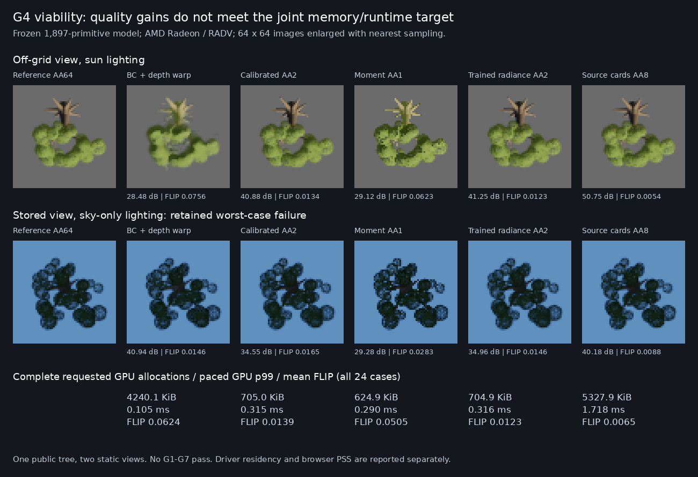
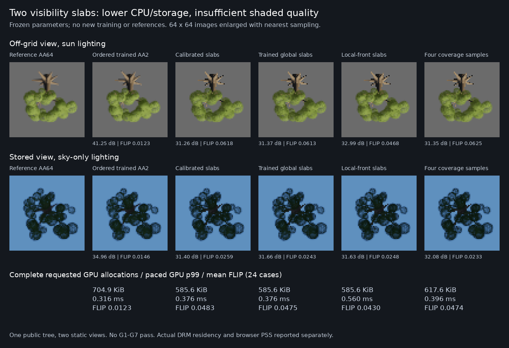

# Shaded appearance: first G4 viability decision

**Decision: change the representation.** Preserve the frozen fit and the renderer as an
experimental control. Stop spending training cycles on material-moment error. Neither
of the two permitted optimizations meets quality, runtime and resident-memory requirements
together. [G1–G7](neural-rendering-goals.md) are unchanged and remain unmet.

Work began 2026-10-27 15:04:56 UTC, with a 17:04:56 UTC deadline, solo on Pop!_OS.
The architecture decision was reached within the two-hour block; final archival/check time
is recorded in the evidence. No training steps or new reference captures occurred in this block.

The useful result is **shading visible material components before mixing them**, combined
with source-derived compact geometry. Relative to the full BC atlas, the trained AA2 path
has 80.20% lower mean FLIP, 94.99% lower LPIPS and +9.442 dB mean PSNR on this diagnostic.
That is not a large demonstrated learning advantage: the existing conventional
source-calibrated primitive control, rendered identically, is only 0.388 dB behind,
The trained parameters reduce mean FLIP by 11.30% and LPIPS by 10.73% versus that control. Both take essentially the same storage and execute the same algorithm.
All 24 trained-vs-calibrated comparisons meet the unchanged numeric quality tolerances.



## What was actually compared

One Great Tree, seed 7, at 64×64 output pixels; two previously published views
(stored anchor 103 and one off-grid direction), four fixed illuminations and three backgrounds:
24 shaded comparisons, not 24 independent scenes. Static hard-cut source cards and authored
wood, production leaf response with analytic sky, flat source bark. There is no wind,
scene shadow transport, fog, temporal reconstruction, camera-cut test or unseen asset here.
AA1 is one spatial sample per pixel; AA2 is 2×2; AA8 is 8×8.

The 1,897 fitted optical primitives are explicit optimized half-precision parameters,
**not an MLP or a neural decoder**. Total packed representation is 107,672 bytes,
including common values and wood. The primitive payload remains
`dc329e4b4c4eaa8ad0bbbb93eeea90cb2a94f4a0f01b284487f344d4ee2ff71c`.
The [prior continuation](neural-source-primitives.md#fixed-longer-optimization-with-exact-continuation)
is frozen.

All methods receive the same authored source information. No target image, current-view
ground truth or future sample is supplied to an inference path. Conventional controls are:

- The full source-integrated 16×16-view atlas: two BC7 layers plus an independent-depth BC5
  layer, 3 MiB, decoded-material bilinear filtering, four-view interpolation and the established
  one-step depth reprojection. Its raw GPU output agrees with the previously checked CPU
  decoder to the recorded 2e-5 maximum tolerance. A first implementation omitted reprojection;
  its off-grid parity failure and all resulting artifacts are preserved as `bc-no-parallax`.
- The existing source-derived 1,897-primitive model with the previously selected **two global
  calibration parameters**. This is not an uncalibrated strawman: its earlier fixed 49-candidate
  calibration used stored development views. No new calibration occurs here. It receives
  exactly the same pre-blend shading, wood renderer, sorting, AA2, output and composite
  as the fitted model. All 107,672 packed bytes are retained, and its active weight hash
  is recorded separately from the frozen trained weights.
- The original conventional source-card and wood renderer, with the same source material
  equations and 8×8 sampling. Cached cards, leaf-pattern texture, depth, scratch and output
  are counted. Source fields cook the cards at initialization; decoding/drawing them and
  wood, visibility, shading, integration and compositing occur in every measured frame.

These are the strongest applicable existing controls tested in this block, not proof of an
optimal conventional renderer. In particular, the BC atlas averages material roles: crediting
the learned path with its entire improvement over that atlas would confound representation,
shading order and learning. The calibrated and direct-source controls expose that confound.

## Two optimization experiments, then a decision

1. **Shade before blending, AA1.** Keep all primitive parameters and sorting unchanged.
   Shade each leaf primitive and shade wood with its bark response, then blend premultiplied
   radiance into one RGBA16F target. This replaces three material targets. Coverage is
   bitwise identical to the initial GPU path in all eight view/light outputs. Numeric
   quality passes versus BC rise from 13/24 to 22/24, but the two remaining cases regress
   as far as 11.558 dB. Runtime does not recover the BC budget.
2. **Four spatial samples, AA2.** Test the demonstrated silhouette/sampling failure.
   Mean quality improves strongly and the worst boundary error falls from 2.236 to 1.414
   pixels. The same two cases still fail. Scratch grows, and complete allocation reduction
   versus BC is only 6.015×. There was no third candidate optimization.

Mean displayed-image metrics, using the existing preprocessing and pinned evaluators:

| Path | PSNR dB ↑ | FLIP ↓ | LPIPS ↓ |
|---|---:|---:|---:|
| BC atlas + depth reprojection | 30.685 | 0.06237 | 0.037719 |
| Frozen model: material moments, AA1 | 30.406 | 0.05049 | 0.035133 |
| Experiment 1: shade then blend, AA1 | 33.431 | 0.02107 | 0.017743 |
| Experiment 2: shade then blend, AA2 | 40.128 | 0.01235 | 0.001889 |
| Conventional calibrated primitives, AA2 | 39.740 | 0.01392 | 0.002116 |
| Original source cards + wood, AA8 | 48.044 | 0.00651 | 0.000301 |

The final trained AA2 path still fails stored view 103, sky-only illumination, against
gray and blue backgrounds. PSNR losses versus BC are **3.530 and 5.980 dB**;
LPIPS ratios are **1.314× and 2.309×**. The excellent mean does not erase these failures.
The conventional source AA8 control has higher mean quality than either compact primitive
path; it is slower and larger. Neither conventional control is silently weakened to
manufacture a learned win.

Coverage is scored before tone mapping. Precision and recall use coverage ≥0.5;
boundary error is the symmetric 99th-percentile distance between binary boundaries.
The table gives the worst view for precision, recall and boundary error:

| Path | Mean coverage MAE ↓ | Precision ↑ | Recall ↑ | Boundary p99, pixels ↓ |
|---|---:|---:|---:|---:|
| BC atlas + depth reprojection | 0.01678 | 97.89% | 93.82% | 2.038 |
| Frozen model: material moments, AA1 | 0.01788 | 99.13% | 97.09% | 2.236 |
| Experiment 1: shade then blend, AA1 | 0.01788 | 99.13% | 97.09% | 2.236 |
| Experiment 2: shade then blend, AA2 | 0.00883 | 97.80% | 98.54% | 1.414 |
| Conventional calibrated primitives, AA2 | 0.00935 | 97.81% | 98.80% | 1.414 |
| Original source cards + wood, AA8 | 0.00429 | 99.49% | 99.57% | 1.000 |

This is a static silhouette diagnostic, not achievement of G3's temporal, disocclusion or
thin-feature acceptance tests.

## Complete rendering cost on the AMD machine

Ryzen 5 5500U, hardware AMD Radeon Graphics / RADV RENOIR, Mesa 26.1.6,
Chrome 154.0.8037.57, pinned Wrela 0.9.0. Each profile has 60 warmup and 240 measured
frames, one worker, 64×64 output. View changes every frame and illumination every two frames,
forcing model updates and sorting. Captures, profiles and scoring run sequentially.
Raw profiles, device descriptions, compiled shaders, programs and commands are retained.

The candidate frame includes half decoding, stable CPU depth sort and index upload,
procedural wood vertex evaluation, optical visibility, blending, integration and final
tone-mapped screen composite. It uploads 8,196 bytes/frame including uniforms, versus
96 bytes for BC. The direct source control has no global sort. The calibrated model
executes the same algorithm as the trained model.

All times below are milliseconds:

| Path | Saturated GPU p95 | Paced GPU p95 / p99 | CPU frame p99 | CPU start → GPU complete p95 / p99 |
|---|---:|---:|---:|---:|
| BC atlas + depth reprojection | 0.0269 | 0.1036 / 0.1046 | 0.370 | 1.906 / 3.812 |
| Frozen model: material moments, AA1 | 0.0758 | 0.2892 / 0.2899 | 1.020 | 4.985 / 5.215 |
| Experiment 1: shade then blend, AA1 | 0.0736 | 0.2915 / 0.2920 | 0.983 | 5.276 / 5.513 |
| Experiment 2: shade then blend, AA2 | 0.0981 | 0.3141 / 0.3161 | 0.973 | 4.340 / 4.528 |
| Conventional calibrated primitives, AA2 | 0.0855 | 0.3125 / 0.3149 | 0.862 | 4.858 / 5.131 |
| Original source cards + wood, AA8 | 1.0488 | 1.6842 / 1.7184 | 0.598 | 3.900 / 4.148 |

GPU spans cover the registered passes, including final compositing. They **do not by
themselves include a queue upload before the first timestamp**. CPU frame time includes
sorting, command recording and submission, but is not GPU completion time. Therefore a
separate observer follows the existing queue-completion promises from CPU frame start
through completion of all that frame's queued work. It adds no waits, includes uploads
and compositing, and excludes post-run image readback. That wall-clock column also includes
browser scheduling and driver notification, and varies between runs; it is not an
input-to-photon measurement or a basis for claiming the trained model faster than calibration.
Instrumentation is confined to copied evidence builds. The ordinary GPU/CPU profiles are
unmodified builds.

The trained AA2 path is 3.031× / 3.021× BC's paced GPU p95 / p99; saturated GPU p95 is
3.649× BC. Its observed complete-work p95 is 2.277× BC. G4's ≤1.1× limit is not met.
Paced frame intervals near 16.7 ms reflect the 60 Hz schedule and are not substituted for
rendering latency. Initialization/source cooking is outside steady-state frame timing;
its allocation peak is included below. No G6 whole-scene or G7 build-time claim is made.

## Resident memory, including scratch and caches

Packed model size is not residency. The engine counter misses executor uniform/upload
rings and the offscreen screen target. A measurement-only observer records **every**
WebGPU buffer and texture creation/destruction, including retained upload capacity,
scratch, output, dummy/fallback resources and cache backing storage. Shader/pipeline
and driver allocation bytes are not exposed by that interface, so actual DRM residency
and whole-browser proportional resident memory are recorded separately.

| Path | Engine appearance/scratch bytes¹ | All live requested GPU bytes² | Peak requested GPU bytes² |
|---|---:|---:|---:|
| BC atlas + depth reprojection | 3,145,844 | 4,341,876 | 7,487,620 |
| Frozen model: material moments, AA1 | 230,316 | 639,916 | 656,300 |
| Experiment 1: shade then blend, AA1 | 164,796 | 574,396 | 590,780 |
| Experiment 2: shade then blend, AA2 | 312,252 | 721,852 | 738,236 |
| Conventional calibrated primitives, AA2 | 312,368 | 721,968 | 738,352 |
| Original source cards + wood, AA8 | 5,046,136 | 5,455,736 | 5,472,120 |

¹ Excludes the identical 65,536-byte output buffer only; includes wood, sorting indices,
depth and image targets. ² Includes that output, screen, upload/uniform rings and all other
observed buffers/textures. No fallback atlas is loaded by the compact paths. Inactive
counterpart payloads are removed from each build. The source-control helper added 116
dummy bytes to the later calibrated build and final checked-in default; this is explicitly
counted for calibration and the final native check, not normalized away. The tables retain
the exact originally measured AA2 build; final default images are byte-identical.

The BC upload ring retains 1,048,576 bytes after initialization; compact/source paths
retain 262,144 bytes. Every path retains a 65,536-byte uniform ring and 16,384-byte
offscreen screen. The three-target path initially appears to save 13.659× by the engine
counter, and the one-target AA1 path 19.089×, but the latter is only **7.559×** with complete
requested allocations. Final AA2 is **6.015×** versus BC and **1.00016×** versus conventional
calibration. Neither is 16×.

Actual post-run residency snapshots, MiB, from the same isolated browser process groups:

| Path | DRM resident VRAM | DRM resident GTT | Browser group PSS |
|---|---:|---:|---:|
| BC atlas + depth reprojection | 24.55 | 9.20 | 464.48 |
| Frozen model: material moments, AA1 | 16.57 | 9.38 | 455.31 |
| Experiment 1: shade then blend, AA1 | 16.57 | 9.40 | 456.44 |
| Experiment 2: shade then blend, AA2 | 16.56 | 9.30 | 456.80 |
| Conventional calibrated primitives, AA2 | 16.82 | 9.38 | 456.54 |
| Original source cards + wood, AA8 | 16.51 | 9.40 | 456.91 |

DRM clients are deduplicated by device/client ID. These counters include driver/client
allocations and retained caches; PSS includes CPU/WASM data, sort scratch, code and browser
caches. The machine uses shared memory: **do not add PSS, VRAM and GTT columns** as if they
were disjoint per-asset ownership. The single-instance fixture's shared host overhead
cannot establish amortized multi-instance residency. WASM committed/used and reserved
values, full allocation descriptors and raw `/proc` records are retained. This is enough
to reject a 16× total-residency claim here, not a claim about every production scene.

## Next architecture-level bet

Keep exact authored wood and material roles. Replace globally sorted, point-sampled
appearance splats with **source-compiled visibility layers and pixel-footprint coverage**.
Use source geometry, field support and known visibility to bound occupied regions and
resolve thin silhouettes without allocating a supersampled image for every asset.
A learned component should predict a compact residual only where the deterministic
source-conditioned renderer has a demonstrated rendered error. Give the conventional
control those same layers, coverage and visibility inputs.

The shortest next discriminating experiment is one fixed-footprint layer/coverage
prototype on these same eight view/light images, against the frozen trained and calibrated
controls, with one scratch pool, full update/sort/composite accounting and a small batch
of instances. First resolve the two sky-only silhouette failures and count amortized
resident bytes. Train nothing until that measured comparison identifies a useful residual.

The remaining acceptance gaps are unseen views/individuals, motion, scale range 8–512 pixels,
richness scaling, shared-memory scaling and whole-scene integration. They are not needed
to decide against the current configuration: it already fails the joint public quality,
memory and cost test. This work does not retire neural rendering or change G1–G7.

## Reused shaded references and proportional verification

The completed shaded references shade each visible source fragment before exact Q20
integration. Existing 16→32 sampling failed all eight cases; the completed 32→64
comparison passed all eight fixed RGB/coverage tolerances. This block uses those AA64
references unchanged. Material-average controls expose nonlinear shading, normal
renormalization, material quantization and leaf/wood role loss; they do not isolate only
the mathematical averaging operation.

The production `leaf_response` extraction has the previously completed 4,096-case GPU
byte-parity check against the original expression
(`a2b14264783b3078b2d8901b92be0ce771a39eb9483e5bf4b185604271a24c25`),
an independent float64 equation check (maximum 6.57e-6), and a transmission-negative control.
Existing exact pixel integration and GPU/CPU material-response checks are reused.
No repeated reference audit or new reference captures were needed.

Preprocessing is engine tone mapping at exposure 0.62 followed by sRGB, applied after
premultiplied linear compositing over each background. FLIP uses LDR 67 pixels/degree,
RGB inputs; LPIPS uses AlexNet v0.1, sRGB [-1,1], without resizing or cropping.
Mean PSNR is the arithmetic mean of case PSNR values, not PSNR of pooled MSE.
Pinned implementations and primary sources are in [citations](citations.md).
The established probes and all executable GPU captures/profiles are the substantive checks;
the final frozen checkout is checked for formatting/types and byte-identical output.
No full-suite or PR-readiness claim is made.

## Evidence and replay

The checked-in `studio/appearance/runtime` defaults to the frozen trained AA2 diagnostic.
Its actual half words, common values and wood are included as Wrela constants so a clean
checkout can build it. This is not enabled in the production renderer.

On Pop!_OS from the worktree:

```bash
wrela tool appearance -- runtime
wrela profile studio/appearance/runtime --frames 240 --warmup 60 --workers 1 --size 64x64 --chrome --json
```

The remote evidence root is
`/home/ryanwible/worktrees/wrela-neural-frontier/build/neural-evidence/g4-viability-v1`.
Each variant retains its exact `runtime-source.tar.gz`, compiled profile build, raw pixels,
profiles, individual scores, allocation/DRM/PSS and completion records. Frozen full BC
and candidate data live in `frozen/`. External scripts under
`/home/ryanwible/.local/state/wrela-neural-frontier/` are archived with the evidence;
they are not repository Python code. Restoring a variant archive restores its actual data
and configuration; save the checked-in version before doing so. The calibrated baseline's
active weight SHA is in its `record.json`.

The old bad projection baseline, initial build/capture failures, failed material-moment
path, failed two targeted optimizations and every quality tail remain preserved.
A manifest binds this evidence, its reference dependency and exact source/script archives.
Evidence digest: `44cc42b8607d0781958bbd4409c360cd7ab8a7288d5a8797dfa091d4f8ef46b6`.


## Replacement experiment: reject two visibility slabs

**Decision: retire the two-slab radiance mixture.** This subsequent experiment tests
the replacement proposed above, with two targeted follow-ups after its initial result.
It does not reopen the first block's optimization budget. The first block concluded
within 67 minutes; this replacement's plan was recorded at 16:29:38 UTC and its decision
at 16:46:09 UTC on 2026-10-27. Zero training steps and zero new references.
G1–G7 remain unchanged and unmet.

The frozen 1,897-primitive payload is unchanged, SHA-256
dc329e4b4c4eaa8ad0bbbb93eeea90cb2a94f4a0f01b284487f344d4ee2ff71c.
The conventional source-calibrated payload is unchanged, SHA-256
065549765511b660a115519d86c2d307bf04c5d56bc2536f17d60d80bb111114.
Both receive the same source geometry, materials, field support, authored wood
triangles, lighting and four quarter-pixel sample locations. The strongest ordered
calibrated control and established BC/depth control remain in the comparison.
These are fitted explicit optical primitives, not an MLP runtime decoder.

The initial replacement removes global CPU sorting and supersampled image targets.
Each primitive averages four opacity samples, converts the result to optical
thickness, and additively accumulates thickness-weighted shaded radiance in two
depth slabs. Far then near slabs resolve over point-sampled source wood. Support
quads expand to cover the four sample positions. Within each slab, colors are
mixtures rather than ordered per-fragment compositing.

This belongs to the general family of bounded-storage commutative transparency
approximations discussed by [McGuire and Bavoil (2013)](https://www.jcgt.org/published/0002/02/09/).
It is our own optical-depth/slab experiment, not a reproduction or novelty claim.

The two follow-ups answer separate measured questions:

1. **Local front anchor:** replace the global split with a per-pixel nearest contributing
   primitive depth, using the source shader's 2.4 m attenuation length for the front
   slab. An extra visibility pass recovers only 0.502 dB while raising paced GPU
   p95 from 0.376 to 0.558 ms.
2. **Independent coverage samples:** keep the original global split, but accumulate
   four independent optical thicknesses before averaging final opacities. This retains
   overlap correlations lost by per-primitive averaging. An extra 32,760 live scratch
   bytes recovers only 0.101 dB. Point-sampled wood and slab color mixtures remain.

No third follow-up is taken. All failed outputs, the local-front compile failure,
exact source/builds and measurements are retained.

### Rendered quality and silhouettes

Same completed AA64 references, two views, four lights, three backgrounds and metric
preprocessing as above; no crop, threshold or acceptance change.

| Path | Mean PSNR dB | Mean FLIP | Mean LPIPS | BC quality gates passed |
|---|---:|---:|---:|---:|
| BC atlas + depth reprojection | 30.68527 | 0.062373 | 0.037719 | reference baseline |
| Conventional calibrated, ordered AA2 | 39.73958 | 0.013921 | 0.002116 | 22/24 |
| Frozen fit, ordered AA2 | 40.12768 | 0.012348 | 0.001889 | 22/24 |
| Frozen fit, global two slabs | 32.84992 | 0.047489 | 0.018105 | 17/24 |
| Conventional calibration, two slabs | 32.71395 | 0.048277 | 0.018490 | 17/24 |
| Follow-up 1: local front | 33.35180 | 0.043010 | 0.016403 | 18/24 |
| Follow-up 2: four coverage samples | 32.95052 | 0.047441 | 0.017916 | 17/24 |

Global slabs have 9.58× the ordered fit's LPIPS; even the best local-front result
passes only 18/24 public cases. The conventional slab control receives identical
runtime inputs and costs, and tracks the fitted one closely. Its ordered version
remains substantially stronger.

Coverage MAE rises from 0.008832 for the ordered fit to 0.013472 for global slabs,
0.013470 with the local front, and 0.012288 with independent coverage samples.
Worst per-image coverage-error p99 rises from 0.113129 to 0.307728, 0.307730 and
0.316566 respectively. Worst silhouette boundary p99 remains 1.414 pixels for
all four; that metric alone hides substantial fractional-coverage damage.
Per-case precision/recall, soft IoU and shaded tails remain in the evidence.



### Complete cost and actual residency

Same Ryzen 5 5500U, hardware AMD RADV RENOIR, Mesa 26.1.6, Chrome
154.0.8037.57, pinned Wrela 0.9.0 / compiler
de9b81e52a7747870dfbd5223cb8aeb41e584d23.
One isolated 240-frame run after 60 warmup frames per path, at 64×64, one worker.
Captures, profiling and scoring run sequentially on Pop!_OS.

GPU spans include decoding, wood, visibility, layer accumulation/resolution and screen
compositing. CPU calls include view/light updates and command recording. No global CPU
sort or index upload remains. These paths write 784 uniform bytes per frame; the
local-front path writes 1,296 bytes. Initialization is outside steady-state time,
but its peak allocation and retained upload capacity are counted.

| Path | Paced GPU p95 / p99 ms | CPU call p99 ms | Saturated GPU p95 ms | CPU start to GPU completion p95 / p99 ms |
|---|---:|---:|---:|---:|
| Frozen fit, global two slabs | 0.375642 / 0.376428 | 0.553050 | 0.09548 | 4.220215 / 4.452451 |
| Conventional calibration, two slabs | 0.375042 / 0.375649 | 0.538050 | 0.11424 | 4.365491 / 4.726450 |
| Follow-up 1: local front | 0.558454 / 0.559950 | 0.702200 | 0.16740 | 4.490247 / 4.605481 |
| Follow-up 2: four coverage samples | 0.390446 / 0.395628 | 0.538550 | 0.10452 | 4.204834 / 4.305229 |

Ordered fitted AA2 has paced GPU p95/p99 0.314113/0.316113 ms, CPU p99 0.973050 ms
and saturated GPU p95 0.09808 ms. BC has paced GPU p95/p99 0.103642/0.104649 ms
and CPU p99 0.370000 ms. CPU sorting removal reduces CPU work, but no replacement
establishes a complete GPU improvement.

Completion uses the existing observer of submissions and completion notifications;
every submission within each CPU frame is accounted for. This includes browser
scheduling and driver notification latency, and is not input-to-photon timing.
Ordered AA2 completion p95/p99 was 4.340100/4.527881 ms; BC was 1.906018/3.812336 ms.
Small single-run differences are not a robust wall-time ranking.

| Path | Engine appearance + scratch bytes | All live requested GPU bytes | Peak requested GPU bytes | DRM VRAM / GTT MiB | Browser group PSS MiB |
|---|---:|---:|---:|---:|---:|
| Frozen fit, global two slabs | 190,088 | 599,688 | 616,072 | 16.582 / 9.289 | 454.899 |
| Conventional calibration, two slabs | 190,088 | 599,688 | 616,072 | 16.582 / 9.289 | 454.088 |
| Follow-up 1: local front | 190,088 | 599,688 | 616,072 | 16.590 / 9.383 | 462.865 |
| Follow-up 2: four coverage samples | 222,848 | 632,448 | 648,832 | 16.586 / 9.289 | 455.003 |

The engine column excludes only the identical 65,536-byte output. Full requested
allocations include that output, depth/coverage/radiance targets, wood, fallback/dummy
resources, uniform/upload rings and screen storage. Only a dummy sort-index entry
remains. No BC fallback atlas is retained. Global/local slabs save 16.9% against
the measured ordered fit's 721,852 requested live GPU bytes.

Against BC's 4,341,876 bytes, complete requested allocations save only **7.240×**
(global/local) or **6.865×** (four coverage samples). The engine-only number appears
to exceed 16× for global slabs, illustrating why it cannot substitute for residency.
Actual DRM residency and whole-browser PSS include retained driver/browser storage
not exposed by WebGPU descriptors. These are separate UMA observations: do not sum
PSS, VRAM and GTT or attribute shared host overhead to one asset. The final-default
116-byte helper difference remains as documented above.

### What the failures identify

Post-measurement attribution uses conservative bounding boxes of the already exported
source wood triangles. No new reference or changed quality gate. Inside these boxes
can include foliage: not all their error is established as wood-caused.

Outside projected wood bounds, four independent opacity values reproduce ordered
AA2 coverage within **0.0001531 mean absolute error**. This is agreement with the
four-sample control, not with perfect coverage. Yet display squared error against
the shaded reference rises from 0.9217 to 2.9194 on average over cases in that region.
Within conservative wood bounds, coverage differs by 0.048656 and display squared
error rises from 0.6505 to 5.0003. Raw masks and per-case values are retained.

Compact coverage accumulation is useful, but does not retain joint depth, shaded
color and wood/leaf visibility. More material-moment fitting would not repair this
renderer's lost ordering. Reject the mixture on quality, full storage and complete
runtime together; infrastructure progress is not a rendering win.

### Next architecture-level bet

Preserve **ordered subpixel visibility including wood**, while eliminating global CPU
sorting and full supersampled radiance targets. The shortest discriminating prototype
is tile-local ordered evaluation at the same four sample positions, with bounded lists,
explicit overflow/fallback accounting and both frozen fitted and conventional
source-calibrated inputs. Recover the ordered control's images before its CPU/storage
savings count. Reuse these references and metrics.

If transmittance reconstruction becomes the demonstrated bottleneck, test a small
source-conditioned transmittance model against conventional moment reconstruction
receiving the same moments, depths and coverage. [Tsopouridis, Vasilakis and Fudos,
Neural Moment Transparency (2024)](https://cgrg.eu/publications/neural-moment-transparency)
is prior work on learned fragment transmittance from accumulated moment statistics.
This is a possible model target, not an implemented result or imported performance
claim. Wrela's fields and source visibility can supply exact ordered supervision and
support bounds to both methods.

### Preservation and proportional verification

The runtime keeps rejected methods as diagnostic modes 4–6; its default remains
the frozen ordered AA2 renderer. Format/type checks pass; a final native capture
reproduces all eight measured AA2 outputs byte for byte. Completed reference and
response checks are reused. No full-suite/PR-readiness claim.

Evidence on Pop!_OS: build/neural-evidence/g4-visibility-layers-v1 in the worktree.
Each variant retains actual source/payload, compiled build, raw images, profile,
completion/allocation records and raw process/DRM records. The manifest references
unchanged prior comparison/reference manifests and binds exact final source/scripts.
Manifest SHA-256: `814030755e130a9fd7a600643fbcef0f303cb6db94d4108f4916cbe7af44ef9e`.


## Ordered GPU execution: quality recovered, cost rejected

**Decision: change the appearance representation. Retire tile-local compute execution;
do not promote the GPU-global-sort alternative.** Keep the original frozen, CPU-sorted
AA2 renderer as the diagnostic control. This block follows the rejected two-slab
representation and uses exactly two targeted optimizations, zero training steps and
zero new shaded references. G1–G7 are unchanged and unmet.

The initial prototype assigns an 8×8 pixel tile to each 64-lane workgroup. It projects
the frozen primitive stream, culls support bounds, compacts a 512-entry local list,
sorts by float32 centre depth and descending primitive ID, and cooperatively evaluates
four ordered subpixel contributions. Pixel colors stay in registers until their
four-sample resolve. Source wood uses the existing 128×128 color/depth raster targets;
these remain resident and counted. This tests ordered GPU execution, not a claim
that all supersampled storage has been removed.

The tile's declared workgroup-local storage is 10,244 bytes; 64 groups are dispatched.
Count above 512 produces invalid negative coverage, making the result ineligible:
there is no hidden dropped-leaf path or loaded conventional fallback. None of the
eight captures overflows, for either fitted or calibrated parameters. This remains
a bounded diagnostic, not a general production fallback.

Both methods receive the same source support, materials, wood, camera, lights and
sample positions. The conventionally calibrated source primitives retain their
previously selected parameters. The fitted and calibrated hashes remain unchanged
from the earlier sections. No new fitting advantage is introduced by the runtime.

### Quality recovery and two consequential follow-ups

| Path | Mean PSNR dB | Mean FLIP | Mean LPIPS | Cases matching its prior ordered control | BC quality gates passed |
|---|---:|---:|---:|---:|---:|
| Frozen fit, tile-local | 40.120118 | 0.012470 | 0.001883 | 24/24 | 22/24 |
| Calibrated, tile-local | 39.735748 | 0.013968 | 0.002108 | 24/24 | 22/24 |
| Follow-up 1: projection cache | 40.120118 | 0.012470 | 0.001883 | 24/24 | 22/24 |
| Follow-up 2: GPU sort + raster | 40.127682 | 0.012348 | 0.001889 | 24/24 | 22/24 |
| Calibrated, GPU sort + raster | 39.739577 | 0.013921 | 0.002116 | 24/24 | 22/24 |

The original fitted AA2 control is 40.127682 dB / 0.012348 FLIP / 0.001889 LPIPS;
the calibrated control is 39.739577 dB / 0.013921 FLIP / 0.002116 LPIPS.
Tile integration uses f32 accumulation instead of rounding every blend through an
RGBA16F attachment, so its pixels are close rather than identical. Every shaded
case stays within the existing relative quality tolerances against its corresponding
ordered control. The fitted tile path's coverage MAE is 0.008820 versus 0.008832;
silhouette precision/recall are identical and worst boundary p99 remains 1.414 pixels.
The same two BC-relative sky-only cases still fail. This is no G4 quality completion.

1. **Project/shade once:** the first measurement's GPU p95 is 1.586 ms. Test whether
   repeating projection in every tile causes that regression by caching all 1,897
   projected/shaded records once per frame. The complete 121,408-byte cache and its
   dispatch are counted. Quality is retained, but GPU p95 remains 1.297 ms, saturated
   p95 0.537 ms, and total requested GPU allocations rise to 836,064 bytes.
2. **GPU sorting plus hardware raster:** replace tile integration with one global
   2,048-entry GPU sort followed by the established wood/leaf raster and four-sample
   resolve. The source count is asserted at most 2,048; sort indices are stored and
   counted. Its single workgroup declares 16,384 bytes of local storage. It reproduces
   all eight fitted and all eight calibrated images **byte for byte**, yet costs more
   GPU work in the alternating comparison below.

The GPU sort uses a standard bitonic network; see [Batcher (1968)](https://doi.org/10.1145/1468075.1468121).
This Wrela implementation and its rendering integration are our own, with no imported
implementation or claimed novelty. No third optimization is taken.

### Complete runtime, including the misleading first paced result

Same Ryzen 5 5500U / hardware AMD RADV RENOIR, Mesa 26.1.6, Chrome 154.0.8037.57,
Wrela 0.9.0 / compiler de9b81e52a7747870dfbd5223cb8aeb41e584d23.
Each initial run has 240 frames after 60 warmups, one worker, 64×64 output.
All builds, scoring and GPU measurements run sequentially on Pop!_OS.

| Path | Paced GPU p95 / p99 ms | CPU call p99 ms | Saturated GPU p95 ms | CPU start to completion p95 / p99 ms |
|---|---:|---:|---:|---:|
| Frozen fit, tile-local | 1.586317 / 1.655851 | 0.573050 | 0.71412 | 4.340356 / 4.500298 |
| Calibrated, tile-local | 1.587522 / 1.643885 | 0.510000 | 0.72608 | 4.340332 / 4.531252 |
| Follow-up 1: projection cache | 1.296984 / 1.430936 | 0.500250 | 0.53696 | 6.070813 / 6.339993 |
| Follow-up 2: GPU sort + raster | 0.224052 / 0.260471 | 0.444150 | 0.22880 | 4.401636 / 4.547219 |
| Calibrated, GPU sort + raster | 0.915528 / 0.916725 | 0.533050 | 0.22452 | 4.385754 / 4.539114 |

These GPU spans include decoding/projection, sorting, visibility, source wood, ordered
leaf composition, resolve and final display composite. CPU calls include view/light
updates and uploads/recording; no new path does a CPU global sort or index upload.
Initialization is outside steady-state timing, with peak/resident allocation counted.
Completion includes every frame submission, plus browser scheduling and completion
notification latency. It is not input-to-photon time.

The first fitted GPU-sort run misleadingly suggests a paced improvement over the old
CPU-sort p95 of 0.314113 ms: it reports 0.224052 ms. However, saturated performance
worsens, and the calibrated GPU-sort run reports 0.915528 ms despite the same algorithm.
This contradiction triggered a proportional verification run, not a new optimization:
three alternating pairs against the archived CPU-sort build, in B,A,A,B,B,A order.

| Alternating comparison | Original CPU sort | GPU sort + raster |
|---|---:|---:|
| Median of saturated GPU medians | 0.078240 ms | 0.214040 ms |
| Saturated GPU p95, three runs | 0.08504 / 0.08100 / 0.09324 ms | 0.23452 / 0.23552 / 0.23092 ms |
| Median CPU frame calls | 0.680000 ms | 0.380000 ms |
| Final pair paced GPU p95 / p99 | 0.313842 / 0.315178 ms | 0.914434 / 0.916959 ms |
| Final pair CPU p95 / p99 | 0.950750 / 1.043300 ms | 0.450250 / 0.538550 ms |

The established paired estimator reports **43.38% lower CPU time but 173.57% higher
saturated GPU time**. Every pair has the same direction. GPU cost is 2.74×, not a win.

Read-only 100 ms power snapshots retain the unchanged automatic policy, reported
shader clocks from 400–1,800 MHz and temperatures 35–43°C. These are not synchronized
per-frame clock measurements, so they do not prove a specific spike's cause.
No clock or power setting was changed. Preserve the initially favorable paced result
alongside the contradictory repeats; do not cherry-pick it.

### Resident storage and scratch

| Path | Engine appearance/scratch bytes | All requested live / peak GPU bytes | DRM VRAM / GTT MiB | Browser group PSS MiB |
|---|---:|---:|---:|---:|
| Frozen fit, tile-local | 305,056 | 714,656 / 731,040 | 16.555 / 9.289 | 449.797 |
| Calibrated, tile-local | 305,056 | 714,656 / 731,040 | 16.555 / 9.195 | 449.311 |
| Follow-up 1: projection cache | 426,464 | 836,064 / 852,448 | 16.566 / 9.398 | 455.268 |
| Follow-up 2: GPU sort + raster | 312,440 | 722,040 / 738,424 | 16.570 / 9.383 | 457.114 |
| Calibrated, GPU sort + raster | 312,440 | 722,040 / 738,424 | 16.824 / 9.383 | 456.738 |

The engine column excludes only the identical 65,536-byte output. Complete requested
allocations include it, wood, sort indices, projected cache, all image/depth targets,
fallback/dummy data, retained upload/uniform rings and screen storage. The initial tile
path saves only 1.0% against the old fitted AA2 allocation of 721,852 bytes; caching
increases storage by 15.8%. The GPU-sort variant has essentially the same storage.
All remain far from 16× against the strongest same-source conventional control.

GPU workgroup-local arrays are separate from persistent WebGPU buffer/texture bytes.
Their declared sizes above affect occupancy; driver alignment and concurrent residency
are not inferred by multiplying the size by every dispatched group. Physical DRM
residency and browser PSS snapshots capture exposed retained driver/client allocations,
including retained spill storage and caches where reported. Transient physical peaks and
exact per-asset attribution are not established by these snapshots. On this UMA
device these columns overlap: never sum PSS, VRAM and GTT.

The restored default adds 72 dummy GPU bytes relative to the parent checkpoint.
Together with the already documented 116-byte helper difference, that is 188 bytes
above the original measured fitted AA2 build. The GPU-sort table counts the actual
722,040 bytes, without subtracting these differences.

### Next representation bet and preservation

The useful result is that ordered subpixel visibility restores the shaded image.
The failed bet is that moving this explicit 1,897-primitive stream's sorting and
compositing to compute delivers the required joint quality/runtime/storage gain.
No further optimization of this execution path is justified by these results.

Next test a **small source-conditioned representation of joint visibility and shaded
response**, replacing the explicit primitive stream. Keep source support and authored
wood, and model the rendered contribution rather than independent averaged material
moments. A deterministic low-rank/basis fit must receive the identical source-derived
features, sample positions and supervision. The frozen ordered fitted and calibrated
renderers remain controls; the completed shaded references still judge actual quality.
This is an architecture hypothesis, not a learned rendering result. No new model was
trained in this block.

Exact source/payload, compiled builds, all five variants, quality/tails, complete runtime,
DRM/PSS, allocation descriptors, three paired runs and power records are preserved in
build/neural-evidence/g4-tile-ordered-v1 on Pop!_OS. The paired profiler writes into the
compared build's results directory: its new baseline outputs were preserved separately,
and the four overwritten original result files were restored from existing copies to
their sealed-manifest hashes. No original evidence was lost; replay now copies the
baseline first.

The runtime preserves rejected diagnostics as modes 7–9 and restores mode 2 as default.
Focused formatting/type checks pass, and all eight restored default images are
byte-identical to the original measured AA2. No full-suite or PR-readiness claim.
Manifest SHA-256: `19998e152994f78f42b6e63c1b2e23668b66485cad005e5077c303677d6e604e`.
