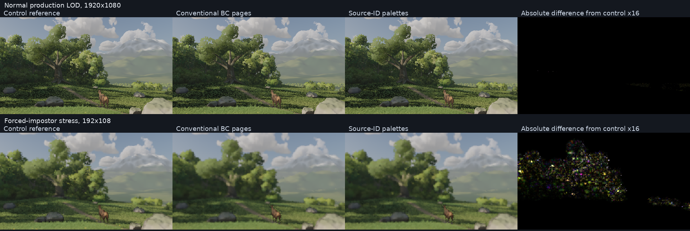

# Source visibility palettes: a measured GPU-memory tradeoff

2026-10-29. **Decision: continue this architecture as an opt-in for the clearing's
12 production kinds.** Store which source card or wood triangle is visible, then
recover attributes from geometry that both methods already retain.

Final impostor storage is **5,485,048 bytes versus 15,728,640 bytes**, a **2.87×
reduction** against the strongest retained conventional BC pages. Complete
browser rendering has a reconstructed per-frame median of 25.11878 ms versus
24.88564 ms (about 0.94% higher). All 24 existing shaded
stress checks and 12 normal-production 1080p comparisons pass the unchanged
development gates. This is a GPU-memory tradeoff, **not a speed win, total
physical-memory win, 16× G4 result or world-leadership claim**.

First joint assessment: 19.88 minutes.
Decision: 65.34 minutes. Exactly two optimization
follow-ups, solo on Pop!_OS AMD. Frozen models and G1–G7 unchanged. No training.
Earlier layouts, failed builds and all raw measurements are preserved.

## How this uses Wrela's source information

[Impostor baking](../engine/impostor.wrela) assigns each covered texel to a
card or limb triangle. A card's normal, depth and tint already live in the
common [source geometry](../engine/plant.wrela); its toward coordinate follows
from its centre and the selected view. Wood attributes are reconstructed
with barycentric coordinates from the common limb description.

The [packer](../engine/impostor_identity.wrela) uses 16-bit identities per
kind: zero is empty, the high bit marks wood. Constant 8×8 regions contain an
identity directly. Other regions reference four 4×4 descriptors; each mixed
block stores a local palette and 1–4-bit selectors. The final buffer includes
every descriptor and palette.

The GPU checks all **12,582,912 decoded IDs** against the source raster before
[Wood](../engine/wood.wrela) activates them. Original BC arrays remain live
during construction and verification, then are released. Those arrays, ID
render targets, packing scratch, readback and final copies are all counted.
There is no uncharged full-atlas fallback, trained model or reference-derived
runtime input.

The explicit request_source_pages option is enabled in
[clearing](../examples/clearing/stage.wrela). Existing exact BC pages remain
available through request_pages. Sources exceeding identity/address bounds
fall back to that path; non-BC callers keep their plain representation.
Only this AMD path and measured family are qualified here.

Both methods receive identical cards, limbs, fields, bounds, atlases, volumes,
sampling, visibility, ordering, lighting, shadows, updates and compositing.
The control is **deduplicated BC pages**, not the larger original 37,748,736-byte
BC arrays or an uncompressed atlas.

## Bounded experiment sequence

The first executable exports all 12 source-ID atlases from one initialized
scene. Its CPU storage census predicts 6,750,808 bytes for a directly decodable
4×4 palette layout. That is a feasibility screen, not a rendering win.

1. First follow-up implements the GPU layout and source attribute decoder.
   Actual requested storage is 6,750,808 bytes; runtime/residency are measured
   and all 24 existing stress checks pass.
2. Final follow-up inlines constant 8×8 regions, allocating only mixed
   children: **5,485,048 actual bytes**. All four stress HDR outputs are
   byte-identical to the first layout. No third optimization is attempted.

One quiet GPU queue; candidates and checks are prepared ahead, captures batched,
CPU scoring afterward. The ID/attribute probes export all kinds from one
initialized scene. The established shaded helper still loads and initializes
the GPU scene for each output of a compiled fixture. No warmed-asset reuse or
capture infrastructure progress is counted as a rendering win.

## Shaded quality

The existing forced-impostor stress uses completed 256/1024/independent-1024
control references. It deliberately includes crowns normally drawn as cards;
this tests representation sensitivity, not normal production detail selection.
Whole image and crown rows 0–87 pass all references at every scale.

Ratios are candidate/control error; PSNR is candidate minus control.

| Stress scale | FLIP ratio | LPIPS ratio | PSNR delta,dB |
| --- | ---: | ---: | ---: |
| 1× | 1.025044 | 0.968395 | -0.167413 |
| 2× | 1.015241 | 1.016810 | -0.062979 |
| 3× | 1.001021 | 1.013544 | +0.046741 |
| 4× | 1.002790 | 0.996590 | -0.011431 |

The worst crown-band PSNR loss against the fine reference is −0.22178 dB.
Unchanged development gates: FLIP/LPIPS ≤1.05×, PSNR loss ≤0.25 dB.

### Why a production 1080p comparison was necessary

The first browser inspection changed 1,487 pixels by more than 2 byte levels,
maximum 18. An all-texel source probe also found wood reconstruction differences.
Those measured uncertainties justified a normal-production 1920×1080 check,
using the same phase 64 quadrature, fixed pose, geometry and lighting:
256 coarse, 1024 fine, independent 1024 control samples.

No transport algorithm or training reference is added. Candidate integrated
captures supply coverage and diagnostics, never the quality target.

| Production scale | FLIP ratio | LPIPS ratio | PSNR delta,dB |
| --- | ---: | ---: | ---: |
| 1× | 1.000531 | 1.000831 | -0.002675 |
| 2× | 1.000161 | 1.000041 | -0.000357 |
| 3× | 1.000100 | 0.999932 | -0.000179 |
| 4× | 1.000043 | 0.999807 | -0.000072 |

All eight fine-reference whole/crown checks pass. Native also passes coarse and
independent references: four further checks. Crown rows 0–879 are declared
before scoring. Viewing transform is exposure-1 Reinhard; LDR-FLIP at 67
pixels/degree, sRGB AlexNet LPIPS v 0.1 and sRGB PSNR, without resizing.

Reference convergence is imperfect: whole-image coarse/fine FLIP is 0.01116590,
independent/fine 0.00266778; PSNR 54.1113/61.9894 dB. Agreement across these
references leaves ample margin for the matched-quality decision. Tiny apparent
improvements are not fidelity wins. These are production-renderer quadrature
references, not independent transport truth.

### Leaf coverage and material reconstruction

The existing accumulation alpha lane records raw leaf-class coverage; RGB
accumulation is unchanged. At a 50% threshold, the paired 1024-sample candidate
has **four additional pixels and none missing**: precision
99.999303%, recall 100%. Symmetric boundary distance p99 is 0,
maximum 2.82843 pixels. Coverage MAE over the union is 0.000020200;
203 pixels differ by more than 2/255 coverage,24 by more than 0.1.

This class includes wood inside impostors but excludes separately drawn near
wood. It is not strand/instance truth or a full G3 test. Independent-reference
boundary p99 is 1 pixel, maximum 42.94 from sparse thresholded components.
Matched sampling reduces comparison variance; no universal silhouette tail
or motion result follows.

Visibility agrees at every texel with a fresh pre-BC bake. Across 1,982,070 leaf
texels, maximum decoded-normal discrepancy is 0.11132 degrees, none above one
degree; sqrt-colour differs by at most one 8-bit level. Across 86,919 wood
texels, **322 exceed one degree**, maximum about 14.10 degrees; maximum toward
error is 0.003146. A second probe checks decoded directions because octahedral
coordinates exaggerate some differences. The remaining discrepancies are real,
and their precise cause is not isolated. **Lossless ID packing does not imply
bit-exact material reconstruction.** Rendered tests, not material moments,
decide acceptance. Broader views and motion remain unqualified.

## Rendering cost and actual memory

Pop!_OS, Ryzen 5 5500U, AMD RADV RENOIR PCI1002:164c, Mesa26.1.6,
Chrome154.0.8037.57, Wrela0.9.0/compiler
de9b81e52a7747870dfbd5223cb8aeb41e584d23. Browser profiles use 1920×1080
output/internal 2× reconstruction,600 warmup plus 60 measured frames, one worker,
pacing/adaptive measurement disabled. No power/thermal lock.

Earlier progress updates quoted the CLI summary, 24.90376→24.96820 ms.
The table below explicitly reconstructs minimum-start/maximum-end GPU spans
for frames 600–659 from the saved timestamp records. These aggregations differ;
both remain in the evidence. The conservative whole-span median is used here.
CPU frame median/p95 is 1.655/1.850 ms for control and 1.695/2.015 ms for the candidate.
Median browser frame interval is 26.610/26.890 ms. No performance improvement
is claimed from either aggregation.

The full frame includes decoding, sorting, visibility, wood, current updates,
lighting, reconstruction and compositing. Vegetation labels are only a subset.
Quantiles describe this 60-frame sample, not broad G4 p95/p99 compliance.

| Method | Full GPU p50/p95/p99,ms | Vegetation labels p50/p95/p99,ms |
| --- | ---: | ---: |
| baseline | 24.88564 / 26.51652 / 27.57921 | 7.37060 / 7.42676 / 7.80186 |
| source-palette | 25.01442 / 26.56091 / 27.60432 | 7.41814 / 7.44753 / 7.80858 |
| hierarchical | 25.11878 / 26.65949 / 27.64333 | 7.47396 / 7.53110 / 7.81805 |

First 120-frame GPU span sums, including ordinary startup work:
10225.50 ms control,
10418.93 ms candidate. These are work
accounting, not isolated packing or application startup latency. No cold-start
speed claim. CPU timings, individual labels and all frame spans remain in the
raw profiles.

| Allocation | Control | Final source-ID |
| --- | ---: | ---: |
| Impostors | 15,728,640 B | 5,485,048 B |
| All requested live GPU allocations | 383,312,696 B | 373,069,104 B |
| Requested startup peak | 578,009,512 B | 578,009,512 B |

The 2.87× ratio is limited to impostor storage. The common leaf atlas, support
table, crown volumes, bounds, geometry, instance buffers and parameters remain
resident and identical. Their allocations are included in the whole-renderer
live/peak observations above. Adding unchanged appearance resources can only
reduce the representation ratio; no complete G4 appearance-budget ratio is
claimed. In particular, this is not a 16× result.

Across the original run and two additional fresh-browser repetitions:

| Actual resident observation | Control range | Candidate range |
| --- | ---: | ---: |
| Deduplicated DRM VRAM | 535,236,608–535,302,144 B | 519,774,208–519,839,744 B |
| DRM GTT | 20,475,904–20,574,208 B | 20,475,904–20,574,208 B |
| Browser-tree PSS | 857,006,080–869,137,408 B | 858,788,864–885,836,800 B |

Observed GPU-resident memory falls roughly 15.4 MB, while paired PSS rises
1.8–16.7 MB. The initial PSS increase is concentrated in the GPU process, but
its cause is unproved. These are whole-client snapshots, not per-asset
attribution or physical peaks. **Do not sum overlapping UMA pools; no total
physical-memory reduction is claimed.** Requested startup peak is unchanged.

### Real source replacement and corruption control

At frame 300 both methods rebuild all 12 kinds with seeds k+101 instead of k+1
through actual remake_woods and caster/occluder invalidation. Both receive
identical changed-source geometry.

| 60-frame edit window | Control | Source-ID |
| --- | ---: | ---: |
| Complete GPU span sum | 2331.58783 ms | 2344.15823 ms |
| Elapsed window | 2523.75506 ms | 2539.57990 ms |
| Maximum GPU frame | 153.66925 ms | 153.02793 ms |
| Requested live after edit | 411,065,772 B | 400,771,796 B |
| Requested peak including edit | 610,996,316 B | 600,752,724 B |
| Observed DRM VRAM after edit | 577,110,016 B | 553,160,704 B |
| Browser PSS after edit | 873,373,696 B | 884,026,368 B |

The edit adds 12.57 ms GPU work and 15.82 ms elapsed across that window;
overlapping CPU/GPU work is not added. All rebuilt IDs verify. The changed-source
image has mean RGB difference 0.006110 byte levels, maximum 16,1,327 pixels above 2.
That is a matched-source diagnostic, not an independently converged new-population
or G3 motion claim.

Deliberate XOR 1 corruption of constant-region IDs triggers the actual verifier
and prevents activation. The source is restored afterward. Diagnostic hooks
are removed; source edits use the existing runtime path.

## Next architecture bet and evidence

Keep source card identity, but test **compact raster-exact wood records**
instead of reconstructing limb geometry in every shaded tap. This targets the
measured wood discrepancy and a larger decoder's cost. Its total resident-memory
effect must be measured; host-process growth is not proven to be shader cache.
Visibility-driven generation may later remove unused angular data; this block
does not claim that saving.

Evidence is preserved under build/neural-evidence/source-identity-atlas-v1 on
Pop!_OS: earlier palettes, both failed builds, probe maxima, raw HDR/coverage
images, source/build archives, source-edit windows and corruption output.
Alpha metadata was corrected with the original retained; no rendered bytes
changed. Replay scripts are archived.

References: [exact BC control](neural-sparse-appearance.md),
[completed stress references and their limits](neural-appearance-projection.md),
[unchanged goals](neural-rendering-goals.md), [measurement rules](bench.md),
[metric sources](citations.md#neural-reconstruction-instrument).
Own source/GPU implementation; no external code, model or assets imported.

Evidence manifest SHA-256: 3320cf05de7f1208b2ecdb43d8872472bb01ed3b97ad514e925c4b3a863bc000.
