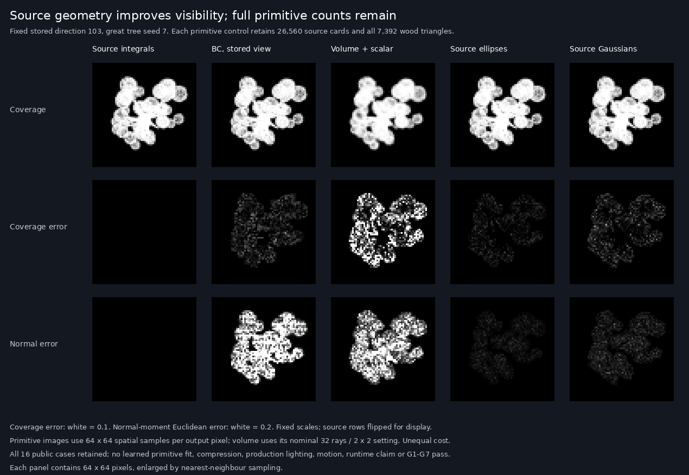
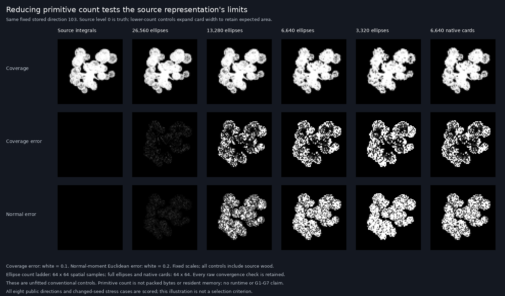
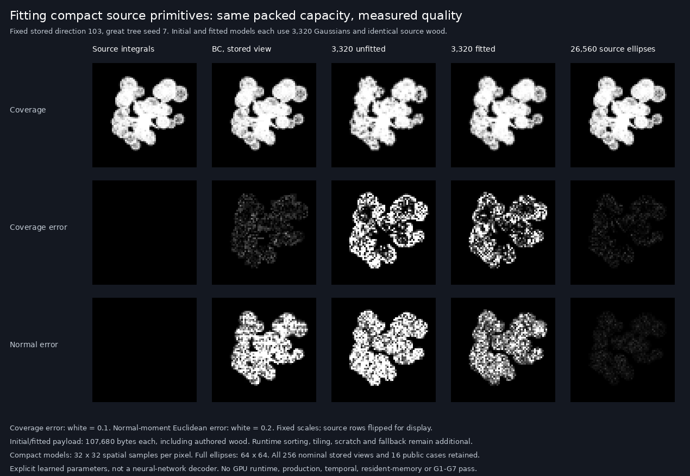
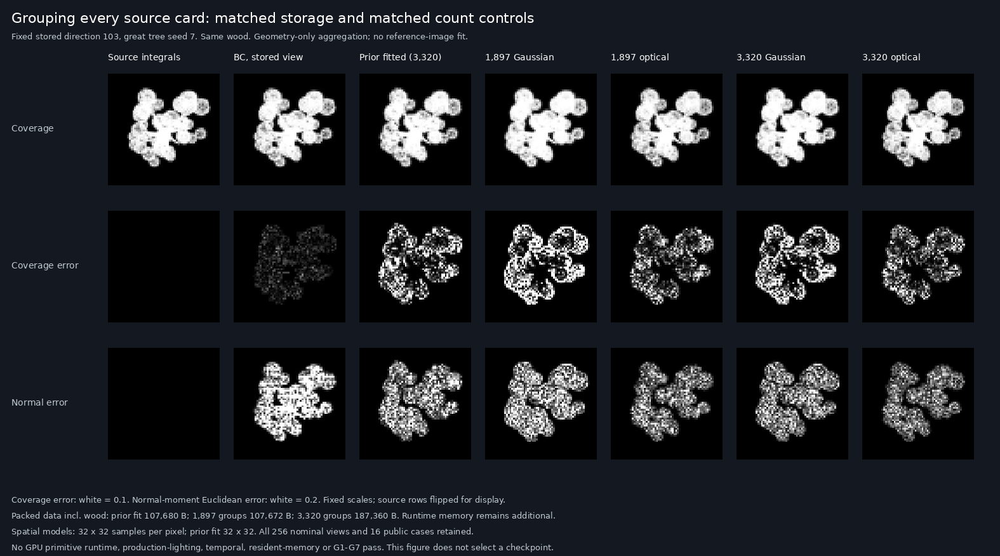
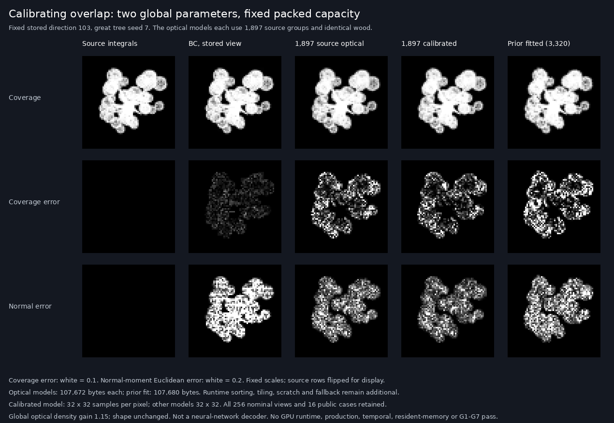
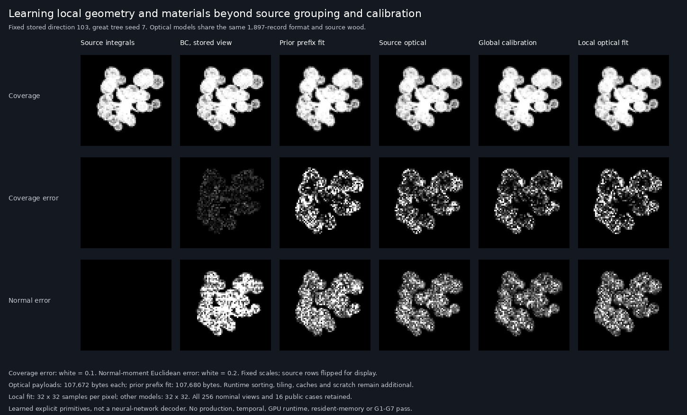

# Source primitive visibility controls

The source geometry provides a much stronger visibility control than the
current learned volume on this public material diagnostic. At full card
count, unfitted ellipses reduce mean coverage error by 61.05%
against the fixed BC control on four stored directions and 95.16%
on four off-grid directions. Both full-count kernels pass all five fixed
material screens in both groups. **This is an uncompressed conventional
control, not a learned advantage or a G1–G7 result.**

All captures, calculations and evaluation run on Pop!_OS, AMD Ryzen 5 5500U /
Radeon Graphics, RADV RENOIR. The five changed Wrela files add diagnostic
exports and component captures. Production rendering and shipped weights
do not change.

## Source and independent controls

The new commands are:

```bash
wrela tool appearance --timeout 900 --blob-budget 3221225472 -- primitives 7
wrela tool appearance --timeout 900 --blob-budget 3221225472 -- source 7 0.375 0.1875 64 0 64 --part wood
wrela tool appearance --timeout 900 --blob-budget 3221225472 -- source 7 0.375 0.1875 64 0 64 --part leaves
```

`primitives SEED` exports the existing canonical description, 26,560 card
records and independent CPU centres, then card rotations/pattern indices,
actual GPU and CPU wood triangle vertices, the actual RGBA8 leaf atlas,
and each pattern's filtered values, leaf indices and hard cut on
128², 256² and 512² midpoint grids. It omits the volume exports.
`source --part all|leaves|wood` selects a component diagnostic;
`all` is the existing full source. It cannot be combined with `--pixel`.
Only the full tree remains the quality target.

Seed 7 repeats all twelve export files exactly; seed 11 preserves the
wood/pattern data while changing card placement. A final capture after all
Wrela edits repeats all twelve files exactly. The old `geometry 7` command
repeats all six earlier files exactly. The first complete-tree component
capture matches the prior reference byte for byte.

Independent calculations reconstruct the pinned hash, rotations, filtered
RGBA8 pattern sampling and authored cubic wood geometry. GPU/CPU wood
vertices differ by at most 1.908e-6; independent float64 reconstruction
differs by at most 1.644e-6, below the fixed 1e-4 absolute + 1e-5 relative
limit. Card rotations differ by at most 4.450e-7. Filtered pattern red
differs by at most 5.402e-8; decoded leaf indices and hard cuts agree
exactly, including every sampled threshold-band value.

All sixteen patterns pass the 256²→512² checks: area fraction changes
≤0.001; centroid and raw second-moment components change ≤0.002.
The existing 8×8 pattern-area estimator is reproduced exactly; its
difference from the 512² estimate ranges from −0.02699 to +0.05563
absolute area fraction. That source-integration error remains visible;
the production estimator has not been silently replaced.

An independent barycentric CPU rasterizer reproduces actual source wood
in all four public off-grid directions. At 32×32 samples per pixel,
coverage MAE is at most 1.669e-6, normal-component MAE at most 1.833e-6,
and there are zero 0.5-coverage threshold disagreements. All eight
leaf-only/wood-only 32→64 sampling checks pass, and the repeated wood
capture is byte exact. Wrong axis, pattern, rotation, view, image flip
and visibility-order controls produce detectable changes.

The first CPU wood replay failed because empty-background normals divided
by zero. Its source, output and failure log are retained in
`failed-empty-normal/`. Guarding the zero denominator fixes that defect
without changing any replay or quality limit. Initial Wrela type errors
and their sources are also retained.

## Kernels and visibility

Both untrained models keep every source card and all 7,392 actual wood
triangles. Each card's local mean and covariance come from its actual
512² hard-cut pattern, transformed by its rotation and width.

The uniform ellipse has Mahalanobis radius squared 4 and constant opacity
`area / (4π sqrt(det(covariance)))`. It exactly preserves planar area,
centroid and covariance. Source-derived opacity is between 0.707 and 0.841.

A Gaussian using the original covariance would require peak opacity
between 1.414 and 1.681. The Gaussian control therefore widens covariance
until peak opacity is at most 0.99, retaining area and centroid but
deliberately changing covariance. Its support ends at Mahalanobis radius
squared 18, with the finite-support mass correction included. Independent
512² numeric integrals check both kernels' area and second moments.

Cards are sorted front to back. A leaf contribution behind the nearest
wood triangle is rejected, and surviving leaf contributions are alpha
composited before the wood contribution. Source colour, crown normal,
toward and crown depth use the measured material encoding. This is a
view-facing two-dimensional kernel on a three-dimensional source centre,
not a reproduction of [Kerbl et al.'s 3D Gaussian Splatting](https://repo-sam.inria.fr/fungraph/3d-gaussian-splatting/).
No paper code, assets, training data or weights are imported.

The complete-tree primitive integration passes 6/16 checks at 8→16,
12/16 at 16→32 and 16/16 at 32→64 spatial samples per pixel.
The limits remain coverage MAE ≤0.001, coverage-error p99 ≤0.01,
linear RGB MAE ≤0.0005 and normal-component MAE ≤0.002.
Worst final values are 0.0003722, 0.004043, 0.00003745 and 0.0003806.
Earlier failed settings remain in the record.

## Full-count quality

The reference is the existing converged full source at 64×64 output
pixels, with hard leaf cuts, crown normals, flat bark and quantized
material targets. It is not production lighting or continuous leaf truth.
The fixed BC control uses two BC7 atlases plus independent BC5 toward/depth;
off-grid queries use the previously frozen reprojection. The volume plus
scalar model uses its nominal 32-ray/2×2 setting. The primitive controls
use 64×64 spatial samples. These are quality comparisons at unequal cost,
not speed comparisons.

The four stored directions are 37, 103, 185 and 242; the four off-grid
directions are the existing public cases. All sixteen seed/view scores
are retained. Seed 11 is compared with unchanged seed-7 representations,
so it is a changed-instance stress test, not asset-conditioned generation.
No claim covers all 256 stored directions.

Four stored directions, mean absolute errors of coverage-weighted moments:

| Control | Coverage | Linear RGB moment | Normal moment | Toward moment | Crown-depth moment |
|---|---:|---:|---:|---:|---:|
| Fixed BC | 0.003223348 | 0.001155048 | 0.029452563 | 0.002844412 | 0.000151159 |
| Volume + scalar | 0.015759998 | 0.001934764 | 0.023326990 | 0.009819634 | 0.000398774 |
| 26,560 ellipses | 0.001255631 | 0.000116909 | 0.001287552 | 0.000746455 | 0.000037115 |
| 26,560 Gaussians | 0.002320183 | 0.000218657 | 0.002352630 | 0.001411993 | 0.000068204 |

Four public off-grid directions, the same quantities:

| Control | Coverage | Linear RGB moment | Normal moment | Toward moment | Crown-depth moment |
|---|---:|---:|---:|---:|---:|
| Fixed BC | 0.025882901 | 0.002766674 | 0.034725454 | 0.015425762 | 0.000571803 |
| Volume + scalar | 0.016379418 | 0.002008220 | 0.023660087 | 0.010108929 | 0.000418904 |
| 26,560 ellipses | 0.001252439 | 0.000116947 | 0.001275214 | 0.000757939 | 0.000037503 |
| 26,560 Gaussians | 0.002436846 | 0.000227491 | 0.002397372 | 0.001493961 | 0.000072445 |

Each material screen requires mean error ≤1.05× BC and the worst view
≤1.10× BC. All five screens pass for each full-count kernel in each group.
These are development screens, not the G4 perceptual, temporal or resident
memory gates.



## Count ladder and native LOD controls

Half and quarter counts use the native source prefixes, at 13,280 and
6,640 cards. The 3,320-card control selects every other card in the
coarsest prefix, spanning its clump shares; it is not a nonexistent native
level 3. Width and local offset scale by the square root of the count
reduction, covariance by the reduction, retaining expected source area.
Opacity and material values are unfitted.

The generalized evaluator exactly reproduces both earlier full-count
images in its identity control. Every image passes physical moment bounds;
an unscaled-width negative control changes coverage. Sampling results:
46/48 at 16to32, 48/48 at 32to64. Selected spatial grid: 64×64.
Native hard-cut level-1 and level-2 GPU captures also pass all sixteen
32→64 integration checks and use the same source wood.

| Control | Cards | Stored coverage MAE | Off-grid coverage MAE | Stored screens | Off-grid screens |
|---|---:|---:|---:|---:|---:|
| ellipse | 13,280 | 0.011084152 | 0.011209176 | 1/5 | 5/5 |
| gaussian | 13,280 | 0.010873575 | 0.011043908 | 1/5 | 5/5 |
| ellipse | 6,640 | 0.017402736 | 0.018358856 | 1/5 | 1/5 |
| gaussian | 6,640 | 0.017001278 | 0.017888624 | 1/5 | 3/5 |
| ellipse | 3,320 | 0.023856093 | 0.025091473 | 0/5 | 0/5 |
| gaussian | 3,320 | 0.023406959 | 0.024291974 | 0/5 | 1/5 |
| native hard cut | 13,280 | 0.011177704 | 0.011336625 | 1/5 | 5/5 |
| native hard cut | 6,640 | 0.017632648 | 0.018552572 | 1/5 | 1/5 |

None of the six reduced-count primitive controls passes all five stored-view
screens. Half and quarter counts pass only the normal-moment screen there;
both eighth-count variants fail all five. Half-count variants still pass
the off-grid screens, showing why an unseen-view mean alone is insufficient.
These quality failures remain after all 48 final integration checks pass.
Native hard-cut LODs show similar losses: half-count stored coverage MAE
is 0.011178 versus 0.011084 for ellipses; quarter-count is 0.017633 versus
0.017403. This suggests reducing the source point set is the main loss
here, rather than the moment-kernel approximation alone. This inference
is limited to this tree, fixed material diagnostic and 64-pixel footprint.
A screen can fail its worst-view limit even when its average beats BC.

Fewer primitives cover larger regions. In the eight-view count ladder,
candidate leaf sample tests stay nearly constant as count falls because
expected area is retained. Gaussian support tests about seven times the
ellipse footprint. These are counts of rectangular sample tests in an
independent CPU implementation; they are not GPU instructions, shading
work or whole-renderer latency.



## Fitted aggregation at fixed packed capacity

The next experiment fits 3,320 explicit Gaussian primitives initialized
from the source control. It lowers mean coverage error by 48.98%
across all 256 stored directions and 47.86% on the four public off-grid
directions, relative to the unfitted model at identical packed capacity.
All five off-grid material screens pass after fitting. The stored-view
coverage mean remains 3.58× BC and four of five stored-view screens
fail. **The fitted model remains rejected.**

This is a learned explicit representation, not an MLP or neural-network
decoder. It tests whether optimization can recover information lost by
source-card reduction. It does not demonstrate a neural advantage over
the strongest conventional method, a runtime win, or any G1–G7 pass.

### Packed model and training

Both initial and final models have exactly 107,680 packed bytes:

| Data | Bytes |
|---|---:|
| 3,320 records × 16 half values | 106,240 |
| Common f32 bounds/material/count header | 32 |
| Authored wood control points | 1,408 |

Each record stores position XYZ relative to the common bounds, local
offset XY, three lower-Cholesky entries, opacity, square-root linear
albedo RGB, normal XYZ and normalized crown depth. Decoded normals are
capped to unit length. The source wood is regenerated from its authored
control points; a pre-expanded wood triangle buffer is not an input to
the packed decoder. GPU generation, sorting, tile lists, caches, scratch,
fallback and metadata allocations are still additional and unmeasured.

The fixed seed-4031 run uses 4,096 Adam steps. It optimizes positions,
offsets, Cholesky shape, opacity and all material attributes. Packing to
half is active from the first step; the toward attribute follows the
measured half-target rounding. Parameters stay inside the predeclared
physical bounds. The final checkpoint is selected by step count alone.

One of all 256 seed-7 stored directions is drawn uniformly each step.
Within it, eight pixels are uniform and eight come from coverage above
0.01, with exact mixture importance correction. Each pixel uses a 4×4
independently jittered spatial grid. Wood intersections are computed
against its actual triangles at those points, without interpolating a
depth map. The loss weights coverage, RGB, normals, toward and crown
depth by 8, 64, 8, 16 and 1600 respectively. No off-grid or changed-seed
reference enters training.

This stochastic squared-error objective and its straight-through
quantization gradients are training approximations. The smooth-gradient
audit disables packing and target rounding; it does not claim that
discrete half conversion is differentiable.

Training takes 255.939 s on the
Ryzen 5 5500U with PyTorch 2.5.1+cpu and four threads, including lazily
constructed wood-query acceleration. It excludes the pre-existing source
reference generation. One asset's fitting time does not establish G7's
complete source-to-validated-model deadline or held-out success rate.

### Independent controls and complete scoring

Packed wood regeneration differs from the earlier GPU vertices by at
most 1.91e-06. All 32,768 predeclared wood point queries
across four directions agree on visibility; depth and encoded-normal
differences pass their fixed limits. The initial independent NumPy and
Torch point decoders differ by at most
2.96e-06, below 2e-5. All eight smooth,
double-precision central-difference gradient checks pass; the largest
absolute gradient discrepancy is 6.03e-10. A zeroed opacity
gradient fails the same check.

The CPU rasterizer is our own external C++17 evaluator, compiled without
fast-math and using four OpenMP threads. It is not a shipping Wrela
renderer or GPU measurement. Its initial/fitted output checks against
independent NumPy point integration have maximum absolute difference
4.77e-08; the post-fit Torch point check is at most
6.15e-06, both below 2e-5. Wrong world-axis and zero-opacity
controls produce large coverage changes. All decoded images satisfy
the physical moment bounds.

Both packed models are evaluated on every one of the 256 stored views
at 16×16 spatial samples per output pixel. The paired corpus decode,
wood raster, scoring and writes take
200.232 s; this observation
is not GPU latency. All sixteen initial/fitted public 16→32 integration
checks pass, so public quality uses 32×32 samples. That eight-direction
integration check does not establish convergence for all 256 nominal
images.

All 256 stored directions, nominal mean absolute moment errors:

| Control | Coverage | Linear RGB moment | Normal moment | Toward moment | Crown-depth moment |
|---|---:|---:|---:|---:|---:|
| Fixed BC | 0.003059909 | 0.001120013 | 0.028233120 | 0.002727373 | 0.000138883 |
| Unfitted packed primitives | 0.021473852 | 0.002227915 | 0.025598879 | 0.014859017 | 0.000687627 |
| Fitted packed primitives | 0.010956385 | 0.001180598 | 0.013913842 | 0.007334720 | 0.000369860 |

Four public off-grid directions at the selected denser integration:

| Control | Coverage | Linear RGB moment | Normal moment | Toward moment | Crown-depth moment |
|---|---:|---:|---:|---:|---:|
| Fixed BC | 0.025882901 | 0.002766674 | 0.034725454 | 0.015425762 | 0.000571803 |
| Unfitted packed primitives | 0.024310225 | 0.002578289 | 0.028003841 | 0.016593909 | 0.000761315 |
| Fitted packed primitives | 0.012674492 | 0.001354021 | 0.015474488 | 0.008360843 | 0.000417555 |

Stored-view fitted/BC mean ratios are 3.5806 for coverage, 1.0541 for
albedo, 0.4928 for normals, 2.6893 for toward and 2.6631 for crown depth.
The worst coverage ratio is 5.0905 at view 153. Only the normal screen
passes over all stored views; every screen still requires mean≤1.05×BC
and worst-view≤1.10×BC.

For changed seed 11, mean coverage error falls from
0.025318539 to
0.016091140. The model remains the
unchanged seed-7 representation, so this is a stress test, not generation
of a new individual's appearance. Full-source primitives, the count
ladder, native hard-cut LODs and the previous volume remain in the
public comparison record.



The next useful source control should aggregate neighbouring cards in
three dimensions, including their spatial covariance and material moments.
The current initialization thins a source prefix and enlarges view-facing
kernels. A moment-preserving spatial aggregation can test whether a
better source-derived representation helps before another fit. This is
a hypothesis, not a measured result or a replacement for the original
goals. Production light response, motion, footprints, runtime and all
other G1–G7 requirements remain.

Evidence: `build/neural-evidence/appearance-learned-primitives-v1/manifest.json`,
SHA-256 `56fe9d315bdc182559753f30a1a6091f3426b1b6c2dfb63c17adaef30e863f83`.
Source snapshot `b333ba10f3c1fb3902c52a47ec7e1c21343b9d45af25cdb90bc2640003e7a453`;
external scripts `52dba28f362738b71fea246768421c947d703dfc9238345681b1a423ad32f1f5`.
The manifest retains both packed models, complete nominal images, all
public outputs, training/gradient/decoder controls, compiler details and
source dependencies. No Wrela runtime or shipped-model edits occur.
Focused allow-list and diff checks pass; no full-suite or PR readiness
claim is made.

## Spatial aggregation of every source card

An unfitted overlap-aware model now improves on the previous fitted
prefix model at essentially the same packed capacity. Its all-256-view
coverage MAE is 0.008003161, 26.95% below the
previous fit; all five mean material errors improve. Four public off-grid
views improve coverage by 29.26% and pass all five screens.
**All four spatial controls still fail the stored-view quality gate.**
The matched-budget optical model is 2.6155× BC on mean stored coverage
and 3.7401× in its worst stored direction. No model is promoted.

### Source partition, projection and opacity

Eight fixed area-weighted Lloyd iterations group all 26,560 source cards
by their three-dimensional centres. Initialization is deterministic and
uniformly spaced over the coarsest 6,640-card prefix. Every source card is
assigned and every group is nonempty. Source area supplies the weights;
no reference pixels, image loss or off-grid labels enter construction.

Each group preserves the area-weighted mean and covariance of the joint
five-dimensional vector (position XYZ, local pattern centroid XY).
Intrinsic pattern covariance is added in the local XY block. The source
pattern moments use the independently checked 512×512 hard-cut integrals.
Linear albedo, normal and crown-depth first moments are averaged with the
same area weights. This preserves statistics before visibility and
nonlinear opacity mapping, not exact rendered coverage.

The view projection is H=[right, local-X; up, local-Y]. Projected mean and
covariance are Hμ and HΣHᵀ. Keeping the joint covariance includes the cross
terms between source position and local pattern offset. A normalized
1e-12 identity term makes Cholesky factorization defined; it is retained
and audited separately from the source covariance.

Two kernels use the same packed data and finite support q≤18:

- **Gaussian alpha:** amplitude is source area divided by the truncated
  Gaussian integral. Covariance expands when needed to keep peak alpha
  at 0.99. Integrated alpha area is preserved; covariance changes.
- **Optical alpha:** preserve projected covariance, interpret that
  normalized density as optical depth, and set alpha=1−exp(−density).
  Integrated optical depth matches source area. Integrated alpha area
  does not. This is an overlap approximation, not exact source opacity.

Both sort group centres front to back, reject contributions behind the
regenerated source wood, and composite constant material moments. The
group covariance does not supply per-ray depth distributions or exact
occlusion ordering.

| Model | Groups | Packed bytes including common header and wood |
|---|---:|---:|
| Prior fitted prefix | 3,320 | 107,680 |
| Matched-budget spatial | 1,897 | 107,672 |
| Matched-count spatial | 3,320 | 187,360 |

A spatial record stores 28 half values: mean5, lower-Cholesky15, area1,
square-root albedo3, normal3 and crown depth1. Common bounds/material/count
use 32 bytes; authored wood uses 1,408 bytes. Decoded normals are capped
to unit length. The matched-budget model uses eight fewer bytes than the
prior fit. The matched-count model uses 74.01% more packed data than the
1,897-group model. These are data sizes, not resident-memory measurements;
alignment, sorting, tile lists, caches, scratch, fallback and runtime
metadata remain additional.

### Independent checks

An independent NumPy nearest-centre calculation checks 512 fixed source
points and stable tie behavior. The entire 1,897-group construction
repeats byte for byte, including all assignments and half records.
Clustering objectives decrease at every iteration.

Directly projected source-card statistics agree with the grouped moments
for every group in all eight public directions: mean error≤
4.44e-16,
covariance error≤
5.96e-16.
Packed projected mean error≤
0.000259
in normalized coordinates, below 0.001. Every packed covariance remains
positive definite and passes the fixed component tolerance
1e-5+0.005 relative. Packed total area changes by at most
0.001190%.

All 96 numeric kernel checks pass the 0.002 relative integral tolerance.
Independent two-dimensional integration checks source area for Gaussian
alpha and optical depth for the optical kernel; a 128-node radial
quadrature separately checks actual alpha area. This does not mislabel
optical-depth preservation as alpha-area preservation.

Eight packed CPU-raster checks against independent NumPy point integration
differ by at most 5.19e-08,
below 2e-5. Swapped-axis and reversed-order controls detect geometry and
visibility mistakes. All corpus outputs pass physical moment bounds.
The external C++17 raster uses four CPU threads without fast-math;
it is not a GPU or Wrela runtime measurement.

### Complete results and remaining failure

All four controls are scored on all 256 stored directions at nominal
16×16 spatial sampling. All 32 public 16→32 sampling comparisons pass,
so the 16 public seed/view cases use 32×32 samples. This eight-direction
integration check does not prove convergence for every nominal view.

All 256 stored directions, mean absolute moment errors:

| Control | Coverage | Linear RGB moment | Normal moment | Toward moment | Crown-depth moment |
|---|---:|---:|---:|---:|---:|
| Fixed BC | 0.003059909 | 0.001120013 | 0.028233120 | 0.002727373 | 0.000138883 |
| Prior unfitted prefix | 0.021473852 | 0.002227915 | 0.025598879 | 0.014859017 | 0.000687627 |
| Prior fitted prefix | 0.010956385 | 0.001180598 | 0.013913842 | 0.007334720 | 0.000369860 |
| 1,897 spatial Gaussian | 0.016764010 | 0.001694544 | 0.016259599 | 0.011761421 | 0.000537327 |
| 1,897 spatial optical | 0.008003161 | 0.000852460 | 0.010762640 | 0.005510278 | 0.000251127 |
| 3,320 spatial Gaussian | 0.013164961 | 0.001350447 | 0.012881684 | 0.009277249 | 0.000413203 |
| 3,320 spatial optical | 0.007904711 | 0.000828031 | 0.009423307 | 0.005564124 | 0.000224118 |

Four public off-grid directions, denser integration:

| Control | Coverage | Linear RGB moment | Normal moment | Toward moment | Crown-depth moment |
|---|---:|---:|---:|---:|---:|
| Fixed BC | 0.025882901 | 0.002766674 | 0.034725454 | 0.015425762 | 0.000571803 |
| Prior unfitted prefix | 0.024310225 | 0.002578289 | 0.028003841 | 0.016593909 | 0.000761315 |
| Prior fitted prefix | 0.012674492 | 0.001354021 | 0.015474488 | 0.008360843 | 0.000417555 |
| 1,897 spatial Gaussian | 0.018850097 | 0.001941743 | 0.017683025 | 0.012964355 | 0.000602873 |
| 1,897 spatial optical | 0.008965747 | 0.000963805 | 0.011689313 | 0.006073518 | 0.000276902 |
| 3,320 spatial Gaussian | 0.014936378 | 0.001563573 | 0.014121724 | 0.010314394 | 0.000462837 |
| 3,320 spatial optical | 0.008863372 | 0.000945167 | 0.010289603 | 0.006141483 | 0.000241856 |

Only the normal screen passes over all stored directions for each of
the four models. For the matched-budget optical model, albedo mean error
is below BC, but its worst-view ratio still fails. All screens retain
mean≤1.05×BC and worst-view≤1.10×BC. Public off-grid pass counts are 2/5
for 1,897 Gaussian and 5/5 for the other three models. Full-source,
native-LOD, prior volume and prefix-model comparisons remain in the record.

Increasing optical-model packed data by 74.01% improves stored coverage
by only 1.23%. The errors also have opposing signed biases:
the 1,897 Gaussian model adds mean coverage 0.016425863, while the optical
model loses 0.003684227. Optical positive and negative error components
are both retained, so a total-area correction alone cannot establish a
quality pass.



Construction of both group sets takes
0.343 s elapsed wall time for CPU work
after source/pattern loading. This excludes source export, reference
generation and validation. Complete four-model nominal decode, wood,
scoring and writes take
241.632 s. Neither time is GPU
latency or a G7 pipeline result. Changed-seed cases still use seed-7
geometry and are stress tests, not new-asset generation.

Next, compare a low-dimensional opacity/shape calibration with a full
packed fit of the 1,897-group optical model. Keep the source-derived model
as the fixed control and select using stored training directions only.
This will test how much is calibration bias and how much requires learned
local geometry/material changes. Neither result can replace the original
production, temporal, perceptual, runtime or G1–G7 gates.

Evidence: `build/neural-evidence/appearance-spatial-primitives-v1/manifest.json`,
SHA-256 `d5910f77992f6870134c09bf3faaa2be6c0a033a33189b615b8ec5481194140a`.
Source snapshot `b333ba10f3c1fb3902c52a47ec7e1c21343b9d45af25cdb90bc2640003e7a453`;
external scripts `f1f48fbfd11a892b2d56cb460a4a4e940466caf956b6a0b8e6355253c55514b6`.
The record contains every packed model, all nominal/public decoded outputs,
construction, projection/packing/integration/decoder controls, diagnostics,
compiler details, figure and immutable dependencies. No Wrela runtime or
shipped weights change. Focused allow-list and diff checks pass; no
full-suite or PR-readiness claim.

## Global optical calibration before a local fit

A fixed two-parameter search selects 15% greater optical density and no
shape change. The calibrated 1,897-group model still occupies 107,672
packed bytes. Its all-256-view coverage MAE is
0.006854065, 14.36% below the source-only
optical model and 37.44% below the older fitted prefix model.
**The calibrated model remains rejected.** Stored coverage remains 2.2400× BC on the mean
and 3.1722× in its worst view.

This is image-based calibration of a conventional model, not a neural
network. It prevents a later local fit from claiming a learned advantage
that a simple global adjustment already supplies.

### Fixed search and independent checks

The 49-candidate Cartesian search uses area multipliers
[0.7, 0.85, 1, 1.15, 1.3, 1.5, 1.75] and linear Cholesky scales
[0.7, 0.8, 0.9, 1, 1.1, 1.2, 1.35]. Both transformations are baked into
the half records before any scoring. Position, local pattern centroid,
material values, common header and authored wood stay fixed. There are
no additional runtime parameters. After calibration, the original source
area/covariance preservation claims no longer apply.

Selection uses the 32 evenly spaced stored directions 4, 12, …, 252,
every pixel, and 16×16 point integration. The fixed loss is
8×coverage MSE + 64×mean RGB MSE + 8×mean normal MSE +
16×toward MSE + 1600×crown-depth MSE. Minimum mean loss wins;
lowest candidate index breaks an exact tie. All 49 models, selection
images and per-view losses are retained. Off-grid labels do not enter
selection. These are development views, not a sealed test.

Candidate 24 wins with loss 0.013224926,
19.81% below the unchanged source candidate. Independent
recomputation from all 49 saved image sets agrees within
1.39e-17. The unchanged candidate repeats the
earlier 32 images byte for byte. Selected packed bytes match the declared
transform exactly. Independent NumPy point integration and the CPU raster
differ by at most 4.6e-08,
below 2e-5; zero-mass negative controls produce large coverage errors.
All outputs satisfy physical moment bounds.

### Full corpus and remaining failure

The frozen selected model is scored on all 256 stored directions at
nominal 16×16 sampling and all 16 public seed/view cases. Public sampling
checks pass as follows: 8/8 16to32. Public quality uses
32×32 spatial samples. The eight-direction sampling
check does not establish convergence for all 256 nominal images.

All stored directions, mean absolute moment errors:

| Control | Coverage | Linear RGB moment | Normal moment | Toward moment | Crown-depth moment |
|---|---:|---:|---:|---:|---:|
| Fixed BC | 0.003059909 | 0.001120013 | 0.028233120 | 0.002727373 | 0.000138883 |
| Prior fitted prefix | 0.010956385 | 0.001180598 | 0.013913842 | 0.007334720 | 0.000369860 |
| Source optical | 0.008003161 | 0.000852460 | 0.010762640 | 0.005510278 | 0.000251127 |
| Calibrated optical | 0.006854065 | 0.000733637 | 0.009609885 | 0.004511756 | 0.000249948 |

Four public off-grid directions, denser integration:

| Control | Coverage | Linear RGB moment | Normal moment | Toward moment | Crown-depth moment |
|---|---:|---:|---:|---:|---:|
| Fixed BC | 0.025882901 | 0.002766674 | 0.034725454 | 0.015425762 | 0.000571803 |
| Prior fitted prefix | 0.012674492 | 0.001354021 | 0.015474488 | 0.008360843 | 0.000417555 |
| Source optical | 0.008965747 | 0.000963805 | 0.011689313 | 0.006073518 | 0.000276902 |
| Calibrated optical | 0.007715352 | 0.000822936 | 0.010396534 | 0.004986157 | 0.000279038 |

The calibrated model passes 2/5 stored material screens and
5/5 off-grid screens. Limits remain mean≤1.05×BC and
worst-view≤1.10×BC. On the 32 selection directions, mean coverage error
changes 0.008317106→
0.007113399; on the remaining 224
development directions it changes
0.007958311→
0.006817018. All five moments and
tails for both groups are in the record. Earlier experiments have already
examined this asset and its directions; the latter group is not held out
from the overall research process.



Selection takes
142.385 s elapsed CPU-work
wall time including wood, rasterization, scoring and writes; final
all-256 evaluation takes
178.036 s. These exclude
pre-existing source/reference generation. They do not measure GPU
latency, resident memory or complete G7 time.

Next, fit local position, covariance, density and material parameters
starting from this calibrated model, at the same actual half-record
capacity. Compare against both source-only and globally calibrated
controls. That experiment must exceed the calibration gain and still
satisfy the original stored/unseen-view and full G1–G7 requirements.

Evidence: `build/neural-evidence/appearance-spatial-calibration-v1/manifest.json`,
SHA-256 `fd84699ae12d2f5a4cc49e3ad89f13bc0a57e17f46ef7627197f1697845a891b`;
source `b333ba10f3c1fb3902c52a47ec7e1c21343b9d45af25cdb90bc2640003e7a453`;
scripts `9aacd3d0f9b0ac115e82a5ce99d1a2b4b9be2f5c081042a6f2da11a032cfc41a`.
No Wrela runtime or shipped weights change. Focused allow-list and diff
checks pass; no full-suite or PR-readiness claim. All original goals remain.

## Local optical fit: regression against calibration

Learning local geometry and materials at the same 107,672-byte capacity
regresses against the two-parameter calibration. Across all 256 stored
directions, coverage MAE rises
0.006854065→0.007795158
(13.73%). All five stored mean material errors worsen. Off-grid
coverage worsens 15.91%, and all five off-grid means worsen too.
**Reject this local fit; retain global calibration as the best model at
this budget.** The source-only control is also retained.

### Actual packed fit and checks

The fit begins byte for byte from the calibrated 1,897-group model.
It optimizes position XYZ, local pattern offset XY, five logarithmic
Cholesky diagonals, ten off-diagonal entries, logarithmic optical area,
square-root albedo RGB, normal XYZ and crown depth. The model remains
28 half values per group, plus the same 32-byte header and 1,408-byte wood
description. Half conversion is active from the first step.

Projected covariance uses HLLᵀHᵀ; optical transmission uses the
exponential of accumulated density. Contributions are centre sorted and
tested against exact source wood at each sampled point. Actual material
toward values follow the measured half-target rounding. Packed decoding
is independently checked; there is no decoder-only covariance clamp to
hide invalid geometry. Bounds and every learning rate are in the retained
plan.

Seed 5483 selects one of the 256 stored directions uniformly each step.
Each batch contains eight uniform pixels and eight with target coverage
above 0.01, with exact mixture importance correction. Each pixel uses a
4×4 independently jittered grid. The weighted squared-error loss is the
same as calibration: weights 8, 64, 8, 16 and 1600 for coverage, mean RGB,
mean normal, toward and crown depth. Adam rates decay to 10% over exactly
4,096 steps. The final checkpoint is fixed by step count; no off-grid
label or validation-selected stopping is used.

Initial packed Torch and independent NumPy point decoders differ by at
most 3.54e-06,
below 2e-5. All eight smooth double-precision finite-difference checks
pass; the largest absolute discrepancy is
1.41e-09. A zeroed
optical-area gradient fails the control. Packing/rounding are disabled
for that smooth check. Sorting, truncation and wood visibility still
have discontinuities; this audit does not prove exact derivatives of
their integrated effects.

After fitting, initial/final Torch point checks are at most
3.84e-06;
independent NumPy integration versus the CPU raster is at most
4.68e-08.
The initial raster repeats calibration's checked outputs byte for byte.
Projected covariances are positive definite for all 256 directions:
minimum eigenvalue 2.53e-06,
maximum condition number 240.111.
Wrong-axis and zero-mass controls detect failures. Every decoded image
passes the physical moment bounds.

The run changes 52,826 of 53,116 half values and takes
142.921 s elapsed wall time
on PyTorch 2.5.1+cpu with four threads, including lazy wood-query
acceleration. It excludes the earlier calibration search, source/reference
generation and validation. Evaluation of all 256 views takes
183.343 s including CPU wood,
rasterization, scoring and writes. Neither time is GPU latency or a
complete G7 pipeline result. These are learned explicit primitives,
not neural-network weights.

### Full-corpus quality

All 256 stored directions use nominal 16×16 spatial sampling. Public
integration checks: 8/8 16to32; public quality uses
32×32 samples. That eight-direction check
does not prove convergence for all nominal views.

All stored directions, mean absolute moment errors:

| Control | Coverage | Linear RGB moment | Normal moment | Toward moment | Crown-depth moment |
|---|---:|---:|---:|---:|---:|
| Fixed BC | 0.003059909 | 0.001120013 | 0.028233120 | 0.002727373 | 0.000138883 |
| Older prefix fit | 0.010956385 | 0.001180598 | 0.013913842 | 0.007334720 | 0.000369860 |
| Source optical | 0.008003161 | 0.000852460 | 0.010762640 | 0.005510278 | 0.000251127 |
| Global calibration | 0.006854065 | 0.000733637 | 0.009609885 | 0.004511756 | 0.000249948 |
| Local optical fit | 0.007795158 | 0.000847792 | 0.010233790 | 0.005143842 | 0.000276841 |

Four public off-grid directions, denser integration:

| Control | Coverage | Linear RGB moment | Normal moment | Toward moment | Crown-depth moment |
|---|---:|---:|---:|---:|---:|
| Fixed BC | 0.025882901 | 0.002766674 | 0.034725454 | 0.015425762 | 0.000571803 |
| Older prefix fit | 0.012674492 | 0.001354021 | 0.015474488 | 0.008360843 | 0.000417555 |
| Source optical | 0.008965747 | 0.000963805 | 0.011689313 | 0.006073518 | 0.000276902 |
| Global calibration | 0.007715352 | 0.000822936 | 0.010396534 | 0.004986157 | 0.000279038 |
| Local optical fit | 0.008942803 | 0.000970206 | 0.011246962 | 0.005778944 | 0.000313521 |

Only 1/5 stored screens pass; 5/5 off-grid screens pass.
Stored coverage is 2.5475× BC on the mean and 3.6196× in the
worst view. The stored albedo tail ratio is
1.1051, exceeding the
unchanged 1.10 limit and losing calibration's albedo pass. The original
mean≤1.05×BC and worst-view≤1.10×BC rules remain unchanged.



### Training-objective diagnostic

The full 256-view weighted MSE also worsens:
0.012722495→0.015157969.
This is not merely a tradeoff between the optimized MSE and reported MAE.

[Nicolet et al., Recursive Control Variates for Inverse Rendering
(SIGGRAPH 2023)](https://research.nvidia.com/labs/rtr/publication/nicolet2023recursive/)
identify problems from differentiating losses with noisy inputs.
That motivates a separate diagnostic here; no paper implementation,
control-variate algorithm, dataset, weights or performance result is used.

For a fixed target t, a random prediction Z satisfies
E[(Z−t)²]=(E[Z]−t)²+Var(Z). For independent predictions A and B with
the same mean, E[(A−t)(B−t)]=(E[Z]−t)². This algebra removes the prediction
variance term from the expected loss; it does not establish unbiased
gradients through hard visibility, sorting or packing.

The post-result diagnostic uses four fixed stored anchors, 16 fixed
importance-weighted pixels per anchor and 128 independent 4×4 jittered
estimates. Models use common random points; adjacent repeat pairs are
independent for the cross loss. All points, wood queries and predictions
are retained. These 64 pixels are a conditional diagnostic, not corpus
confidence or a causal training ablation.

Calibrated→fitted self loss:
0.015436596→0.016293264;
independent-pair cross loss:
0.014242917→0.015130818.
The variance penalty changes only
0.001218411→
0.001182623. Both losses get worse;
this does not support blaming the variance term alone for the regression.

Next, repeat the same initialization, seed, samples and 4,096-step budget
with all optimizer step sizes reduced tenfold. This isolates step size
before changing the representation, objective or sample budget. Retain
both this failed fit and calibration; require actual packed quality gains.
Production materials, light response, temporal behavior, footprints,
resident memory, browser timing and all original G1–G7 targets remain.

Evidence: `build/neural-evidence/appearance-learned-spatial-v1/manifest.json`,
SHA-256 `7d534b610dfb2e276b0abe814ed0ca0916e732c6f1be160cc9ed25ebd8ee1ea8`;
source `b333ba10f3c1fb3902c52a47ec7e1c21343b9d45af25cdb90bc2640003e7a453`;
scripts `7f2aedaab046238caf435164bbe5d364d4a69ccf9af6139b3a680d6ed0c3a7ab`.
No Wrela runtime or shipped weights change. Focused allow-list and diff
checks pass; no full-suite or PR-readiness claim.

## Earlier untrained checkpoint: decision and reproducibility

Retain these source-derived controls when fitting any compact learned
representation. The next meaningful candidate must beat the unfitted
model at the same capacity, the native hard-cut controls where applicable,
and a strong quality-matched atlas. Report all stored and unseen-view
failures. Count positions, shape/material data, wood representation,
sorting, tile lists, caches, scratch and fallback in resident memory.

No packed primitive model, trained primitive model or GPU primitive
runtime exists in this checkpoint. CPU/capture elapsed observations
include reference evaluation or compilation/cooking/readback/file writes.
They do not establish G4 speed or G7 generation time. Production materials,
motion, lighting, 8–512-pixel footprints, unseen asset families, browser
whole-pass measurements and the full G1–G7 validation remain.

Focused format/type checks for the changed tool and fixture, `suite allow`,
independent controls and diff checks pass. No full-suite or PR-readiness
claim is made.

Evidence lives on Pop!_OS under
`/home/ryanwible/worktrees/wrela-neural-frontier/build/neural-evidence/`:

| Artifact | SHA-256 |
|---|---|
| `appearance-primitives-v1/manifest.json` | `2a232b363a4f279ae0cb3a70d9c000e327933436989d262d8b223220883e2d39` |
| `appearance-primitive-budget-v1/manifest.json` | `7d55fc50d287fc0457b4d2ff2026f9cf91063bb2c4abda015d260238e34bc55c` |
| `appearance-primitives-v1/final-source.tar.gz` | `b333ba10f3c1fb3902c52a47ec7e1c21343b9d45af25cdb90bc2640003e7a453` |
| `appearance-primitives-v1/external-scripts.tar.gz` | `54933ac1ce22ba48aaf2cd7d1a9cc034263bc6128130f6509f77d79e3d72490d` |

The manifests hash the raw outputs, every external capture dependency,
failures, plans, scripts and figures. The source archive overlays the
recorded parent commit. Wrela 0.9.0 pins compiler
`de9b81e52a7747870dfbd5223cb8aeb41e584d23`; NumPy is 2.2.6.
All original goals and prior failures remain intact.
