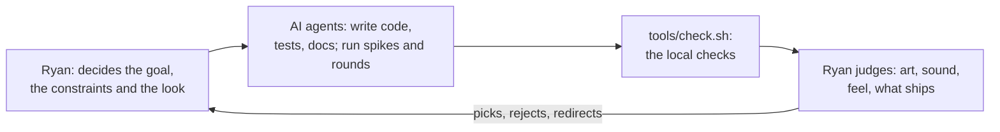

# wrela: how it's made

*What AI does in this project, what people do, and every outside work we use and how. Started
2026-10-10. Games are a contentious place for AI, so this record is complete and public. If a
line here is wrong, that is a bug: fix it in the same change that makes it wrong.*

## In short

- **One person, a team of AI agents.** Ryan (the owner) decides, directs and judges. Claude and
  Codex agents write almost all of the code, tests and docs, and run the experiments.
- **No generative image, sound, music, voice or video model makes anything in wrela.** Every
  image and sound comes from wrela code that runs on the player's device: the renderer draws the
  world from fields, the piano synthesizes its notes, and the music is a score written as code.
- **References are for learning, not for copying.** Agents look at outside images to learn
  light, colour, form and composition. We never trace them, ship them or recreate a specific
  shot, character or design. Each one is listed below with its source, its rights and its use.

## Who does what



| Work | People (Ryan) | AI agents |
|---|---|---|
| Goal, constraints, flagship design | Decides all of it (#44: "settled means the owner decided it") | Asks questions, writes the decisions down |
| Planning against the vision | Sets the vision and the owner's gates; answers the open lore questions | Keeps a map from the vision to what exists, ranks the gaps each day, and proposes the next workstreams |
| Language, compiler, engine, runtime, studio | Reviews, directs, merges | Writes the code and its tests |
| Art direction | Picked the look (#50) and judges every art result | Builds the looks in code, judges stills against a rubric, proposes changes |
| Creatures and the world | Judges each result (blind where we can) | Authors them as fields, and how they behave (what they sense of the player and do about it), in wrela code |
| Characters' motion and combat | Designed the climber (a cape all the way round, a mask, a great sword moved by will, a blink for a dodge); judges how the fight plays, with a pad | Keys the moves and their frame data as code (the sword's path, the body's form), writes the fight's sim and its tests, and plays it with a test bot |
| Music and sound | Judges by ear; ruled out music models (#44) | Write the piano synthesizer, the floor's synthesized sounds (steps, wind, water) and their mix, the scores and performances as code, and the tools |
| Story and lore | Writes the overarching story and its ending | Drafts each floor's lore within what Ryan has written; Ryan reviews it |
| Translation (planned) | | Translates; players review |
| Docs and records | Reviews | Writes them |
| Architecture and code health | Decides calls that change the architecture | A steward thread reviews every merge each 6 hours (duplicated helpers, dead experiments, code across layers), measures frame and gate time, cleans up, and proposes larger refactors |

Every commit on `main` so far (50 of 50 on 2026-10-10) was written with Claude Code and carries
a `Co-Authored-By: Claude` line; Ryan commits or merges them. Agents also merge their own
branches with Ryan's standing permission, after `tools/check.sh` passes. Since 2026-10-11 every
branch starts from `main` and squash-merges back into it once its change passes the local check.
If main changes after verification, the branch incorporates it and runs the same check on the
combined sources before merging. Check infrastructure changes pass the complete suite and
focused failure regressions. There is no separate premerge check or periodic test tier.

## Local verification

On 2026-10-11 Ryan asked Codex to consolidate local verification into `tools/check.sh` and
`tools/check.sh <check-name>`. Every retained check runs in the complete suite; individual
checks have the same sizes and assertions. Compiled artifacts are cached, but passes are not.
The same command can select an exact native Wrela `@test` by package and name, including std.
The suite uses small CPU/GPU/browser fixtures, bounded seeded samples and explicit resource
lifecycle checks. Historical milestone benchmarks, full-floor bakes and extended camera tours
are retired from automated verification; their past results remain historical evidence. A
passing suite does not re-establish whole-floor visual quality, prolonged stability or a
reference machine's frame-rate claims. Ryan's play and visual judgments still decide those.

On 2026-10-14 Ryan asked for a much faster development loop with the same single check. Claude
measured the Linux machine. The warm suite took 316.9 s, and most of that time was the Rust test
programs, which ran one test at a time. The programs now run 2 to 6 tests at a time (half the
cores). The other steps run beside them, and every check runs even when another fails. Running
tests at the same time exposed a race in the shared Chrome's lazy start: a second tab could
receive no port. The start is now locked. Each scenario's console keeps only its own page's
records, because one test uses the console to confirm a build arrived. A name that ends in `::`
selects a group: a Rust module in one test program, a Wrela package or a browser test file.
On the Linux machine (12 cores, Radeon integrated GPU, Chrome), five consecutive warm suites
passed in 118.8 to 125.2 s with all 744 Rust tests. The sampled summed memory of the check's
processes peaked at 3.5 to 3.7 GiB. A suite after a public change to `compiler/sema`, with its
rebuild, passed in 125.2 s. Running the longest test program beside the others took 108 to
110 s but used up to 5.1 GiB and slowed that program by a quarter, so it was not kept.
One suite from an empty Cargo target directory, with every build, passed in 456.2 s.
The M4 Air has not been measured; its times are reported separately.

## Tools and models

| Tool | What it does here |
|---|---|
| [Claude Code](https://claude.com/claude-code) (Anthropic), mostly Claude Opus 5.5 | Writes the code, tests and docs, on Ryan's MacBook Air and in cloud sessions |
| [OpenAI Codex](https://openai.com/codex/) | Reviews performance across the codebase, implements optimizations and regression tests, and measures their effects in a cloud session |
| Claude Opus 5.5, Sonnet 5.5 and Fable 5.1 | The authors in the blind authoring rounds that test thesis 1 (vision.md); Opus also in the first round |
| [GPT-6.1-Sol and GPT-6-Astra](https://openai.com/) (OpenAI), as T3 Code child tasks | Since 2026-10-14, reviewers in a council on an implementation plan: each reads the brief and the checkout, returns findings, and rebuts the leader's answers; they don't edit |
| Claude subagents with no context | Blind raters in the lookdev loop: they see only the before and after stills and the anchors |
| Plan councils: Claude leads; OpenAI Codex GPT-6.1-Sol and GPT-6-Astra review | Since 2026-10-14, two Codex models review a measured plan independently, read-only, and then rebut the leader's answers. Claude decides, implements and verifies. First used for the faster check |
| Claude projects (claude.ai) | Run several agent threads at once (lookdev items, fixes, rendering setup), with one coordinator |
| [OpenAI Codex](https://openai.com/codex/) (GPT-6) and parallel subagents | Since 2026-10-10, audit performance across the compiler, runtimes, engine, studio, UI and tools; implement behavior-preserving improvements and run focused tests and repository gates. CPU gate work includes checks without rasterization, focused builds, isolated scratch directories, Linux compatibility, quota-aware scheduling, artifact-only studio builds, CPU literal inspection, and pipeline reuse between variant previews. On 2026-10-11, Ryan requested fixes for 19 visual and gameplay issues in The Last Green. Codex and parallel subagents inspected the renderer, procedural vegetation, water, clouds, character, and movement; implemented fixes and focused regressions; and used native M4 profiles, lookbook and motion captures, and interactive browser play to assess them. Live play exposed slow-frame cloth timing and fallen-log placement faults that the short captures missed. No generated art assets were used. Ryan requested a daily sweep from fresh `main` at 02:00 America/Denver. On 2026-10-11 Ryan also requested a repo-wide bug sweep: agents reproduced failures, fixed them, and added focused regressions across the codebase. |
| [sfizz](https://sfz.tools/sfizz/) (BSD 2-clause), `sfizz_render` | Plays the reference piano's samples from a take's MIDI file, for the listening tests (`tools/listening.py`). Not part of the game |
| Mesa's lavapipe (Vulkan on the CPU), MIT, patched (`tools/cloud/`) | The GPU of a cloud machine, which has none (`tools/cloud.sh`) |
| [FFmpeg](https://ffmpeg.org/) with x264, GPL | Makes the motion captures' clips and contact sheets from the frames the native host saves (`tools/motion.py`). Not part of the game |
| [Wrangler](https://developers.cloudflare.com/workers/wrangler/) (Cloudflare, MIT/Apache 2.0) and GitHub Actions | Deploy each release from `main` to Cloudflare Workers (`.github/workflows/deploy.yml`, `tools/deploy.py`) |
| [Binaryen](https://github.com/WebAssembly/binaryen) (Apache 2.0), `wasm-opt` 133 or later | Shrinks a released build's WASM (`wrela build --optimize`, `-Oz`), carrying its trap locations through as a source map. Runs at build time; nothing of it ships |
| strace, LGPL; Linux mount namespaces (`unshare`) | Historical gate pass caching, retired 2026-10-11: what each slow test reads, so a pass is reused only while all of it is unchanged, or, for a test that builds a program, while its builds make the same files. The ideas are build systems' (Bazel's action cache, ccache's manifests, tup's and fabricate's traced dependencies, Shake's and Bazel's early cutoff) |

Not used, by decision: Suno or any music model (Ryan, 2026-10-06, #44), and any image, texture,
3D, voice or video generator. No asset is made by a model that was trained to output art.

## Wrela console and static hosting, 2026-10-12

Ryan requested a generic Wrela console at `games.wrela.dev`, starting with The Last Green,
with an original opening animation, local profiles and saves, and static Cloudflare hosting.
Codex authored editable Figma mocks as text, vectors and components, then implemented the
console UI and session/save policy in Wrela. Browser code supplies generic embedded-program
channels, file import/export and environment mechanisms through a shared asynchronous host
capability request. The compiler and native host support that same request; neither knows the
console catalog or a game's save schema. The intro is a Wrela field shader. Existing Wrela
renders supply game cover images. No generative image, audio or video model made an asset.

Figma's Plugin API and timeline export were used for layout and timing studies, outside the
repository. The chosen font files are [Barlow](https://github.com/google/fonts/tree/main/ofl/barlow)
and [Manrope](https://github.com/google/fonts/tree/main/ofl/manrope), both SIL Open Font License;
their licenses ship in `console/fonts`. Manrope's variable font was instantiated at weight 500
with [fontTools](https://github.com/fonttools/fonttools) (MIT), without changing its design.
[Pillow](https://pillow.readthedocs.io/) (HPND) converts existing Wrela frame captures into
RGBA cover data during release packaging. The reusable Wrela UI accepts caller-selected baked fonts rather than adding console fonts to
every program's default font pair.

[Cloudflare Pages Direct Upload](https://developers.cloudflare.com/pages/get-started/direct-upload/),
[custom domains](https://developers.cloudflare.com/pages/configuration/custom-domains/), and
[static headers](https://developers.cloudflare.com/pages/configuration/headers/) were consulted
for local static release uploads, domain binding, immutable build paths and isolation headers.
[MDN's cross-origin isolation permission reference](https://developer.mozilla.org/en-US/docs/Web/HTTP/Reference/Headers/Permissions-Policy/cross-origin-isolated)
was used to delegate the existing shared WASM memory capability to embedded game origins.
These are implementation references, not copied product designs or assets. Saves and profiles
stay in browser-owned storage and export as files; there is no server-side save service.

Local browser checks exercised new game, explicit ready-frame handoff, F10 return after storage
commit, save export/import, the previous-game backup, profile-name persistence, and a 390×844
layout with three slots. These checks establish the exercised flows, not prolonged stability.
On the M4, 120 native lockstep frames at 1280×720 measured the console opening at 0.057 ms
median GPU span and 0.576 ms median CPU frame call; the browser channel is outside this native
measurement. The same-mode Last Green baseline at `f2969cbd` measured 12.806 ms GPU span and
18.956 ms CPU frame call; the candidate measured 12.129 ms and 18.173 ms. All 114 shader files
match. Separate startup-inclusive samples vary, so this is no performance-win or sustained
Chrome-frame-rate claim. The console suspends its frame clock and pad input while a game is
shown. Gate time gains were not measured; the complete gate retains the new policy and failure
regressions and adds the console's small shader corpus.

## Wrela alien opening and sparse library, 2026-10-12

Ryan rejected the busy first console and requested a black, lit 3D space, a rotating alien
form that becomes Wrela, and a small album selector. Codex used the frontend-design skill
for composition studies, then authored the procedural solid, metallic lighting, font-field
extrusion, morph timeline and all controls in Wrela. The existing licensed Barlow fields
supply the letter shapes. No outside visual asset, shader source or generative media was used.
The browser ABI and game rendering code are unchanged. Covers retain their aspect ratio;
only five nearby covers can hold textures or requests. Saves and settings open on demand.
The 6.6-second opening can be skipped without starting a game; reduced motion bypasses it
and holds the background still.

Actual Chrome captures checked the full opening at 1280×720 and 390×844, a three-title
fixture, and Enter used to skip the intro. Local interaction checks exercised continue,
ready-frame handoff, F10 return, the existing saved profile, save selection and settings.
Four small Wrela regressions cover the timeline, album geometry and request window, and
save-panel capacity. The frame captures and clips are original Wrela renders retained
outside the repository.

On the M4, matched 480-frame native lockstep runs at 1280×720 measured the old console at
0.055 ms median GPU span and 0.543 ms CPU frame call, and the new console at 0.658 ms and
1.323 ms. The new GPU span's p95 is 1.147 ms, about 7% of 16.7 ms. Native console runs do
not exercise browser session I/O; these samples do not establish sustained Chrome frame
rates. Matched 120-frame Last Green runs on the same machine measured 11.792 ms GPU span
and 17.731 ms CPU frame call before this change, then 12.127 ms and 17.932 ms. The game's
114 generated shader entries match. This change adds no game-frame work; timing variation
is not a performance gain. Gate time impact was not measured as a paired benchmark; the
same complete gate retains all checks and gains four small tests plus the scene shader.

## Original console typography and unfolding sculpture, 2026-10-12

Ryan requested an original sleek font, a better alien form and transformation, and removal
of the top-right player name. Codex used the frontend-design skill to compare two concepts
and authored Wrela Meridian: 95 original printable ASCII glyphs with broad proportions,
cut terminals, a low lowercase x-height, and softened geometric corners. Centreline paths
in `console/meridian.wrela` supply build-time distance fields for display text and the
opening's actual mesh. The existing Manrope face remains for small controls and save details.
New builds replace Barlow; retained immutable releases keep their original notices. The new drawings and procedural sculpture are original
project code under the repository's MIT license; no outside outlines, visual references,
shader source or generative media assets were used.

Six tapered titanium vanes rotate around a hollow spindle, separate with a short stagger,
and unfold into their exact glyph paths. Mesh topology stays fixed throughout the opening.
A moving light crosses the resolved word before the room fades into the library. The prior
field interpolation and font texture extrusion are removed. All geometry, lighting, text
and timing remain in Wrela. The host ABI, static hosting model, saved profile identity and
game code are unchanged. The top-right profile label is removed; settings and saves remain.

A Wrela specimen and Chrome sequences at desktop and portrait sizes check the alphabet,
full opening, library, skip and saved animation-off behavior. Focused regressions cover glyph
coverage and field bounds, terminal joins, and the correspondence between font paths and
mesh endpoints, plus portrait framing. Captures are original renders, retained outside the repository.

On the M4, matched 480-frame native lockstep profiles at 1280×720 measured the previous
opening at 0.666 ms median GPU span and 1.326 ms CPU frame call; the final mesh opening
measured 0.167 ms and 0.669 ms. GPU p95 fell from 1.205 to 0.271 ms, about 1.6% of the
16.7 ms frame budget. The mesh adds a resize-bound colour/depth pair (7.0 MiB at this size)
and uploads its geometry once. These are startup-inclusive native samples, not sustained
Chrome frame rates or browser session-loading measurements.

Matched 120-frame Last Green profiles measured 12.335 ms GPU span / 17.967 ms CPU before,
and 11.856 / 17.926 ms after; all 114 shader inventory entries match. This console change
adds no game-frame work; the difference is measurement variation. There is no paired gate
time benchmark. The gate keeps its existing coverage and gains four small regressions,
a cached original-font bake and two additional render pipelines.

## Simulated construction studies, 2026-10-11

Ryan asked for worlds composed by simulation across seeds, including people whose construction
becomes fields at compile time, with shared engine mechanisms and different rules per world.
OpenAI Codex implemented the first small construction studies (`examples/builders`): an event
calendar, finite stock and labour, support and overlap checks, and continuous field recipes.
Forest and ocean studies own their site preferences, material knowledge and tidal work rules.
They are experiments, not new Last Green lore. The lab replays each solid's completion time.

The source is original project code under the repo's MIT license. No outside assets, reference
images, model-generated art or new external algorithm source was used. The work builds on the
repo's field, constant-evaluation and seeded-noise code. Tests use small seeded worlds, explicit
failure cases and a real GPU field comparison. These checks do not establish beautiful worlds,
structural engineering accuracy, interacting civilizations or a replacement for the floor's
current authored composition.

Studio finding: an associated event type through a generic world implementation did not resolve
in a call to the history driver (`Calendar<People<H>::Event>` versus `Calendar<Task>`). The shared
interface takes its event type as an explicit trait parameter. The engine primer command has
language areas only; source inspection was used for the existing engine modules.

## CPU agent workflow survey, 2026-10-11

Ryan asked for a broad pass over agent latency without a GPU, on machines with varying CPU
counts. Codex and parallel agents inspected discovery and editing, builds, tests, simulation,
studio inspection, reference fitting, audio, captures, browser driving and the check runners.
The development container has a two-CPU quota despite an affinity mask of three CPUs; scheduling
uses the quota and affinity rather than the host's reported processor count.

| Workflow | Work removed or bounded |
|---|---|
| Source discovery and edits | `query` already batches queries in one check, `doc` parses without compiling, and source edits use checked plans. These paths keep their existing behavior. |
| Builds and state tests | Existing constant and native-code caches stay. CPU frame/tick tests skip GPU optimization and shader/browser output, retaining language diagnostics, CPU debug checks and pipeline command metadata. GPU tests and programs that fetch generated build files keep the full path. |
| Simulation diagnosis | `trace` and `bisect --no-gpu` can inspect CPU state without software rasterization; `--workers` selects an explicit worker count. State which needs GPU feedback still needs shader execution. |
| Studio inspection and comparison | Twelve synchronous field actions run their own exports on the CPU without an unseen frame or shader compilation. Invalid actions fail before a build. PNGs and GPU-dependent actions still render. Comparisons batch consecutive field view controls into their final image; field edits and map actions still settle normally. |
| Audio | Reuse FFT plans, windows and scratch buffers; retain fitted decay curves across grid candidates; reject non-peaks before median calculation. Numbers and sheets share one build but keep separate program instances. Listening excerpts touch only fade boundaries and avoid full-track copies. |
| Reference fitting | Independent part fits use a bounded queue and return in original order, instead of starting a thread per part in every round. |
| Stills and motion | Reuse screen readback buffers, use fast lossless PNG compression, and omit discarded pre-roll captures while rendering the same history. Software stills divide available CPUs between concurrent shots; browser and FFmpeg workers use available CPUs too. |
| Browser and local server | Reap orphaned Chrome children on Linux and reduce server shutdown polling latency from 500 ms to 50 ms. |
| Check runners | Reuse Python workers; bound memo builds and quick/slow test processes by the CPU quota. Only compress WGSL when a compressed budget applies or a failure needs its compressed size. |

Measured locally against a clean build of `7f49462`, with the release tools on two CPU workers:

| Work | Before | After | Evidence |
|---|---:|---:|---|
| Wolf studio probe, cold native cache | 9.54 s | 4.60 s | Same JSON; Mesa's shader cache shared |
| Wolf studio parts, warm native cache | 4.53 s | 2.34 s | Same JSON |
| Sphere studio probe, warm | 2.06 s | 0.61 s | Same JSON; all twelve actions compared |
| 120 first-light frames at 640×360, all PNGs | 1.13 s | 0.37 s | Three-run medians; same decoded pixels and command hash |
| Same render, keep only frames 90–119 | 1.13 s | 0.17 s | Same retained pixels; 121 files become 31 |
| 60-frame test-floor state trace | 1.53 s | 0.34 s | Two-run medians; `--no-gpu` gives the same 61 CSV lines |
| Eight seconds of audio partial analysis | 0.53 s | 0.15 s | Three-run medians; same JSON |
| Thirty seconds of click analysis | 0.084 s | 0.0084 s | Three-run medians; same JSON |
| Eight 20-second listening excerpts | 2.78 s | 0.071 s | Same samples |
| 56 check/memo/resource tests | 6.87 s | 1.60 s | Same tests pass |
| Wolf / grazer 120-frame CPU tests | 2.54 / 3.11 s | 2.18 / 2.77 s | Three alternating runs; same results |

The faster PNG encoder trades file size for CPU time: this capture's files grew 35%, with no
pixel change. Audio numbers and sheets took 1.4× and 1.7× less time in fresh one-second piano
runs; their JSON, the sheet PNG and the rendered WAV matched exactly. WAV synthesis itself did
not get faster. Shader and simulation arithmetic stay unchanged; the runtime frame-cost changes
apply to screen capture. These are local workflow measurements, not reference-GPU timing claims.

Separately, batching comparison view controls on top of the other changes cut default-size
`beside` from 3.44 to 2.16 s, `variants` from 4.67 to 3.19 s, and `sweep` from 5.68 to 3.78 s.
All three commands matched every decoded pixel and their normalized JSON at 64, 896 and 960
pixels; the largest size also displays the lens's UI panel. Raw local timings, environment
details and validation logs are kept in `target/cpu-bench`.

Final validation passed 607 Rust tests, 119 Python tooling tests, formatting, Clippy, the browser
runtime checks and all 211 shader size checks. Another focused run passed 18 regressions,
including the relevant long audio and studio image tests. Worker scheduling was exercised at
1, 2, 4 and larger simulated CPU counts; wall-clock measurements used this two-CPU container.
The complete final gate still took 235 s here, with every gate test run because the optional
strace/mount-namespace test memo was unavailable.

This pass does not turn full-resolution software rendering, long playthroughs, cold Rust builds,
or uncached world bakes into constant-time operations. Image checks retain their resolution and
rendered history, and hardware timing measurements still require the reference GPU.

## Local session resource policy, 2026-10-11

Ryan asked Codex to implement support for ten concurrent coding sessions directly on main,
on an Apple M4 with ten CPU cores, 16 GiB unified memory and limited storage. This policy
starts with one costly job at a time; it is a conservative setting, not a throughput claim.
Reading and editing can proceed in all ten sessions. Focused checks and captures precede gates,
long checks and background warming, with aging for fairness. A long tier yields between tests
and stages, retaining its cases and sizes. Measurements reserve the queue.

The queue supervises owned process trees, preserves a live child's lease if its supervisor
dies, and records the checked commit and dirty source digest, queue time and outcome in the
per-user resource directory. A verification pass is rejected if its sources change. Ordinary
jobs cap Cargo compilation at four processes, test executables at one, test threads and default
compiler/runtime workers at two. Explicit concurrency tests retain their requested workers.
Two small GPU holders share global file permits across native hosts and Python's browser
driver; large renders and measurements take an exclusive barrier. Warning memory pressure
reduces check/build workers to one and defers renders, long work and warming. Critical pressure
pauses admission; sustained critical pressure, a deadline or critically low disk space stops
the owned job. These limits cooperate with the repo's tools; they do not constrain unrelated
applications or arbitrary commands outside the queue.

Source-only session worktrees share the common Git directory's Cargo and content-keyed native
and constant caches. Whole-job admission protects mutable binaries, and each selected checkout
rebuilds its own tool before use. Test scratch stays inside its checkout. No target or
node_modules is copied into new sessions. A 20 GiB shared-cache ceiling and 12 GiB admission
reserve prevent unbounded routine growth; only owned disposable output is pruned automatically.
An explicit cache reset runs under admission. Existing worktrees, captures, unmerged branches
and unknown scratch are preserved. The first inventory found about 38 GiB in existing targets;
this change does not erase them or claim that space has been reclaimed.
On this APFS machine, existing dependency artifacts seeded the shared cache with filesystem
clones, retaining current artifacts and excluding workspace crates and incremental state.
The clones share disk blocks; each session still builds its own current workspace sources.

Audio verification exposed a shared-cache correctness bug: Cargo accepted older, different
Rust source after another checkout had built into the shared target. Codex traced this to
Cargo's relative paths and modification-time checks. Job admission now checks the checkout,
source content and recorded workspace artifact state. Unknown or changed inputs clear only
workspace freshness records; dependency outputs and incremental data remain cached. A job
records its resulting artifacts only if its source inputs stayed unchanged. This records build
provenance, never test passes. Small regressions cover older content, an unrecorded cache writer
and source changes during a job. Admission follows the enclosing workspace from subdirectories;
nested tool calls must remain in one checkout instead of sharing its lease with another branch.
The conservative source key can also rebuild workspace crates
after non-Rust edits. Test helpers now resolve the running checkout and reject unrelated
runtime manifests instead of silently reading a build-time checkout.

The investigation used Cargo's public [compiler fingerprint documentation](https://doc.rust-lang.org/stable/nightly-rustc/cargo/compiler/fingerprint/index.html)
to confirm its freshness rules. No source code or assets were copied from this reference.

AGENTS.md is the sole repository instruction document. It is a regular file; the former
alias to CLAUDE.md and the separate CLAUDE.md file were removed.
Ryan then asked Codex to shorten that file for agent development speed and code quality.
The revised instructions make routine agent work and local merges explicit, require source
freezing during verification, and retain the single gate and shared resource limits.
Frame-time and gate-time effects belong in completion reports as well as PRs.
Ryan also required agents to remove each session worktree and local branch after merging.
Removal accepts either commit ancestry or an identical complete source tree in main's
first-parent history, so squash merges remain removable after main advances. It pins the
branch commit for deletion and preserves followup commits, switched branches, dirty work,
live jobs and ignored outputs needing preservation. Agents move needed outputs outside the
session before cleanup; no Git hook or periodic job deletes active sessions.

The policy uses Cargo's documented [worker and target settings](https://doc.rust-lang.org/cargo/reference/config.html#buildjobs),
explicit [libtest thread limits](https://doc.rust-lang.org/rustc/tests/index.html#test-threads-num_threads),
Python's [process sessions and descriptor inheritance](https://docs.python.org/3/library/subprocess.html#subprocess.Popen),
and Apple's [memory pressure guidance](https://support.apple.com/guide/activity-monitor/check-if-your-mac-needs-more-ram-actmntr34865/mac).
Linux admission also reads [cgroup memory limits](https://docs.kernel.org/admin-guide/cgroup-v2.html#memory)
through all visible ancestors, estimating working memory after inactive filesystem cache;
host-wide free RAM alone can hide a container's limit.
No outside code or assets were copied. CPU/lavapipe correctness keeps real shader and buffer
assertions; reference GPU measurements and final visual judgment remain their own evidence.

## Native image-quality study, 2026-10-11

Ryan asked Codex and parallel subagents to compare image reconstruction and tree detail,
then set full output resolution as the look-development baseline, accepting slower frames.
The study compares native exact samples, native temporal AA, and the prior 1.75 scale on
moving routes. It uses small GPU regressions, M4 profiles, and interactive browser play.
Temporal averaging and upscaling are separate: native rendering can still use history for
thin-leaf coverage. A four-tap filter that mixes neighbours at exact sample alignment hides
authored detail. Bounded interpolation preserves those samples; projected crown size controls
when geometry becomes an impostor. Atlas views need isolated sampling and coverage-weighted
normal/depth filtering. No generated art assets or external implementation code were used.

Primary research: [AMD FSR 1](https://gpuopen.com/fidelityfx-superresolution/) and
[FSR 2](https://gpuopen.com/fidelityfx-superresolution-2/) (SDK code under MIT; documentation
consulted, no code ported) explain spatial versus temporal inputs and history requirements.
[Epic TSR documentation](https://dev.epicgames.com/documentation/en-us/unreal-engine/temporal-super-resolution-in-unreal-engine)
(copyright Epic; documentation only) explains temporal detail and motion diagnostics.
[meshoptimizer](https://github.com/zeux/meshoptimizer) (MIT; documentation only) informs
error-based geometry selection. [NVIDIA GPU Gems filtering](https://developer.nvidia.com/gpugems/gpugems/part-iv-image-processing/chapter-24-high-quality-filtering)
(copyright NVIDIA and contributors; reading only) explains why procedural detail must be
filtered over its pixel footprint. These references guide comparisons, not claims that an
external upscaler or automatic compiler reconstruction has been implemented.

## Character presence and vegetation stability, 2026-10-11

Ryan requested stable foliage light, more natural grass and ground, clearer cloud volume,
and a new character silhouette. The current direction is a large empty black robe with
hanging empty sleeves, an empty hood, a hem that leaks connected shadows, and a detailed
telekinetic sword with a metallic light response. The upper silhouette is lean and varied,
not a wide block. It supersedes the earlier mask design. Ryan named a grim reaper and the broad mood
of a dementor (Harry Potter, copyright its rights holders), explicitly requesting an original
character. No reference shot, mesh, texture, or character design was copied or sampled.
Codex and parallel agents author the forms in Wrela, inspect motion captures and browser
play, and validate rendering rules with small shader and numerical regressions. No art
asset is made with a generative image, audio, music, voice, or video model.
The material pass carries authored roughness and metallicity through the character bake,
reusing the engine's GGX and probe reflection functions with colored metal reflectance.
Small real-shader fixtures check moving highlights, roughness, material baking, static shadow
sampling, foliage gaps, and vacated temporal history. Native captures and browser play remain
the visual evidence; test passes alone do not establish a finished environment or zero flicker.

## Environment form and lighting research, 2026-10-11

Ryan paused character work and asked Codex and parallel agents to correct the environment
findings, with primary-source research. The research separates observed natural structure
from rendering approximations. The applications below are design decisions for Wrela, not
claims that the complete external algorithms have been implemented. Motion captures,
interactive browser play, small regressions and same-machine profiles remain the checks.

| Primary source | Finding and application | Rights and use |
|---|---|---|
| Runions, Lane and Prusinkiewicz, [Modeling Trees with a Space Colonization Algorithm](https://algorithmicbotany.org/papers/colonization.egwnp2007.html), 2007, pp. 2–6 | Smooth a branching skeleton before forming cylinders. The pipe model relates a parent's radius to its children's radii with an exponent usually between 2 and 3. Later fine branches produce a hierarchy; light access favors outer growth. Apply these principles to taper, curved attachments, unequal limbs, fine outer sprays and open crown interiors. | Copyright Eurographics and authors; paper read for principles. No text, code, tree geometry or reference image copied. |
| Palubicki et al., [Self-organizing tree models for image synthesis](https://algorithmicbotany.org/papers/selforg.sig2009.html), 2009 | Branch competition for space/light and internal signaling shape a tree. Our inference: neighboring crown masses should not all be equally full; preserve a dominant growth structure and asymmetric gaps. This does not require a full growth simulation at runtime. | Copyright ACM and authors; research reference only, no code or models imported. |
| Kharlamov, Cantlay and Stepanenko, [GPU Gems 3, chapter 4: Next-Generation SpeedTree Rendering](https://developer.nvidia.com/gpugems/gpugems3/part-i-geometry/chapter-4-next-generation-speedtree-rendering), 2007, sections 4.2, 4.4–4.6 | Trunk silhouettes carry bark form. Backlit leaves transmit light; broad filtered highlights reduce shimmer. Binary cutouts can scintillate in motion, while coverage transitions can change apparent tree density. Apply separate checks for geometry, coverage, reflected light and transmission. Preserve crown coverage and color across distance; do not hide leaf loss with visibly giant cards. Alpha-to-coverage is an option only with suitable multisampling, not a substitute for correct geometry or motion. | Copyright NVIDIA and contributors; explanatory material read, no sample shaders or assets copied. |
| USDA Forest Service FEIS, [Arizona fescue](https://research.fs.usda.gov/feis/species-reviews/fesari), botanical characteristics | This bunchgrass has narrow leaves, typically below 3 mm wide and 20–41 cm long, with flower stalks above the leaves at 0.3–0.9 m. Use distinct short basal foliage and sparse taller stalks as a growth-habit reference. Avoid making every meadow element a broad upright spear. Values inform scale relationships, not a claim that the fictional flora are this species. | U.S. government botanical synthesis; facts consulted. No photographs, illustrations or species assets copied. |
| USDA Forest Service, [Nonnative Invasive Plants of Pacific Coast Forests, PNW-GTR-817](https://research.fs.usda.gov/download/treesearch/37858.pdf), oxeye daisy, p. 47; Royal Botanic Gardens Kew, [Digitalis purpurea descriptive accounts](https://powo.science.kew.org/taxon/urn:lsid:ipni.org:names:802077-1/general-information) | Daisy has basal rosette foliage and a separate taller flowering stem; foxglove has large basal leaves and reduced leaves/bracts above. These support separating basal foliage from a thin reproductive axis. One species is selected per crown, and the stem and head share a root and wind motion. The half-height basal foliage rule and 24 cm cap are our visual tuning, not measured rules for every species. Nonflowering rush and tussock heights remain separately authored. | U.S. government field guide and copyrighted Kew flora accounts; morphological facts read. No plant illustrations, images or text copied. |
| USDA NRCS, [Stream Restoration Design Field Guide](https://www.nrcs.usda.gov/sites/default/files/2024-10/Stream%20Restoration%20Field%20Guide_july%202012.pdf), 2012, stream-bed sampling; [Stream Visual Assessment Protocol 2](https://www.nrcs.usda.gov/sites/default/files/2022-09/StreamVisualAssessment.pdf), 2009 | Bed material varies with hydraulic and sediment processes; pools, riffles and bars are distinct features. Apply asymmetric bank shelves, localized gravel/cobbles and varied wet margins. Root plants on suitable banks and shelves. Avoid a uniform trench with identical vertical sides and an unbroken grass lip. This is visual inference from channel morphology, not an engineering restoration model. | U.S. government guidance; text facts and diagrams studied. No diagrams or photographic textures copied. |
| WMO, [International Cloud Atlas: Cumulus explanatory remarks](https://cloudatlas.wmo.int/explanatory-remarks-and-special-clouds-cumulus.html); NOAA, [Cumulus glossary](https://forecast.weather.gov/glossary.php?word=CUMULUS) | Nearly horizontal gray bases are normal; remove the mechanical slab appearance without removing the common condensation level. Cumulus relief has pronounced light differences, especially in side light; backlighting gives a bright edge around a darker body. Apply uneven lobe height, interrupted perimeter and thickness variation while retaining light direction and a coherent base region. | WMO copyrighted reference text and U.S. government glossary; definitions read. No atlas photographs or cloud shapes traced. |
| Andrew Schneider, [Nubis: Authoring Real-Time Volumetric Cloudscapes with the Decima Engine](https://www.guerrilla-games.com/read/nubis-authoring-real-time-volumetric-cloudscapes-with-the-decima-engine), SIGGRAPH 2017, slides 28–39 and 84–92 | Separate cloud coverage/type and vertical density profile from boundary erosion. Remapped erosion preserves the solid core. Attenuation alone makes interiors too dark; the lighting approximation also depends on surrounding coarse density and height. Apply varied authored profiles and bounded interior fill so billows keep relief. More march samples cannot repair repetitive density shapes. | Copyright Guerrilla/Sony and authors; presentation read for density/lighting principles. No noise textures, generator code, presentation code or art assets imported. |
| Morgan McGuire and Michael Mara, [Efficient GPU Screen-Space Ray Tracing](https://jcgt.org/published/0003/04/04/), 2014, sections 1, 3–4 | A depth buffer represents limited visible layers; projected ray samples must address the matching depth surface, with finite depth intervals when needed. These principles inform matching jittered reflection color/depth coordinates and rejecting color-filter taps across unrelated depths. This is a repair of the existing reflection path, not a port of the paper's DDA or layered tracing implementation. | Copyright authors/JCGT; paper consulted for projection and finite-layer principles, with no sample code copied. |
| National Park Service, [Weathering](https://home.nps.gov/subjects/erosion/weathering.htm) and [Materials and Monuments](https://www.nps.gov/articles/000/cemetery-preservation-course-materials-and-monuments.htm) | Cracks, freezing water and roots divide rock; porous masonry is vulnerable to moisture. Our application: coherent bedding and joints on bedrock, fragments below exposed faces, recessed masonry joints and contact weathering tied to ledges, openings and ground. Rock/soil material ownership must agree with vegetation and paint masks. Do not add uniform noise to imply erosion. | U.S. government educational material; physical principles consulted, with no photographs or textures copied. |

Bark relief also uses the surface-gradient principle described by Morten Mikkelsen, [Bump Mapping Unparametrized Surfaces on the GPU](https://mmikk.github.io/papers3d/mm_sfgrad_bump.pdf), 2010. Height derivatives and the local surface basis give opposing slopes on either side of a ridge; degenerate bases and maximum slope are bounded. This is an original implementation of the principle, with no source code or media copied. The paper remains copyrighted by its author.

These sources guide original procedural forms. Native full-resolution look development
remains the baseline. Geometry and material structure must read before any extra sharpening,
upscaling, distance simplification or temporal averaging is judged. No generative media
models or outside art assets were used for this research pass.

## Repository bug sweep, 2026-10-12

Ryan requested an autonomous review of the whole current repository. Codex and parallel
agents reviewed the compiler, shared ABI, both hosts, standard library, engine, UI, studio,
examples and local tools. They used the existing MIT-licensed source, language specification
and tests to find failures, then added bounded regressions and fixed their causes. No outside
assets or new reference algorithms were used.

The review includes invalid input and resource lifetime paths: unsafe automatic source fixes,
trait and projection checks, GPU lowering, stale source edits and hot reload, command validation,
GPU retirement and pass joining, nested task failure reporting, text focus and small layouts,
field diagnostics, and verification admission and source tracking. Suspected bugs that failed
to reproduce were discarded. State tests use CPU hosts; shader behavior uses real GPU tests.
The atomic map review consulted the [WGSL memory model](https://www.w3.org/TR/WGSL/#memory-model)
and [atomic built-ins](https://www.w3.org/TR/WGSL/#atomic-builtin-functions), W3C, under its
[permissive document license](https://www.w3.org/copyright/document-license/). They explain that
atomic ordering applies per memory location. The fix uses a key claim and commuting atomic
additions, with stable reads in a later dispatch, instead of a publication flag across locations.

ABI validation was checked against the installed wgpu-core 30.0.1 source, commit
`40f4a34ebaf56f9a046231f54125ad046239d3f3`, under MIT or Apache-2.0. Its
[resource validation](https://github.com/gfx-rs/wgpu/blob/40f4a34ebaf56f9a046231f54125ad046239d3f3/wgpu-core/src/device/resource.rs)
and [render validation](https://github.com/gfx-rs/wgpu/blob/40f4a34ebaf56f9a046231f54125ad046239d3f3/wgpu-core/src/command/render.rs)
were used to check binding-number limits, colour blendability and depth-clear ranges. No source
was copied.

The full local check verifies the final frozen tree before the local squash merge. Frame costs
are compared with native M4 profiles of The Last Green in the same measurement mode; those
profiles do not establish Chrome frame rates or long-run stability.

The saved baseline and sweep outputs for the floor's reach, shots, report, calibration and tour
are byte-identical. All critical sites pass the reach check. Existing authoring diagnostics
identify two unreachable crag viewpoints and two shots below their subject-visibility threshold;
their cause remains a content-review question. They did not establish an additional code defect.

Before the squash merge, `main` advanced to `f2969cbd` and then `cb12b804`. The agents reviewed
the optimizer, wood buffers, checker scope reuse, console, session services and hosting changes,
incorporated them, and regenerated the shared ABI files and browser bundle. The extended review
also covers resumed gamepad state, hidden child input, embedded-page reload, host method receivers,
UTF-8 text parity, catalog errors and asset paths, export names, recovery acknowledgement and
destinations, recovered-save backups, immutable release metadata, reserved build paths and the
release tool's checkout admission. Final verification and the paired profile baseline use the
latest incorporated main.

The sweep fixes 105 distinct defect classes. Shared native/browser defects are counted once;
the browser also receives the corresponding parity fixes.

| Area | Defects | Main failure paths |
|---|---:|---|
| Syntax, grammar, standard collections and UI | 13 | Unsafe source fixes, worker admission, zero-sized boxes, small integer serialization, atomic payloads, focus and clipped layouts |
| Semantic analysis | 8 | Trait bounds, generic kinds, associated types, projection loans, callable effects and runtime array counts |
| Lowering and workgroup analysis | 7 | Skipped barriers, GPU vector shifts, unsupported blending, enum clone tags, callback writeback, erased values and missing array bounds |
| Driver and CLI | 13 | Invalid roots, stale edits and builds, float text, empty test selections, trace precision, audio bounds and refactor parsing |
| Shared ABI | 8 | Workgroup overflow, pad number parity, depth clears, texture payload padding, binding indices, blended formats and UTF-8 text parity |
| Native host and parallel tasks | 12 | Pass scopes, timing collection, debug state, call completion, handovers, malformed worker memory and thread lifetime |
| Browser-only host paths | 15 | Deferred attachments, resource retirement, input loss, stuck input, audio shutdown, OPFS recovery, literal URLs, test parameters, host receivers, embedded reload and gamepad routing |
| Tools and engine helpers | 15 | Frozen-source proof, input hashing, server paths, gzip freshness, lock cleanup, admission, executable freshness, nearest cells, camera, clipmap invalidation and static release packaging |
| Studio, RNG, float parsing and fight sounds | 6 | Invalid diagnostic samples, rounded unit draws, repeated exponent signs, lost tally cues and skipped blink arrivals |
| Console and session services | 8 | Pending export identity, catalog decode errors, accepted export keys, cover paths, visible load errors, recovery slot selection, export acknowledgement and freed-world resume destinations |

## The references

### The rules

1. **Learn, don't copy.** A reference teaches light, colour, value, form, scale or composition.
   We don't trace it, sample its pixels into the game, or rebuild a specific shot, character or
   design from it.
2. **Prefer the cleanest rights.** Public-domain works first (museum open-access collections, US
   federal government photos), then works under open licences, then official stills a studio
   offers for free use. A copyrighted image with no such offer (a publisher's screenshot) is for
   private study only. A reference whose source or rights we can't name isn't used.
3. **Ship only what the licence allows, with its credit.** A file in the repo has a manifest
   beside it (`references/**/*.toml`) with its source, author and licence. Anything adapted from
   a work that needs credit (CC BY) carries the credit into the game.
4. **Style references stay private.** Images used only to judge the look (lookdev) are kept out
   of the repo, in the project's private files. Only their record is here.
5. **Record every one, in this file.** An agent that uses a reference adds its row in the same
   change. The row says what it teaches and how we used it.

### In the repo

| Reference | Source and rights | How we use it |
|---|---|---|
| OpenAI, [Custom instructions with AGENTS.md](https://learn.chatgpt.com/docs/agent-configuration/agents-md) | Public documentation; no text or code copied | Consulted on 2026-10-11 when tightening repository agent instructions: project guidance supplies commands and expectations; the repo retains one instruction file and local verification. |
| Six photos of bison and wolves (`references/grazer/`, `references/wolf/`) | Wikimedia Commons; US National Park Service, Fish and Wildlife Service and Agricultural Research Service photos; public domain. Each `.toml` has the URL and author. | Authoring rounds 4 and 5: agents saw them beside their creature to check proportion and silhouette (`wrela studio … beside`, `wrela compare`). Nothing of the photo goes into a creature. |
| "Fantasy wolf miniature", a sculpt (`references/wolf/sculpt-standing.obj`) | Drew Vaughan (3ddrew), [Thingiverse 680145](https://www.thingiverse.com/thing:680145), CC BY 4.0 | Test 6 (vision.md): a wolf measured from the sculpt and rebuilt as lofts and sweeps, to learn whether wrela's forms can hold a great shape. It is an adaptation, so its source carries the attribution in the `.toml`, and a game that ships it credits him. |
| Satie, Gymnopédie No. 1 (1888) | The Mutopia Project's edition (Mutopia-2014/12/14-37, typeset by Evin Robertson from the Dover reprint), public domain | Spike 14 (#48): transcribed note by note into a score as code (`examples/gymnopedie/score.wrela`), then performed by wrela's piano. |
| Salamander Grand Piano V3 (a Yamaha C5) | Recorded by Alexander Holm, CC BY 3.0; FreePats' retuned SFZ, played by sfizz | Spike 14: wrela's piano model is fitted to measurements of these recordings (partial frequencies, levels, decays). The recordings are not in the game; the fitted numbers are, so a game that ships them credits him (`engine/piano_grand.wrela` says so). The listening tests (`tools/listening.py`) also play them beside wrela's piano, from a copy outside the repo. |
| A. Chaigne and A. Askenfelt, "Numerical simulations of piano strings" (JASA, 1994); B. Bank and others, "Physics-based sound synthesis of the piano" (2000); P. J. Huber, robust regression (1964) | Published methods; no code taken | `engine::piano` reads the fitted tables through a string's frequency-dependent losses (each partial falls 60 dB in 1 / (b₁ + b₃ f²) seconds), fitted to each measured key with Huber-weighted least squares and steadied across keys, and holds each level row to a hammer spectrum that never rises past its peak. |
| Inter and JetBrains Mono fonts (`ui/fonts/`) | SIL Open Font License 1.1, licence texts beside them | The studio's interface text. |
| musl's libm; ARM's optimized-routines | MIT | `compiler/std/math.wrela` follows their algorithms and coefficients (credited in the file). |
| Steven Worley, "A Cellular Texture Basis Function" (SIGGRAPH 1996) | A published algorithm; no code taken | Bark's plates (`engine/plant.wrela`, `plates_at`): the nearest and second-nearest of jittered cell points, written from the paper's idea. |
| Heini Hediger's flight distance (*Wild Animals in Captivity*, 1950), as field ethology uses it | A published idea; no code or data taken | The fawn's behaviour (`games/last-green/behaviour.wrela`): it notices a person first and watches, and flees when they come on within a distance; the distances are our own, tuned by test. |
| Vadim Zavalishin, *The Art of VA Filter Design* (2012); George Marsaglia, "Xorshift RNGs" (2003) | Published algorithms; no code taken | The floor's sound (`engine/sound.wrela`): the state-variable filter that bands each source's noise, and the seeded noise itself. |
| The soil production function: Heimsath, Dietrich, Nishiizumi and Finkel, "The soil production function and landscape equilibrium", *Nature* 388 (1997) | A published finding; we use its idea, not its text or data | `engine::soil::soil`: rock weathers to soil fastest under a thin soil and creep moves it downhill, so crests are thin and hollows deep (credited in the file). |
| Landscape evolution by stream power: Jean Braun and Sean D. Willett, "A very efficient O(n), implicit and parallel method to solve the stream power equation governing fluvial incision and landscape evolution", *Geomorphology* 180–181 (2013) | A published method; no code taken | `engine::landform::incise`: a channel cuts down at K A^m S, solved implicitly in the order the water flows, so a step of any length is stable. The Last Green's world is made with it (`games/last-green/geology.wrela`). |
| Priority-flood depression filling: Richard Barnes, Clarence Lehman and David Mulla, "Priority-flood: An optimal depression-filling and watershed-labeling algorithm for digital elevation models", *Computers & Geosciences* 62 (2014), its epsilon variant | A published method; no code taken | `engine::landform::drainage` (moved there from `engine::grow`, which already used it): water is routed across pits from the outlets, lowest first, so every cell drains. |
| Corner cutting: George Chaikin, "An algorithm for high-speed curve generation", *Computer Graphics and Image Processing* 3 (1974) | A published algorithm; no code taken | `games/last-green/geology.wrela`, `rounded`: a stream's course of cell centres smoothed, its ends kept. |
| The topographic wetness index: Keith Beven and Mike Kirkby, "A physically based, variable contributing area model of basin hydrology", *Hydrological Sciences Bulletin* 24 (1979) | A published idea; no code taken | `games/last-green/geology.wrela`, `wetness`: how wet the land is, from the area draining through it and its slope; the grown wood takes it. |
| Terrain authored through its causes: Guillaume Cordonnier, Jean Braun, Marie-Paule Cani, Bedrich Benes, Éric Galin, Adrien Peytavie and Éric Guérin, "Large Scale Terrain Generation from Tectonic Uplift and Fluvial Erosion", *Computer Graphics Forum* 35(2) (2016) | A published idea; no code or data taken | The world's land is authored through its causes (its rock's layers, the old land, the base level its rivers run to) and not by drawing its valleys. |
| Threshold slopes, as thermal erosion does: F. Kenton Musgrave, Craig E. Kolb and Robert S. Mace, "The synthesis and rendering of eroded fractal terrains", *SIGGRAPH* (1989) | A published idea; no code taken | `engine::landform::collapse`: a slope steeper than its rock stands at sheds its excess downhill, no faster than the rock weathers, so a hard cap stands in cliffs over the soft rock's talus. |
| Erosion and deposition: Philippe Davy and Dimitri Lague, "Fluvial erosion/transport equation of landscape evolution models revisited", *Journal of Geophysical Research* 114 (2009) | A published method; no code taken | `engine::landform::settle`: what the water cuts it carries down and lays where its load is heavy for its water (D = G Qs / Q), so valley floors fill and fans spread where ravines meet them. |
| Nonlinear hillslope creep: Joshua J. Roering, James W. Kirchner and William E. Dietrich, "Evidence for nonlinear, diffusive sediment transport on hillslopes and implications for landscape morphology", *Water Resources Research* 35(3) (1999) | A published method; no code taken | `engine::landform::diffuse`: soil creeps faster by 1 / (1 - (S / Sc)²) as its slope S nears a critical one, so hillsides run straight down from rounded crests instead of rounding all over. |
| Channel initiation at a source area: David R. Montgomery and William E. Dietrich, "Where do channels begin?", *Nature* 336 (1988) | A published finding; we use its idea, not its data | `engine::landform::Shaping::channel`: water cuts only where enough of it gathers to run in a channel; below that, slopes only creep and fail. |
| Johann Heinrich von Thünen's land-use rings (*Der isolirte Staat*, 1826); settlement site and budding as human geography teaches them | Published ideas; no code or data taken | The Last Green's elves (`games/last-green/peoples.wrela`): each settlement takes its fields nearest by walking cost, then pasture, then wood; it chooses its site by water, soil, slope and sun; when it outgrows its land, some of its people found another. |
| W3C, Gamepad API, its "standard" mapping | A W3C specification; no code taken | The browser host reads pads by it (`runtime/browser/src/listen.ts`), and wrela's pad buttons and axes take its order and names (south, east, west, north, the shoulders and triggers, the sticks, the d-pad). |
| Closest points of two segments (as in Christer Ericson, *Real-Time Collision Detection*, 2005, §5.1.9) | A standard method; no code taken | The climber's fight (`examples/climber/fight.wrela`): the sword's edge, swept between ticks, is tested against capsules on the wolf's body, and the wolf's bite against a capsule up the climber. |
| Position-based dynamics (Matthias Müller, Bruno Heidelberger, Marcus Hennix, John Ratcliff, "Position Based Dynamics", 2007); long-range attachments (Tae-Yong Kim, Nuttapong Chentanez, Matthias Müller-Fischer, "Long Range Attachments: A Method to Simulate Inextensible Clothing in Computer Games", 2012) | Published methods; no code taken | The climber's cape (`examples/climber/cape.wrela`): a grid of points held by links whose lengths are kept, each point tethered to the collar so the cloth can't stretch however fast the body moves. |
| The 100STYLE Dataset (Ian Mason, Sebastian Starke and Taku Komura, "Real-Time Style Modelling of Human Locomotion via Feature-Wise Transformations and Local Motion Phases", I3D 2022) | [Zenodo](https://zenodo.org/records/8127870), CC BY 4.0; credit: "The 100STYLE Dataset - Ian Mason" | The humanoid (`examples/humanoid`): the dataset was downloaded outside the repo and read by `tools/bvh.py`. Its skeleton's proportions are `rig`'s, and its Neutral idle, walk, run, sidestep and walk backward, each cut to one averaged loop of 32 samples, are `clips.wrela`. It is an adaptation, so the files say so, and a game that ships it credits the dataset. The physical body (`examples/physical`): its Neutral clips whole, retargeted to the motion lab's body, are the motion-matching library (`data/mm.wmm`) and what its policy (`data/policy.wnn`) was trained to follow; both are adaptations. |
| Catmull-Rom splines (Edwin Catmull and Raphael Rom, 1974); two-bone inverse kinematics by the law of cosines | Standard methods; no code taken | The humanoid's motion layer (`examples/humanoid/motion.wrela`): poses sampled smoothly round a cycle, and legs reaching held feet; its arms reaching the sword (`reach.wrela`). |
| Extended position-based dynamics for rigid bodies: Matthias Müller, Miles Macklin, Nuttapong Chentanez, Stefan Jeschke and Tae-Yong Kim, "Detailed Rigid Body Simulation with Extended Position Based Dynamics", *Computer Graphics Forum* 39(8) (2020) | A published method; no code taken | `engine::rigid`: bodies stepped in substeps, joints, drives and contacts moving them back into place. Its turn drive solves the three axes together through both bodies' inertia (the paper's scalar step turns a long thin body about the wrong axis); its drives take a most torque, so a heavy sword lags its muscles and swings on; thin fast capsules are kept from passing through each other within a substep. |
| Minimum jerk: Tamar Flash and Neville Hogan, "The coordination of arm movements: an experimentally confirmed mathematical model", *Journal of Neuroscience* 5(7) (1985) | A published model; no code taken | `examples/humanoid/blade.wrela`: a cut's stroke and its wind-up ease as a person's reach does (10u³ − 15u⁴ + 6u⁵). |
| The ACCAD Open Motion Project (The Ohio State University) | [accad.osu.edu](https://accad.osu.edu/research/motion-lab/mocap-system-and-data), CC BY 3.0; credit: "Open Motion Project by ACCAD/The Ohio State University" | Measured only, outside the repo: its Male 2 crosses, hooks and uppercuts show the pelvis turning about two-thirds as far as the chest, about 35 ms before it, and the weight going 10 to 20 cm toward the strike. `examples/humanoid/blade.wrela` takes those numbers for a cut (`PELVIS_SHARE`, `PELVIS_LEAD`, `trunk`). The physical body (`examples/physical`): the walks and runs of Male 1, Male 2 and Female 1 (starts, stops, turns of 45° to 180°, runs, backward and side steps; 114 clips) retargeted to the motion lab's body from their joints' places, their feet set on the floor, and each mirrored, are in the motion-matching library (`data/mm.wmm`) with 100STYLE's Neutral clips, and its policy was trained to follow them; both are adaptations. |

### Style influences (named, not traced)

The art direction (#44) names four influences. They set the direction in words; we don't copy
images from them.

| Influence | What it stands for |
|---|---|
| E. H. Shepard's drawings for Winnie-the-Pooh | Storybook softness and texture |
| Anime | Shapes, characters, stylized faces |
| *The Legend of Zelda: Breath of the Wild* (Nintendo) | Landscapes: landform, distance, haze |
| Studio Ghibli's films, Kazuo Oga's backgrounds | Painted light and colour in forests and fields (the rubric's "hero" bar) |
| Real light | Sun, sky, bounce light and fog in the renderer |

The lore (vision.md, "The lore") names one comparison, the owner's. It sets a feeling in words;
we don't copy the game's story, characters or designs.

| Influence | What it stands for |
|---|---|
| *Clair Obscur: Expedition 33* (Sandfall Interactive, 2025) | A world as a dying, preserved piece of itself |

### Lookdev references (private, for judging the look)

The lookdev loop (milestone 6) judges each still against a rubric whose scale has anchor
images. They are in the project's private files, not the repo.

| Reference | Source and rights | How we use it |
|---|---|---|
| Spike 15's stills, B and C; spike 16's forest interior and year 800 | wrela's own renders (branches `spike-15`, `spike-16`), MIT | The "shippable mid-tier" anchor: the look Ryan picked, which today's floor must reach again. |
| The lookbook baseline, 2026-10-10 | wrela's own renders | The "blockout" and "placeholder" anchors. |
| The AAA set, 83 images (below) | 23 public-domain paintings (The Met Open Access, CC0); 52 official Studio Ghibli stills (Ghibli offers them free to use "within the bounds of common sense", [ghibli.jp/info/013344](https://www.ghibli.jp/info/013344/); © Studio Ghibli); 8 Nintendo store-page screenshots of *Breath of the Wild* and *Tears of the Kingdom* (© Nintendo, private study only) | The "hero" anchor: an agent looks at them beside a render to judge light, colour, value, depth and how a material reads. |

#### The AAA set

A Claude agent gathered it on 2026-10-10. It downloaded all 50 official stills of each of 14
Studio Ghibli films (700 images), looked at them on contact sheets and kept the 52 that show each
topic best, Kazuo Oga's painted backgrounds first. It added screenshots from Nintendo's official
store pages and public-domain landscape paintings from The Met (Hudson River School, Barbizon
school, Constable, Courbet, Ruisdael). The images were not traced, not copied into assets, not
used to train any model, and are not in the repo or the game. The project's private record keeps
each file's size and SHA-256. Tried and not used: *Genshin Impact* (no image large enough
without text over it) and Wikimedia Commons (rate-limited).

**forest-interior**

| File | Work | Rights | Source | What it teaches |
|---|---|---|---|---|
| `ghibli-karigurashi-001.jpg` | The Secret World of Arrietty (2010). Studio Ghibli, dir. Hiromasa Yonebayashi. | © Studio Ghibli, free-use still | [link](https://www.ghibli.jp/gallery/karigurashi001.jpg) | Garden path through dense undergrowth to a house; many painted plant types, worn path, and soft dappled light. |
| `ghibli-kazetachinu-050.jpg` | The Wind Rises (2013). Studio Ghibli, dir. Hayao Miyazaki. | © Studio Ghibli, free-use still | [link](https://www.ghibli.jp/gallery/kazetachinu050.jpg) | Large trees framing a bright opening to sky and an easel; shows the dark frame / bright gap pattern in a forest edge. |
| `ghibli-marnie-035.jpg` | When Marnie Was There (2014). Studio Ghibli, dir. Hiromasa Yonebayashi. | © Studio Ghibli, free-use still | [link](https://www.ghibli.jp/gallery/marnie035.jpg) | Bright, open conifer wood with ferns and a mossy log; light green shadows and high-key forest light. |
| `ghibli-mononoke-010.jpg` | Princess Mononoke (1997). Studio Ghibli, dir. Hayao Miyazaki; art directors incl. Kazuo Oga. | © Studio Ghibli, free-use still | [link](https://www.ghibli.jp/gallery/mononoke010.jpg) | Deep forest with huge mossy trunks and a glowing god in back light; volumetric light shafts and warm glow through a dark interior. |
| `ghibli-mononoke-023.jpg` | Princess Mononoke (1997). Studio Ghibli, dir. Hayao Miyazaki; art directors incl. Kazuo Oga. | © Studio Ghibli, free-use still | [link](https://www.ghibli.jp/gallery/mononoke023.jpg) | Night forest of roots and moss with small glowing spirits; dark blue-green values with small light accents. |
| `ghibli-mononoke-027.jpg` | Princess Mononoke (1997). Studio Ghibli, dir. Hayao Miyazaki; art directors incl. Kazuo Oga. | © Studio Ghibli, free-use still | [link](https://www.ghibli.jp/gallery/mononoke027.jpg) | Thick moss floor in a forest clearing with figures; how to paint a moss carpet with light patches. |
| `ghibli-totoro-019.jpg` | My Neighbor Totoro (1988). Studio Ghibli, dir. Hayao Miyazaki; art director Kazuo Oga. | © Studio Ghibli, free-use still | [link](https://www.ghibli.jp/gallery/totoro019.jpg) | Tunnel of twisted bushes and trees; Kazuo Oga's dense green layering and a lit path through shade. |
| `ghibli-totoro-025.jpg` | My Neighbor Totoro (1988). Studio Ghibli, dir. Hayao Miyazaki; art director Kazuo Oga. | © Studio Ghibli, free-use still | [link](https://www.ghibli.jp/gallery/totoro025.jpg) | Fern hollow with flowers and a sleeping creature in a dappled den; saturated greens, many leaf shapes, and a light pool on the ground. |
| `pd-met-courbet-a-brook-in-the-forest.jpg` | A Brook in the Forest (ca. 1868–77). Gustave Courbet. | Public domain (CC0); downscaled | [link](https://images.metmuseum.org/CRDImages/ep/original/DP302942.jpg) | Dark forest brook with rocks; a realist value structure for a shaded wood interior with water. |
| `pd-met-ruisdael-the-forest-stream.jpg` | The Forest Stream (ca. 1660). Jacob van Ruisdael. | Public domain (CC0); downscaled | [link](https://images.metmuseum.org/CRDImages/ep/original/DP146457.jpg) | Old oaks over a stream with a bright cloud sky; strong tree silhouettes and a lit water break. |
| `pd-met-whittredge-the-brook-in-the-woods.jpg` | The Brook in the Woods (ca. 1885–86). Worthington Whittredge. | Public domain (CC0); downscaled | [link](https://images.metmuseum.org/CRDImages/ad/original/DT5642.jpg) | Hudson River School forest interior: tall trunks, a still brook and quiet light; vertical rhythm of trunks. |

**meadow-clearing**

| File | Work | Rights | Source | What it teaches |
|---|---|---|---|---|
| `game-botw-37559b8f.jpg` | The Legend of Zelda: Breath of the Wild (2017). Nintendo (Nintendo EPD). | © Nintendo, store screenshot | [link](https://assets.nintendo.com/image/upload/f_jpg,q_95/store/software/switch/70010000000025/37559b8fa80cf0708c8dcef23ef4fea9af26d997a7c6f981565bc50eeaa3cc0f) | Rider through tall wind-blown grass and white flowers; real-time grass density, motion and stylised colour. |
| `game-totk-ec907a95.jpg` | The Legend of Zelda: Tears of the Kingdom (2023). Nintendo (Nintendo EPD). | © Nintendo, store screenshot | [link](https://assets.nintendo.com/image/upload/f_jpg,q_95/store/software/switch/70010000063714/ec907a9568fb27177faf87288e98cee15f4fc4f0ff575ab39b150b3c6efe0350) | Open grass plain with trees, ruins and a far volcano; real-time vista of a flat meadow and how far trees read. |
| `game-totk-pmp-bg-cliffside.jpg` | The Legend of Zelda: Tears of the Kingdom (2023). Nintendo (Nintendo EPD). | © Nintendo, store screenshot | [link](https://assets.nintendo.com/image/upload/f_jpg,q_95,w_2400/Microsites/zelda-totk-pmp/bg-cliffside) | Grass plain at low sun with a lone rider; back-lit grass and long shadows across a flat field. |
| `ghibli-karigurashi-022.jpg` | The Secret World of Arrietty (2010). Studio Ghibli, dir. Hiromasa Yonebayashi. | © Studio Ghibli, free-use still | [link](https://www.ghibli.jp/gallery/karigurashi022.jpg) | Garden lawn seen from a tiny figure's height; huge grass blades and leaves at ground scale. |
| `ghibli-kazetachinu-024.jpg` | The Wind Rises (2013). Studio Ghibli, dir. Hayao Miyazaki. | © Studio Ghibli, free-use still | [link](https://www.ghibli.jp/gallery/kazetachinu024.jpg) | Hill meadow with a parasol under big cumulus; bright high-key grass and a strong sky. |
| `ghibli-majo-002.jpg` | Kiki's Delivery Service (1989). Studio Ghibli, dir. Hayao Miyazaki. | © Studio Ghibli, free-use still | [link](https://www.ghibli.jp/gallery/majo002.jpg) | Cottage in a garden clearing ringed by trees; flowers, lawn and soft forest edge in daylight. |
| `ghibli-mononoke-002.jpg` | Princess Mononoke (1997). Studio Ghibli, dir. Hayao Miyazaki; art directors incl. Kazuo Oga. | © Studio Ghibli, free-use still | [link](https://www.ghibli.jp/gallery/mononoke002.jpg) | Bright green open grass with a demon boar coming out of the wood edge; flat saturated grass against a dark tree line. |
| `ghibli-totoro-001.jpg` | My Neighbor Totoro (1988). Studio Ghibli, dir. Hayao Miyazaki; art director Kazuo Oga. | © Studio Ghibli, free-use still | [link](https://www.ghibli.jp/gallery/totoro001.jpg) | House in a summer clearing with wild grass and flowers; Kazuo Oga's meadow detail and sky. |
| `ghibli-totoro-021.jpg` | My Neighbor Totoro (1988). Studio Ghibli, dir. Hayao Miyazaki; art director Kazuo Oga. | © Studio Ghibli, free-use still | [link](https://www.ghibli.jp/gallery/totoro021.jpg) | Child sitting in a small grassy clearing in thick growth; ground-level grass and small flowers. |
| `ghibli-totoro-040.jpg` | My Neighbor Totoro (1988). Studio Ghibli, dir. Hayao Miyazaki; art director Kazuo Oga. | © Studio Ghibli, free-use still | [link](https://www.ghibli.jp/gallery/totoro040.jpg) | Child on a grass rise under a huge sky; tall wild grass silhouettes against clouds. |
| `pd-met-constable-stoke-by-nayland.jpg` | Stoke-by-Nayland (ca. 1810–11). John Constable. | Public domain (CC0); downscaled | [link](https://images.metmuseum.org/CRDImages/ep/original/DP164805.jpg) | Constable oil sketch of a village, fields and a stormy sky; loose brushwork and broken light on English farmland. |
| `pd-met-courbet-a-brook-in-a-clearing-possibly-brook-val.jpg` | A Brook in a Clearing (possibly "Brook, Valley of Fontcouverte; Study") (probably 1862). Gustave Courbet. | Public domain (CC0); downscaled | [link](https://images.metmuseum.org/CRDImages/ep/original/DP302937.jpg) | Small clearing with a brook and rocks in strong light; realist light on grass and stone. |
| `pd-met-rousseau-a-meadow-bordered-by-trees.jpg` | A Meadow Bordered by Trees (ca. 1845–60). Théodore Rousseau. | Public domain (CC0); downscaled | [link](https://images.metmuseum.org/CRDImages/ep/original/DP-19627-001.jpg) | Barbizon meadow edged by trees; how a tree line closes a clearing and holds the light. |
| `pd-met-rousseau-an-early-summer-morning-in-the-forest-of.jpg` | An Early Summer Morning in the Forest of Fontainebleau (probably 1861). Théodore Rousseau. | Public domain (CC0); downscaled | [link](https://images.metmuseum.org/CRDImages/ep/original/DT240033.jpg) | Fontainebleau heath with a lone birch in morning light; sparse open ground and a pale sky. |

**water**

| File | Work | Rights | Source | What it teaches |
|---|---|---|---|---|
| `ghibli-chihiro-043.jpg` | Spirited Away (2001). Studio Ghibli, dir. Hayao Miyazaki. | © Studio Ghibli, free-use still | [link](https://www.ghibli.jp/gallery/chihiro043.jpg) | Train on a flooded plain under a pink evening sky; a still mirror surface with soft reflections. |
| `ghibli-karigurashi-049.jpg` | The Secret World of Arrietty (2010). Studio Ghibli, dir. Hiromasa Yonebayashi. | © Studio Ghibli, free-use still | [link](https://www.ghibli.jp/gallery/karigurashi049.jpg) | Catfish in a shallow pond with a kettle boat; clear shallow water, ripples and submerged forms. |
| `ghibli-laputa-037.jpg` | Castle in the Sky (1986). Studio Ghibli, dir. Hayao Miyazaki. | © Studio Ghibli, free-use still | [link](https://www.ghibli.jp/gallery/laputa037.jpg) | Waterfall pouring from a ruin wall into mist; painted falling water and spray. |
| `ghibli-marnie-009.jpg` | When Marnie Was There (2014). Studio Ghibli, dir. Hiromasa Yonebayashi. | © Studio Ghibli, free-use still | [link](https://www.ghibli.jp/gallery/marnie009.jpg) | Lakeside house reflected in calm water at dusk; painted reflections and warm-cool contrast. |
| `ghibli-marnie-010.jpg` | When Marnie Was There (2014). Studio Ghibli, dir. Hiromasa Yonebayashi. | © Studio Ghibli, free-use still | [link](https://www.ghibli.jp/gallery/marnie010.jpg) | Marsh with grass islands under fog; flat grey water and low-contrast mist. |
| `ghibli-marnie-021.jpg` | When Marnie Was There (2014). Studio Ghibli, dir. Hiromasa Yonebayashi. | © Studio Ghibli, free-use still | [link](https://www.ghibli.jp/gallery/marnie021.jpg) | Rowing boat on a lake at sunset; a glittering sun path and pastel sky in the water. |
| `ghibli-marnie-037.jpg` | When Marnie Was There (2014). Studio Ghibli, dir. Hiromasa Yonebayashi. | © Studio Ghibli, free-use still | [link](https://www.ghibli.jp/gallery/marnie037.jpg) | Forest pool under a mossy log in bright woodland; clear water in a green, lit setting. |
| `ghibli-ponyo-041.jpg` | Ponyo (2008). Studio Ghibli, dir. Hayao Miyazaki. | © Studio Ghibli, free-use still | [link](https://www.ghibli.jp/gallery/ponyo041.jpg) | Flooded house and boat in clear water; simple flat reflections and clear shallow water over grass. |
| `pd-met-bierstadt-nevada-falls-yosemite.jpg` | Nevada Falls, Yosemite (1872 or 1873). Albert Bierstadt. | Public domain (CC0); downscaled | [link](https://images.metmuseum.org/CRDImages/ad/original/DT9507.jpg) | Falls and rapids in a pine valley; white water against dark rock and trees. |
| `pd-met-corot-waterfall-at-terni.jpg` | Waterfall at Terni (1826). Camille Corot. | Public domain (CC0) | [link](https://images.metmuseum.org/CRDImages/ep/original/DP274250.jpg) | Corot's oil sketch of a waterfall in a gorge; simple brushwork for falling water and rock. |
| `pd-met-courbet-the-source-of-the-loue.jpg` | The Source of the Loue (1864). Gustave Courbet. | Public domain (CC0); downscaled | [link](https://images.metmuseum.org/CRDImages/ep/original/DT1964.jpg) | River coming out of a cave under cliffs; dark water, white rapids and heavy rock. |

**rock-cliff**

| File | Work | Rights | Source | What it teaches |
|---|---|---|---|---|
| `game-botw-8f7854a3.jpg` | The Legend of Zelda: Breath of the Wild (2017). Nintendo (Nintendo EPD). | © Nintendo, store screenshot | [link](https://assets.nintendo.com/image/upload/f_jpg,q_95/store/software/switch/70010000000025/8f7854a3b7271d364e1e421aced946982235d22b420e1a0cec5296a62d97c225) | Paraglider in a red-rock canyon; real-time rock faces with simple shading and soft haze in the gap. |
| `ghibli-ged-014.jpg` | Tales from Earthsea (2006). Studio Ghibli, dir. Gorō Miyazaki. | © Studio Ghibli, free-use still | [link](https://www.ghibli.jp/gallery/ged014.jpg) | Figure on a rocky crag above a sunset sea with dark islands; rock shapes as silhouettes against a hot sky. |
| `ghibli-ged-023.jpg` | Tales from Earthsea (2006). Studio Ghibli, dir. Gorō Miyazaki. | © Studio Ghibli, free-use still | [link](https://www.ghibli.jp/gallery/ged023.jpg) | Dark castle on a rock spur over water; massing of rock and wall in shadow under a bright sky. |
| `ghibli-ged-025.jpg` | Tales from Earthsea (2006). Studio Ghibli, dir. Gorō Miyazaki. | © Studio Ghibli, free-use still | [link](https://www.ghibli.jp/gallery/ged025.jpg) | Two figures on a large boulder in a windy grass plain at sunset; a lone rock in grass with warm rim light. |
| `ghibli-laputa-019.jpg` | Castle in the Sky (1986). Studio Ghibli, dir. Hayao Miyazaki. | © Studio Ghibli, free-use still | [link](https://www.ghibli.jp/gallery/laputa019.jpg) | Close cliff face with grass tufts in the cracks; painted rock planes and texture at near range. |
| `ghibli-porco-001.jpg` | Porco Rosso (1992). Studio Ghibli, dir. Hayao Miyazaki. | © Studio Ghibli, free-use still | [link](https://www.ghibli.jp/gallery/porco001.jpg) | Hidden cove under a limestone overhang; layered sedimentary rock, white sand and clear water. |
| `ghibli-porco-032.jpg` | Porco Rosso (1992). Studio Ghibli, dir. Hayao Miyazaki. | © Studio Ghibli, free-use still | [link](https://www.ghibli.jp/gallery/porco032.jpg) | Figure climbing a pale layered rock wall; close-range strata, cracks and cool shadow in limestone. |
| `pd-met-brett-kynance.jpg` | Kynance (1888). John Brett. | Public domain (CC0); downscaled | [link](https://images.metmuseum.org/CRDImages/ep/original/DP169651.jpg) | Cornish coast with rocks and surf in clear light; precise rock forms and sea colour. |
| `pd-met-courbet-river-and-rocks.jpg` | River and Rocks (1873–77). Gustave Courbet. | Public domain (CC0); downscaled | [link](https://images.metmuseum.org/CRDImages/ep/original/DP302935.jpg) | Large rock masses by a river; Courbet's palette-knife rock texture and heavy forms. |
| `pd-met-gifford-a-gorge-in-the-mountains-kauterskill-clo.jpg` | A Gorge in the Mountains (Kauterskill Clove) (1862). Sanford Robinson Gifford. | Public domain (CC0); downscaled | [link](https://images.metmuseum.org/CRDImages/ad/original/DT81.jpg) | Gorge full of glowing haze between dark rock walls; luminism and backlit atmosphere in a cliff valley. |
| `pd-met-ruisdael-mountain-torrent.jpg` | Mountain Torrent (1670s). Jacob van Ruisdael. | Public domain (CC0); downscaled | [link](https://images.metmuseum.org/CRDImages/ep/original/DP123841.jpg) | Falling water over rocks under a heavy sky; rock and water contrast with dramatic value. |

**ruins**

| File | Work | Rights | Source | What it teaches |
|---|---|---|---|---|
| `game-totk-pmp-explore.jpg` | The Legend of Zelda: Tears of the Kingdom (2023). Nintendo (Nintendo EPD). | © Nintendo, store screenshot | [link](https://assets.nintendo.com/image/upload/f_jpg,q_95,w_2400/Microsites/zelda-totk-pmp/explore) | Stone ruins with a glowing effect in a real-time engine; worn blocks, moss and readable stone at mid range. |
| `ghibli-ged-009.jpg` | Tales from Earthsea (2006). Studio Ghibli, dir. Gorō Miyazaki. | © Studio Ghibli, free-use still | [link](https://www.ghibli.jp/gallery/ged009.jpg) | Ruined arch and statue over a busy harbour; old stone in the foreground against a bright, lived-in far city. |
| `ghibli-karigurashi-020.jpg` | The Secret World of Arrietty (2010). Studio Ghibli, dir. Hiromasa Yonebayashi. | © Studio Ghibli, free-use still | [link](https://www.ghibli.jp/gallery/karigurashi020.jpg) | Huge stacked stone blocks with moss and plants at a tiny scale; weathered stone with soft green growth. |
| `ghibli-laputa-039.jpg` | Castle in the Sky (1986). Studio Ghibli, dir. Hayao Miyazaki. | © Studio Ghibli, free-use still | [link](https://www.ghibli.jp/gallery/laputa039.jpg) | Overgrown garden of columns and pools seen from above; ruins reclaimed by lawn and trees. |
| `ghibli-laputa-040.jpg` | Castle in the Sky (1986). Studio Ghibli, dir. Hayao Miyazaki. | © Studio Ghibli, free-use still | [link](https://www.ghibli.jp/gallery/laputa040.jpg) | Moss-covered robot ruin in rain and forest; heavy green growth on a broken form. |
| `ghibli-laputa-041.jpg` | Castle in the Sky (1986). Studio Ghibli, dir. Hayao Miyazaki. | © Studio Ghibli, free-use still | [link](https://www.ghibli.jp/gallery/laputa041.jpg) | Tall overgrown robot in a forest glade; a large ruin silhouette in calm forest light. |
| `ghibli-marnie-003.jpg` | When Marnie Was There (2014). Studio Ghibli, dir. Hiromasa Yonebayashi. | © Studio Ghibli, free-use still | [link](https://www.ghibli.jp/gallery/marnie003.jpg) | Old stone silo on a green hill; a lone ruined tower against cloud. |
| `ghibli-nausicaa-006.jpg` | Nausicaä of the Valley of the Wind (1984). Studio Ghibli, dir. Hayao Miyazaki. | © Studio Ghibli, free-use still | [link](https://www.ghibli.jp/gallery/nausicaa006.jpg) | Ancient giant's stone skull rising from vegetation into blue sky; a big ruin form and weathered surface. |
| `pd-met-church-the-parthenon.jpg` | The Parthenon (1871). Frederic Edwin Church. | Public domain (CC0); downscaled | [link](https://images.metmuseum.org/CRDImages/ad/original/DT1540.jpg) | Parthenon in warm light; marble ruins, broken edges and a soft sky. |
| `pd-met-cole-a-view-near-tivoli-morning.jpg` | A View near Tivoli (Morning) (1832). Thomas Cole. | Public domain (CC0); downscaled | [link](https://images.metmuseum.org/CRDImages/ad/original/DT208249.jpg) | Temple ruin on a height above a valley in morning haze; a ruin as the focal point of a vista. |
| `pd-met-gifford-tivoli.jpg` | Tivoli (1870). Sanford Robinson Gifford. | Public domain (CC0); downscaled | [link](https://images.metmuseum.org/CRDImages/ad/original/DT1549.jpg) | Tivoli in a golden haze; a hilltop town and ruins dissolved in luminous air. |
| `pd-met-robert-aqueduct-in-ruins.jpg` | Aqueduct in Ruins (). Hubert Robert. | Public domain (CC0) | [link](https://images.metmuseum.org/CRDImages/ep/original/DP230529.jpg) | Ruined aqueduct with figures; arches, broken stone and plants growing out of masonry. |

**far-land-vista**

| File | Work | Rights | Source | What it teaches |
|---|---|---|---|---|
| `game-botw-7137262b.jpg` | The Legend of Zelda: Breath of the Wild (2017). Nintendo (Nintendo EPD). | © Nintendo, store screenshot | [link](https://assets.nintendo.com/image/upload/f_jpg,q_95/store/software/switch/70010000000025/7137262b5a64d921e193653f8aa0b722925abc5680380ca0e18a5cfd91697f58) | Key art from a rock outcrop over a hazy valley with a far castle and volcano; layered aerial perspective in a painterly real-time style (logo in frame). |
| `game-totk-05b3d8e8.jpg` | The Legend of Zelda: Tears of the Kingdom (2023). Nintendo (Nintendo EPD). | © Nintendo, store screenshot | [link](https://assets.nintendo.com/image/upload/f_jpg,q_95/store/software/switch/70010000063714/05b3d8e8c74beaa43a7714c275a7ad06018ed069bd6bd3f923442b9ac16fdc49) | In-game vista from height: mesas, a far mountain range and a soft blue haze; reference for real-time distance fog and silhouette layering. |
| `ghibli-ged-007.jpg` | Tales from Earthsea (2006). Studio Ghibli, dir. Gorō Miyazaki. | © Studio Ghibli, free-use still | [link](https://www.ghibli.jp/gallery/ged007.jpg) | Painted city by the sea seen from a hill; shows detail falling off into blue haze with distance and a warm-cool split between near and far. |
| `ghibli-howl-009.jpg` | Howl's Moving Castle (2004). Studio Ghibli, dir. Hayao Miyazaki. | © Studio Ghibli, free-use still | [link](https://www.ghibli.jp/gallery/howl009.jpg) | Green alpine meadow, far snow peaks and clouds; saturated near greens against desaturated blue mountains. |
| `ghibli-howl-048.jpg` | Howl's Moving Castle (2004). Studio Ghibli, dir. Hayao Miyazaki. | © Studio Ghibli, free-use still | [link](https://www.ghibli.jp/gallery/howl048.jpg) | High-mountain valley with lakes; a figure in the foreground gives scale to a far valley painted in cool layers. |
| `ghibli-kazetachinu-028.jpg` | The Wind Rises (2013). Studio Ghibli, dir. Hayao Miyazaki. | © Studio Ghibli, free-use still | [link](https://www.ghibli.jp/gallery/kazetachinu028.jpg) | Looking down over a forest canopy from a height; shows how a painted canopy reads as clustered masses, not single leaves, at distance. |
| `ghibli-marnie-006.jpg` | When Marnie Was There (2014). Studio Ghibli, dir. Hiromasa Yonebayashi. | © Studio Ghibli, free-use still | [link](https://www.ghibli.jp/gallery/marnie006.jpg) | Wide view of a bay and green hills with low cloud; a calm high-key vista with very soft value steps into the distance. |
| `ghibli-mimi-020.jpg` | Whisper of the Heart (1995). Studio Ghibli, dir. Yoshifumi Kondō. | © Studio Ghibli, free-use still | [link](https://www.ghibli.jp/gallery/mimi020.jpg) | Town and hills from a balcony; a figure and railing frame a far view that fades into warm haze. |
| `ghibli-mononoke-024.jpg` | Princess Mononoke (1997). Studio Ghibli, dir. Hayao Miyazaki; art directors incl. Kazuo Oga. | © Studio Ghibli, free-use still | [link](https://www.ghibli.jp/gallery/mononoke024.jpg) | Forested mountain under a deep blue sky with many small spirit figures; shows big landform shapes and strong sky colour. |
| `ghibli-totoro-041.jpg` | My Neighbor Totoro (1988). Studio Ghibli, dir. Hayao Miyazaki; art director Kazuo Oga. | © Studio Ghibli, free-use still | [link](https://www.ghibli.jp/gallery/totoro041.jpg) | Rice fields and far wooded hills under evening cloud; Kazuo Oga's layered cloud banks and warm low sun on a rural vista. |
| `pd-met-bierstadt-the-rocky-mountains-lander-s-peak.jpg` | The Rocky Mountains, Lander's Peak (1863). Albert Bierstadt. | Public domain (CC0); downscaled | [link](https://images.metmuseum.org/CRDImages/ad/original/DT82.jpg) | Grand mountain range with a lit waterfall and a camp in shade; extreme aerial perspective and a light-in-the-distance composition. |
| `pd-met-church-heart-of-the-andes.jpg` | Heart of the Andes (1859). Frederic Edwin Church. | Public domain (CC0); downscaled | [link](https://images.metmuseum.org/CRDImages/ad/original/DT78.jpg) | Huge composite vista from a dark near jungle to far snow peaks; many depth layers with clear value steps. |
| `pd-met-cole-view-from-mount-holyoke-northampton-mass.jpg` | View from Mount Holyoke, Northampton, Massachusetts, after a Thunderstorm—The Oxbow (1836). Thomas Cole. | Public domain (CC0); downscaled | [link](https://images.metmuseum.org/CRDImages/ad/original/DP-12550-001.jpg) | The Oxbow: a storm-dark near hill and a sunlit valley with a river bend; light and shadow divided across the frame to lead the eye. |
| `pd-met-cropsey-the-valley-of-wyoming.jpg` | The Valley of Wyoming (1865). Jasper Francis Cropsey. | Public domain (CC0); downscaled | [link](https://images.metmuseum.org/CRDImages/ad/original/DT4598.jpg) | Wide valley with a river and farms under clear light; calm horizontal layering and soft distance colour. |
| `pd-met-durand-high-point-shandaken-mountains.jpg` | High Point: Shandaken Mountains (1853). Asher Brown Durand. | Public domain (CC0) | [link](https://images.metmuseum.org/CRDImages/ad/original/ap77.3.1.jpg) | Trees framing a view of far mountain ridges; a classic near-frame / far-view composition. |

**characters-cel**

| File | Work | Rights | Source | What it teaches |
|---|---|---|---|---|
| `game-botw-b478fce8.jpg` | The Legend of Zelda: Breath of the Wild (2017). Nintendo (Nintendo EPD). | © Nintendo, store screenshot | [link](https://assets.nintendo.com/image/upload/f_jpg,q_95/store/software/switch/70010000000025/b478fce889ed0237b252978f046884121f6be959f5b4b62e4fc03970bd617647) | Cel-shaded face with two-tone shading and a soft rim light, set against a painterly birch wood; shows how a toon character sits in a non-toon world. |
| `ghibli-howl-037.jpg` | Howl's Moving Castle (2004). Studio Ghibli, dir. Hayao Miyazaki. | © Studio Ghibli, free-use still | [link](https://www.ghibli.jp/gallery/howl037.jpg) | Flat-colour figures with one shadow tone placed over a dense painted flower meadow; the figures stay readable because the background is busier but lower contrast. |
| `ghibli-karigurashi-033.jpg` | The Secret World of Arrietty (2010). Studio Ghibli, dir. Hiromasa Yonebayashi. | © Studio Ghibli, free-use still | [link](https://www.ghibli.jp/gallery/karigurashi033.jpg) | Small cel figure framed by large painted marigolds; shows scale contrast and how a simple character silhouette reads in front of high-detail foliage. |
| `ghibli-majo-038.jpg` | Kiki's Delivery Service (1989). Studio Ghibli, dir. Hayao Miyazaki. | © Studio Ghibli, free-use still | [link](https://www.ghibli.jp/gallery/majo038.jpg) | Two cel figures seated on a grassy bank with a town and sea behind; clean line, one shadow tone, and warm daylight on skin and cloth. |
| `ghibli-marnie-019.jpg` | When Marnie Was There (2014). Studio Ghibli, dir. Hiromasa Yonebayashi. | © Studio Ghibli, free-use still | [link](https://www.ghibli.jp/gallery/marnie019.jpg) | Figures in a rowing boat under evening light; cel shading takes a coloured key light and a cool shadow tone from the painted sky. |
| `ghibli-mononoke-033.jpg` | Princess Mononoke (1997). Studio Ghibli, dir. Hayao Miyazaki; art directors incl. Kazuo Oga. | © Studio Ghibli, free-use still | [link](https://www.ghibli.jp/gallery/mononoke033.jpg) | Rider on a white wolf in a sunlit forest; white fur shaded with blue-grey shadows, a model for a light-coloured creature under green bounce light. |
| `ghibli-mononoke-048.jpg` | Princess Mononoke (1997). Studio Ghibli, dir. Hayao Miyazaki; art directors incl. Kazuo Oga. | © Studio Ghibli, free-use still | [link](https://www.ghibli.jp/gallery/mononoke048.jpg) | Close cel portrait with a painted meadow and sky behind; shows the line weight and the flat skin shadow shape at close range. |
| `ghibli-totoro-018.jpg` | My Neighbor Totoro (1988). Studio Ghibli, dir. Hayao Miyazaki; art director Kazuo Oga. | © Studio Ghibli, free-use still | [link](https://www.ghibli.jp/gallery/totoro018.jpg) | Child running through a painted summer garden; a cel figure in motion with a hard sun shadow and no outline on the painted world. |
| `ghibli-totoro-038.jpg` | My Neighbor Totoro (1988). Studio Ghibli, dir. Hayao Miyazaki; art director Kazuo Oga. | © Studio Ghibli, free-use still | [link](https://www.ghibli.jp/gallery/totoro038.jpg) | Three figures under a large tree with dappled shade; shows how cel characters take leaf-shadow and sunlight patches. |


## Whole-repo performance sweep, 2026-10-12

Ryan asked Codex and parallel agents to inspect today's whole codebase, verify performance
opportunities, and ship winning changes. The audit covered compiler syntax, semantics, IR,
lowering and drivers; native, ABI and browser hosts; engine, std, games, studio and UI; and
build, check, capture and audio tools. It used current source rather than recent commits.
No outside algorithm, asset or new AI tool was used. Upscaling stays disabled: The Last
Green's `SCALE` remains 1.0.

Six changes remove repeated work: GPU DCE follows borrowed expression definitions rather
than allocating per-expression operand lists; native and browser command checkers retain
rollback scopes; streamed wood retains count-reset storage and processes active list
spans while keeping spare GPU capacity; Chrome console collection tails appended log
bytes; and ordinary cache admission reuses its first storage scan. Regressions cover
effect/control/local/index dependencies, rejected commands and attachments, same-layout
count resets, shrink/empty/regrow GPU contents and poisoned tails, split console records
and UTF-8, and cache/disk admission failures.

Measured on the Apple M4 against `b7a7e032`:

| Bounded workload | Before | After | Evidence and limit |
|---|---:|---:|---|
| GPU DCE, 32,768 live dependency steps | 1.245 ms | 0.535 ms | Identical whole IR output; 32,771 allocations become 3 |
| GPU DCE, dead dependency steps | 1.003 ms | 0.274 ms | Identical output; construction/cloning excluded |
| GPU DCE, steps through locals | 4.049 ms | 2.317 ms | Identical output; 98,311 allocations become 32,775 |
| Native dispatch checking, 2 / 8 bindings | 52.06 / 122.49 ns | 30.29 / 104.36 ns | Seven alternating samples; one allocation per dispatch becomes zero |
| Browser dispatch checking, 2 / 8 bindings | 173.62 / 525.48 ns | 149.34 / 349.86 ns | JavaScriptCore, nine alternating samples; all 74 diagnostic vectors match |
| Browser mixed command checking | 108.66 ns/command | 100.29 ns/command | Draw costs stay equivalent; excludes WebGPU and Chrome frame rate |
| Console processing, 200 appended-log polls | 2528.6 ms | 72.6 ms | Three pairs; identical full output; 307.4 MB of source reads become 3.1 MB |
| Two versus one shared-cache size scans | 475.1 ms | 230.7 ms | Five samples over 9.09 GiB; about 244 ms less ordinary job admission work |
| Last Green vegetation occlusion, controlled native run | 0.449 ms | 0.367 ms | Median of three run medians; 17.8–19.1% less GPU time in every pair |
| Last Green GPU span, controlled native run | 12.124 ms | 11.751 ms | 2.2–3.6% less in each pair; label times overlap and cannot be added |
| Last Green CPU frame call, controlled native run | 19.291 ms | 17.850 ms | Includes GPU synchronization; 1.3–7.5% less in each pair |

The render measurements use 120 lockstep frames at 1280×720, span timing, and nine workers
under exclusive measurement admission. `tools/wrela profile games/last-green --json`
ran twice on each checkout. Separate CLI pairs showed wide variation, including slower
whole-frame candidate results, so they do not establish a whole-frame win on their own.
A controlled comparison then held one host binary, device, allocator and compiled pipelines
for six runs, alternating old/new, new/old, old/new. Each restart reset the game and its
resources; restart/init time is outside CPU frame-call timing. All 114 pipeline manifest
entries and corresponding shader hashes match, and no restart built a GPU pipeline.
The controlled comparison isolates the Wrela program change; the checker measurements
separately establish the host validator benefit.

Vegetation occlusion now takes 2.2% of the total 16.7 ms budget, down from 2.7%. The controlled
GPU span fits that budget; the synchronized CPU frame-call median remains above it.
Water remains the largest recurring label at about 7.5 ms (45% of the total budget), with
clouds and full-resolution temporal resolve around 3.4–3.6 ms each. These are overlapping
GPU labels, not additive costs or Chrome frame rates. Slow-frame results are mixed: one
controlled pair's GPU p95 grew 8.6% and CPU p95 grew 6.6%; there is no tail-stability claim.
End-to-end gate-time savings were not measured; the compiler pass and admission scan
numbers establish bounded reductions only. The rejected browser draw-map reuse added
about 9% to draw-check time and was removed before verification.

The following opportunities were inspected but are not claimed as measured improvements.
Each needs the stated bounded proof before implementation; none justifies reducing
quality, weakening checks, changing resource hazards, or restoring upscaling.

| Area and current cost | Next bounded verification |
|---|---|
| Water reflection march and depth-aware filtering (`engine/water.wrela`); largest recurring baseline GPU label | Preserve depth-layer filtering and reflected pixels; measure water separately on the M4 |
| Terrain material shading samples all four materials and three rock planes even at zero weights (`engine/terrain.wrela`) | Real shader comparisons for pure/mixed materials and axis normals; measure divergent branches |
| Filtered noise still evaluates zero-contribution octaves (`engine/noise.wrela`) | Seeded CPU/GPU agreement across footprint cutoffs; preserve summation order |
| Cloud inner march still samples fields after its existing opacity cutoff (`engine/sky.wrela`) | Exact bounded shader comparison, then cloud GPU timings |
| Clipmap follow rewrites draw arguments even with no cooked levels (`engine/terrain.wrela`) | Unchanged/moved levels and indirect argument contents |
| Forest CPU selection builds eight temporary vectors (`engine/vegetation.wrela`; clearing/reference examples) | Reused capacity, exact list/mark order, and warm allocation counts |
| Wood choosing scans every reserved slot, including empty ones (`engine/wood.wrela`) | Slot indirection and visibility indexing through load/drop/recentre; real GPU output |
| Wood culling also visits card lists and padding (`engine/wood.wrela`) | Restrict dispatch ranges without reading stale tails or missing far lists |
| Spatial queries search a wider cube of hashed cells than their exact bounds (`engine/spatial.wrela`) | Seeded boundary queries with identical callback order |
| Crown-cap dilation is linear in radius per grid cell (`engine/grow.wrela`) | Exact values and first-owner ties against the current two-pass rule |
| Studio contacts linearly search pair counts for each interface voxel (`studio/describe.wrela`) | Small many-part field results and diagnosis CPU time |
| CSE clones vector-owning expressions for both lookup and removal (`compiler/ir/src/opt.rs`) | Dominance, branch/loop scopes, signed zeros and NaNs; whole-package compile time |
| Type-property queries repeatedly walk interned DAGs (`compiler/sema/src/ty.rs`) | Cached flags for variables, parameters and projections; inference agreement |
| Parser drops lexer newline tokens then reconstructs recovery newlines (`compiler/syntax/src`) | Public lexer agreement, malformed brackets and parser recovery |
| Borrow liveness globally rescans bodies, including bodies with no loan holders (`compiler/sema/src/borrowck.rs`) | Empty fast path first; unchanged loan diagnostics and loop back edges |
| Uniform specialization scans unrelated functions each round (`compiler/ir/src/opt.rs`) | Callsite worklist agreement over shared copies and dependent specializations |
| Code motion rebuilds nested use sets; uniform loads clone scoped maps (`compiler/ir/src/opt.rs`) | Stores, dominance, loops and conditional motion |
| Branch conversion allocates operand lists and clones expressions for shape tests (`compiler/ir/src/opt.rs`) | Exact output shape and shader budgets; existing 96-statement bound limits benefit |
| Constant cache cleanup scans the whole shared directory per build (`compiler/driver/src`) | Stale-temp recovery, content integrity and bounded cold-build timing |
| Native draws copy bindings/uniforms; pending/prepared pass vectors are rebuilt (`runtime/native/src/gpu.rs`) | Joined-pass resource hazards, multi-batch lifetimes and real pixels before scratch reuse |
| Native timestamp resolve creates scratch buffers per timed flush (`runtime/native/src/gpu.rs`) | Reuse buffers while retaining Metal's required pre-resolve wait; timing-only benefit |
| Native/browser readbacks create staging buffers and separate submissions (`runtime/*`) | Concurrent snapshots, map/unmap lifetimes and measured readback workloads |
| Native cache pruning scans all module files on a cold write (`runtime/native/src/cache.rs`) | Stale cleanup and actual cold-module latency |
| Native decoding allocates command and binding vectors per batch (`runtime/abi/src/stream.rs`) | Preserve all-or-nothing rejection of malformed trailing commands |
| Scripted input rescans full event lists every tick/frame; queued input copies bytes (`runtime/abi/src/input.rs`) | Event arrival/order and reload ownership under long bounded scripts |
| Browser texture-binding checks repeatedly classify kinds/formats (`runtime/browser/src/check.ts`) | Cached descriptor flags, unchanged ABI vectors and texture-heavy checker timing |
| Browser copies sequencer state for every command (`runtime/browser/src/program.ts`) | Snapshot only mutating transitions; rejected-command state and allocation timing |
| Browser render draws repeat pipeline state and zero-uniform bind groups (`runtime/browser/src/gpu.ts`) | Mock call counts plus Chrome CPU timing; native wgpu already deduplicates pipelines |
| Browser event queues copy already assembled input events (`runtime/browser/src/program.ts`) | FIFO, mutation and unread-input reload regressions |
| Browser tick clock is sampled when timing is disabled (`runtime/browser/src/ticker.ts`) | Controlled clock counts and identical timing-enabled results |
| Browser storage rewalks OPFS directories for requests (`runtime/browser/src/loader.ts`) | Repeated latency and recovery after directory deletion |
| UI tree rows and wholly clipped rect/glyph quads still get generated (`ui/widgets.wrela`, `ui/draw.wrela`) | Layout/focus/caret agreement, exact clip-edge pixels and large-list uploads |
| Full check enumerates Rust tests twice per executable (`tools/check.py`) | Empty artifacts, exact selected counts and unchanged failure handling |
| Job cancellation scans the process tree every 200 ms (`tools/jobs.py`) | Preserve descendant cleanup and cancellation safety before reducing scans |
| Focused Rust selection rereads all Rust source (`tools/check.py`) | Exact/ambiguous/unknown selection agreement and startup timing |
| Blind listening pads/copies full tracks; PCM writes build an integer list (`tools/listening.py`) | Exact gain, samples and padding; long-track peak memory |

Existing caches, input/no-input fast paths, upload rings, screen readback reuse, idle studio
views, quota admission and GPU synchronization were reviewed before proposing replacements.
The full-scene rendering profile is a short startup-inclusive measurement, not a sustained
Chrome frame-rate or whole-scene quality claim. Raw timing samples, harness inputs and logs
are retained outside the session under `target/perf-sweep-20261012`.

## Console startup pacing and folded form, 2026-10-12

Ryan reported startup stalls, an ineffective fade, oversized lettering and a form that did
not feel alien enough. Codex replaced the spindle with six bands of a procedural surface
in four coordinates. Independent plane rotations and perspective projection let the cavities
change depth as the form turns. The same sampled Meridian paths receive the contracting
bands. The word is one third of its earlier width, with a matte finish. The geometry and
motion are authored Wrela code; no outside design or generated media assets were used.

A Wrela presentation clock now starts at the first frame and caps each advance at 1/30 s,
so initialization and a loading pause cannot jump over the intro. A final scene exposure
fades every part to black, holds black for 250 ms and then admits the library. Skip,
reduced motion, profile storage and game/save selection retain their existing behavior.

A fresh-profile Chrome run on the M4 reproduced 112 ms and 316 ms gaps during background
game preparation; console CPU frame work stayed below 6 ms. Removing the game catalog for
an isolation run removed those gaps (21 ms maximum). The browser host now queues one
background shader compilation per device, with a 16 ms yield between them. Foreground
startup and cache identity are unchanged; the game still prepares during the intro. A
matched run with only this loader change had a 27 ms maximum interval and no gap above
35 ms. The complete new release recorded 19 ms maximum across 842 frames; pixel checks
on desktop and phone captures confirmed full black between the word and the library. These are bounded real-time startup traces, not sustained gameplay frame rates.
A focused fake-device test checks the bound across overlapping preparations, promise reuse
and recovery after a shader rejects. Presentation-clock, black-hold, projection-bound and
word-size regressions accompany the Wrela change. Captures and traces are retained outside
the checkout with the `paradox-` prefix in the console's October 12 visualization directory.

Matched native M4 profiles at 1280×720 measured the console's 480-frame opening at
0.167 → 0.177 ms median GPU span (p95 0.380 → 0.348 ms), and 0.663 → 0.686 ms CPU frame call.
The new form uses about 1.1% of a 16.7 ms GPU frame budget. Last Green's unchanged 120-frame
workload measured 11.825 → 11.790 ms GPU span and 17.664 → 17.806 ms CPU frame call; all 114
shader inventory entries match. Those small differences are not a gameplay performance
claim. Full-gate timing is reported with completion; the new queue regression itself took
0.1 s, while cold Wrela fixture compilation took 83–126 s in focused runs.

## T3-managed work and direct checks, 2026-10-12

Ryan chose T3 Code to own worktrees and agent sessions across two background machines, with
completed work pushed as a branch and submitted as a pull request. He asked Codex to remove
the repository's worktree registry, job queue, resource admission and process bookkeeping.
This supersedes the local session resource policy above; that entry remains as history.

The implementation removes the custom queue, CPU/memory probes, shared Cargo target registry,
GPU permits and command-blocking/session hooks. The CLI, check, console-release, lookbook,
motion and cloud-warm commands run directly. Cargo output belongs to each checkout by default;
ordinary Cargo dependency downloads and the compiler/runtime's content-keyed code caches remain.
Native GPU hosts no longer acquire machine-wide locks, and default worker counts use the
available machine parallelism instead of an admitted-job environment variable. Explicit worker
counts and concurrency tests retain their meaning.

The check runner still discovers every retained test, rejects empty or ambiguous selections,
includes ignored GPU tests, and reports failures and skipped tests. Rust fixtures keep isolated
scratch directories and pinned executables for tests that spawn their own workers; a failed run
keeps its diagnostic output. Browser runs retain per-run pages, timeouts and child-process
cleanup. New small fixtures cover direct CLI build/command failure propagation and console
release paths relative to the caller. Tests solely for the removed orchestration are removed.

Sources: T3 Code's public [project settings documentation](https://github.com/pingdotgg/t3code/blob/main/docs/user/project-settings.md)
and [remote access documentation](https://github.com/pingdotgg/t3code/blob/main/docs/user/remote-access.md),
used as workflow references for assigned worktrees, separate environments and PR-based cleanup.
No outside code or assets were copied. Codex (GPT-6.1 Sol, high reasoning) performed the dependency
audit, implementation and local verification through a T3-managed worktree. No before/after
gate-speed or M4 frame-time gain is claimed.

## Hardware rendering checks and relative profiles, 2026-10-13

Ryan moved development to Linux machines with integrated GPUs. Rendering checks now require
hardware adapters in both hosts. The native host rejects CPU, virtual and unknown adapter
types; the browser rejects WebGPU fallback adapters before requesting a device. The old
lavapipe provisioning script, Mesa patch and software-only lookbook scheduling are removed.
The timestamp regression checks valid results and label/frame association without a speed
ceiling. Other correctness, resource and shipped-size assertions remain in the local check.

`wrela profile` now excludes 60 warmup frames by default. `--warmup 0` includes the first
frames. Fixed simulation steps, frame range, size, workers and parsed input define the replay;
`--scenario` names it. Seeds and quality remain in the scene and script and must stay fixed
for a performance comparison. Init and warmup costs are reported separately. Every run starts
with empty temporary storage, never the game's saved state.

Save a baseline build before changing the source, in the normal checkout:

```sh
tools/wrela build games/last-green -o /tmp/last-green-before
```

After the change, with builds and other GPU work idle:

```sh
tools/wrela profile games/last-green --compare /tmp/last-green-before --pairs 5 --json > /tmp/last-green-comparison.json
```

The comparison alternates baseline/candidate and candidate/baseline, on one device with the
same host binary. Each sample resets the program and its resources and storage. It excludes
warmup work from GPU labels and timed CPU phases. JSON retains every sample, paired changes,
and the range of run medians. Overlapping ranges are reported as inconclusive; the range is
not a confidence interval. An unchanged build compared with its saved copy measures local
noise. A machine-wide advisory file lock excludes other profiler processes; it does not stop
ordinary builds, browser work or external processes.

Reports record hashed machine identity, OS/architecture, CPU availability, GPU/backend/PCI IDs,
driver, host executable hash and build content hash (manifest, WASM, shaders and packaged
files). Saved `--baseline` reports must match hardware and replay settings. Changed host code
is allowed and remains identified by its hash. Controlled `--compare` isolates Wrela build
changes; use separate same-machine reports when measuring changes to the Rust host itself.
Build changes detected during a comparison invalidate the result. A baseline under the
candidate's generated directory is rejected before it can be overwritten. Older reports lack
the required identity and must be recorded again.

Linux results describe each Linux GPU. Periodic paired M4 Air profiles use separate baselines.
GPU spans, individual pass durations and CPU frame calls stay distinct; synchronized CPU calls
include GPU waits and do not establish Chrome frame rates. This tooling change makes no
render-speed claim, and no M4 measurement was made for it.

Verification on this Intel UHD Graphics 620 / Mesa 26.0.8 Linux machine passed the focused
GPU profiler regression, all 744 Rust tests, 464 browser tests and 66 tools tests, plus every
infrastructure check. The final complete `tools/check.sh` took 683.2 s. This is an observed
check duration; no paired gate-time change was measured.

An isolated unchanged-build sample used `examples/hello-field`, 640×360, one worker,
60 warmup frames and 120 measured frames in each of five alternating pairs, in span mode.
Both build hashes matched. GPU run medians ranged from 7.914 to 7.916 ms; paired changes
ranged from -0.006% to +0.027%. CPU frame-call run medians ranged from 8.656 to 9.350 ms;
paired changes ranged from -0.14% to +5.49%. Both comparisons were inconclusive. These
samples measure local variation for this scene and mode, not a rendering improvement or
a universal noise threshold. Reports and saved builds stayed outside the repository.

Codex (GPT-6.1) implemented this work without subagents or generated assets. Implementation
references were the [wgpu device-type documentation](https://docs.rs/wgpu/latest/wgpu/enum.DeviceType.html),
the [WebGPU adapter options](https://gpuweb.github.io/types/interfaces/GPURequestAdapterOptions.html)
and [adapter information](https://gpuweb.github.io/types/interfaces/GPUAdapterInfo.html),
and Rust's [file-lock API](https://doc.rust-lang.org/std/fs/struct.File.html#method.try_lock).
They teach hardware/fallback classification and advisory-lock lifetime. These public documents
were read as API references; no outside source code or art assets were copied.

## Audit of recent main commits, 2026-10-14

Ryan asked Claude Code (Claude Opus 5.5), working without subagents, to audit the commits
Codex made on `main` from 2026-10-11 to 2026-10-13 and to refactor where needed. This was
the first time one AI agent reviewed another agent's merged work in this repository. The
review read the compiler, runtime, tooling and check changes and ran the complete check on
this Linux machine. It found that the check passed here only with Chrome settings kept
outside the repository. Without them, Chrome tests looked for the macOS app, and Linux Chrome
then offered only its software WebGPU adapter. `tools/headless.py` now finds Chrome on PATH
on Linux and adds the flags that expose the hardware adapter. `tools/check.py` installs the
browser runtime's locked packages, which only the removed cloud script installed before.
The audit also named the W0005 arguments in `ui/` and `console/`, removed unused imports and
check controls, and removed a reference to the deleted task file. No outside source or asset
was used.

On `main`, without those outside settings, the complete check failed 28 Chrome agreement
tests. On this branch, with no `WRELA_*` variables set, it passed all 744 Rust tests and every
browser, tools and infrastructure check in 321.0 s. That time includes warm build output. It
is not a paired gate-time comparison. No rendering code changed, so no frame-time claim is made.

## The world's geology, 2026-10-14

Ryan asked for a deep visual pass on the Last Green, built in levels: geology first, then the
stages that read it, such as ecology. He asked that an agent can see how the geology reads at
several levels, and that he gives only what he likes and dislikes. Claude Code (Claude Opus
5.5) proposed the plan. A plan council reviewed it: OpenAI Codex GPT-6.1-Sol and GPT-6-Astra,
each in two rounds, read-only. Their findings changed the plan: drainage on level ground, a
relief that adds no step where it meets the land, a tree's jittered root on a cliff, exact
test fixtures, a GPU test of the relief, and a lens that does not wait for the history.
Claude decided, implemented and verified the change, without subagents other than the
council.

A first version eroded the far mountains. Ryan then asked for no mountains, a forest that
goes on to the horizon, and the authored square itself simulated, its named places derived
from the land and not drawn. He chose a dissected plateau. The world is now made at build time
(`engine::landform`, `games/last-green/geology.wrela`): an old plateau of bedded rock (a
hard grit cap over shale, a sandstone band, granite bosses) is cut over 1.2 million years by
rivers running to a trunk valley and to the lowland round it, at 64 m over 16 km and at 8 m
over the floor's square. Slopes creep where their rock carries soil and fail where they are
steeper than their rock stands, as fast as it weathers. Summits, tors, overlooks, falls,
gorges, springs, lakes and the meetings of streams are found in the land and named for what
and where they are; no lore names were added. The bare view (F8's fourth, `tools/lookbook.py
--view bare`) draws this land alone, and the map lens draws its layers and its places and
answers its numbers as JSON. The floor's play still stands on its old land until Ryan has
judged this one. The wildwood also no longer grows trees on rock, cliffs or above the tree
line. No outside asset was used.

Ryan then asked for the rock as solids and a better simulation. The heightfield stays the
ground; where it can't hold rock (faces steeper than a few of its cells), the geology places
solids: each face of grit or sandstone as its beds' blocks, set into it at their own heights;
the granite as its corestones; the scree's fallen pieces; the tors; and the streams' boulders.
A few prototypes (jointed blocks weathered by noise, each a field realized to a mesh) are drawn
many times, culled to the view each frame. In the bare view the rocks and the ground itself cast
the sun's shadows. The water now lays down some of what it cuts, and thin bands of sandstone in
the shale make benches along the valleys' sides.

Ryan said the rocks looked good from far off but not up close. Each rock now has a near mesh
and a far mesh; its blocks' edges are worn round and their faces weathered into broad lumps,
grooves along their laminae, and pits. The granite is no longer cut into beds: its bosses
weather to smooth domes whose skin splits into sheets, each ending in a low lip, and only its
fallen corestones and tors stand as solids. A turned-angle sign error had set the blocks
across every face that did not run north-south or east-west; they now lie along their faces,
and a block reaches down to the land where the land drops away beside or behind it. A new
test holds that no block hangs over the air. The bare view gained a close shot under the
tallest bedded crag, and its overlooks now face the way the view is most open.

Ryan then said some rocks looked like castle walls and the hills too regular, and asked for a
better simulation. The rock now has its own beds, from about 1 m to 7 m thick, and two joint
sets fixed across the region. Each cliff is joint columns that stand to the cliff's top and
reach down to the scree. The cliff has bays and buttresses, gullies down its major joints, and
a top that rises and falls; a column undercut too far has fallen. Creep is now nonlinear
(Roering and others, 1999), and each face fails at its rock's slope give or take a fifth. Bands
of shattered rock along the joint sets erode faster, so valleys follow them. The square's
channels start where less water gathers, and its creep is slower. Its grain factor was
recalibrated to 3.5. Soft rock's slopes carry rills. Shots now keep clear of the rocks as well as
the land, and the close shot is taken where the most cliff rock stands.

Ryan then said the crag still read as too regular, with regular undulations on the stone, and
asked Claude to work as a hard look-development critic until it was satisfied. Claude judged
each change on full-size stills of the bare view and on crops of them.
- **Blocks:** a block is now a new solid (`stone::Block`). It has sharp joint faces a little
  off square, with chips knocked off its top and upright edges. It wears in broad fracture
  swells, a coarse grain, slanting laminae of uneven thickness, and pits; nothing in it is a
  sine wave. Each block is made in one of nine shapes at its own proportions, so its detail is
  not stretched.
- **Colour:** a block is darker in its crust and under itself, paler where a chip broke it,
  streaked where water ran, and patched with faint grey lichen.
- **Cliff columns:** a column stands as one, its partings opening in some columns and not
  others. Soft beds weather back under hard ones. Columns stand out or back by up to 3 m, the
  joints are farther apart, and cap blocks are worn and lie flush with the land over them.
- **Around the cliffs:** fallen blocks lie at the cliffs' feet. The land between blocks is
  scree, not pale rock.
- **Tors:** tors stand on the tops of the knobs where tors were found in the land.
- **Shots:** the tor and lake shots look from the side that sees them best.
- **Granite:** tried twice as jointed columns, the granite read as stacked sponges and then
  as ruins, so it stands as smooth domes and tors only.

Ryan then asked Claude to keep going. Claude critiqued each of the six bare shots again, on full
stills and crops, and changed what still read wrong.
- **Crag:** blocks from inside a cliff are no longer chipped along their top edges, so a
  parting no longer shows as a notch like a mortar course. Most joints and partings are now
  tight: a column meets its neighbour a little into it, so the face runs on across them, and
  about a third weather open. Neighbouring columns stand back about as far as each other. Shade
  varies over the rock in patches and streaks across its blocks, not block by block.
- **Granite:** steep granite faces stand as joint blocks no more than 9 m across, split by
  sheets 3 to 18 m thick and set back their own way. No block reaches into a stream's bed. The
  sheet lips on the domes are now unevenly spaced and weather off in places. The granite is
  stained in patches, and rock in a stream's bed is darker.
- **Gentle ground:** the grit's and sandstone's beds crop out of gentler slopes as low ledges
  along the contours, with fallen blocks below them. Each stratum weathers to its own soil:
  peat on the grit, grey clay on the shale, brown loam on the sandstone.
- **Tors:** a tor is one mass on a broad base of the knob's rock, with columns of worn slabs of
  uneven height and breadth, and fallen blocks round it.
- **Shots:** the summit looks across the square, where the land is finest and the rock is
  solid, not out over the coarser region. The gorge shot stands on the stream's bed, and the
  lake shot looks across the basin from its shore.

Ryan then asked for a plan council on the simulation and the look. Claude led; OpenAI Codex
GPT-6.1-Sol and GPT-6-Astra reviewed the plan, read-only, in two rounds. They showed that the
lead step, a simulated soil layer in `engine::landform::evolve`, was unsound as written: soil
could be spent twice, deposition and lake filling broke the bedrock-plus-soil sum, and its test
had no equilibrium. They also showed that `engine::soil` already models soil from the land's
shape (Heimsath and others, 1997). Claude deferred the simulated layer, with their accounting
rules kept for later, and did this instead.
- **Soil:** the square's soil is worked out once, when the world is built, by `engine::soil`
  from each cell's curvature, slope and wetness. Wetness is the topographic index from the
  drained area and the slope. Each kind of soil has its own tint over its rock's. Ledges crop
  out where the soil is thin.
- **Talus:** talus runs from each face of solid rock down the land's fall. Fallen blocks lie
  only on talus, and scree shows there. A face's extent no longer crosses a gully's floor and
  climbs the far side.
- **Rills:** the rills that followed the slope's direction, and ringed hollows, are gone.
- **Rock grain:** rock now has a grain per pixel where a pixel is small enough to show it, so
  granite reads as crystals up close.
- **Tried and reverted:** clustered joint spacing made narrow columns of stacked cubes up close,
  and didn't remove the stripes seen from far off.
- **Checked:** making the steep faces' colour flat showed that colour isn't what smears them.

Ryan asked to keep using the council. In a second council (three rounds, the same reviewers), Claude
proposed raising the made land into talus aprons below the cliffs. The reviewers showed that this
would leave the drainage, wetness and lakes stale. It would also turn debris into bedrock and grow
new cliff columns on the apron. Recomputing the drainage couldn't refresh the rock's erodibility or
recover the solid land under shallow fill. In the third round, Claude moved the apron to the land
as drawn instead, and the reviewers resolved those objections.
- **Talus apron:** talus piles against the foot of each face of solid rock and buries a third of
  the face. It falls away at 0.6 and thins to nothing 40 m out. Its surface is the highest of the
  repose cones over each cell.
- **Where none lies:** none lies in or beside a stream's bed, a lake or the square's collar.
  Water is taken to run on under it, as through scree.
- **Which land is used:** the land as made decides where cliffs and granite roofs stand. The land
  as drawn decides what their blocks rest on, so columns end on the apron and fewer hang.
- **Ledges:** none stands out of talus deeper than 0.5 m.
- **Far stripes, still open:** Claude tested shut joints, even set-backs, columns ending at their
  beds, sharp caps, every column standing, columns turned toward their face and no deep breaks.
  None removed the stripes seen from 1.5 km, so the cause is still unknown, and the changes were
  reverted.

## The world's water and forest, 2026-10-15

Ryan merged the geology and asked for the next layer, water and ecology as one, with a plan
council first. Claude led; OpenAI Codex GPT-6.1-Sol and GPT-6-Astra reviewed the plan,
read-only, over three rounds. Their findings changed the plan: lakes keep their beds and fill only
their own basin to its spill level; streams cover every channel, lake outlets included, and are
held so their water never rises down them; the forest takes its wetness and soil from the
geology, not from the floor's rules; a tree's jitter is kept clear of rock by its whole reach; the
world switch drops every fetch and job from the source it left; and the play floor's bake and
shaders stay as they were.
- **Water:** each pond is a basin of the drained land (`engine::landform::basins`), still at the
  height it spills over, with its bed under it; small and shallow ones are left dry. Streams run
  down every channel from where enough water gathers (`engine::landform::channels`), joined where
  they meet, smoothed by corner cutting, and as wide and deep as their catchment.
- **Forest:** the floor's history (`engine::grow`) grows the wood, given the land's wetness (its
  topographic index), its soil's depth and its ponds, over the tiles the geology's square touches.
  No tree stands on a cliff face, a rock's block or in a pond; trees stand on scree and bare
  crests as on the thinnest soil, where pines take and oaks starve and nothing grows tall. No
  people, herd or events touch it; those are later layers. Past its bake, the wildwood grows,
  kept off the land's faces.
- **The grown view** (F8's fifth, `tools/lookbook.py --view grown`): the world's land under its
  water and wood, with its rock, the wood's floor of the play floor (litter, moss, ferns and
  grass by the canopy's light), its places' shots moved off the stems, and two of the wood: in
  it and over it. The play view is unchanged: its bake's files and every one of its shaders are
  the same bytes as before, and the wood's floor, now shared, gives the same cover bit for bit.
  The wood holds 192 tiles, not 160, so the grown bake and the wildwood ring at its edge fit.

Ryan then asked Claude to keep improving it. Claude judged the grown view's stills again.
- **Ponds' shores:** a pond's sheet ended a cell past its basin, so where the land dipped below
  its level there its edge showed as straight steps. The sheet now floods out from the basin
  through every point under its level within a cell, with a row of shore points past them; a
  hollow its shore cuts off stays dry.
- **Scree:** the wood now grows on its talus, so the pale scree under it read as bare ground.
  Under the wood, the talus is old scree: moss on its stones and soil between them, which the
  wood's litter covers.
- **Wetness:** the geology's wetness is 1 on every flat valley floor, which the wood's floor read
  as a stream's gravel bed. The history is given at most 0.88; the streams mark their own beds.
- **Far land:** past the trees streamed in, the land is drawn in its canopy's greens, so the wood
  runs on to the horizon.
- **Shots:** each place's eye moves up to 8 m to see farthest past the stems and the low crowns
  of shrubs and young trees, across its view, and never onto rock or water.
- **Floor plants:** the grown view's wood floor is as bare as the play floor's under its beeches;
  it is the floor's shared look, not this layer's.

## The ancient wood, 2026-10-16

Ryan said the grown wood didn't read as a mythical elven forest and that its trees and plants
looked wrong, and asked for a plan council toward AAA quality. Claude led; OpenAI Codex
GPT-6.1-Sol and GPT-6-Astra reviewed the plan, read-only, in two rounds. They found that the
grown bake skipped the fork pass the play bake runs; that more tree kinds cost about 12 MiB of
GPU memory each; that the bake could not store a trunk over 1.02 m or a crown over 12.75 m; that
a larger trunk had to be drawn as well as simulated; and that the elves' land use is lore for
Ryan. Ryan then decided: the forest evolves with no people for now, its trees are larger than
life, and its look should be mythic.
- **Specimens:** a specimen view (F8's sixth, `tools/lookbook.py --view specimens`) shows each
  species at 10 to 400 years, open-grown and among others. It showed that every open-grown tree
  was drawn in its forest form (crowding was judged against its kind's drawn crown), and that
  crowns were a few puffballs on bare limbs.
- **Crowns:** a crown is now fine clumps over its whole shell, bulging over its scaffold limbs,
  open beneath and with gaps for the sky. Pines are whorls of needle plates on a bare stem;
  hawthorn and sloe are thickets of stems.
- **Ancient species:** in the grown world each species grows taller, lives longer and thickens
  further (oak to 34 m, 1200 years and a 2.4 m trunk radius). The bake keeps trunks to 3 m and
  crowns to 25.5 m; trunks are drawn as thick as they grew; an oak or beech over 1.2 m in radius
  stands as the great tree. The grown bake now chooses forks as the play bake does.
- **Floor and light:** the grown wood's shade carries a low carpet of moss, grasses, ferns and
  herbs; its gentle rock is grown over; sun shafts fall through its canopy and its light glows
  more.

Ryan agreed and asked to keep tightening it, saying the bark had to read much better.
- **Bark:** its pattern was laid once round every limb, so a twig and an ancient trunk had as
  many plates. It's now laid in metres (a whole number of 2 m tiles round each limb) and fades
  to its mean where a pixel is coarser than its grain. Oak's fissures are cooked an even width
  and run along the trunk, parting and joining; pine's plates are long, bent and cracked, grey
  low on the trunk under its orange; birch has a black fissured foot; beech has faint dashes and
  green algae; furrows are darker in their depths; lichen grows in the pale patches. The
  specimen view shoots each bark close.
- **Mist:** the air can carry a low mist (`engine::air::Air::mist`) that lies in the valleys and
  over the water and thins over the tops; the grown land's air has it, the floor's doesn't.
- **Shrubs:** hawthorn and sloe are many small clusters on their stems with a ragged edge.
- **An ancient:** a grown-view shot of the wood's oldest tree.

## The climber's robe, darkness and glide, 2026-10-14

Ryan found the Last Green's player character clunky to move and its cloth, robe, darkness and
sword poor. He named a mix of a dementor (Harry Potter) and a ringwraith (the Nazgûl of
Tolkien's *The Lord of the Rings*) as the mood, with Organization XIII's coats (*Kingdom
Hearts*, Square Enix and Disney) as another reference: a long train that drags on the ground,
a readable empty hood, nice movement. These works are copyright their rights holders. They
were named, not looked at: no image, shot, mesh, texture or character design was traced,
sampled or recreated, and the forms are original.

Claude Code (Claude Opus 5.5) did the work alone, without subagents. It rebuilt the cloth's
rest shape (a lean A line with a 1.35 m train and torn strips at its foot), the peaked hood,
the slim swinging sleeves, the sword and its hanging pose, and replaced the hem's deformed
tongues with wisps and a pool of darkness. It also eased the floor's glide. It judged each
round from native-host lookbook stills and motion captures on this Linux machine. The
darkness is drawn as coverage kept by Wyman and McGuire's hashed alpha threshold
(`engine::noise`, already in the engine). The sleeves swing as damped pendulums. No outside
code, asset or data was used, and no art was made with a generative model.

Ryan then had another AI agent review the branch (its transcript shows Google's Antigravity).
Claude Code checked each point against the code and renders before acting. Much of the
review's code detail was wrong, such as invented function names and wrong values. Its
diagnoses held up: the torn hem cut rectangular holes, the grass hid the train, the line pass
outlined each gap in the smoke, the robe had no waist or shoulder structure, the hood's peak
stood up, and black cloth lost its rim light. The fixes are a scalloped hem, a grass contact
that runs along the train, a `VEIL` tag class (thin for temporal AA, no lines), a mantle and a
drooping cowl, a void material inside the hood, and an opt-in cloth sheen in the engine's
character shading (later removed). A stronger waist pinch was tried and backed off: in motion
the cloth clung to it like a body. No outside code or asset was used.

Ryan then asked for the darkness to be licks of shadow, like flame, rising subtly off the
hem and the train's edge; for cloth that reads as cloth; for a tighter silhouette; for a
better sword; and for a ready pose. Claude Code proposed the approach and Ryan agreed to it
before any code. Ryan asked for a few edge colours to be tried and the best picked: violet,
cold blue, ember red and pale grey were rendered from the same shot, and violet was picked.
The licks are hard-edged flame shapes cut from short ribbons along each root's recent path.
The cloth is drawn as a spline surface through the simulated points, with creases that
darken in their valleys. Cloth sheen replaces gloss on cloth. The hood and the mantle carry
creases too, as a displacement of their fields. The sword rises into a raised guard beside
the hood as a fight comes near. A guard straight in front of the face was considered and
rejected: the player's camera, behind, would hide the blade behind the hood. Narrower
shoulders were tried and reverted: the cloth fell inside the body it hangs round.

Ryan judged the licks disconnected, the cloth's light still not cloth, and the figure parts
stitched together, and asked to rethink all three and "turn everything up to 11". Claude Code
proposed a restructure and Ryan agreed before code. The garment is now one simulated cloth of
five sheets (hood, robe, mantle, two sleeves). The hood is the robe's top, held to the head
and open at the face, so there are no rigid parts but the sword. The licks are the robe's own
hem burning: the drawn surface runs on past the hem, and flame shapes are cut from it in the
cloth's coordinates. The garment has its own coat shading in the climber's package; the engine
sheen added in the second round is removed. A thread-direction highlight (Kajiya and Kay's
model, read for principle) was tried and dropped: on black it read as wet latex. The coat now
reads by a soft fibre sheen toward the form's edge, as velvet and wool do. No outside code or
asset was used.

Ryan liked the licks, but judged the hood warped, the silhouette worse and the material still
not cloth. The hood was a small sphere whose opening was cut in whole cells, so it came out
blocky and bulged behind. It is now a taller cowl with an overhanging brow, and its opening is
a smooth oval cut in the shader. The mantle had become a wide shelf; it is now a cowl collar,
snug at the shoulders and falling to points in front and behind. The sleeves open into bells
and bend stiffly enough not to stay buckled after a swing. On the coat, both regular creases
and fold-keyed light read as pinstripes. Its folds are now fewer, broader and uneven, the hood
carries almost none, and the light on them is hard-edged shapes where a fold's side turns to
the sun: a third tone, as anime paints black coats. The frame-rate test now bounds the robe
point by point and each free sheet on average, because the sleeves' and mantle's free ends whip
apart over a log at a sprint.

Ryan then noted an indent at the chin and a lumpy join from neck to cowl, a hood opening
too perfectly oval and a hood too like a sphere, and light that striped the cloth; he asked
that the climber look menacing, almost eating the light, as if made of shadow cloth. The
robe's collar had pinched in round a neck between the hood and the cowl; it is now wide, under
the hood's foot, and the cowl's top tucks under it. The hood is deeper than it is wide, with
flat sides, a peak drawn up to a point and a back that slopes straight down. Its opening is a
pointed arch with a flatter foot and slightly uneven sides. The cloth no longer models light on
its folds at all: it is near-black whatever lights it, darker still toward the edge of its form
so it reads as a hole in the scene, with a faint violet at the very edge. Pure black was tried
first; the face's void then vanished into the cloth, so the cloth sits just above it.

## Wrela Facet, a recursive opening and a console dashboard, 2026-10-14

Ryan asked for a sleek gaming-console feel, a custom font, and an alien artifact that
turns into Wrela and "breaks your brain". Claude Code (Opus 5.5) did the design and the code.

**Type.** Wrela Facet (`console/facet.wrela`) replaces Meridian. It has 95 printable ASCII
glyphs drawn as stroke centrelines: unicase capitals, a 0.10 em stroke, mitred joins,
45-degree chamfered bowls and flat cut terminals. The build bakes them to distance fields.
Joined runs of a stroke share an extra term at each mitre, so a field has no seam where
two runs meet. The WRΞLA mark uses the same strokes at 0.14 em with a stemless E. Its 19
straight runs are the rigid pieces of the opening. Manrope remains for sentences. For
an HTML layout mock only, two OFL display faces from Google Fonts (Chakra Petch, Rajdhani)
were compared. They showed that tracked unicase capitals read as console type. Neither
face, nor any outline from them, is in the repository.

**Opening.** The artifact is a hollow shell of 38 plates (both ends of 19 prisms, cut from
the mark's runs and carved by a spherical shell). Smaller copies of the shell nest inside
it, each 1/1.8 the size of the one around it, each turning about its own axis. New levels
grow out of the core while the outer level thins and scatters, so the form never completes.
The recursion then stops at a fixed phase. Its outer shell becomes 19 loose shards: each
collapses into its front plate, flies out and in front of the eye, and locks into WRΞLA.
The inner levels fall into the core, which flashes with an anamorphic streak. A light strip
crosses the mark, which then flies to the header as the dashboard fades in. The opening
lasts 7.9 s. A key, click or pad press skips it; reduced motion and the animation setting
bypass it.

The opening is sphere-traced signed distance fields in a Wrela fragment shader, rendered to
HDR with a two-scale separable Gaussian bloom and the Narkowicz fit of the ACES filmic
curve. Rotations are quaternion slerps. These are common published techniques, implemented
here as original code. To keep the trace in budget, a point finds the two levels that
bracket it from the logarithm of its radius. A build-time octahedral table of 24×24
directions lists, for each cell, the plates within a margin of it, and a step never passes
that margin. A per-ray bitmask lists the loose shards whose bounding spheres the ray
crosses. The trace runs at about 360,000 pixels (a million once only the mark remains).

**Dashboard.** The selected title's cover fills the screen with a slow drift and dark
scrims. A row of albums leads with the selection, and a hero column shows the title in
Facet, the save to continue, and Play/Continue and Saves. A white pill slides to the
focused button. Arrow keys, Tab, a pad's d-pad and its left stick move focus by rows.
Hovering focuses a control. Saves and Settings open as sheets from the right. The footer
shows key or pad hints for the last device used. The protocol, profile and save logic is
unchanged.

**Checks.** Regressions cover Facet's coverage and seamless mitres, the mark's 19 pieces,
the timeline's bookends and handoff continuity, every piece's final place, bounded and
consecutive recursion levels, the direction table against off-grid shell points, layout
at four screen sizes, and focus movement. Native captures and real headless Chrome
(WebGPU) captures at 1280×720, 1440×900 and phone sizes checked the full opening and the
dashboard. Scripted keys checked the sliding focus, the sheets, name entry and the toggle.
DevTools device-metrics emulation in headless Chrome drew both this and the previous console
1.5–2× too large at a device pixel ratio above 1. A real `--force-device-scale-factor=2`
drew the intended size, so this is an emulation artifact. Captures are original renders,
retained outside the checkout in `console-redesign-evidence`.

**Cost.** Matched native M4 runs at 1280×720 (600 frames, not serial) measured the opening
at 0.180 → 2.247 ms median GPU span (p95 0.732 → 5.426 ms, max 0.751 → 6.360 ms), about a
third of a 16.7 ms frame at worst. The dashboard fell from 0.164 to 0.068 ms. `wrela
profile` (480 frames) measured 0.688 → 2.800 ms CPU frame call, which on the native host
includes the wait for the GPU. The console's own CPU work stays near 0.6 ms. These are
native samples, not Chrome frame rates. Game rendering is unchanged.

## A minimal sculpture and a game library, 2026-10-14

Ryan found the recursive artifact cheesy and asked for something minimalist, and for a
proper console dashboard: a library of several games. Claude Code (Opus 5.5) replaced both.
Wrela Facet and the WRΞLA mark are unchanged.

**Opening.** The recursion, its direction table, the bloom, the flare and the cyan accent
are gone. The mark's 19 runs float as matte, bone-white slivers in a black room. Each lies
on the line from one fixed eye point through its place in the word, at a depth factor from
0.5 to 1.7. Its scale matches that factor, so from that point it covers exactly its place.
Neighbouring strokes sit at far different depths. The eye glides on a sphere about the word,
from low and well to the side, and the scatter, which first reads as fragments of a script,
closes into WRΞLA at 4.3 s. One soft key light turns slightly, then the word flies to the
header and the library fades in (6.4 s in all). This anamorphic idea was first planned, but
not built, in an abandoned Codex branch; the code here is new. Lighting is one wrapped key,
a low fill, a faint sheen and rim, and a gentle falloff with distance, so depth reads before
alignment.

**Library.** A row of uniform 16:9 albums, a little over three across, under a "Library"
label and a game count. Selection moves along the row; the row scrolls only when the
selection would leave it. A selected album has a white ring; the others are dimmed. An album
without art shows its title on a quiet card. Below are the selected title, a line for its
state ("Not started" or the save to continue), and Play/Continue and Saves. Down from any
album reaches Play. The backdrop is near black, washed at the top by a 16-tap disc blur of
the selected art. The palette is monochrome. Covers within six albums of the selection hold
textures, enough for a full row on a wide screen.

**Checks.** Regressions cover the anamorphic alignment (direction and scale from the eye),
the depth spread, the eye's path, the mark's fit, row scrolling, layout at four screen sizes,
cover reach and entering a row at its main action. Native captures with a six-title local
catalog (one without art) and scripted keys checked scrolling, the placeholder card and
focus. Real headless Chrome (WebGPU, device scale factor 2) checked the opening and library
against the live Last Green session.

**Cost.** Native M4, 1280×720, 600 frames: opening median GPU span 2.456 ms (p95 3.419 ms;
the first seven frames, black while pipelines warm, reach 13.7 ms). The library is 0.191 ms.
`wrela profile` measured 2.944 ms CPU frame call (it waits on the GPU on the native host).
The trace is capped at 1.2 million pixels. These are native samples, not Chrome frame rates.
Game rendering is unchanged.

## Wrela Vale, a rune artifact and a lit room, 2026-10-14

Ryan asked for Continue/New/Load actions, a font with modern fantasy flair, a dashboard that
reads as a lit room in an endless void, a pointer cursor and exact hover, no transport error
text or animation switch, the alien artifact always turning, and no game count. Claude Code
(Opus 5.5) did the work.

**Type.** Wrela Vale (`console/vale.wrela`) replaces Facet. Its 95 unicase glyphs are drawn
as centrelines with round bowls (arcs in 6-degree runs). A broad pen at 20 degrees sets each
run's width (stems and falling strokes thick, bars and rising strokes thin), free ends flare,
the A's apex is pointed and the Q's tail sweeps below the line. Runs on a curve share their
end widths; the overlap of two runs' slabs near a turn covers the seam, bounded so that it
cannot reach outside the stroke. The WRΞLA mark uses the same hand at 1.4 times the weight,
now with an E that has a stem.

**Artifact and opening.** The artifact is an astrolabe of runes: three tilted rings turn
against one another about a dark, polished core, each carrying the mark's nine strokes
facing out, and each ring precesses slowly. In the opening the first ring's runes leave
their orbits for the anamorphic sculpture, the others spiral into the core, and the core
sinks away; the word then rises into the header. Behind the library the same artifact turns
above the selection, dimmer, traced at 500,000 pixels.

**Room.** The selected card stands forward under a light, the others fall back along an arc
and turn in. A stage shader draws the void, a glossy floor with the light's pool, a faint
beam, a screen-space reflection of the artifact, and fog to darkness. Cards are perspective
quads with reflections under the floor. The camera leans toward the pointer and breathes.
The CPU and GPU share one projection, so the pointer hits exactly what is drawn: a hovered
card or button shows its ring or pill, and the cursor becomes a hand over anything pressable,
through a new `cursor` host service limited to `default`, `pointer` and `text`.

**Actions.** A title shows New alone until it has saves, then Continue (the newest save), New
and Load. Load opens a sheet of saves; choosing one plays it; Export and Import stay there.
A dropped request or a failed connection now retries after three seconds without a message.
The animation setting and the storage note are gone; the system's reduced-motion setting is
still honoured.

**Checks.** Regressions cover Vale's coverage, contrast, flares, seamless bowls and pointed
apex; the mark's nine strokes; the anamorphic alignment and the other rings vanishing; the
artifact's orbits and rune facing; projection and ray agreement, card placement on three
screen sizes and reflections; the action rule; quiet retries; and the cursor service's list.
Chrome (WebGPU, scale factor 2 and 3) checked the opening, the room, hover rings and the
cursor; native captures with a six-title local catalog checked the row.

**Cost.** Native M4 1280×720: opening median GPU span 3.591 ms (p95 4.883 ms), room 1.039 ms
(p95 1.287 ms). `wrela profile` (600 frames): 3.747 ms CPU frame call, which waits on the GPU
on the native host. These are native samples, not Chrome frame rates. Game rendering is
unchanged.

## A gilded tesseract, 2026-10-14

Ryan rejected the rune astrolabe and asked what 3D forms read as alien. Claude Code (Opus
5.5) listed candidates (the tesseract and other 4D polytopes, the Clifford torus, sphere
eversion, Klein bottle, Hopf fibration, Borromean rings, an impossible portal cube, gyroid
surfaces, strange attractors) and rendered six as short clips in a throwaway Wrela package
outside the repository, then four tesseract variants (gilded, unfolding into the Dali net of
eight cubes, afterimage echoes, a glass lantern) and two gilded takes with prism faces. Ryan
chose the gilded tesseract with mirror glass, asked for no ball joints, less light on the
glass and welded-looking corners. The Dali net is a well-known construction of the
tesseract (and the subject of Dali's Corpus Hypercubus, 1954); no image was used.

**The artifact** (`console/tesseract.wrela`) is a tesseract turning by a double rotation,
projected from four dimensions. Its 32 struts are polished metal, silver far in the fourth
dimension and gold near, all of one width so every corner is one seamless weld. Its 24 faces
are rippling mirror glass: nearly clear face-on, a soft mirror toward the edges, reflecting
the studio and the struts; where they mirror the studio, each colour channel looks a little
along the glass's fold, so the folds fringe into a spectrum. Rays meet struts and faces
exactly: the ray-capsule intersection follows Inigo Quilez's published formula
([intersectors](https://iquilezles.org/articles/intersectors/)), reimplemented here; quads are
ray-plane tests with an inside test inset by the strut radius, so the glass begins at the
metal's surface. A bounding sphere about each strut and face rules out most tests. Each pixel
takes two samples in the opening and one in the room; traced layers divide the screen by a
whole number, because resampling a one-pixel highlight by 0.93 broke it into dashes.

**Opening.** The tesseract turns in the dark over a glossy floor that reflects it, then spins
faster and folds into its centre; the mark's nine strokes, now polished gold, fly out of that
point to their anamorphic places, the word reads at 4.6 s and rises into a gold header mark.
**Room.** The tesseract rises behind the selected card at reduced light; the room's floor
reflects it. The rune astrolabe and its core are removed.

**Checks.** Regressions cover the tesseract's struts and faces (four struts and six faces at
each corner, faces in order around their squares), its bounds as it turns, the fold before
the strokes leave, the strokes' anamorphic homes, and traced sizes at whole divisors. Native
captures and Chrome (WebGPU, scale factor 2) checked the opening and the room.

**Cost.** Native M4: opening median GPU span 10.27 ms at 1280×720 (p95 11.98) and 10.24 ms at
2560×1440, about 60% of a 16.7 ms frame while the tesseract fills the screen, then 2-3 ms once
it has folded; room 2.08 ms (p95 2.47) and 2.35 ms (p95 2.72). The first take of the tracer
cost 31 ms; one path per sample in full colour, bounding spheres, four bounces and a smaller
traced layer brought it here. These are native samples, not Chrome frame rates. Game
rendering is unchanged.

## A sharper console and a continuous opening, 2026-10-14

Ryan found the console blurry in the browser, did not want gold letters, preferred Facet to
Vale, found the tesseract-to-WRΞLA animation bad, wanted the UI as sharp as traditional web
UI, did not want the game reflected in the floor, and wanted the selected game to compose
with the tesseract. Claude Code (Opus 5.5) made the changes below and judged them in Chrome
(WebGPU, real device scale factor 2) and in native captures.

**Type.** Wrela Facet returns (`console/facet.wrela`); Vale is removed. The header and the
opening draw the WRΞLA mark from Facet's own strokes, flattened to 19 mitred runs, in pale
silver-white instead of gold.

**Opening.** One object and one camera, no cut. The tesseract turns alone near the eye, the
mark resolves beneath it as a light passes along it, then the mark rises into the header while
the tesseract draws back to its place in the room and the library comes up. The anamorphic
strokes and the fold are removed.

**Room.** The tesseract stands behind the selected game so its struts frame the card. Cards
no longer reflect in the floor. The traced layer carries coverage in alpha, so the floor is
drawn only where the tesseract does not stand in front.

**Sharpness.** Traced layers keep at least half the screen's resolution on 2× displays. UI
edges snap to device pixels; buttons, keycaps and the settings control are one-pixel
outlines drawn by a new `ring` primitive in `ui/draw.wrela`; the focus pill is solid. Dashed
highlights along the struts had two causes, found by turning off parts of the light path:
the studio's narrow strips and tight key lobe were narrower than the arc a strut's
reflection sweeps across one pixel (about 0.4 radians at six pixels a radius), and far or
refracted struts thinner than a pixel. The studio's softboxes are now broader and softer
than that arc; a one-dimensional model of a strut against a 64-sample reference cut the mean
error about fourfold. Struts now cover each pixel analytically: a pixel's footprint grows
along the path and widens at each glass fold, and a strut counts for the share of it that
it fills. With that, one ray a pixel keeps edges clean. An energy-preserving prefilter of
the softboxes and a silhouette fade were tried and dropped: the model showed them no better
than broader softboxes.

**Checks.** Regressions cover a strut's share of a pixel (whole, half on its rim, a quarter
beside it, none clear of it), the flat mark matching its pieces, the opening's poses and
end places, the selected card's placement, a ring as one quad carrying its width, and traced
sizes. The tesseract's bounding sphere is tightened to 1.7 times its size, checked over 60
turns.

**Cost.** Native M4 GPU spans, median (p95), against `main` on the same machine: opening
2.89 ms (3.47) at 1280×720 and 3.33 ms (3.67) at 2560×1440, from 10.12 and 10.24 ms; room
3.73 ms (4.01) and 4.00 ms (4.30), from 2.09 and 2.31 ms. The room costs more because the
tesseract now frames the card and fills more of the screen; one ray a pixel, gold mirrored
only in the nearest glass, four bounces, a tighter bound and removing the unused floor path
paid for most of it. Everything but the trace costs about 0.2 ms. These are native samples,
not Chrome frame rates. Game rendering is unchanged.

## The tesseract recedes behind the library, 2026-10-14

Ryan asked for a smaller tesseract that looks farther back, floating behind everything; for
the large WRΞLA to disappear instead of travelling to the header; and for no ghost image of
the tesseract. Claude Code (Opus 5.5) made these changes and judged them in Chrome (WebGPU,
device scale factor 2) and native captures.

**Opening.** The large mark fades out where it resolved; the small header mark fades in
with the library. The opening tesseract is about 15% smaller.

**Room.** The tesseract floats far behind the cards (10 units back, 1.25 in size, about
half a card wide) and rises above the selected card, which hides its lower part. It is
dimmer than in the opening. The floor no longer mirrors it.

**Far struts.** At that distance a strut is about two pixels in radius and its reflections
broke into dashes again. Rendering the metal in a flat colour showed the geometry and
coverage were clean, so the cause was the studio it mirrors. Pixels across a strut's edge
are now shaded at the middle of the band of strut they see, not at the silhouette. Struts
under three pixels in radius take four rays a pixel, each with half the footprint, and
struts under four pixels see a blurred studio of broad lobes, as distant metal does in a
renderer with specular level of detail. The opening, where struts are larger, keeps one ray
and sharp reflections.

**Checks.** Regressions cover the opening's timing (the mark gone before the library is up,
its centring on a phone, the tesseract's end place) and the rays and blur chosen for near
and far struts.

**Cost.** Ryan's own Chrome was rendering the console preview during measurement, so native
M4 GPU spans were inflated for every build. Measured back to back under the same load at
1280×720, medians were: opening 10.42 ms against 11.14 ms on `main`, room 11.83 ms against
12.50 ms. The tesseract covers about a sixth of the pixels it did, which pays for four rays
where it is far. These are native samples, not Chrome frame rates. Game rendering is
unchanged.

## A black and silver console laid out like a console, 2026-10-14

Ryan found the gold and silver cheesy and asked for black and silver; for the tesseract and
the letters to come up sooner and together; for no floor spotlight and no separator line; for
a study of how Xbox, Steam and PS5 place a game library; and for controls in the manner of
shadcn/ui. Claude Code (Opus 5.5) made the changes and judged them in Chrome (WebGPU, device
scale factor 2) and native captures.

**Research.** A Claude Code subagent read public descriptions of the PS5 home screen, the
2023 Xbox home, Steam Big Picture and its library asset guidelines (Steamworks), Microsoft's
TV design guidance, Apple's tvOS layout, focus and typography guidelines, and shadcn/ui's
theme and button source. No images were saved or traced. What they share: a row anchored at
the left safe margin with the focused title in a fixed slot and the rest running off the
right edge; the focused title's art filling the space above; its name, state and one main
action left-aligned with the row; focus shown by size, brightness and a ring, never a tilt;
quiet navigation at the top; a 5% safe area. From shadcn/ui: near-white primary buttons,
quiet filled secondary buttons behind 10% white hairlines, 8 px radii, muted grey text, a
ring outside the focused control, and stroked icons with no glow.

**Layout.** The cards are one flat row along the bottom: the selection in a fixed slot at a
5.5% margin, a fifth of the screen high, its lower edge at 88% of the height; the others at
78% size and lower brightness to its right; the one before it slides out to the left and
fades. Above the selection, from its left edge: the title in Facet, the state, and the
actions, the first solid. The tesseract takes the place a console gives a game's art: far
behind, up and to the right (centred on a tall screen). The row and the tesseract are fitted
to the camera at rest, so the pointer's sway moves the cards against it. The floor, its pool
of light and the beam are gone; the room is a void.

**Controls.** Buttons are 40 px high with 8 px corners, the main action solid near-white and
the rest dark grey behind a hairline. With keys or a pad a 2 px ring 3 px outside the focused
button slides to the next; under the pointer the button brightens instead. The settings
button is a quiet square with two sliders drawn after Lucide's settings-2 icon (ISC
licence), recreated from its 24-unit geometry with rectangles and rings. Key hints are small
bordered caps in Manrope. The sheets, rows and name field follow the same tokens. The
separator line is gone.

**Tesseract.** The struts shade from black chrome (far in the fourth dimension) to silver
(near); the studio's lights are neutral; the glass faces are smoked, darkening what lies
behind each, and their spectral fringe is about half as wide. The tesseract and the mark
come up together in the first 0.6 s, hold, and the mark fades by 3 s; the library is up by
4.4 s (5.4 s before).

**Checks.** Regressions cover the row's slot, baseline and size on four screen shapes,
cards between slots mid-move, the tesseract's place on screen, and the opening's timing.

**Cost.** Ryan's Chrome was again rendering the preview during measurement, so native M4
GPU spans are inflated. Back to back under that load at 1280×720, medians were: room
4.1–4.2 ms against 5.3 ms on `main`; opening 2.5 ms on both. At 2560×1440 the room took
4.2–4.3 ms against 5.5 ms. The tesseract covers fewer pixels and the floor is gone. These
are native samples, not Chrome frame rates. Game rendering is unchanged.

## Black metal and the mark's light back, 2026-10-14

Ryan missed the light passing along the large WRΞLA and found the tesseract's metal too
bright; he asked for something edgy, black and sleek, with silver tones allowed. Claude Code
(Opus 5.5) brought the sweep back, now starting with the tesseract: the tesseract comes up
in the first 0.6 s while the light crosses the mark from 0.1 s to 1.4 s; the mark holds,
fades by 3.2 s, and the library is up by 4.6 s. The struts now shade from near-black chrome
(reflectance 0.08) to a dark satin silver (0.42), so the tesseract reads as black with
silver where the lights catch its edges. In the room it is lit at 70% of its opening light
(50% before) so the darker metal still shows. Native and Chrome captures judged the look;
the opening's timing regression covers the sweep. Only constants and the mark's existing
sweep changed. Native M4 GPU medians, back to back with `main`: opening 2.5–2.7 ms on both;
room 3.7–3.9 ms against 4.2–4.3 ms, within the noise of a shared machine. These are native
samples, not Chrome frame rates.

## A tesseract that reads as four-dimensional, 2026-10-14

Ryan brought a recommendation (from another AI tool) for making the tesseract read as a 4D
object rather than a 3D cage, and asked Claude Code (Opus 5.5) to try its two strongest
parts. Claude Code judged the other three: per-face shifts of the 4D angle behind each pane
have no geometric basis and would look like a rendering fault; curved stereographic struts
have no cheap exact ray test and would need curved glass too; a bright line where the
object meets w = 0 risked looking cheap and sparkling, so it was left for later.

**Turn.** The tesseract now turns in an isoclinic double rotation (the x–w and y–z planes
by one angle), so its cells pass through each other and turn inside out. Each quarter turn
eases in and out (80% of a quintic ease), lingering where the cells nest and surging
through the eversion; a slow yaw and a fixed tilt show its depth.

**Perspective and taper.** The 4D eye moved from w = 2.2 to 2.0, so the near cell is drawn
three times the far one. Each strut is a round cone whose radius at each corner scales as
the corner does, from 0.67 to 2 times the base radius, so the struts that meet at a corner
still weld. The ray test is after Inigo Quilez's ray–round-cone intersector (iquilezles.org
articles on intersectors; MIT licence), rewritten in Wrela; a regression checks its hits on
both ends, its middle and a miss. The pixel-coverage and edge-shading code now uses the
radius where the ray passes.

**Shade.** With the far cell small and thin, black far struts vanished and the tesseract read
as a plain cube, so the shading flipped: heavy near struts are black chrome, the far needles
satin silver.

**Cost.** The four-ray cutoff first used the thinnest needles, then the base radius; both
sent the close tesseract in the opening to four rays a pixel (12–14 ms). The cutoff is now
2.5 pixels of base radius, and native captures of consecutive frames show the needles
clean. Native M4 GPU medians, back to back with a checkout at the previous commit, while
Ryan's Chrome preview was also rendering: opening 2.9–3.3 ms against 2.5–2.8 ms; room
4.5–5.6 ms against 4.1–4.4 ms. These are native samples, not Chrome frame rates.

## A whiteboard, 2026-10-14

Ryan asked whether Wrela could build web applications without HTML or CSS, and then asked
Claude Code (Opus 5.5) to build a Miro-like board for fun, as a forcing function on the
engine's UI layer. Miro and Lucid are product references for interaction conventions only,
from general knowledge of such tools: a tool rail on the left, a colour bar over a
selection, sticky notes whose text shrinks to fit, connectors that follow their shapes, and
single-key tools. No screen, asset or design was traced or copied.

**The board** (`examples/board/`) is a Wrela program drawn entirely from the `ui` package's
quads: an endless dot grid, sticky notes, rectangles, ellipses, diamonds, free text, pen
strokes and arrows between items. It has select, shift-select and marquee; move, resize and
nudge; double-click to type, with a caret, Backspace, Delete and arrows; a colour bar; front
and back; undo and redo; duplicate, copy, cut and paste; pan by Space, the hand tool, the
middle button or scrolling; zoom about the pointer with Cmd or a pinch; fit and 100%; and a
save to the program's storage after each change settles. Its tests drive it with scripts of
input in the native host, as a person would.

**The `ui` layer** gained ellipses, diamonds and lines with round ends (`ui/draw.wrela`) and
word wrapping (`ui/text.wrela`). The ellipse's distance is Inigo Quilez's approximation
([ellipse distance](https://iquilezles.org/articles/ellipsedist/)) and the diamond's his
rhombus ([2D distance functions](https://iquilezles.org/articles/distfunctions2d/)), both
reimplemented in Wrela.

**What it found.** The language and the `ui` layer carried an ordinary application without
new features. The gaps are the ones a canvas application expects: no system clipboard (copy
and paste stay in the board), no input method for composed text, Latin-1 fonts only, and
nothing for screen readers.

## Clipboard, input methods, system glyphs and screen readers, 2026-10-14

Ryan asked Claude Code (Opus 5.5) to fix the gaps the whiteboard found: ownership friction, two
small API gaps, and no system clipboard, input method, text past Latin-1 or screen reader
support. He asked for the plan to go through a council first: a review skill he supplied, in
which the leader (Opus 5.5) sends one brief to two reviewers run as T3 Code child tasks, GPT-6.1-Sol
and GPT-6-Astra (OpenAI, high effort), answers their findings, and runs a rebuttal round. The
reviewers read the checkout but changed nothing. Two rounds ran; they found a kerning-table
stride bug the plan would have caused, per-codepoint glyphs that would split emoji sequences,
accessibility actions that would have hit whatever was drawn on top, spaces the hidden text field
would have lost, a paste that could arrive twice or never, and composition events a full input
ring could split. The plan changed for each. The language changes went in a PR of their own.

**Input and the browser host.** Three input events: `Compose` (an input method's text as it
changes, written all or nothing and checked for gaps), `Paste` (by a serial; the program asks for
the data) and `Assist` (an assistive technology's action, by node). The browser host has three
owners of the keys: the canvas, a hidden text field at the caret while the program edits text (so
input methods compose there), and an accessibility overlay of real buttons and a listbox (F6 in,
Escape out). Services: `text/input`, `clipboard/offer` (what a copy takes, offered before the
keys that copy arrive), `clipboard/pasted`, `a11y/tree`, `a11y/announce`, `font/glyph`, and a
capabilities word in `environment`. The keyboard's and the overlay's patterns follow the W3C's
[ARIA Authoring Practices](https://www.w3.org/WAI/ARIA/apg/) (button and listbox) and the
[UI Events](https://www.w3.org/TR/uievents/) and [Input Events](https://www.w3.org/TR/input-events-2/)
specifications.

**Glyphs.** Text is laid out by character group: an approximation of Unicode's extended grapheme
clusters ([UAX #29](https://www.unicode.org/reports/tr29/)) for accents, emoji skin tones, flags
and joined emoji sequences only, with no shaping between groups. A group past the baked fonts is
drawn by the browser in the system's fonts and made into a glyph while the program runs: a
signed distance field from the drawing's exact Euclidean distance transform, after Pedro
Felzenszwalb and Daniel Huttenlocher, ["Distance Transforms of Sampled
Functions"](https://theoryofcomputing.org/articles/v008a019/) (Theory of Computing 8, 2012),
reimplemented in Wrela; an emoji stays a colour image. No font file was added.

**Checks.** A real-browser test drives headless Chrome with trusted keys and an input method
through Chrome's [DevTools protocol](https://chromedevtools.github.io/devtools-protocol/) (its
Input domain, over a small WebSocket client in tools/chrome_session.py) and checks that each edit
reaches the program once. A GPU frame test checks a colour glyph's pixels. VoiceOver and pasting
into other applications were not tested.

## Refining the whiteboard, 2026-10-14

Ryan asked Claude Code (Opus 5.5) to keep refining the board towards Miro's features and
polish, as a harsh critic, with more tests. The loop: capture the board in headless Chrome with
trusted input over the DevTools protocol, judge the picture, list what falls short, fix it, test
it, and capture again. The model judged its own captures; Ryan judges the result. Miro's
conventions again come from general knowledge of the product only: smart guides, connection dots
on an item's sides, elbow connectors, frames, a minimap, groups, Alt and a letter to align, and a
click on a sticky's side to add the next one. No screen, asset or design was traced or copied.

**What changed.** Moves and resizes snap to other items' edges and middles and show guides; Shift
keeps a drag to one axis and Alt leaves a copy. Connectors route in elbows, can be dragged out of
an item's side dots, take labels and arrowhead choices, and can have either end dragged to
another item. Text editing has a selection, word and line steps, and a selection highlight. The
camera eases. There is a context menu, locking, a cursor for each thing the pointer does, frames
that carry what is inside them, a shapes flyout with a triangle and a pill, sizes for words, a
minimap, an editable board name, groups, align and even spacing, a box with handles that scales a
selection of several, and Shift+2 to zoom to the selection. Each has a frame test that drives the
board with a script of input, or a unit test of the pure logic.

**Outside algorithms.** A connector's elbow route is tested against items with Liang and Barsky's
line clipping (Y.-D. Liang and B. A. Barsky, "A New Concept and Method for Line Clipping", ACM
Transactions on Graphics 3(1), 1984). The triangle's distance in `ui/draw.wrela` follows Inigo
Quilez's triangle in his [2D distance functions](https://iquilezles.org/articles/distfunctions2d/).
Both are reimplemented in Wrela.

**Not checked.** No frame-time measurement was made for this work; boards of thousands of items
were not tried.
## Networking for Wrela programs, 2026-10-14

Ryan asked for Wrela's own networking, "absolutely bulletproof and as compressed and performant
as possible", designed to deploy (servers on Fly.io machines, clients as static files on
Cloudflare) but not deployed. He decided: WebTransport only; servers are Wrela programs run by a
Rust host, as clients are run by the browser host; and one program can build as a client, a
server, both, or a client with a server API. Claude Code (Opus 5.5) led the design through a
council: two reviewers run as T3 Code child tasks, GPT-6.1-Sol and GPT-6-Astra (OpenAI, high
effort), read the checkout and the brief, and two rounds of findings and rebuttals followed, for
the first plan and again for the reworked one. They found that edits could be lost or applied
twice across reconnects, that a room's state must come only from a deterministic reducer of
logged inputs, that a resource limit can look like a program's own panic, that payload bytes
need lifetimes and must not cross a build change, and that the outcome window must follow the
client's acknowledgements. The plan changed for each.

**A spike, not kept.** A small WebTransport echo server (the `wtransport` crate) and a page ran in
headless Chrome 155: sessions with a short-lived self-signed certificate passed by its hash
(`serverCertificateHashes`), length-prefixed frames on a bidirectional stream split across
writes, datagrams (Chrome reported 1,211 bytes at most), and a second session after closing, from
the page and from a dedicated worker. All worked. Safari 26.6 waits on Ryan by hand; Firefox
isn't installed here.

**`std::pack`.** A `@fieldwise` trait that packs values in bits with no names, for bytes that only
the build that wrote them reads. Its integers are varints in 7-bit groups with a continuation
bit, as in LEB128 (the [DWARF](https://dwarfstd.org/) format's encoding) and
[Protocol Buffers' varints](https://protobuf.dev/programming-guides/encoding/#varints); its
signed integers are first mapped by Protocol Buffers' ZigZag encoding (0, -1, 1, -2 as 0, 1, 2,
3). Both are reimplemented in Wrela; the rule that a value has exactly one packing (shortest
varints, one NaN, zero padding, nothing left over) is ours.

**Roles and rooms.** A program that exports `serve` gets a server build beside its client
build, each lowered from its own entries, with one pair id in both modules; `@client` and
`@server` mark what only one role may run, checked per instance after monomorphization, so
generics and closures are covered. The server host runs each room as its own instance with a
memory cap (a limiter that fails with an error rather than refusing growth, so a cap is never
mistaken for the program's own panic) and a deadline on every call (Wasmtime's epoch
interruption). Measured on this M4 Air with 500 rooms: 85 KiB resident each, about 16 µs to
start one and 2.6 µs a `serve`.

**`std::net`, and what the model found.** A room's ordered log is pure Wrela, tested against a
seeded model of peers, connections that drop, and a server that crashes and loses what it hadn't
kept. Its first run found that identity wasn't idempotent: a peer whose first hello's answer was
lost asked again, got a second id, and had its pending proposal committed once for each. Peers
now name themselves with a token they choose, which the room gives one id however many hellos
carry it. Designing the room's reducer also found a hole in the language (#221): `@deterministic`
code wasn't checked through trait methods of generic parameters. The model runs 10,000 seeds in
the gate (about 2 s), and checks that its runs did crash the server with unkept records, drop
connections and refuse proposals.

**Durable rooms.** The server host keeps each room's journal: records framed with their length
and a CRC-32C (the Castagnoli polynomial, as iSCSI and many storage formats use it; [RFC
3720](https://www.rfc-editor.org/rfc/rfc3720#appendix-B.4) gives its check value), flushed before
anything a call sent goes out, compacted by writing a snapshot beside the journal and renaming it
into place. Its tests found the host treating a failed journal write like a deadline (the call's
events waited and ran later), a retry count that reset with each restart, and that an instance
restarted to isolate a trapping message forgot which connection was which peer's, so a poisoned
proposal couldn't be traced to its peer: proposals now say whose they are, and a peer sends them
only after its welcome. Measured on this M4 Air's SSD (indicative, not a benchmark): a call of 400
proposals, 256 committed, took about 5 ms with its one flush.

**Rooms over the network.** `wrela-serve` runs a server build's rooms over WebTransport with the
[`wtransport`](https://github.com/BiagioFesta/wtransport) crate (MIT or Apache-2.0, a Rust
WebTransport implementation over [quinn](https://github.com/quinn-rs/quinn)'s QUIC) and
[tokio](https://tokio.rs/) (MIT): a session at `/room/<name>?pair=<id>` opens one bidirectional
stream of length-prefixed frames, and each room runs on a thread of its own. The sessions, the
rooms running and the bytes every queue holds are bounded, so a connection too slow to keep up is
closed and its peer comes back. A development certificate is self-signed and passed to the client
by its hash, as Chrome's `serverCertificateHashes` takes it.

**The browser's connections.** The browser host opens a program's connections with the
[W3C WebTransport API](https://www.w3.org/TR/webtransport/) in its render worker and keeps
messages' bytes as the native host does. A headless Chrome test runs a program's client build
against its server build in `wrela-serve`: it joins a room another peer used first and sees its
own proposal committed after that peer's. Its tests found that the host read a message's serial
one word early, and that Chrome's `TextDecoder` refuses a view into the program's shared memory.

**A council's review before merging.** On 2026-10-15 Ryan asked for a council to review the
networking stack (#218–#226) before it merged: Claude led; Codex GPT-6.1-Sol and GPT-6-Astra
reviewed the code read-only, then rebutted Claude's answers. They found what the tests had
missed. Reading a long journal back could compact it before the end and drop the records after
the snapshot. Events past a call's bytes waited for an event that might never come. A journal
handle could outlive a failed rename. A connection could propose as any peer by naming its id. No
client gave its pair id, though the spec said so. Rooms were never reclaimed, a full queue could
drop a build's stop, and queues were bounded in messages but not bytes. Claude found one more: a
peer far behind could be sent more of the log than its queue holds, again on every reconnect.
Answering them, Claude found that a room rebuilt from its journal kept every outcome since its
snapshot, as acknowledgements aren't kept: enough, after one large call, to make the snapshot
larger than a host request. The fixes add a host mechanism, a connection's tag, so a room started
again knows each connection's peer without trusting what a proposal says. Each fix has a
regression test that fails without it.

Once the stack had merged, Ryan asked for one more round, with an Opus 5.5 subagent as a third
reviewer beside the two Codex models. All three found the same kind of gap: what a room does after
a failure. An event past the host's limits during isolation was dropped with the events after it;
a room at its limits waited for an event that might never come; a quarantined room kept its
connections and every message they sent. Opus found that one connection could multiply a call's
output by saying hello again, which made the room drop every peer in a loop, and that a few slow
connections could exhaust the shared queue budget and get healthy ones closed. GPT-6.1-Sol and
Opus both found that a build swapped away and back could leave two threads writing one journal.
The fixes take every failed call one event at a time, close a quarantined room, hold a journal in
one room host at a time, reserve each connection a share of the queue, and refuse a second hello.

## A slower opening and a closer 4D eye, 2026-10-14

Ryan asked for a steady turn, for the tesseract not to travel when the page loads, for the
large tesseract and mark to fade out before the library fades in, and for a slower, more
tasteful light along the mark. He then brought notes from another AI tool with five ideas
for making the tesseract stranger, and asked Claude Code (Opus 5.5) to do two of them: a
stronger 4D perspective, and a glint that travels through w. Claude Code judged the other
three. A persistent mark on one cell would fight the shading by depth, which swaps colours
as cells swap places. A solid cross-section is exact and cheap to trace, but dim behind the
smoked glass. Turning in 4D under the cursor works against a steady turn. These are left
for later. Claude Code made the changes and judged them in Chrome and in native captures.

**Opening.** The tesseract and the mark come up out of black over 1.4 s. The light crosses
the mark in 3.2 s (it was 1.3 s), with a wider ramp and a broader glint. Both hold, go down
into black together, and the library comes up out of black with the tesseract already in
its place. The library is up by 7.4 s. The tesseract no longer draws back. Its turn no
longer eases each quarter turn: it turns at one steady rate.

**A fix.** The mark's letters went black once the light had passed them, and the header's
mark never showed. The glint squared a negative number with `pow`, which WGSL leaves
undefined. It now squares by hand.

**Perspective.** The notes found that the earlier entry's "three times" was wrong. Corners
sit at ±0.5 in each coordinate, and the turn keeps them within 0.71 of w = 0, so with the
eye at 2 the near nested cell was drawn 1.67 times the far one. The eye is now at 1.2: 2.4
times nested, and from 0.63 to 2.43 times the base size across the turn. The spread fell
from 1.4 to 0.94, so the farthest corner reaches where it did before.

**Glint.** The slow glint on the struts no longer sweeps through 3D space. It is a band in
w that passes from the near cell to the far one every 8 seconds. It lights pieces at one
depth together, however far apart they are on screen, and slides along the struts that
cross that depth.

**Cost.** Native M4 GPU frame spans at 1280×800, three alternating pairs against the
previous commit: opening 3.79 → 3.54 ms, room 5.35 → 5.71 ms. Both are inconclusive, with
overlapping ranges. These are native samples, not Chrome frame rates.

**Turn and highlights.** Ryan asked for a turn that is less predictable, with no seam, and
for less light on struts that catch it just right. The turn now runs in four planes at
rates that share no common period (x–w, y–z, y–w and a yaw), so it never repeats, and each
corner keeps a steady speed (within 1% in a model of 800 s). The y–w turn carries corners
almost to the 4D eye. There the perspective puts them near the middle, so the tesseract
reaches no farther than 1.81 times the spread, which is now 0.895. Struts are drawn no
thicker than 2.4 times their base radius. In native captures at 2560×1600, whole silver
struts lit near white when the key light's hotspot and the w glint met. The hotspot fell
from 1.3 to 0.5 and the glint from 0.8 to 0.55, and the worst frame's pixels above 0.75
fell from 865 to 273, all on thin highlight lines. Native M4 GPU frame spans against the
previous commit, three alternating pairs at 1280×800: opening 2.67 → 2.37 ms, room
4.70 → 4.30 ms, both with separate ranges. The two builds turn differently, so the measured
frames show different poses.

**A cube.** Ryan asked for the tesseract to resolve into a perfect cube as the light finishes
crossing the mark. Claude Code's first try blended each corner from the turning tesseract
toward a cube in a straight line. Corners of two differently turned shapes cancel, so the
shape shrank to a knot halfway. The second try eased the 4D turns forward to their next
multiple of π, and Ryan saw them speed up into the cube. Now the turns through w (x–w and
y–w) keep their own clock, measured from the pose where w is w and the cells nest one inside
the other. From 2.5 s they only slow, smoothly, and come to rest at that pose at 3.7 s;
they never run faster than the turn. Meanwhile each corner's 4D depth flattens: the far
cell swells to the near cell's size, and they meet in one cube. The y–z turn, the yaw and
the tilt go on, so the cube keeps turning in 3D. Once the cells coincide, only one cell's
12 struts and 6 faces are traced. Back in the room, after the dark, it is a tesseract again.
Native M4 GPU frame spans over 3.0–5.5 s against the commit before the cube, three
alternating pairs at 1280×800: 2.21 → 1.98 ms.

**Straight struts.** Ryan saw struts bent by the glass. The glass bent the view through each
face along its folds, and mirrored struts in its rippled surface. It now bends neither: the
view passes straight through, and struts are mirrored in the flat face. The ripples and the
spectral fringe stay on the studio that the glass mirrors. Native M4 GPU frame spans
against the previous commit, three alternating pairs at 1280×800, are inconclusive: cube
beat 1.95 → 1.86 ms, room 4.43 → 4.37 ms.

**A cube at rest.** Ryan asked for the cube to stop moving once resolved, and for the whole
mark and the cube to hold for a moment before fading into the library. In the opening, the
tesseract now runs on its own clock. From 2.5 s that clock only slows, smoothly, and it
stands still at 3.7 s. The clock carries every turn, 3D as well as 4D, and the light and
ripples on the glass. At rest the cells nest, and the cube is seen three-quarters on. The
camera holds still through the title and takes up its lean in the dark. The mark and the
cube hold, fully lit, from 3.7 s to 4.9 s; native captures across that hold are identical
byte for byte. They are dark by 6.1 s, and the library is up by 7.7 s.

Ryan saw the lighting shift as the cube came to rest. Just before the cells meet, each face
is two panes and each strut two struts, and the tracer counted both. When the cells met and
only one cell was traced, the second pane's reflection and darkening went in one frame:
the cube's region fell from 0.0567 to 0.0459 in mean brightness. The cube is still traced
once, but each face now counts as its two panes (the second too deep to mirror the struts,
as before) and each strut's cover as two struts'. At the switch the region goes from 0.0567
to 0.0575. The pixels that change between those two frames are no more than between the two
before them, and they lie on strut outlines finishing their last move.

**A cube inside a cube.** Ryan then asked whether the tesseract should come to rest as the
cube inside the cube instead. Claude Code rendered both at rest side by side and recommended
it. It is the image people know as a tesseract, and it keeps black chrome outside and
silver inside. The opening ends on the same object the library shows, and the flattening,
the one-cell tracing and the doubled count all go. The tesseract's clock still slows from
2.5 s and stands still at 3.7 s, where the cells nest and it is seen three-quarters on.
Native captures across the hold are identical byte for byte.

**The mark's spacing.** Ryan asked whether Facet is distinctive enough. Claude Code rendered
variants of the mark with the real renderer. Ryan chose the one where the A tucks in by
0.07 em over the L's open side, which closes the hole between them, and turned down a
shorter middle bar on the Ξ.

## Facet's octagon rule and kerning, 2026-10-14

Ryan asked what would make Facet Wrela's own. Claude Code (Opus 5.5) proposed an octagon rule
and mocked it in the real renderer, and Ryan approved it with a kerning table.

**Corners.** Facet's bowls were already cut at 45 degrees, its O is an octagon, and the
favicon will be the tesseract's octagonal Petrie projection. Now every square outer corner of
a letter or digit is cut at 45 degrees by the bowls' 0.10 em: 2, 4, 5, B, D, E, F, G, L and P
(so R), and the mark's R and L. The mark's R is now one stroke round its top-left corner, so
the mark has 21 runs (19 before). A square turn stays only where another stroke runs on
through it, as where B's bowls meet its stem. Brackets keep their square corners, so they
stay apart from parentheses. A regression checks the rule over the mark, the digits and the
capitals.

**Kerning.** Facet had no kerning. Claude Code first measured every pair from the strokes:
the space between letters, averaged over 14 bands of the cap height and moved halfway toward
the space between two stems. Open sides either dominated (every pair after a C at the cap)
or, when their depth was limited, slopes did (AA closed by a tenth of an em). Both were
dropped for a table of the classic open pairs: A with T, V, W and Y each way; L with T, V, W,
Y and A; FA and PA; 0.04 to 0.07 em, in either case. Digits keep their widths. Native
captures of game titles show the corners and the even spacing.

## The tesseract's Petrie octagon as the console's icon, 2026-10-14

Ryan asked whether the console could have a tesseract favicon and chose the Petrie octagon
from Claude Code's mocks: the tesseract seen straight down its 4D axis of symmetry, an
octagonal lattice of its 32 struts. Claude Code (Opus 5.5) worked out how to keep it legible
when small and built it.

**Sizes.** At 16 pixels the true projection is grey mush, because its inner ring is
tan(22.5°) ≈ 0.41 of the outer and 32 struts meet in 13 pixels. Each size is therefore drawn
for itself. The 180-pixel home-screen icon is the true projection, square and opaque. The
32-pixel icon, which a Retina tab shows, opens its inner ring to 0.55 and puts every corner on
a pixel's centre. The 16-pixel icon is the octagon and the star its long struts make. Each is
silver on a black tile with rounded corners, so it shows in light and dark tab bars.

**Build.** No image files: `console/icon.wrela` draws each size from `tesseract::edges()` as
a constant, with each pixel covered as far as a stroke's edge crosses it, and writes it as a
PNG with uncompressed (stored) deflate blocks: 0.6 KB, 2.1 KB and 32 KB. A `std::io::Shipped`
constant ships them under `files/icons/`. std's `Shipped` gains `path(i)`, the path `fetch`
already used. The platform package's new `icon` host request hands the page each icon's kind,
size and path. The browser runtime accepts only a square PNG under `files/` and sets the
page's `<link rel="icon">` or `apple-touch-icon` for it. The native host has no page and
declines the request. Regressions read each PNG back strictly (CRCs, stored blocks,
Adler-32) and check the true projection's two rings and the 32-pixel corners on pixel
centres; Pillow also decodes the shipped files.

## Leapling, and a console library that reads as a console, 2026-10-14

Ryan asked for a basic 2D platformer in the spirit of Mario, "sick as fuck", deployed with the
console, and for the console's landing page to read as a professional game console. Claude
Code (Opus 5.5) designed and built both. Leapling borrows the genre's verbs (run, jump, stomp,
coins, prize blocks, springs, a goal) and none of Nintendo's characters, worlds or designs. It
has no story and no lore.

**Game.** `games/leapling`: one course, Dusk Ridge, 156 cells by 15, written as text. The
simulation steps at 120 Hz, so the feel doesn't depend on the frame rate. Walking is 7 cells
a second and running 10.5. A held jump climbs about 3.5 cells and a tap about 1.7. Coyote time
is 90 ms and jump buffering 120 ms. Springs throw the hero high whether or not jump is held.
Walkers can be stomped and spikers can't; spikers turn at edges. The game also has prize
blocks, one-way ledges, spikes, two checkpoints and an octagonal gate. One fragment shader
draws everything as fields: a dusk sky with a setting sun and rays, three parallax ridges
(the nearest of pines) rim-lit by the sun, fireflies, the cells, the creatures, the hero
(lit by its own antenna), sparks, and a stroke font of the game's own for the logo and HUD.
Sound is synthesized as it plays: square, pulse, triangle and noise tones with slides for
each cue, and a four-chord loop (vi, IV, I, V in C) of bass, arpeggio and hi-hat. No art,
sound or music comes from a file or a generative model. The cover is the title screen,
rendered natively.

**Session.** `games/leapling/session` adapts The Last Green's session program, keeping its
journal, its backup before a new game, recovery of the save written on return, and its
import checks. A shared `progress` module holds the save: courses cleared, coins, best time.

**Console.** A first try filled the backdrop with the selected game's art. Ryan preferred the
tesseract kept at the centre, with the light shifting subtly toward the game's palette. Now
the console averages each cover's colourful, bright pixels into one colour. The studio's
strips, back band and room take most of that colour, the key light little of it, and the
low glow in the dark takes it too. The colour eases in with the library and from game to
game. The opening stays white. Ryan then asked for the tesseract in the middle, larger and
brighter, with a slight spotlight in the game's colour shining through it: a beam from high
above that widens below it, and a soft glow behind it, both seen in the haze. He asked for
the row to work as an album picker with the selection always at the left: the albums after
it stand turned toward it and overlapping, and the one before it peeks in at the left edge,
turned the other way, so the pointer can still reach it. A new selection is taken at once, even while the
last one's session is still answering; that session is closed when it answers. The opening
plays once per visit: within 30 minutes of the last one, the console waits at most half a
second in the dark for the clock and the record, then starts in the dark just before the
library.

**Way back.** Ryan asked for a way back to the console from inside a game, and for the
address to change so the browser's Back returns to it. The browser host now names the shown
program in the page's address (`#leapling`). Back sends the program a request to return,
which the platform's return link treats as its F10 shortcut, so the game saves first; a
program that does not return within 10 seconds is closed. A game that returns by itself takes
its address entry with it. In Leapling, Escape pauses play, and the pause screen and the title
show Escape as the way back to the console.

**Checks.** Real Chrome (headless, hardware WebGPU), driven over the DevTools protocol through
a local preview, ran the whole loop: the opening, the library, New, the game handed over
inside the console, playing, F10 back, and the library offering Continue. Regressions cover
the jump heights, coyote time and buffering, stomping and being hurt, prize blocks, springs,
pits and checkpoints, type layout, the save, imports, and the visit rule.

## wrela.dev, deployed from main, 2026-10-15

Ryan asked for the live site to be made real: CI deploys on each merge to `main`, the games move
to `games/`, the console is at `wrela.dev` with each game on its own origin
(`<game>.wrela.dev`, so its saves are its own), and the download is smaller. A plan council
(Claude leading; GPT-6.1-Sol and GPT-6-Astra reviewing, two rounds) shaped the plan; its
reviewers asked for the release-retention rules `tools/deploy.py` keeps. Claude measured The
Last Green's live download (game.wasm 5.11 MB at Cloudflare's on-the-fly brotli, which matches
quality 3; 4.79 MB of WGSL sent uncompressed), tested on Cloudflare that static assets can't serve
precompressed files and that serving WGSL as `text/plain` lets Cloudflare compress it, and kept
requests free of Worker code. Binaryen shrinks the WASM (see Tools and models).

The site is three Workers serving static assets, deployed from GitHub Actions with Wrangler.
The live site is the archive: a deploy fetches each release it keeps from the Workers that
serve it, checking each file's SHA-256, and fails rather than drop one. References: Cloudflare's
[Workers static assets](https://developers.cloudflare.com/workers/static-assets/),
[custom domains](https://developers.cloudflare.com/workers/configuration/routing/custom-domains/),
[Workers pricing](https://developers.cloudflare.com/workers/platform/pricing/) and
[GitHub Actions deployment](https://developers.cloudflare.com/workers/ci-cd/external-cicd/github-actions/),
and GitHub's [environments](https://docs.github.com/en/actions/deployment/targeting-different-environments/using-environments-for-deployment).
These are implementation references; nothing was copied.

Ryan then asked for the console's opening to play on every visit to `wrela.dev`, but not when
a tab is reloaded. The browser host's environment now says whether the page load reloaded the
tab (the [Navigation Timing](https://developer.mozilla.org/en-US/docs/Web/API/PerformanceNavigationTiming/type)
type), and the console's 30-minute rule and its stored time are gone.

Ryan found the raw covers wasteful and the album row hard to read. Covers now ship as WebP
(quality 90: 29 and 107 KB, from 2 MB of pixels each), decoded by the browser through a new
host mechanism (`image/decode`) at the size the catalog promises. Asked for a direction, Ryan
proposed cubes: each game is now a cube in the tesseract's room, its cover on its sides,
turning slowly; the selection tumbles forward and widens into its whole cover. Claude judged
the look from headless Chrome captures at rest, mid-tumble and settled. Ryan also asked for the
games to load ahead of time without slowing the console: once the library has settled, the
console has the browser fetch each game's pages, runtime, WASM and shaders at low priority,
the selection first, and stops when a game opens. The console and the games are one site, so
the browser's cache serves them to the game.
Ryan then asked for tighter type, the selection always at the left, softer hover, more weight
on the selection and a tesseract that sits lower and farther off. The UI's fonts gained
optional tracking and weight (stroke added through the distance field); the console sets
Manrope a little closer and heavier, with 15-pixel button labels. Hover and focus ease in over
a quarter second. Resting cubes stand still and dimmer; the selection stands in a pool of its
cover's light and makes a half turn as it arrives. The tesseract stands twice as deep at the
same size on screen, lower and dimmer in the library. The row then became a carousel, as Ryan
asked that the block left behind take the chosen one's place rather than leave the screen;
the tesseract went deeper again, and the title was laid out for the still camera so it no
longer rises and falls with the camera's drift.
On a switch the title and state now ease out and the new ones in; the blocks' edges are a steady
silver line a pixel wide, their outline smoothed, brightening, eased, only under the pointer
(it had followed the keyboard focus from block to block); and the tesseract turns 30% slower.
The blocks' edges then moved out of the faces' shading into lines of their own on the screen,
one CSS pixel wide: drawn inside each face, an edge took its width from the face's angle, and
the top face, seen almost edge on, made its back edge flicker.

## wrela.dev after launch, and a plan for its docs, 2026-10-15

Ryan asked Claude (Opus 5.5) to look at wrela.dev as a showcase. In Chrome, Claude found that
the console's fetches ahead had never run: its Content Security Policy let it connect only to
its own origin, and the browser refused each game file (about 80 console errors). Opening a
game put the release's directory in the address (`wrela.dev/releases/<id>/#leapling`): the
history entry's relative address resolved against the page's `<base>`, and a deploy removes
that directory 14 days later. A browser without WebGPU showed the red failure box, and the page
had no description for a link to show where it is shared. The Last Green appeared to hang; it
ran at about one frame a second on that Chromium's Intel gen-9 adapter, so its first frame took
over a minute.

Ryan then asked for docs at docs.wrela.dev, agent-native and written in Wrela, and for a plan
council on the plan. Claude led; OpenAI Codex GPT-6.1-Sol and GPT-6-Astra reviewed it, read-only,
in two rounds. Both found that opening the policy was not enough: a `no-cors` fetch of a shader
or a manifest served with `nosniff` is an opaque response that Chromium's
[opaque response blocking](https://chromium.googlesource.com/chromium/src/+/main/services/network/public/cpp/orb/)
withholds, so the cache need not keep it for the game. The console's subdomains share one
[HTTP cache partition](https://developer.chrome.com/blog/http-cache-partitioning), so the
partition was not the obstacle. The console now fetches each file as a readable CORS request
with credentials, as the game's page later does; each game's Worker lets the console's origin
read its files; and pages are no longer fetched ahead, since a frame's page is a navigation. The
history entry keeps the page's own path. A browser or machine without WebGPU, a hardware adapter
or OffscreenCanvas is told what a program needs. The console's page has a description and an
[Open Graph](https://ogp.me/) card with its first game's cover. Whether the game's frame reuses
the fetched files can only be seen on the deployed site; it is to be checked there. The council
also shaped the docs plan: versioned docs kept apart from 14-day releases, each version's
corpus beside its app so the app's own fetch reads it, and screen-reader document roles and
in-page find before the docs are public. These are implementation references; nothing was
copied.

## Addresses, links, find and documents for programs, 2026-10-15

For docs.wrela.dev written in Wrela, Ryan asked for everything HTML gives a page that a canvas
lacks; the whiteboard had brought the clipboard, input methods, glyphs and the screen-reader
overlay. The browser host now gives a top-level program its page's address: it reads it, adds
or replaces an entry on the page's own origin, and hears Back and Forward (`nav/*`). It opens a
link in a new tab, goes to another page of its origin (another version of a site), and may take
the browser's find keys for a find of its own (`keys/find`). The host no longer drops a fragment
from the address on load; the console does that itself, so a program with routes keeps its
deep links. The accessibility overlay gained a document: headings with their levels,
paragraphs, links and code, in the tree's order whether or not they are on screen, as the plan
council asked, with a link's focus and activation going to the program. The roles follow the
W3C's [WAI-ARIA](https://www.w3.org/TR/wai-aria-1.2/) (`heading`, `link`, `document`). Writing a
console test found a compiler bug: a closure with a `str` parameter gives malformed IR (#238).
Claude (Opus 5.5) wrote it.

## Reference docs from source, 2026-10-15

Ryan asked for docs at docs.wrela.dev that agents and people read alike, useful first to the
agents building the games, and for the plan to go through a council (recorded with the site's
fixes). The reference comes from the sources: `wrela doc --export` writes the spec by section, a
page per module of std and of each package, an index of every item and every section of the
spec with its page, anchor and source, and a map of the pages in the form the
[llms.txt proposal](https://llmstxt.org/) describes. The council asked that live lookup stay as
it was (an export would go stale while an item is edited) and that the spec's prose be indexed
beside the items, so a search finds a rule as well as a name. AGENTS.md now says reference docs
come from source, and that doc comments are the reference. Claude (Opus 5.5) wrote it.

## docs.wrela.dev, a Wrela program, 2026-10-15

Ryan asked for the docs site to be written in Wrela, however much a browser's HTML and CSS would
have given for free, and for its look to sit between the console's and a calmer page to read:
"add flair where you can but keep it readable". He asked Claude (Opus 5.5) to follow Anthropic's
frontend-design skill (a Claude Code plugin, `frontend-design@claude-plugins-official`, installed
for this): a short plan of colours, type, layout and one bold element, checked against the brief
and against the looks such pages fall into, then built and judged from screenshots.

The plan kept the console's black only in the header band, set the page on a quieter slate, and
read in Manrope, the console's face; code and the names of items are set in JetBrains Mono. Its
one bold element is the WRΞLA mark drawn as a field: lines of equal distance to the mark spread
from it as a map's contours do, fading, and on the front page drift slowly outward, still when
the system asks for less motion. Wrela's content is fields, and its text is drawn from distance
fields too. The first lines took the mark's own field, a lower bound outside its strokes, and
came out as stacked rectangles; the lines now take the distance to each stroke's centre line,
joined with a smooth minimum (after Inigo Quilez's [smooth minimum](https://iquilezles.org/articles/smin/),
reimplemented). Facet and Manrope moved from the console into `ui/brand`, which both now use.

The program (`docsite/`) reads the export's `index.json` with a small JSON reader, its Markdown
into blocks, and lays a page out at the screen's width: prose wrapped across styled runs, code
coloured by Wrela's lexical rules and wrapped under itself, tables narrowed to fit. It lists the
pages, searches items by name and the spec's sections by their words, selects and copies text,
finds on the page (taking Ctrl or Cmd+F from the browser), keeps the reader's place in the
page's address, and gives screen readers the whole page, in order, whether or not it is on
screen. A finger's drag scrolls; a mouse's selects. The docs Worker serves the program and the
export side by side in each release, with stable addresses for the raw files (`/llms.txt`,
`/std/io.md`) that lead to the current release. Writing its tests found a second compiler bug: a
temporary `String` borrowed inside `assert(...)` is freed before the comparison (#240).

## A semantic tree for web apps, 2026-10-16

Ryan asked what a Wrela web app still lacks that HTML and CSS give a page, and for each gap to
be closed without breaking Wrela's architecture, the browser still WebGPU only. A plan council
(Claude leading; OpenAI Codex GPT-6.1-Sol and GPT-6-Astra reviewing, read-only) shaped the
first step. A program now publishes a semantic tree (`std::semantics`): each node's role, its
label, its link and its rectangle, with structure and geometry sent apart, and only when they
change. The browser host keeps a real element for each node over the canvas: links are `<a
href>` (a plain click is the program's; a modified one opens what the browser opens), fields are
real `<input>` and `<textarea>` elements in their forms, with `name` and `autocomplete`, so a
password manager and an input method work as on any page. A field's text is the host's; the
program hears that it changed (`Event::Field`, by revision), reads it, and replaces it only if it
has read the newest revision and nothing is being composed, so a person's typing is never
lost. The keyboard patterns of composite widgets (tabs, menus, a listbox, a slider, a modal
dialog) are the host's, after the W3C's [ARIA Authoring
Practices](https://www.w3.org/WAI/ARIA/apg/patterns/); a field's names for its values follow
HTML's [autofill](https://html.spec.whatwg.org/multipage/form-control-infrastructure.html#autofill)
tokens. The docs site and the whiteboard publish their trees this way. A real-Chrome test
clicks, types and composes through it. Whether a password manager saves and fills a form was
checked by hand only. Writing that test found that each fresh test Chrome held its pages for
25 s while it waited for the system keyring, and that a scripted page passed before its
script had run; both are fixed. These are implementation references; nothing was copied.
Claude (Opus 5.5) wrote it.

## The reference docs: facts only, 2026-10-16

Ryan asked for docs at docs.wrela.dev that people and agents read with ease, with "just the meat
and the facts": provenance does not matter to a reader. Claude (Opus 5.5) led a content pass and
gave its parts to eight Claude subagents: five on parts of the spec and three on the doc comments
of std, ui, platform and the engine. All worked to one standard: about 80% ASD-STE100 (one fact
to a sentence, the active voice, one word for one thing), and each page, section and module
opens with a sentence that can stand alone as its summary, since `llms.txt` and `index.json`
use it. Claude checked each part against the original: the same code blocks, rule IDs and
diagnostic codes. The spec and the comments lost their decision IDs, tiers, milestones, design
references, measurements made once, and the names of the tests that hold each rule. The spec's
"Tiers at a glance" and "Settled in milestone 2" went; their rules moved to the sections they
belong to, and "Lifted builds, provenance and the tools" became §20. The export now links each
reference to a section of the spec, and each item to its line in the repository.

The comments named outside work that some code follows. Those names are recorded here now, not
in the docs. Each was a reference only: the code is Wrela's own, and none was copied.

| Source | What it teaches | Where |
|---|---|---|
| Sébastien Hillaire, ["A Scalable and Production Ready Sky and Atmosphere Rendering Technique"](https://sebh.github.io/publications/egsr2020.pdf) (EGSR 2020) | A sky and aerial perspective from transmittance, multiple-scattering and sky-view tables; Earth's Rayleigh and ozone values | `engine::air` |
| Jorge Jimenez's interleaved gradient noise | A per-pixel jitter whose neighbours spread evenly | `engine::sky`'s cloud march |
| Brian Karis's analytic fit of the environment BRDF, and his squash of bright samples before a temporal resolve | The specular scale and bias for a roughness; a history that bright samples don't dominate | `engine::light`, `engine::temporal` |
| Sébastien Lagarde's fit of specular occlusion | How much of its sky light a surface keeps, from its ambient occlusion and roughness | `engine::light` |
| Anders Friberg, Roberto Bresin and Johan Sundberg's KTH performance rules (Director Musices); Neil Todd's phrase arch (1992); Friberg and Sundberg's final ritardando (1999); Peter Desain and Henkjan Honing, "Tempo curves considered harmful" | Rules for playing a score with expression: phrase arches, the final slowing, ornaments that keep their time | `engine::perform` |
| Gabriel Weinreich on coupled piano strings; Harold Conklin on phantom partials | A unison's aftersound; partials from the string's stretching, louder for a harder blow | `engine::piano` |
| Pierre Bénard and others (2009), dynamic solid textures | Texture octaves a power of two apart, blended by distance, so marks keep their size on screen | `engine::paint` |
| The British National Vegetation Classification (W14, W10, W16, W8, W7, MG5, U4, M23) | Which plants grow together in a woodland's floor and an open meadow | `engine::grass`'s species |
| Matthew Keeter's interval pruning | Removing the operations of a field's tape that can't change its value over a box | `std::stage`'s `Tape::prune` |
| Guy Steele and Jon White's free-format printing, with Robert Burger and Kent Dybvig's fixes | The fewest digits that read back as the same float | `std::fmt` |
| Chris Wellons's `lowbias32` (hash-prospector, public domain) | A 32-bit integer hash's constants | `std::derive`'s scramble |
| [ttf-parser](https://github.com/RazrFalcon/ttf-parser) (MIT or Apache-2.0) | How a TrueType font's `cmap`, `hhea`, `OS/2`, `glyf` and `kern` tables are read, and their fallbacks | `ui::ttf` |

## Rendering moonshots: plan, baseline and exact skips, 2026-10-16

Ryan asked for moonshot ideas that make rendering much faster with no loss of quality, and for
a council to vet them before he had them implemented. Claude (Opus 5.5) proposed seven: work
skipped where it's proven to change nothing, caches for shading that doesn't change, motion for
everything, prefiltering derived by the compiler, virtual geometry cooked from fields, certified
half floats and fused passes. The council (GPT-6.1-Sol and GPT-6-Astra, two rounds) found that the
first spikes leaned on the compiler's intervals where they can't go (texture reads), that a
reflection tracer which moves its samples isn't exact, that motion vectors don't make a history
valid, and that the gates named no statistic. The plan became: a hand-written Wrela version
proves each gain on hardware before the compiler generalizes it, and every spike freezes its
image and timing gates first. The papers it named (Keeter's interval rendering, McGuire and
Mara's screen-space tracing, Uludag's Hi-Z, Proudfoot et al., Spire, shading atlases, Dorn et
al. and Yang and Barnes on prefiltering, Ragan-Kelley's Halide, Karis's Nanite talk) are the
ideas' published sources, cited from the models' knowledge; no code was taken.

The baseline (AMD Radeon, Lucienne iGPU, RADV, native host, 1280×720, the Last Green's opening,
120 frames after 60): a GPU span of 37.2 ms, of which the clouds' march took 10.0 ms, the trees'
shading 5.7, the grass 3.5, the trees' prepass 3.0 and the terrain 2.4 (labels overlap).

The first change skips only work whose result is discarded: the clouds' march stops sampling its
field once a ray is opaque, the terrain reads no material tile of zero weight and no detail size
faded out, and noise layers faded to their mean aren't evaluated. Eight lookbook views rendered
at 1280×720 are the same bits as before; the opening differs by at most 1/255 in 0.001% of its
pixels, as two runs of the unchanged build do. Five alternating pairs (`wrela profile --compare`)
measured a GPU span 3.6% shorter (37.25 to 35.92 ms, every pair faster), the terrain 36% faster
(2.43 to 1.55 ms) and the clouds 4.6% (10.02 to 9.54 ms). No M4 or Chrome measurement was made.

Temporal AA's resolve at the output's size now finds its nearest sample's neighbourhood itself
(`temporal::resolve_gathered`) instead of reading the two targets a separate pass wrote. At half
the output's size the shared pass still pays, since four output pixels read each neighbourhood:
the clearing's resolve gathering its own took 11% longer. In the Last Green's opening (same
machine and settings as above) the resolve took 35.5% less time (2.11 to 1.36 ms) and the GPU
span 2.6% less, in every pair. Held in 32 bits rather than half floats, the neighbourhood clips a
little differently: a test scene agrees within 1/255; settled stills differ by at most 2/255 in
99% of pixels, up to 55/255 in a few, where the history's clip crosses its box's edge; frame to
frame, the held gust, the canopy, the walk and the mere change as much as before (1.9526 against
1.9527/255 in the gust). On this RADV driver the shared pass's half floats are truncated, not
rounded: a resolve that truncated as it does gave the same bits.

The water's reflection from the screen costs about 2.9 ms of its 4.7 ms draw in the mere's view
(measured by leaving it out), and halving its 24 steps saved 1.6 ms, so its loop dominates. Four
exact changes were tried. A map of the nearest distance over 8 × 8 tiles, which let a step skip a
texel nothing in front of it could hold, gave the same bits (a test compared it with a march
that skips nothing) but made the water 2.2% slower, its own pass included: a step still waited on
a load, the map's instead of the scene's. Reading four steps' texels at once made it 2% slower,
and projecting the ray's points linearly changed nothing; neither the reads' order nor the
arithmetic is what limits it. Filtering a hit after the loop instead of inside it, so a group of
pixels whose rays stop at different steps filters together once, made the water 2.2% faster
(5.68 to 5.56 ms, every pair) with the same bits in the mere, the stream and the waterfall; that
change is kept, the others aren't.

Since the march's reads wait on each other, the water's march now reads one texel in three
(`water::reflection_march`): every step is checked for where the march ends, but only each third
step's texel is read, and where that lands behind a surface the two before it are read and
tested first. Over surfaces thick enough that none lies between its reads it meets what single
steps meet, at the same step (a GPU test, over walls met at 21 of the 24 steps); a thin surface
whose only hit falls on a first or second step is passed by. Its gates were set before it was
measured: the mere's, the stream's and the waterfall's stills within 2/255 in 99% of pixels and
8/255 in 99.9%, the mere's frame-to-frame change within 2% of before, and a sixth less water time
at least. It met them: 1/255 and 3/255; 0.6020 against 0.6018/255; the water 16.2% faster in the
mere (5.55 to 4.65 ms) and the GPU span 2.4% shorter, in every pair. The stills differ in single
pixels of the sun's glint. Pairs of steps saved 10.7%; groups held in arrays were slower than
before, as the arrays' registers cost more than the reads saved.

The virtual geometry spike (S1a, `engine::clusters`, `examples/clusters`) cooks a field's surface
at six levels, each cell twice the last's (4 mm to 128 mm), on grids from one origin so a coarse
block covers eight finer ones exactly. Each block's quads are a cluster: extracted as
`engine::realize` extracts them, kept together, with an error measured from the field (its
vertices' distance from the surface, at least a quarter of a cell) and raised to its children's.
Each frame walks down the levels from the coarsest: a cluster whose error looks at most half a
pixel from its nearest point is drawn, one that doesn't hands its live children down, and a
cluster with no live parent starts the walk at its level, so the work grows with the cut. Where
neighbours are drawn at different levels, each cluster's skirt (its boundary edges' quads pushed
a cell into the surface) covers the gap. The ideas are Nanite's (Karis et al., "Nanite: A Deep
Dive", SIGGRAPH 2021 Advances in Real-Time Rendering: clusters, a cut by projected error, a
parent's error never under its children's) and chunked terrain's skirts (Ulrich, "Rendering
Massive Terrains using Chunked Level of Detail Control", SIGGRAPH 2002); the clusters here are
extraction's blocks, re-extracted at each level rather than simplified, and no code was taken.
The subject is spike 13's smooth creature without its bark.

Gates, on this Radeon, 1280×720 unless said: no crack and every silhouette within a pixel of the
finest level drawn everywhere (GPU test, 9 copies: 0 cracks, 33 pixels differ, all on
silhouettes); every quad within its room; Chrome draws the native host's frame (the same bits).
The cut over 64 copies lists 359,000 quads; the finest level is 669,000 quads a copy (43 million
for the field). Nine copies take 5.2 ms of GPU time drawn as the cut and 21.6 ms as the finest
level (Chrome: 5.3 and 22.8 ms); 64 copies take 7.0 ms (the finest level overflows its room).
Hidden copies cost nothing that shows: 0, 1,000, 10,000 and 100,000 more under the ground, 7.08,
7.02, 7.02 and 7.05 ms. Visible ones cost little: 64, 144 and 256 copies, 7.05, 7.58 and 8.77 ms.
Detail costs a little: a finest level twice as fine (8 mm to 4 mm, a level more) took 7.05 ms
against 6.18. Selection is 1.2 ms of the 7.0 (walking the levels from the top took it from 2.0).
Not yet good enough to ship: the rooms are sized for every copy at the finest level (about 500 MB
for 64 copies, of which the cut uses about 3 MB of lists); the smooth creature certifies, but
the clusters' errors are measured, not certified, and noisy fields (bark, stone) aren't tried;
and no game draws with it.

Two planned spikes found no subject in this frame. Half floats (W2.3) were to go into one kernel
that computes colour alone, where an error can't move a position or a branch: the frame's passes
on colour alone are bound by their reads (the look's `develop` reads seven texels a pixel; its
glow is a quarter of the screen), and those heavy in arithmetic (the clouds' march, the dab map,
the shading) compute in world coordinates, which the council kept in 32 bits. A cache of
shading that doesn't change (W2.4) found the terrain's detail and the dab map bound to the view's
footprint, and the shadows already cached (their median in the baseline was its frames drawing
them after load). What the baseline shows is the clouds, so a cache's other half went there: the
dome's tiles out of sight (more than half a radian past the view's corners) are marched one
round in two, each in its turn. Gates set first: stills within 2/255 at p99 and 8/255 at p99.9,
the camera's hard turn's frame-to-frame change within 2%, the clouds a quarter faster. Met: 2/255
and 5/255 (the probes, which light every surface from the whole dome, move a little); 30.5292
against 30.5293/255; the clouds 28% faster and the GPU span 8% shorter in the opening, every pair.
Every third round saved 35% and every fourth 42%; a turn's tile waits longer there. Staggered by a
tile's number alone, a whole phase rested or marched together (every tile of a phase is the same
modulo 32), and the median frame saved only 13%.

Grass now draws its motion (W1.4): the near blades again in the motion pass, each point bent by
this frame's wind and cloak and by last frame's, with 0.5 in the target's z
(`temporal::deforming_of`), where the depth equals the shading's (so a leaflet's cut and what's
in front write nothing). A resolve reprojects thin geometry by it, and treats it as still
otherwise; only where the history at that point showed thin geometry too, since grass the cloak
pushes aside points back at where the cloak was. In a test of blades sliding 1.5 pixels a frame
it is 31% nearer a fresh resolve after 12 frames than without (whose blades fade toward the
ground). In the floor the grass stays crisper in a hard turn; the held gust's frame-to-frame
change is 1.2% more (its blades move rather than smear). It costs 0.86 ms of GPU time in the
opening (3%), the blades' second draw. It's the motion that a resolve shading a share of the
pixels each frame would need; that spike isn't done.

Prefiltering derived by the compiler (idea 4) is `std::derive::filtered` (language.md §13): the
gradient's forward mode with each direction's seed the footprint's width along it, and each
discontinuous builtin (`fract`, `floor`, `step`, `abs`, `min`, `max`, the clamps and the rest)
averaged over the range its operand spans, from closed forms of its integral. The idea is Dorn,
Barnes, Yang and Wolff's ("Automatically Antialiasing Procedural Shaders", 2015) and Yang and
Barnes's ("Approximate Program Smoothing Using Mean-Variance Statistics", 2018), which carry a
value's spread through a program and smooth the operations that jump; this one carries first
order spreads only, so a product of patterns along different axes averages exactly and `abs`
of a difference of two doesn't (std's test writes a checker as a product). Its gate was the
council's: judged against supersampling. A checkered ground plane to its horizon at a sample a
pixel is 13/255 from the mean of 256 samples a pixel, where point samples are 87/255 off (130
against 12 in the far rows, where they turn to moiré), the same bits in Chrome as natively. No
code was taken from either paper; its cost per pixel against a point sample wasn't measured.

The clusters' memory (S4's question for the spike) came down from about 500 MB to 357 MB for
the 64 copies: once cooking's counts are read back, each level's quads and vertices are copied
into buffers of exactly that size, and the frame's lists, with room for every quad of every copy
at their level (at most 8M), shrink with them. A first version also sized the frame's lists from
counts read back every 8 frames (twice what a recent frame needed): 78 MB, for +0.11 ms of 7.0.
A council review (two reviewers, gpt-6.1-sol and gpt-6-astra, through T3 Code) found that it
dropped clusters after a jump of the view or more copies until the rooms grew, and that its tests
waited for the rooms to settle, so they missed it. A fallback that draws a cluster in place of
children with no room was rejected too: it leaves the cut's error test, and the skirts close
gaps of one level only. So the lists stay whole; sizing them to need is left for a fallback that
keeps both coverage and silhouettes. Cooking's peak is still the finest level's cell map (about
440 MB at 4 mm, freed as soon as its clusters are emitted), and cooking itself takes about 0.7 s,
on the device.

A second council (the same reviewers) reviewed the stack and the next cloud work. Cooking the
far sunlight's optical depth into a volume in the field's frame was dropped before it was built.
The field doesn't repeat every 48 km: its shape noise repeats every 3.6 km, so the common period
is 144 km. The dome's rays reach 60 km, so a volume that doesn't wrap would cover about 120 km a
side. And `R16Float` can't be stored to. An exact skip of the march's empty samples, through a max
hierarchy of the weather map, was measured first and dropped too. Ablations of the march
(Radeon, 1280×720, three pairs) found that the coarse marking costs 0.53 ms of the opening's
6.90 ms for clouds, and the fine samples' weather tests 0.78 ms more (0.76 and 0.72 of 7.29 at the
mere). So such a skip saves at most about 11%, under its 10% gate in practice, and the other
5.6 ms is the shape, detail and lighting of samples the weather admits. Tiles out of sight rest
three rounds in place of two (`RESTING`): clouds -9.5% at the opening and -12.6% at the mere, GPU
span -3.0% and -2.5% (five pairs). Its stills are within p99 1–2/255 and p99.9 1–4/255 of two
rounds' on nine lookbook views. The reversal capture's frame-to-frame change is the same
(30.556/255 against 30.557), and its frames are within p99.9 4/255 of two rounds'.

The grass's placing (3.49 ms at the opening) was measured before anything was cached, as the
council asked: ablations, each returning at a later point of `grass::place`, found the cells' walk
and tests 0.97 ms, the stones and the clipmap's ground 0.67 ms, the meadow's noises and lighting
0.5 ms, appending 0.1 ms, and the wood's floor's plants (`under_plant`) 1.2 ms, of which choosing a
herb's species (`species_of`, scoring all 32 species) was 1.05 ms. A species whose acid, wet or
light range the habitat is more than 0.15 past scores exactly 0 (`smoothstep` is 0 there), so it
is now passed over before its score is worked out: grass 3.49 -> 3.05 ms at the opening (-12.6%,
GPU span -1.3%) and -3.4% at the mere (span inconclusive), five pairs. The stills are the same as
before to within what two runs of one build differ by (at most 3/255 at a handful of pixels), and
a test checks it chooses what scoring every species chooses over 4096 seeded habitats and on every
range's edges. Bitmasks of the species each of 32 bins of a habitat's acid, wet and light might admit (so the walk reads only those) gained nothing more (-0.3%, inconclusive): the rest of the choice is scoring the species a habitat is within reach of.

## Live fields in the docs, 2026-10-16

Ryan asked for docs that show what only Wrela can draw. A block of code that builds a field now has
the field drawn live under it: the docs read the block into a scene of std::field's own primitives
and combinators, evaluated on the GPU by their own `distance`, and lit by the gradient the
compiler derives. A reader drags the code's numbers and the field follows, and can see the
field's distance on a slice through it.
The shading's soft shadows (the nearest approach of a ray toward the light) and its ambient
occlusion (a few samples along the normal) follow [Inigo Quilez's articles on soft
shadows](https://iquilezles.org/articles/rmshadows/) and on raymarched [occlusion](https://iquilezles.org/articles/nvscene2008/),
reimplemented; nothing was copied. Claude (Opus 5.5) wrote it.

Ryan then found the docs slow to scroll on a Pixel 9, the front page's blob unclear, its four
views hard to read, and the whole short of a careful web page's polish; he asked for the polish of
[shadcn/ui's documentation](https://ui.shadcn.com/docs), and then for better than it, while the
docs stay a canvas program. Claude (Opus 5.5) redid the look in that manner without copying its
code: Inter for all text, the neutral greys of [Tailwind CSS's zinc palette](https://tailwindcss.com/docs/colors)
(MIT) for the page, hairlines, rounded cards and buttons, a search dialog over the page, and a
sidebar whose highlight glides between rows. The front page's field is now the console's
tesseract at rest, a cube inside a cube with their corners joined, built from a few of
std::field's fields; its views are two, its shape and its distance. On a phone the page stretches
at its ends, a pull past its top loads it again (a new host service, `nav/reload`), and a finger
held on words selects them for a copy. While a finger moves the page the program tells the host
nothing of where its parts are, and the front page draws nothing while it's still. In headless
Chrome on an M4 Air at three device pixels to the CSS pixel, with the CPU slowed six times: the
longest main-thread task over four swipes went from about 30 ms to 7.7 ms on the front page (8.9
ms on a spec page), and the idle front page's GPU thread went from 16.4% busy to too little to
list, its worker from 6.5% to 0.8%. These aren't a Pixel 9's own numbers.

## The spec regrouped for reading, 2026-10-16

Ryan asked for the spec (`docs/language.md`) to be reviewed and tightened into a technical
specification that reads easily, and for its rule IDs and section numbers to make sense. Claude
(Opus 5.5) regrouped its sections by topic, in the order a reader learns the language: §6 holds the
memory model alone, and threads, ticks, tasks, jobs and the audio thread moved to §16, requests,
input and the clock to a new §17 (Host services), the GPU's buffers and bindings to §18, programs,
hosts and client and server builds to a new §15, and rooms to §19. Every subsection is numbered.
The spec opens with how to read it and its contents; long table cells became subsections; §10
lists the diagnostic codes' ranges; and §15 names the three hosts. Rule IDs left the prose for one
index at the end, *The rules by ID*, whose words are the primer's: the conformance test checks
that they agree. A script moved the repository's references to the new numbers (about 490 lines in 195
files), and each reference to a section that split was checked by hand. §22's complete program now builds the
console's tesseract at rest in place of the blob.

## A humanoid bake-off, 2026-10-16

Ryan decided the Last Green's wraith goes: the player becomes a masked samurai, a humanoid that
moves as one does in *Elden Ring* (FromSoftware, Bandai Namco), which he has played and can judge
by. That game was named, not looked at: no image, animation, shot or design was traced, sampled
or recreated. To choose how the humanoid is animated before it is built, Claude Code (Claude
Opus 5.5) set up a bake-off, alone and without subagents: one stand-in mannequin, one controller
and camera, two sources of motion behind the same procedural layer (gait blend by speed, stride
warp, held feet, IK over the ground, hip sink, lean), playable side by side
(`examples/humanoid`).

- **A, keyed:** a walk, a run and an idle written as a few poses each by the agent.
- **B, captured:** 100STYLE's Neutral clips (see the table above), cut to loops by `tools/bvh.py`.

The capture has no real run (its fastest is about 2 m/s), so B's run is its slow run warped to
jog and sprint speeds; that is a finding about this dataset, not about capture. Judged from
native-host captures on the M4 Air and in Chrome; no outside code was used and nothing was made
with a generative model.

## A combat spike: a sword fight from physics, 2026-10-16

Ryan chose motion capture after the bake-off, and asked for combat with physical flair: weighty
because of physics and movement derived from it, with motion capture as a guide, not played back;
a guard that goes where the foe's cut is coming, and a cut that comes from wherever the fighter
is. He ruled out capturing combat ourselves.

First, research. Claude Code (Claude Opus 5.5) sent four subagents (Claude Code's general-purpose
agent) to survey the motion capture whose licences allow a public MIT repo to hold data derived
from it, then checked the deciding licences at their sources itself. The usable sources are CC0
or CC BY: 100STYLE, ACCAD, the Cologne Motion Capture Database and Quaternius's animation
libraries (keyed, not captured). CMU's database allows it with a no-resale condition. LAFAN1,
Bandai Namco's datasets, SFU, AMASS and every commercial library checked (Mixamo, ActorCore,
MoCap Online, Kubold, the Unity and Unreal stores) forbid it. None of the usable ones has katana
work or game-style dodge rolls; ACCAD's fastest held runs reach about 4.9 m/s, 100STYLE's about
2 m/s. The data stays outside the repo; only 100STYLE's converted loops are in it.

Then the spike (`examples/humanoid`, the bake-off's package; the keyed side, which lost, is gone),
by Claude Code alone, without subagents:

- `engine::rigid`: rigid bodies by XPBD (see the table).
- `body`: a fighter's upper body and sword as eleven rigid parts, each joint a muscle with a most
  torque, the pelvis on a strong spring; the legs reach by IK from the simulated pelvis to the
  feet the motion capture plants. A blow slackens the struck body's muscles for a moment.
- `blade`: a cut is a plane through the foe at an angle, swept from raised behind to past it,
  aimed wherever the foe is, from wherever the sword was; a guard lies across the plane of the
  cut that's coming, within both hands' reach.
- `reach`: the target pose: the motion capture's, the trunk turned through the cut as ACCAD's
  strikes turn (see the table), the head to the foe, both arms on the sword.
- `duel`: lock-on movement (walking, sidestepping and backing as 100STYLE does them), a chain of
  three cuts, a heavy cut, a held guard, a foe that circles, presses and guards, blows that rock
  the body and stop the duel an instant, blades that meet and turn cuts aside.

The masked samurai's form, a dodge and the feel's tuning are for Ryan to judge next. No outside
code was used and nothing was made with a generative model; judged from native-host captures and
Chrome on the M4 Air. `compiler/std` gained `Plain` on `Quat` (it's a `vec4`), and the engine sim
state for it.

## Physical motion: a body that learns to follow a stick, 2026-10-17

Ryan asked for movement in wrela better than Elden Ring's, and decided how to get it: train with
the best tools outside wrela and take the trained model into it. Claude Code (Claude Opus 5.5)
did the work end to end. OpenAI Codex (GPT-6.1-Sol and GPT-6-Astra, high reasoning, read-only)
reviewed each plan and the code adversarially; Claude decided, fixed and verified.

The motion lab is outside the repo (Python): MuJoCo 3.16 and MJX (Apache 2.0) on JAX, a PPO of
its own, and the training runs on rented GPUs (RunPod, an RTX 4090 at $0.89 an hour). In it:

- A humanoid body (20 rigid parts, 51 degrees of freedom, 45 PD motors) with the proportions of
  100STYLE's skeleton; its feet touch the ground through spheres and a toe capsule.
- Motion capture: 100STYLE (CC BY 4.0, see the table) retargeted to the body by a two-bone fit per
  limb. Its fastest motion is about 1.6 m/s and it has no quick reversals, so ACCAD's walks and
  runs (CC BY 3.0, see the table) were added: retargeted from their joints' places (ACCAD's rest
  pose isn't 100STYLE's), each actor's trunk and head set to 100STYLE's posture, the feet set on
  the floor by leg IK, and each clip mirrored. Measuring tools found what was wrong at each step
  (elbows bent backwards, toes curled, feet in the floor, a figure leaning back with its head up,
  standing on the start of a sprint, the captures' calibration T-poses being played); each has a
  test. ACCAD's runs last a second or two, too short to search, so each actor's best gait cycle
  was looped into a ten-second run, and each stance's foot held still where it stood.
- Motion matching that turns a stick into a reference motion; a policy trained to keep the
  simulated body on that reference through its motors' targets, with the reference a frame ahead.
- Terrain as boxes (steps, stairs, ramps, platforms), the reference brought onto it the way games
  place feet, and a height scan the policy sees.
- How it was improved: a diagnosis of where trained bodies fail (by the time since the last command
  change, the turn, the speed, strafing; falls apart from drift), then short runs each warm from
  the same policy with one thing changed, judged on the same terms, before a long run of the
  winners. Codex's reviews proposed most of the candidates. A later review found that the
  evaluation ended a body once it drifted from its reference while the game catches the reference
  up and goes on; judged as the game plays, bodies fell about ten times as often. Training then
  caught up as the game does, and turned the stick hard more often. A body that learnt that
  drifting costs nothing drifted (the reference always came back), so each catch-up, and drifting
  toward one, was given a cost.

The physical body walked without falling but lagged and wobbled, and it would take many more
paid runs to answer the stick as a game must. Ryan then decided the movement is kinematic first:
the motion matcher plays the capture directly (as games do), with IK on top, and physics comes in
for reactions (a shove hands the body to the simulated one for a moment, then back). The matcher
was then tuned by a measure of its own (`feel.py`: each response over many trials, held 0.2 s):
stops and idles searched only when the stick is let go, starts that move at once, the springs and
the root's pull halved, transitions only when clearly better. Faster springs made held feet slide:
a held ankle was pinned where it landed, but in the capture a planted foot rolls from heel to toe,
so the pinned ankle swept the toe along the floor. A held foot now moves as the capture's foot does
each frame (it rolls, it doesn't slide with the root): on the clean 100STYLE capture, planted feet
slipped 3 cm/s in a start and stop, not 12.5 (the capture itself: 0.8). Two Codex reviews (GPT-6-Astra
and GPT-6.1-Sol) found the shove's hand-over jumping from the drawn pose, stops that lost
their strafing restriction, searches with no frame allowed jumping to frame 0, and a shove that
outlived a mode switch; each was fixed with a regression test.

In the repo:

- `engine::articulated`: MuJoCo's physics for such a body, as MJX computes it, in f64. A golden test
  checks every stage of a step against the lab's f64 oracle (MJX's method in NumPy) to rounding.
- `engine::collide`: MJX's contacts of spheres and capsules with boxes, checked against MJX.
- `engine::quatd`: f64 sine, cosine, arctangent and the exponential (fdlibm's algorithms and
  coefficients, its notice kept in the file).
- `engine::policy`: the trained network, read in place from exported bytes.
- `engine::matching`, `engine::ground` and `engine::tracking`: the lab's matcher, its terrain layer
  and its control loop, golden-tested against the lab to rounding (on stairs too).
- `examples/physical`: the body played with a keyboard or a pad at 60 Hz ticks, and tests that
  measure its movement (how fast it starts, stops and turns; that it doesn't fall). The golden
  tests of the engine modules above are here too (`golden.wrela`), with the fixtures the lab wrote
  for them (`fixtures/`): the engine holds only source.

| Source | Rights | Use |
|---|---|---|
| MuJoCo and MJX (Todorov, Erez and Tassa, "MuJoCo: A physics engine for model-based control", IROS 2012; Google DeepMind's MJX) | Apache 2.0 | The lab's simulator. `engine::articulated` re-implements MJX's method (its documentation's Computation chapter and its source), with no code copied. |
| fdlibm (Sun Microsystems, 1993) | Its notice: free to use, copy, modify and distribute with the notice kept | `engine::quatd`'s argument reduction, polynomial coefficients and their order. |
| Motion matching (Simon Clavet, "Motion Matching and The Road to Next-Gen Animation", GDC 2016) | A published method | The lab's `mm.py` and `engine::matching`. |
| Critically damped springs (Daniel Holden, "Spring-It-On: The Game Developer's Spring-Roll-Call", 2021) | A published method | The stick's trajectory and the transitions' offsets. |
| Inertialization (David Bollo, "Inertialization: High-Performance Animation Transitions in Gears of War", GDC 2018) | A published method | Transitions between matched frames. |
| DeepMimic (Peng, Abbeel, Levine and van de Panne, SIGGRAPH 2018) | A published method | The tracking rewards. |
| DReCon (Bergamin, Clavet, Holden and Forbes, SIGGRAPH Asia 2019) | A published method | A policy that tracks a motion-matched reference. |
| PPO (Schulman et al., 2017); the adaptive learning rate of rsl_rl (Rudin et al., "Learning to Walk in Minutes", 2022) | Published methods; rsl_rl is BSD-3, read, not copied | The lab's trainer. |

## Keeping this record

AGENTS.md tells every agent to update this file in the same change when it uses a new
reference, a new outside asset or data, a new AI tool or model, or AI in a new kind of work.
