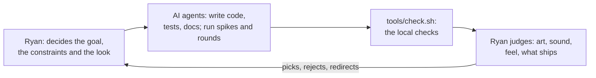

# wrela: how it's made

*What AI does in this project, what people do, and every outside work we use and how. Started
2026-10-10. Games are a contentious place for AI, so this record is complete and public. If a
line here is wrong, that is a bug: fix it in the same change that makes it wrong.*

## In short

- **One person, a team of AI agents.** Ryan (the owner) decides, directs and judges. Claude and
  Codex agents write almost all of the code, tests and docs, and run the experiments.
- **No generative image, sound, music, voice or video model makes anything in wrela.** Every
  image and sound comes from wrela code that runs on the player's device: the renderer draws the
  world from fields, the piano synthesizes its notes, and the music is a score written as code.
- **References are for learning, not for copying.** Agents look at outside images to learn
  light, colour, form and composition. We never trace them, ship them or recreate a specific
  shot, character or design. Each one is listed below with its source, its rights and its use.

## Who does what



| Work | People (Ryan) | AI agents |
|---|---|---|
| Goal, constraints, flagship design | Decides all of it (#44: "settled means the owner decided it") | Asks questions, writes the decisions down |
| Planning against the vision | Sets the vision and the owner's gates; answers the open lore questions | Keeps a map from the vision to what exists, ranks the gaps each day, and proposes the next workstreams |
| Language, compiler, engine, runtime, studio | Reviews, directs, merges | Writes the code and its tests |
| Art direction | Picked the look (#50) and judges every art result | Builds the looks in code, judges stills against a rubric, proposes changes |
| Creatures and the world | Judges each result (blind where we can) | Authors them as fields, and how they behave (what they sense of the player and do about it), in wrela code |
| Characters' motion and combat | Designed the climber (a cape all the way round, a mask, a great sword moved by will, a blink for a dodge); judges how the fight plays, with a pad | Keys the moves and their frame data as code (the sword's path, the body's form), writes the fight's sim and its tests, and plays it with a test bot |
| Music and sound | Judges by ear; ruled out music models (#44) | Write the piano synthesizer, the floor's synthesized sounds (steps, wind, water) and their mix, the scores and performances as code, and the tools |
| Story and lore | Writes the overarching story and its ending | Drafts each floor's lore within what Ryan has written; Ryan reviews it |
| Translation (planned) | | Translates; players review |
| Docs and records | Reviews | Writes them |
| Architecture and code health | Decides calls that change the architecture | A steward thread reviews every merge each 6 hours (duplicated helpers, dead experiments, code across layers), measures frame and gate time, cleans up, and proposes larger refactors |

Every commit on `main` so far (50 of 50 on 2026-10-10) was written with Claude Code and carries
a `Co-Authored-By: Claude` line; Ryan commits or merges them. Agents also merge their own
branches with Ryan's standing permission, after `tools/check.sh` passes. Since 2026-10-11 every
branch starts from `main` and squash-merges back into it once its change passes the local check.
If main changes after verification, the branch incorporates it and runs the same check on the
combined sources before merging. Check infrastructure changes pass the complete suite and
focused failure regressions. There is no separate premerge check or periodic test tier.

## Local verification

On 2026-10-11 Ryan asked Codex to consolidate local verification into `tools/check.sh` and
`tools/check.sh <check-name>`. Every retained check runs in the complete suite; individual
checks have the same sizes and assertions. Compiled artifacts are cached, but passes are not.
The same command can select an exact native Wrela `@test` by package and name, including std.
The suite uses small CPU/GPU/browser fixtures, bounded seeded samples and explicit resource
lifecycle checks. Historical milestone benchmarks, full-floor bakes and extended camera tours
are retired from automated verification; their past results remain historical evidence. A
passing suite does not re-establish whole-floor visual quality, prolonged stability or a
reference machine's frame-rate claims. Ryan's play and visual judgments still decide those.

On 2026-10-14 Ryan asked for a much faster development loop with the same single check. Claude
measured the Linux machine. The warm suite took 316.9 s, and most of that time was the Rust test
programs, which ran one test at a time. The programs now run 2 to 6 tests at a time (half the
cores). The other steps run beside them, and every check runs even when another fails. Running
tests at the same time exposed a race in the shared Chrome's lazy start: a second tab could
receive no port. The start is now locked. Each scenario's console keeps only its own page's
records, because one test uses the console to confirm a build arrived. A name that ends in `::`
selects a group: a Rust module in one test program, a Wrela package or a browser test file.
On the Linux machine (12 cores, Radeon integrated GPU, Chrome), five consecutive warm suites
passed in 118.8 to 125.2 s with all 744 Rust tests. The sampled summed memory of the check's
processes peaked at 3.5 to 3.7 GiB. A suite after a public change to `compiler/sema`, with its
rebuild, passed in 125.2 s. Running the longest test program beside the others took 108 to
110 s but used up to 5.1 GiB and slowed that program by a quarter, so it was not kept.
One suite from an empty Cargo target directory, with every build, passed in 456.2 s.
The M4 Air has not been measured; its times are reported separately.

## Tools and models

| Tool | What it does here |
|---|---|
| [Claude Code](https://claude.com/claude-code) (Anthropic), mostly Claude Opus 5.5 | Writes the code, tests and docs, on Ryan's MacBook Air and in cloud sessions |
| [OpenAI Codex](https://openai.com/codex/) | Reviews performance across the codebase, implements optimizations and regression tests, and measures their effects in a cloud session |
| Claude Opus 5.5, Sonnet 5.5 and Fable 5.1 | The authors in the blind authoring rounds that test thesis 1 (vision.md); Opus also in the first round |
| Claude subagents with no context | Blind raters in the lookdev loop: they see only the before and after stills and the anchors |
| Plan councils: Claude leads; OpenAI Codex GPT-6.1-Sol and GPT-6-Astra review | Since 2026-10-14, two Codex models review a measured plan independently, read-only, and then rebut the leader's answers. Claude decides, implements and verifies. First used for the faster check |
| Claude projects (claude.ai) | Run several agent threads at once (lookdev items, fixes, rendering setup), with one coordinator |
| [OpenAI Codex](https://openai.com/codex/) (GPT-6) and parallel subagents | Since 2026-10-10, audit performance across the compiler, runtimes, engine, studio, UI and tools; implement behavior-preserving improvements and run focused tests and repository gates. CPU gate work includes checks without rasterization, focused builds, isolated scratch directories, Linux compatibility, quota-aware scheduling, artifact-only studio builds, CPU literal inspection, and pipeline reuse between variant previews. On 2026-10-11, Ryan requested fixes for 19 visual and gameplay issues in The Last Green. Codex and parallel subagents inspected the renderer, procedural vegetation, water, clouds, character, and movement; implemented fixes and focused regressions; and used native M4 profiles, lookbook and motion captures, and interactive browser play to assess them. Live play exposed slow-frame cloth timing and fallen-log placement faults that the short captures missed. No generated art assets were used. Ryan requested a daily sweep from fresh `main` at 02:00 America/Denver. On 2026-10-11 Ryan also requested a repo-wide bug sweep: agents reproduced failures, fixed them, and added focused regressions across the codebase. |
| [sfizz](https://sfz.tools/sfizz/) (BSD 2-clause), `sfizz_render` | Plays the reference piano's samples from a take's MIDI file, for the listening tests (`tools/listening.py`). Not part of the game |
| Mesa's lavapipe (Vulkan on the CPU), MIT, patched (`tools/cloud/`) | The GPU of a cloud machine, which has none (`tools/cloud.sh`) |
| [FFmpeg](https://ffmpeg.org/) with x264, GPL | Makes the motion captures' clips and contact sheets from the frames the native host saves (`tools/motion.py`). Not part of the game |
| strace, LGPL; Linux mount namespaces (`unshare`) | Historical gate pass caching, retired 2026-10-11: what each slow test reads, so a pass is reused only while all of it is unchanged, or, for a test that builds a program, while its builds make the same files. The ideas are build systems' (Bazel's action cache, ccache's manifests, tup's and fabricate's traced dependencies, Shake's and Bazel's early cutoff) |

Not used, by decision: Suno or any music model (Ryan, 2026-10-06, #44), and any image, texture,
3D, voice or video generator. No asset is made by a model that was trained to output art.

## Wrela console and static hosting, 2026-10-12

Ryan requested a generic Wrela console at `games.wrela.dev`, starting with The Last Green,
with an original opening animation, local profiles and saves, and static Cloudflare hosting.
Codex authored editable Figma mocks as text, vectors and components, then implemented the
console UI and session/save policy in Wrela. Browser code supplies generic embedded-program
channels, file import/export and environment mechanisms through a shared asynchronous host
capability request. The compiler and native host support that same request; neither knows the
console catalog or a game's save schema. The intro is a Wrela field shader. Existing Wrela
renders supply game cover images. No generative image, audio or video model made an asset.

Figma's Plugin API and timeline export were used for layout and timing studies, outside the
repository. The chosen font files are [Barlow](https://github.com/google/fonts/tree/main/ofl/barlow)
and [Manrope](https://github.com/google/fonts/tree/main/ofl/manrope), both SIL Open Font License;
their licenses ship in `console/fonts`. Manrope's variable font was instantiated at weight 500
with [fontTools](https://github.com/fonttools/fonttools) (MIT), without changing its design.
[Pillow](https://pillow.readthedocs.io/) (HPND) converts existing Wrela frame captures into
RGBA cover data during release packaging. The reusable Wrela UI accepts caller-selected baked fonts rather than adding console fonts to
every program's default font pair.

[Cloudflare Pages Direct Upload](https://developers.cloudflare.com/pages/get-started/direct-upload/),
[custom domains](https://developers.cloudflare.com/pages/configuration/custom-domains/), and
[static headers](https://developers.cloudflare.com/pages/configuration/headers/) were consulted
for local static release uploads, domain binding, immutable build paths and isolation headers.
[MDN's cross-origin isolation permission reference](https://developer.mozilla.org/en-US/docs/Web/HTTP/Reference/Headers/Permissions-Policy/cross-origin-isolated)
was used to delegate the existing shared WASM memory capability to embedded game origins.
These are implementation references, not copied product designs or assets. Saves and profiles
stay in browser-owned storage and export as files; there is no server-side save service.

Local browser checks exercised new game, explicit ready-frame handoff, F10 return after storage
commit, save export/import, the previous-game backup, profile-name persistence, and a 390×844
layout with three slots. These checks establish the exercised flows, not prolonged stability.
On the M4, 120 native lockstep frames at 1280×720 measured the console opening at 0.057 ms
median GPU span and 0.576 ms median CPU frame call; the browser channel is outside this native
measurement. The same-mode Last Green baseline at `f2969cbd` measured 12.806 ms GPU span and
18.956 ms CPU frame call; the candidate measured 12.129 ms and 18.173 ms. All 114 shader files
match. Separate startup-inclusive samples vary, so this is no performance-win or sustained
Chrome-frame-rate claim. The console suspends its frame clock and pad input while a game is
shown. Gate time gains were not measured; the complete gate retains the new policy and failure
regressions and adds the console's small shader corpus.

## Wrela alien opening and sparse library, 2026-10-12

Ryan rejected the busy first console and requested a black, lit 3D space, a rotating alien
form that becomes Wrela, and a small album selector. Codex used the frontend-design skill
for composition studies, then authored the procedural solid, metallic lighting, font-field
extrusion, morph timeline and all controls in Wrela. The existing licensed Barlow fields
supply the letter shapes. No outside visual asset, shader source or generative media was used.
The browser ABI and game rendering code are unchanged. Covers retain their aspect ratio;
only five nearby covers can hold textures or requests. Saves and settings open on demand.
The 6.6-second opening can be skipped without starting a game; reduced motion bypasses it
and holds the background still.

Actual Chrome captures checked the full opening at 1280×720 and 390×844, a three-title
fixture, and Enter used to skip the intro. Local interaction checks exercised continue,
ready-frame handoff, F10 return, the existing saved profile, save selection and settings.
Four small Wrela regressions cover the timeline, album geometry and request window, and
save-panel capacity. The frame captures and clips are original Wrela renders retained
outside the repository.

On the M4, matched 480-frame native lockstep runs at 1280×720 measured the old console at
0.055 ms median GPU span and 0.543 ms CPU frame call, and the new console at 0.658 ms and
1.323 ms. The new GPU span's p95 is 1.147 ms, about 7% of 16.7 ms. Native console runs do
not exercise browser session I/O; these samples do not establish sustained Chrome frame
rates. Matched 120-frame Last Green runs on the same machine measured 11.792 ms GPU span
and 17.731 ms CPU frame call before this change, then 12.127 ms and 17.932 ms. The game's
114 generated shader entries match. This change adds no game-frame work; timing variation
is not a performance gain. Gate time impact was not measured as a paired benchmark; the
same complete gate retains all checks and gains four small tests plus the scene shader.

## Original console typography and unfolding sculpture, 2026-10-12

Ryan requested an original sleek font, a better alien form and transformation, and removal
of the top-right player name. Codex used the frontend-design skill to compare two concepts
and authored Wrela Meridian: 95 original printable ASCII glyphs with broad proportions,
cut terminals, a low lowercase x-height, and softened geometric corners. Centreline paths
in `console/meridian.wrela` supply build-time distance fields for display text and the
opening's actual mesh. The existing Manrope face remains for small controls and save details.
New builds replace Barlow; retained immutable releases keep their original notices. The new drawings and procedural sculpture are original
project code under the repository's MIT license; no outside outlines, visual references,
shader source or generative media assets were used.

Six tapered titanium vanes rotate around a hollow spindle, separate with a short stagger,
and unfold into their exact glyph paths. Mesh topology stays fixed throughout the opening.
A moving light crosses the resolved word before the room fades into the library. The prior
field interpolation and font texture extrusion are removed. All geometry, lighting, text
and timing remain in Wrela. The host ABI, static hosting model, saved profile identity and
game code are unchanged. The top-right profile label is removed; settings and saves remain.

A Wrela specimen and Chrome sequences at desktop and portrait sizes check the alphabet,
full opening, library, skip and saved animation-off behavior. Focused regressions cover glyph
coverage and field bounds, terminal joins, and the correspondence between font paths and
mesh endpoints, plus portrait framing. Captures are original renders, retained outside the repository.

On the M4, matched 480-frame native lockstep profiles at 1280×720 measured the previous
opening at 0.666 ms median GPU span and 1.326 ms CPU frame call; the final mesh opening
measured 0.167 ms and 0.669 ms. GPU p95 fell from 1.205 to 0.271 ms, about 1.6% of the
16.7 ms frame budget. The mesh adds a resize-bound colour/depth pair (7.0 MiB at this size)
and uploads its geometry once. These are startup-inclusive native samples, not sustained
Chrome frame rates or browser session-loading measurements.

Matched 120-frame Last Green profiles measured 12.335 ms GPU span / 17.967 ms CPU before,
and 11.856 / 17.926 ms after; all 114 shader inventory entries match. This console change
adds no game-frame work; the difference is measurement variation. There is no paired gate
time benchmark. The gate keeps its existing coverage and gains four small regressions,
a cached original-font bake and two additional render pipelines.

## Simulated construction studies, 2026-10-11

Ryan asked for worlds composed by simulation across seeds, including people whose construction
becomes fields at compile time, with shared engine mechanisms and different rules per world.
OpenAI Codex implemented the first small construction studies (`examples/builders`): an event
calendar, finite stock and labour, support and overlap checks, and continuous field recipes.
Forest and ocean studies own their site preferences, material knowledge and tidal work rules.
They are experiments, not new Last Green lore. The lab replays each solid's completion time.

The source is original project code under the repo's MIT license. No outside assets, reference
images, model-generated art or new external algorithm source was used. The work builds on the
repo's field, constant-evaluation and seeded-noise code. Tests use small seeded worlds, explicit
failure cases and a real GPU field comparison. These checks do not establish beautiful worlds,
structural engineering accuracy, interacting civilizations or a replacement for the floor's
current authored composition.

Studio finding: an associated event type through a generic world implementation did not resolve
in a call to the history driver (`Calendar<People<H>::Event>` versus `Calendar<Task>`). The shared
interface takes its event type as an explicit trait parameter. The engine primer command has
language areas only; source inspection was used for the existing engine modules.

## CPU agent workflow survey, 2026-10-11

Ryan asked for a broad pass over agent latency without a GPU, on machines with varying CPU
counts. Codex and parallel agents inspected discovery and editing, builds, tests, simulation,
studio inspection, reference fitting, audio, captures, browser driving and the check runners.
The development container has a two-CPU quota despite an affinity mask of three CPUs; scheduling
uses the quota and affinity rather than the host's reported processor count.

| Workflow | Work removed or bounded |
|---|---|
| Source discovery and edits | `query` already batches queries in one check, `doc` parses without compiling, and source edits use checked plans. These paths keep their existing behavior. |
| Builds and state tests | Existing constant and native-code caches stay. CPU frame/tick tests skip GPU optimization and shader/browser output, retaining language diagnostics, CPU debug checks and pipeline command metadata. GPU tests and programs that fetch generated build files keep the full path. |
| Simulation diagnosis | `trace` and `bisect --no-gpu` can inspect CPU state without software rasterization; `--workers` selects an explicit worker count. State which needs GPU feedback still needs shader execution. |
| Studio inspection and comparison | Twelve synchronous field actions run their own exports on the CPU without an unseen frame or shader compilation. Invalid actions fail before a build. PNGs and GPU-dependent actions still render. Comparisons batch consecutive field view controls into their final image; field edits and map actions still settle normally. |
| Audio | Reuse FFT plans, windows and scratch buffers; retain fitted decay curves across grid candidates; reject non-peaks before median calculation. Numbers and sheets share one build but keep separate program instances. Listening excerpts touch only fade boundaries and avoid full-track copies. |
| Reference fitting | Independent part fits use a bounded queue and return in original order, instead of starting a thread per part in every round. |
| Stills and motion | Reuse screen readback buffers, use fast lossless PNG compression, and omit discarded pre-roll captures while rendering the same history. Software stills divide available CPUs between concurrent shots; browser and FFmpeg workers use available CPUs too. |
| Browser and local server | Reap orphaned Chrome children on Linux and reduce server shutdown polling latency from 500 ms to 50 ms. |
| Check runners | Reuse Python workers; bound memo builds and quick/slow test processes by the CPU quota. Only compress WGSL when a compressed budget applies or a failure needs its compressed size. |

Measured locally against a clean build of `7f49462`, with the release tools on two CPU workers:

| Work | Before | After | Evidence |
|---|---:|---:|---|
| Wolf studio probe, cold native cache | 9.54 s | 4.60 s | Same JSON; Mesa's shader cache shared |
| Wolf studio parts, warm native cache | 4.53 s | 2.34 s | Same JSON |
| Sphere studio probe, warm | 2.06 s | 0.61 s | Same JSON; all twelve actions compared |
| 120 first-light frames at 640×360, all PNGs | 1.13 s | 0.37 s | Three-run medians; same decoded pixels and command hash |
| Same render, keep only frames 90–119 | 1.13 s | 0.17 s | Same retained pixels; 121 files become 31 |
| 60-frame test-floor state trace | 1.53 s | 0.34 s | Two-run medians; `--no-gpu` gives the same 61 CSV lines |
| Eight seconds of audio partial analysis | 0.53 s | 0.15 s | Three-run medians; same JSON |
| Thirty seconds of click analysis | 0.084 s | 0.0084 s | Three-run medians; same JSON |
| Eight 20-second listening excerpts | 2.78 s | 0.071 s | Same samples |
| 56 check/memo/resource tests | 6.87 s | 1.60 s | Same tests pass |
| Wolf / grazer 120-frame CPU tests | 2.54 / 3.11 s | 2.18 / 2.77 s | Three alternating runs; same results |

The faster PNG encoder trades file size for CPU time: this capture's files grew 35%, with no
pixel change. Audio numbers and sheets took 1.4× and 1.7× less time in fresh one-second piano
runs; their JSON, the sheet PNG and the rendered WAV matched exactly. WAV synthesis itself did
not get faster. Shader and simulation arithmetic stay unchanged; the runtime frame-cost changes
apply to screen capture. These are local workflow measurements, not reference-GPU timing claims.

Separately, batching comparison view controls on top of the other changes cut default-size
`beside` from 3.44 to 2.16 s, `variants` from 4.67 to 3.19 s, and `sweep` from 5.68 to 3.78 s.
All three commands matched every decoded pixel and their normalized JSON at 64, 896 and 960
pixels; the largest size also displays the lens's UI panel. Raw local timings, environment
details and validation logs are kept in `target/cpu-bench`.

Final validation passed 607 Rust tests, 119 Python tooling tests, formatting, Clippy, the browser
runtime checks and all 211 shader size checks. Another focused run passed 18 regressions,
including the relevant long audio and studio image tests. Worker scheduling was exercised at
1, 2, 4 and larger simulated CPU counts; wall-clock measurements used this two-CPU container.
The complete final gate still took 235 s here, with every gate test run because the optional
strace/mount-namespace test memo was unavailable.

This pass does not turn full-resolution software rendering, long playthroughs, cold Rust builds,
or uncached world bakes into constant-time operations. Image checks retain their resolution and
rendered history, and hardware timing measurements still require the reference GPU.

## Local session resource policy, 2026-10-11

Ryan asked Codex to implement support for ten concurrent coding sessions directly on main,
on an Apple M4 with ten CPU cores, 16 GiB unified memory and limited storage. This policy
starts with one costly job at a time; it is a conservative setting, not a throughput claim.
Reading and editing can proceed in all ten sessions. Focused checks and captures precede gates,
long checks and background warming, with aging for fairness. A long tier yields between tests
and stages, retaining its cases and sizes. Measurements reserve the queue.

The queue supervises owned process trees, preserves a live child's lease if its supervisor
dies, and records the checked commit and dirty source digest, queue time and outcome in the
per-user resource directory. A verification pass is rejected if its sources change. Ordinary
jobs cap Cargo compilation at four processes, test executables at one, test threads and default
compiler/runtime workers at two. Explicit concurrency tests retain their requested workers.
Two small GPU holders share global file permits across native hosts and Python's browser
driver; large renders and measurements take an exclusive barrier. Warning memory pressure
reduces check/build workers to one and defers renders, long work and warming. Critical pressure
pauses admission; sustained critical pressure, a deadline or critically low disk space stops
the owned job. These limits cooperate with the repo's tools; they do not constrain unrelated
applications or arbitrary commands outside the queue.

Source-only session worktrees share the common Git directory's Cargo and content-keyed native
and constant caches. Whole-job admission protects mutable binaries, and each selected checkout
rebuilds its own tool before use. Test scratch stays inside its checkout. No target or
node_modules is copied into new sessions. A 20 GiB shared-cache ceiling and 12 GiB admission
reserve prevent unbounded routine growth; only owned disposable output is pruned automatically.
An explicit cache reset runs under admission. Existing worktrees, captures, unmerged branches
and unknown scratch are preserved. The first inventory found about 38 GiB in existing targets;
this change does not erase them or claim that space has been reclaimed.
On this APFS machine, existing dependency artifacts seeded the shared cache with filesystem
clones, retaining current artifacts and excluding workspace crates and incremental state.
The clones share disk blocks; each session still builds its own current workspace sources.

Audio verification exposed a shared-cache correctness bug: Cargo accepted older, different
Rust source after another checkout had built into the shared target. Codex traced this to
Cargo's relative paths and modification-time checks. Job admission now checks the checkout,
source content and recorded workspace artifact state. Unknown or changed inputs clear only
workspace freshness records; dependency outputs and incremental data remain cached. A job
records its resulting artifacts only if its source inputs stayed unchanged. This records build
provenance, never test passes. Small regressions cover older content, an unrecorded cache writer
and source changes during a job. Admission follows the enclosing workspace from subdirectories;
nested tool calls must remain in one checkout instead of sharing its lease with another branch.
The conservative source key can also rebuild workspace crates
after non-Rust edits. Test helpers now resolve the running checkout and reject unrelated
runtime manifests instead of silently reading a build-time checkout.

The investigation used Cargo's public [compiler fingerprint documentation](https://doc.rust-lang.org/stable/nightly-rustc/cargo/compiler/fingerprint/index.html)
to confirm its freshness rules. No source code or assets were copied from this reference.

AGENTS.md is the sole repository instruction document. It is a regular file; the former
alias to CLAUDE.md and the separate CLAUDE.md file were removed.
Ryan then asked Codex to shorten that file for agent development speed and code quality.
The revised instructions make routine agent work and local merges explicit, require source
freezing during verification, and retain the single gate and shared resource limits.
Frame-time and gate-time effects belong in completion reports as well as PRs.
Ryan also required agents to remove each session worktree and local branch after merging.
Removal accepts either commit ancestry or an identical complete source tree in main's
first-parent history, so squash merges remain removable after main advances. It pins the
branch commit for deletion and preserves followup commits, switched branches, dirty work,
live jobs and ignored outputs needing preservation. Agents move needed outputs outside the
session before cleanup; no Git hook or periodic job deletes active sessions.

The policy uses Cargo's documented [worker and target settings](https://doc.rust-lang.org/cargo/reference/config.html#buildjobs),
explicit [libtest thread limits](https://doc.rust-lang.org/rustc/tests/index.html#test-threads-num_threads),
Python's [process sessions and descriptor inheritance](https://docs.python.org/3/library/subprocess.html#subprocess.Popen),
and Apple's [memory pressure guidance](https://support.apple.com/guide/activity-monitor/check-if-your-mac-needs-more-ram-actmntr34865/mac).
Linux admission also reads [cgroup memory limits](https://docs.kernel.org/admin-guide/cgroup-v2.html#memory)
through all visible ancestors, estimating working memory after inactive filesystem cache;
host-wide free RAM alone can hide a container's limit.
No outside code or assets were copied. CPU/lavapipe correctness keeps real shader and buffer
assertions; reference GPU measurements and final visual judgment remain their own evidence.

## Native image-quality study, 2026-10-11

Ryan asked Codex and parallel subagents to compare image reconstruction and tree detail,
then set full output resolution as the look-development baseline, accepting slower frames.
The study compares native exact samples, native temporal AA, and the prior 1.75 scale on
moving routes. It uses small GPU regressions, M4 profiles, and interactive browser play.
Temporal averaging and upscaling are separate: native rendering can still use history for
thin-leaf coverage. A four-tap filter that mixes neighbours at exact sample alignment hides
authored detail. Bounded interpolation preserves those samples; projected crown size controls
when geometry becomes an impostor. Atlas views need isolated sampling and coverage-weighted
normal/depth filtering. No generated art assets or external implementation code were used.

Primary research: [AMD FSR 1](https://gpuopen.com/fidelityfx-superresolution/) and
[FSR 2](https://gpuopen.com/fidelityfx-superresolution-2/) (SDK code under MIT; documentation
consulted, no code ported) explain spatial versus temporal inputs and history requirements.
[Epic TSR documentation](https://dev.epicgames.com/documentation/en-us/unreal-engine/temporal-super-resolution-in-unreal-engine)
(copyright Epic; documentation only) explains temporal detail and motion diagnostics.
[meshoptimizer](https://github.com/zeux/meshoptimizer) (MIT; documentation only) informs
error-based geometry selection. [NVIDIA GPU Gems filtering](https://developer.nvidia.com/gpugems/gpugems/part-iv-image-processing/chapter-24-high-quality-filtering)
(copyright NVIDIA and contributors; reading only) explains why procedural detail must be
filtered over its pixel footprint. These references guide comparisons, not claims that an
external upscaler or automatic compiler reconstruction has been implemented.

## Character presence and vegetation stability, 2026-10-11

Ryan requested stable foliage light, more natural grass and ground, clearer cloud volume,
and a new character silhouette. The current direction is a large empty black robe with
hanging empty sleeves, an empty hood, a hem that leaks connected shadows, and a detailed
telekinetic sword with a metallic light response. The upper silhouette is lean and varied,
not a wide block. It supersedes the earlier mask design. Ryan named a grim reaper and the broad mood
of a dementor (Harry Potter, copyright its rights holders), explicitly requesting an original
character. No reference shot, mesh, texture, or character design was copied or sampled.
Codex and parallel agents author the forms in Wrela, inspect motion captures and browser
play, and validate rendering rules with small shader and numerical regressions. No art
asset is made with a generative image, audio, music, voice, or video model.
The material pass carries authored roughness and metallicity through the character bake,
reusing the engine's GGX and probe reflection functions with colored metal reflectance.
Small real-shader fixtures check moving highlights, roughness, material baking, static shadow
sampling, foliage gaps, and vacated temporal history. Native captures and browser play remain
the visual evidence; test passes alone do not establish a finished environment or zero flicker.

## Environment form and lighting research, 2026-10-11

Ryan paused character work and asked Codex and parallel agents to correct the environment
findings, with primary-source research. The research separates observed natural structure
from rendering approximations. The applications below are design decisions for Wrela, not
claims that the complete external algorithms have been implemented. Motion captures,
interactive browser play, small regressions and same-machine profiles remain the checks.

| Primary source | Finding and application | Rights and use |
|---|---|---|
| Runions, Lane and Prusinkiewicz, [Modeling Trees with a Space Colonization Algorithm](https://algorithmicbotany.org/papers/colonization.egwnp2007.html), 2007, pp. 2–6 | Smooth a branching skeleton before forming cylinders. The pipe model relates a parent's radius to its children's radii with an exponent usually between 2 and 3. Later fine branches produce a hierarchy; light access favors outer growth. Apply these principles to taper, curved attachments, unequal limbs, fine outer sprays and open crown interiors. | Copyright Eurographics and authors; paper read for principles. No text, code, tree geometry or reference image copied. |
| Palubicki et al., [Self-organizing tree models for image synthesis](https://algorithmicbotany.org/papers/selforg.sig2009.html), 2009 | Branch competition for space/light and internal signaling shape a tree. Our inference: neighboring crown masses should not all be equally full; preserve a dominant growth structure and asymmetric gaps. This does not require a full growth simulation at runtime. | Copyright ACM and authors; research reference only, no code or models imported. |
| Kharlamov, Cantlay and Stepanenko, [GPU Gems 3, chapter 4: Next-Generation SpeedTree Rendering](https://developer.nvidia.com/gpugems/gpugems3/part-i-geometry/chapter-4-next-generation-speedtree-rendering), 2007, sections 4.2, 4.4–4.6 | Trunk silhouettes carry bark form. Backlit leaves transmit light; broad filtered highlights reduce shimmer. Binary cutouts can scintillate in motion, while coverage transitions can change apparent tree density. Apply separate checks for geometry, coverage, reflected light and transmission. Preserve crown coverage and color across distance; do not hide leaf loss with visibly giant cards. Alpha-to-coverage is an option only with suitable multisampling, not a substitute for correct geometry or motion. | Copyright NVIDIA and contributors; explanatory material read, no sample shaders or assets copied. |
| USDA Forest Service FEIS, [Arizona fescue](https://research.fs.usda.gov/feis/species-reviews/fesari), botanical characteristics | This bunchgrass has narrow leaves, typically below 3 mm wide and 20–41 cm long, with flower stalks above the leaves at 0.3–0.9 m. Use distinct short basal foliage and sparse taller stalks as a growth-habit reference. Avoid making every meadow element a broad upright spear. Values inform scale relationships, not a claim that the fictional flora are this species. | U.S. government botanical synthesis; facts consulted. No photographs, illustrations or species assets copied. |
| USDA Forest Service, [Nonnative Invasive Plants of Pacific Coast Forests, PNW-GTR-817](https://research.fs.usda.gov/download/treesearch/37858.pdf), oxeye daisy, p. 47; Royal Botanic Gardens Kew, [Digitalis purpurea descriptive accounts](https://powo.science.kew.org/taxon/urn:lsid:ipni.org:names:802077-1/general-information) | Daisy has basal rosette foliage and a separate taller flowering stem; foxglove has large basal leaves and reduced leaves/bracts above. These support separating basal foliage from a thin reproductive axis. One species is selected per crown, and the stem and head share a root and wind motion. The half-height basal foliage rule and 24 cm cap are our visual tuning, not measured rules for every species. Nonflowering rush and tussock heights remain separately authored. | U.S. government field guide and copyrighted Kew flora accounts; morphological facts read. No plant illustrations, images or text copied. |
| USDA NRCS, [Stream Restoration Design Field Guide](https://www.nrcs.usda.gov/sites/default/files/2024-10/Stream%20Restoration%20Field%20Guide_july%202012.pdf), 2012, stream-bed sampling; [Stream Visual Assessment Protocol 2](https://www.nrcs.usda.gov/sites/default/files/2022-09/StreamVisualAssessment.pdf), 2009 | Bed material varies with hydraulic and sediment processes; pools, riffles and bars are distinct features. Apply asymmetric bank shelves, localized gravel/cobbles and varied wet margins. Root plants on suitable banks and shelves. Avoid a uniform trench with identical vertical sides and an unbroken grass lip. This is visual inference from channel morphology, not an engineering restoration model. | U.S. government guidance; text facts and diagrams studied. No diagrams or photographic textures copied. |
| WMO, [International Cloud Atlas: Cumulus explanatory remarks](https://cloudatlas.wmo.int/explanatory-remarks-and-special-clouds-cumulus.html); NOAA, [Cumulus glossary](https://forecast.weather.gov/glossary.php?word=CUMULUS) | Nearly horizontal gray bases are normal; remove the mechanical slab appearance without removing the common condensation level. Cumulus relief has pronounced light differences, especially in side light; backlighting gives a bright edge around a darker body. Apply uneven lobe height, interrupted perimeter and thickness variation while retaining light direction and a coherent base region. | WMO copyrighted reference text and U.S. government glossary; definitions read. No atlas photographs or cloud shapes traced. |
| Andrew Schneider, [Nubis: Authoring Real-Time Volumetric Cloudscapes with the Decima Engine](https://www.guerrilla-games.com/read/nubis-authoring-real-time-volumetric-cloudscapes-with-the-decima-engine), SIGGRAPH 2017, slides 28–39 and 84–92 | Separate cloud coverage/type and vertical density profile from boundary erosion. Remapped erosion preserves the solid core. Attenuation alone makes interiors too dark; the lighting approximation also depends on surrounding coarse density and height. Apply varied authored profiles and bounded interior fill so billows keep relief. More march samples cannot repair repetitive density shapes. | Copyright Guerrilla/Sony and authors; presentation read for density/lighting principles. No noise textures, generator code, presentation code or art assets imported. |
| Morgan McGuire and Michael Mara, [Efficient GPU Screen-Space Ray Tracing](https://jcgt.org/published/0003/04/04/), 2014, sections 1, 3–4 | A depth buffer represents limited visible layers; projected ray samples must address the matching depth surface, with finite depth intervals when needed. These principles inform matching jittered reflection color/depth coordinates and rejecting color-filter taps across unrelated depths. This is a repair of the existing reflection path, not a port of the paper's DDA or layered tracing implementation. | Copyright authors/JCGT; paper consulted for projection and finite-layer principles, with no sample code copied. |
| National Park Service, [Weathering](https://home.nps.gov/subjects/erosion/weathering.htm) and [Materials and Monuments](https://www.nps.gov/articles/000/cemetery-preservation-course-materials-and-monuments.htm) | Cracks, freezing water and roots divide rock; porous masonry is vulnerable to moisture. Our application: coherent bedding and joints on bedrock, fragments below exposed faces, recessed masonry joints and contact weathering tied to ledges, openings and ground. Rock/soil material ownership must agree with vegetation and paint masks. Do not add uniform noise to imply erosion. | U.S. government educational material; physical principles consulted, with no photographs or textures copied. |

Bark relief also uses the surface-gradient principle described by Morten Mikkelsen, [Bump Mapping Unparametrized Surfaces on the GPU](https://mmikk.github.io/papers3d/mm_sfgrad_bump.pdf), 2010. Height derivatives and the local surface basis give opposing slopes on either side of a ridge; degenerate bases and maximum slope are bounded. This is an original implementation of the principle, with no source code or media copied. The paper remains copyrighted by its author.

These sources guide original procedural forms. Native full-resolution look development
remains the baseline. Geometry and material structure must read before any extra sharpening,
upscaling, distance simplification or temporal averaging is judged. No generative media
models or outside art assets were used for this research pass.

## Repository bug sweep, 2026-10-12

Ryan requested an autonomous review of the whole current repository. Codex and parallel
agents reviewed the compiler, shared ABI, both hosts, standard library, engine, UI, studio,
examples and local tools. They used the existing MIT-licensed source, language specification
and tests to find failures, then added bounded regressions and fixed their causes. No outside
assets or new reference algorithms were used.

The review includes invalid input and resource lifetime paths: unsafe automatic source fixes,
trait and projection checks, GPU lowering, stale source edits and hot reload, command validation,
GPU retirement and pass joining, nested task failure reporting, text focus and small layouts,
field diagnostics, and verification admission and source tracking. Suspected bugs that failed
to reproduce were discarded. State tests use CPU hosts; shader behavior uses real GPU tests.
The atomic map review consulted the [WGSL memory model](https://www.w3.org/TR/WGSL/#memory-model)
and [atomic built-ins](https://www.w3.org/TR/WGSL/#atomic-builtin-functions), W3C, under its
[permissive document license](https://www.w3.org/copyright/document-license/). They explain that
atomic ordering applies per memory location. The fix uses a key claim and commuting atomic
additions, with stable reads in a later dispatch, instead of a publication flag across locations.

ABI validation was checked against the installed wgpu-core 30.0.1 source, commit
`40f4a34ebaf56f9a046231f54125ad046239d3f3`, under MIT or Apache-2.0. Its
[resource validation](https://github.com/gfx-rs/wgpu/blob/40f4a34ebaf56f9a046231f54125ad046239d3f3/wgpu-core/src/device/resource.rs)
and [render validation](https://github.com/gfx-rs/wgpu/blob/40f4a34ebaf56f9a046231f54125ad046239d3f3/wgpu-core/src/command/render.rs)
were used to check binding-number limits, colour blendability and depth-clear ranges. No source
was copied.

The full local check verifies the final frozen tree before the local squash merge. Frame costs
are compared with native M4 profiles of The Last Green in the same measurement mode; those
profiles do not establish Chrome frame rates or long-run stability.

The saved baseline and sweep outputs for the floor's reach, shots, report, calibration and tour
are byte-identical. All critical sites pass the reach check. Existing authoring diagnostics
identify two unreachable crag viewpoints and two shots below their subject-visibility threshold;
their cause remains a content-review question. They did not establish an additional code defect.

Before the squash merge, `main` advanced to `f2969cbd` and then `cb12b804`. The agents reviewed
the optimizer, wood buffers, checker scope reuse, console, session services and hosting changes,
incorporated them, and regenerated the shared ABI files and browser bundle. The extended review
also covers resumed gamepad state, hidden child input, embedded-page reload, host method receivers,
UTF-8 text parity, catalog errors and asset paths, export names, recovery acknowledgement and
destinations, recovered-save backups, immutable release metadata, reserved build paths and the
release tool's checkout admission. Final verification and the paired profile baseline use the
latest incorporated main.

The sweep fixes 105 distinct defect classes. Shared native/browser defects are counted once;
the browser also receives the corresponding parity fixes.

| Area | Defects | Main failure paths |
|---|---:|---|
| Syntax, grammar, standard collections and UI | 13 | Unsafe source fixes, worker admission, zero-sized boxes, small integer serialization, atomic payloads, focus and clipped layouts |
| Semantic analysis | 8 | Trait bounds, generic kinds, associated types, projection loans, callable effects and runtime array counts |
| Lowering and workgroup analysis | 7 | Skipped barriers, GPU vector shifts, unsupported blending, enum clone tags, callback writeback, erased values and missing array bounds |
| Driver and CLI | 13 | Invalid roots, stale edits and builds, float text, empty test selections, trace precision, audio bounds and refactor parsing |
| Shared ABI | 8 | Workgroup overflow, pad number parity, depth clears, texture payload padding, binding indices, blended formats and UTF-8 text parity |
| Native host and parallel tasks | 12 | Pass scopes, timing collection, debug state, call completion, handovers, malformed worker memory and thread lifetime |
| Browser-only host paths | 15 | Deferred attachments, resource retirement, input loss, stuck input, audio shutdown, OPFS recovery, literal URLs, test parameters, host receivers, embedded reload and gamepad routing |
| Tools and engine helpers | 15 | Frozen-source proof, input hashing, server paths, gzip freshness, lock cleanup, admission, executable freshness, nearest cells, camera, clipmap invalidation and static release packaging |
| Studio, RNG, float parsing and fight sounds | 6 | Invalid diagnostic samples, rounded unit draws, repeated exponent signs, lost tally cues and skipped blink arrivals |
| Console and session services | 8 | Pending export identity, catalog decode errors, accepted export keys, cover paths, visible load errors, recovery slot selection, export acknowledgement and freed-world resume destinations |

## The references

### The rules

1. **Learn, don't copy.** A reference teaches light, colour, value, form, scale or composition.
   We don't trace it, sample its pixels into the game, or rebuild a specific shot, character or
   design from it.
2. **Prefer the cleanest rights.** Public-domain works first (museum open-access collections, US
   federal government photos), then works under open licences, then official stills a studio
   offers for free use. A copyrighted image with no such offer (a publisher's screenshot) is for
   private study only. A reference whose source or rights we can't name isn't used.
3. **Ship only what the licence allows, with its credit.** A file in the repo has a manifest
   beside it (`references/**/*.toml`) with its source, author and licence. Anything adapted from
   a work that needs credit (CC BY) carries the credit into the game.
4. **Style references stay private.** Images used only to judge the look (lookdev) are kept out
   of the repo, in the project's private files. Only their record is here.
5. **Record every one, in this file.** An agent that uses a reference adds its row in the same
   change. The row says what it teaches and how we used it.

### In the repo

| Reference | Source and rights | How we use it |
|---|---|---|
| OpenAI, [Custom instructions with AGENTS.md](https://learn.chatgpt.com/docs/agent-configuration/agents-md) | Public documentation; no text or code copied | Consulted on 2026-10-11 when tightening repository agent instructions: project guidance supplies commands and expectations; the repo retains one instruction file and local verification. |
| Six photos of bison and wolves (`references/grazer/`, `references/wolf/`) | Wikimedia Commons; US National Park Service, Fish and Wildlife Service and Agricultural Research Service photos; public domain. Each `.toml` has the URL and author. | Authoring rounds 4 and 5: agents saw them beside their creature to check proportion and silhouette (`wrela studio … beside`, `wrela compare`). Nothing of the photo goes into a creature. |
| "Fantasy wolf miniature", a sculpt (`references/wolf/sculpt-standing.obj`) | Drew Vaughan (3ddrew), [Thingiverse 680145](https://www.thingiverse.com/thing:680145), CC BY 4.0 | Test 6 (vision.md): a wolf measured from the sculpt and rebuilt as lofts and sweeps, to learn whether wrela's forms can hold a great shape. It is an adaptation, so its source carries the attribution in the `.toml`, and a game that ships it credits him. |
| Satie, Gymnopédie No. 1 (1888) | The Mutopia Project's edition (Mutopia-2014/12/14-37, typeset by Evin Robertson from the Dover reprint), public domain | Spike 14 (#48): transcribed note by note into a score as code (`examples/gymnopedie/score.wrela`), then performed by wrela's piano. |
| Salamander Grand Piano V3 (a Yamaha C5) | Recorded by Alexander Holm, CC BY 3.0; FreePats' retuned SFZ, played by sfizz | Spike 14: wrela's piano model is fitted to measurements of these recordings (partial frequencies, levels, decays). The recordings are not in the game; the fitted numbers are, so a game that ships them credits him (`engine/piano_grand.wrela` says so). The listening tests (`tools/listening.py`) also play them beside wrela's piano, from a copy outside the repo. |
| Inter and JetBrains Mono fonts (`ui/fonts/`) | SIL Open Font License 1.1, licence texts beside them | The studio's interface text. |
| musl's libm; ARM's optimized-routines | MIT | `compiler/std/math.wrela` follows their algorithms and coefficients (credited in the file). |
| Steven Worley, "A Cellular Texture Basis Function" (SIGGRAPH 1996) | A published algorithm; no code taken | Bark's plates (`engine/plant.wrela`, `plates_at`): the nearest and second-nearest of jittered cell points, written from the paper's idea. |
| Heini Hediger's flight distance (*Wild Animals in Captivity*, 1950), as field ethology uses it | A published idea; no code or data taken | The fawn's behaviour (`examples/last-green/behaviour.wrela`): it notices a person first and watches, and flees when they come on within a distance; the distances are our own, tuned by test. |
| Vadim Zavalishin, *The Art of VA Filter Design* (2012); George Marsaglia, "Xorshift RNGs" (2003) | Published algorithms; no code taken | The floor's sound (`engine/sound.wrela`): the state-variable filter that bands each source's noise, and the seeded noise itself. |
| The soil production function: Heimsath, Dietrich, Nishiizumi and Finkel, "The soil production function and landscape equilibrium", *Nature* 388 (1997) | A published finding; we use its idea, not its text or data | `engine::soil::soil`: rock weathers to soil fastest under a thin soil and creep moves it downhill, so crests are thin and hollows deep (credited in the file). |
| Johann Heinrich von Thünen's land-use rings (*Der isolirte Staat*, 1826); settlement site and budding as human geography teaches them | Published ideas; no code or data taken | The Last Green's elves (`examples/last-green/peoples.wrela`): each settlement takes its fields nearest by walking cost, then pasture, then wood; it chooses its site by water, soil, slope and sun; when it outgrows its land, some of its people found another. |
| W3C, Gamepad API, its "standard" mapping | A W3C specification; no code taken | The browser host reads pads by it (`runtime/browser/src/listen.ts`), and wrela's pad buttons and axes take its order and names (south, east, west, north, the shoulders and triggers, the sticks, the d-pad). |
| Closest points of two segments (as in Christer Ericson, *Real-Time Collision Detection*, 2005, §5.1.9) | A standard method; no code taken | The climber's fight (`examples/climber/fight.wrela`): the sword's edge, swept between ticks, is tested against capsules on the wolf's body, and the wolf's bite against a capsule up the climber. |
| Position-based dynamics (Matthias Müller, Bruno Heidelberger, Marcus Hennix, John Ratcliff, "Position Based Dynamics", 2007); long-range attachments (Tae-Yong Kim, Nuttapong Chentanez, Matthias Müller-Fischer, "Long Range Attachments: A Method to Simulate Inextensible Clothing in Computer Games", 2012) | Published methods; no code taken | The climber's cape (`examples/climber/cape.wrela`): a grid of points held by links whose lengths are kept, each point tethered to the collar so the cloth can't stretch however fast the body moves. |

### Style influences (named, not traced)

The art direction (#44) names four influences. They set the direction in words; we don't copy
images from them.

| Influence | What it stands for |
|---|---|
| E. H. Shepard's drawings for Winnie-the-Pooh | Storybook softness and texture |
| Anime | Shapes, characters, stylized faces |
| *The Legend of Zelda: Breath of the Wild* (Nintendo) | Landscapes: landform, distance, haze |
| Studio Ghibli's films, Kazuo Oga's backgrounds | Painted light and colour in forests and fields (the rubric's "hero" bar) |
| Real light | Sun, sky, bounce light and fog in the renderer |

The lore (vision.md, "The lore") names one comparison, the owner's. It sets a feeling in words;
we don't copy the game's story, characters or designs.

| Influence | What it stands for |
|---|---|
| *Clair Obscur: Expedition 33* (Sandfall Interactive, 2025) | A world as a dying, preserved piece of itself |

### Lookdev references (private, for judging the look)

The lookdev loop (milestone 6) judges each still against a rubric whose scale has anchor
images. They are in the project's private files, not the repo.

| Reference | Source and rights | How we use it |
|---|---|---|
| Spike 15's stills, B and C; spike 16's forest interior and year 800 | wrela's own renders (branches `spike-15`, `spike-16`), MIT | The "shippable mid-tier" anchor: the look Ryan picked, which today's floor must reach again. |
| The lookbook baseline, 2026-10-10 | wrela's own renders | The "blockout" and "placeholder" anchors. |
| The AAA set, 83 images (below) | 23 public-domain paintings (The Met Open Access, CC0); 52 official Studio Ghibli stills (Ghibli offers them free to use "within the bounds of common sense", [ghibli.jp/info/013344](https://www.ghibli.jp/info/013344/); © Studio Ghibli); 8 Nintendo store-page screenshots of *Breath of the Wild* and *Tears of the Kingdom* (© Nintendo, private study only) | The "hero" anchor: an agent looks at them beside a render to judge light, colour, value, depth and how a material reads. |

#### The AAA set

A Claude agent gathered it on 2026-10-10. It downloaded all 50 official stills of each of 14
Studio Ghibli films (700 images), looked at them on contact sheets and kept the 52 that show each
topic best, Kazuo Oga's painted backgrounds first. It added screenshots from Nintendo's official
store pages and public-domain landscape paintings from The Met (Hudson River School, Barbizon
school, Constable, Courbet, Ruisdael). The images were not traced, not copied into assets, not
used to train any model, and are not in the repo or the game. The project's private record keeps
each file's size and SHA-256. Tried and not used: *Genshin Impact* (no image large enough
without text over it) and Wikimedia Commons (rate-limited).

**forest-interior**

| File | Work | Rights | Source | What it teaches |
|---|---|---|---|---|
| `ghibli-karigurashi-001.jpg` | The Secret World of Arrietty (2010). Studio Ghibli, dir. Hiromasa Yonebayashi. | © Studio Ghibli, free-use still | [link](https://www.ghibli.jp/gallery/karigurashi001.jpg) | Garden path through dense undergrowth to a house; many painted plant types, worn path, and soft dappled light. |
| `ghibli-kazetachinu-050.jpg` | The Wind Rises (2013). Studio Ghibli, dir. Hayao Miyazaki. | © Studio Ghibli, free-use still | [link](https://www.ghibli.jp/gallery/kazetachinu050.jpg) | Large trees framing a bright opening to sky and an easel; shows the dark frame / bright gap pattern in a forest edge. |
| `ghibli-marnie-035.jpg` | When Marnie Was There (2014). Studio Ghibli, dir. Hiromasa Yonebayashi. | © Studio Ghibli, free-use still | [link](https://www.ghibli.jp/gallery/marnie035.jpg) | Bright, open conifer wood with ferns and a mossy log; light green shadows and high-key forest light. |
| `ghibli-mononoke-010.jpg` | Princess Mononoke (1997). Studio Ghibli, dir. Hayao Miyazaki; art directors incl. Kazuo Oga. | © Studio Ghibli, free-use still | [link](https://www.ghibli.jp/gallery/mononoke010.jpg) | Deep forest with huge mossy trunks and a glowing god in back light; volumetric light shafts and warm glow through a dark interior. |
| `ghibli-mononoke-023.jpg` | Princess Mononoke (1997). Studio Ghibli, dir. Hayao Miyazaki; art directors incl. Kazuo Oga. | © Studio Ghibli, free-use still | [link](https://www.ghibli.jp/gallery/mononoke023.jpg) | Night forest of roots and moss with small glowing spirits; dark blue-green values with small light accents. |
| `ghibli-mononoke-027.jpg` | Princess Mononoke (1997). Studio Ghibli, dir. Hayao Miyazaki; art directors incl. Kazuo Oga. | © Studio Ghibli, free-use still | [link](https://www.ghibli.jp/gallery/mononoke027.jpg) | Thick moss floor in a forest clearing with figures; how to paint a moss carpet with light patches. |
| `ghibli-totoro-019.jpg` | My Neighbor Totoro (1988). Studio Ghibli, dir. Hayao Miyazaki; art director Kazuo Oga. | © Studio Ghibli, free-use still | [link](https://www.ghibli.jp/gallery/totoro019.jpg) | Tunnel of twisted bushes and trees; Kazuo Oga's dense green layering and a lit path through shade. |
| `ghibli-totoro-025.jpg` | My Neighbor Totoro (1988). Studio Ghibli, dir. Hayao Miyazaki; art director Kazuo Oga. | © Studio Ghibli, free-use still | [link](https://www.ghibli.jp/gallery/totoro025.jpg) | Fern hollow with flowers and a sleeping creature in a dappled den; saturated greens, many leaf shapes, and a light pool on the ground. |
| `pd-met-courbet-a-brook-in-the-forest.jpg` | A Brook in the Forest (ca. 1868–77). Gustave Courbet. | Public domain (CC0); downscaled | [link](https://images.metmuseum.org/CRDImages/ep/original/DP302942.jpg) | Dark forest brook with rocks; a realist value structure for a shaded wood interior with water. |
| `pd-met-ruisdael-the-forest-stream.jpg` | The Forest Stream (ca. 1660). Jacob van Ruisdael. | Public domain (CC0); downscaled | [link](https://images.metmuseum.org/CRDImages/ep/original/DP146457.jpg) | Old oaks over a stream with a bright cloud sky; strong tree silhouettes and a lit water break. |
| `pd-met-whittredge-the-brook-in-the-woods.jpg` | The Brook in the Woods (ca. 1885–86). Worthington Whittredge. | Public domain (CC0); downscaled | [link](https://images.metmuseum.org/CRDImages/ad/original/DT5642.jpg) | Hudson River School forest interior: tall trunks, a still brook and quiet light; vertical rhythm of trunks. |

**meadow-clearing**

| File | Work | Rights | Source | What it teaches |
|---|---|---|---|---|
| `game-botw-37559b8f.jpg` | The Legend of Zelda: Breath of the Wild (2017). Nintendo (Nintendo EPD). | © Nintendo, store screenshot | [link](https://assets.nintendo.com/image/upload/f_jpg,q_95/store/software/switch/70010000000025/37559b8fa80cf0708c8dcef23ef4fea9af26d997a7c6f981565bc50eeaa3cc0f) | Rider through tall wind-blown grass and white flowers; real-time grass density, motion and stylised colour. |
| `game-totk-ec907a95.jpg` | The Legend of Zelda: Tears of the Kingdom (2023). Nintendo (Nintendo EPD). | © Nintendo, store screenshot | [link](https://assets.nintendo.com/image/upload/f_jpg,q_95/store/software/switch/70010000063714/ec907a9568fb27177faf87288e98cee15f4fc4f0ff575ab39b150b3c6efe0350) | Open grass plain with trees, ruins and a far volcano; real-time vista of a flat meadow and how far trees read. |
| `game-totk-pmp-bg-cliffside.jpg` | The Legend of Zelda: Tears of the Kingdom (2023). Nintendo (Nintendo EPD). | © Nintendo, store screenshot | [link](https://assets.nintendo.com/image/upload/f_jpg,q_95,w_2400/Microsites/zelda-totk-pmp/bg-cliffside) | Grass plain at low sun with a lone rider; back-lit grass and long shadows across a flat field. |
| `ghibli-karigurashi-022.jpg` | The Secret World of Arrietty (2010). Studio Ghibli, dir. Hiromasa Yonebayashi. | © Studio Ghibli, free-use still | [link](https://www.ghibli.jp/gallery/karigurashi022.jpg) | Garden lawn seen from a tiny figure's height; huge grass blades and leaves at ground scale. |
| `ghibli-kazetachinu-024.jpg` | The Wind Rises (2013). Studio Ghibli, dir. Hayao Miyazaki. | © Studio Ghibli, free-use still | [link](https://www.ghibli.jp/gallery/kazetachinu024.jpg) | Hill meadow with a parasol under big cumulus; bright high-key grass and a strong sky. |
| `ghibli-majo-002.jpg` | Kiki's Delivery Service (1989). Studio Ghibli, dir. Hayao Miyazaki. | © Studio Ghibli, free-use still | [link](https://www.ghibli.jp/gallery/majo002.jpg) | Cottage in a garden clearing ringed by trees; flowers, lawn and soft forest edge in daylight. |
| `ghibli-mononoke-002.jpg` | Princess Mononoke (1997). Studio Ghibli, dir. Hayao Miyazaki; art directors incl. Kazuo Oga. | © Studio Ghibli, free-use still | [link](https://www.ghibli.jp/gallery/mononoke002.jpg) | Bright green open grass with a demon boar coming out of the wood edge; flat saturated grass against a dark tree line. |
| `ghibli-totoro-001.jpg` | My Neighbor Totoro (1988). Studio Ghibli, dir. Hayao Miyazaki; art director Kazuo Oga. | © Studio Ghibli, free-use still | [link](https://www.ghibli.jp/gallery/totoro001.jpg) | House in a summer clearing with wild grass and flowers; Kazuo Oga's meadow detail and sky. |
| `ghibli-totoro-021.jpg` | My Neighbor Totoro (1988). Studio Ghibli, dir. Hayao Miyazaki; art director Kazuo Oga. | © Studio Ghibli, free-use still | [link](https://www.ghibli.jp/gallery/totoro021.jpg) | Child sitting in a small grassy clearing in thick growth; ground-level grass and small flowers. |
| `ghibli-totoro-040.jpg` | My Neighbor Totoro (1988). Studio Ghibli, dir. Hayao Miyazaki; art director Kazuo Oga. | © Studio Ghibli, free-use still | [link](https://www.ghibli.jp/gallery/totoro040.jpg) | Child on a grass rise under a huge sky; tall wild grass silhouettes against clouds. |
| `pd-met-constable-stoke-by-nayland.jpg` | Stoke-by-Nayland (ca. 1810–11). John Constable. | Public domain (CC0); downscaled | [link](https://images.metmuseum.org/CRDImages/ep/original/DP164805.jpg) | Constable oil sketch of a village, fields and a stormy sky; loose brushwork and broken light on English farmland. |
| `pd-met-courbet-a-brook-in-a-clearing-possibly-brook-val.jpg` | A Brook in a Clearing (possibly "Brook, Valley of Fontcouverte; Study") (probably 1862). Gustave Courbet. | Public domain (CC0); downscaled | [link](https://images.metmuseum.org/CRDImages/ep/original/DP302937.jpg) | Small clearing with a brook and rocks in strong light; realist light on grass and stone. |
| `pd-met-rousseau-a-meadow-bordered-by-trees.jpg` | A Meadow Bordered by Trees (ca. 1845–60). Théodore Rousseau. | Public domain (CC0); downscaled | [link](https://images.metmuseum.org/CRDImages/ep/original/DP-19627-001.jpg) | Barbizon meadow edged by trees; how a tree line closes a clearing and holds the light. |
| `pd-met-rousseau-an-early-summer-morning-in-the-forest-of.jpg` | An Early Summer Morning in the Forest of Fontainebleau (probably 1861). Théodore Rousseau. | Public domain (CC0); downscaled | [link](https://images.metmuseum.org/CRDImages/ep/original/DT240033.jpg) | Fontainebleau heath with a lone birch in morning light; sparse open ground and a pale sky. |

**water**

| File | Work | Rights | Source | What it teaches |
|---|---|---|---|---|
| `ghibli-chihiro-043.jpg` | Spirited Away (2001). Studio Ghibli, dir. Hayao Miyazaki. | © Studio Ghibli, free-use still | [link](https://www.ghibli.jp/gallery/chihiro043.jpg) | Train on a flooded plain under a pink evening sky; a still mirror surface with soft reflections. |
| `ghibli-karigurashi-049.jpg` | The Secret World of Arrietty (2010). Studio Ghibli, dir. Hiromasa Yonebayashi. | © Studio Ghibli, free-use still | [link](https://www.ghibli.jp/gallery/karigurashi049.jpg) | Catfish in a shallow pond with a kettle boat; clear shallow water, ripples and submerged forms. |
| `ghibli-laputa-037.jpg` | Castle in the Sky (1986). Studio Ghibli, dir. Hayao Miyazaki. | © Studio Ghibli, free-use still | [link](https://www.ghibli.jp/gallery/laputa037.jpg) | Waterfall pouring from a ruin wall into mist; painted falling water and spray. |
| `ghibli-marnie-009.jpg` | When Marnie Was There (2014). Studio Ghibli, dir. Hiromasa Yonebayashi. | © Studio Ghibli, free-use still | [link](https://www.ghibli.jp/gallery/marnie009.jpg) | Lakeside house reflected in calm water at dusk; painted reflections and warm-cool contrast. |
| `ghibli-marnie-010.jpg` | When Marnie Was There (2014). Studio Ghibli, dir. Hiromasa Yonebayashi. | © Studio Ghibli, free-use still | [link](https://www.ghibli.jp/gallery/marnie010.jpg) | Marsh with grass islands under fog; flat grey water and low-contrast mist. |
| `ghibli-marnie-021.jpg` | When Marnie Was There (2014). Studio Ghibli, dir. Hiromasa Yonebayashi. | © Studio Ghibli, free-use still | [link](https://www.ghibli.jp/gallery/marnie021.jpg) | Rowing boat on a lake at sunset; a glittering sun path and pastel sky in the water. |
| `ghibli-marnie-037.jpg` | When Marnie Was There (2014). Studio Ghibli, dir. Hiromasa Yonebayashi. | © Studio Ghibli, free-use still | [link](https://www.ghibli.jp/gallery/marnie037.jpg) | Forest pool under a mossy log in bright woodland; clear water in a green, lit setting. |
| `ghibli-ponyo-041.jpg` | Ponyo (2008). Studio Ghibli, dir. Hayao Miyazaki. | © Studio Ghibli, free-use still | [link](https://www.ghibli.jp/gallery/ponyo041.jpg) | Flooded house and boat in clear water; simple flat reflections and clear shallow water over grass. |
| `pd-met-bierstadt-nevada-falls-yosemite.jpg` | Nevada Falls, Yosemite (1872 or 1873). Albert Bierstadt. | Public domain (CC0); downscaled | [link](https://images.metmuseum.org/CRDImages/ad/original/DT9507.jpg) | Falls and rapids in a pine valley; white water against dark rock and trees. |
| `pd-met-corot-waterfall-at-terni.jpg` | Waterfall at Terni (1826). Camille Corot. | Public domain (CC0) | [link](https://images.metmuseum.org/CRDImages/ep/original/DP274250.jpg) | Corot's oil sketch of a waterfall in a gorge; simple brushwork for falling water and rock. |
| `pd-met-courbet-the-source-of-the-loue.jpg` | The Source of the Loue (1864). Gustave Courbet. | Public domain (CC0); downscaled | [link](https://images.metmuseum.org/CRDImages/ep/original/DT1964.jpg) | River coming out of a cave under cliffs; dark water, white rapids and heavy rock. |

**rock-cliff**

| File | Work | Rights | Source | What it teaches |
|---|---|---|---|---|
| `game-botw-8f7854a3.jpg` | The Legend of Zelda: Breath of the Wild (2017). Nintendo (Nintendo EPD). | © Nintendo, store screenshot | [link](https://assets.nintendo.com/image/upload/f_jpg,q_95/store/software/switch/70010000000025/8f7854a3b7271d364e1e421aced946982235d22b420e1a0cec5296a62d97c225) | Paraglider in a red-rock canyon; real-time rock faces with simple shading and soft haze in the gap. |
| `ghibli-ged-014.jpg` | Tales from Earthsea (2006). Studio Ghibli, dir. Gorō Miyazaki. | © Studio Ghibli, free-use still | [link](https://www.ghibli.jp/gallery/ged014.jpg) | Figure on a rocky crag above a sunset sea with dark islands; rock shapes as silhouettes against a hot sky. |
| `ghibli-ged-023.jpg` | Tales from Earthsea (2006). Studio Ghibli, dir. Gorō Miyazaki. | © Studio Ghibli, free-use still | [link](https://www.ghibli.jp/gallery/ged023.jpg) | Dark castle on a rock spur over water; massing of rock and wall in shadow under a bright sky. |
| `ghibli-ged-025.jpg` | Tales from Earthsea (2006). Studio Ghibli, dir. Gorō Miyazaki. | © Studio Ghibli, free-use still | [link](https://www.ghibli.jp/gallery/ged025.jpg) | Two figures on a large boulder in a windy grass plain at sunset; a lone rock in grass with warm rim light. |
| `ghibli-laputa-019.jpg` | Castle in the Sky (1986). Studio Ghibli, dir. Hayao Miyazaki. | © Studio Ghibli, free-use still | [link](https://www.ghibli.jp/gallery/laputa019.jpg) | Close cliff face with grass tufts in the cracks; painted rock planes and texture at near range. |
| `ghibli-porco-001.jpg` | Porco Rosso (1992). Studio Ghibli, dir. Hayao Miyazaki. | © Studio Ghibli, free-use still | [link](https://www.ghibli.jp/gallery/porco001.jpg) | Hidden cove under a limestone overhang; layered sedimentary rock, white sand and clear water. |
| `ghibli-porco-032.jpg` | Porco Rosso (1992). Studio Ghibli, dir. Hayao Miyazaki. | © Studio Ghibli, free-use still | [link](https://www.ghibli.jp/gallery/porco032.jpg) | Figure climbing a pale layered rock wall; close-range strata, cracks and cool shadow in limestone. |
| `pd-met-brett-kynance.jpg` | Kynance (1888). John Brett. | Public domain (CC0); downscaled | [link](https://images.metmuseum.org/CRDImages/ep/original/DP169651.jpg) | Cornish coast with rocks and surf in clear light; precise rock forms and sea colour. |
| `pd-met-courbet-river-and-rocks.jpg` | River and Rocks (1873–77). Gustave Courbet. | Public domain (CC0); downscaled | [link](https://images.metmuseum.org/CRDImages/ep/original/DP302935.jpg) | Large rock masses by a river; Courbet's palette-knife rock texture and heavy forms. |
| `pd-met-gifford-a-gorge-in-the-mountains-kauterskill-clo.jpg` | A Gorge in the Mountains (Kauterskill Clove) (1862). Sanford Robinson Gifford. | Public domain (CC0); downscaled | [link](https://images.metmuseum.org/CRDImages/ad/original/DT81.jpg) | Gorge full of glowing haze between dark rock walls; luminism and backlit atmosphere in a cliff valley. |
| `pd-met-ruisdael-mountain-torrent.jpg` | Mountain Torrent (1670s). Jacob van Ruisdael. | Public domain (CC0); downscaled | [link](https://images.metmuseum.org/CRDImages/ep/original/DP123841.jpg) | Falling water over rocks under a heavy sky; rock and water contrast with dramatic value. |

**ruins**

| File | Work | Rights | Source | What it teaches |
|---|---|---|---|---|
| `game-totk-pmp-explore.jpg` | The Legend of Zelda: Tears of the Kingdom (2023). Nintendo (Nintendo EPD). | © Nintendo, store screenshot | [link](https://assets.nintendo.com/image/upload/f_jpg,q_95,w_2400/Microsites/zelda-totk-pmp/explore) | Stone ruins with a glowing effect in a real-time engine; worn blocks, moss and readable stone at mid range. |
| `ghibli-ged-009.jpg` | Tales from Earthsea (2006). Studio Ghibli, dir. Gorō Miyazaki. | © Studio Ghibli, free-use still | [link](https://www.ghibli.jp/gallery/ged009.jpg) | Ruined arch and statue over a busy harbour; old stone in the foreground against a bright, lived-in far city. |
| `ghibli-karigurashi-020.jpg` | The Secret World of Arrietty (2010). Studio Ghibli, dir. Hiromasa Yonebayashi. | © Studio Ghibli, free-use still | [link](https://www.ghibli.jp/gallery/karigurashi020.jpg) | Huge stacked stone blocks with moss and plants at a tiny scale; weathered stone with soft green growth. |
| `ghibli-laputa-039.jpg` | Castle in the Sky (1986). Studio Ghibli, dir. Hayao Miyazaki. | © Studio Ghibli, free-use still | [link](https://www.ghibli.jp/gallery/laputa039.jpg) | Overgrown garden of columns and pools seen from above; ruins reclaimed by lawn and trees. |
| `ghibli-laputa-040.jpg` | Castle in the Sky (1986). Studio Ghibli, dir. Hayao Miyazaki. | © Studio Ghibli, free-use still | [link](https://www.ghibli.jp/gallery/laputa040.jpg) | Moss-covered robot ruin in rain and forest; heavy green growth on a broken form. |
| `ghibli-laputa-041.jpg` | Castle in the Sky (1986). Studio Ghibli, dir. Hayao Miyazaki. | © Studio Ghibli, free-use still | [link](https://www.ghibli.jp/gallery/laputa041.jpg) | Tall overgrown robot in a forest glade; a large ruin silhouette in calm forest light. |
| `ghibli-marnie-003.jpg` | When Marnie Was There (2014). Studio Ghibli, dir. Hiromasa Yonebayashi. | © Studio Ghibli, free-use still | [link](https://www.ghibli.jp/gallery/marnie003.jpg) | Old stone silo on a green hill; a lone ruined tower against cloud. |
| `ghibli-nausicaa-006.jpg` | Nausicaä of the Valley of the Wind (1984). Studio Ghibli, dir. Hayao Miyazaki. | © Studio Ghibli, free-use still | [link](https://www.ghibli.jp/gallery/nausicaa006.jpg) | Ancient giant's stone skull rising from vegetation into blue sky; a big ruin form and weathered surface. |
| `pd-met-church-the-parthenon.jpg` | The Parthenon (1871). Frederic Edwin Church. | Public domain (CC0); downscaled | [link](https://images.metmuseum.org/CRDImages/ad/original/DT1540.jpg) | Parthenon in warm light; marble ruins, broken edges and a soft sky. |
| `pd-met-cole-a-view-near-tivoli-morning.jpg` | A View near Tivoli (Morning) (1832). Thomas Cole. | Public domain (CC0); downscaled | [link](https://images.metmuseum.org/CRDImages/ad/original/DT208249.jpg) | Temple ruin on a height above a valley in morning haze; a ruin as the focal point of a vista. |
| `pd-met-gifford-tivoli.jpg` | Tivoli (1870). Sanford Robinson Gifford. | Public domain (CC0); downscaled | [link](https://images.metmuseum.org/CRDImages/ad/original/DT1549.jpg) | Tivoli in a golden haze; a hilltop town and ruins dissolved in luminous air. |
| `pd-met-robert-aqueduct-in-ruins.jpg` | Aqueduct in Ruins (). Hubert Robert. | Public domain (CC0) | [link](https://images.metmuseum.org/CRDImages/ep/original/DP230529.jpg) | Ruined aqueduct with figures; arches, broken stone and plants growing out of masonry. |

**far-land-vista**

| File | Work | Rights | Source | What it teaches |
|---|---|---|---|---|
| `game-botw-7137262b.jpg` | The Legend of Zelda: Breath of the Wild (2017). Nintendo (Nintendo EPD). | © Nintendo, store screenshot | [link](https://assets.nintendo.com/image/upload/f_jpg,q_95/store/software/switch/70010000000025/7137262b5a64d921e193653f8aa0b722925abc5680380ca0e18a5cfd91697f58) | Key art from a rock outcrop over a hazy valley with a far castle and volcano; layered aerial perspective in a painterly real-time style (logo in frame). |
| `game-totk-05b3d8e8.jpg` | The Legend of Zelda: Tears of the Kingdom (2023). Nintendo (Nintendo EPD). | © Nintendo, store screenshot | [link](https://assets.nintendo.com/image/upload/f_jpg,q_95/store/software/switch/70010000063714/05b3d8e8c74beaa43a7714c275a7ad06018ed069bd6bd3f923442b9ac16fdc49) | In-game vista from height: mesas, a far mountain range and a soft blue haze; reference for real-time distance fog and silhouette layering. |
| `ghibli-ged-007.jpg` | Tales from Earthsea (2006). Studio Ghibli, dir. Gorō Miyazaki. | © Studio Ghibli, free-use still | [link](https://www.ghibli.jp/gallery/ged007.jpg) | Painted city by the sea seen from a hill; shows detail falling off into blue haze with distance and a warm-cool split between near and far. |
| `ghibli-howl-009.jpg` | Howl's Moving Castle (2004). Studio Ghibli, dir. Hayao Miyazaki. | © Studio Ghibli, free-use still | [link](https://www.ghibli.jp/gallery/howl009.jpg) | Green alpine meadow, far snow peaks and clouds; saturated near greens against desaturated blue mountains. |
| `ghibli-howl-048.jpg` | Howl's Moving Castle (2004). Studio Ghibli, dir. Hayao Miyazaki. | © Studio Ghibli, free-use still | [link](https://www.ghibli.jp/gallery/howl048.jpg) | High-mountain valley with lakes; a figure in the foreground gives scale to a far valley painted in cool layers. |
| `ghibli-kazetachinu-028.jpg` | The Wind Rises (2013). Studio Ghibli, dir. Hayao Miyazaki. | © Studio Ghibli, free-use still | [link](https://www.ghibli.jp/gallery/kazetachinu028.jpg) | Looking down over a forest canopy from a height; shows how a painted canopy reads as clustered masses, not single leaves, at distance. |
| `ghibli-marnie-006.jpg` | When Marnie Was There (2014). Studio Ghibli, dir. Hiromasa Yonebayashi. | © Studio Ghibli, free-use still | [link](https://www.ghibli.jp/gallery/marnie006.jpg) | Wide view of a bay and green hills with low cloud; a calm high-key vista with very soft value steps into the distance. |
| `ghibli-mimi-020.jpg` | Whisper of the Heart (1995). Studio Ghibli, dir. Yoshifumi Kondō. | © Studio Ghibli, free-use still | [link](https://www.ghibli.jp/gallery/mimi020.jpg) | Town and hills from a balcony; a figure and railing frame a far view that fades into warm haze. |
| `ghibli-mononoke-024.jpg` | Princess Mononoke (1997). Studio Ghibli, dir. Hayao Miyazaki; art directors incl. Kazuo Oga. | © Studio Ghibli, free-use still | [link](https://www.ghibli.jp/gallery/mononoke024.jpg) | Forested mountain under a deep blue sky with many small spirit figures; shows big landform shapes and strong sky colour. |
| `ghibli-totoro-041.jpg` | My Neighbor Totoro (1988). Studio Ghibli, dir. Hayao Miyazaki; art director Kazuo Oga. | © Studio Ghibli, free-use still | [link](https://www.ghibli.jp/gallery/totoro041.jpg) | Rice fields and far wooded hills under evening cloud; Kazuo Oga's layered cloud banks and warm low sun on a rural vista. |
| `pd-met-bierstadt-the-rocky-mountains-lander-s-peak.jpg` | The Rocky Mountains, Lander's Peak (1863). Albert Bierstadt. | Public domain (CC0); downscaled | [link](https://images.metmuseum.org/CRDImages/ad/original/DT82.jpg) | Grand mountain range with a lit waterfall and a camp in shade; extreme aerial perspective and a light-in-the-distance composition. |
| `pd-met-church-heart-of-the-andes.jpg` | Heart of the Andes (1859). Frederic Edwin Church. | Public domain (CC0); downscaled | [link](https://images.metmuseum.org/CRDImages/ad/original/DT78.jpg) | Huge composite vista from a dark near jungle to far snow peaks; many depth layers with clear value steps. |
| `pd-met-cole-view-from-mount-holyoke-northampton-mass.jpg` | View from Mount Holyoke, Northampton, Massachusetts, after a Thunderstorm—The Oxbow (1836). Thomas Cole. | Public domain (CC0); downscaled | [link](https://images.metmuseum.org/CRDImages/ad/original/DP-12550-001.jpg) | The Oxbow: a storm-dark near hill and a sunlit valley with a river bend; light and shadow divided across the frame to lead the eye. |
| `pd-met-cropsey-the-valley-of-wyoming.jpg` | The Valley of Wyoming (1865). Jasper Francis Cropsey. | Public domain (CC0); downscaled | [link](https://images.metmuseum.org/CRDImages/ad/original/DT4598.jpg) | Wide valley with a river and farms under clear light; calm horizontal layering and soft distance colour. |
| `pd-met-durand-high-point-shandaken-mountains.jpg` | High Point: Shandaken Mountains (1853). Asher Brown Durand. | Public domain (CC0) | [link](https://images.metmuseum.org/CRDImages/ad/original/ap77.3.1.jpg) | Trees framing a view of far mountain ridges; a classic near-frame / far-view composition. |

**characters-cel**

| File | Work | Rights | Source | What it teaches |
|---|---|---|---|---|
| `game-botw-b478fce8.jpg` | The Legend of Zelda: Breath of the Wild (2017). Nintendo (Nintendo EPD). | © Nintendo, store screenshot | [link](https://assets.nintendo.com/image/upload/f_jpg,q_95/store/software/switch/70010000000025/b478fce889ed0237b252978f046884121f6be959f5b4b62e4fc03970bd617647) | Cel-shaded face with two-tone shading and a soft rim light, set against a painterly birch wood; shows how a toon character sits in a non-toon world. |
| `ghibli-howl-037.jpg` | Howl's Moving Castle (2004). Studio Ghibli, dir. Hayao Miyazaki. | © Studio Ghibli, free-use still | [link](https://www.ghibli.jp/gallery/howl037.jpg) | Flat-colour figures with one shadow tone placed over a dense painted flower meadow; the figures stay readable because the background is busier but lower contrast. |
| `ghibli-karigurashi-033.jpg` | The Secret World of Arrietty (2010). Studio Ghibli, dir. Hiromasa Yonebayashi. | © Studio Ghibli, free-use still | [link](https://www.ghibli.jp/gallery/karigurashi033.jpg) | Small cel figure framed by large painted marigolds; shows scale contrast and how a simple character silhouette reads in front of high-detail foliage. |
| `ghibli-majo-038.jpg` | Kiki's Delivery Service (1989). Studio Ghibli, dir. Hayao Miyazaki. | © Studio Ghibli, free-use still | [link](https://www.ghibli.jp/gallery/majo038.jpg) | Two cel figures seated on a grassy bank with a town and sea behind; clean line, one shadow tone, and warm daylight on skin and cloth. |
| `ghibli-marnie-019.jpg` | When Marnie Was There (2014). Studio Ghibli, dir. Hiromasa Yonebayashi. | © Studio Ghibli, free-use still | [link](https://www.ghibli.jp/gallery/marnie019.jpg) | Figures in a rowing boat under evening light; cel shading takes a coloured key light and a cool shadow tone from the painted sky. |
| `ghibli-mononoke-033.jpg` | Princess Mononoke (1997). Studio Ghibli, dir. Hayao Miyazaki; art directors incl. Kazuo Oga. | © Studio Ghibli, free-use still | [link](https://www.ghibli.jp/gallery/mononoke033.jpg) | Rider on a white wolf in a sunlit forest; white fur shaded with blue-grey shadows, a model for a light-coloured creature under green bounce light. |
| `ghibli-mononoke-048.jpg` | Princess Mononoke (1997). Studio Ghibli, dir. Hayao Miyazaki; art directors incl. Kazuo Oga. | © Studio Ghibli, free-use still | [link](https://www.ghibli.jp/gallery/mononoke048.jpg) | Close cel portrait with a painted meadow and sky behind; shows the line weight and the flat skin shadow shape at close range. |
| `ghibli-totoro-018.jpg` | My Neighbor Totoro (1988). Studio Ghibli, dir. Hayao Miyazaki; art director Kazuo Oga. | © Studio Ghibli, free-use still | [link](https://www.ghibli.jp/gallery/totoro018.jpg) | Child running through a painted summer garden; a cel figure in motion with a hard sun shadow and no outline on the painted world. |
| `ghibli-totoro-038.jpg` | My Neighbor Totoro (1988). Studio Ghibli, dir. Hayao Miyazaki; art director Kazuo Oga. | © Studio Ghibli, free-use still | [link](https://www.ghibli.jp/gallery/totoro038.jpg) | Three figures under a large tree with dappled shade; shows how cel characters take leaf-shadow and sunlight patches. |


## Whole-repo performance sweep, 2026-10-12

Ryan asked Codex and parallel agents to inspect today's whole codebase, verify performance
opportunities, and ship winning changes. The audit covered compiler syntax, semantics, IR,
lowering and drivers; native, ABI and browser hosts; engine, std, games, studio and UI; and
build, check, capture and audio tools. It used current source rather than recent commits.
No outside algorithm, asset or new AI tool was used. Upscaling stays disabled: The Last
Green's `SCALE` remains 1.0.

Six changes remove repeated work: GPU DCE follows borrowed expression definitions rather
than allocating per-expression operand lists; native and browser command checkers retain
rollback scopes; streamed wood retains count-reset storage and processes active list
spans while keeping spare GPU capacity; Chrome console collection tails appended log
bytes; and ordinary cache admission reuses its first storage scan. Regressions cover
effect/control/local/index dependencies, rejected commands and attachments, same-layout
count resets, shrink/empty/regrow GPU contents and poisoned tails, split console records
and UTF-8, and cache/disk admission failures.

Measured on the Apple M4 against `b7a7e032`:

| Bounded workload | Before | After | Evidence and limit |
|---|---:|---:|---|
| GPU DCE, 32,768 live dependency steps | 1.245 ms | 0.535 ms | Identical whole IR output; 32,771 allocations become 3 |
| GPU DCE, dead dependency steps | 1.003 ms | 0.274 ms | Identical output; construction/cloning excluded |
| GPU DCE, steps through locals | 4.049 ms | 2.317 ms | Identical output; 98,311 allocations become 32,775 |
| Native dispatch checking, 2 / 8 bindings | 52.06 / 122.49 ns | 30.29 / 104.36 ns | Seven alternating samples; one allocation per dispatch becomes zero |
| Browser dispatch checking, 2 / 8 bindings | 173.62 / 525.48 ns | 149.34 / 349.86 ns | JavaScriptCore, nine alternating samples; all 74 diagnostic vectors match |
| Browser mixed command checking | 108.66 ns/command | 100.29 ns/command | Draw costs stay equivalent; excludes WebGPU and Chrome frame rate |
| Console processing, 200 appended-log polls | 2528.6 ms | 72.6 ms | Three pairs; identical full output; 307.4 MB of source reads become 3.1 MB |
| Two versus one shared-cache size scans | 475.1 ms | 230.7 ms | Five samples over 9.09 GiB; about 244 ms less ordinary job admission work |
| Last Green vegetation occlusion, controlled native run | 0.449 ms | 0.367 ms | Median of three run medians; 17.8–19.1% less GPU time in every pair |
| Last Green GPU span, controlled native run | 12.124 ms | 11.751 ms | 2.2–3.6% less in each pair; label times overlap and cannot be added |
| Last Green CPU frame call, controlled native run | 19.291 ms | 17.850 ms | Includes GPU synchronization; 1.3–7.5% less in each pair |

The render measurements use 120 lockstep frames at 1280×720, span timing, and nine workers
under exclusive measurement admission. `tools/wrela profile examples/last-green --json`
ran twice on each checkout. Separate CLI pairs showed wide variation, including slower
whole-frame candidate results, so they do not establish a whole-frame win on their own.
A controlled comparison then held one host binary, device, allocator and compiled pipelines
for six runs, alternating old/new, new/old, old/new. Each restart reset the game and its
resources; restart/init time is outside CPU frame-call timing. All 114 pipeline manifest
entries and corresponding shader hashes match, and no restart built a GPU pipeline.
The controlled comparison isolates the Wrela program change; the checker measurements
separately establish the host validator benefit.

Vegetation occlusion now takes 2.2% of the total 16.7 ms budget, down from 2.7%. The controlled
GPU span fits that budget; the synchronized CPU frame-call median remains above it.
Water remains the largest recurring label at about 7.5 ms (45% of the total budget), with
clouds and full-resolution temporal resolve around 3.4–3.6 ms each. These are overlapping
GPU labels, not additive costs or Chrome frame rates. Slow-frame results are mixed: one
controlled pair's GPU p95 grew 8.6% and CPU p95 grew 6.6%; there is no tail-stability claim.
End-to-end gate-time savings were not measured; the compiler pass and admission scan
numbers establish bounded reductions only. The rejected browser draw-map reuse added
about 9% to draw-check time and was removed before verification.

The following opportunities were inspected but are not claimed as measured improvements.
Each needs the stated bounded proof before implementation; none justifies reducing
quality, weakening checks, changing resource hazards, or restoring upscaling.

| Area and current cost | Next bounded verification |
|---|---|
| Water reflection march and depth-aware filtering (`engine/water.wrela`); largest recurring baseline GPU label | Preserve depth-layer filtering and reflected pixels; measure water separately on the M4 |
| Terrain material shading samples all four materials and three rock planes even at zero weights (`engine/terrain.wrela`) | Real shader comparisons for pure/mixed materials and axis normals; measure divergent branches |
| Filtered noise still evaluates zero-contribution octaves (`engine/noise.wrela`) | Seeded CPU/GPU agreement across footprint cutoffs; preserve summation order |
| Cloud inner march still samples fields after its existing opacity cutoff (`engine/sky.wrela`) | Exact bounded shader comparison, then cloud GPU timings |
| Clipmap follow rewrites draw arguments even with no cooked levels (`engine/terrain.wrela`) | Unchanged/moved levels and indirect argument contents |
| Forest CPU selection builds eight temporary vectors (`engine/vegetation.wrela`; clearing/reference examples) | Reused capacity, exact list/mark order, and warm allocation counts |
| Wood choosing scans every reserved slot, including empty ones (`engine/wood.wrela`) | Slot indirection and visibility indexing through load/drop/recentre; real GPU output |
| Wood culling also visits card lists and padding (`engine/wood.wrela`) | Restrict dispatch ranges without reading stale tails or missing far lists |
| Spatial queries search a wider cube of hashed cells than their exact bounds (`engine/spatial.wrela`) | Seeded boundary queries with identical callback order |
| Crown-cap dilation is linear in radius per grid cell (`engine/grow.wrela`) | Exact values and first-owner ties against the current two-pass rule |
| Studio contacts linearly search pair counts for each interface voxel (`studio/describe.wrela`) | Small many-part field results and diagnosis CPU time |
| CSE clones vector-owning expressions for both lookup and removal (`compiler/ir/src/opt.rs`) | Dominance, branch/loop scopes, signed zeros and NaNs; whole-package compile time |
| Type-property queries repeatedly walk interned DAGs (`compiler/sema/src/ty.rs`) | Cached flags for variables, parameters and projections; inference agreement |
| Parser drops lexer newline tokens then reconstructs recovery newlines (`compiler/syntax/src`) | Public lexer agreement, malformed brackets and parser recovery |
| Borrow liveness globally rescans bodies, including bodies with no loan holders (`compiler/sema/src/borrowck.rs`) | Empty fast path first; unchanged loan diagnostics and loop back edges |
| Uniform specialization scans unrelated functions each round (`compiler/ir/src/opt.rs`) | Callsite worklist agreement over shared copies and dependent specializations |
| Code motion rebuilds nested use sets; uniform loads clone scoped maps (`compiler/ir/src/opt.rs`) | Stores, dominance, loops and conditional motion |
| Branch conversion allocates operand lists and clones expressions for shape tests (`compiler/ir/src/opt.rs`) | Exact output shape and shader budgets; existing 96-statement bound limits benefit |
| Constant cache cleanup scans the whole shared directory per build (`compiler/driver/src`) | Stale-temp recovery, content integrity and bounded cold-build timing |
| Native draws copy bindings/uniforms; pending/prepared pass vectors are rebuilt (`runtime/native/src/gpu.rs`) | Joined-pass resource hazards, multi-batch lifetimes and real pixels before scratch reuse |
| Native timestamp resolve creates scratch buffers per timed flush (`runtime/native/src/gpu.rs`) | Reuse buffers while retaining Metal's required pre-resolve wait; timing-only benefit |
| Native/browser readbacks create staging buffers and separate submissions (`runtime/*`) | Concurrent snapshots, map/unmap lifetimes and measured readback workloads |
| Native cache pruning scans all module files on a cold write (`runtime/native/src/cache.rs`) | Stale cleanup and actual cold-module latency |
| Native decoding allocates command and binding vectors per batch (`runtime/abi/src/stream.rs`) | Preserve all-or-nothing rejection of malformed trailing commands |
| Scripted input rescans full event lists every tick/frame; queued input copies bytes (`runtime/abi/src/input.rs`) | Event arrival/order and reload ownership under long bounded scripts |
| Browser texture-binding checks repeatedly classify kinds/formats (`runtime/browser/src/check.ts`) | Cached descriptor flags, unchanged ABI vectors and texture-heavy checker timing |
| Browser copies sequencer state for every command (`runtime/browser/src/program.ts`) | Snapshot only mutating transitions; rejected-command state and allocation timing |
| Browser render draws repeat pipeline state and zero-uniform bind groups (`runtime/browser/src/gpu.ts`) | Mock call counts plus Chrome CPU timing; native wgpu already deduplicates pipelines |
| Browser event queues copy already assembled input events (`runtime/browser/src/program.ts`) | FIFO, mutation and unread-input reload regressions |
| Browser tick clock is sampled when timing is disabled (`runtime/browser/src/ticker.ts`) | Controlled clock counts and identical timing-enabled results |
| Browser storage rewalks OPFS directories for requests (`runtime/browser/src/loader.ts`) | Repeated latency and recovery after directory deletion |
| UI tree rows and wholly clipped rect/glyph quads still get generated (`ui/widgets.wrela`, `ui/draw.wrela`) | Layout/focus/caret agreement, exact clip-edge pixels and large-list uploads |
| Full check enumerates Rust tests twice per executable (`tools/check.py`) | Empty artifacts, exact selected counts and unchanged failure handling |
| Job cancellation scans the process tree every 200 ms (`tools/jobs.py`) | Preserve descendant cleanup and cancellation safety before reducing scans |
| Focused Rust selection rereads all Rust source (`tools/check.py`) | Exact/ambiguous/unknown selection agreement and startup timing |
| Blind listening pads/copies full tracks; PCM writes build an integer list (`tools/listening.py`) | Exact gain, samples and padding; long-track peak memory |

Existing caches, input/no-input fast paths, upload rings, screen readback reuse, idle studio
views, quota admission and GPU synchronization were reviewed before proposing replacements.
The full-scene rendering profile is a short startup-inclusive measurement, not a sustained
Chrome frame-rate or whole-scene quality claim. Raw timing samples, harness inputs and logs
are retained outside the session under `target/perf-sweep-20261012`.

## Console startup pacing and folded form, 2026-10-12

Ryan reported startup stalls, an ineffective fade, oversized lettering and a form that did
not feel alien enough. Codex replaced the spindle with six bands of a procedural surface
in four coordinates. Independent plane rotations and perspective projection let the cavities
change depth as the form turns. The same sampled Meridian paths receive the contracting
bands. The word is one third of its earlier width, with a matte finish. The geometry and
motion are authored Wrela code; no outside design or generated media assets were used.

A Wrela presentation clock now starts at the first frame and caps each advance at 1/30 s,
so initialization and a loading pause cannot jump over the intro. A final scene exposure
fades every part to black, holds black for 250 ms and then admits the library. Skip,
reduced motion, profile storage and game/save selection retain their existing behavior.

A fresh-profile Chrome run on the M4 reproduced 112 ms and 316 ms gaps during background
game preparation; console CPU frame work stayed below 6 ms. Removing the game catalog for
an isolation run removed those gaps (21 ms maximum). The browser host now queues one
background shader compilation per device, with a 16 ms yield between them. Foreground
startup and cache identity are unchanged; the game still prepares during the intro. A
matched run with only this loader change had a 27 ms maximum interval and no gap above
35 ms. The complete new release recorded 19 ms maximum across 842 frames; pixel checks
on desktop and phone captures confirmed full black between the word and the library. These are bounded real-time startup traces, not sustained gameplay frame rates.
A focused fake-device test checks the bound across overlapping preparations, promise reuse
and recovery after a shader rejects. Presentation-clock, black-hold, projection-bound and
word-size regressions accompany the Wrela change. Captures and traces are retained outside
the checkout with the `paradox-` prefix in the console's October 12 visualization directory.

Matched native M4 profiles at 1280×720 measured the console's 480-frame opening at
0.167 → 0.177 ms median GPU span (p95 0.380 → 0.348 ms), and 0.663 → 0.686 ms CPU frame call.
The new form uses about 1.1% of a 16.7 ms GPU frame budget. Last Green's unchanged 120-frame
workload measured 11.825 → 11.790 ms GPU span and 17.664 → 17.806 ms CPU frame call; all 114
shader inventory entries match. Those small differences are not a gameplay performance
claim. Full-gate timing is reported with completion; the new queue regression itself took
0.1 s, while cold Wrela fixture compilation took 83–126 s in focused runs.

## T3-managed work and direct checks, 2026-10-12

Ryan chose T3 Code to own worktrees and agent sessions across two background machines, with
completed work pushed as a branch and submitted as a pull request. He asked Codex to remove
the repository's worktree registry, job queue, resource admission and process bookkeeping.
This supersedes the local session resource policy above; that entry remains as history.

The implementation removes the custom queue, CPU/memory probes, shared Cargo target registry,
GPU permits and command-blocking/session hooks. The CLI, check, console-release, lookbook,
motion and cloud-warm commands run directly. Cargo output belongs to each checkout by default;
ordinary Cargo dependency downloads and the compiler/runtime's content-keyed code caches remain.
Native GPU hosts no longer acquire machine-wide locks, and default worker counts use the
available machine parallelism instead of an admitted-job environment variable. Explicit worker
counts and concurrency tests retain their meaning.

The check runner still discovers every retained test, rejects empty or ambiguous selections,
includes ignored GPU tests, and reports failures and skipped tests. Rust fixtures keep isolated
scratch directories and pinned executables for tests that spawn their own workers; a failed run
keeps its diagnostic output. Browser runs retain per-run pages, timeouts and child-process
cleanup. New small fixtures cover direct CLI build/command failure propagation and console
release paths relative to the caller. Tests solely for the removed orchestration are removed.

Sources: T3 Code's public [project settings documentation](https://github.com/pingdotgg/t3code/blob/main/docs/user/project-settings.md)
and [remote access documentation](https://github.com/pingdotgg/t3code/blob/main/docs/user/remote-access.md),
used as workflow references for assigned worktrees, separate environments and PR-based cleanup.
No outside code or assets were copied. Codex (GPT-6.1 Sol, high reasoning) performed the dependency
audit, implementation and local verification through a T3-managed worktree. No before/after
gate-speed or M4 frame-time gain is claimed.

## Hardware rendering checks and relative profiles, 2026-10-13

Ryan moved development to Linux machines with integrated GPUs. Rendering checks now require
hardware adapters in both hosts. The native host rejects CPU, virtual and unknown adapter
types; the browser rejects WebGPU fallback adapters before requesting a device. The old
lavapipe provisioning script, Mesa patch and software-only lookbook scheduling are removed.
The timestamp regression checks valid results and label/frame association without a speed
ceiling. Other correctness, resource and shipped-size assertions remain in the local check.

`wrela profile` now excludes 60 warmup frames by default. `--warmup 0` includes the first
frames. Fixed simulation steps, frame range, size, workers and parsed input define the replay;
`--scenario` names it. Seeds and quality remain in the scene and script and must stay fixed
for a performance comparison. Init and warmup costs are reported separately. Every run starts
with empty temporary storage, never the game's saved state.

Save a baseline build before changing the source, in the normal checkout:

```sh
tools/wrela build examples/last-green -o /tmp/last-green-before
```

After the change, with builds and other GPU work idle:

```sh
tools/wrela profile examples/last-green --compare /tmp/last-green-before --pairs 5 --json > /tmp/last-green-comparison.json
```

The comparison alternates baseline/candidate and candidate/baseline, on one device with the
same host binary. Each sample resets the program and its resources and storage. It excludes
warmup work from GPU labels and timed CPU phases. JSON retains every sample, paired changes,
and the range of run medians. Overlapping ranges are reported as inconclusive; the range is
not a confidence interval. An unchanged build compared with its saved copy measures local
noise. A machine-wide advisory file lock excludes other profiler processes; it does not stop
ordinary builds, browser work or external processes.

Reports record hashed machine identity, OS/architecture, CPU availability, GPU/backend/PCI IDs,
driver, host executable hash and build content hash (manifest, WASM, shaders and packaged
files). Saved `--baseline` reports must match hardware and replay settings. Changed host code
is allowed and remains identified by its hash. Controlled `--compare` isolates Wrela build
changes; use separate same-machine reports when measuring changes to the Rust host itself.
Build changes detected during a comparison invalidate the result. A baseline under the
candidate's generated directory is rejected before it can be overwritten. Older reports lack
the required identity and must be recorded again.

Linux results describe each Linux GPU. Periodic paired M4 Air profiles use separate baselines.
GPU spans, individual pass durations and CPU frame calls stay distinct; synchronized CPU calls
include GPU waits and do not establish Chrome frame rates. This tooling change makes no
render-speed claim, and no M4 measurement was made for it.

Verification on this Intel UHD Graphics 620 / Mesa 26.0.8 Linux machine passed the focused
GPU profiler regression, all 744 Rust tests, 464 browser tests and 66 tools tests, plus every
infrastructure check. The final complete `tools/check.sh` took 683.2 s. This is an observed
check duration; no paired gate-time change was measured.

An isolated unchanged-build sample used `examples/hello-field`, 640×360, one worker,
60 warmup frames and 120 measured frames in each of five alternating pairs, in span mode.
Both build hashes matched. GPU run medians ranged from 7.914 to 7.916 ms; paired changes
ranged from -0.006% to +0.027%. CPU frame-call run medians ranged from 8.656 to 9.350 ms;
paired changes ranged from -0.14% to +5.49%. Both comparisons were inconclusive. These
samples measure local variation for this scene and mode, not a rendering improvement or
a universal noise threshold. Reports and saved builds stayed outside the repository.

Codex (GPT-6.1) implemented this work without subagents or generated assets. Implementation
references were the [wgpu device-type documentation](https://docs.rs/wgpu/latest/wgpu/enum.DeviceType.html),
the [WebGPU adapter options](https://gpuweb.github.io/types/interfaces/GPURequestAdapterOptions.html)
and [adapter information](https://gpuweb.github.io/types/interfaces/GPUAdapterInfo.html),
and Rust's [file-lock API](https://doc.rust-lang.org/std/fs/struct.File.html#method.try_lock).
They teach hardware/fallback classification and advisory-lock lifetime. These public documents
were read as API references; no outside source code or art assets were copied.

## Audit of recent main commits, 2026-10-14

Ryan asked Claude Code (Claude Opus 5.5), working without subagents, to audit the commits
Codex made on `main` from 2026-10-11 to 2026-10-13 and to refactor where needed. This was
the first time one AI agent reviewed another agent's merged work in this repository. The
review read the compiler, runtime, tooling and check changes and ran the complete check on
this Linux machine. It found that the check passed here only with Chrome settings kept
outside the repository. Without them, Chrome tests looked for the macOS app, and Linux Chrome
then offered only its software WebGPU adapter. `tools/headless.py` now finds Chrome on PATH
on Linux and adds the flags that expose the hardware adapter. `tools/check.py` installs the
browser runtime's locked packages, which only the removed cloud script installed before.
The audit also named the W0005 arguments in `ui/` and `console/`, removed unused imports and
check controls, and removed a reference to the deleted task file. No outside source or asset
was used.

On `main`, without those outside settings, the complete check failed 28 Chrome agreement
tests. On this branch, with no `WRELA_*` variables set, it passed all 744 Rust tests and every
browser, tools and infrastructure check in 321.0 s. That time includes warm build output. It
is not a paired gate-time comparison. No rendering code changed, so no frame-time claim is made.

## Keeping this record

AGENTS.md tells every agent to update this file in the same change when it uses a new
reference, a new outside asset or data, a new AI tool or model, or AI in a new kind of work.
